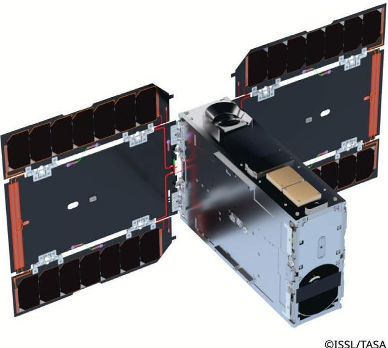
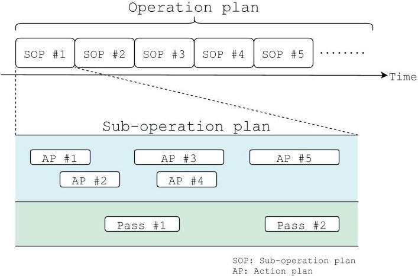
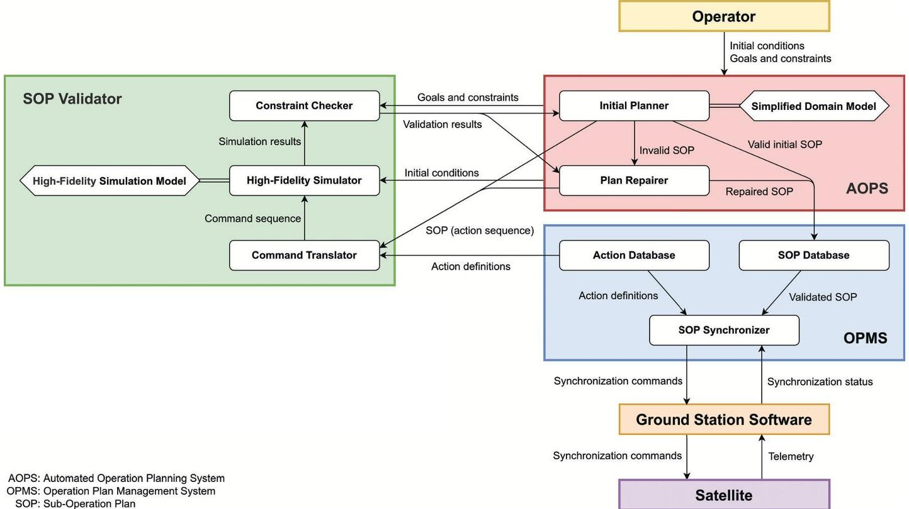
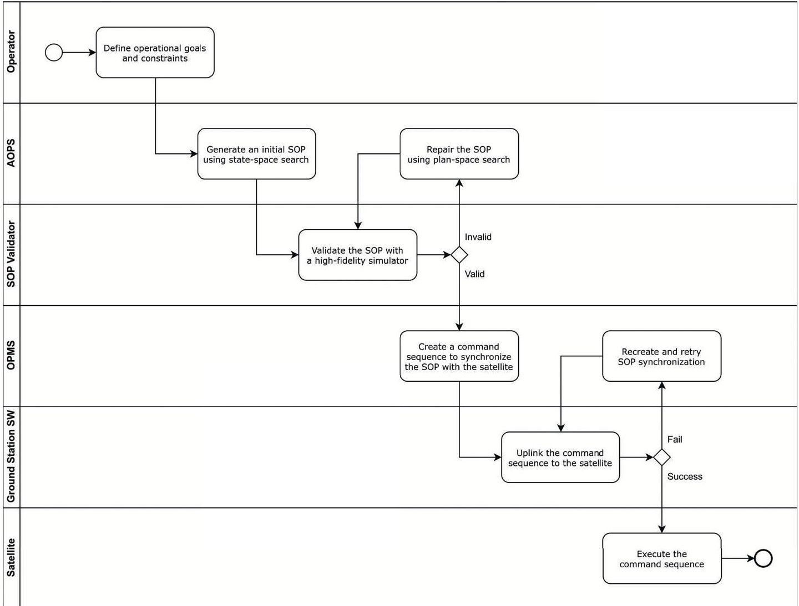
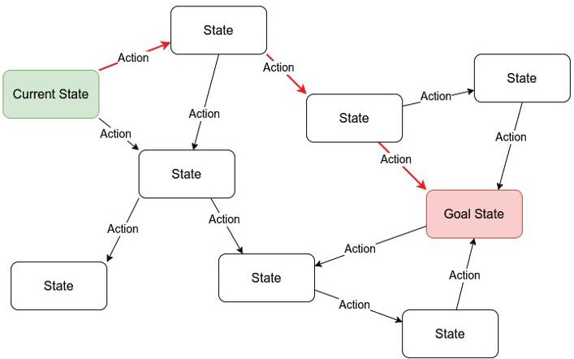
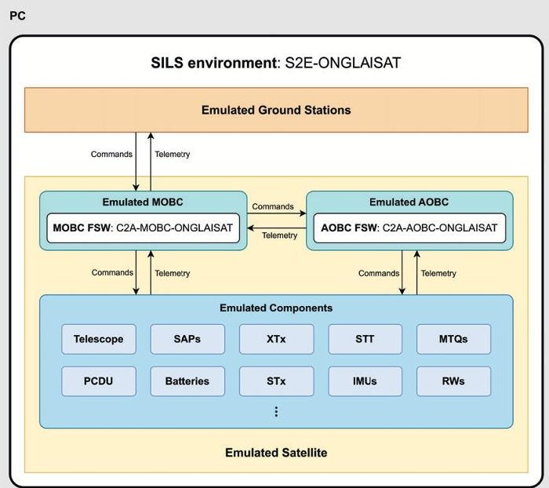
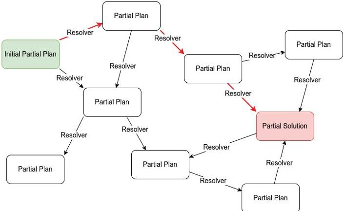
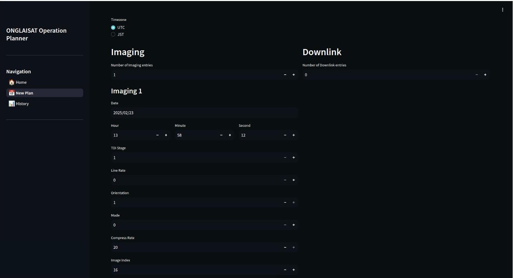
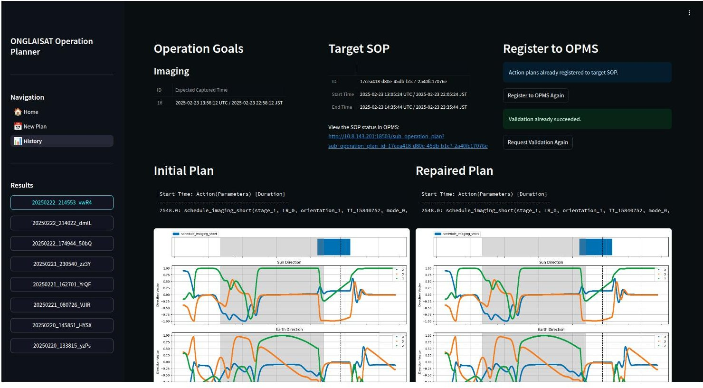

<!-- PDF_PAGE: 1 -->

IAC-25-B4.3.5

# Demonstration of an Automated Operation Planning System for ONGLAISAT CubeSat Riki Nakamura $ ^{a} $ $ ^{*} $ , Shunichiro Nomura $ ^{b} $ , Akihiro Ishikawa $ ^{c} $ , Satoshi Ikari $ ^{d} $ , Ryu Funase $ ^{e} $ , Shinichi Nakasuka $ ^{f} $

$ ^{a} $ Department of Aeronautics & Astronautics, Graduate School of Engineering, The University of Tokyo, 7-3-1 Hongo, Bunkyo-ku, Tokyo, 113-0033, Japan, nakamura@space.t.u-tokyo.ac.jp

$ ^{b} $ Department of Aeronautics & Astronautics, Graduate School of Engineering, The University of Tokyo, 7-3-1 Hongo, Bunkyo-ku, Tokyo, 113-0033, Japan, nomura@space.t.u-tokyo.ac.jp

$ ^{c} $ Department of Aeronautics & Astronautics, Graduate School of Engineering, The University of Tokyo, 7-3-1 Hongo, Bunkyo-ku, Tokyo, 113-0033, Japan, ishikawa@space.t.u-tokyo.ac.jp

$ ^{d} $ Department of Aeronautics & Astronautics, Graduate School of Engineering, The University of Tokyo, 7-3-1 Hongo, Bunkyo-ku, Tokyo, 113-0033, Japan, ikari@space.t.u-tokyo.ac.jp

$ ^{e} $ Department of Aeronautics & Astronautics, Graduate School of Engineering, The University of Tokyo, 7-3-1 Hongo, Bunkyo-ku, Tokyo, 113-0033, Japan, funase@space.t.u-tokyo.ac.jp

$ ^{f} $ Department of Aeronautics & Astronautics, Graduate School of Engineering, The University of Tokyo, 7-3-1 Hongo, Bunkyo-ku, Tokyo, 113-0033, Japan, nakasuka@space.t.u-tokyo.ac.jp

* Corresponding Author

## Abstract

The ONGLAISAT CubeSat, jointly developed by Taiwan Space Agency and the University of Tokyo, demonstrated high-resolution Earth imaging with Time Delay Integration technology. To support efficient operations with limited human resources, we developed an Automated Operation Planning System (AOPS) that generates satellite operation plans from high-level objectives. AOPS combines simplified models for rapid plan generation with high-fidelity simulations for validation and, if necessary, iterative repair. During the final phase of the ONGLAISAT mission, AOPS automatically generated and validated plans for imaging and downlink sessions, which were executed successfully on orbit. This demonstration confirmed the feasibility of automated plan generation for small satellites, improving both efficiency and reliability in real satellite operations.

Keywords: Satellite Operation, Ground System, Automated Planning, CubeSat, On-orbit Demonstration

## Nomenclature

f Evaluation value used in the state-space search (plan cost)

g Accumulated cost in the search (approximated by search depth)

H Heuristic term that estimates the severity of remaining violations in the plan

h Admissible heuristic function in the classical Weighted A $ ^{*} $ search

w Weight coefficient used in the classical Weighted A $ ^{*} $ search

## Acronyms/Abbreviations

AOBC Attitude and Orbit Control System Onboard Computer

AOPS Automated Operation Planning System

FSW Flight Software

ISSL Intelligent Space Systems Laboratory

MOBC Main Onboard Computer

OBC Onboard Computer

OPMS Operation Plan Management System

SILS Software-in-the-Loop Simulations

SOP Sub-Operation Plan

TASA Taiwan Space Agency

TDI Time Delay Integration

## 1. Introduction

The increasing prevalence of small satellites, particularly CubeSats, has significantly lowered the barriers to space development. This paradigm shift has allowed not only traditional space agencies but also emerging nations, private companies, and academic institutions to participate in satellite missions. While CubeSats offer advantages such as low cost and rapid development, their operations remain challenging. Compared with large

<!-- PDF_PAGE: 2 -->

satellites, which typically include extensive margins and redundant subsystems, CubeSats are designed with minimal resources, requiring that operation plans be executed with exceptional care. Moreover, CubeSat missions are often operated by small teams with limited experience, highlighting the need for robust systems that can automate or support mission operations.

The most basic method for the automation of spacecraft operations is rule-based execution, in which command sequences are generated according to predetermined rules or schedules. While simple and reliable, this approach does not adequately address the tightly coupled constraints and limited resources that characterize CubeSats and, more generally, small satellites. In particular, constraints from multiple domains-power, thermal, attitude, and communication—must be handled simultaneously, which rule-based methods cannot easily manage. To address these challenges, model-based automated planning has been developed, which can dynamically generate operation plans based on models of the spacecraft and its environment.

Research on automated planning for spacecraft has a long history. Onboard autonomy was pioneered by NASA's Remote Agent, which flew on the Deep Space 1 mission in 1999 and became the first system to autonomously generate and execute spacecraft activity plans in situ without real-time human input [1,2]. Building on this milestone, CASPER (Continuous Activity Scheduling, Planning, Execution and Replanning) was introduced as an iterative repair planner [3] and was later deployed in the Autonomous Sciencecraft Experiment on the Earth Observing-1 satellite, enabling onboard replanning of imaging tasks [4]. CASPER itself was an extension of JPL's ground-based planning framework ASPEN (Automated Scheduling and Planning ENvironment), a reconfigurable environment that has been applied to a variety of missions [5,6]. Another influential framework is NASA Ames's EUROPA (Extensible Universal Remote Operations Planning Architecture) toolkit, which provides a constraint-based temporal planning library and has been widely employed across missions [7,8]. These systems established the state of the art in automated mission operations, from autonomous spacecraft control (Remote Agent, CASPER) to flexible ground planning tools (ASPEN, EUROPA). More recently, efforts have turned toward deploying onboard planners on smaller platforms: for example, MEXEC (Multi-mission EXECutive) was demonstrated on the ASTERIA CubeSat, showing that

advanced goal-oriented commanding is feasible even on resource-constrained 6U platforms [9,10]. Looking to the future, NASA is developing Aerie, a next-generation multi-mission planning and sequencing system, which is baselined for Europa Clipper uplink planning [11,12].

These automated planning systems rely on simplified models of spacecraft behavior to keep computation tractable, but as a result they cannot fully ensure operational safety in real missions. To address this challenge, we proposed a dual-model planning framework that combines simplified models for rapid plan generation with high-fidelity simulators for iterative plan repair and validation [13]. Unlike prior systems that terminate planning once a simplified model yields a solution, our approach explicitly incorporates high-fidelity, commanddriven simulation in the planning loop, ensuring that only plans verified under realistic spacecraft dynamics proceed to execution. Building on this framework, we developed AOPS, a ground-based system that automatically generates safe and executable operation plans for real satellite missions. In particular, AOPS was applied to ONGLAISAT (ONboard Globe-Looking And Imaging SATellite), a 6U-class CubeSat developed by TASA, the University of Tokyo's ISSL, ArkEdge Space Inc., and Space BD Inc., which was launched in 2024 to demonstrate high-resolution Earth imaging using TDI technology [14]. This paper focuses on the development of AOPS and its on-orbit demonstration during the ONGLAISAT mission.

## 2. ONGLAISAT Mission Overview

ONGLAISAT is a 6U-class CubeSat developed by ISSL in collaboration with TASA, as shown in Fig. 1. It was launched aboard a SpaceX Falcon 9 rocket on November 5, 2024, transported to the International Space Station, and deployed into orbit on December 9, 2024. The mission concluded on February 24, 2025, after the orbital altitude dropped below the mission threshold.

The satellite carries an optical observation system with a TDI sensor. The primary mission objective was to demonstrate high signal-to-noise ratio Earth imaging using TDI, a technique that synchronizes the readout of the image sensor with the satellite's orbital motion to accumulate more light per pixel. This method enhances image brightness and sharpness while preserving spatial resolution. ONGLAISAT successfully achieved a ground resolution of approximately 2.5-3.0 meters, which is among the highest performance levels demonstrated in the CubeSat class.

<!-- PDF_PAGE: 3 -->

Fig. 1. Overview of the ONGLAISAT satellite

The satellite includes multiple OBCs dedicated to different subsystems. MOBC manages general satellite operations, while the AOBC performs precise attitude determination and control. The FSW on these computers is based on the Command Centric Architecture (C2A), a modular and reconfigurable framework that enables flexible and reliable spacecraft operations [15,16].

In addition to its technological demonstration, ONGLAISAT provided a valuable opportunity to study the automation of small satellite operations. Unlike large satellites, CubeSats are designed with limited margins and minimal redundancy, making careful operation planning essential. Moreover, ONGLAISAT was operated by a small team, highlighting the importance of ground systems to support efficient mission execution. To address these challenges, two complementary systems were developed: OPMS, which manages, validates, and synchronizes operation plans [17], and AOPS, which automatically generates operation plans from high-level mission objectives. This paper focuses on the development and on-orbit demonstration of AOPS during the ONGLAISAT mission.

## 3. Automated Operation Planning System (AOPS)

## 3.1 Architecture and Workflow

AOPS is designed to work in conjunction with OPMS a web-based software system developed by ISSL to automate and streamline the management of satellite operation plans. As shown in Fig. 2, OPMS provides a hierarchical structure for operation plans; an operation plan is divided into multiple SOPs, each corresponding to a specific time window, defined as one orbit in the

ONGLAISAT mission. An Action is a parameterized template consisting of a sequence of commands with relative execution times, while an Action Plan is a concrete instance of an Action with specific parameters. SOPs manage the mission timeline by placing APs at specified times together with contextual information such as ground station passes [17]. AOPS generates plans in an OPMS-compatible format, with the planning horizon defined at the SOP level, so that the plans can be directly validated, registered, and executed within the existing operations framework.

Fig. 2. Hierarchical structure of an operation plan [17]

The end-to-end architecture of AOPS, as summarized in Fig. 3, covers simplified-model planning, simulatorbacked validation and iterative repair, and integration with OPMS. The overall workflow of AOPS is illustrated in Fig. 4. First, the operator specifies high-level mission objectives, such as imaging opportunities or downlink sessions, together with associated constraints. From these objectives, AOPS generates an initial SOP using a simplified domain model, which allows candidate solutions to be created rapidly without considering all physical dynamics in detail. Next, the candidate SOP is validated through high-fidelity simulation, where ONGLAISAT's actual FSW and emulated subsystems are executed to reproduce realistic system behavior. If the SOP fails to satisfy safety or feasibility requirements in this step, it is iteratively refined by the plan-repair module until a valid solution is obtained. Once the SOP has passed the validation process, it is registered in the OPMS database. From there, the plan can be scheduled for uplink and executed onboard the satellite as part of the standard operations workflow.

<!-- PDF_PAGE: 4 -->

76th International Astronautical Congress (IAC 2025), Sydney, Australia, 29 Sep-3 Oct 2025. Copyright $ \textcircled{2} $ 2025 by Riki Nakamura. Published by the IAF, with permission and released to the IAF to publish in all forms.

Fig. 3. End-to-end architecture of AOPS with simulator-backed validation and OPMS integration

Fig. 4. Overall workflow of automated operation planning and execution with AOPS and OPMS IAC-25-B4.3.5

<!-- PDF_PAGE: 5 -->

## 3.2 Initial Plan Generation

The first step of AOPS is to generate an initial SOP from the operator-specified goals and constraints. This process is formulated as a state-space search problem, where the search space consists of possible actions (e.g., imaging, downlink) and their feasible orderings within the time window of a single orbit, as illustrated in Fig. 5. A simplified domain model is used in this step to keep the search computationally efficient: for instance, the duration of attitude maneuvers is assumed to be constant regardless of the maneuver angle, and resources such as power and thermal states are not considered. This simplified model captures only the essential spacecraft behaviors and deliberately omits complex dynamics and detailed subsystem interactions. Although such simplifications limit physical fidelity, they enable rapid exploration of the state space and allow candidate SOPs to be generated in a practical timeframe.

This initial plan generation provides candidate SOPs that are sufficiently structured to be validated in the next step. While they cannot guarantee feasibility under realistic system dynamics, they serve as efficient starting points for the subsequent simulator-based validation and plan repair process.

Fig. 5. State-space search for initial plan generation [13]

## 3.3 Plan Validation using a Simulator

To ensure that automatically generated plans are executable under realistic conditions, AOPS employs a numerical simulator as a validation backend. The simulator executes ONGLAISAT's actual FSW within a SILS environment and emulates OBCs and hardware components, as illustrated in Fig. 6. In addition, it models multiple physical domains, including orbit, attitude, power, thermal, and communication, so that operational constraints such as battery depth of discharge, attitude accuracy during imaging, and data downlink opportunities can be

faithfully reproduced in simulation before execution. As a result, candidate plans generated from the simplified model can be tested against realistic system dynamics before being accepted.

If a plan fails to satisfy the mission constraints in this validation step, it is flagged as invalid and passed to the plan-repair module for iterative refinement. By integrating this simulation loop, AOPS goes beyond the simplified consistency checks commonly used in earlier planning frameworks and ensures that only plans verified under realistic satellite behavior proceed to execution. The simulator itself, including its architecture and fidelity assessment against telemetry data, has been described in detail in [18]. In this paper, we highlight its role as a core component of AOPS for guaranteeing the safety and reliability of generated operation plans.

Fig. 6. Overview of the simulator for ONGLAISAT [18]

## 3.4 Plan Repair

While the initial plan generation relies on state-space search with a simplified domain model, the generated plans may fail under realistic satellite dynamics due to unmodeled effects such as coupled attitude-power thermal interactions. To overcome this limitation, AOPS incorporates a plan repair module based on plan-space search, which refines invalid plans identified during simulator validation.

In the plan-space formulation, each node represents a partial plan, which may be incomplete or inconsistent, and each edge corresponds to a resolver that modifies the plan, such as adjusting action timing, inserting or removing actions, or replacing actions with alternatives. Start-

<!-- PDF_PAGE: 6 -->

ing from the initial plan, resolvers are iteratively applied to generate candidate repairs, as illustrated in Fig. 7. Each candidate plan is translated into a command sequence and executed in the high-fidelity simulator, which evaluates feasibility against mission constraints. If the plan violates any constraints, feedback from the simulation guides the search toward improved solutions.

Fig. 7. Plan-space search for plan repair [13]

To improve efficiency, the repair process employs informed search techniques. Specifically, Weighted A $ ^{*} $ search is adopted to explore the plan space using the evaluation function

$$
f = g + H
$$

Unlike the classical form $ f=g+wh $ , here H itself is designed as a domain-specific function that directly incorporates physical quantities relevant to satellite operations.

In this study, H is computed as the sum of penalties assigned to each defect detected in simulation, plus the number of actions contained in the plan, so as to discourage unnecessary plan extensions:

$$
H = (\mathrm {s u m o f p e n a l t i e s}) + (\mathrm {p l a n l e n g t h})
$$

For example, penalties are added when imaging is not achieved, delayed, or performed with insufficient accuracy, as well as when resource constraints such as power or thermal margins are violated. This design ensures that the search is directed toward repairs most likely to eliminate constraint violations, without requiring exhaustive exploration.

Through this iterative loop of simulation-based validation and heuristic-guided repair, AOPS transforms coarse initial plans into executable solutions verified under realistic system behavior.

## 3.5 Implementation

AOPS was designed as a modular system where each component communicates through APIs, enabling loose coupling with external services such as OPMS and the simulator. This architecture allows planning, validation, and execution to evolve independently while remaining seamlessly integrated in operations.

## 3.5.1 Initial Planning with Unified Planning

A key feature of the implementation is the use of the Unified Planning library [19,20], a Python API for modeling planning problems and dispatching them to suitable solvers. By leveraging this framework, operator-specified goals entered through the Streamlit-based graphical user interface, as shown in Fig. 8, can be directly transformed into planning problems. These problems are then solved by planning problem solvers such as Aries [21] without the need to manually generate problem files in domain-specific languages such as the Planning Domain Definition Language (PDDL) [22] or the Action Notation Modeling Language (ANML) [23]. This approach greatly simplifies the workflow: whereas traditional systems required additional subsystems to dynamically produce problem files, Unified Planning enables direct and flexible problem construction within the application.

## 3.5.2 Plan Repair and Validation

The plan repair module is implemented as a separate service that interacts with the validator via API calls, to which candidate SOPs are submitted for validation. The validator integrates a high-fidelity simulator based on the Spacecraft Simulation Environment (S2E) [16,24] framework implemented in C++, executing ONGLAISAT's FSW in a SILS environment. Simulation results are then processed in Python to produce validation results, which verify both feasibility with respect to mission constraints (e.g., power margins and pointing accuracy) and satisfaction of operator-specified goals. Finally, these validation results are returned to the plan repair module as feedback for further repair if required. This service-oriented design allows planning algorithms and physical simulation to remain independent while cooperating in a closed loop.

## 3.5.3 Integration with OPMS

Validated SOPs are automatically registered to OPMS through its RESTful API. Because AOPS outputs plans in an OPMS-compatible format, the system can directly leverage OPMS functions such as plan management, synchronization, and uplink scheduling. This integration

<!-- PDF_PAGE: 7 -->

ensures that AOPS augments the existing ground system rather than duplicating it, focusing specifically on automated generation and refinement of safe and executable plans.

## 3.6 Features

The development of AOPS introduced several distinctive features that set it apart from conventional planning frameworks:

- Dual-model planning framework: AOPS combines rapid initial plan generation using simplified domain models with iterative refinement and validation based on high-fidelity simulation. Planning directly with a high-fidelity model would often cause state-space explosion, making it impractical to obtain solutions. This dual approach ensures both computational efficiency and operational reliability, addressing the limitations of planners that rely solely on abstract models.

- Simulator-backed validation with multimodal and command-driven models: AOPS integrates a high-fidelity simulator that executes the actual FSW in a SILS environment and models coupled physical domains such as attitude, power, thermal, and communication. Because the simulator is command-driven, operation plans can be validated using the exact command sequences intended for uplink, ensuring consistency between pre-flight validation and on-orbit execution. This enables plan validation under conditions much closer to those of an actual satellite, allowing AOPS to capture complex interactions that traditional frameworks relying on simplified or decoupled models cannot fully address.

- Seamless integration with OPMS: AOPS generates operation plans directly in OPMS-compatible format and registers them through OPMS's API. This design allows AOPS to complement the existing ground system without duplication, enabling automated planning to be adopted in practice with minimal operational overhead.

Together, these features demonstrate that AOPS not only automates the generation of operation plans but also ensures their safety and practicality for real satellite missions.

## 4. On-Orbit Demonstration with ONGLAISAT

The on-orbit demonstration of AOPS was conducted during the final phase of the ONGLAISAT mission, on February 22-23, 2025.Notably, February 23 marked the last day of satellite operations before termination, under-

scoring the limited time available for this experiment. Despite these constraints, AOPS was successfully applied to routine mission activities.

During the demonstration, four SOPs were generated: two for TDI imaging sessions and two for downlink sessions. In all four cases, the plans passed the validation step without any violations in the high-fidelity simulator; consequently, no repair process was triggered. This demonstrates that the automatically generated plans were immediately applicable to real operations, while highlighting the value of simulator-backed validation in confirming feasibility and safety prior to uplink. An example of the GUI used in this process, including the goal specification interface and the generated SOP confirmation interface, is shown in Fig. 8.

Command uplink was executed in two ground station passes. Although OPMS's automated SOP synchronization could not be employed due to mission-specific constraints and limited tuning time for ONGLAISAT, the command sequences exported by OPMS were manually transmitted. Since the OPMS auto-uplink capability had already been demonstrated and used over an extended period on the prior SPHERE-1 EYE mission, the lack of full automation in this case does not diminish the feasibility of this approach. The end-to-end chain from automated plan generation by AOPS to registration in OPMS and on-orbit execution was verified; together with the past OPMS achievements, this indicates the potential for fully automated operations.

The operations generated by AOPS were subsequently confirmed to have been executed on board, validating that automatically generated and simulatorverified plans were successfully applied in real satellite operations. Although no violations occurred during the on-orbit demonstration, simulation experiments have shown that the plan-repair module can effectively resolve violations when they arise [25].

## 5. Conclusion

This paper introduced AOPS, an Automated Operation Planning System developed for the ONGLAISAT mission. AOPS generates operation plans from highlevel goals using a dual approach: rapid initial planning with simplified models, followed by validation in a highfidelity simulator. When necessary, the plans are refined through heuristic-guided repair until they become feasible and safe for real execution.

The system was demonstrated on orbit in February 2025, during the final phase of ONGLAISAT. Four plans

<!-- PDF_PAGE: 8 -->

(a) Goal specification interface

(b) Generated SOP confirmation interface

Fig. 8. GUI example of AOPS used in actual imaging operation

—two imaging and two downlink sessions—were generated, validated, and executed without violations. This confirmed that AOPS can provide safe and immediately applicable operation plans within real satellite operations.

By combining simplified planning models with simulator-backed validation, AOPS offers both efficiency and reliability, reducing operational workload and ensuring safety. The successful demonstration shows the potential

<!-- PDF_PAGE: 9 -->

of automated planning systems to support future small satellite missions.

## Acknowledgements

The authors would like to thank the ONGLAISAT project team for their invaluable contributions and support throughout the mission.

## References

[1] Muscettola, N., Nayak, P. P., Pell, B., and Williams, B. C., "Remote Agent: to boldly go where no AI system has gone before," Artificial Intelligence, Vol. 103, Nos. 1-2, 1998, pp. 5-47.. https://doi.org/ 10.1016/S0004-3702(98)00068-X

[2] Nayak, P. P., Bernard, D. E., Dorais, G. A., Gamble, E. B., Kanefsky, B., Kurien, J., Millar, W., Muscettola, N., Rajan, K., Rouquette, N., Smith, B., and Taylor, W., "Validating The DS1 Remote Agent Experiment," presented at the 5th International Symposium on Artificial Intelligence, Robotics and Automation in Space, 1999.

[3] Knight, R., Rabideau, G., Chien, S., Engelhardt, B., and Sherwood, R., "Casper: Space Exploration Through Continuous Planning," IEEE Intelligent Systems, Vol. 16, No. 5, 2001, pp. 70-75.. https:// doi.org/10.1109/MIS.2001.956084

[4] Chien, S., Sherwood, R., Tran, D., Cichy, B., Rabideau, G., Castano, R., Davis, A., Mandl, D., Frye, S., Trout, B., Shulman, S., and Boyer, D. "Using Autonomy Flight Software to Improve Science Return on Earth Observing One," Journal of Aerospace Computing, Information, and Communication, Vol. 2, No. 4, 2005, pp. 196-216.. https:// doi.org/10.2514/1.12923

[5] Fukunaga, A., Rabideau, G., Chien, S., and Yan, D., "Towards an Application Framework for Automated Planning and Scheduling," In 1997 IEEE Aerospace Conference, Vol. 1, 1997, pp. 375-386.. https://doi.org/10.1109/AERO.1997.574426

[6] Chien, S., Rabideau, G., Knight, R., Sherwood, R., Engelhardt, B., Mutz, D., Estlin, T., Smith, B., Fisher, F., Barrett, T., Stebbins, G., and Tran, D. "ASPEN - Automating Space Mission Operations Using Automated Planning and Scheduling," presented at the 6th International Conference on Space Operations, 2000.

[7] Barreiro, J., Boyce, M., Do, M., Frank, J., Iatauro, M., Kichkaylo, T., Morris, P., Ong, J., Remolina, E., Smith, T., and others, "EUROPA: Platform

for AI Planning, Scheduling, Constraint Programming, And Optimization," presented at the 4th International Competition on Knowledge Engineering for Planning and Scheduling, 2012.

[8] "EUROPA," GitHub, Jun 26 2019.. Retrieved 15 February 2024. https://github.com/nasa/europa

[9] Troesch, M., Mirza, F., Hughes, K., Rothstein-Dowden, A., Bocchino, R., Donner, A., Feather, M., Smith, B., Fesq, L., Barker, B., and Campuzano, B., "MEXEC: An Onboard Integrated Planning and Execution Approach for Spacecraft Commanding," 2020.. https://doi.org/2014/53230

[10] Fesq, L., Beauchamp, P., Altenbuchner, C., Bocchino, R., Donner, A., Feather, M., Hughes, K., Kennedy, B., Mackey, R., Mirza, F., Sternberg, D., Smith, M. W., Troesch, M., Seager, S., Knapp, M., Kolcio, K. O., and Doran, P., "Results from the ASTERIA CubeSat Extended Mission Experiments," presented at the 2021 IEEE Aerospace Conference, 2021.. https://doi.org/10.1109/AERO 50100.2021.9438402

[11] Dailis, M., Ferguson, E., Camargo, C., and Maillard, A., "Aerie: A Modern Multi-Mission Planning, Scheduling, And Sequencing System," presented at the 13th International Workshop on Planning and Scheduling for Space, 2023.

[12] "Aerie," GitHub, Feb 13 2024.. Retrieved 15 February 2024. https://github.com/NASA-AMMOS/ aerie

[13] Nakamura, R., Nomura, S., Nakasuka, S., and Funase, R., "Dual-Model Planning Framework for Spacecraft Autonomy Using High-Fidelity Simulation," presented at the 16th International Symposium on Artificial Intelligence, Robotics and Automation in Space, 2024.

[14] Chan, C.-Y., Huang, N.-y., Shang, J.-r., Lin, A., Ling, J., Ishikawa, A., Toshihiro, S., Suzumoto, R., Fujiwara, M., Kondo, H., Imamura, T., Karakawa, T., Suda, K., Yamamoto, T., Gyu, Y., Hirayama, R., Kawabata, Y., Ikari, S., Funase, R., and Nakasuka, S., "Mission Introduction of ONGLAISAT (ONboard Globe-Looking And Imaging Satellite)," presented at the 33rd International Symposium on Space Technology and Science, 2022.

[15] Nakajima, S., Takisawa, J., Ikari, S., Tomooka, M., Aoyanagi, Y., Funase, R., and Nakasuka, S., "Command-Centric Architecture (C2A): Satellite Software Architecture with a Flexible Reconfiguration

<!-- PDF_PAGE: 10 -->

Capability," Acta Astronautica, Vol. 171, 2020 pp. 208-214.. https://doi.org/10.1016/j.actaastro. 2020.02.034

[16] Suzumoto, R., Ikari, S., Kakihara, K., Hosonuma, T., Yanagida, K., Sakamoto, Y., Fujiwara, M., Kondo, H., Enokida, K., Suzuki, T., Gyu, Y., Sekine, H., Mochizuki, T., Ito, Y., Funase, R., and Nakasuka, S., "Open-Source Software Suite for Small Satellites: C2A (Command Centric Architecture), S2E (Spacecraft Simulation Environment), And WINGS (Web-Based Interface Ground-Station Software)," presented at the 36th Small Satellite Conference, 2022.

[17] Nomura, S., Mochizuki, T., Kakihara, K., Kawabata, Y., Kondo, H., Enokida, K., Ishikawa, A., Matsushita, S., Funase, R., and Nakasuka, S. "Operation Plan Management System (OPMS): Software for the Safe Operations of Satellites," presented at the 34th International Symposium on Space Technology and Science, 2023.

[18] Nakamura, R., Ishikawa, A., Kawabata, Y., Ikari, S., Funase, R., Nakasuka, S., and Nomura, S., "Development and Practical Application of a Numerical Simulator for Operation Plan Validation of ONGLAISAT," presented at the 35th International Symposium on Space Technology and Science, 2025.

[19] Micheli, A., Bit-Monnot, A., Roger, G., Scala, E., Valentini, A., Framba, L., Rovetta, A., Trapasso, A., Bonassi, L., Gerevini, A. E., Iocchi, L., Ingrand, F., Köckemann, U., Patrizi, F., Saetti, A., Serina, I., and Stock, S., "Unified Planning: Modeling Manipulating and Solving AI Planning Problems in Python," SoftwareX, Vol. 29, 2025, p. 102012.. https://doi.org/10.1016/j.softx.2024.102012

[20] Luca, F., Valentini, A., Bit-Monnot, A., Micheli A., Trapasso, A., Rovetta, A., selva, f., Godet, R., Roeger, G., Stock, S., Farciola, A. L., Tosello, E., patrizi, Köckemann, U., Ramírez, M., Speck, D., Scala, E., Rothe, J., Goyal, S., serivan, Sung, A., Karpas, E., Chiariello, F., Serina, I., Jennifer, Bonassi, L., and Nakamura, R., "Unified Planning Library," Dec 19 2024.. https://doi.org/10.5281/ zenodo.14527866

[21] "Aries," Dec 23 2024.. Retrieved 26 December 2024. https://github.com/plaans/aries

[22] McDermott, D., Ghallab, M., Howe, A., Knoblock, C., Ram, A., Veloso, M., Weld, D., and

Wilkins, D., "PDDL - The Planning Domain Definition Language," Aug1998.. https://www.researchgate.net/publication/2278933_PDDL_-_ The_Planning_Domain_Definition_Language

[23] Smith, D., Frank, J., and Cushing, W., "The ANML Language," presented at the 18th International Conference on Automated Planning and Scheduling, 2008.

[24] Ikari, S., Suzuki, T., Sekine, H., Nakamura, R., Hosonuma, T., Okada, H., Ogoshi, S., Mochizuki, T., Sakamoto, Y., Funase, R., and Nakasuka, S., "Open-Source Software Suite for Effective Spacecraft Research and Development: Introductions and Case Studies," presented at the 75th International Astronautical Congress, 2024.. https://doi.org/10.52202/078372-0087

[25] Nakamura, R., "A Study on Automated Planning for Spacecraft Through Simulator-Based PlanSpace Search," Tokyo, Japan, 2025.