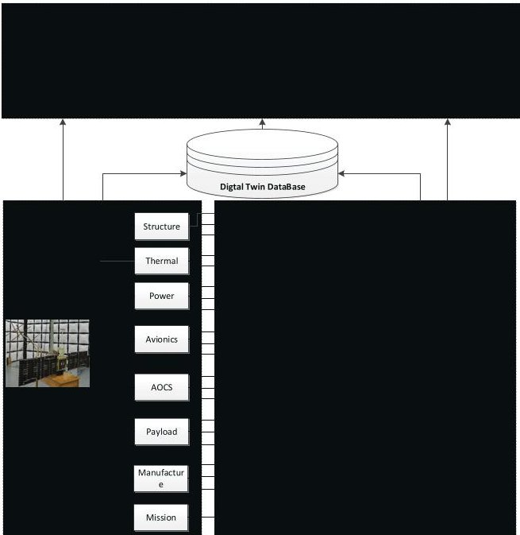
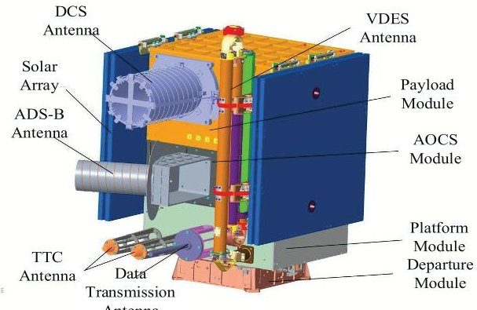
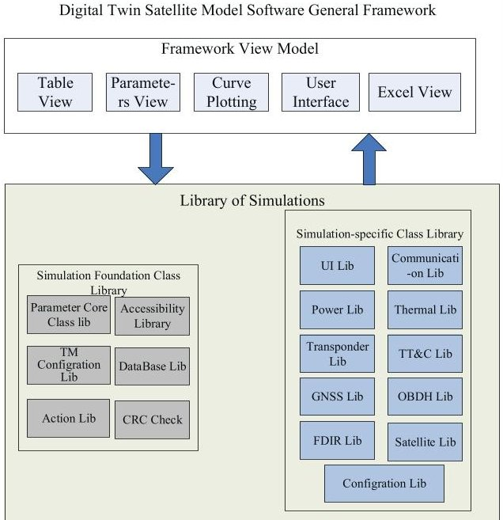
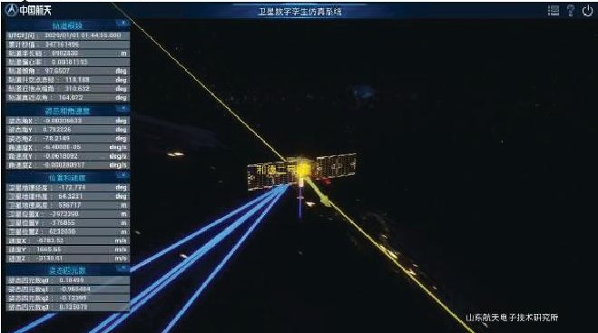
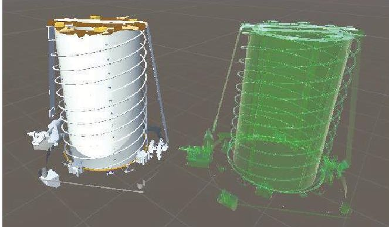
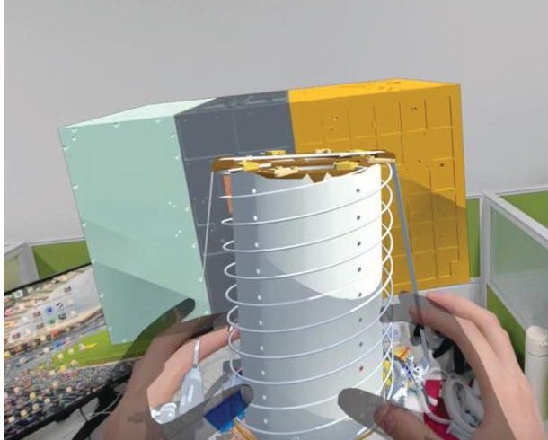

<!-- PDF_PAGE: 1 -->

$ 7 6^{\mathrm{th}} $ International Astronautical Congress (IAC), Sydney, Australia, September 29 to October 3, 2025. Copyright $ \textcircled{2} 0 2 5 $ by the International Astronautical Federation (IAF). All rights reserved.

IAC-25,D1,IP,30,x95112

# Digital Twin Technology for Small Satellite Development and Operations: A Case Study of HEAD-2D

Xu Peipei $ ^{a,b} $ , Wu Sheng $ ^{a^{*}} $ , Jiang Lianxiang $ ^{b^{*}} $

$ ^{a} $ Yantai Research Institute, Harbin Engineering University, No.1 Qingdao Street, Huangbohai New Area, Yantai , China, 264003, xupeipeicn@126.com; wusheng@hrbeu.edu.cn

$ ^{b} $ Shandong Institute of Space Electronics Technology, China Academy of Space Technology, No.513, Hangtian Road, Yantai, China, 264067, jianglianxiangcn@163.com

* Corresponding Author

## Abstract

With the development of modern small satellite technology, satellites play more and more important roles in remote sensing, broadband communication, navigation and scientific research. In recent years, the large-scale constellation plans are put forward continuously, SpaceX, Oneweb and Amazon have announced their large-scale broadband internet satellite constellations. Stimulate by commercial capital and market, the satellite industry develops fast. Low cost, short development cycle, digitalization, networking and intelligence become its trend. The mode of design, manufacture and operation of satellites (constellations) need to change at the same time. Digital Twin is a cutting-edge technology that has revolutionized the industry by mirroring almost every facet of a product, process, or service. It has the potential to replicate spacecraft in the physical world in the digital space and provide developers with feedback from the virtual world. As a result, the technology enables developers to quickly detect and solve physical problems, design and build better spacecrafts, and realize value and benefits faster than previously possible. Furthermore, the Digital Twin technology helps to improve the development processes and performance of small satellites. In this article, we developed a digital twin system for the small satellite HEAD-2D, the digital twin system consisted of satellite models, database, running environment and communication interfaces between the digital twin and the physical satellite. The digital models are developed using C# language and Creo tools. Based on the digital twin system, we could simulate the operation state of HEAD-2D satellite in orbit by configuring parameters and status. With the digital twin, it is easy to optimize and estimate the operation state and sytem design. For new missions, we could build the digital twin of the new missions and evaluate the technology feasibility by configure corresponding parameters. The digital twin is also useful for new staffs to learn the composition and principle of satellites.

Keywords: digital twin, small satellite, AR/MR

## 1. Introduction

Digital Twin is a cutting-edge technology that has revolutionized the industry by mirroring almost every facet of a product, process, or service[1]. It has the potential to replicate spacecraft in the physical world in the digital space and provide developers with feedback from the virtual world[2, 3].

Driven by national-level strategies such as Germany's Industry 4.0, the U.S. Industrial Internet, and China's Manufacturing 2025, digital twin technology has been applied across ten major fields, including spacecraft, ships, vehicles, power plants, aircraft, complex electromechanical equipment, manufacturing workshops, and smart cities. Several internationally renowned companies have begun to offer applications of digital twin technology in product design, manufacturing, and services. The main applications are reflected in the following aspects:

First, digital twins are used to perform iterative design optimization, predict equipment performance and quality, and improve design accuracy. By establishing a

digital twin, the performance and quality of finished components can be predicted before any physical manufacturing takes place. Design flaws can be identified, and iterative design can be directly conducted within the digital twin. Manufacturing simulations can be rerun to ensure all design specifications are accurately met, significantly shortening the development cycle and reducing R&D costs.

Second, digital twin technology enhances the efficiency and quality of manufacturing resource management and control, optimizes the allocation of manufacturing resources, reduces equipment downtime improves workshop management efficiency and quality, and lowers production costs. In December 2017, Lockheed Martin deployed a "Smart Space Platform" utilizing digital twin technology at its F-35 fighter production facility in Fort Worth[4]. This platform maps actual production data to digital twin models and integrates with manufacturing planning and execution systems to enable advanced planning and allocation of manufacturing resources.

<!-- PDF_PAGE: 2 -->

Third, digital twin technology enables real-time and precise monitoring of equipment operational status and actual performance, facilitating equipment health management. By integrating with technologies such as the Industrial Internet of Things (IIoT) and big data, digital twin technology allows for real-time, remote, and accurate monitoring of the operational status and effectiveness of physical entities. It supports fault diagnosis of physical entities and improves fault analysis efficiency. The German Aerospace Centre (DLR) established the Virtual Testbed iBOSS platform[5], which seamlessly integrates digital twins with the physical environment. This platform applies digital twin technology across the entire lifecycle, from design and testing to operation and maintenance, leveraging virtual modelling and simulation to develop new component designs, monitor in-orbit operational status, and perform fault diagnosis and prediction.

Fourth, digital twin technology is used to test equipment system functions in laboratories or under other conditions, accelerating system upgrades and transformations. Digital twin technology creates a virtual model of a physical entity in a digital form. Through virtual-real interaction feedback, data fusion analysis, and decision iteration optimization, it adds or extends new functions to the physical entity.

As a result, the technology enables developers to quickly detect and solve physical problems, design and build better spacecrafts, and realize value and benefits faster than previously possible. Furthermore, the Digital Twin technology helps to improve the development processes and performance of small satellites. In this article, we developed a digital twin system for the small satellite HEAD-2D, the digital twin system consisted of satellite models, database, running environment and communication interfaces between the digital twin and the physical satellite.

## 2. System architecture of digital twin satellite

As shown in Figure 1, the digital twin satellite consists of a physical satellite, a virtual satellite, a twin satellite database, digital twin application services, and the connections between them. Models, data, and services are the three core elements of the digital twin satellite. This project takes an IoT satellite with flight experience as the physical satellite and establishes, through layer-by-layer decomposition, the corresponding system model (functional model) of the physical satellite, as well as subsystem models for mechanical, information, control, power, payload, and other systems, along with core unit-level models. Throughout the satellite's entire lifecycle, data generated from design, manufacturing, process, testing, etc., as well as simulation data produced by the digital twin satellite, are stored in the database. Based on the physical model, virtual model, and database, research on

system function simulation, system design, and health management applications is conducted using the digital twin satellite. This enables model- and data-driven demonstration of satellite operational modes, optimization of satellite system design methods based on the model library, assistance in overall satellite design, full utilization of digital twin models and data to accelerate the overall design of satellite systems, and thorough verification of whether the system solution's operational mode design, reliability design, etc., meet the overall mission requirements.

Fig.1 the system architecture of digital twin

The physical satellite is based on China's low-orbit IoT HEAD-D satellite as the physical entity. It was launched in August 2022, carrying DCS, AIS, and ADS-B payloads, and can provide AIS and ADS-B message reception, global end-to-end data transmission services, and IoT information collection services. The satellite weighs approximately 39.6 kg and mainly consists of subsystems such as structure, thermal control, integrated electronics, control, telemetry and data transmission, and payload. The external envelope dimensions at launch are 735 mm $ \times $ 560 mm $ \times $ 430 mm, and the in-flight external envelope dimensions are 680 mm $ \times $ 550 mm $ \times $ 1,270 mm.

<!-- PDF_PAGE: 3 -->

Fig.2 the Three-dimensional structural model of HEAD- 2D satellite

## 3. Development of digital twin models

The digital twin satellite system model software is implemented using an extensible framework software platform based on WPF technology. It combines the framework and logical components in the application composition through a "framework + module class library" approach. The framework provides the graphical user interface, public interfaces, module and plugin loading, and management for the test system. Business logic is encapsulated into functional modules to implement public interfaces. The main design principles are as follows:

## (1) Modular Design

The software is structured as a framework combined with modules, consisting of loosely coupled modules that are dynamically discovered and assembled at runtime. Composing the system through modules facilitates application extensibility and provides excellent maintainability. When system requirements change and new modules need to be added, a modular system requires significantly less effort. Furthermore, existing modules can be improved with greater independence, thereby enhancing testability.

## (2) Adoption of the WPF User Interface Framework

WPF introduces XAML, enabling the separation of the interface and the program, making it easier to customize themes, appearance, and behaviour, and simplifying maintenance. Additionally, WPF features robust "data binding" capabilities, enabling data-driven interfaces (where changes in data drive interface updates). Moreover, the reflection mechanism of the .Net Framework, utilized by WPF, can be ingeniously applied in framework and module development.

## (3) Adoption of the MVVM Pattern

The MVVM (Model-View-View-Model) framework is an evolved architectural framework derived from the combination of the MVP (Model-View-Presenter) pattern and WPF. Building upon the original MVP framework and incorporating new features of WPF, it

makes UI construction and modification increasingly easier while enhancing functional testability to address increasingly complex requirement changes.

(4) Use of Excel and XML Files for Storing Configuration Information

By separating program logic from configuration information, the framework's universality is significantly enhanced, and software maintenance costs are substantially reduced. XML files feature simple syntax, convenient access, clear and intuitive structure, and low error susceptibility, making them widely used data formats. For data with irregular structures and large volumes, XML files are suitable for configuration. Excel files, known for their standardization and ease of operation, are highly convenient for batch configuration input and modification. The combination of both greatly enhances code flexibility and, consequently, the degree of universality.

The design of the digital twin satellite system model software adopts a newly developed general framework structure for satellite simulators based on WPF. On the basis of this general framework, the software interface and simulation functions of each subsystem are developed through module expansion. The structural framework design of the digital twin satellite system model software is illustrated in the figure below.

Fig.3 the framework of digital twin satellite model

To intuitively demonstrate the operational status of the digital twin satellite in orbit, we developed both 3D and 2D visualization software for the digital twin satellite. This software receives telemetry parameters such as satellite orbital data generated by the digital twin simulation platform or actual telemetry from the satellite in orbit. By utilizing a simulation engine

<!-- PDF_PAGE: 4 -->

function library, it drives the satellite models to visually display their on-orbit operational status, offering advantages such as intuitiveness and vivid representation.

Fig.4 3-dimissional UI design

## 4. Digital Assembly

The satellite digital assembly system utilizes AR/MR technology to simulate the satellite assembly process in a virtual environment by interacting with the system via hand gestures. During virtual assembly, the assembly sequence planning and path coverage achieve 100% and the system can automatically identify potential design conflicts, such as interferences between components, errors in the assembly sequence, or difficulties in assembling critical parts. Detecting and resolving these issues early significantly reduces the time and cost of design iterations while avoiding expensive rework and material waste. Furthermore, the digital assembly system can simulate different assembly scenarios, assisting engineers in optimizing assembly processes and enhancing the efficiency of future practical operations.

We have designed an assembly control panel subsystem based on intelligent gesture recognition technology. This system can intelligently perceive user needs: when the user's left hand makes a preset specific gesture, it automatically generates a control panel on the right side of the palm and intelligently follows the hand's movement, ensuring the control panel remains in a position convenient for operation. This design not only enhances operational convenience but also improves the naturalness and intuitiveness of user interaction, making the entire assembly process smoother and more efficient.

During the component assembly process, the system is designed as a paperless intelligent virtual assembly system. Therefore, before assembly, workers do not need to refer to paper drawings. Instead, they can clearly see the corresponding assembly positions of various components through the intelligent assisted assembly function. The intelligent assisted assembly design primarily includes the construction of prompt

installation position models and the development of intelligent assisted assembly logic scripts.

(1) Construction of Prompt Installation Position Models

A corresponding prompt installation position model must be constructed for each component. To reduce workload, the component is directly duplicated, and its material is set to transparent green, as shown in the following figure.

Fig.5 Satellite Components and Prompt Installation Position Models

## (2) Intelligent Assisted Assembly Logic Script

The primary function implemented is as follows: when the operator picks up a component, the corresponding prompt installation position model is displayed at its installation location; when the component is put down, the prompt model disappears.

The basic algorithmic principle of this script involves broadcasting an event to display the prompt model at the start of the picking action, and broadcasting another event to hide the prompt model at the end of the picking action.The AR device automatically displays the prompt model upon detecting the model-picking action and hides it upon detecting the model-releasing action.

Fig. 6 Assisted Assembly Visualization 5. Conclusions

<!-- PDF_PAGE: 5 -->

Taking the HEAD-2D satellite with on-orbit flight experience as the physical entity for the digital twin, we established digital models at the system level, core subsystem level, and key component level. Based on these multi-level models, the project achieved simulations of the satellite's typical on-orbit operational modes, flight procedures, attitude, power status, and information flow. Model-driven and data-driven approaches were employed to realize 3D modeling and simulation of the satellite's in-orbit operations. The digital models can be applied to simulate satellite assembly processes, providing a platform for process feasibility evaluation and assembly training. Furthermore, these models support simulations of typical fault injection and handling at the system, subsystem, and unit levels, validating the effectiveness of fault mitigation measures. The models developed through the Digital Twin Satellite project contribute to enhancing the efficiency of satellite digital design and manufacturing.

## Acknowledgements

This work was supported by the Key R&D project of Shandong Province under grant 2021JMRH0111. The author would like to thank the Shandong Province Government of China for the support of Taishan Scholar Expert project under grant No. tsqn202103156 in 2021 and Yantai city government for special supporting funds

for provincial class or above leading talents in Yantai City in 2022.

## References

[1]. Tao, F., Qi, Q., Wang, L., and Nee, A. Y. C. "Digital Twins and Cyber-Physical Systems toward Smart Manufacturing and Industry 4.0: Correlation and Comparison," Engineering Vol. 5, No. 4, 2019, pp. 653- 661.

doi: https://doi.org/10.1016/j.eng.2019.01.014

[2]. Tao, F., Xiao, B., Qi, Q., Cheng, J., and Ji, P. "Digital twin modeling," Journal of Manufacturing Systems Vol. 64, 2022, pp. 372-389. doi: https://doi.org/10.1016/j.jmsy.2022.06.015

[3]. He, W., Li, H., Qiu, S., Liu, M., and Wang, X. "DTDDQNR: A digital twin assisted direct-to-cell satellite network intelligent routing algorithm," Advances in Space Research Vol. 75, No. 1, 2025, pp. 635-647. doi: https://doi.org/10.1016/j.asr.2024.09.015

[4]. Liao, M., Renaud, G., and Bombardier, Y. "Airframe digital twin technology adaptability assessment and technology demonstration," Engineering Fracture Mechanics Vol. 225, 2020, p. 106793.

doi:https://doi.org/10.1016/j.engfracmech.2019.106793

[5]. Rast, M., Schluse, M., Stern, O., Kupetz, A., and Roßmann, J. "Virtual Testbed for Development, Test and Validation of Modular Satellites." 2016.