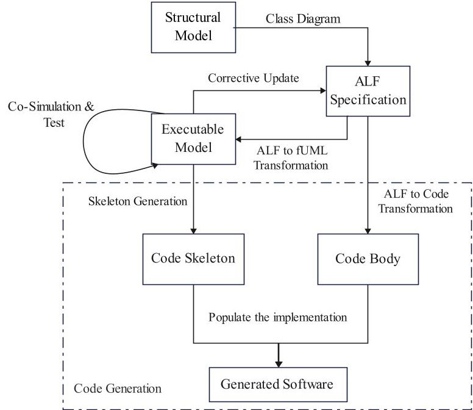
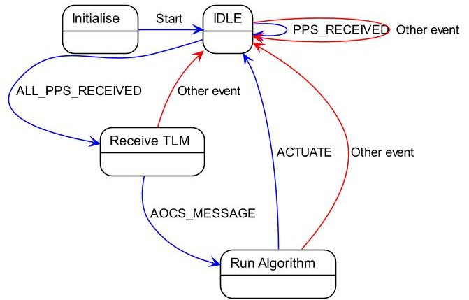
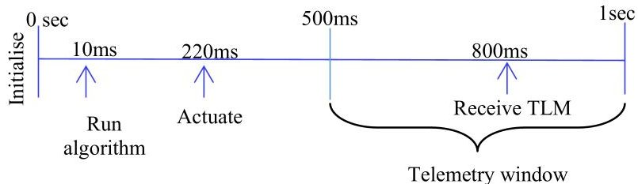
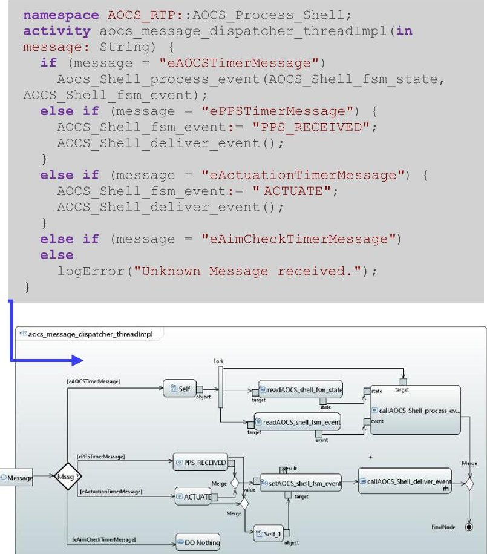
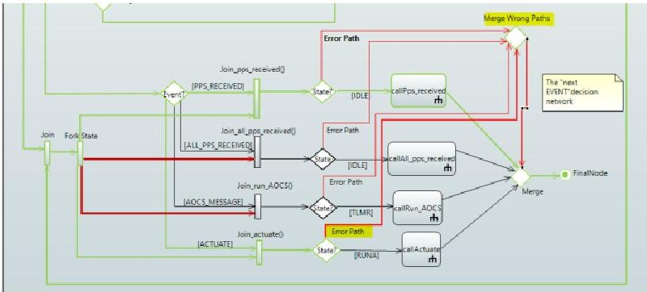

<!-- PDF_PAGE: 1 -->

# Enhancing Flight Software Development through a Model-Based Approach: A Case Study on Alsat-1B

1 $ ^{1 \mathrm{st}} $ Youcef Bouziane

Algerian Space Agency,

Satellites Development Center,

Oran, Algeria

ybouziane@cds.asal.dz

https://orcid.org/0000-0001-7072-2576

Abstract—Developing satellite flight software (FSW) presents considerable challenges, requiring rigorous methodologies to ensure both reliability and efficiency. In this paper, we explore the application of Model-Based Development (MBD) to the periodic operations within the Attitude and Orbit Control System (AOCS) of the Alsat-1B satellite. Our approach systematically models, simulates, and validates these functions using Unified Modeling Language (UML), Foundational UML (fUML), and Action Language for fUML (ALF). A pivotal aspect of our methodology is the use of ALF as an intermediary layer between the high-level model and the final code generation, ensuring that behavioral specifications are accurately translated into executable code. We evaluate the system's robustness by simulating various error scenarios, including timing irregularities and state inconsistencies. The results demonstrate that our method facilitates early detection of design issues and supports a more reliable transition from model to code. This work highlights the potential of MBD to streamline FSW development for small satellites, offering valuable insights into enhanced testing and validation practices

Keywords—Model-Based Development, Flight Software, Model Driven Architecture, Code Generation, Simulation and Validation

## I. INTRODUCTION

Satellite flight software (FSW) is a mission-critical element of modern space systems, tasked with controlling satellite operations, managing data acquisition and transmission, and autonomously responding to contingencies. Over recent years, as the reliance on software has grown, FSW has evolved from simple command-driven programmes to highly complex systems that integrate advanced features such as autonomous decision-making and fault recovery. This evolution necessitates close collaboration among various engineering disciplines, making the design and verification of FSW an increasingly challenging endeavour.

Traditional software engineering approaches often fall short when addressing the stringent reliability requirements inherent in space missions. In contrast, Model-Based Development (MBD) has emerged as a transformative approach that replaces manual coding with an iterative, model-centric process. By utilising high-level models as the primary artefacts throughout the development lifecycle, MBD enables early error detection, rigorous simulation, and automated code generation, thereby reducing risks and improving overall system quality.

This paper presents a framework that leverages established modelling standards, including Unified Modeling Language (UML), Foundational UML (fUML), and Action Language

for fUML (ALF), and integrates co-simulation through the Functional Mock-up Interface (FMI) to address key challenges in software development. Our approach not only clarifies the diverse landscape of model-based methodologies but also offers practical solutions to synchronise behavioural models with generated code. Through a case study of the Alsat-1B [1] AOCS process, our framework illustrates how modelling the system's core control logic can enhance the reliability and efficiency of the software development.

The remainder of this paper is organised as follows. Section 2 reviews our motivations and situates our framework within the broader context of model-based approaches. Section 3 outlines the proposed framework and describes its key components. Section 4 details the implementation and evaluation of our case study, including model construction, simulation, and code generation. Finally, Section 5 discusses our findings and outlines potential directions for future work..

## II. MOTIVATION

Recent experiences have highlighted the benefits of MBD in various domains. For example, NASA's utilisation of MATLAB/Simulink for the Orion Crew Vehicle and JPL's application of Model-Based Testing have demonstrated the potential of these approaches in reducing development time and improving system robustness [2]. Similarly, the development of the JPL Flight Software was elaborated using Model-Based Design techniques derived from system models. This demonstrated improved test coverage for mission-critical systems [3]. In other studies, state transition diagrams [4] and input domain models [5] have enhanced the validation of flight control algorithms, while automated code generation reduces manual errors and accelerates certification [6], [7].

Despite these advancements, several critical issues remain unresolved. In particular, ensuring consistency between highlevel system models and the generated code poses a major challenge [8]. While structural elements are often generated automatically, behavioural aspects frequently suffer from discrepancies or incomplete translations. This inconsistency necessitates extensive manual intervention, undermining overall system reliability.

Moreover, specifying the model with sufficient detail to support execution and rigorous testing presents its own difficulties [9], [10]. Models must be comprehensive enough to capture all necessary operational behaviours yet remain manageable for simulation and verification. In many cases, traditional graphical modelling approaches fall short in expressing complex logic, leading to gaps in executable semantics that can result in erroneous or partial code generation, also called "code generation dilemma [11], [12].

<!-- PDF_PAGE: 2 -->

Our work builds on these foundations by proposing a comprehensive framework that addresses critical gaps in model-to-code synchronisation and aims to enhance early stage error detection, ultimately contributing to more reliable and efficient software development. In doing so, our approach complements and extends the current state of the art, paving the way for future research in model-driven engineering for space systems.

## III. PROPOSED FRAMEWORK

## A. Framework Overview

Fig. 1. Overall Framework Architecture

The proposed framework is structured around four key stages, forming a coherent pathway from design to executable code. Each stage builds upon the previous one, ensuring that both structural and behavioural aspects of the system are rigorously defined, tested, and transformed into a functional software implementation. Fig. 1 illustrate the overall framework architecture, depicting the transition from modeling to simulation and, finally, code generation.

1) Structural Modeling: The framework begins by defining the system architecture and the development of a comprehensive structural model using class diagrams. This model captures the essential classes, attributes, and interclass relationships that constitute the back-bone of the software.

2) Behavioural Modeling: To specify complex operational logic with greater precision, the framework employs ALF to describe the behaviour. In fact, rather than relying on graphical UML activity diagrams, we favour ALF to maintain the maximum amount of behaviour specified in this language. Then, these ALF specifications are transformed into an executable fUML representation ensuring that the model's behaviour is both accurately captured and directly executable. This ALF to fUML transformation constitutes the first transformation of our two-step transformation process.

3) Co-Simulation and Test: With both structural and behavioural models in place, the framework incorporates a simulation phase that leverages co-simulation techniques. By integrating the FMI, the simulation environment provides fine-grained, step-by-step control over time-driven and

event-based processes. This allows the testing of state transitions and dynamic behaviours for different scenarios and subsequently update the model and the ALF.

4) Code Generation: Following successful simulation and test, the executable model is automatically converted into a source code skeleton, capturing all the static definitions (e.g. classes, attributes, and interfaces). Then, the two-step transformation process initiated in the Behavioural Modeling step is continued: the same updated ALF code that was transformed into the tested fUML model is translated into the target programming language and used to populate the body of skeleton.

## B. Addressing Key Challenges

Our framework directly addresses several key challenges in model-based software development. Traditional graphical activity diagrams often fall short in expressing complex operational behaviour. To overcome this, our framework employs ALF as an intermediary language. ALF is an OMG standard specifically designed to complement UML and fUML. It provides a textual means to capture detailed behavioural specifications while retaining similarities with conventional programming languages. This dual nature allows ALF to serve as an effective bridge. In our approach, the ALF code is first mapped to executable fUML elements, ensuring that the model's dynamic behaviour is accurately defined. In a subsequent transformation step, the same ALF code, after correction updates, is converted to target programming language code. This process, combined with the automatic generation of a code skeleton from the executable model, guarantees that both the structural and behavioural aspects of the model are faithfully preserved in the generated software. This overall strategy enhances consistency between the model and the generated code while bridging the model-to-code gap and reducing the need for manual intervention.

Second, standard simulation environments typically lack the fine-grained control needed for time-driven and eventbased processes. In our approach we incorporate co-simulation through FMI. This integration enables step-by-step simulation control, allowing for the synchronisation of timers and the triggering of events. Consequently, the framework can test state transitions and dynamic behaviours.

Lastly, by establishing a cohesive toolchain that bridges diverse modelling standards and automates key transformations, the framework minimizes manual intervention. This not only streamlines the development process but also improves consistency and traceability throughout the lifecycle from abstract models to executable code.

## IV. IMPLEMENTATION AND EVALUATION

This section presents the implementation of the proposed framework for modeling the existing Alsat-1B AOCS process periodic activities to assess the framework effectiveness.

## A. Alsat-1B AOCS Process Overview

Alsat-1B [1] is a medium-resolution Earth observation satellite developed through a collaboration between the Algerian Space Agency (ASAL) and Surrey Satellite Technology Ltd (SSTL). Launched on 26 September 2016, the satellite is designed for agricultural and disaster monitoring using a suite of multispectral and panchromatic imagers.

<!-- PDF_PAGE: 3 -->

The AOCS Process is managed by the onboard computer, it integrates sensor data to determine attitude and issue commands via external algorithms. This study focuses on modeling the existing periodic sampling and actuation functionality. This functionality is governed by a Finite State Machine (FSM) that synchronises with the OBC750 clock Fig. 2 and Fig. 3 illustrate the FSM's state transitions (IDLE, Receive TLM, Run Algorithm) and its periodic activities

Fig.2. AOCS Finite State Machine

Fig. 3. AOCS FSM periodic activities

## B. Implementation

The entire implementation process was carried out using the Papyrus environment and its associated plugins, which provided the necessary tools to model, simulate, and generate code for our use case.

1) Structural Modeling: In this phase, the static architecture of the AOCS process was captured through a detailed UML class diagram. This diagram represents the core components, such as the AOCS_Process_Shell and the AOCS_State_Machine, comprising 23 classes that define modules, timers, handlers, and nested elements. The AOCS_Process_Shell serves as the primary entry point, managing message dispatching, timer initialisation, and interfacing with the state machine. Meanwhile, the AOCS_State_Machine encapsulates the operational logic for state transitions, periodic sampling, and actuation.

2) Behavioural Modeling: For capturing dynamic behaviour, the focus shifts to defining executable operations. Rather than relying exclusively on graphical activity diagrams, we used ALF to specify behaviours textually. The ALF specifications were then mapped to fUML elements, such as CallBehaviorActions and ValueSpecificationActions, to form executable activity diagrams. Our modelling resulted in 11 key activity diagrams, including the AOCSShell- ClassifierBehavior (which initiates the model), the aocs_message_dispatcher_thread (responsible for monitoring and triggering state transitions), and the AOCS_Shell_process_event diagram (which implements the decision-making logic). Fig. 4 details how the behavior of the

AOCS_Process_Shell activity, defined textually in ALF, is transformed into its executable fUML counterpart.

Fig. 4. AOCS_Process_Shell from ALF to fUML

3) Co-Simulation and Test: In our framework, the simulation environment was configured to focus on the state machine's dynamics by assuming that non-implemented components (such as the AOCS algorithms and anomaly detection systems) function as intended. This allowed us to concentrate on verifying that the state transitions and event-handling mechanisms accurately re-flect the desired operational behaviour. Key elements of the simulation setup included selecting a suitable execution engine (Moka in our case) and integrating co-simulation capabilities via FMI. The FMI integration provided precise control over time-driven tasks and event triggers, enabling the simulation to be executed step-by-step. This fine-grained control allowed us to define and adjust input parameters, monitor variable changes, and set breakpoints at critical points in the model to track state transitions and internal behaviour in real time. Under nominal conditions, the simulation confirmed that that the system followed the expected state transitions (IDLE $ \rightarrow $ Receive TLM $ \rightarrow $ Run Algorithm $ \rightarrow $ IDLE), and that the periodic activities and signal processing occurred in the expected sequence, with no error paths activated. To further assess system robustness, error scenarios were deliberately introduced. One of the scenarios, included a missed PPS signal and the triggering of the ACTUATE event prematurely. While in another, an abnormal state change was induced between successive PPS events. In both cases, the state machine's error-handling mechanisms successfully detected the anomalies and restored the system to a safe state, resetting the cycle for continued operation. Fig. 5 presents the error handling workflow, detailing the state transitions and actions triggered by a missed PPS signal.

<!-- PDF_PAGE: 4 -->

Fig. 5. Missed PPS signal Error handling mechanism in action

4) Code Generation: We started by translating the ALF code that was used to define precise behavioural specifications, into Java. Despite the common preference for C or C++ in embedded systems, Java was chosen here for demonstration purposes. This was achieved using ANTLR (Another Tool for Language Recognition), which generates a parser and lexer from a defined ALF grammar. After converting ALF to Java, the next step involved embedding the generated Java code, which encapsulates the behavioural logic, into the corresponding operation skeletons. These skeletons, automatically generated from the executable model, served as placeholders within the class files. Subsequently, the complete project code was generated. In our case, the generated project comprised 15 classes that collectively embody the structural and behavioural features of the AOCS process periodic activities.

## C. Discussion

The implementation phase demonstrated the potential of our framework in addressing the core challenges of model-driven software development. A significant issue encountered was the inherent limitation of ALF syntax. Although ANTLR is a powerful tool for translating ALF to Java, the ALF language itself has intrinsic syntax and semantic constraints that limit its ability to fully express complex Java constructs. This shortfall poses a threat to the validity of a fully automated translation process, especially in mission-critical contexts. However, ALF remains effective for expressing algorithmic logic where control flow and arithmetic operations predominate. In addition, the review process for generated code highlighted the need for careful inspection and manual adjustments. While our automated tools ensure a high degree of alignment between the model and the generated code, complex logic and specific configurations sometimes require further refinement. This manual intervention, although necessary to ensure accuracy, introduces potential for human error and impacts reproducibility. Our findings underscore the importance of further automating these refinement steps to improve consistency and reduce overall development time. In summary, our implementation confirms that the proposed framework can integrates structural and behavioral modelling, co-simulation, and automated code generation. This integration enhances consistency between the design and the generated code and facilitates early detection of potential issues within a model-centric workflow. This experience validates the viability of our approach for developing and testing softwares, while also highlighting key areas for future enhancement.

## V. CONCLUSION AND FUTURE WORK

This research presents a framework for model-driven software development that integrates established modelling standards (UML, fUML, ALF) with co-simulation via FMI. Our framework addresses critical issues in translating highlevel models into executable code, as demonstrated through the modeling of the Alsat-1B AOCS process. A major contribution is our two-step transformation process, where ALF serves as an intermediary language to ensure that the detailed behavioural specifications in the model are accurately converted into source code. This process significantly enhances consistency between design and implementation. Moreover, by incorporating co-simulation, the framework achieves precise control over time-driven and event-based processes, enabling rigorous testing of state transitions and operational behaviours. Although some manual intervention is still required, particularly in managing advanced object-oriented constructs and error recovery, the approach lays a robust foundation for further automation. Future work will focus on minimising these manual adjustments, scaling the framework to cover additional AOCS process functionalities, and exploring other modelling languages and toolchains to further enhance reliability and efficiency.

## REFERENCES

[1] "AlSat-1B | Small Satellite supplier | Surrey Satellite Technology Ltd SSTL." Accessed: Mar. 21, 2025. [Online]. Available: https://www.sstl.co.uk/media-hub/latest-news/2016/sstl-announces successful-launch-of-alsat-1b

[2] L. E. Prokop, "Core Flight Software Projects on Orion Multi-Purpose Crew Vehicle," in Annual Workshop on Spacecraft Flight Software, 2018.

[3] J. M. C. Oh, G. J. Watney, and E. G. Benowitz, "Software assurance for model-based design," in IEEE Aerospace Conference Proceedings, 2008. doi: 10.1109/AERO.2008.4526596.

[4] D. Dong, Y. Fang, and Y. Chen, "Application of Test Method Based on State Transition Diagram in Flight Control Software," Proceedings - 2019 6th International Conference on Dependable Systems and Their Applications, DSA 2019, pp. 495-496, Jan. 2020, doi: 10.1109/DSA.2019.00082.

[5] D. Dong, W. Hua, Z. Liu, Y. Fang, and Y. Hou, "Test Method of Flight Control Software based on Input Field Model," Proceedings - 2021 8th International Conference on Dependable Systems and Their Applications, DSA 2021, pp. 706-711, 2021, doi: 10.1109/DSA52907.2021.00102.

[6] K. Tsujimoto, M. Shimoura, Y. Morita, and H. Oyori, "Applying Model-Based Development (MBD) to embedded systems," 55th AIAA/ASMe/ASCE/AHS/SC Structures, Structural Dynamics, and Materials Conference, 2014, doi: 10.2514/6.2014-0217.

[7] P. Sivakumar, B. Vinod, R. S. Sandhya Devi, and S. Poorani Nithilavallee, "Model based design approach in automotive software and systems," International Journal of Applied Engineering Research, vol. 10, no. 11, 2015, doi: 10.37622/ijaer/10.11.2015.29857-29865.

[8] E. Kindler, "Model-based software engineering: The challenges of modelling behaviour," in ACM International Conference Proceeding Series, 2010. doi: 10.1145/1811147.1811151.

[9] E. Seidewitz and J. Tatibouet, "Tool Paper: Combining Alf and UML in Modeling Tools-An Example with Papyrus," OCL@MoDELS, 2015, Accessed: Nov. 21, 2023. [Online]. Available: http://www.xtuml.org/.

[10] E. Seidewitz, "What models mean," IEEE Softw, vol. 20, no. 5, 2003, doi: 10.1109/MS.2003.1231147.

[11] L. Apvrille and F. Mallet, "Model-Driven Engineering and Software Development: 7th International Conference, MODELSWARD 2019, Prague, Czech Republic, February 20-22, 2019, Revised Selected Papers," Model-Driven Engineering and Software Development, 2020, doi: 10.1007/978-3-030-37873-8.

[12] J. Schröpfer and T. Buchmann, "Integrating UML and ALF: An Approach to Overcome the Code Generation Dilemma in ModelDriven Software Engineering," Communications in Computer and

<!-- PDF_PAGE: 5 -->

