<!-- PDF_PAGE: 1 -->

# Future Satellite Gravimetry with a Network of Miniaturized Satellites

N. Pfaffenzeller iD, R. Pail iD, J. Jensen iD, and K. Schilling iD

## Abstract

This feasibility study evaluates the potential of a CubeSat-based gravimetry mission for monitoring Earth's gravity field, focusing on scientific benefits and technical implementation. Scientific requirements are derived from user needs, and suitable miniaturized instruments for accelerometry, GNSS, and inter-satellite ranging are assessed. Various CubeSat constellations and formations are explored to mitigate temporal aliasing, the primary error in current gravity missions, and in this context, adapted gravity field processing schemes are also applied. Gravity field performance is analyzed based on satellite configuration, instrumental noise, and orbital parameters. We identify the configuration consisting of four polar and four inclined satellite pairs distributed across several orbital planes as the most promising candidate. The technical feasibility prioritizes a platform that balances scientific precision with CubeSat constraints and cost limitations. Key challenges include the miniaturization of scientific payloads - requiring a 35% reduction in instrument size and securing suitable launch opportunities. Despite these challenges, results indicate that a CubeSat constellation could improve temporal gravity field retrieval and enhance climate process monitoring. Further research is recommended to refine the mission concept.

## Keywords

Future satellite mission · Gravity field · Satellite constellations · Technological demonstrator

## 1 Introduction

Satellite gravimetry provides a unique tool to monitor global mass change processes in the Earth system in a limited time span. Currently, data products are provided on a monthly basis by the processing centers of the GRACE (Tapley et al. 2004) or the GRACE-FO (Kornfeld et al. 2019; Landerer et al. 2020) missions. Based on the successful heritage

of the previously mentioned satellite pair missions in inline formation, GRACE and GRACE-FO, and the single satellite missions of CHAMP (Reigber et al. 1999) and GOCE (Drinkwater et al. 2003), new concepts are elaborated. This necessity arises because current satellite gravity missions face intrinsic limitations in spatiotemporal resolution. They hinder the accurate retrieval of high-frequency signals originating from oceanic and atmospheric mass variations, as well as ocean tides, which tend to alias into the gravity field solutions (Flechtner et al. 2016). Consequently, new mission architectures and observation strategies are required to overcome these challenges and improve the resolution and accuracy of temporal gravity field measurements. The double satellite pair concept (Bender et al. 2008) consists of one in-line polar and one in-line inclined pair and is currently investigated within the "Mass Change and Geosciences International Constellation" (MAGIC) study (Haag-

<!-- PDF_PAGE: 2 -->

Table 1 Summary of simulation aspects. The section number is indicated in brackets

<table border="1"><tr><td>Orbit</td><td>Satellite Network Design(2.3),Inter-Satellite Distance and Altitude Variations(4.1.1),Orbit Design and Mission Lifetime Analysis Based on Solar Activity Variations(4.2.1)</td></tr><tr><td>Sensors</td><td>Accelerometer(2.2.1),Inter-satellite Ranging(2.2.2),GNSS Receiver(2.2.3)</td></tr><tr><td>Parametrization approach</td><td>Nominal(4.1),Co-parametrization of Short-Term Gravity Solutions and of Ocean Tide Constituents</td></tr><tr><td>Satellite system</td><td>System Overview and Budgets(4.2.2),Preliminary Satellite Design(4.2.3),Design Constraints(5)</td></tr></table>

mans and Tsaoussi 2020). Other mission concepts covering various satellite formations (e.g., Pendulum, Cartwheel) were investigated by Elsaka et al. (2014), but are limited in their technical feasibility. The realization of the double-pair mission is very cost intensive with large conventional satellites, as used in the GRACE/GRACE-FO mission. With the completed 3-year DFG (German Research Foundation)-funded project "Cube-satellite networks for geodetic Earth observation on the example of gravity field retrieval" (CubeGrav), we investigated the potential of a network of small satellites for gravity field retrieval. In this manuscript, the science and mission requirements and the related miniaturized payload are addressed in Sect. 2. In Sect. 3, various numerical simulation setups are presented, and results are shown in Sect. 4, covering the scientific outcomes in Sect. 4.1 and the technical findings in Sect. 4.2. In Sect. 5, these main results are discussed, and in Sect. 6, conclusion and recommendations are provided. Table 1 summarizes the parameters investigated within this study.

## 2 Requirements

## 2.1 User Needs

In the context of the International Union of Geodesy and Geophysics (IUGG) in 2015, the user requirements for mass change monitoring from space were consolidated within an international initiative (Pail et al. 2015). A similar approach was adopted for the ongoing MAGIC study (Haagmans and Tsaoussi 2020) and its inclined pair NGGM (Daras 2023). The Earth observation user requirements for a future CubeSat mission constellation are expected to align closely with those established by the IUGG and NGGM/MAGIC, as they were derived independently of specific satellite mission architectures and available instrumentation. As a baseline, the CubeSat constellation should, at minimum, satisfy the threshold requirements defined in the IUGG study and the NGGM/MAGIC MRDs.

## 2.2 Instruments and Candidate Sensors

As the basis for a future network of small satellites, we rely on the established observation concepts in the

form of high-low satellite-to-satellite tracking (hl-sst) and low-low satellite-to-satellite tracking (ll-sst) adopted by GRACE/GRACE-FO. Thus, as key payload, we assume accelerometers mounted at the center of mass of all participating satellites, a ranging device to measure the intersatellite distance between two satellites forming a satellite pair (ll-sst observations), and a GNSS receiver for hl-sst observations. We do not consider any information on the attitude system in our simulations, which is a necessary task for future work, in particular in regard to inter-satellite ranging measurements. We consider multiple satellites in different configurations, but always in terms of satellite pairs. The selected instrument candidates and their specifications are evaluated in terms of size （1 U=10 $ cm^{3} $ ）, weight, and power (SWaP) and technological readiness level (TRL).

## 2.2.1 Accelerometer

Three accelerometer candidates have been assessed for a miniaturized satellite gravimetry mission. The first, CubSTAR, is a miniaturized electrostatic accelerometer developed by Onera (Liorzou et al. 2023), with noise performances varying from 50 to 300 $ \mu\mathrm{m} $ , depending on the gap between the proof mass and the electrodes. CubSTAR has a size of 4 U, weighs 5 kg, has a power demand of 4.5 W, and has a TRL of 6 (Rodrigues et al. 2022). The second, the Simplified Gravitational Reference Sensor (SGRS), builds on the heritage of the Gravitational Reference Sensor from the LISA Pathfinder mission and is being developed under the leadership of the University of Florida (Dávila Álvarez et al. 2022). However, with a weight of 13 kg, a power demand of 20 W, a size of $ 10^{4} $ cm $ ^{3} $ , and a TRL of 5, SGRS is a rather large solution for a miniaturized mission. The third candidate, the optomechanical accelerometer, incorporates a mechanical resonator with a laser interferometric readout and is the most compact accelerometer with 2.18 U in size, a weight of 2 kg, a power demand of 10 W (Hines et al. 2022), and a TRL of 5 (Nelson et al. 2024). All three accelerometers demonstrate promising capabilities. However, based on all the key parameters from the previously mentioned instruments, the optomechanical accelerometer emerges as the most suitable candidate.

## 2.2.2 Inter-Satellite Ranging Instrument

Three potential developments for an inter-satellite ranging instrument are identified and evaluated. The CubeSat Laser

<!-- PDF_PAGE: 3 -->

Infrared CrosslinK (CLICK) mission aims to investigate inter-satellite communication links for CubeSats and serves as a technological demonstrator (Tomio et al. 2022). However, its expected accuracy of approximately 50 cm is not suitable for precise ranging applications and is therefore excluded from further consideration. Another candidate is the Micro Non-Planar Ring Oscillator ( $ \mu $ NPRO), proposed for miniaturized ranging in satellite gravimetry (Wiese et al. 2022). This sensor, developed by NASA/JPL and based on the LISA Pathfinder mission, remains largely undocumented in publicly available sources. Due to the lack of accessible technical specifications, this option is also dismissed. The most promising candidate is the Dynamic Optical Ranging and Timing System (DORT), a short-pulse laser system designed for absolute ranging measurements in satellite gravimetry and other applications (Paul et al. 2025). Developed by MUnique Technology, DORT offers an expected accuracy of at least 1 $ \mu $ m and has a size of 3 U, a power demand of 10 W, and a weight of 1.5 kg. However, as noise specifications for the DORT system were not available during the CubeGrav project, we assume that the noise performance of the GRACE-FO microwave ranging instrument (MWI) is representative of a future ranging instrument such as DORT.

Therefore, a baseline accuracy of 1 $ \mu\mathrm{m} $ is considered the minimum requirement for inter-satellite ranging. A substudy performed within the CubeGrav project investigated various instruments for accelerometry and ranging, revealing that if the MWI performance were degraded to 10 or 100 $ \mu\mathrm{m} $ the resulting gravity field solutions would be dominated by increased ranging noise rather than temporal aliasing (Pfaffenzeller and Pail 2021).

## 2.2.3 GNSS Instrument

A suitable GNSS sensor is the ZED-F9P developed by the company u-blox. It is a dual-frequency multi-GNSS receiver with an expected accuracy in the decimeter range (Moeller et al. 2024). The ZED-F9P has a size of $ 1 0^{2} \mathrm{c m}^{3} $ , weighs 0.065 kg, has a power demand of 0.5 W, and has a TRL of 9.

## 2.2.4 Instrument Performance Evaluation

The noise performance of various candidate accelerometer and inter-satellite ranging instruments is presented in terms of amplitude spectral density (ASD) in Fig. 1, with the corresponding analytical descriptions provided in Eqs. (1) (7). Numerical specifications are available for the accelerometers used in MAGIC $ ( a_{\mathrm{MAGIC}} ) $ (Lenoir et al. 2011), and the simplified gravitational reference sensor $ ( a_{\mathrm{SGRS}} ) $ (SGRS) (Dávila Álvarez et al. 2022), as well as for the microwave ranging instrument (MWI) $ ( r_{\mathrm{MWI}} ) $ (Kornfeld et al. 2019) and the laser ranging interferometer (LRI) $ ( r_{\mathrm{LRI}} ) $ (Nicklaus et al. 2020). The numerical approximations for the CubSTAR accelerometer (50 $ \mu\mathrm{m} $ $ a_{\mathrm{C50}} $ and 300 $ \mu\mathrm{m} $ $ a_{\mathrm{C300}} $ ) are derived

from Liorzou et al. (2023), while those for the optomechanical (optom) accelerometer $ ( a_{\mathrm{optom}} ) $ are based on the work of Hines et al. (2020). Additionally, we assume different orbit position errors achievable by a future GNSS sensor, covering three cases: 1, 30, and 100 cm. In the following, the noise specifications of the abovementioned instruments are defined:

aMAGIC

$$
= 1 \cdot 1 0 ^ {- 1 1} \sqrt {\frac {\left(\frac {1 0 ^ {- 3} \mathrm {H z}}{f}\right) ^ {2}}{\left[ \left(\frac {1 0 ^ {- 5} \mathrm {H z}}{f}\right) ^ {2} + 1 \right]} + 1 + \left(\frac {f}{1 0 ^ {- 1} \mathrm {H z}}\right) ^ {4}} \frac {\mathrm {m}}{\mathrm {s} ^ {2} \sqrt {\mathrm {H z}}}
$$

aC50

$$
= 1. 5 8 \cdot 1 0 ^ {- 1 1} \cdot \sqrt {\left(\frac {2 . 2 \cdot 1 0 ^ {- 2} \mathrm {H z}}{0 . 9 \cdot f}\right) ^ {\frac {5}{4}}} + 6 9 5 + \left(\frac {4 . 8 \cdot f}{1 . 5 \mathrm {H z}}\right) ^ {4. 3} \frac {\mathrm {m}}{\mathrm {s} ^ {2} \sqrt {\mathrm {H z}}}
$$

aC300

$$
= 1. 5 8 \cdot 1 0 ^ {- 1 1} \cdot \sqrt {\left(\frac {2 . 2 \cdot 1 0 ^ {- 2} \mathrm {H z}}{0 . 9 \cdot f}\right) ^ {1 . 2} + 1 + \left(\frac {4 . 5 \cdot f}{9 . 9 \cdot 1 0 ^ {- 1} \mathrm {H z}}\right) ^ {4 . 4 2}} \frac {\mathrm {m}}{\mathrm {s} ^ {2} \sqrt {\mathrm {H z}}} \tag {2}
$$

$$
a _ {\mathrm {S G R S}} = 5 \cdot 1 0 ^ {- 1 3} \cdot \sqrt {1 + \left(\frac {1}{f}\right) ^ {\frac {2}{3}}} \frac {\mathrm {m}}{\mathrm {s} ^ {2} \sqrt {\mathrm {H z}}}
$$

$$
a _ {\mathrm {o p t o m}} = 3 \cdot 1 0 ^ {- 1 1} \cdot \sqrt {\frac {0 . 1 \mathrm {H z}}{f}} \frac {\mathrm {m}}{\mathrm {s} ^ {2} \sqrt {\mathrm {H z}}}
$$

$$
r _ {\mathrm {M W I}} = 2. 6 2 \cdot (2 \pi f) ^ {2} \cdot 1 0 ^ {- 6} \cdot \sqrt {1 + \left(\frac {0 . 0 0 3 \mathrm {H z}}{f}\right) ^ {2}} \frac {\mathrm {m}}{\mathrm {s} ^ {2} \sqrt {\mathrm {H z}}}
$$

$$
r _ {\mathrm {L R I}} = 2 \cdot (2 \pi f) ^ {2} \cdot 1 0 ^ {- 8} \cdot \sqrt {1 + \left(\frac {1 0 ^ {- 2} \mathrm {H z}}{f}\right) ^ {2}} \frac {\mathrm {m}}{\mathrm {s} ^ {2} \sqrt {\mathrm {H z}}}
$$

## 2.3 Satellite Network Design

In the following, we focus on the satellite network design. We distinguish between satellite constellations and formations. Formation flying involves satellites that are dynamically linked through a shared control law, which governs at least one state variable of each satellite in relation to the others (Bandyopadhyay et al. 2016). Consequently, any movement of one satellite within the formation directly affects the others. In contrast, if this dynamic coupling is absent, the system is classified as a constellation. Notably, a satellite constellation can include multiple satellite formations within its structure. As a foundation for our study, we adopt the in-line polar and in-line inclined satellite pair $ (70^{\circ} $ inclination),

<!-- PDF_PAGE: 4 -->

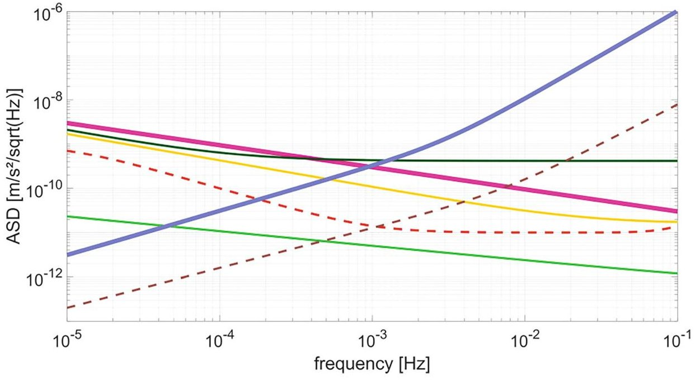

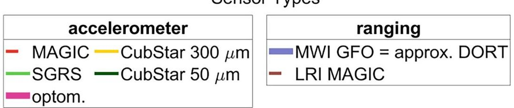

Fig.1 Amplitude spectral density (ASD) of the accelerometer and the ranging candidates from Sects. 2.2.1 and 2.2.2. In addition, the performance of the accelerometer from MAGIC and the performance of the laser ranging interferometer (LRI) are visualized in dashed lines

as outlined in the MAGIC study, considering it as a state-of-the-art constellation. Specifically, we focus on these two orbital planes (polar: 468 km altitude, inclined: 432 km altitude) selected as one of seven orbit sets, which were investigated in detail within the MAGIC study (Table 3 in Massotti et al. 2021). Extended satellite constellations are achieved by adding satellites on additional planes with the same altitude and inclination but rotated by their right ascension of the ascending node (RAAN) to enhance spatial resolution and adjusting the mean anomaly to improve temporal sampling. The resulting orbital configurations are presented in the work of Pfaffenzeller and Pail (2023), which include four constellations with polar-only satellite pairs and three constellations combining polar and inclined satellite pairs. Exemplarily, we select the GRACE-like formation of 1 polar pair (1p) and the constellations of a MAGIC-like double-pair 1 polar + 1 inclined pair (1p1i), 18 satellite pairs distributed on 9 orbital planes (18pRAAN), and 4 polar pairs + 4 inclined pairs, each distributed on 2 orbital planes (4p4iRAAN). Furthermore, orbital planes with varying inclinations are considered in the next design. Specifically, we rely on a 6-satellite-pair constellation called 1p5i, extending the double constellation, with 4 satellite pairs on the orbital planes with an altitude of 432 km each and inclination of $ 8 0^{\circ} $

60°, 48°, and 33°. Additionally, an alternative constellation design, deviating completely from the MAGIC configuration, is based on the orbital parameters of the International Space Station (ISS), with an inclination of 51.6° and an altitude of 385 km, and a sun-synchronous orbit (SSO) with an inclination of 97° and altitude of 480 km (see Sect. 4.2.1). We consider four satellite pairs on each of the previously mentioned orbital planes (4SSO4ISS).

The satellite formation is considered not only in an in-line configuration, where a single link exists between two adjacent satellites forming a pair, but also in a pearl-string formation. In this formation, each satellite has an inter-satellite link with all other satellites in the same orbital plane, resulting in multiple inter-satellite links. A schematic visualization of this configuration is provided in the work of Pfaffenzeller and Pail (2023). Additionally, the study investigates the cross-track formation concept. The inter-satellite ranging is done in a cross-track direction, perpendicular to the satellite's movement, similar to the formation described by Zingerle et al. (2024). The combination of multiple satellite pairs in in-line formation with some in cross-track formation is referred to as the mixed formation setup. The inter-satellite distance between adjacent satellites forming a satellite pair is set to 220 km.

<!-- PDF_PAGE: 5 -->

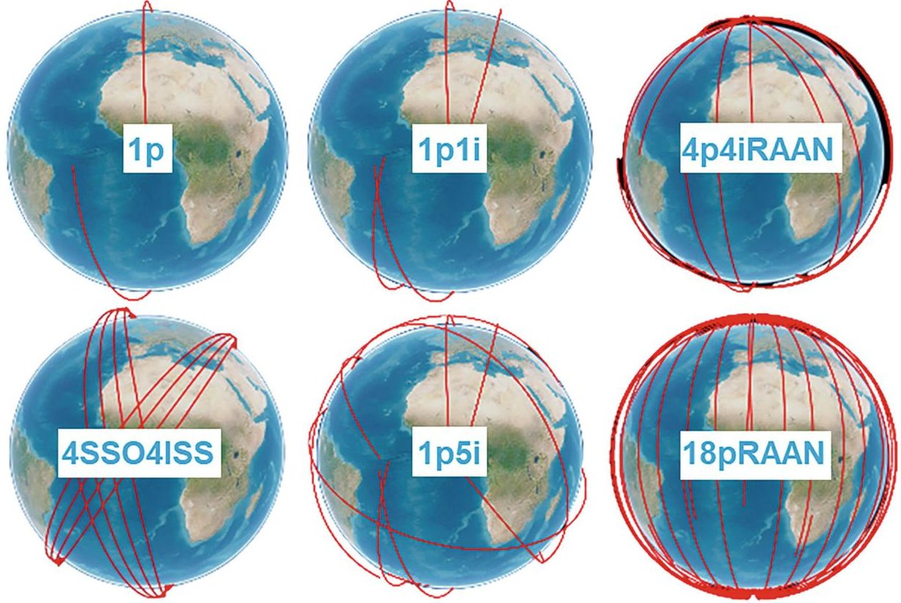

Fig. 2 Visualization of the first revolution of the following satellite configurations: 1 polar pair (1p), 1 polar pair + 1 inclined pair (1p1i), 4 polar + 4 inclined pairs each distributed on 2 planes (4p4iRAAN), 4

pairs on 1 orbital plane of SSO+4 inclined pairs on 1 orbital plane of ISS (4SSO4ISS), 1 polar +5 different inclined pairs (1p5i), 18 polar pairs distributed on 9 orbital planes (18pRAAN)

In Fig. 2, the first revolution of the selected satellite configurations is visualized, which is analyzed regarding its gravity field retrieval performance in Sect. 4.1.

## 3 Simulation Environment

For numerical performance evaluation, we use two simulation tools: a reduced-scale and a full-scale simulator, both available at IAPG, TUM. The reduced-scale simulator, computationally efficient due to its linear observation equation, models satellite orbits as circular using Keplerian elements and processes only ll-sst observations. It derives acceleration differences along the line of sight from satellite positions (Murbock 2015; Murbock et al. 2015). The full-scale simulator, in contrast, employs fully numerically integrated orbits and processes both hl-sst and ll-sst observations. Gravity field processing follows a modified integral equation approach with short-arc orbit representation (Pfaffenzeller and Pail 2023). Simulated gravity field observations are computed based on the static gravity field model GOCO05S (Mayer-Gurr et al. 2015). Additionally, contributions from temporal gravity field variations are considered using the Earth system model (ESM) HIS (Dobslaw et al. 2014), which accounts for signals from hydrology, ice, and solid Earth, as well as an error product for high-frequency signals from the atmosphere and ocean (AO error) (Dobslaw et al. 2016). Uncertainties in ocean tide models (OT error) are simulated

by calculating the difference between two ocean tide models: the Empirical Ocean Tide (EOT) model 11a (Savcenko and Bosch 2012) and the Goddard Ocean Tide (GOT) model 4.7 (Ray 1999). The lifetime and control analysis were conducted using ESA's Debris Risk Assessment and Mitigation Analysis (DRAMA) tool (Braun et al. 2020) and Ansys Systems Tool Kit (Release 12.7).

## 4 Results

## 4.1 Scientific Evaluation

The simulation results are expressed in degree amplitudes of equivalent water height (EWH; Wahr et al. 1998):

$$
\sigma_ {n} (\mathrm {E W H}) = \frac {a \rho_ {\mathrm {E}}}{3 \rho_ {\mathrm {W}}} \frac {2 n + 1}{1 + k _ {n}} \sqrt {\sum_ {m = 0} ^ {n} \left(\overline {{C}} _ {n m} ^ {2} + \overline {{S}} _ {n m} ^ {2}\right)}
$$

In this equation, $ C_{nm} $ and $ S_{nm} $ are the estimated spherical harmonic coefficients of degree n and order m (d/o). The parameter a represents the Earth's semimajor axis, while $ \rho_{\mathrm{E}} $ and $ \rho_{\mathrm{W}} $ denote the average densities of the Earth and water, respectively. Additionally, $ k_{n} $ corresponds to the Load Love number for degree n. Subsequent figures illustrate the temporal gravity field signal (HIS) to be recovered, along with the gravity field retrieval error (i.e., noise) of various constellations. The performance of the satellite formations and

<!-- PDF_PAGE: 6 -->

constellations, described in Sect. 2.3, is evaluated in terms of monthly gravity field retrieval with nominal processing (see Sect. 4.1.3). Selected results are also summarized by Pfaffenzeller and Pail (2023). The pearl-string formation does not provide the expected improvement in spatiotemporal performance. While multi-inter-satellite links increase redundancy, the global and temporal coverage remains largely unaffected. Increasing the number of satellite pairs in the state-of-the-art double-pair constellations yields significant benefits for the resulting gravity field: in the low spherical harmonic (SH) spectrum, by distributing satellites across multiple orbital planes (via shifts in RAAN), and in the high SH spectrum, by distributing satellites within a single orbital plane (via shifts in mean anomaly). This distribution has minimal impact on monthly gravity field estimation, but is critical for short-term solutions and ocean tide co-estimation (see Sect. 4.1.3). For the selected configurations shown in Fig. 2, the retrieved monthly gravity fields are illustrated in Fig. 3, with corresponding global RMS values provided. The 1p formation exhibits the typical vertical striping pattern seen in GRACE-like missions (Fig. 3a). This pattern is significantly reduced with the MAGIC-like double-pair constellation (1p1i) shown in Fig. 3b. The 4SSO4ISS constellation (d), with pairs on an ISS-like orbit at a low altitude, results in low residuals. However, due to the lack of pole coverage from satellites in SSO orbit, large residuals are observed in high-latitude regions. As a result, this constellation does not support the extension of the time series over polar ice sheets but may be preferable from a technical perspective (cf. Sect. 4.2.1).

In the 4p4iRAAN configuration (c), the residuals show a less distinct pattern. As expected, larger residuals are observed over midlatitude regions, due to the higher altitude of the inclined pairs and the RAAN shift compared to the 4ISS4SSO configuration (d). However, this constellation improves the global RMS by a factor of four compared to the previous one.

The 1p5i constellation (Fig. 3e) provides a broad variety of multidirectional observations with five different inclined pairs. However, this configuration has a disadvantage for global gravity field retrieval: with lower inclination, fewer parts of the Earth are covered, resulting in fewer observations and larger residuals, which increase the RMS value. Finally, the 18pRAAN constellation is presented with three formation concepts: in-line (Fig. 3f), cross-track (Fig. 3g), and mixed (Fig. 3h). In the in-line and cross-track formations, observations are restricted to North-South and East-West directions, respectively, leading to residual patterns aligned with the vertical/horizontal directions. The cross-track formation performs significantly worse than the in-line formation, as indicated by a much more distinct residual pattern and a sevenfold increase in RMS. Combining both formations into a mixed configuration combines the benefits

of both setups. With multidirectional observations, temporal aliasing is significantly reduced, leading to the lowest RMS.

## 4.1.1 Inter-Satellite Distance and Altitude Variations

In this section, we examine the impact of variations in altitude and inter-satellite distances based on the satellite configurations selected in Sect. 2.3. Altitude variation is closely related to mission lifetime (cf. Sect. 4.2.1). At lower altitudes, higher atmospheric drag results in reduced mission lifetime. Conversely, increasing the altitude leads to greater attenuation of the gravity field signal, particularly affecting the higher SH spectrum. Although changes in the signal-to-noise ratio (SNR) with altitude are observed, altitude is not considered a primary performance driver for the mission, because temporal aliasing remains the main error contributor.

The inter-satellite distance is directly linked to the signalto-noise ratio of the ranging instrument and its ability to measure long distances accurately. We assess the impact of inter-satellite distances ranging from 1 to 300 km on gravity field solutions derived from in-line satellite pair formations. The results indicate that, in general, longer inter-satellite distances are preferable, as shorter gravity field wavelengths cannot be accurately detected with smaller separations. In multi-satellite configurations, the ability to mitigate temporal aliasing effects significantly influences the relevance of inter-satellite distance. For constellations capable of reducing temporal aliasing, the impact of shorter inter-satellite distances is less pronounced. Specifically, for constellations composed solely of polar satellites, shorter distances lead to more significant degradation of the gravity field solution. In contrast, constellations combining polar and inclined satellite pairs exhibit less sensitivity to shorter distances. After considering all factors, we identify 25 km as the minimum required inter-satellite distance for CubeSat missions. This distance causes only a minor reduction in the overall performance while remaining achievable with miniaturized ranging technologies.

## 4.1.2 Instrument Performance

The performance of potential miniaturized instrument candidates is assessed with nominal processing for monthly gravity field retrieval. To this end, various instrument combinations are generated, consisting of different accelerometer sensors and an assumed future ranging instrument modeled on the basis of the noise behavior of the MWI from the GRACE-FO mission (cf. Sect. 2.2). To quantify the pure impact of the accelerometer and ranging instruments, a GNSS geolocation error of 1 cm is assumed for the hl-sst observations across all scenarios. The evaluation of instrument performance is conducted using the 4p4iRAAN satellite constellation. The results are presented in terms of equivalent water height (EWH) degree amplitudes in

<!-- PDF_PAGE: 7 -->

a) RMS: 1990 mm

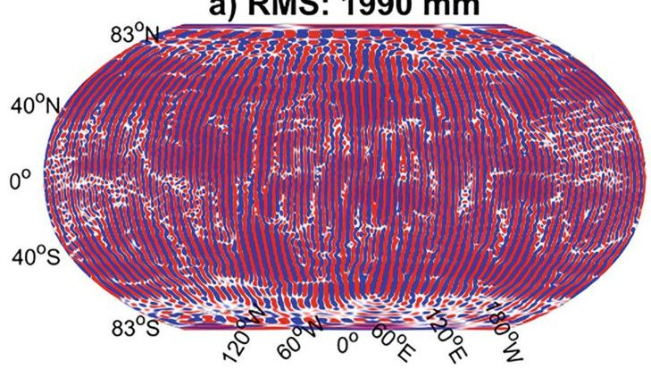

b) RMS: 431 mm

c) RMS: 238 mm

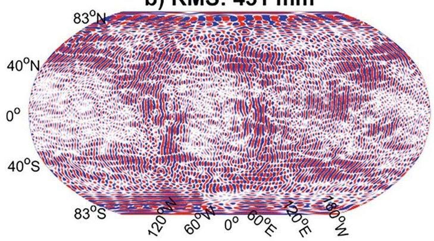

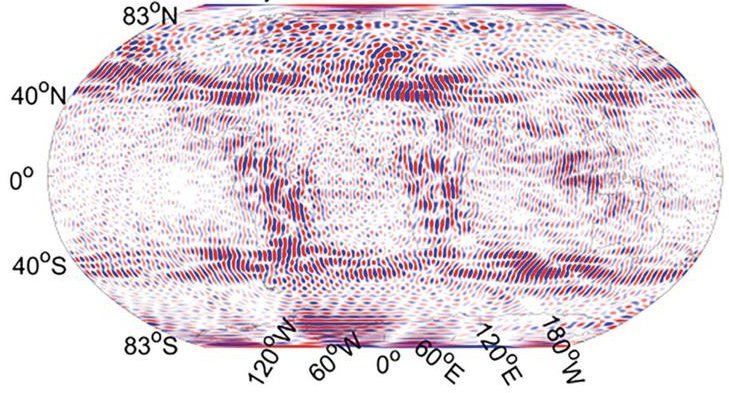

d) RMS: 926 mm

e) RMS: 292 mm

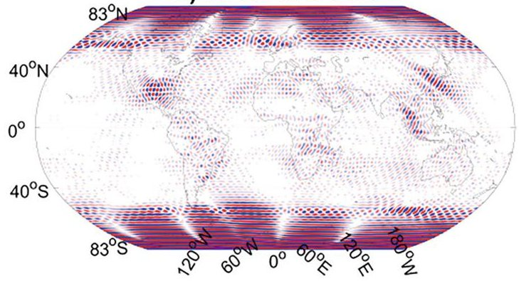

f) RMS: 193 mm

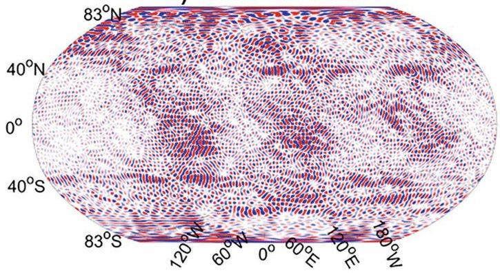

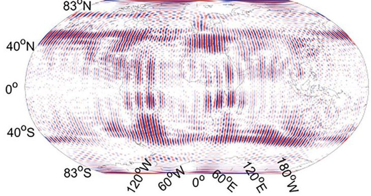

g) RMS: 1403 mm

h) RMS: 70 mm

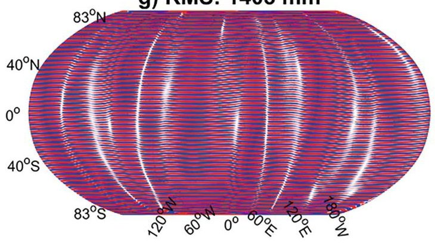

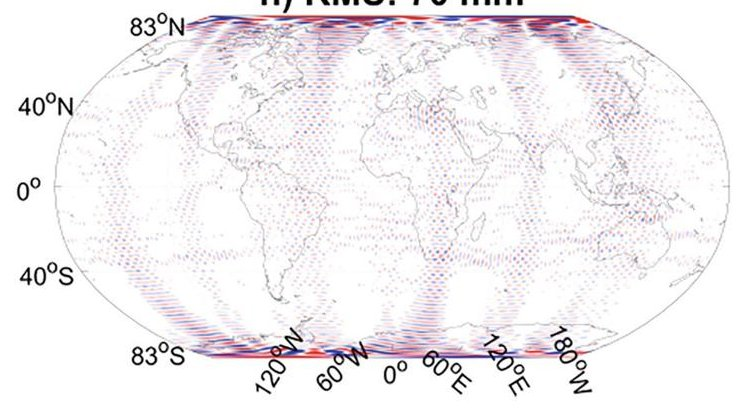

[mm EWH]

Fig. 3 Global monthly EWH gravity field residuals from simulations given in mm from d/o 3 to d/o 100. The residuals represent the difference between the retrieved gravity fields and the time-variable signal from HIS. The results are generated with the following constellations and formations (cf. Fig. 2): (a) 1p, (b) 1p1i, (c) 4p4iRAAN, (d)

4SSO4ISS, (e) 1p5i, (f) 18pRAAN in-line formation, (g) 18pRAAN cross-track formation, and (h) 18pRAAN mixed formation. The global RMS values based on EWH grids (weighted with cosine latitude) estimated from d/o 3 to 100 are indicated in the upper right corner of each configuration

<!-- PDF_PAGE: 8 -->

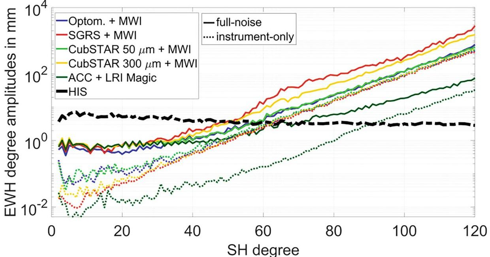

Fig. 4 EWH degree amplitudes on monthly averaged gravity field retrieval in mm. The gravity field retrieval (=noise) is visualized together with the time-variable signal HIS from January 2002 to be retrieved. The results are generated with the satellite constellation 4p4iRAAN and with the different instrument noise assumptions (cf.

Sect. 2.2). The dotted lines represent the instrument-only solutions, considering only instrumental noise contributions within the simulation setup. The solid lines represent the full-noise solutions, taking into account instrumental noise and time-variable gravity field contributions (HIS + AO error + OT error)

millimeters in Fig. 4. The dotted lines in Fig. 4 represent the "instrument-only" solutions, which consider only instrumental noise contributions, while the solid lines represent the "full-noise" solutions, accounting for both instrumental noise and time-variable gravity field contributions from nontidal and tidal signals. For quantification purposes, the mean time-varying gravity signal (HIS) over 1 month is shown as a black dashed line. Results generated with the MAGIClike accelerometer and laser ranging interferometer (LRI) are provided for comparison, depicted in dark green. The enhanced performance and lower noise levels of the MAGIClike instruments lead to a higher SNR, demonstrated by the crossover point of the HIS signal at higher d/o compared to the miniaturized instrument candidates, for both instrumentonly and full-noise scenarios. This behavior is anticipated, as the accelerometer and LRI exhibit lower noise across the entire frequency spectrum, as shown in Fig. 1.

For the instrument-only scenarios of the miniaturized instrument candidates, this finding is confirmed. Generally, instrument noise is dominated by accelerometer noise at low frequencies, impacting the low SH spectrum, and by ranging noise at higher frequencies, affecting the high SH spectrum. Changes in instrument performance, such as a comparison between the lower noise of the SGRS accelerometer and the higher noise of the optomechanical accelerometer, lead to corresponding variations in behavior. However, different behavior is observed in the full-noise scenarios for the miniaturized instrument combinations. Despite the SGRS and CubSTAR with a 300 $ \mu\mathrm{m} $ gap exhibiting better noise performance than the optomechanical accelerometer and the

CubSTAR with a 50 $ \mu\mathrm{m} $ gap, the former candidates yield a lower SNR. This discrepancy is attributed to the weighting scheme applied within the least squares adjustment, which also accounts for temporal gravity field contributions. Notably, instrument noise is not the dominant factor; temporal aliasing exceeds the influence of instrument noise, as clearly indicated in Fig. 4. The ability to mitigate temporal aliasing depends on the selected satellite constellation and formation, as discussed in Sect. 4.1 and by Pfaffenzeller and Pail (2023).

So far, we have assumed a GNSS geolocation error of 1 cm. Increasing this error to 30 cm results in the degradation of the coefficients in the low-degree SH spectrum, while the remaining SH coefficients remain largely unaffected. However, when considering a severe GNSS geolocation error of 100 cm, the impact extends across the entire SH spectrum, leading to a lower SNR. This deterioration arises due to the increased weighting of hl-SST observations relative to ll-SST observations. Given that the GNSS candidate sensor discussed in Sect. 2.2.3 provides accuracy within the decimeter range, its influence on gravity field solutions is less significant compared to that of the accelerometer and ranging instruments. Consequently, GNSS geolocation plays a subordinate role for temporal gravity field retrieval.

## 4.1.3 Parametrization Scheme

In this section, we review the parametrization scheme and its impact on gravity field solutions. In the case of nominal processing, we retrieve the SH coefficients of gravity fields on a monthly basis. In our analysis, we apply an extended

<!-- PDF_PAGE: 9 -->

## Co-parametrization of Short-Term Solutions

The selected parameterization approach enables the simultaneous estimation of both short-term and long-term gravity field solutions, achieving varying spatial resolutions. Lower SH coefficients (e.g., up to d/o 30) are estimated for shortterm intervals (e.g., 24, 12, or 6 h), while higher SH coefficients are estimated on a monthly basis. This methodology, which divides the results into short- and long-term components, is based on the work of Wiese et al. (2011) and has been applied to multi-satellite configurations in the study of Pfaffenzeller and Pail (2023). The findings from the latter study demonstrate that this parameterization approach allows for the retrieval of standalone gravity fields with temporal resolutions of 24, 12, and 6 h, depending on the selected satellite constellation. A key requirement for the satellite configuration is that it must provide adequate ground track coverage within the chosen short-term time frame. As shown by Pfaffenzeller and Pail (2023), this requirement can be met through global distribution of satellite pairs, such as the 18 satellite pairs distributed across 9 polar orbital planes (18pRAAN) or the 4 polar and 4 inclined satellite pairs distributed across 2 orbital planes (4p4iRAAN).

## Co-parametrization of Ocean Tide Constituents

The temporal aliasing of tidal signals can be mitigated using an alternative parametrization approach involving a two-step procedure. In the first step, signals from major ocean tide constituents are co-estimated alongside the regular gravity field solutions over various timescales, such as periods spanning several months to years. The resulting enhanced ocean tide de-aliasing product is then applied to the nominal gravity field processing. As demonstrated by Hauk and Pail (2018), this approach improves the final gravity field's SH coefficients, particularly for double-pair constellations. Existing ocean tide products suffer from insufficient observations and data quality, particularly in high-latitude regions. Multisatellite constellations, including multiple pairs on polar orbits, provide valuable observations that help reduce these aliasing effects. The key to improving gravity field solutions lies not only in the selection of the satellite constellation but also in the duration of the co-estimation period for ocean tide signals. The added benefit of a multi-satellite network is that it enables the use of shorter time periods (e.g., several months) to produce comparable or even superior results to the state-of-the-art double-pair constellation, which typically requires years of data. A summary of these findings is presented by Pfaffenzeller and Pail (2024).

Based on the results presented above, we identify the constellation 4p4iRAAN as the most promising candidate

in terms of scientific performance and select this satellite constellation for further analysis regarding its technical feasibility in Sect. 4.2.

## 4.2 Technical Evaluation

## 4.2.1 Orbit Design

CubeSats are commonly deployed as secondary payloads or via rideshare programs, which offer a cost-effective means of launching small satellites. These opportunities are available through various missions, including SSO missions in LEO, resupply missions to the ISS, and SpaceX Starlink launches. These missions typically operate at an inclination of approximately 45°. However, CubeSats often lack access to polar orbits or orbits with inclinations around 70°, necessitating dedicated rocket launches for these specialized orbital paths. Launching small payloads on dedicated rockets typically incurs costs starting at approximately 4 million Euros, whereas rideshare missions are less expensive, with costs ranging between 250,000 and 400,000 Euros per satellite. For the 4p4iRAAN satellite constellation, achieving the required orbital configurations with four dedicated rocket launches would incur a minimum cost of 16 million Euros. In contrast, launching 16 satellites via rideshare in suboptimal orbits would cost approximately 6.4 million Euros. However, modifying the orbital planes postlaunch is unfeasible due to the significant additional energy demands (delta-v), which exceed the capabilities of small satellites, even those equipped with electric propulsion. The delta-v budget quantifies the total change in velocity required for a space mission, serving as a critical indicator of the propellant needed for various maneuvers and thus reflecting the mission's overall energy requirements (Walter 2008). This limitation results in two primary options: utilizing an additional orbital transfer vehicle to facilitate orbital adjustments, which would introduce substantial additional costs, or adopting a constellation to the SSO/ISS orbital planes (cf. 4SSO4ISS). Unfortunately, the SSO/ISS configurations fail to provide adequate coverage of polar regions (cf. Fig. 3d), which are critical for monitoring glaciers and the cryosphere being key components of climate observation. Moreover, the ISS orbital inclination falls outside the optimal range of 65-75°, as indicated in studies such as those of Wiese et al. (2012) and Heller-Kaikov et al. (2023). As a result, extensive coverage of the polar regions can only be achieved through satellite pairs operating in polar orbits. Despite these limitations, the SSO/ISS constellation may still offer a cost-effective solution for technology demonstration missions. For the CubeGrav mission, we assume an operational mission lifetime of 5 years that we orientate on the nominal lifetime of the existing satellite mission GRACE/-FO. One significant factor influencing its longevity is drag disturbance

<!-- PDF_PAGE: 10 -->

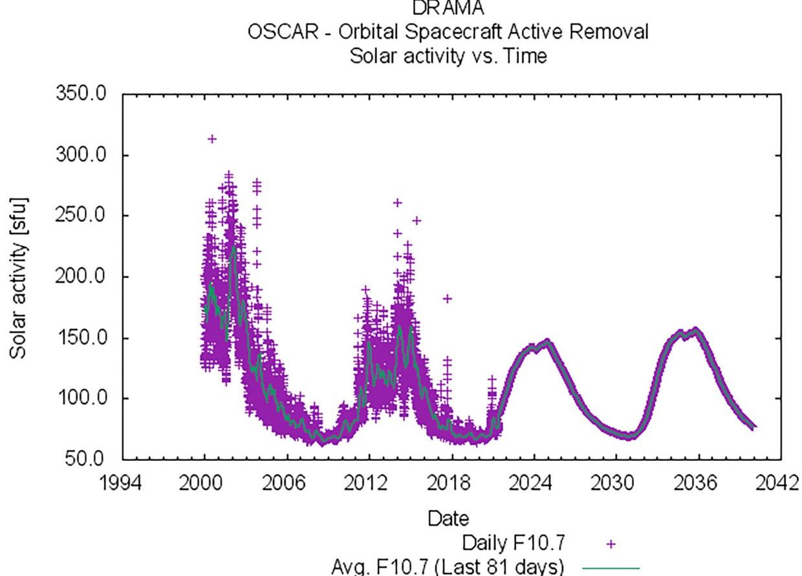

Fig. 5 Solar activity values depending on the years. The values are provided from the year 2000 to the year 2040, including measurements from 2000 to 2022 and estimations from 2022 to 2040

acting on the satellite. Consequently, analyzing solar activity is critical for determining the mission's lifetime. Figure 5 illustrates the solar magnetic activity cycle from the year 2000, with predictions extending to the year 2040.

The orbital lifetime is analyzed depending on the launch of the satellites for two solar activity cases (Fig. 6). For the mission start in the year 2000 during periods of high solar activity, a polar orbit with the selected initial altitude of 468 km of the 4p4iRAAN constellation lasts approximately 2 years. In contrast, during low solar activity, such as in 2006, the mission lifetime of a polar orbit extends to nearly 8 years. Thus, to minimize the demand on the delta-v budget for altitude correction maneuvers, it is advantageous to launch during a phase of low solar activity. Altitude corrections are necessary to maintain a 5-year lifetime during periods of high solar activity. Specifically, the satellite must remain within a 15 km margin for the first 3 years, requiring eight stationkeeping maneuvers with an average impulse of 91 Ns each, amounting to a total of 735 Ns. The timing of the launch significantly impacts the orbital lifetime. To avoid the peak solar activity phase, the launch should occur either before mid-2030 or after 2035. For instance, a launch in June 2030 allows for a 5-year mission without the need for altitude correction maneuvers, whether in a polar or inclined orbit.

The initial satellite configuration is assumed to be established at launch, with the entire delta-v budget allocated to maintain the relative distances between satellite pairs.

Two practical orbital maneuvers for a single satellite in a pair are simulated. The position in the local-vertical-local horizontal coordinate frame for both scenarios reflects the relative deviation between the target position in the twopair constellation and the satellite's actual location, representing the error that the satellite must correct. Maneuver costs are computed using a model predictive control (MPC) method, which employs a cost function designed to minimize thrust consumption while modeling the thrust vector for a chemical propulsion system. In the first scenario, the crosstrack separation is 46.40 m, and the error is corrected within approximately two orbits. The total impulse required for this maneuver is 0.72 Ns. In the second scenario, a corrective maneuver addresses the along-track drift resulting from orbital altitude differences. The initial offsets to be corrected are 24.95 m in the radial direction and 999.42 m in the along-track direction. Using the MPC approach, these offsets are rectified over the course of three orbits, with a total impulse expenditure of 0.83 Ns. For a thruster with a total impulse capacity of 400 Ns, up to 480 in-plane maneuvers or 550 cross-track maneuvers could be performed. This would allow for approximately one maneuver per satellite every 5 days over a 5-year mission duration.

## 4.2.2 System Overview and Budgets

An overview of the satellite system and the budgets is provided in this section. The mass and volume specifications

<!-- PDF_PAGE: 11 -->

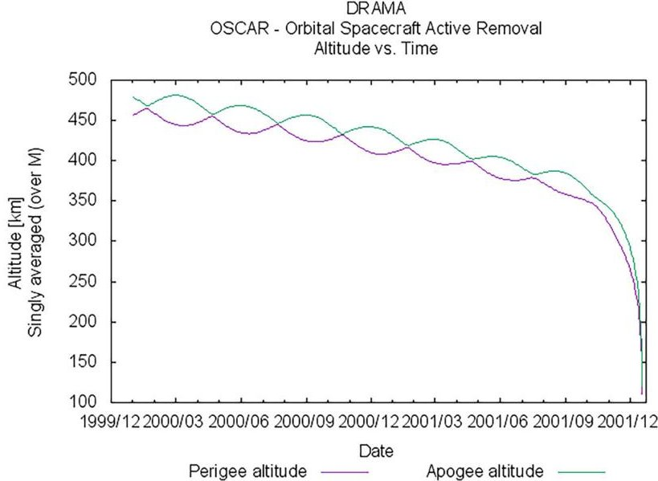

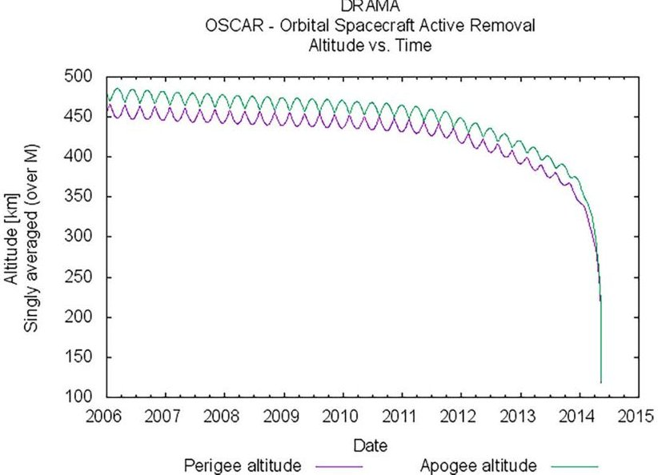

Fig. 6 Orbital lifetime depending on the launch date in high solar activity (left) and low solar activity (right)

Table 2 Mass and volume specifications of the CubeSat systems

<table border="1"><tr><td></td><td>Mass(kg)</td><td>Volume(U)</td></tr><tr><td>Total structural mass</td><td>0.4</td><td>-</td></tr><tr><td>Satellite bus</td><td>1.85</td><td>1.8</td></tr><tr><td>Propulsion system</td><td>1.25</td><td>0.8</td></tr><tr><td>Satellite w/o payload</td><td>3.5</td><td>2.6</td></tr><tr><td>Scientific payload current</td><td>3.5</td><td>5.18</td></tr><tr><td>Total current</td><td>6.92</td><td>7.98</td></tr><tr><td>Total miniaturized</td><td>7.42</td><td>6.0</td></tr></table>

of the different CubeSat systems are listed in Table 2. The selected satellite configuration (satellite without payload), consisting of the satellite bus and the chemical propulsion system, covers 2.6 U and 3.5 kg. According to the scientific payload specifications, the optomechanical accelerometer and the inter-satellite ranging instrument cover in sum a volume of 5.18 U and 3.5 kg. As it becomes obvious, the satellite configuration including the scientific payload exceeds the selected framework of 6 U. Since the provided numbers of the scientific payload are at the maximum level and are expected to reduce in the future, miniaturization is expected. A minimum of 2 U must be reserved for the bus and subsystems to ensure the satellite's proper functionality.

Consequently, the payload volume needs to be reduced by at least 35% to fit within the 6 U constraints. Ideally, this reduction should exceed 40% to provide flexibility in positioning the accelerometer and thruster. Other factors, such as the energy budget and communication budget, have also been taken into account and have influenced the initial system design.

## 4.2.3 Preliminary Satellite Design

A visualization of the preliminary system design is provided in Fig. 7. The setup includes the flight-proven TRL 9 components star sensor, chemical propulsion systems, and satellite

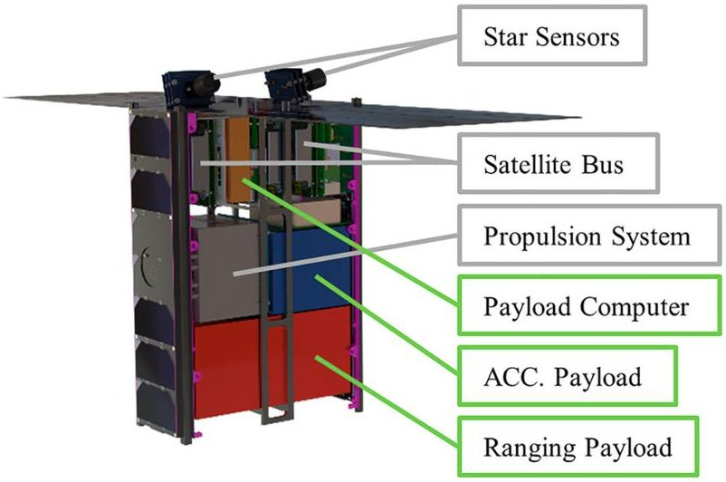

Fig.7 Preliminary satellite design

bus. The satellite bus visualized as the grey boxes represents all necessary components for a successful mission including the On-Board Computer (OBC), the Attitude and Orbit Control System (AOCS) including actuators and sensors, the Electrical Power System (EPS), the Power Distribution Unit (PDU), and the communication modules. The scientific payload covering predominantly the accelerometer and the inter-satellite ranging instrument is indicated with the green boxes. The latter ones should represent available space that is adjustable for payload requirements.

## 5 Design Constraints and Requirements

In the following, the key challenges associated with the design and performance of the CubeSat mission are presented, along with their origins, proposed solutions, and impacts on the overall system. One of the primary challenges is the accommodation of the scientific payload within

<!-- PDF_PAGE: 12 -->

the CubeSat's limited space of 6 U. To address this challenge, it is necessary to miniaturize both the payload and platform packaging; however, achieving the required tight tolerances requires considerable effort to meet these space optimization requirements. Another significant challenge is the precise placement of the optomechanical accelerometer at the CubeSat's Center of Mass (COM), which is crucial for ensuring measurement accuracy and mission success. Precise mass distribution methods and advanced modeling techniques are necessary to minimize COM deviations. Achieving this requires careful iterative design analysis. Regarding propulsion, while solid electric propulsion (SEP) is favored due to its simpler and faster development compared to liquid alternatives, it presents a trade-off. While SEP aligns well with the payload constraints, it may limit postlaunch orbital adjustments, which could affect mission flexibility. Additionally, CubeSat size constraints in the selected 6 U design limit power generation capacity. To overcome this, deployable solar arrays are proposed to maximize power output. However, the deployment mechanism introduces added complexity, and the balance between power needs and observation opportunities requires further optimization. In addition, the deployment of solar arrays induces vibrations that necessitate dampening mechanisms and vibration isolation techniques at the payload mounting points. These solutions add complexity and mass to the CubeSat but are crucial to maintaining power generation efficiency while mitigating vibrations. These findings underscore the need for careful design trade-offs, emphasizing that while solutions to each challenge are feasible, their integration into the CubeSat system requires careful consideration of mission constraints and iterative refinement. Further studies are necessary to fully optimize these solutions.

## 6 Conclusion and Recommendations

The CubeGrav project has demonstrated the effectiveness of CubeSats in retrieving Earth's gravity field, offering substantial scientific benefits by enhancing spatiotemporal resolution and mitigating temporal aliasing compared to conventional single- or dual-satellite mission configurations. The constellation of 4 polar and 4 inclined satellite pairs, each distributed on 2 orbital planes (4p4iRAAN), is one of the most promising satellite constellations in terms of scientific performance, and a potential realization in orbit is possible but more cost intensive than other CubeSat constellations. Appropriate instrument options for accelerometry and GNSS sensing could be identified. However, a key challenge remains in developing a suitable inter-satellite ranging system capable of achieving micrometer-level accuracy while adhering to stringent size, weight, and power constraints. Advancements in miniaturized instrumentation are expected

to address this challenge, thereby influencing the design of future satellite missions. The lifetime of the satellite mission depends on solar activity, and it is recommended that the satellites are launched close to the solar minimum to ensure a sufficient operational duration of several years. Continued investigation into both the scientific performance and the technical implementation of such systems is essential to exploit the full potential of CubeSats for gravity field monitoring.

## References

Bandyopadhyay S, Foust R, Subramanian GP, Chung S-J, Hadaegh FY (2016) Review of formation flying and constellation missions using nanosatellites. J Spacecr Rocket 53(3):567-578

Bender PL, Wiese DN, Nerem RS (2008) A possible dual-grace mission with 90 degree and 63 degree inclination orbits. In: Proceedings of the 3rd international symposium on formation flying, missions and technologies. ESA/ESTEC, Noordwijk, pp 1-6

Braun V, Funke Q, Lemmens S, Sanvido S (2020) DRAMA 3.0-upgrade of ESA's debris risk assessment and mitigation analysis tool suite. J Space Saf Eng 7(3):206-212

Daras I (ed) (2023) Next Generation Gravity Mission (NGGM) mission requirements document, Issue 1.0. Earth and Mission Science Division, European Space Agency. https://doi.org/10.5270/ESA.NGGM-MRD.2023-09-v1.0

Dávila Álvarez A, Knudtson A, Patel U, Gleason J, Hollis H, Sanjuan J et al (2022) A simplified gravitational reference sensor for satellite geodesy. J Geod 96(10). https://doi.org/10.1007/s00190-022-01659-0

Dobslaw H, Bergmann I, Dill R, Forootan E, Klemann V, Kusche J, Sasgen I (2014) Updating ESA's Earth system model for gravity mission simulation studies: 2. Comparison with the original model. Scientific Technical Report; 14/08. Deutsches GeoForschungsZentrum GFZ, 57pp

Dobslaw H, Bergmann-Wolf I, Forootan E, Dahle C, Mayer-Gurr T, Kusche J, Flechtner F (2016) Modeling of present-day atmosphere and ocean non-tidal de-aliasing errors for future gravity mission simulations. J Geod 90(5):423-436

Drinkwater M, Floberghagen R, Haagmans R, Muzi D, Popescu A (2003) GOCE: ESA's first Earth explorer core mission. In: Earth gravity field from space - from sensors to earth science, Space sciences series of ISSI, vol 18. Kluwer Academic Publishers, Dordrecht, pp 419-432. ISBN: 1-4020-1408-2

Elsaka B et al (2014) Comparing seven candidate mission configurations for temporal gravity field retrieval through full-scale numerical simulation. J Geod 88(1):31-43. https://doi.org/10.1007/s00190-013-0665-9

Flechtner F, Neumayer K-H, Dahle C, Dobslaw H, Fagiolini E, Raimondo J-C, Guntner A (2016) What can be expected from the GRACE-FO laser ranging interferometer for Earth science applications? Surv Geophys 37(2):453-470. https://doi.org/10.1007/s10712-015-9338-y

Haagmans R, Tsaoussi L (eds) (2020) Next generation gravity mission as a mass-change and geosciences international constellation (MAGIC) mission requirements document. Earth and Mission Science Division, European Space Agency, NASA Earth Science Division. https://doi.org/10.5270/esa.nasa.magic-mrd.2020. Accessed 14 Jan 2025

Hauk M, Pail R (2018) Treatment of ocean tide aliasing in the context of a next generation gravity field mission. Geophys J Int 214(1):345- 365. https://doi.org/10.1093/gji/ggy145

<!-- PDF_PAGE: 13 -->

Heller-Kaikov B, Pail R, Daras I (2023) Mission design aspects for the mass change and geoscience international constellation (MAGIC). Geophys J Int 235(1):718-735. https://doi.org/10.1093/gji/ggad266

Hines A, Richardson L, Wisniewski H, Guzman F (2020) Optomechanical inertial sensors. Appl Optics 59(22): G167-G174. https://doi.org/ 10.1364/AO.393061

Hines A, Nelson A, Zhang Y, Valdes G, Sanjuan J, Stoddart J, Guzmán F (2022) Optomechanical accelerometers for geodesy. Remote Sens 14(17). https://doi.org/10.3390/rs14174389

Kornfeld RP, Arnold BW, Gross MA, Dahya NT, Klipstein WM, Gath PF, Bettadpur S (2019) GRACE-FO: the gravity recovery and climate experiment follow-on mission. J Spacecr Rocket 56(3):931- 951. https://doi.org/10.2514/1.A34326

Landerer FW, Flechtner FM, Save H, Webb FH, Bandikova T, Bertiger WI et al (2020) Extending the global mass change data record: GRACE follow-on instrument and science data performance. Geophys Res Lett 47(12). https://doi.org/10.1029/2020GL088306

Lenoir B, Lévy A, Foulon B, Lamine B, Christophe B, Reynaud S (2011) Electrostatic accelerometer with bias rejection for gravitation and Solar System physics. Adv Space Res 48(7):1248-1257. https:// doi.org/10.1016/j.asr.2011.06.005

Liorzou F, Lebat V, Christophe B, Boulanger D, Rodrigues M, Zahzam N et al (2023) ONERA accelerometers for future gravity mission. EGU General Assembly 2023, Vienna, Austria

Massotti L, Siemes C, March G, Haagmans R, Silvestrin P (2021) Next generation gravity mission elements of the mass change and geoscience international constellation: from orbit selection to instrument and mission design. Remote Sens 13(19). https://doi.org/10.3390/ rs13193935

Mayer-Gurr T et al (2015) The new combined satellite only model GOCO05s. In: Presentation at EGU 2015, Vienna, Apr 2015

Moeller G, Wolf A, Sonnenberg F, Bauer G, Soja B, Rothacher M (2024) A low-cost commercial off-the-shelf GNSS receiver for space. EGU General Assembly 2024, Vienna, Austria

Murbock M (2015) Virtual constellations of next generation gravity missions. In: Reihe C: Dissertationen: Deutsche Geodatische Kommission. Verlag C.H. Beck, Bayerische Akademie der Wissenschaften, München. https://dgk.badw.de/fileadmin/user_upload/ Files/DGK/docs/c-750.pdf. Accessed 14 Jan 2025

Murbock M, Pail R, Daras I, Gruber T (2015) Optimal orbits for temporal gravity recovery regarding temporal aliasing. Int J Geod 88(2):113-126. https://doi.org/10.1007/s00190-013-0671-y

Nelson A, Warrayat M, Dahn J, Harley-Trochimczyk I, Sanjuan J, Guzman F (2024) A six-axis optomechanical inertial sensing and navigation system for future mass change missions. In: AGU 2024, Washington, DC, USA

Nicklaus K, Cesare S, Massotti L, Bonino L, Mottini S, Pisani M, Silvestrin P (2020) Laser metrology concept consolidation for NGGM. CEAS Space J 12(3):313-330. https://doi.org/10.1007/s12567-02000324-6

Pail R et al (2015) Science and user needs for observing global mass transport to understand global change and to benefit society. Surv Geophys 36(6):743-772

Paul E, Darrow M, Pfaffenzeller N, Eder B, Gruber T, Pail R (2025) New high-precise optical ranging device enables satellite gravimetry with small satellites. In: Proc. SPIE 13699, International Conference on Space Optics - ISCO 2024. https://doi.org/10.1117/12.3072774

Pfaffenzeller N, Pail R (2021) Multi-satellite formations and constellations of CubeSats and their potential in NGGMs. In: Scientific assembly of the International Association of Geodesy, 2021, Beijing, China. https://mediatum.ub.tum.de/doc/1615996/1615996.pdf. Accessed 14 Jan 2025

Pfaffenzeller N, Pail R (2023) Small satellite formations and constellations for observing sub-daily mass changes in the Earth system. Geophys J Int 234(3):1550-1567. https://doi.org/10.1093/gji/ggad132

Pfaffenzeller N, Pail R (2024) Capabilities of ocean tide aliasing reduction by co-estimation of major constituents with future satellite constellations. In: Symposium on gravity, geoid and height systems 2024, Thessaloniki

Ray R (1999) A global ocean tide model from TOPEX/POSEIDON altimetry: GOT99.2, Rep NASA/TM-1999-209478. Goddard Space Flight Center, Greenbelt, 58 pp. https://ntrs.nasa.gov/api/citations/ 19990089548/downloads/19990089548.pdf. Accessed 14 Jan 2025

Reigber C, Schwintzer P, Lühr H (1999) The CHAMP geopotential mission, Bollettino di Geofisica Teoretica ed Applicata, 40/3-4, September-December 1999. In: Marson I, Sunkel H (eds) Proceedings of the 2nd joint meeting of the International Gravity and the International Geoid Commission, 1998, Trieste, Italy, pp 285-289. ISSN: 0006-6729

Rodrigues M, Berge J, Boulanger D, Christophe B et al (2022) Space accelerometers for micro and nanosatellites: Fundamental Physics and Geodesy missions from MICROSCOPE, GOCE and GFO return of experience. In: 4S symposium 2022, Vilamoura, Portugal. https:// hal.science/hal-03854833/document. Accessed 16 Jul 2025

Savcenko R, Bosch W (2012) EOT11a - empirical ocean tide model from multi-mission satellite altimetry. DGFI Report No. 89. Deutsches Geodatisches Forschungsinstitut, München. https://epic.awi.de/id/eprint/36001/1/DGFI_Report_89.pdf. Accessed 14 Jan 2025

Tapley BD, Bettadpur S, Watkins M, Reigber C (2004) The gravity recovery and climate experiment: mission overview and early results. Geophys Res Lett 31(9). https://doi.org/10.1029/2004GL019920

Tomio H, Kammerer W, Grenfell P, Cierny O, Garcia M, Lindsay C et al (2022) Transmitter and fine pointing system development and testing for the CubeSat Laser Infrared CrosslinK (CLICK) B/C mission. In: International conference on space optics 2022, Dubrovnik

Wahr J, Molenaar M, Bryan F (1998) Time variability of the Earth's gravity field: hydrological and oceanic effects and their possible detection using GRACE. J Geophys Res 103(B12):30205-30229

Walter U (2008) Astronautics. Wiley-VCH, Weinheim (Physics textbook). ISBN: 978-3-527-40685-2

Wiese DN, Visser P, Nerem RS (2011) Estimating low resolution gravity fields at short time intervals to reduce temporal aliasing errors. Adv Space Res 48(6):1094-1107. https://doi.org/10.1016/j.asr.2011.05.027

Wiese DN, Nerem RS, Lemoine FG (2012) Design considerations for a dedicated gravity recovery satellite mission consisting of two pairs of satellites. J Geod 86(2):81-98. https://doi.org/10.1007/s00190-011-0493-8

Wiese DN, Bienstock B, Blackwood C, Chrone J, Loomis BD, Sauber J et al (2022) The mass change designated observable study: overview and results. Earth Space Sci 9(8):e2022EA002311. https://doi.org/ 10.1029/2022EA002311

Zingerle P, Gruber T, Pail R, Daras I (2024) Constellation design and performance of future quantum satellite gravity missions. Earth Planets Space 76:101. https://doi.org/10.1186/s40623-024-02034-3

<!-- PDF_PAGE: 14 -->

Open Access This chapter is licensed under the terms of the Creative Commons Attribution 4.0 International License (http://creativecommons.org/licenses/by/4.0/), which permits use, sharing, adaptation, distribution and reproduction in any medium or format, as long as you give appropriate credit to the original author(s) and the source, provide a link to the Creative Commons license and indicate if changes were made.

The images or other third party material in this chapter are included in the chapter's Creative Commons license, unless indicated otherwise in a credit line to the material. If material is not included in the chapter's Creative Commons license and your intended use is not permitted by statutory regulation or exceeds the permitted use, you will need to obtain permission directly from the copyright holder.

