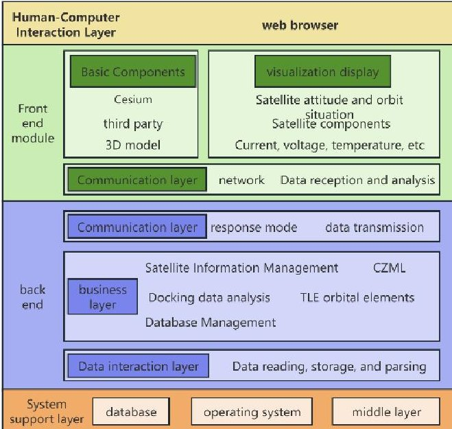
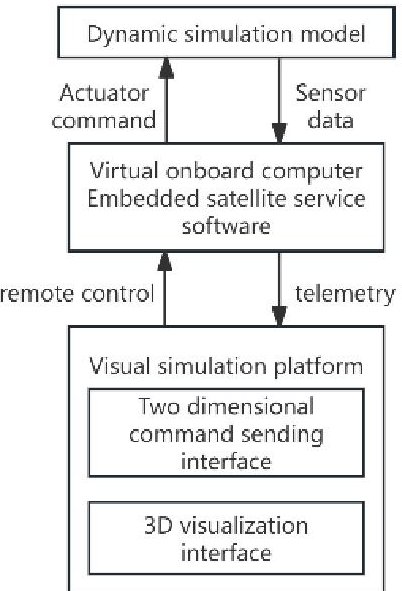
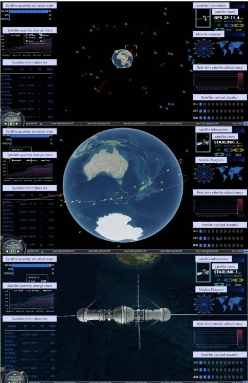

<!-- PDF_PAGE: 1 -->

# Implementation of a Visualization Platform for Integrated Electronic Digitalization Technology of Micro-Nano Satellites Based on Cesium

$ 1^{\mathrm{st}} $ Hongming Zhang School of Sino-Frenchl Engineering, Nanjing University of Science and Technology Nanjing, China 1679367448@qq.com

$ 2^{\mathrm{nd}} $ Yongjun Yu*

School of Mechanical Engineering,

Nanjing University of Science and Technology

Nanjing, China

yuyongjun@njust.edu.cn

*Corresponding author

$ 3^{\mathrm{rd}} $ Wenhe Liao School of Mechanical Engineering, Nanjing University of Science and Technology Nanjing, China yuyongjun@njust.edu.cn

4th Jin Ni School of Mechanical Engineering, Nanjing University of Science and Technology Nanjing, China ninininiminini@163.com

Abstract-Aiming at the problems in the development of the integrated electronic system of micro-nano satellites—such as unreliable data reception at the receiving end, unintuitive and unclear display of various parameter performances, existing visualization programs only being compatible with a single spacecraft, and data mismatch between visualization systems of different spacecraft—this paper proposes a research on the visualization system scheme based on Cesium. It establishes the digital twin framework of the spacecraft, conducts real-time distribution of the generated data, and then uses Cesium to parse and visually display the satellite's orbit, speed, and data of various components, thus realizing a complete spacecraft digital twin visualization system that can be adapted to different spacecraft.

Keywords—Micro-nano satellite, integrated electronic system visualization, Cesium, data matching

## I. INTRODUCTION

In the development and testing process of the integrated electronic system for micro-nano satellites, existing visualization methods mostly rely on desktop programs or dedicated clients customized for a single spacecraft. This model exposes many problems in scenarios of parallel development and on-orbit verification of multiple models and tasks: on the one hand, customization for a single machine or project leads to high development and maintenance costs, as well as a heavy workload for adapting to new models; on the other hand, when traditional visualization schemes display orbit, attitude, and component-level telemetry, they often struggle to provide an intuitive, continuous, and interactive digital twin view due to non-uniform data formats, weak time synchronization mechanisms, and limited rendering performance. To address these issues, it is necessary to build a universal, modular, and Web-based 3D visualization platform to improve the adaptation efficiency of multiple satellite models, reduce deployment thresholds, and enhance the collaboration capability in development and operation and maintenance $ ^{[1]} $

For this reason, this paper designs and implements a spacecraft digital twin visualization platform with Cesium as the core. As a WebGL-based 3D Earth and spatial scene rendering engine, Cesium provides CZML/SampledProperty mechanisms

for time-series data, quadtree tiling and LOD (Level of Detail) streaming loading strategies, as well as rich coordinate systems and transformation tools, making it naturally suitable for interactive visualization of orbits, attitudes, and sensor fields of view. Leveraging Cesium's architectural advantages, this paper proposes a modular data-driven pipeline: it unifies orbital position, attitude quaternion, and component telemetry into time-series data sources, uses SampledProperty/CZML for smooth interpolation and time synchronization on the client side to drive 3D models; in terms of model adaptation, it adopts nodebased modeling of glTF/glb and overlay replacement strategy to achieve granularity control of movable components, thereby supporting rapid access and visual reuse of multiple satellite models.

The main work and contributions of this paper are as follows: 1) Proposes and implements a generalized spacecraft digital twin visualization framework based on Cesium, supporting time-driven display of orbit and attitude, and superposition of component-level telemetry; 2) Designs a movable component implementation scheme combining model node access and alternative overlays, solving the problems of diversity and intuitiveness of visualization functions; 3) Implements interpolation and sequence control strategies for time-series data on the front end, and reduces bandwidth and rendering pressure through differential push and LOD management; 4) Through the construction of a sample system and experimental verification, demonstrates the capability of multi-model satellite access, model tracking, and intuitive display of telemetry attributes.

## II. CESIUM VISUALIZATION PLATFORM ARCHITECTURE

## A. The basic principle of Cesium

Translation: Cesium is a WebGL-based 3D Earth and map visualization engine. Its core principle is based on the WGS84 ellipsoid or geocentric coordinate system, loading images, terrain, and 3D Tiles models on demand through quadtree tiling and streaming LOD (Level of Detail) strategies to support realtime rendering of massive data. For dynamic targets (such as satellites) $ ^{[2]} $ , CZML or sampled position/attitude properties are used to describe time-varying orbits/attitudes, which are then

<!-- PDF_PAGE: 2 -->

interpolated for display on the client side. It also provides functions such as coordinate system conversion, occlusion/terrain height picking, and lighting and shader acceleration $ ^{[3]} $ . This enables high-performance, interactive visualization of satellite orbits, fields of view, and situational awareness when combined with orbit propagators (e.g., TLE/SGP4) and sensor models.

## B. Visualization Platform Architecture

The visualization platform framework is mainly divided into the following levels:

Figure. 1. Visualization system architecture.

According to Figure 1, it can be known that, this architecture is divided into four layers:

Human-Computer Interaction Layer: Supports direct Webbased operations with no dedicated client required, compatible with mainstream browsers such as Edge, Chrome, and Firefox.

Frontend Module: Responds to user interactions and loads visualization modules on demand (including satellite attitude and orbit display, data uplink and downlink, user terminal scenarios, etc.). Modular splitting facilitates maintenance and expansion; it communicates with the backend via RESTful API, and develops space/ground/user segment functions using HTML, CSS, JavaScript, Vue framework, and Cesium library.

Backend Module: Consists of a communication layer, data interaction layer, and business layer, with decoupled responsibilities to reduce coupling. The business layer processes data such as satellite orbits and attitudes, and connects to the database through the data interaction layer.

System Support Layer: Composed of MySQL database, operating system, and middleware, providing basic support and data security.

## C. Design of Visualization Platform Based on Four Dimensional Matrix

The development of satellite visualization systems faces various technical challenges. By unifying the satellite position and attitude into a $ 4 \times4 $ homogeneous transformation matrix to achieve a single algebraic expression, its universal, compact, and

efficient characteristics can adapt to multiple scene requirements, ensuring the accuracy, performance, and maintainability of related scenes.

In three-dimensional matrix coordinate transformation, displacement requires addition, rotation and scaling require multiplication, which is complex and not conducive to inverse transformation $ ^{[4]} $ . This article unifies three transformations through a four-dimensional transformation matrix, converting all operations into multiplication operations, simplifying coordinate transformation logic and achieving inverse transformation. The basic transformation formula is as follows:

$$
V r = T \cdot R \cdot N \cdot V o
$$

Among them, Vo is the original four-dimensional coordinate, Vr is the transformed four-dimensional coordinate, T is the four-dimensional displacement matrix, R is the four-dimensional rotation matrix, and N is the four-dimensional scaling matrix.

For any three-dimensional coordinate $ ( x, y, z) $ , when its fourth dimension is 1, it represents a point, and when its fourth dimension is 0, it represents a vector. For any four-dimensional coordinate $ ( x, y, z, w) $ , when $ w=0 $ , it represents a vector, and its three-dimensional coordinates are $ ( x, y, z) $ ; When $ w \neq 0 $ , it represents a point with three-dimensional coordinates of $ ( x / w, y / w, z / w) $ . For any translation transformation $ ( t_{x}, t_{y}, t_{z}) $ , the four-dimensional matrix of $ T $ is:

$$
\boldsymbol {T} \left(t _ {x}, t _ {y}, t _ {z}\right) = \left[ \begin{array}{c c c c} 1 & 0 & 0 & t _ {x} \\ 0 & 1 & 0 & t _ {y} \\ 0 & 0 & 1 & t _ {z} \\ 0 & 0 & 0 & 1 \end{array} \right]
$$

Taking the rotation of $ \theta $ angle around the x-axis as an example, the four-dimensional matrix of R is:

$$
R _ {x} (\theta) = \left[ \begin{array}{c c c c} 1 & 0 & 0 & 0 \\ 0 & \cos \theta & - \sin \theta & 0 \\ 0 & \sin \theta & \cos \theta & 0 \\ 0 & 0 & 0 & 1 \end{array} \right]
$$

For any scaling transformation $ ( s_{x}, s_{y}, s_{z}) $ , based on formula derivation and the aforementioned calculations, the four-dimensional transformation matrix of N is:

$$
N \left(s _ {x}, s _ {y}, s _ {z}\right) = \left[ \begin{array}{c c c c} s _ {x} & 0 & 0 & 0 \\ 0 & s _ {y} & 0 & 0 \\ 0 & 0 & s _ {z} & 0 \\ 0 & 0 & 0 & 1 \end{array} \right]
$$

The four-dimensional matrix has great advantages in solving inverse transformations. For a four-dimensional transformation $ M=T\cdot R\cdot N $ , its transformation matrix is:

$$
M = N ^ {- 1} \cdot R ^ {- 1} \cdot T ^ {- 1}
$$

Therefore, when the coordinates of the satellite in the Earth's fixed coordinate system are $ ( x,y,z) $ , the satellite body rotates $ \theta_{x}, $ $ \theta_{y}, $ $ \theta_{z} $ relative to the coordinate system, and the payload rotates $ \theta_{r},\theta_{p},\theta_{h} $ relative to the satellite, its four-dimensional transformation matrix is:

<!-- PDF_PAGE: 3 -->

$$
\left\{ \begin{array}{l} \boldsymbol {R} _ {\mathrm {o}} = \boldsymbol {R} _ {x} \left(\theta_ {x}\right) \cdot \boldsymbol {R} _ {y} \left(\theta_ {y}\right) \cdot \boldsymbol {R} _ {z} \left(\theta_ {z}\right) \\ \boldsymbol {R} _ {\mathrm {s}} = \boldsymbol {R} _ {x} \left(\theta_ {r}\right) \cdot \boldsymbol {R} _ {y} \left(\theta_ {p}\right) \cdot \boldsymbol {R} _ {z} \left(\theta_ {h}\right) \\ \boldsymbol {M} = \boldsymbol {T} (x, y, z) \cdot \boldsymbol {R} _ {\mathrm {o}} \cdot \boldsymbol {R} _ {\mathrm {s}} \end{array} \right.
$$

## III. DESIGN OF VISUALIZATION PLATFORM AND DATA MATCHING

Figure. 2. Visual platform model.

The system has detailed satellite visualization capabilities in a three-dimensional Earth scene, which can accurately locate and display the real-time status of the satellite by interacting with relevant modules/platforms, completing coordinate transformations and matrix calculations, providing diverse visualization details, and ensuring visual continuity and temporal consistency through timestamp interpolation smoothing and setting refresh rates $ ^{[5]} $ . The specific details are shown in Figure 2.

## A. Matching satellite orbit data with Cesium visualization data

The core of reliable satellite orbit data visualization in Cesium is consistent time (UTC) and format, clear coordinate system/unit conversion, and sampling density/rendering optimization; commonly used APIs/objects include SampledPositionProperty, Entity, and Primitive, with mapping strategies involving assigning position/attitude to Entity, loading glTF/glb models, displaying trajectories via path/polyline, and interactive information presentation, while massive data and high-precision scenarios are optimized through Instancing, 3D Tiles, and origin shifting, and the TABLE I. summarizes relevant data fields, formats/units, Cesium objects/properties, and key functions/parameters.

TABLE I. TRACK DATA MATCHING

<table border="1"><tr><td>Data Type/Field</td><td>Expected Format/Unit</td><td>Cesium Object/Property</td></tr><tr><td>ECEF Coordinates(x,y,z)</td><td>Meters(m),Earth-Centered Earth-Fixed(ECEF)</td><td>Entity.position=Cartesian3(x,y,z)orvalue ofSampledPositionProperty</td></tr><tr><td>ECI/TEME Coordinates</td><td>ECI usually needs conversion to ECEF(considering GMST)</td><td>Converted to Cartesian3(ECEF)</td></tr><tr><td>ECEF Time Series(ephemeris[].(time,x,y,z))</td><td>Array,unit:m</td><td>SampledPositionProperty/newCesium.Cartesian3(x,y,z)</td></tr><tr><td>Attitude Quaternion(qx,qy,qz,qw)</td><td>Normalized quaternion(unitless)</td><td>SampledProperty-Entity.orientation</td></tr><tr><td>Model URL/Scale(model.uri,model.scale)</td><td>String/Numeric value</td><td>Entity.model</td></tr><tr><td>Trajectory Visualization Parameters(path)</td><td>Trail/lead time(seconds),resolution,material</td><td>Entity.path</td></tr><tr><td>Trajectory Line(static point set)(positions)</td><td>Cartesian3 array(latitude-longitude-altitude conversion)</td><td>Entity.polyline or Primitive(superior performance)</td></tr><tr><td>Label/Billboard(text/billboard)</td><td>Text/Image</td><td>Entity.label/Entity.billboard</td></tr></table>

## B. Satellite component visualization data matching

The core process of visualizing satellite components is as follows: telemetry data in JSON/CZML format is pushed to the front-end in real time through channels such as WebSocket $ ^{[6]} $ Cesium loads the satellite GLB model and its position and

orientation are driven by dynamic data. The movable components update their position by changing local matrices or creating coverings through independent GLTF nodes. The communication layer unifies timestamps and coordinate systems, and the rendering layer updates corresponding data. The specific data correspondence relationship is attached below TABLE II.

TABLE II. COMPONENT DATA MATCHING

<table border="1"><tr><td>Purpose</td><td>Key Functions</td></tr><tr><td>Cesium Loads Entire glb Model</td><td>viewer.entities.add(model configuration)/Cesium.Model.fromGltf</td></tr><tr><td>Dynamic Position(Orbit)</td><td>SampledPositionProperty/CzmlDataSource/VelocityOrientationProperty</td></tr><tr><td>Set Overall Model Attitude</td><td>Transforms.headingPitchRollToFixedFrame/Quaternion.fromHeadingPitchRoll</td></tr><tr><td>Calculate World Transformation Matrix</td><td>Cesium.Matrix4.multiply/Matrix4.multiplyByPoint</td></tr><tr><td>Local Point to World Coordinates(Alternative Annotation)</td><td>Matrix4.multiplyByPoint/Matrix4.multiplyByPointAsVector</td></tr><tr><td>Quaternion/Matrix Drives Component Rotation</td><td>Matrix4.fromRotationTranslation/Quaternion to Matrix4</td></tr></table>

<!-- PDF_PAGE: 4 -->

These key functions enable telemetry data communication from C # to the front-end, loading and dynamically driving the glb model in Cesium, accessing glTF nodes or replacing coverings, calculating coordinates and matrices, visualizing component parameters, synchronizing time, and optimizing performance related to satellite component visualization.

## C. Satellite attitude data matching

The core of accurately adjusting satellite attitude in visualization is converting various attitude representations from ground telemetry (quaternion/Euler angles/direction cosine matrix/angular velocity) to Cesium's reference frame (usually Earth-fixed/ECEF/Cesium's fixed reference frame) according to time and coordinate systems, then assigning the processed quaternion to Entity.orientation (or SampledProperty), while the position is time-sampled via SampledPositionProperty and assigned to entity.position to ensure time synchronization and smooth interpolation, with the following TABLE III. specific attitude visualization data correspondence.

TABLE III. ATTITUDE DATA MATCHING

<table border="1"><tr><td>Purpose</td><td>Key Functions/Classes</td></tr><tr><td>Receive and Parse Telemetry</td><td>JSON+Cesium.JulianDate.fromIso8601</td></tr><tr><td>Time-Series Position</td><td>Cesium.SampledPositionProperty</td></tr><tr><td>Time-Series Attitude(Quaternion)</td><td>Cesium.SampledProperty(Cesium.Quaternion)</td></tr><tr><td>ECI→ECEF(if ECI is provided by the backend)</td><td>Cesium.Transforms.computeIcrfToFixedMatrix+Cesium.Quaternion.fromRotationMatrix</td></tr><tr><td>Compose/CorrectQuaternion</td><td>Cesium.Quaternion.multiply+Cesium.Quaternion.normalize</td></tr><tr><td>Debugging</td><td>Draw Arrows/Labels/model.readyPromise</td></tr></table>

## D. Experimental results presentation

Through the establishment of the aforementioned satellite visualization system, visualization at this stage can already display satellite orbits $ ^{[7]} $

Figure. 3. Visual platform rendering.

It allows for the import of different satellite models and provides real-time visualization of the status of various satellite components. Additionally, it displays information such as the satellite's model and current status. Furthermore, it features model tracking, the ability for multiple satellites to operate in orbit, and an aesthetically pleasing UI design, it can meet the current on-orbit service needs of different satellites, and is more intuitive compared to existing systems. Below figure 3 is an image of the system's effect.

## IV. CONCLUSION

To address single-spacecraft compatibility and data mismatch in micro-nano satellite integrated electronic system visualization, this study proposes a Cesium-based digital twin solution with modular web architecture, four-dimensional matrix transformation, data-driven pipeline, glTF/glb multi-spacecraft adaptation, and Cesium's time-series interpolation/LOD optimization for real-time visualization. Key metrics: 10-satellite scene - bandwidth 500 $ \rightarrow $ 150 kbps ( $ \downarrow $ 70%), initialization 12 $ \rightarrow $ 2.5 s ( $ \downarrow $ 79%); 20-satellite scene - frame rate 12 $ \rightarrow $ 35 FPS ( $ \uparrow $ 192%), GPU memory 800 $ \rightarrow $ 240 MB ( $ \downarrow $ 70%); 120-satellite support ( $ \uparrow $ 2300%), sync delay 300 $ \rightarrow $ 45 ms ( $ \downarrow $ 85%). Validated for multi-model access/tracking, it resolves web bandwidth/rendering issues, balances fluency/scalability, cuts costs/thresholds, and provides a universal spacecraft digital twin visualization solution.

## REFERENCES

[1] Y. Zhang, T. Brown, S. Miller, "Digital twin architecture for small satellite electronic systems: design and implementation," IEEE Access, vol. 10, pp. 11234-11249, 2022.

[2] H. Li, R. Thompson, D. O'Connor, "A scalable WebGIS approach to satellite electronic health monitoring and visualization," Int. J. Appl. Earth Obs. Geoinform., vol. 103, p. 102786, 2021.

[3] P. Nguyen, R. Gonzalez, H. Patel, "Visualizing spaceborne telemetry and electronic subsystems with Cesium and WebGL," in Proc. IEEE Int. Conf. Aerosp. Electron., 2023, pp. 78-86.

[4] S. Kumar, J. Rivera, "Real-time attitude and orbit visualization for CubeSats using open 3D platforms and Cesium," Acta Astronautica, vol. 181, pp. 45-56, 2021.

[5] A. Smith, M. Johnson, K. Lee, "Real-time visualization and simulation of small satellite missions using Cesium and WebGL," in Proc. Int. Conf. Space Oper. (SpaceOps), 2019, pp. 445-452.

[6] L. Andersson, P. Eriksson, "Integration of on-board electronic digital models into a Cesium-based visualization framework," in Proc. AIAA Model. Simul. Conf., 2024, paper AIAA-2024-0456.

[7] B. Yu, J. Wang, X. Li, et al., "A web-based 3D visualization platform for satellite constellation management using Cesium," Adv. Space Res., vol. 66, no. 3, pp. 1234-1246, 2020.