<!-- PDF_PAGE: 1 -->

$ 7 6^{\mathrm{th}} $ International Astronautical Congress (IAC 2025), Sydney, Australia, 29 Sep-3 Oct 2025. Copyright $ \textcircled{2} 0 2 5 $ by the International Astronautical Federation (IAF). All rights reserved.

IAC-25-B4.IP.55.X102125

# In-situ Power System Modelling for Micro/Nano Satellite Autonomous Operation System

Yuma Sato $ ^{a} $ , Kikuko Miyata $ ^{b} $

$ ^{a} $ Department of Vehicle and Mechanical Engineering, Meijo University, 1-501 Shiogamaguchi Tempaku-ku, Nagoya, Aichi, 468-8502, Japan, 243431006@ccmailg.meijo-u.ac.jp

$ ^{b} $ Department of Vehicle and Mechanical Engineering, Meijo University, 1-501 Shiogamaguchi Tempaku-ku, Nagoya, Aichi, 468-8502, Japan

* Corresponding Author

## Abstract

The demand for micro/nano-satellites has grown in recent years. However, there are many challenges, such as a low success rate or strict power constraints. The reliability of the electrical system is critical for ensuring safe operation, because its failures are the primary cause of failure in the initial operational phase. In addition, a large portion of the generated power is consumed simply by maintaining bus equipment, leading to the severe constraints of the available electrical power resources. Therefore, the safe and efficient operation is important. Autonomous satellite operation is a critical technology. This study proposes an autonomous scheduling method that enhances both the safety and efficiency of satellite operations by integrating system identification of the battery. The proposed framework consists of two main parts: a ground system and an onboard system. On the ground, a battery equivalent circuit model is identified from on-orbit telemetry data using a logarithmic Unscented Kalman Filter (UKF), and this updated model is incorporated into a simulator for mission planning. In the onboard system, a computationally efficient Constrained Nonlinear Recursive Least Squares method is used for rapid system identification when a significant discrepancy between predicted and actual battery states is detected. The mission schedule is then re-optimized using Mixed Integer Programming using the system identification results in onboard. In this case study, each method was applied to actual onboard data from our 1U CubeSat DENDEN-01 to evaluate the system identification method. Additionally, we verified the effectiveness of the onboard scheduling method through numerical simulations employing a parameter set of DENDEN-01. The results confirmed that the logarithmic UKF can effectively estimate battery parameters across multiple datasets. Furthermore, the proposed onboard scheduling method was shown to provide a globally optimal schedule, a significant improvement over previous heuristic approaches that simply delete low-priority tasks.

Keywords: Nano Satellites, Battery, Mission Planning, Autonomous Operation, System Identification, Optimization

<table border="1"><tr><td colspan="2">Nomenclature</td><td colspan="2">Subscripts</td></tr><tr><td>C</td><td>:Capacity</td><td>b</td><td>:Battery</td></tr><tr><td>i</td><td>:Current</td><td>bus</td><td>:Bus system</td></tr><tr><td>N</td><td>:Total number of tasks</td><td>ch</td><td>:Generated power in charging mode</td></tr><tr><td>μ</td><td>:Number of parallel cells</td><td>co</td><td>:Power consumption</td></tr><tr><td>p</td><td>:Priority of tasks</td><td>ct</td><td>:Charge transfer</td></tr><tr><td>P</td><td>:Initial covariance</td><td>d</td><td>:Diffusion</td></tr><tr><td>Π</td><td>:Power</td><td>dl</td><td>:Double layer</td></tr><tr><td>Q</td><td>:System noise covariance</td><td>in</td><td>:Charging</td></tr><tr><td>r</td><td>:Observation noise covariance</td><td>ini</td><td>:Initial</td></tr><tr><td>R</td><td>:Resistance</td><td>mi</td><td>:Generated power in mission mode</td></tr><tr><td>V</td><td>:Voltage</td><td>max</td><td>:Maximum</td></tr><tr><td>X</td><td>:Binary decision variable that indicates whether tasks are executed</td><td>min</td><td>:Minimum</td></tr><tr><td>β</td><td>:Determine the sign of the current</td><td>n</td><td>:Task number</td></tr><tr><td>γ</td><td>:Slope of the linearized SOC-OCV relationship</td><td>o</td><td>:Power consumption of other equipment</td></tr><tr><td>δ</td><td>:Binary parameter that is 1 if task n is executed</td><td>out</td><td>:Discharging</td></tr><tr><td>Δt</td><td>:Time interval</td><td>OCV</td><td>:Open circuit voltage</td></tr><tr><td>ε</td><td>:Intercept of the linearized SOC-OCV relationship</td><td>t</td><td>:Time</td></tr><tr><td>η</td><td>:Charging/Discharging efficiency</td><td>0</td><td>Electrophoretic</td></tr><tr><td></td><td></td><td colspan="2">Abbreviations</td></tr><tr><td></td><td></td><td>CN</td><td>:Condition Number</td></tr></table>

<!-- PDF_PAGE: 2 -->

$ 7 6^{\mathrm{th}} $ International Astronautical Congress (IAC 2025), Sydney, Australia, 29 Sep-3 Oct 2025. Copyright $ \textcircled{2} 0 2 5 $ by the International Astronautical Federation (IAF). All rights reserved.

CNRLS : Condition Number based Recursive Least Squares

FCC : Full Charge Capacity

MIP : Mixed-Integer Programming

OCV : Open Circuit Voltage

RLS : Recursive Least Squares

SOC : State of Charge

SOH : State of Health

UKF : Unscented Kalman Filter

## 1. Introduction

The demand for micro/nano-satellites has grown in recent years [1]. Their advantages include low cost and a shorter development period than those of conventional satellites; however, they have severe constraints on mass and volume. These constraints make design, manufacturing, and operations difficult, causing issues in securing safety and reliability and realizing efficient operation. Furthermore, the low success rate of these satellites is a significant concern. Swartwout [2] reported that only 28.2% of all small satellites were able to complete all missions. Improving this rate is essential for the further expansion of space utilization.

The reliability of the electrical power system is critical for ensuring the operational safety of a satellite. Electrical system failures are the primary cause of failure in the initial operational phase [3]. The severe constraints of mass and volume also limit the available electrical power resources. For example, the power consumption ratio of bus operation to maximum power generation is 4.99 [4], for a 2-t class large satellite ASTRO-H and 1.93 for our 1U CubeSat DENDEN-01 [5]. This implies for micro/nano-satellites like DENDEN-01, a large portion of the generated power is consumed simply by maintaining bus equipment. This results in extremely limited opportunities for mission operations and a high vulnerability to unexpected power fluctuations. Although a large power safety margin enhances robustness against unexpected power fluctuations, it compromises the goal of maximizing mission opportunities.

Satellites are equipped with batteries, and state management is important for their safe operation. The state of charge (SOC) and state of health (SOH), are critical parameters. SOC represents the available capacity at a given stage. SOH represents the battery's level of degradation, is defined as the ratio of the present full charge capacity (FCC) to its nominal value. The battery must be operated within a predetermined SOC range for safe and reliable long-term operation and to prevent overcharging or overdischarging. An acceptable SOC range is often calculated based on mission duration and battery characteristics. Additionally, battery degradation affects the accuracy of SOC estimation.

Autonomous satellite operation is a critical technology that drives the increased use of micro/nano-

satellites. Previously, engineers constructed and validated their operational plans individually. The previous method is not suitable for multiple satellite missions, such as constellations or formation flights, because it requires an enormous of human resources. Furthermore, existing methods are associated with issues such as the risk of human error, reliance on specific personnel, and quality variability.

Effective mission scheduling is important for fully autonomous satellite operations. Effective mission schedules for autonomous operations must address the complex priority requirements of multiple tasks, such as bus systems, photo mission, and downlink operations.

Autonomous satellite scheduling has been addressed with optimization techniques, such as sequential quadratic programming [6], or mixed integer linear programming [7,8], which are effective for resolving complex constraints to find optimal schedules. However, there is limited research that accurately models the dynamic characteristics of the battery, a critical power resource for mission success.

Among the few studies that consider battery state, the work in Ref. [6] used the alternating-current impedance method to perform battery system identification and utilized the resulting model for scheduling. This approach, however, was intended for 50 kg class satellites and has not been verified for application to 1U CubeSats, which have more severe power and payload constraints. Furthermore, this identification was based on static ground tests and did not track the degradation that occurs during on-orbit operations.

Another line of research [7] focused on scheduling to minimize battery degradation. While valuable for longterm health, this approach's primary goal was to prevent future degradation rather than to maximize mission value by fully leveraging the battery's current.

Our previous research proposed an autonomous operation planning method for micro/nano-satellites [9,10]. This approach performs operation scheduling on the ground based on a high-accuracy SOC estimation model. The SOC estimation utilized an equivalent circuit model, whose parameters were identified from ground test results. However, this method did not account for the battery degradation or the corresponding changes in the equivalent circuit model parameters. This could potentially result in mission failures due to unexpected power deficits, or, conversely, the operation plan would become excessively conservative to protect the battery. In addition, even if the mission scheduler utilizes a high-accuracy on-ground simulator, the SOC prediction results may differ from actual satellite data for various reasons, such as unexpected battery degradation. To address this difference, we previously proposed a method [10] that deletes the mission execution interval with the lowest priority, based on a pre-assigned priority.

<!-- PDF_PAGE: 3 -->

Although this approach is simple, the resulting schedule is not guaranteed to be optimal.

Therefore, the objective of this study is to perform system identification on the battery equivalent circuit model with on-orbit data and then incorporate the updated model into the scheduling process. This study makes two major contributions to previous studies. First, we demonstrate the effectiveness of applying system identification to on-orbit data. Second, based on the identified model, we propose a safe and more efficient autonomous scheduling method that is applicable to 1U CubeSats.

The remainder of this paper is organized as follows. Section 2 provides a general overview of the scheduling system. It then describes the system identification method in the ground system, followed by the onboard system identification method and the scheduling approach that uses its results. Section 3 summarizes the simulation conditions. Section 4 presents the simulation results. The system identification effects are indicated using a case study. Mission scheduling results using estimated parameters are also presented. Section 5 presents our conclusions and concluding remarks.

## 2. Scheduling system

This section describes the autonomous operation scheduling method.

Figure 1 shows the overview of the scheduling system.

The operator decides the scheduling duration and priorities of each operational mode.

The ground system executes system identification and operation planning. System identification is performed using on-orbit data. Scheduling is performed using both operator-defined settings and the results of system identification. This step uses a scheduling algorithm [9], which integrates the mathematical optimization and a simulation-based constraints satisfaction check. The first step is mission scheduling by mathematical optimization. Next, a simulation-based constraint satisfaction check is performed. This check uses the schedule designed in the first step as an input to a numerical simulation to estimate the future battery state and verify compliance with constraints. If the resulting SOC and voltage do not satisfy the predefined constraints, an additional constraint is added, and the mathematical optimization is performed again. This iterative process is repeated until all constraints are satisfied.

Subsequently, the generated schedule is transmitted to the satellite, and the missions are executed according to these sequences. In parallel, the satellite's battery condition is also estimated to ensure operational safety. If the discrepancy between the ground-predicted SOC and the onboard-estimated SOC exceeds a predefined threshold, the onboard scheduler is activated. It then reschedules the mission plan to either reduce this discrepancy or secure an additional safety margin.

Subsequently, the satellite executes its missions according to this revised schedule.

## Operator

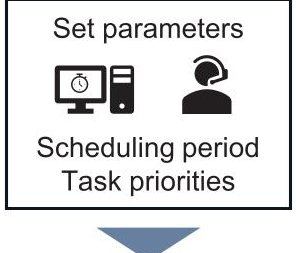

Ground scheduler

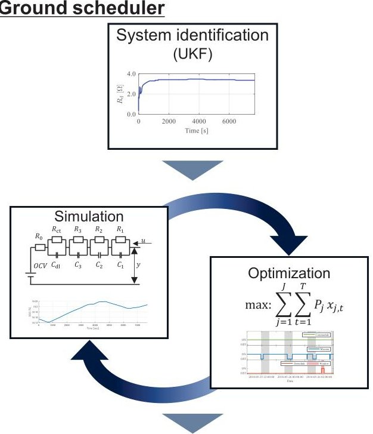

Onboard system

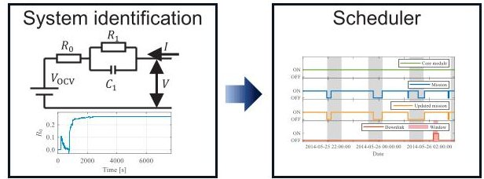

Fig. 1. Overview of scheduling system

## 2.1 System identification method (Ground system)

The system identification method employed for the ground system is described below. This method can use a high-order equivalent circuit model and can also perform SOH estimation. As a result, it achieves highaccuracy battery state estimation.

Figure 2 shows the equivalent circuit model of the battery [6,11].

The state variable x of this model is defined by

$$
\boldsymbol {x} (t) = \left[ S O C (t) \quad v _ {d l} (t) \quad v _ {3} (t) \quad v _ {2} (t) \quad v _ {1} (t) \right].
$$

The state space representation can be expressed as

<!-- PDF_PAGE: 4 -->

$ 7 6^{\mathrm{th}} $ International Astronautical Congress (IAC 2025), Sydney, Australia, 29 Sep-3 Oct 2025. Copyright $ \textcircled{2} 0 2 5 $ by the International Astronautical Federation (IAF). All rights reserved.

$$
\dot {\boldsymbol {x}} (t) = \boldsymbol {A} \boldsymbol {x} _ {b a t t} (t) + \boldsymbol {b} u (t),
$$

$$
y (t) = f _ {O C V} \left(S O C (t)\right) + c ^ {T} \boldsymbol {x} _ {b a t t} (t) + R _ {0} u (t),
$$

where

$$
\boldsymbol {A} = \operatorname {d i a g} \left[ 0 - \frac {1}{C _ {\mathrm {d l}} R _ {\mathrm {c t}}} - \frac {1}{C _ {3} R _ {3}} - \frac {1}{C _ {2} R _ {2}} - \frac {1}{C _ {1} R _ {1}} \right],
$$

$$
\boldsymbol {b} = \left[ \frac {1}{F C C} \quad \frac {1}{C _ {\mathrm {d l}}} \quad \frac {1}{C _ {3}} \quad \frac {1}{C _ {2}} \quad \frac {1}{C _ {1}} \right] ^ {\mathrm {T}},
$$

$$
\boldsymbol {c} = \left[ \begin{array}{c c c c c} 0 & 1 & 1 & 1 & 1 \end{array} \right] ^ {\mathrm {T}}.
$$

Here,

$$
C _ {l} = \frac {C _ {\mathrm {d}}}{2} (l = 1, 2, 3),
$$

$$
R _ {l} = \frac {8 R _ {\mathrm {d}}}{(2 l - 1) ^ {2} \pi^ {2}} \quad (l = 1, 2, 3).
$$

$ f_{\mathrm{OCV}}(SOC) $ represents the open circuit voltage (OCV), which is defined as a function of the SOC. The relationship between OCV and SOC is determined from the results of the experiment. $ R_{0} $ represents the electrophoretic resistance, $ R_{\mathrm{ct}} $ is the charge transfer resistance, $ C_{\mathrm{dl}} $ is the double layer capacity, $ R_{\mathrm{d}} $ is the diffusion resistance, and $ C_{\mathrm{d}} $ is the diffusion capacity. In addition, input is $ u(t)=i_{t} $ , and output is $ y(t)=V_{\mathrm{b,t}}. i_{t} $ represents the battery current, and $ V_{\mathrm{b,t}} $ represents the battery voltage.

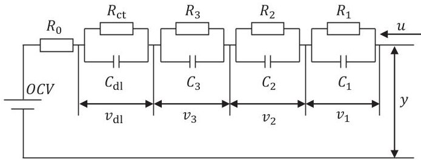

Fig. 2. Equivalent circuit model of Li-ion battery

This study employs an unscented Kalman filter (UKF) for the system identification of the battery model in the ground system. However, conventional UKF may estimate values that are physically impossible. To address this issue, our research employs the technique of logarithmize parameter estimation [12]. The nonnegative parameter constraint can be satisfied by taking the logarithm of the system's unknown parameters. Additionally, this method can reduce numerical errors caused by differences in the order of magnitude among the parameters. Therefore, we first logarithm the unknown system parameters. Then, we construct an augmented state system that includes these parameters along with the original state variables and perform the estimation.

$$
\boldsymbol {z} _ {L} (t) = \left[ \begin{array}{l} S O C (t) \\ v _ {\mathrm {d l}} (t) \\ v _ {1} (t) \\ v _ {2} (t) \\ v _ {3} (t) \\ \ln R _ {0} \\ \ln R _ {\mathrm {c t}} \\ \ln R _ {\mathrm {d}} \\ \ln C _ {\mathrm {d l}} \\ \ln C _ {\mathrm {d}} \\ \ln F C C \end{array} \right],
$$

$$
f _ {\mathrm {L}} \left(\boldsymbol {z} _ {L}, u\right) = \left[ \begin{array}{c} \frac {u}{\exp (\ln F C C)} \\ - \frac {v _ {\mathrm {d l}}}{\exp \left(\ln C _ {d l} + \ln R _ {c t}\right)} + \frac {u}{\exp \left(\ln C _ {\mathrm {d l}}\right)} \\ - \frac {\pi^ {2} v _ {1}}{4 \exp \left(\ln C _ {\mathrm {d}} + \ln R _ {\mathrm {d}}\right)} + \frac {2 u}{\exp \left(\ln C _ {\mathrm {d}}\right)} \\ - \frac {9 \pi^ {2} v _ {2}}{4 \exp \left(\ln C _ {\mathrm {d}} + \ln R _ {\mathrm {d}}\right)} + \frac {2 u}{\exp \left(\ln C _ {\mathrm {d}}\right)} \\ - \frac {2 5 \pi^ {2} v _ {3}}{4 \exp \left(\ln C _ {\mathrm {d}} + \ln R _ {\mathrm {d}}\right)} + \frac {2 u}{\exp \left(\ln C _ {\mathrm {d}}\right)} \\ 0 \\ 0 \\ 0 \\ 0 \\ 0 \end{array} \right], \tag {10}
$$

$$
\begin{array}{l} h _ {\mathrm {L}} \left(\boldsymbol {z} _ {L}, u\right) = f _ {\mathrm {O C V}} \left(S O C\right) + v _ {\mathrm {d l}} + v _ {1} \\ + v _ {2} + v _ {3} + \exp \left(\ln R _ {0}\right) u. \\ \end{array}
$$

The augmented system is shown in Eq. (9), and its state space model is presented in Eqs. (10) and (11).

## 2.2 System identification method (On-board system)

The identification method must be formulated in a format compatible with mathematical optimization, because the onboard scheduling process uses the system identification results.

This system employs the condition number based recursive least squares (CNRLS) [13]. The CNRLS is an improved version of the Recursive Least Squares (RLS) algorithm, enhancing parameter estimation accuracy through the use of the Condition Number. If the CN value exceeds a predefined threshold, the currently identified result is considered unreliable and is discarded. The method then uses previously identified and stored parameters to enable the continuous estimation of highaccuracy parameters.

Figure 3 shows the 1-RC equivalent circuit model for onboard applications.

<!-- PDF_PAGE: 5 -->

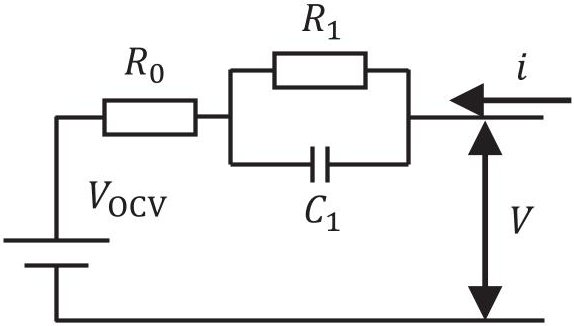

Fig. 3. 1-RC equivalent circuit model for onboard applications

The discrete-time state space representation for the equivalent circuit mode in Fig. 3 is as follows:

$$
x _ {t + 1} = A ^ {\prime} x _ {t} + B ^ {\prime} u _ {t},
$$

$$
y _ {t} = C ^ {\prime} x _ {t} + D ^ {\prime} u _ {t},
$$

where

$$
A ^ {\prime} = \left[ \exp \left(- \frac {\Delta t}{R _ {1} C _ {1}}\right) \right],
$$

$$
B ^ {\prime} = \left[ R _ {1} 1 - \exp \left(- \frac {\Delta t}{R _ {1} C _ {1}}\right) \right],
$$

$$
C ^ {\prime} = 1,
$$

$$
D ^ {\prime} = R _ {0},
$$

$$
y _ {t} = V _ {t} - V _ {\mathrm {O C V}, t},
$$

$$
u _ {t} = i _ {t},
$$

$$
x _ {t} = V _ {1 _ {t}}.
$$

Applying the z-transform to Eqs. (12) and (13) yields the following:

$$
\frac {Y (z)}{U (z)} = C ^ {\prime} \left(z I - A ^ {\prime}\right) ^ {- 1} B ^ {\prime} + D ^ {\prime} = \frac {a _ {2} + a _ {3} z ^ {- 1}}{1 - a _ {1} z ^ {- 1}},
$$

here

$$
a _ {1} = \exp \left(- \frac {\Delta t}{\mathrm {R} _ {1} C _ {1}}\right),
$$

$$
\begin{array}{l} a _ {2} = R _ {0}, \\ a _ {3} = R _ {1} \left(1 - a _ {1}\right) - R _ {0} a _ {1}. \\ \end{array}
$$

From Eq. (21), we derive the following equation for use in the CNRLS.

$$
V _ {t} - V _ {\mathrm {O C V}, t} = \left[ \begin{array}{l} a _ {1} \\ a _ {2} \\ a _ {3} \end{array} \right] ^ {T} \left[ \begin{array}{c} V _ {t - 1} \\ i _ {t} \\ i _ {t - 1} \end{array} \right].
$$

## 2.3 Scheduling method (On-board system)

This study uses mixed-integer programming (MIP) to perform scheduling. Based on an initial schedule generated by a ground scheduler, the method achieves a

feasible schedule by selectively deleting tasks according to their priorities. Note that in this paper, a single task is defined as the continuous period from when a mission is turned ON until it is turned OFF.

The objective function used in this study is as follows:

$$
\max : \sum_ {n = 1} ^ {N} p _ {n} X _ {n},
$$

N represents the total number of tasks in the initial schedule, n is the task index, $ p_{n} $ is the priority of task n, and $ X_{n} $ is a binary decision variable that indicates whether tasks are executed. A value of 1 for $ X_{n} $ means the task is executed, while a value of 0 means it is not.

Next, the constraint functions are described.

The battery current at each time step is calculated based on power consumption and generation. To switch the power consumption and generation values according to the satellite's operational mode, linear constraints using the Big-M method are introduced.

$$
i _ {t} \geq \frac {\Pi_ {\mathrm {c h}, t} - \left(\sum_ {n = 1} ^ {N} \Pi_ {\mathrm {c o}, n , t} X _ {n} + \Pi_ {o , t}\right)}{V _ {\mathrm {b u s}} \mu} - M \sum_ {n = 1} ^ {N} \delta_ {t, n} X _ {n},
$$

$$
i _ {t} \leq \frac {\Pi_ {\mathrm {c h}, t} - \left(\sum_ {n = 1} ^ {N} \Pi_ {\mathrm {c o}, n , t} X _ {n} + \Pi_ {o , t}\right)}{V _ {\mathrm {b u s}} \mu} + M \sum_ {n = 1} ^ {N} \delta_ {t, n} X _ {n},
$$

$$
i _ {t} \geq \frac {\Pi_ {\mathrm {m i} , t} - \left(\sum_ {n = 1} ^ {N} \Pi_ {\mathrm {c o} , n , t} X _ {n} + \Pi_ {o , t}\right)}{V _ {\mathrm {b u s}} \mu}
$$

$$
- M \left(1 - \sum_ {n = 1} ^ {N} \delta_ {t, n} X _ {n}\right),
$$

$$
\begin{array}{l} i _ {t} \leq \frac {\Pi_ {\mathrm {m i} , t} - \left(\sum_ {n = 1} ^ {N} \Pi_ {\mathrm {c o} , n , t} X _ {n} + \Pi_ {o , t}\right)}{V _ {\mathrm {b u s}} \mu} \\ + M \left(1 - \sum_ {n = 1} ^ {N} \delta_ {t, n} X _ {n}\right). \\ \end{array}
$$

In Eqs. (27)-(30), $ i_{t} $ represents the current [A] at time step $ t $ $ \Pi_{\mathrm{ch},t} $ and $ \Pi_{\mathrm{mi},t} $ denote the generated power [W] in charging and mission mode, $ \Pi_{co,n,t} $ is task power consumption [W], $ \Pi_{0,t} $ is the power consumption of other equipment [W], $ V_{\mathrm{bus}} $ is the battery voltage [V], $ \mu $ is the number of parallel cells, M is a sufficiently large constant, and $ \delta_{t,n} $ is a binary parameter that is 1 if task n is executed at time t and 0 otherwise.

In this study, similar to the method proposed by Rigo et al. [8], the charging efficiency $ \eta_{\mathrm{in}} $ and discharging efficiency $ \eta_{\mathrm{out}} $ are switched based on the sign on the battery current. To achieve this, we introduce an indicator variable $ \beta_{t} $ to determine the sign of the current, and implement this switching mechanism using the Big-M method.

$$
i _ {t} \geq - M \left(1 - \beta_ {t}\right), \quad i _ {t} \leq M \beta_ {t}.
$$

<!-- PDF_PAGE: 6 -->

$ S O C_{t} $ is calculated using $ \beta_{t} $ , which is determined by Eq. (31).

$$
S O C _ {t + 1} \geq S O C _ {t} + \frac {i _ {t} \Delta t}{F C C} \eta_ {\mathrm {i n}} - M \left(1 - \beta_ {t}\right),
$$

$$
S O C _ {t + 1} \leq S O C _ {t} + \frac {i _ {t} \Delta t}{F C C} \eta_ {\mathrm {i n}} + M \left(1 - \beta_ {t}\right),
$$

$$
S O C _ {t + 1} \geq S O C _ {t} + \frac {i _ {t} \Delta t}{F C C} \eta_ {\mathrm {o u t}} - M \beta_ {t},
$$

$$
S O C _ {t + 1} \geq S O C _ {t} + \frac {i _ {t} \Delta t}{F C C} \eta_ {\mathrm {o u t}} - M \beta_ {t},
$$

Here, FCC is the full charge capacity of the battery [C], $ \Delta t $ is the time interval [s], and M is a sufficiently large constant (Big-M).

Furthermore, the following constraint is introduced to ensure that the SOC remains within an acceptable range.

$$
S O C _ {t} \geq S O C _ {\min }, \quad S O C _ {t} \leq S O C _ {\max }.
$$

Here, $ S O C_{\mathrm{m i n}} $ and $ S O C_{\mathrm{m a x}} $ represent the lower and upper limits of the SOC, respectively. These limits are determined based on factors such as the satellite's planned operational lifetime and the battery's characteristics.

Next, we propose a battery voltage constraint. The OCV is dependent on the SOC. In the onboard scheduler, the relationship between SOC and OCV was defined by the following equation, which is a linear approximation of the experimental results.

$$
V _ {\mathrm {O C V}} = \gamma S O C + \epsilon .
$$

Here, $ \gamma $ and $ \epsilon $ are the slope and intercept, respectively, of the linear approximation of the experimentally determined SOC-OCV relationship, calculated using the least squares method.

The battery voltage is determined as follows, using the parameters defined in Eq. (37) and those determined by the CNRLS.

$$
\begin{array}{l} V _ {t} = \gamma \left(S O C _ {t} - a _ {1} S O C _ {t - 1}\right) + \epsilon \left(1 - a _ {1}\right) \\ + a _ {1} V _ {t - 1} + a _ {2} i _ {t} + a _ {3} i _ {t - 1}. \\ \end{array}
$$

Additionally, the voltage is subject to an operational lower limit, the following constraint.

$$
V _ {t} \geq V _ {\min }.
$$

## 3. Case study conditions

The proposed concept is verified using a numerical case study based on scenarios involving actual satellites.

To evaluate the system identification methods, we apply each method to actual onboard data from our 1U CubeSat DENDEN-01 and demonstrate that the parameters of the equivalent circuit model of the battery can be estimated.

First, we evaluate the system identification method using the UKF. We perform system identification on multiple current and voltage datasets and evaluate the estimation results.

The parameters used for the UKF are show below. The system noise covariance Q, observation noise covariance r, initial value of the augmented state variable $ z_{0} $ , and initial covariance P were determined through trial and error, with reference to previous studies [6,12]. The initial SOC, denoted by $ SOC_{\mathrm{ini}} $ is determined form SOC-OCV relationship.

$$
\boldsymbol {Q} = \operatorname {d i a g} \left(1 0 ^ {- 8}, 1 0 ^ {- 6}, 1 0 ^ {- 3}, 1 0 ^ {- 3}, 1 0 ^ {- 3}, 1 0 ^ {- 1 0}, \right.
$$

$$
r = 1. 4,
$$

$$
z _ {0} = \left[ \begin{array}{c} S O C _ {\mathrm {i n i}} \\ 0 \\ 0 \\ 0 \\ 0 \\ - 2. 5 \\ - 1. 5 \\ - 1 \\ 6 \\ 1 1 \\ 9. 4 3 1 4 \end{array} \right],
$$

$$
\boldsymbol {P} = \operatorname {d i a g} \left(0. 0 5, 1 0 ^ {3}, 1 0 ^ {8}, 1 0 ^ {8}, 1 0 ^ {8}, 9, 1 3, 1 1, 7, 1 0, 1\right).
$$

Second, we demonstrate the effectiveness of the CNRLS and the onboard scheduling algorithm. We verify the effectiveness of the proposed onboard scheduling method based on the following scenarios. The ground scheduler, shown in Fig. 1, generates an initial operational plan based on a battery prediction model and transmits it to the satellite. The satellite executes the initial operational plan, which is generated by the ground scheduler. For this case study scenario, we set a discrepancy by the onboard-estimated SOC is 5% lower than the ground-predicted SOC at the end of the measurement data period. This setup simulates a situation where an estimation error has accumulated over time. Subsequently, the proposed method reconstructs a safe and efficient operational schedule based on the latest satellite state at that point in time.

In this case study, we define the parameters and operational modes based on those of our 1U CubeSat, DENDEN-01. Similar to previous studies [9], the satellite in this paper has three operational modes. The

<!-- PDF_PAGE: 7 -->

first operational mode is the core module that is required to be continuously active. In this mode, only the bus system is active to charge the battery. The second operational mode is the photo mission. The request for this operational mode is to maximize its operational duration. It is considered the power consumption of the mission related equipment. The third operational mode is the downlink phase, activating once within a defined setting window, taking into account the power consumption of the communication equipment.

We assume two types of satellite's attitude, as shown in the overview in Fig. 4. During an active mission, the satellite operates in mission mode. In other cases, it remains in charging mode. During the mission mode, the attitude is of the satellite is controlled to continuously point the opposite side of the solar panel towards the Earth's centre. In the charging mode, the attitude is maintained to keep the side of the solar-cell array facing the sun.

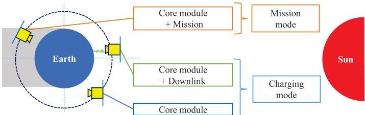

Fig. 4. Overview of the satellite's attitude

In this paper, the priority of each task is set to its execution duration in seconds [s], although it could be assigned any arbitrary value. The main parameters for the simulation are summarized in Table 1.

Table 1. List of parameters

<table border="1"><tr><td colspan="2">Battery parameters</td></tr><tr><td>Control voltage[V]</td><td>4.24</td></tr><tr><td>Battery nominal capacity[C][5]</td><td>12600</td></tr><tr><td colspan="2">Spacecraft conditions</td></tr><tr><td>Spacecraft bus voltage[V]</td><td>7.28</td></tr><tr><td>Maximum power generation per face[W]</td><td>1.63</td></tr><tr><td>Number of solar panels faces on+z,-z</td><td>3</td></tr><tr><td>Number of solar panels faces on-x,+y,-y</td><td>1</td></tr><tr><td>Charge efficiency</td><td>0.90</td></tr><tr><td>Discharge efficiency</td><td>0.95</td></tr><tr><td>Number of battery parallel cells</td><td>1</td></tr><tr><td>Number of battery series cells</td><td>2</td></tr><tr><td>Consumed power of core module[W]</td><td>1.36</td></tr><tr><td>Consumed power of mission[W]</td><td>2.93</td></tr><tr><td>Consumed power of downlink[W]</td><td>4.77</td></tr><tr><td colspan="2">Optimization Conditions</td></tr><tr><td>Maximum acceptable SOC</td><td>0.98</td></tr><tr><td>Maximum acceptable SOC</td><td>0.15</td></tr><tr><td>Minimum acceptable battery voltage[V]</td><td>5.9</td></tr></table>

## 4. Results and discussion

The optimization was performed using the Julia language version 1.10.0, JuMP package [14] and Gurobi Optimizer version 11.0.0 [15]. Furthermore, we employed MATLAB R2023b with the Aerospace toolbox for the simulation.

## 2.1 Results of system identification (Ground system)

We performed system identification on a total of 24 current and voltage datasets.

Figure 5 presents one of the on-orbit measured current history used in this study. In this figure, the horizontal axis indicates time [s], while the vertical axis shows the current [A]. A positive current indicates that the battery is charging.

Figure 6 indicates the voltage. In this figure, the horizontal axis indicates time [s], while the vertical axis shows the voltage [V]. The blue line measured for the same time period as the current in Fig. 5. The red line is the sequential estimated result by UKF. The yellow line shows the voltage re-estimation using only the final set of identified parameters.

The estimated results (yellow line) closely track the measured data (blue line), confirming the validity of the identified parameters. Furthermore, the UKF results (red line) also track the measured values (blue line) reasonably well, suggesting that the voltage estimation by the UKF is likely valid.

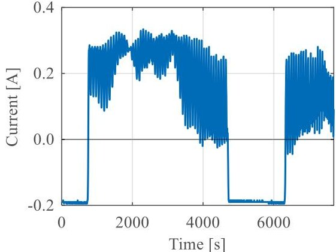

Fig. 5. Measured current history

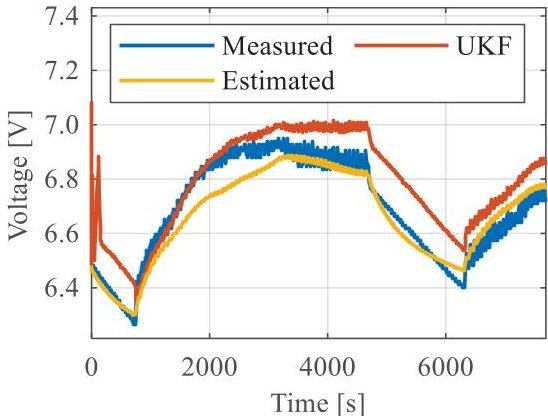

Fig. 6. Voltage history

<!-- PDF_PAGE: 8 -->

Figure 7 presents the time history of the estimated parameters. The horizontal axis represents time [s], and the vertical axis represents the parameter's value. The results indicate that the parameters $ R_{0} $ $ R_{\mathrm{ct}} $ , and $ R_{\mathrm{d}} $ exhibit clear convergence. In contrast, such as $ C_{\mathrm{d}} $ , fail to converge to a stable value. This indicates that countermeasures for such phenomena are required when applying this method to an actual satellite.

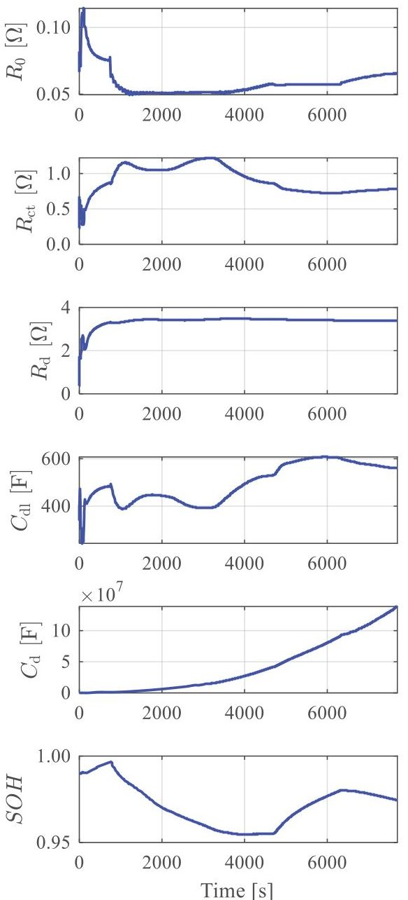

Fig. 7. Estimated parameters of equivalent circuit model in ground system

Next, we discuss the convergence of the estimation results and the effects of the current's sign and the SOC on the estimation accuracy. The results of system identification for all 24 datasets are presented in Figs. 8- 13. In these figures, the horizontal axis SOC [%] at the final time, while the vertical axis shows the estimated

values for the parameters $ R_{0}, R_{\mathrm{ct}}, R_{\mathrm{d}}, C_{\mathrm{d}}, C_{\mathrm{d}} $ and SOH. SOH is calculated as the ratio of the estimated FCC to the nominal FCC. To investigate the influence of the current's sign, datasets where the current is mostly positive are plotted in blue, and those where it is mostly negative are plotted in red. In addition, the mean value calculated after removing outliers is shown by the yellow line. In Figs. 8 and 12, the upper plot shows all the data, the lower plot shows the same data with outliers removed because the outliers are large. The orange box indicates the region shown in the enlarged view.

Despite the presence of a few outliers in some datasets, the estimations are generally in close agreement. Therefore, we conclude that this method is a viable approach for the system identification of satellite batteries.

In this study, no significant change in the trend of the estimation results due to the sign of the charge/discharge current was observed.

Regarding the dependency on the SOC, it was observed for the parameters $ R_{0} $ $ R_{\mathrm{ct}} $ , and $ C_{\mathrm{d l}} $ . In particular, an increasing trend in the values was observed when the SOC was below 10%. Since these are key parameters that significantly affect the battery's state in the equivalent circuit model, their SOC dependency must also be considered if the satellite needs to be operated in a low-SOC environment for any reasons.

For the SOH result in Fig. 13, we believe the reason the degradation was within 4% is that the satellite's operation period was short. Furthermore, a more thorough discussion of the SOH estimation accuracy will require the use of long-term operation data.

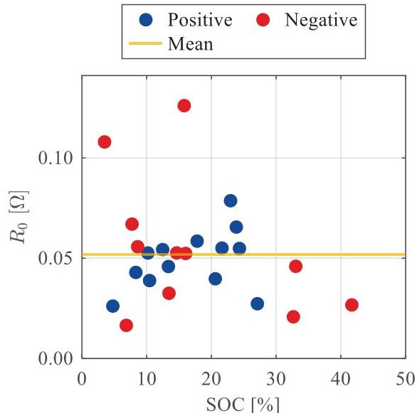

Fig. 8. Estimation results of $ R_{0} $

<!-- PDF_PAGE: 9 -->

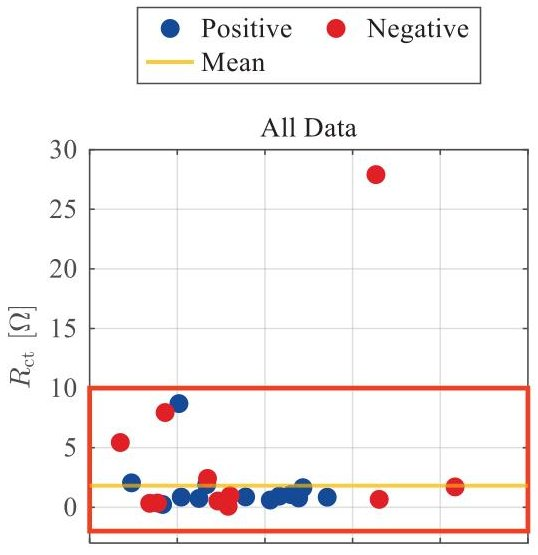

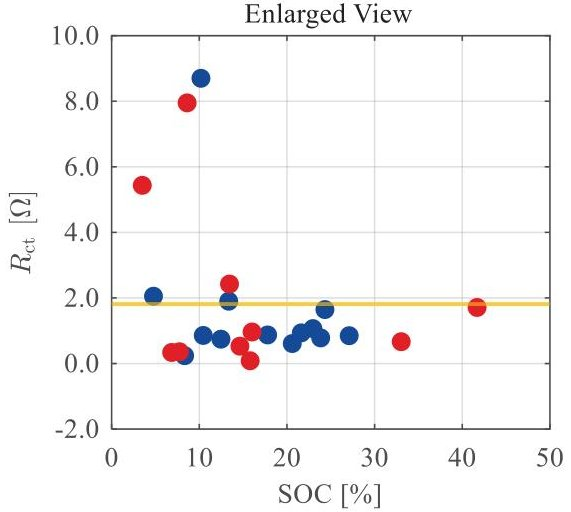

Fig. 9. Estimation results of $ R_{\mathrm{ct}} $

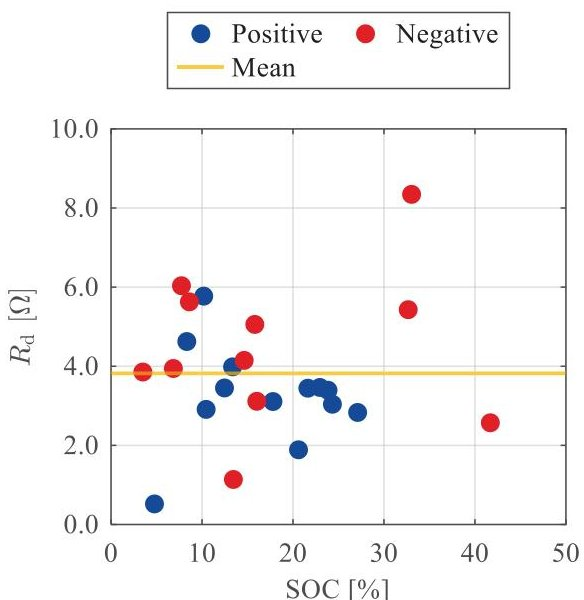

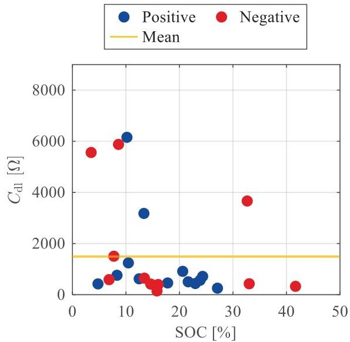

Fig. 10. Estimation results of $ R_{\mathrm{d}} $

Fig. 11. Estimation results of $ C_{\mathrm{d l}} $

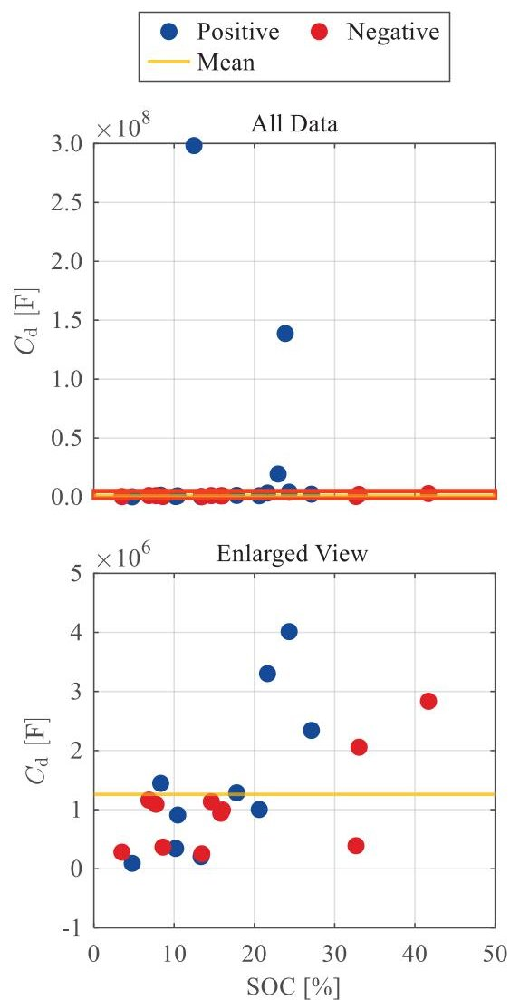

Fig. 12. Estimation results of $ C_{\mathrm{d}} $

<!-- PDF_PAGE: 10 -->

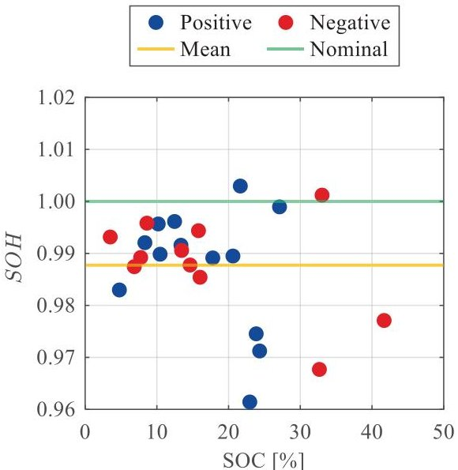

Fig. 13. Estimation results of SOH

## 2.2 Results of system identification (Onboard system)

The results of applying the CNRLS algorithm to the current history from Fig. 5 are presented in Figs. 14-16. In these figures, the horizontal axis indicates time [s], while the vertical axis shows the estimated values for the parameters $ R_{0}, R_{1}, C_{1}. $

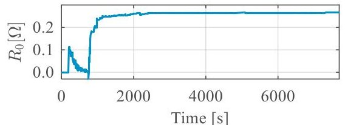

Fig. 14. Estimated $ R_{0} $ using the CNRLS method

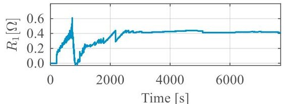

Fig. 15. Estimated $ R_{1} $ using the CNRLS method

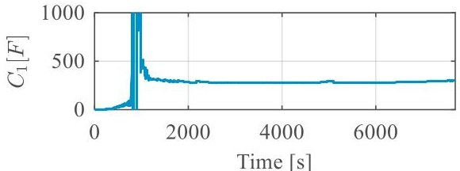

Fig. 16. Estimated $ C_{1} $ using the CNRLS method

As shown in Figs. 14-16, the estimation results fluctuate significantly immediately after the start of the estimation. In particular, a sharp oscillation is observed around the 1000 s. This behaviour is likely influenced by the current transition from negative to positive, as shown

in Fig. 5. The estimation is shown to continue with relative stability after the 3000 s. Moreover, it remains unaffected by the switching that occurs due to the change in the current sign after 5000 s. These results suggest that while the CNRLS requires a certain period to converge, it is indeed applicable for the system identification od a satellite's battery system.

## 2.3 Results of scheduling system (Onboard)

The scheduling results are shown in Figs. 17 and 18. Figure 17 indicates the schedule from the ground scheduler as the initial schedule, while Fig. 18 shows the schedule from the proposed onboard scheduler. The vertical axis shows the ON/OFF status for each operational mode, and the horizontal axis represents time [s]. The green line represents the core module status, bule line represents the mission status, and red line indicates the execution status of the downlink task. The grey shading represents the eclipse duration. The red-shaded area represents the downlink window.

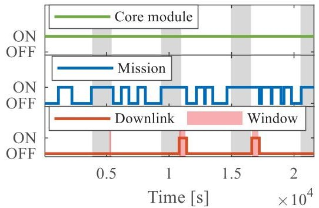

Fig. 17. Mission schedule by ground scheduler

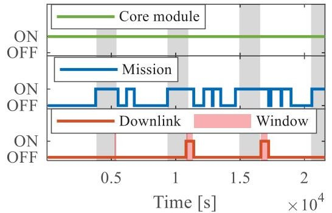

Fig.18. Mission schedule by onboard scheduler

As shown in Fig. 18 the proposed method successfully generates a feasible schedule. Furthermore, a comparison of Fig. 17 and Fig. 18 indicates that certain tasks have been omitted. It is clear that this is not a simple removal of low-priority tasks; rather, the tasks are removed based on a comprehensive assessment of the overall schedule.

Figure 19 shows the voltage estimation history corresponding to the operational schedule indicated in Fig. 18. The horizontal axis represents time, and the vertical axis represents voltage [V]. This figure indicates

<!-- PDF_PAGE: 11 -->

that the proposed method enables scheduling while simultaneously estimating the battery voltage.

The SOC estimation history during scheduling is presented in Fig. 20. The horizontal axis represents time, and the vertical axis represents the SOC [%]. As can be seen from this figure, the scheduling was successfully performed without violating the lower limit.

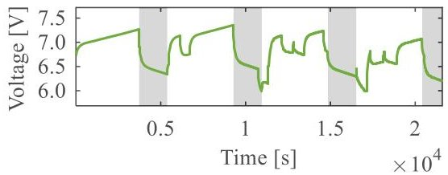

Fig. 19. Estimated voltage result by onboard scheduler

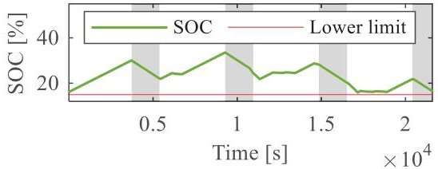

Fig. 20. Estimated SOC result by onboard scheduler

## 5. Conclusions

This study aimed to improve the safety and efficiency of micro/nano-satellites. To achieve this, we proposed a scheduling method that uses the results of battery system identification performed with actual on-orbit data.

Specifically, we enabled the results of system identification using the logarithmic UKF [12] to be incorporated into the battery simulation of our previously proposed ground scheduling system [10]. Furthermore, as a method to address the difference between the predefined and onboard estimation SOC, we performed system identification using the computationally efficient CNRLS [13] and formulated a scheduling method as a MIP that can utilize these results.

In a case study targeting a 1U CubeSat with actual data, the effectiveness of the system identification method was demonstrated. Furthermore, we presented the results of a safe and efficient scheduling method that utilizes these identification results.

This study confirmed the applicability of the Logarithmic UKF for system identification of a satellite battery, and found that the parameters $ R_{0}, R_{\mathrm{ct}} $ , and $ C_{\mathrm{dl}} $ may increase sharply when the SOC levels are below 10%.

Furthermore, we showed that the CNRLS is also applicable to battery system identification, and demonstrated that a scheduling method using these results is feasible.

## Acknowledgements

This work was supported by JSPS KAKENHI Grant Number JP25K08129 and Toyoaki Scholarship Foundation.

## References

[1] E. Kulu, CubeSats & Nanosatellites - 2024 Statistics Forecast and Reliability, IAC-24-B4.6A.13, 75th International Astronautical Congress, Milan, Italy, 2024, 14 - 18 October.

[2] M. Swartwout, Small Satellite Reliability: Database Update and Identifying Best Practices, NEEP Electronics Technology Workshop, 2021.

[3] M. Langer, J. Bouwmeester, Reliability of CubeSats - Statistical Data, Developers' Beliefs and the Way Forward, SSC-16X-2, 30th Annual AIAA/USA Conference on Small Satellites, Utah, USA, 2016, 6 11 August.

[4] T. Shimada, K. Hirose, A. Kukita, H. Ikeda, Y. Ohgushi, M. Ozaki, T. Dotani, T. Okazaki, T. Takahashi, Y. Nozaki, T. Muramatsu, K. Mizushima, C. Nakayama, Development of Electrical Power Subsystem for X-ray Astronomy Satellite: ASTROH, JSASS-2013-4318, 57th Space Sciences and Technology Conference, Yonago, Japan, 2013, 9 - 11 October, (in Japanese).

[5] M. R. Yamagata, Y. Wakita, K. Miyata, and Y. Aoyanagi, Electric Power Supply for Spacecrafts Using VO2-Based Phase Change Materials and the Development of Cubesat "DENDEN-01" for its On-Orbit Demonstration, The 44th Japan Symposium on Thermophysical Properties, Chiba, Japan, 2023, 7-9 November.

[6] K. Miyata, A. Takaki, S. Hara, Model-Based Efficient and Safe Spacecraft Operations Planner Focusing on Battery State Management, IEEJ Journal of Industry Applications, Vol. 11, No. 3 (2022) pp. 447-457.

[7] M. Lami, A. Shamayleh, S. Mukhopadhyay, Minimizing the state of health degradation of Li-ion batteries onboard low earth orbit satellites, Soft Computing, Vol. 24, No. 6, (2020) pp. 4131-4147.

[8] C. A. Rigo, L. O. Seman, E. Camponogara, E. M. Filho, E. A. Bezerra, A nanosatellite task scheduling framework to improve mission value using fuzzy constraints, Expert Systems with Applications, Vol. 175 (2021) p. 114784.

[9] Y. Sato, K. Miyata, K. Mutsuo, K. Okuyama Autonomous Operations Planning Method for Micro/Nano Satellites Focusing on Realistic Power Constraint, IAC-24-B4.IP.70X89936, 75th International Astronautical Congress, Milan, Italy, 2024, 14 - 18 October.

[10] Y. Sato, K. Miyata, Improvement of Autonomous Mission Scheduling Planner for Actual Micro/Nano Satellite Implementation, f-11-4, 35th International

<!-- PDF_PAGE: 12 -->

Symposium on Space Technology and Science Tokushima, Japan, 2025, 12-18, July.

[11] E. Kuhn, C. Forgez, P. Lagonotte, G. Friedrich, Modelling Ni-mH battery using Cauer and Foster structures, Journal of Power Sources, Vol. 158, No. 2 (2006) pp. 1490-1497.

[12] A. Baba, S. Adachi, Simultaneous state and logarithmic parameter estimation of lithium-ion batteries using UKF, IEEJ Transactions on Industry Applications, Vol. 133, No.12 (2013) pp. 1139-1147.

[13] M. Kim, K. Kim, S. Han, Reliable Online Parameter Identification of Li-Ion Batteries in Battery

Management Systems Using the Condition Number of the Error Covariance Matrix, IEEE Access, Vol. 8 (2020) pp. 189106-189114.

[14] M. Lubin, O. Dowson, J. D. Garcia, J. Huchette, B. Legat, J. P. Vielma, JuMP 1.0: Recent improvements to a modelling language for mathematical optimization, arXiv:2206.03866, 2023.

[15] Gurobi Optimization, , https://www.gurobi.com/ (accessed 7.9.25).