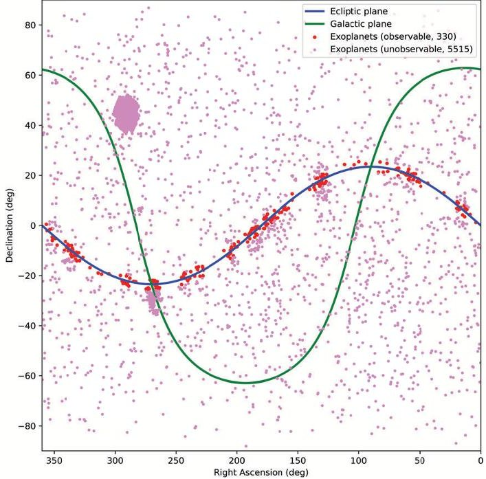
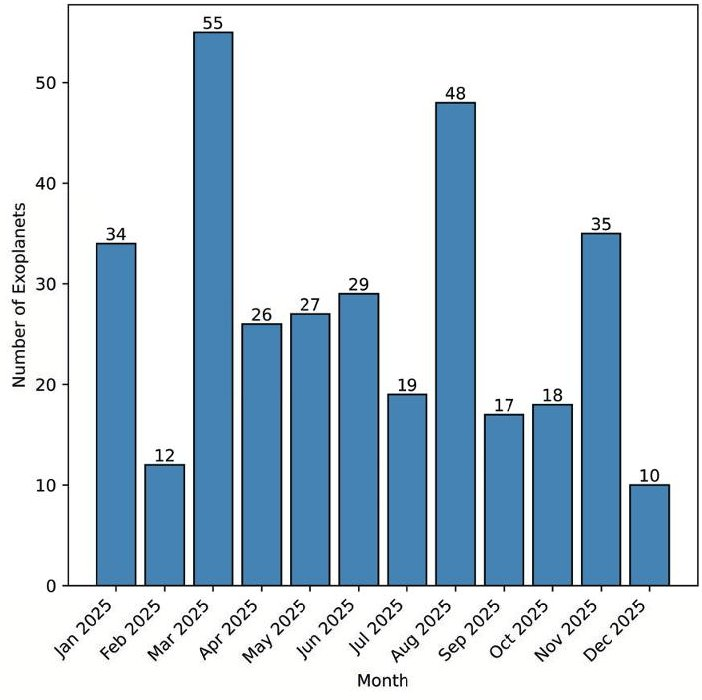
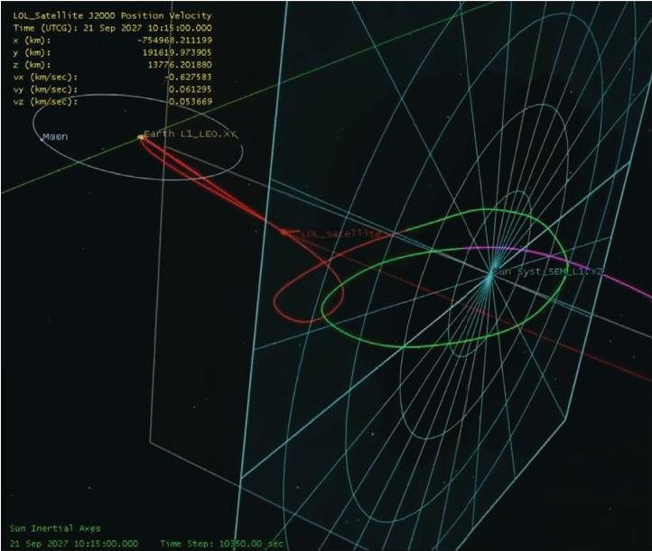
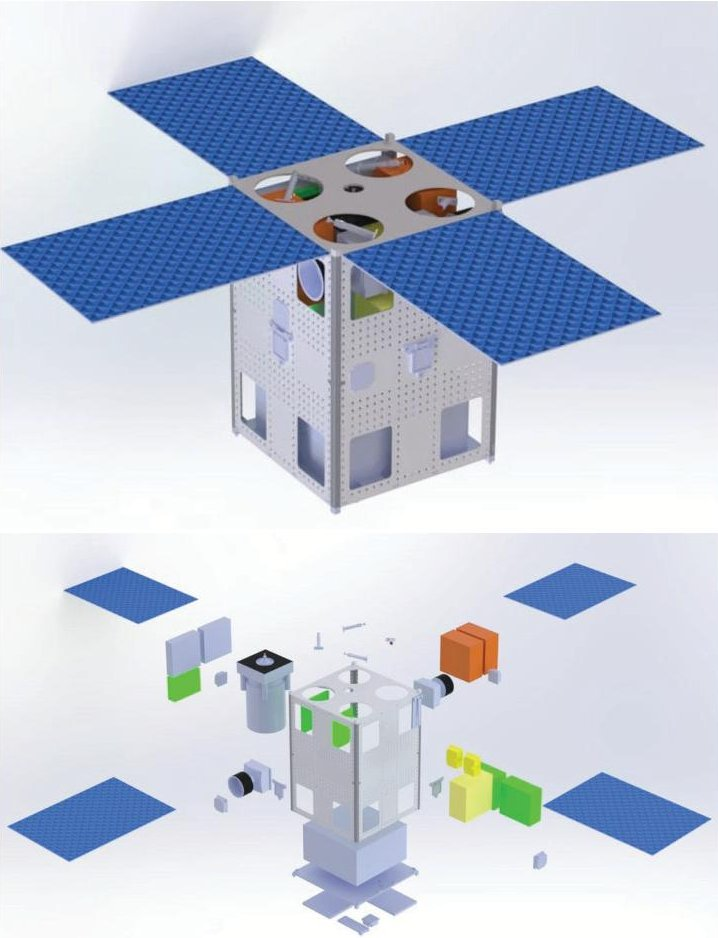

<!-- PDF_PAGE: 1 -->

IAC-25-A.7.1.7

# L1 Optical Lensing (LOL): Using the Earth as an Atmospheric Lens

Marco Grisolia $ ^{a *} $ , Ben Tullett $ ^{b} $ , Katell Le Floch $ ^{c} $ , Konrad Kij $ ^{d} $ , Jacob Higgins $ ^{e} $ , Mateusz Bocko $ ^{f} $ Marco Morelli $ ^{g} $ , José Lorenzo-López $ ^{h} $ , Levente Antal $ ^{i} $ , Daphne Papadatos $ ^{j} $ , Gianluca Borgo $ ^{k} $ Tania Baluja García $ ^{l} $ , Cecilie Strømsnes $ ^{m} $ , Sebastian Andrei Parvu $ ^{n} $ , Nick Hosewol $ ^{o} $ Quinn van der Schaar $ ^{p} $ , Sara Cecilia Abecia Hernanz $ ^{q} $ , Halvor Klepsvik $ ^{r} $ , Aikaterini Papadopoulou $ ^{s} $ Henning Wacker $ ^{t} $ , Fredrik Palmén $ ^{u} $ , Laura Chilin $ ^{v} $ , Samuel Beer $ ^{w} $ , Iliana Nika $ ^{x} $ , Tom Touleron $ ^{y} $ Juan Diego Draxl Giannoni $ ^{a a z} $ , Shae Simonson $ ^{a b} $ , Digna Jonikaite $ ^{a c} $ , Philipp Wilkendorf $ ^{a d} $ Aren Vardanyan, Giorgio Abbate $ ^{a e} $ , Serena Campioli $ ^{a e} $

Emails: s344206@studenti.polito.it, s2161438@ed.ac.uk, Katell.LEFLOCH@estaca.eu, s2161438@ed.ac.uk, kkij@cbk.waw.pl, mateusz.k.bocko@gmail.com, morellimarco2000@gmail.com, jose.lorenzo@upct.es, antallevente99@gmail.com, daphnepapadatos@cmail.carleton.ca, gianborgo@hotmail.com, taniabalujagarcia@gmail.com, cethst@gmail.com, sebastian.andrei.parvu@gmail.com, nickhosewol@gmail.com, quinnvanderschaar@gmail.com, sara.cecilia.abecia@upc.edu, Halvorkl@gmail.com, aapapadop@ece.auth.gr, henning.wacker@googlemail.com, frepal-0@student.ltu.se, laurachilin6@gmail.com, samuel.beer@hotmail.com, iliana.nika@yahoo.com, tom.touleron@gmail.com, jd.draxlgiannoni@gmail.com, shaesimonson256@gmail.com, d.jonikaite@student.tudelft.nl, philipp.wilkendorf@mailbox.tu-dresden.de, aren.vardanyan02@gmail.com, giorgio.abbate@studenti.polito.it, serena.campioli@polito.it

$ ^{a} $Politecnico di Torino, Italy; $ ^{b} $University of Edinburgh, United Kingdom; $ ^{c} $ESTACA, France; $ ^{d} $Space Research Center PAS, Poland; $ ^{e} $University of Bristol, United Kingdom; $ ^{f} $Wroclaw University of Science and Technology, Poland; $ ^{g} $Università degli Studi di Napoli "Federico II", Italy; $ ^{h} $Spain; $ ^{i} $University of Szeged, Hungary; $ ^{j} $Carleton University, Canada; $ ^{k} $University of Southampton, United Kingdom; $ ^{l} $Universidad Politécnica de Madrid, Spain; $ ^{m} $Aarhus University, Denmark; $ ^{n} $Politecnico di Milano, Romania; $ ^{o} $KU Leuven - University of Leuven, Belgium; $ ^{p} $University of Twente, The Netherlands; $ ^{q} $Universitat Politécnica de Catalunya (UPC BarcelonaTech), Spain; $ ^{r} $University of Oslo, Norway; $ ^{s} $Aristotle University of Thessaloniki, Greece; $ ^{t} $FH Aachen University of Applied Sciences, Germany; $ ^{u} $Luleå University of Technology, Sweden; $ ^{v} $Italy; $ ^{w} $United Kingdom; $ ^{x} $National and Kapodistrian University Of Athens, Greece; $ ^{y} $IMT, France; $ ^{z} $University of California, San Diego, United States; $ ^{aa} $Carleton University, Canada; $ ^{ab} $Delft University of Technology (TU Delft), The Netherlands; $ ^{ac} $TU Dresden, Germany; $ ^{ad} $von Karman Institute for Fluid Dynamics, Belgium; $ ^{ae} $Politecnico di Torino, Italy;

Corresponding author

## Abstract

The Terrascope concept was first introduced by D. Kipping in 2019, and it has increasingly gained scientific attention. This concept uses a satellite at Lagrange point 1 and involves using Earth's atmosphere as a lens to amplify light from distant astronomical bodies. If successful, the Terrascope could revolutionise deep space observation by enhancing angular resolution and amplification. Indeed, in previous studies, D. Kipping determined an estimated amplification of order 22,500: the computed amplification decreased after accounting for the effects of turbulence, absorption, transmission, and scattering of Earth's atmosphere, and the estimated image reconstruction was performed taking into account Earth's oblateness. On these premises, 'L1 Optical Lensing (LOL)' mission is carried out and aims to characterise the amplification and the resolution of the Terrascope concept by using a satellite placed at a Hill radius distance from Earth, serving both as a technological and scientific demonstration. This study was initially conducted during ESA's CubeSat Summer School 2024 in ESEC using a Model-Based Systems Engineering approach with the COMET tool and ESA expert support. The proposed satellite would be launched as a secondary payload on the Ariane 62 rocket in 2030, alongside ESA's NEOMIR mission. The first presented system analysis resulted in a 12U CubeSat design at both system and subsystem levels, including system budgets and subsystem analyses. The optical payload consisted of visible and infrared detectors aiming to observe distant celestial objects in the anti-sun direction, such as high-redshift objects, active galactic nuclei, radio galaxies and exoplanets. In the subsequent iterations, the scale-up to a micro-satellite has emerged as the optimal solution due to payload constraints. In particular, a tailored payload ray-tracing design combined with AOCS fine guidance logic has been investigated. Additionally, from a cost perspective, the main benefit of this concept is that it tackles the crisis in astronomy of making ever-larger space and ground-based telescopes. For instance, the upcoming Extremely Large Telescope (ELT) has an aperture diameter of 39 m and comes at a cost of 1.4B. Studies from D. Kipping predicted that a Terrascope of 1 m aperture diameter, placed at a Hill radius distance from Earth, could achieve the same amplification as a 150 m telescope on Earth, which would cost 50-100B. Therefore, using natural lensing instead of building ever-growing apertures could lead to comparable results in deep-space observation, at a fraction of the cost.

IAC-25-A.7.1.7

<!-- PDF_PAGE: 2 -->

## 1. Introduction

## 1.0.1 Telescopes and CubeSats

The advancement of telescope infrastructure, on Earth and in space, is closely tied to progress in astrophysical research. Using the first refracting telescope in 1609, Galileo discovered craters on the Moon, the phases of Venus, and the four largest moons surrounding Jupiter, laying the foundations for the next 400 years of modern observational astronomy [1]. Over the last 40 years, ground-based observatories have imaged and constrained Type Ia supernovae, supporting evidence for a current-day, vacuum-dominated expanding universe [2, 3]. Follow-up observations (z>1) with the Hubble Space Telescope (HST) discovered evidence of a previous decelerating epoch in an earlier matter-dominated universe. Observations with the James Webb Space Telescope (JWST) have probed galaxies up to a redshift of 14.44 (as of May 2025), a mere 280 million years after the Big Bang [4, 5].

These accomplishments demonstrate how the progression of observational infrastructure and space technology advances in tandem with our understanding of the universe's workings. Oftentimes, however, this progression in technological capability grows alongside various parameters: the size of mirrors, cost, complexity, and mass are all examples [6]. One alternative to this has been the development of smaller satellite systems, otherwise known as CubeSats or NanoSats, which offer an opportunity to carry out space research at a fraction of the cost and complexity of current missions. Examples include HaloSat, Arcsecond Space Telescope Enabling Research in Astrophysics (ASTERIA), and Star-Planet Activity Research CubeSat (SPARCS) [7-9], all of which are lighter, cheaper and smaller than many of the satellites used in modern space missions. These small-sat missions have successfully demonstrated usefulness in astrophysical research, with the first exoplanet detection by a CubeSat completed by ASTERIA, which observed the transiting 55 Cancri e [10-12].

Nonetheless, the use of smaller satellites comes at the cost of precision, sensitivity, usable wavelengths, and aperture size, the latter of which limits the number of collectable photons. This not only reduces a telescope's ability to detect more distant and faint objects, but also limits the maximum signal-to-noise. This is especially critical in transmission and emission spectroscopy of exoplanet atmospheres, where signals are easily dwarfed by their host star's light, which is millions of times brighter. Therefore, an optimal space platform would utilise the low mass and volume of a CubeSat, while somehow not being limited to a small aperture size. Different approaches are

being taken to solve this problem; for instance, Active Deployable Optical Telescope (A-DOT) will demonstrate one of the largest deployable mirror systems to date, featuring a 0.3 m mirror onboard a 6U CubeSat [13]. Nonetheless, this mirror diameter is still far below the size of JWST (6.6 m circumscribed) and HST (2.4 m) [14, 15].

One alternative approach to solving this problem is the Terrascope. This is a novel telescope design which uses the Earth's atmosphere as the primary aperture, making use of its refractive nature. Parallel light rays incident onto Earth get refracted and bent onto a focal line that spans thousands of kilometres [16]. Combining this with the small form factor of a CubeSat would enhance photon collection capabilities, improving the measurable signal-to-noise far beyond that currently possible with small-sat systems, while also minimising launch mass and cost, making it an excellent candidate for many scientific purposes, including future exoplanet spectroscopy missions.

## 1.0.2 The Terrascope Concept

The Terrascope concept (popularised by Prof. David Kipping [16]) utilises the atmosphere of celestial bodies and their refractive properties to bend light onto a focal line. The idea of utilising the atmosphere for telescopic purposes first appeared in 1998 with Earth Atmospheric Space Telescope (EAST), proposed by Yu Wang of the National Aeronautics and Space Administration (NASA)'s Jet Propulsion Laboratory. This was inspired by the effect of stellar refraction, a widely observed phenomenon where the position of stars in the sky differs from their actual position in space [17].

The Earth's atmosphere, for example, has a focal line reaching from roughly 85% of the Earth-Moon distance out to beyond the Hill radius (the region around a planetary body where the gravitational force of that body is stronger than that of the Sun's). Kipping determines that a 1 m detector placed at the Hill radius (which is least affected by extinction due to a larger impact parameter) could experience an amplification of 22,500 with a lensing timescale of 20 hours, equivalent to a 150 m diameter space-based telescope [16].

However, because a Terrascope utilises atmospheric refraction, and therefore the light rays pass through the atmosphere, chromatic aberration and atmospheric extinction are important to consider. Kipping finds that a detector placed at Lagrange Point 1 (L1) can still benefit from impressive amplification when using many of the standard photometric filters. Furthermore, when observing in infrared wavelengths, amplification remains

<!-- PDF_PAGE: 3 -->

constant across the Infrared (IR) range, therefore making the infrared region of the electromagnetic spectrum the ideal observational range [16].

It can be seen that the implementation of a satellite capable of harnessing Earth's atmosphere as a giant lens offers exciting opportunities in astrophysical research, beyond the physical limits of mirror size. This paper presents a scientific and technical feasibility study that focuses on a CubeSat mission capable of demonstrating this technology. This study has been carried out by 32 students and professionals from numerous European Space Agency (ESA) member and cooperating states by following a concurrent engineering approach. The work was originally developed at the ESA CubeSat Summer School 2024. The outline of this paper is as follows:

## Section 2: Science Case

- Discussing the potential scientific use case of a Terrascope in the context of exoplanet spectroscopy, focusing on observation opportunity.

## Section 3: Mission Analysis

- Exploring both the feasibility of reaching L1, as well as a preliminary orbit design to maximise the science opportunity.

## Section 4: Space Segment

## Payload

1. Opto-Mechanical System

2. Active Cooling System

3. Detection Chain

## Satellite Platform

1. Configuration

2. Structure and Mechanisms

3. Attitude and Orbit Control System

4. Propulsion

5. On-board Data Handling and Communications

6. Power

7. Thermal Control

## 2. Science Case

2. 0.1 Identifying relevant science targets

Alongside a feasibility study of technical mission aspects, such as the Attitude and Orbit Control System (AOCS), thermal, and structural subsystems, an exploration into the scientific feasibility and utility of a Terrascope is required. A science use case is also

vital in informing several subsystems, from mission analysis (to generate idealised orbits for maximum alignment) to the optical payload. To demonstrate the scientific feasibility of a Terrascope, this paper explores the use case of exoplanet spectroscopy, a research area that would benefit greatly from Terrascope technology. However, a Terrascope orbiting L1 would only be aligned with a handful of exoplanets due to the need for targets to fall on the line that spans L1 and Earth. As such, identifying whether any suitable science candidates are in good-enough alignment with the L1-Earth system is important to assess the potential scientific feasibility.

## 2.1 Theory and calculation

Potential candidates which are on-axis with the focal plane of the Terrascope must first be identified. Once these have been found, an exact time and offset of an orbiting Terrascope around L1 will be found to ensure the exoplanet would pass directly on-axis with the Earth-Terrascope system. This, in turn, allows for the optimisation of an orbit around L1 (see Section 3).

To find the rough alignment of the Terrascope exoplanet system, simulations utilising a 3-hour time step over a year-long period have been carried out with all suitable exoplanet candidates for this mission. The exoplanet catalogue used in these simulations was the NASA Exoplanet Archive, which provides 5,845 exoplanets with suitable measurements of Right Ascension (RA), Declination (DEC), and distance (at the time of access; accessible at [18]). The simulations have been run in Python, utilising the Skyfield, Astropy and Numpy libraries. If an exoplanet, at any point in the year-long run, comes within 2.5 degrees of on-axis alignment, then it is considered a potential candidate to be moved onto the next stage of analysis. The value of 2.5 degrees was chosen for 2 main reasons. Firstly, as Kipping states, there is a region up to 1.5 degrees off-axis that still benefits from amplification for a detector located at a given point in space, and secondly, the Terrascope would not sit exactly at L1 and would instead utilise a Lissajous/Lyapunov orbit, meaning there is an offset from L1. This offset will change where the on-axis line falls, and so the extra degree was used to capture exoplanets that could be observed on-axis within a specific orbit.

The alignment is calculated by iterating over each exoplanet at each time step and calculating unit vectors between L1 and a given exoplanet and between L1 and Earth. The position of L1 is approximated to first order at each time step, which allows for both unit vectors to be found.

<!-- PDF_PAGE: 4 -->

First, the RA and DEC coordinates of the exoplanets converted into a heliocentric ecliptic coordinate frame (keeping consistent with the frame subsequently used to calculate the L1-Earth unit vector). From this, a unit vector between L1 and the exoplanet is found, as well as the unit vector between L1 and the Earth. Care is taken to ensure that both of these unit vectors are in the same coordinate frame (heliocentric ecliptic), as mixing frames (such as equatorial and ecliptic) would introduce error when calculating the angle between them when using the dot product, as seen in Equation 1

$$
\theta = \arccos \left(\hat {v} _ {l 1 E x o} \cdot \hat {v} _ {l 1 E a r}\right),
$$

where $ \hat{v}_{l1Exo} $ is the unit vector from L1 to the exoplanet, and $ \hat{v}_{l1Ear} $ is the unit vector from L1 to Earth.

Once the exoplanet candidates have been identified, their RA and DEC coordinates can be used to reverse engineer the optimal offset from L1 and, as such, can be used to plan an idealised orbit (see Section 3 for further information).

## 2.1.1 Results

Out of the 5,845 possible exoplanets, 330 have been identified to lie within 2.5 degrees of being on-axis with L1 and Earth (see full table in [19]), at some point during the year. This amounts to 5.65% of known exoplanets. A representation of the distribution of these exoplanets that would be observable can be seen in Figure 1, with the red dots representing those that are within 2.5 degrees of the ecliptic plane.

Several key observing fields are visible in Figure 1, for example, the Kepler star field, which appears as the large, dense pink region near the galactic plane at an RA of $ 2 9 0^{\circ} $ . This field is responsible for almost half of the confirmed exoplanet discoveries, owing to its high stellar density and the Kepler mission. The prevalent sources of exoplanets observable with a Terrascope are those originally identified in the Ecliptic Plane Input Catalogue (EPIC) catalogue from the K2 survey; however, some sources can also be found in respective catalogues from other surveys such as Henry Draper (HD) and Optical Gravitational Lensing Experiment (OGLE) - in total, the exoplanets identified in the K2 survey that are also observable with a Terrascope make up more than half of the potential 330 targets.

To demonstrate the capability of a continual observation schedule, the number of possible exoplanet targets per month is shown below in Figure 2.

Fig. 1. Showing the distribution of exoplanets in the galactic (green) and ecliptic (blue) plane, with the exoplanets represented in red falling within 2.5 degrees of being onaxis with a Terrascope at some point in the year.

Fig. 2. Showing the number of possible exoplanet observation targets per month during a year-long orbit, counting targets that come within 2.5 degrees of being on-axis.

<!-- PDF_PAGE: 5 -->

This would allow for year-round observation opportunities, maximising the science time of such a mission. Furthermore, the spread of science candidates allows for a uniform focus on different science cases (from atmospheric studies of super-Earths, multi-planetary systems, mini-Neptune's and more).

## 2.1.2 Chosen science targets

Of the 330 potential science targets, there are several of particular interest that are worth highlighting, and confirmed to have transiting planets as viewed from the ecliptic plane.

## 1. GJ 9827 planetary system:

A transiting three-planet system containing two super-Earths (b and c), and the first discovered steam world (a mini-Neptune) (d). They orbit a K-type main-sequence star with an apparent V-band magnitude of 10.25 and lie at a distance of 29.652 parsecs away. The orbital periods are roughly b: 1.2 days, c: 3.6 days, and d: 6.2 days, and the planets span the radius gap, increasing from $ 1. 4 4_{-0. 0 7}^{+0. 0 9} R_{\oplus} $ to $ 1. 8 9_{-0. 1 4}^{+0. 1 6} R_{\oplus} $ [20, 21].

2. WASP-47 planetary system: A four-body system orbiting a G9V star located 264.78 parsecs away. This is a Hot Jupiter system with a unique orbital configuration, hinting at a two-stage planetary formation origin. The planets WASP-47 b,d, and e all transit the host star, with b and c having a mass of $ 3 6 3. 6 \pm7. 3 $ $ M_{\oplus} $ and $ 3 9 8 \pm9. 1 $ $ M_{\oplus} $ respectively, with d and e being much smaller at $ 1 5. 5 \pm0. 8 $ $ M_{\oplus} $ and $ 9. 0 \pm0. 5 $ $ M_{\oplus} $ respectively. The orbital periods of the planets are 4.16 days for b, 588.50 days for c, 9.03 days for d, and 0.79 days for e, respectively [22-24]

3. K2-155 d: A potentially habitable super-Earth exoplanet, located 72.80 parsecs away in a three super-Earth transiting system. Climate simulations have demonstrated the potential for this planet to have a moderate climate, with surface temperatures $ \leq 2 0^{\circ} \mathrm{C} $ [25].

The full list of exoplanets within 2.5 degrees of being on-axis with a Terrascope system (both transiting and nontransiting) can be found and explored in a GitHub repository, as found in [19].

## 2.2 Discussion

The aforementioned exoplanetary systems each present unique research opportunities, from Hot Jupiter systems with unique orbital configurations, to superEarths and potentially habitable planets. The GJ 9827

system contains both super-Earth planets and a mini-Neptune that orbit in a 3:1 (b,c) and 5:1 (c,d) resonance around a K7V star [21]. Not only do these planets span the radius gap (the transition of rocky planets to gaseous planets), but recent improvements in stellar and mass parameters of the planets, and the fact that the star is relatively bright (V-band mag 10.25), make this system an ideal candidate for transmission spectroscopy [21]. Furthermore, there exists an opportunity for observation of rare planet-planet occultations, which permits orbital parameters to be refined to a very high precision [21].

Successful transmission spectroscopy needs not only adequate knowledge of the host star and a sufficiently large signal, but also a stable observing environment [26]. Further to the usual sources of instrumental systematic errors and astrophysical systematic errors (star spectrum variability, background stars, nightshade emission), there is the additional source of error due to telluric contamination with a Terrascope system. This contamination poses both similar yet different challenges to traditional groundbased observation, as a detector placed at L1 only receives rays that have passed through the atmosphere above 14 km, where there is less turbulence, fewer aerosols and no clouds. Nevertheless, there are still molecules which contaminate spectroscopic signals, such as those corresponding to $ \mathrm{H_{2}O}, $ $ \mathrm{CO_{2}}, $ and $ \mathrm{O_{3}} $ . The airmass traversed is no longer upwards through the atmosphere but across swathes of Earth's circumference; rays of wavelength $ \lambda > 0. 5 \ \mu\mathrm{m} $ impact a detector at L1 having traversed an airmass of roughly $ 10^{1} $ (see Fig. 10 in [16]). This is of the order of observing objects located at large zenith angles, near the horizon. Additionally, atmospheric variability on a planetary scale becomes important, in contrast to a singular column, when observing from the ground. In addition to unwanted telluric spectral features, several other potential challenges need to be addressed, ranging from the time-variability aspect of the atmosphere to daylight scattering background contributions.

There are a couple of methods that exist which are used to address telluric contamination, including comparative stellar sources that are also on-axis [26], or High-resolution spectroscopy (HRS), which makes use of Doppler-shifted spectral lines originating in close-orbiting exoplanets, leaving Earth's, and even the host star's, spectral signature largely unaffected [27]. HRS could therefore be directly applicable in helping to mitigate fine-detail telluric contamination in a Terrascope system, alongside other considerations such as careful choice of atmospheric bands (IR), applying ray-tracing simulations through atmospheric models, and utilising the

<!-- PDF_PAGE: 6 -->

fact that Rayleigh-scattered sunlight is highly polarised [16], to name a few.

## 3. Missions Analysis

Now that an analysis of the possible science targets has been conducted, the feasibility of a CubeSat mission reaching a viable orbit was assessed. As previously mentioned, a concurrent engineering approach was taken in the design of this mission. The use of the Concurrent Model-based Engineering Tool (COMET) tool, developed by ESA, has improved the workflow and accelerated the design process in its early stages [28]. By following a Model-Based System Engineering (MBSE) approach, trade-offs between mission objectives, payload requirements, and subsystem requirements have been traced at an early stage, reducing the risk of late-stage redesigns.

Scientific constraints and design drivers lead, after the assessment of potential stakeholders, to the definition of high-level requirements and objectives, which will be presented throughout this section and discussed in the subsequent Space Segment section.

A brief example of high-level requirements is presented below:

1. The mission shall be able to take images in the antisun direction, facing towards Earth

2. The mission shall be able to occult the Earth during the imaging frame

3. The mission shall perform nominal observation from Lagrange Point 1 (L1)

4. The spacecraft shall embark at least one NIR or IR camera

5. The mission operational lifetime shall be at least 6 months from L1 arrival

6. The mission shall be launched as a piggyback to another mission

7. The mission shall be compliant with the Space Debris Mitigation regulation

An important high-level objective to reduce cost and complexity has been to find possible rideshare missions headed to L1 in the near future, which have a launcher that would be easily integrated with our design. Further to this, several possible trajectories to L1 have been analysed, including a halo, quasi-periodic (3D) trajectory

Fig. 3. Image showing a simulated trajectory design for a Terrascope rideshare with NEO Surveyor

and a Lyapunov planar trajectory.

Four viable rideshare opportunities were identified, and a trade-off analysis was completed to determine which would be most beneficial. These included Lisa (expected launch with Ariane 6-2 in 2035)[29] , NEO Surveyor (expected launch with Falcon 9 Block 5 in 2027)[30], IMAP (expected launch with Falcon 9 Block 5 in 2025) [31], and NEOMIR (expected launch with Ariane 6-2 in 2030+) [32]. From these 4, a rideshare with NEO Surveyor was originally chosen as the optimal because it enabled the best orbit, while also providing a reasonable launch date - to be launched from the Eastern Test Range on an intermediate-class launch vehicle between mid-September and early October 2027. The subsequent analysis shown (in Fig. 3 uses this rideshare with NEO Surveyor; however, upon completion of further iterations, a more realistic timeframe would be to rideshare with NEOMIR, to be launched in the early 2030s.

With a launch vehicle and rideshare identified, a CONOPS was developed, which runs as follows: 1) Launch, 1.1) MECO, 2) Transfer Orbit-Insertion, 2.2) Ejection, 3) Detumbling, 4) 3x TCM, 5) Transfer Orbit, 6) STK/Orbit Stabilisation Manoeuvre, 7) In-Orbit Commissioning, 8) Operation, 9) Optional Extension, 10) EOL/Disposal into Deep Space. An example mission trajectory was simulated using Ansys STK and is shown in Figure 3.

<!-- PDF_PAGE: 7 -->

Due to using a Lyapunov orbit, a Terrascope CubeSat would be able to get as close to L1 as desired, which becomes vital in observing science targets on-axis and unlocking maximal amplification. For example, the closest the aforementioned GJ 9827 system comes to being on axis with L1 is 2.14 degrees. By projecting the position of L1 onto the vector between Earth and GJ 9827, an offset of roughly 56,000 km in (mostly) the ecliptic north pole direction of the ecliptic heliocentric coordinate system results in perfect alignment with a Terrascope CubeSat. Further analysis of the exoplanets found in [19] would allow for an optimised orbit to be found, maximising the number of on-axis observations possible during the operational phase of a Terrascope's lifecycle.

## 4. Space Segment

## 4.1 Payload

The Payload of the L1-Optical Lensing (LOL) mission is designed to demonstrate the feasibility of using Earth's atmosphere as a large-aperture lens for high-sensitivity optical and infrared observations.

## 4.1.1 Opto-Mechanical System

The Opto-Mechanical subsystem comprises the telescope optics (mirrors, lenses, filters, etc.), any spectrometer or calibration optics, and the supporting structure (optical bench and mechanisms). A feasible design could use a compact reflective or refractive telescope that focuses IR light onto the detector. For example, the ASTERIA CubeSat employed an 85mm f/1.4 refractor[11], while HST and Roman use large (2.4 m) reflective mirrors[15, 33]. The detector would cover 0.5-2.3 $ \mu\mathrm{m} $ (optical through near-IR) to capture both exoplanet spectra and reference stars. Band-selecting filters or a filter wheel would define the passbands; Roman's Wide-Field Imager uses eight filters across 0.48-2.30 $ \mu\mathrm{m} $ as an example of filter-based spectral selection. Onboard calibration lamps or LEDs (for flat-fielding) can be included to track detector response. A low-resolution spectroscopic element (e.g. a grism or prism) could optionally be added to disperse the light, analogous to the slit-less spectrography on HST or the grisms on JWST, but scaled to the CubeSat form factor. Such an element would allow coarse exoplanet spectrography, though at reduced resolution (likely R<100) due to size constraints.

Mechanically, the optics must be mounted on a stiff, thermally stable bench to preserve alignment. Common materials include carbon-fibre composites or aluminium honeycomb panels (as used on Advanced Composition Explorer (ACE) and Solar and Heliospheric Observatory (SOHO)) with low thermal expansion. For instance,

CHaracterising ExOPlanets Satellite (CHEOPS) mounts its 33 cm telescope on a stiff optical bench that is thermally decoupled from the spacecraft bus[34], ensuring the optics remain fixed despite temperature changes. The bench and baffles also help isolate the payload thermally (e.g via multi-layer insulation) and prevent conductive heat loads.

A deployable, internal occulter or baffle may be used to block stray sunlight or Earthshine from the optics. Alternatively, inspired by ESA's PRoject for OnBoard Autonomy (PROBA-3) mission [35], a formation-flying occulter could be used, with a leading satellite casting a shadow onto the trailing telescope to create an artificial eclipse. Although more complex, this could shift vibration-generative heavy-pointing AOCS systems to a secondary platform, making space for more scientific equipment and data handling capabilities.

## 4.1.2 Active Cooling System

The infrared detectors require operational temperatures ranging from 150 K down to 55 K, depending on the spectral range and noise performance requirements. Commercial-Off-The-Shelf (COTS) cryocoolers, such as pulse tubes and rotary or linear Stirling machines, are commonly considered early in trade-off analyses for small scientific payloads. Among these, rotary Stirling micro-coolers stand out as attractive candidates for Nano- and MicroSat missions due to their low mass, low steady-state power consumption, compact size, and rapid cooldown capabilities, especially where passive radiators are insufficient [36].

Recent activities between Thales Cryogenics and CNES have demonstrated the cryogenic performance of Rotary Monobloc Stirling (RMs) coolers for nanosatellite applications. Two flight-representative models have been developed: the RMs1 (~1U, 150 g, 1 W cooling capacity at 150 K, ~1 W input power, with an estimated 5-year ground mean time to failure) and the RMs3 (~1U+, 450 g, 0.6 W cooling capacity at 77 K, ~4 W input power, also with a 5-year ground reliability) [37]. Alternative solutions are available from other manufacturers, such as Germany's AIM Infrarot-Module GmbH, which offers the SF070 cooler [38]. Integration of these cryocoolers will likely require dedicated electronic drivers and a cryostat assembly to ensure effective thermal coupling between the detector and the cold tip.

<!-- PDF_PAGE: 8 -->

## 4.1.3 Configuration

Fig. 4. Representation of internal configuration of the 12U Terrascope satellite

The configuration of the satellite platform was primarily driven by the payload (as shown in grey in Fig. 4), which was given priority over all other subsystems and required continuous Earth pointing of the main camera.

To meet the thermal constraints, the cryocooler of the payload is positioned at the maximum possible distance from both internal heat sources and the reaction wheels, in order to mitigate thermal coupling and vibration transmission. The AOCS design (yellow in Fig. 4) included six sun sensors, one on each CubeSat face, together with two star trackers placed close to the solar panels in a shaded configuration. Attitude control relied on four reaction wheels to provide three-axis control with redundancy, complemented by two internal gyros and three magnetometers. The power subsystem (green in Fig. 4) was based on four deployable solar panels oriented towards the Sun while simultaneously shading the star tracker lenses, two secondary batteries, two On-Board Data Handling (OBDH) units, and one Power Control and Distribution Unit (PCDU). For communications and

TeleMetry and TeleCommand (TMTC) (brown in Fig. 4), the configuration includes one vertical omni-directional antenna oriented towards the Sun and one horizontal omni-directional antenna oriented towards the Earth, both operating in S-band for platform telemetry and telecommand. In addition, two high-gain patch antennas are placed on the Earth-facing side to ensure the transmission of payload data. Finally, the propulsion subsystem (orange in Fig. 4) relied on a main thruster aligned with the estimated centre of mass, supported by four cold-gas thrusters dedicated to attitude control.

At this preliminary stage, several simplifying assumptions were adopted. Component masses were only roughly estimated, and placeholder models were used that may change in dimensions and therefore do not necessarily reflect the final characteristics. No fasteners such as nuts, bolts or screws were included in the design, and neither were thermal insulation, cables, pipes or harnesses. To account for these missing elements, dedicated free volumes were reserved for the later integration of thermal insulation, electrical cabling, heaters, stand-offs, mounting plates and damping devices. This approach ensures sufficient margins for integration while enabling a first-order assessment of subsystem accommodation.

## 4.1.4 Structure and Mechanisms

The structural design must ensure compatibility with standardised COTS dispensers. Accordingly, the platform rails and their positioning shall follow the CubeSat Design Specification (CDS) requirements, while the remaining structure can be tailored to mission-specific needs. The overall platform must comply with the following constraints [39]:

- Centre of Gravity maintained within $ \pm 4 5 $ mm along the X and Y axes, and $ \pm 7 0 $ mm along the Z axis, with respect to the geometrical centre.

- No external components protruding more than 6.5 mm outside the rails (dispenser-dependent).

- Structural materials limited to aluminium alloys 7075,6061,6082,5005,and/or 5052.

A first benchmark has shown the availability of flightproven COTS structural frames, with an estimated dry mass in the range of 1-1.5 kg.

Regarding mechanisms, only non-pyrotechnic actuators are considered for this mission. In compliance with CDSrequirements, at least two deployment switches shall be implemented [39]. For solar array deployment, spring-loaded hinges combined with a burn-wire release mechanism are considered, offering a simple and reliable

<!-- PDF_PAGE: 9 -->

solution. These mechanisms are typically designed and qualified by the solar panel provider.

The design of internal support structures remains an open point. In particular, careful consideration will be required for the decoupling between the payload and the main structure, both mechanically and thermally.

## 4.1.5 Attitude and Orbit Control System

The design of the AOCS is probably one of the most challenging for a spacecraft of such application with reduced mass and volume capabilities. The Terrascope concept relies on maintaining strict alignment with the Earth's atmosphere focal line; therefore, both pointing and attitude stability requirements are derived from payload and system analyses in a concurrent way to meet the mission objectives, obtaining a balanced and efficient solution. For this mission, the pointing requirement has been established to $ \Delta\theta\approx 10^{-3} $ deg ( $ \sim $ 3.6 arcsec), which is typically orders of magnitude more stringent than the state of the art CubeSat-class missions and even comparable with space astronomical observatories.

The selected AOCS architecture includes a tetrahedral configuration of four reaction wheels enabling attitude control with redundancy, combined with a set of cold gas thrusters to provide full attitude authority. Such thrusters are intended to be used for detumbling after mothercraft separation, attitude maintenance and wheel desaturation. Based on the solar-radiation pressure (SRP) torque estimates, showing maximum accelerations of $ 0. 0 4 2 \mathrm{~ m / s^{2}} $ on a first analysis, reaction wheel desaturation is expected to occur once per week, which underlines the importance of the coordination between the AOCS and the Propulsion subsystems.

For the attitude and orbit determination, a set of two star trackers, two gyroscopes, and six sun sensors has been selected after a preliminary trade-off analysis. Star trackers provide a nominal measurement accuracy of $ 5 \times1 0^{-5} $ deg, while gyros and sun sensors enable short-term propagation of the attitude error. Through an Extended Kalman Filter (EKF), appropriate sensor fusion should be implemented to ensure robustness of measurements to satisfy attitude determination requirements.

A first-order disturbance analysis has been performed, and to support this, the selected AOCS control law is currently based on a simple Proportional Integral Derivative (PID) control law developed in MATLAB Simulink. These preliminary studies show the feasibility of meeting the pointing requirements, but a complete assessment including 6 degrees of freedom and full actuator dynamics sensor noise, jitter propagation and attitude determination algorithms combined with payload measurements remains an open point and will be the subject of further work.

## 4.1.6 Propulsion

The propulsion subsystem design has been performed with the following constraints coming from requirements at the mission and system levels. It will supply reaction wheel desaturation, station keeping in the L1 halo orbit, and impulse manoeuvres. Due to the low specific impulse requirements, the propulsion system has been designed to fit in a 2U form factor with CubeSat limited power, mass and volume budgets. The subsystem should support at least six months of operations after orbital insertion, while ensuring thrusting manoeuvres do not expose the payload to direct sunlight.

There were several design assumptions taken, for example, a maximal rate of reaction wheel desaturation of once a week, the propellant is assumed as an ideal gas, and the thin-walled pressure vessel assumption stands. From these assumptions, a trade-off between the different kinds of propulsion systems was completed. This included cold gas, monopropellant, bipropellant, ion engines, resisto-jets, and hall thrusters. Several factors were taken into consideration, for example, the thrust, specific impulse, wet mass, size and DOF, which resulted in a cold gas solution being chosen as the most viable. This minimises system complexity and electrical demand, while also reducing integration risk.

Subsequently, a trade-off has been performed to determine which type of propellant was the most balanced solution in terms of the design drivers previously identified. Xenon appeared to be the best for the reaction control system. The configuration consists of one main thruster to optimise station keeping and larger manoeuvres, complemented by four smaller cold gas thrusters dedicated to attitude control. Together, these thrusters provide both translation and torque, with the layout designed to ensure redundancy and to minimise contamination on sensitive optical surfaces.

## 4.1.7 On-Board Data Handling & Communications

The OBDH system is designed around COTS components to reduce development cost and risk while taking advantage of the high performance and reliability of widely available hardware.

<!-- PDF_PAGE: 10 -->

The communications and data handling system for the LOL mission is designed to support reliable telemetry command, and scientific data return from the Earth-Sun L1 point. Given the extreme distance (1.5+ million km), the system prioritises link stability, antenna configuration, and compatibility with existing ground infrastructure.

Communications Overview: The satellite will operate in the S-band, chosen for its balance between antenna size, regulatory accessibility, and atmospheric performance. The system includes:

- Two omnidirectional antennas (Nanocom AM2150-0) for continuous telemetry, tracking, and command coverage, ensuring communication regardless of satellite orientation.

- One high-gain directional patch antenna (Spacecom 202288), co-aligned with the optical payload, used during scheduled contact windows to downlink scientific data.

- Power combiners (Mini-Circuits ZX10-2-1252-S+) to manage signal routing between antennas and transceivers.

- Telemetry, Tracking, and Command (TT&C) handled by a Gomespace Nanocom transceiver, designed for lower data rate, high stability communication.

- Payload data downlink managed by the SpaceCom XLINK-S transceiver, designed for higher throughput and compatibility with standard ground station protocols.

## Data Handling:

The on-board data handling system is designed with flexibility in mind. A wide range of flight computers and modules can be used, as long as they support the necessary interfaces for integration with the satellite's subsystems. These include Spacewire, CAN, $ I^{2} $ C, SPI, and RS422, which are commonly supported by COTS components.

A Field-Programmable Gate Array (FPGA)-based system could be advantageous for tasks such as image compression, buffering, and real-time data routing especially during high-throughput downlink sessions. The system has to include sufficient storage to buffer payload data between contact windows, and will be compatible with ESA-standard ground stations to ensure legal frequency use and operational interoperability.

## 4.1.8 Power

The LOL satellite power subsystem is based on deployable high-efficiency solar panels and a rechargeable battery system, sized to guarantee continuous operation in theL1 orbit. The preliminary configuration considers a generation capacity in the range of 0.95 - 1.2 W per solar cell. Considering the baseline design with 2.5x6U deployable solar panels, the generation capacity of the platform is between 38W and 48W, sufficient to cover the needs of the optical payload, the cryocooler, the AOCS and communications with an additional 30% margin for contingencies.

Energy storage is provided by lithium-ion batteries with an estimated capacity of 86 Wh per unit, designed to withstand peak consumption during manoeuvres or high-rate downlink sessions. Power is distributed through a PCDU that provides regulated 3.3 V, 5 V and 12 V lines, including protections and basic redundancies.

## 4.1.9 Thermal Control

The L1 Lagrange point imposes a distinctive thermal and radiation environment. Therefore, to guide the early design of the Thermal Control System (TCS), the team reviewed heritage approaches from comparable missions.

NASA's ACE is an orbiter positioned around L1, designed to study energetic particles in space. The observatory meets its thermal requirements with a combination of Multi-layer insulation (MLI), thermal radiators, and thermostatically controlled heater circuits [40]. Similarly, the integrated use of those three elements has been presented in the SOHO, a joint ESA/NASA project [41]. These two spacecraft were selected as references because, although initially designed for shorter lifetimes, both have remained operational for nearly three decades, demonstrating the reliability of their thermal architecture.

Key design elements from ACE that informed our approach include thermal isolation, achieved mainly through extensive use of MLI with a white Beta Cloth outer layer, and the incorporation of graphite weave in selected areas to mitigate electrostatic discharge [40]. For SOHO, four MLI types were developed during Phase C/D to meet different performance requirements. Notably, Type B employed an external Electrodag 501C coating to reduce specularity toward the payload [41].

Structural panels of ACE employed honeycomb cores with aluminium facesheets and double plates to control conductive heat paths, while some instruments were left

<!-- PDF_PAGE: 11 -->

uninsulated where conductive coupling was acceptable. Thermostatically controlled heaters, radiators, and surface design together maintained low thermal gradients across the observatory [40]. Notably, SOHO incorporates doublers, interfillers, and localised thermal straps to enhance heat transfer from specific units to radiator panels or between adjacent units [41]. In both missions, tanks were treated with highly individualised thermal solutions.

In orbit, ACE experiences a largely stable thermal environment with slow, predictable variations driven by changes in Sun-spacecraft geometry. These variations are corrected through AOCS or propulsion [40]. Seasonal variations and long-term ageing effects are further mitigated through adjustable heaters, functional redundancy and designed thermal margins, ensuring stable operating conditions for all subsystems [41].

Following the review of the existing design, the team carried out a preliminary study. The central component of this study was a thermal analysis, performed by establishing the thermal equilibrium at the L1 point. The analysis accounted for the incoming solar heat flux $ (\dot{Q}Solar) $ , the heat generated by the satellite's electrical components $ (\dot{Q}Gen) $ , and the radiative heat loss described by the Stefan-Boltzmann law $ (\dot{Q}_{Rad}) $ . Albedo and Earth's infrared contributions were excluded from the analysis, as these effects are characteristic of Low Earth Orbit (LEO) rather than the L1 environment.

$$
\dot {Q} _ {S o l a r} + \dot {Q} _ {G e n} = \dot {Q} _ {R a d},
$$

The methodology was to simulate different surface properties and evaluate the resulting thermal response. In one case, a surface with solar absorptivity $ \alpha=0. 4 6 $ and emissivity $ \varepsilon=0. 8 6 $ was considered. This is representative of coatings used in spacecraft thermal control systems, such as 5 mil aluminised Kapton films [42, 43]. This configuration resulted in a relatively stable thermal environment, with temperatures between $ 9^{\circ} C $ and $ 2 0^{\circ} C $ Based on these results, the next iteration of the design will use this surface model as a reference for MLI analysis and radiator sizing.

## 5. Conclusion

This paper presents a feasibility study of a Terrascope mission, which utilises the Earth's atmosphere as a primary aperture, allowing for previously unrivalled amplifications. Both a scientific study focusing on exoplanet observation opportunities and issues faced with

transmission spectroscopy of exoplanetary atmospheres has been conducted, alongside a concurrent engineeringled analysis of a potential 12U CubeSat platform to host such a mission.

Detailed analysis of all subsystems has been carried out, all of which point towards the possibility of a future successful realisation of a Terrascope mission. However, to realistically fit all components of such a system (which requires fine pointing, its own propulsion, careful thermal management, and complex optical setups) into a 12U CubeSat is overly ambitious, and as such, increasing the size to greater than 12U would be sensible.

Future studies, taking advantage of extra space, need to be completed to explore topics not covered here. Some examples include the full assessment of the AOCS system (taking into consideration sensor noise, jitter propagation, etc), a detailed analysis of a system capable of occulting the Earth and dealing with scattered sunlight, as well as more refined Lyapunov orbits to properly account for the correct offsets as required by exoplanet alignments, to name a few.

It can be seen that the potential of a Terrascope system (outlined by D. Kipping [16]) could revolutionise observational astronomy, enabling much more detailed analysis of astrophysical objects both near and far. Therefore, the continuation of this work, and any further studies and investigations, should be undertaken to move towards a practical implementation.

## Acknowledgements

This paper and the work herewith would not have been possible without the numerous experts who facilitated the concurrent study at the ESA CubeSat Summer School 2024. Furthermore, the work of David Kipping presents the physical foundations on which this feasibility study of a Terrascope is based, and is the reason for its beginning in the first place. Thank you to all the experts who have helped, and David Kipping for presenting the idea of a Terrascope [16].

<!-- PDF_PAGE: 12 -->

## Acronyms

A-DOT Active Deployable Optical Telescope. 2

ACE Advanced Composition Explorer. 7, 10, 11

AOCS Attitude and Orbit Control System. 3, 7-11

ASTERIA Arcsecond Space Telescope Enabling Research in Astrophysics. 2,7

CDS CubeSat Design Specification. 8

CHEOPS CHARACTERISING EXOPlanets Satellite. 7

COMET Concurrent Model-based Engineering Tool. 6

COTS Commercial-Off-The-Shelf. 7-10

DEC Declination. 3,4

EAST Earth Atmospheric Space Telescope. 2

EKF Extended Kalman Filter. 9

EPIC Ecliptic Plane Input Catalogue. 4

ESA European Space Agency. 3, 6, 7, 10, 11

FPGA Field-Programmable Gate Array. 10

HD Henry Draper.4

HRS High-resolution spectroscopy. 5

HST Hubble Space Telescope. 2,7

IR Infrared. 3, 5, 7

JWST James Webb Space Telescope. 2,7

L1 Lagrange Point 1. 2-5, 9-11

LEO Low Earth Orbit. 11

LOL L1-Optical Lensing. 7,10

MBSE Model-Based System Engineering. 6

MLI Multi-layer insulation. 10,11

NASA National Aeronautics and Space Administration. 2,3,10

OBDH On-Board Data Handling. 8,9

OGLE Optical Gravitational Lensing Experiment. 4

PCDU Power Control and Distribution Unit. 8

PID Proportional Integral Derivative. 9

PROBA-3 PRoject for OnBoard Autonomy. 7

RA Right Ascension. 3,4

RMs Rotary Monobloc Stirling. 7

SOHO Solar and Heliospheric Observatory. 7, 10, 11

SPARCS Star-Planet Activity Research CubeSat. 2

SRP solar-radiation pressure.9

TCS Thermal Control System. 10

TMTC TeleMetry and TeleCommand. 8

TT&C Telemetry, Tracking, and Command. 10

## References

[1] G. Galilei, "Sidereus nuncius," Translated by Albert Van Helden, University of Chicago Press, 1989.

[2] A. Riess et al., "Observational evidence from supernovae for an accelerating universe and a cosmological constant," The Astronomical Journal, vol. 116, pp. 1009-1038, 1998. DOI: 10.1086/300499.

[3] S. Perlmutter et al., "Measurements of $ \Omega $ and $ \Lambda $ from 42 High-Redshift Supernovae," The Astrophysical Journal, vol. 517, pp. 565-586, 1999. DOI: 10.1086/307221.

[4] A. Riess et al., "Type ia supernova discoveries at $ z > 1 $ from the hubble space telescope: Evidence for past deceleration and constraints on dark energy evolution $ ^{*} $ , The Astrophysical Journal, vol. 607, pp. 665-687, 2004. DOI: 10.1086/383612.

[5] P. Naidu et al., A cosmic miracle: A remarkably luminous galaxy at $ z_{\mathrm{spec}}=14.44 $ confirmed with jwst, arXiv preprint arXiv:2505.11263, Submitted 16 May 2025, 2025. DOI: 10.48550/arXiv.2505. 11263.

[6] H. M. Martin, "Making mirrors for giant telescopes," in Astronomical Optics: Design, Manufacture, and Test of Space and Ground Systems II, T. B. Hull, D. W. Kim, and P. Hallibert, Eds., International Society for Optics and Photonics, vol. 11116, SPIE, 2019, 111160J 1-16. DOI: 10.1117/12.2534601.

<!-- PDF_PAGE: 13 -->

[7] P. Kaaret, "Halosat: A cubesat to study the hot galactic halo," The Astrophysical Journal, vol. 884, p. 162, 2019. DOI: 10.3847/1538-4357/ab4193.

[8] M. Knapp et al., "Demonstrating high-precision photometry with a cubesat: Asteria observations of 55 cancri e," The Astronomical Journal, vol. 160, p. 23, 2020. DOI: 10.3847/1538-3881/ab8bcc.

[9] E. Shkolnik et al., "Building SPARCS, an ultraviolet science CubeSat for exoplanet habitability studies, technology advancements, and mission training," Journal of Astronomical Telescopes, Instruments, and Systems, vol. 11, p. 042212, 2025. DOI: 10.1117/1.JATIS.11.4.042212.

[10] R. Millan et al., "Small satellites for space science: A cospar scientific roadmap," Advances in Space Research, vol. 64, pp. 1466-1517, 2019. DOI: https://doi.org/10.1016/j.asr.2019.07.035.

[11] NASA Exoplanet Archive / Caltech, ASTERIA, the Arcsecond Space Telescope Enabling Research In Astrophysics: Project Overview, Accessed: 31 August 2025. [Online]. Available: https : / / exoplanetarchive . ipac . caltech . edu / docs/ASTERIAMission.html.

[12] M. Knapp et al., "Demonstrating high-precision photometry with a cubesat: Asteria observations of 55 cancri e," The Astronomical Journal, vol. 160, p. 23, 2020, ISSN: 1538-3881. DOI: 10.3847/1538-3881/ab8bcc.

[13] N. Schwartz et al., "Phasing a small deployable optical space telescope using focal-plane wavefront sensing," in Space Telescopes and Instrumentation 2024: Optical, Infrared, and Millimeter Wave, International Society for Optics and Photonics, vol. 13092, SPIE, 2024, 130925Q. DOI: 10.1117/12.3019886.

[14] J. Rigby et al., "The science performance of jwst as characterized in commissioning," Publications of the Astronomical Society of the Pacific, vol. 135, p. 048001, 2023. DOI: 10.1088/1538-3873/acb293.

[15] M. Lallo, "Experience with the hubble space telescope: 20 years of an archetype," Optical Engineering, vol. 51, p. 011011, 2012. DOI: 10.1117/1.oe. 51.1.011011.

[16] D. Kipping, "The "terrascope": On the possibility of using the earth as an atmospheric lens," Publications of the Astronomical Society of the Pacific, vol. 131, p. 114503, 2019. DOI: 10.1088/1538-3873/ab33c0.

[17] Y. Wang, "Very high resolution space telescope using the Earth atmosphere as the objective lens," in Space Telescopes and Instruments V, P. Y. Bely and J. B. Breckinridge, Eds., International Society for Optics and Photonics, vol. 3356, SPIE, 1998, pp. 665-669. DOI: 10.1117/12.324434.

[18] "Nasa exoplanet archive," [Online]. Available: https://exoplanetarchive.ipac.caltech.edu/cgi-bin/TblView/nph-tblView?app= ExoTbls&config=PS.

[19] "Github repository," [Online]. Available: https : //github.com/BTu11ett/Appendix-A/blob/ 5fbf9652668e275b02e97afd235b92f7c9c9ce9e/ Exoplanet_List.pdf.

[20] A. Bonomo et al., "Cold jupiters and improved masses in 38 kepler and k2 small planet systems from 3661 harps-n radial velocities - no excess of cold jupiters in small planet systems," Astronomy and Astrophysics, vol. 677, A33, 2023. DOI: 10. 1051/0004-6361/202346211.

[21] V. Passegger et al., "The compact multi-planet system gj 9827 revisited with espresso," Astronomy and Astrophysics, vol. 684, A22, 2024. DOI: 10. 1051/0004-6361/202348592.

[22] J. Becker et al., "Wasp-47: A hot jupiter system with two additional planets discovered by k2," The Astrophysical Journal Letters, vol. 812, p. L18, 2015. doi: 10.1088/2041-8205/812/2/L18.

[23] C. Hellier et al., "Seven transiting hot jupiters from wasp-south, euler and trappist: Wasp-47b, wasp-55b, wasp-61b, wasp-62b, wasp-63b, wasp-66b and wasp-67b," Monthly Notices of the Royal Astronomical Society, vol. 426, pp. 739-750, 2012. DOI: 10.1111/j.1365-2966.2012.21780.x.

[24] M. Neveu-VanMalle et al., "Hot jupiters with relatives: Discovery of additional planets in orbit around wasp-41 and wasp-47***," Astronomy and Astrophysics, vol. 586, A93, 2016. DOI: 10.1051/0004-6361/201526965. [Online]. Available: https://doi.org/10.1051/0004-6361/201526965.

<!-- PDF_PAGE: 14 -->

[25] T. Hirano et al., "K2-155: A bright metal-poor m dwarf with three transiting super-earths," The Astronomical Journal, vol. 155, p. 124, 2018. DOI: 10.3847/1538-3881/aaaa6e. [Online]. Available: https://dx.doi.org/10.3847/1538- 3881/aaaa6e.

[26] L. Kreidberg, "Exoplanet atmosphere measurements from transmission spectroscopy and other planet star combined light observations," in Handbook of Exoplanets, H. J. Deeg and J. A. Belmonte, Eds. Springer International Publishing, 2018, pp. 2083-2105, ISBN: 978-3-319-55333-7. DOI: 10.1007/978-3-319-55333-7_100. [Online]. Available: https://doi.org/10.1007/978-3-319-55333-7_100.

[27] J. Birkby, "Spectroscopic direct detection of exoplanets," in Handbook of Exoplanets, H. J. Deeg and J. A. Belmonte, Eds. Cham: Springer International Publishing, 2018, pp. 1485-1508, ISBN: 978-3-319-55333-7. DOI: 10.1007/978-3-319-55333-7_16. [Online]. Available: https://doi.org/10.1007/978-3-319-55333-7_16.

[28] European Space Agency and RHEA Group, Comet: Concurrent model-based engineering tool, https://www.esa.int/Enabling_Support/Space_Engineering_Technology/COMET_upgrade_for_ESA_mission_design_centre, version Baseline version introduced in 2022, Developed under ESA's General Support Technology Programme. Accessed: 2025-09-11.

[29] CNES, Lisa mission: Laser interferometer space antenna, https: // cnes.fr/en/projects/lisa, Expected launch with Ariane 6 in 2035. Accessed: 2025-09-11, 2025.

[30] NASA, Nasa awards planetary defense space telescope launch services contract, https: // www. nasa.gov/news-release/nasa-awards- planetary-defense-space-telescope-launch-services-contract/, Expected launch on Falcon 9 in 2027. Accessed: 2025-09-11, 2025.

[31] M. Wall. "Spacex targets sept. 23 for launch of nasa's imap mission to map the boundaries of our solar system." Expected launch on Falcon 9 in 2025. Accessed: 2025-09-11. (2025).

[32] European Space Agency, Neomir: Finding risky asteroids outshone by the sun, https://www.esa.int/ Space _ Safety / Planetary _ Defence / NEOMIR _ finding _ risky _ asteroids _ outshone_by_the_Sun, Expected launch on Ariane 6-2 in the early 2030s. Accessed: 2025-09-11 2023.

[33] NASA Goddard Space Flight Center, Observatory Technical — Nancy Grace Roman Space Telescope (Version 1.3, August 2025), Version 1.3 (August 2025); Accessed: 31 August 2025. [Online]. Available: https://roman.gsfc.nasa.gov/science/observatory_technical.html.

[34] European Space Agency (ESA), CHEOPS-CHARACTERISING ExOPlanet Satellite: Payload Overview, Page last updated: 1 September 2019; Accessed: 31 August 2025. [Online]. Available: https://sci esa . int / web / cosmic - vision/ - /49469 - cheops.

[35] European Space Agency (ESA), Proba-3 achieves precise formation flying, Published: 8 May 2025; Accessed: 31 August 2025. [Online]. Available: https://phys.org/news/2025-05-proba-precise-formation-flying.html.

[36] L. Marelli, "Characterization of cots rotary cryocoolers for space applications," in Proceedings of the 9th European Space Cryogenics Workshop, Session 6: Miniature Coolers and IDCA's, Noordwijk, The Netherlands, Jun. 2025.

[37] Thales Group, Rotary Monobloc Stirling coolers (RM), https: // www . thalesgroup . com/en/markets/market-specific-solutions thales - cryogenics / rotary - monobloc stirling - coolers - rm, Thales Cryogenics overview page (consulté en 2025), 2025.

[38] NASA SmallSat Thermal Control, Thermal control state of the art, 2024. [Online]. Available: https://www.nasa.gov/smallsat-institute/sstsoa/thermal-control/#7.3.

[39] C. P. S. The CubeSat Program, Cubesat design specification (1u-12u), rev. 14, CP-CDS-R14, 2020. [Online]. Available: https : // static1 . squarespace . com / static / 5418c831e4b0fa4ecac1bacd / t / 5f24997b6deea10cc52bb016 / 1596234122437 / CDS + REV14 + 2020 - 07 - 31+DRAFT.pdf.

[40] M. C. Chiu et al., "Ace spacecraft," The Johns Hopkins University Applied Physics Laboratory, Laurel, Maryland, U.S.A., Tech. Rep., 1998, Curators: ACE Science Center. Page title: Advanced Composition Explorer (ACE). [Online]. Available: https://izw1.caltech.edu/ACE/ASC/DATA/pdf_docs/ACE_Spacecraft_SSR.pdf.

<!-- PDF_PAGE: 15 -->

[41] J. García, "Soho svm thermal control," SAE International, SAE Technical Paper 941427, 1994. DOI: 10.4271/941427. [Online]. Available: https:// doi.org/10.4271/941427.

[42] J. R. Wertz and W. J. Larson, Space Mission Analysis and Design, 3rd. USA: Microcosm Press and Springer, 2011.

[43] J. H. Henninger, "Solar absorptance and thermal emittance of some common spacecraft thermalcontrol coatings," NASA Goddard Space Flight Center, Greenbelt, MD, United States, NASA Reference Publication NASA-RP-1121, Apr. 1984, Document ID: 19840015630. NAS 1.61:1121. [Online]. Available: https: //ntrs . nasa .gov/api/citations/19840015630/downloads/ 19840015630.pdf.