<!-- PDF_PAGE: 1 -->

IAC-25-A6,IP,23,x100659

# Maintenance and sustainability in orbit: modular standard for the new generation of spacecrafts

Giacomo Govoni $ ^{a} $ , Harsh Kumar $ ^{b} $ , Simone Ricciardelli $ ^{c} $ , Sara Dell'Arciprete $ ^{d} $ , Andrea Santamaria $ ^{e} $

$ ^{a} $ Politecnico di Torino, Corso Duca degli Abruzzi 24, 10129 Torino TO, giacomo.govoni8@gmail.com

$ ^{b} $ Politecnico di Torino, Corso Duca degli Abruzzi 24, 10129 Torino TO, harsh.kumar@studenti.polito.it

$ ^{c} $ Politecnico di Torino, Corso Duca degli Abruzzi 24, 10129 Torino TO, <u>simone.ricciardelli@studenti.polito.it</u>

$ ^{d} $ Politecnico di Torino, Corso Duca degli Abruzzi 24, 10129 Torino TO, <u>sara.dellarciprete@gmail.com</u>

$ ^{e} $ Politecnico di Torino, Corso Duca degli Abruzzi 24, 10129 Torino TO, andrea.santamaria@studenti.polito.it

## Abstract

The increasing reliance on spacecraft for scientific, commercial and defence applications requires a paradigm shift in design and maintenance strategies. In particular, current satellite architectures lack structural modularity to enable inorbit repairs and upgrades. This paper proposes a standardised modular construction protocol for spacecrafts, allowing for component replacement and maintenance directly in space. The proposed structure envisages satellites as interconnected functional modules, facilitating the removal of damaged units and the integration of upgraded components, thus extending mission duration and reducing space debris. This paper outlines the development of a universally accepted standard for the modular assembly of spacecraft that requires international collaboration between space agencies, industry players and research institutes. This protocol will enable interoperability between modules from different manufacturers and nations by defining uniform physical and communication interfaces. The framework could also serve as a basis for future applications in larger spacecraft, supporting the evolution of in-space manufacturing and in-orbit servicing. To reach the aim of this paper, a Model-Based System Engineering approach is pursued. This study is carried out in the framework of the Space Exploration and Development Systems XVII (SEEDS XVII) II Level Master's programme, a project born from the collaboration between the Politecnico di Torino (PoliTo), the Institut Sup'erieur de l'Aeronautiche et de l'Espace (ISAE) and the University of Leicester, with the participation of Agenzia Spaziale Italiana (ASI), Centre National D'Etudes Spatiales (CNES), European Space Agency (ESA), Thales Alenia Space and Altec. Keywords: Modular Spacecraft, In-orbit Servicing, Space Debris Mitigation, Space Sustainability, Space Exploration, Standardized Interfaces

## Nomenclature

$ m_{0} $ Initial mass of the servicer [kg]

$ m_{\mathrm{target}} $ Mass of the target spacecraft [kg]

$ m_{\mathrm{prop}} $ Propellant mass [kg]

$ \Delta V $ Velocity change [m/s]

$ I_{sp} $ Specific impulse [s]

$ g_{0} $ Standard gravitational acceleration (9.81 m/s $ ^{2} $

$ F $ Thrust [N]

$ t $ Burn duration [s]

$ P_{\mathrm{avg}} $ Average power consumption [W]

$ E_{\mathrm{req}} $ Required energy storage [Wh]

$ E_{\mathrm{battery}} $ Battery capacity [Wh]

$ \eta_{\mathrm{BDR}} $ Battery discharge efficiency [-]

DoD Depth of Discharge [%]

Acronyms/Abbreviations AOCS Attitude and Orbital Control System

CAM Collision Avoidance Manoeuvre

DoD Depth of Discharge

CER Cost Estimating Relationship

COTS Commercial Off-The-Shelf

COM Communication Subsystem

ATCS Active Thermal Control System

EPS Electrical Power System

DPR Distributed Power Regulation

BDR Battery Discharge Rate

FDIR Fault Detection, Isolation and Recovery

FEM Finite Element Method/Model

FPGA Field-Programmable Gate Array

GaAs Gallium Arsenide

GNSS Global Navigation Satellite System

IAC International Astronautical Congress

<!-- PDF_PAGE: 2 -->

IMU Inertial Measurement Unit

IR Infrared

ISAM In-Space Assembly and Manufacturing

ISL Inter-Satellite Link

ISP Specific Impulse

LEO Low Earth Orbit

LiDAR Light Detection And Ranging

MCU Microcontroller Unit

MMH Mono-MethylHydrazine

MMU Mass Memory Unit

MOCET Mission Operations Cost Estimating Tool

MPPT Maximum Power Point Tracker

NTR Nuclear Thermal Rocket

OBC On-Board Computer

OBDH On-Board Data Handling

OpEx Operational Expenses

PDU Power Distribution Unit

PRP Propulsion

PTCS Passive Thermal Control System

QoS Quality of Service

RCS Reaction Control System

RF Radio Frequency

RW Reaction Wheel

RTD Resistance Temperature Detector

RTG Radioisotope Thermoelectric Generator

S3R Sequential Switching Shunt Regulator

SDR Software Defined Radio

SMA Shape Memory Alloy

TC Telecommand

SP Solar Panels

TCS Thermal Control System

TRL Technology Readiness Level

## 1. Introduction

UHF Ultra High Frequency

With the growing advent of the new space economy, we see a rapid rise in orbital satellite launches from just 55 launched in 2004 to 259 in 2025 [1]. As more satellites and probes are launched into space, we observe a continuous increase in space debris as a result. The services provided by an ever-growing fleet of spacecraft are essential to modern life. Our daily lives depend on satellite technology for everything from global communications and financial transactions to national defence and scientific research. This reliance, however, is becoming increasingly at odds with the traditional approach to designing satellites, which has primarily been to"launch and leave." Most current satellite architectures are monolithic, meaning that if one part fails, the entire system becomes useless and contributes to the growing problem of space debris. This strategy is unsustainable, posing a significant problem for current and future space missions and incurring substantial costs. The growing problem of space debris, which includes broken satellites and rocket parts, is a clear and present risk to working spacecraft. One of the main concerns is the risk of collision, because even small pieces of debris can cause significant damage to operational satellites, making it more difficult to conduct operations in space and forcing satellites to perform fuel-consuming avoidance manoeuvres that reduce their operational life. The current method of building satellites as single, irreparable units further exacerbates this problem, as once a satellite is in orbit, there is often no way to repair it or extend its life.

Given these pressing concerns, it is imperative to implement a fundamental overhaul of the design and maintenance of spacecraft. The concept of satellite maintenance, which encompasses the repair, refuelling, and enhancing of satellites while they are in orbit, has the potential to become the most viable alternative. This approach is expected to extend the lifespan of space assets, enhance mission capabilities, and reduce the quantity of space debris generated. The Hubble Space Telescope has been the subject of early servicing missions, which have not only demonstrated the feasibility and practicality of conducting repairs in space, but also instilled confidence in the proposed approach. The subsequent critical phase is the development of modular spacecraft systems, as indicated by these findings. By utilising standard interconnected components to design satellites, the aerospace industry can advance towards a more sustainable and adaptable future in space. This design philosophy would enable the replacement of damaged components and the integration of new technologies while the satellite is in orbit, thereby simplifying satellite maintenance and enhancements to the extent of 'plugging and playing.' This study

<!-- PDF_PAGE: 3 -->

proposes a standardized modular construction methodology for spacecraft, intending to establish universal physical and communication interfaces that facilitate the collaboration and servicing of satellites in a novel manner. This architecture will not only increase the longevity of individual missions but also enhance their adaptability. Nevertheless, it will also establish the foundation for more intricate manufacturing and assembly in space, resulting in a more dynamic and sustainable future for space exploration and utilisation.

## 2. Background & State of Art

The modularity approach for spacecraft systems is becoming a core paradigm in space activities, particularly in the context of in-orbit servicing missions. Modular design approach makes it easier to achieve scalable, reconfigurable, and upgradable platforms which can tolerate a broad spectrum of mission profiles with lower cost and higher operational flexibility. The modularity of a system consist in the breakdown of the spacecraft into independent functional units (power, thermal control, propulsion, communications and payload) linked together with standardized interfaces (mechanical, electrical, thermal and data). This allows integration, maintenance and possibility to change technology on-orbit directly during the spacecraft's life.

In recent years, a number of programs have demonstrated the technical and programmatic advantage of modularity. The NASA Ames Common Bus[2] is an earlier reference model, promoting functional separation and reuse of the spacecraft bus for different missions. Similarly, the iSSI (International Standard of Spacecraft Interfaces) and European developments such as SIROM/IBOSS [3] aim to establish interoperable multidomain interfaces, thereby enabling an open and cooperative space environment. Industrial prototypes have further confirmed the principle: Airbus' OneSat and Lockheed Martin's LM400 [4] illustrate effective reconfigurable hardware and software-defined architecture integration to support fast production cycles and mission adaptability. In small satellites, Argotec's Hawk Plus illustrates panel-based modularity, decoupling bus and payload development and optimizing integration timetables and industrial scaling.

Modular space architecture has clear benefits: Mission flexibility: modular interface can be easily modified to accommodate different mission needs, reorganizing the module configuration without redesigning the system. Servicing and maintainability: standardized interfaces facilitate in-orbit replacement or update of subsystems. Scalability: power, payload and thrust can be enhanced upgrading the respective module Fault tolerance: redundancy distribute in more than just one modules enhances reliability and robustness. - Technology insertion: new subsystems or payloads can be inserted easily, facilitating innovation and changes

However, modularity also presnts some technical challenges which need to be addressed. Each module adds mass and volume in the form of structural support and interface hardware, which usually lower the mass efficiency. The creation of reliable multi-domain interfaces (mechanical, electrical, thermal and data) remains a large challenge, as the fundamentals are areas of potential failure and have to go through thorough qualification for electromagnetic compatibility, mechanical integrity, and thermal stability. Thermal management is particularly problematic, as modularity demands limited passive sharing of heat, with active use of control systems becoming the focus. Moreover, integration and verification campaigns are inherently more difficult, as module-to-module interfaces must be examined in detail to ensure nominal operation of the integrated system.

In conclusion, modularity has a leading role in the next-generation spacecraft architectures with better adaptability, maintainability and robustnes. Despite the added mass, complexity and difficulties in thermal management, the big advantages modularity offers, pushes space economy to address this limitation with new standard and defined design principles. In particular for the in-orbit servicing, modularity is not only an asset but also a necessity to ensure sustainability and operational versatility

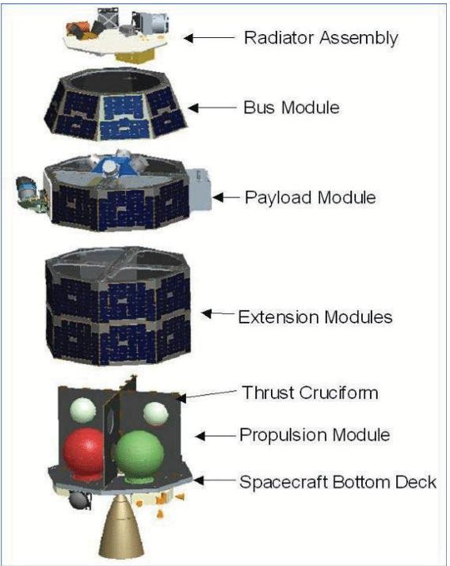

Fig. 1. NASA Ames Modular Common Spacecraft Bus function separations

<!-- PDF_PAGE: 4 -->

## 3. Potential Mission Concept

## 3.1 Mission definition

The mission focuses on validating the feasibility and performance of a modular spacecraft architecture capable of being reconfigured in orbit and demonstrating key servicing functionalities. These include station-keeping, collision avoidance manoeuvres, and the capability to alter the orbit of a captured target. The servicer is designed as a fully modular system whose architecture allows structural reconfiguration directly in orbit. The system is first launched in a small configuration that is best for ascent. After deployment, the modules can be reconfigured to create an operational configuration that is best for active servicing activities. This flexibility shows how modular spaceships are better for being adaptable, easy to maintain, and useful in the future. A robotic arm does the reconfiguration by detaching, moving, and reconnecting modules at set interface points. These interfaces support mechanical, electrical, and data transfer functionalities, and are key enablers of the system's adaptability. The reconfiguration demonstrates not only the modularity of the design but also the operational integrity of the system after structural changes. Two main configurations are considered: a launch configuration, in which modules are ar ranged to minimize volume and enhance structural resilience; and an operational configuration, which optimizes the geometry for orbital transfer and rendezvous with a target. Following deployment, the servicer autonomously transitions from the launch to the operational layout. Some subsystems, particularly those related to attitude and orbit control, must remain active throughout the mission and are not subject to disconnection. In addition to modular reconfiguration, the mission validates core servicing capabilities such as precision orbital manoeuvres, autonomous navigation, and target capture. The servicer must perform station-keeping and collision avoidance (SK-CAM) with the attached target, and demonstrate the capability to execute an orbital change of the target, ensuring its repositioning in a controlled manner. This mission scenario is a first step toward establishing a reusable, reconfigurable servicer platform capable of supporting a broad range of future operations, including debris mitigation, satellite life extension, and in-orbit assembly. In order to define a consistent and well-structured mission, as anticipated, it is essential to first understand the underlying problem, the impact, and the potential strategies to address it. This section articulates key questions that form the foundation of the mission definition process.

What is the Root Problem? The root problem is the growing congestion of space debris within Earth and cislunar orbits, which put at risk the safety, reliability, and longterm sustainability of space operations and infrastructures.

both for current and future space missions.

How Can it be Solved? The problem of orbital congestion in the cislunar environment can be addressed through an integrated strategy combining different in-orbit servicing operations. First, identifying obsolete or defunct assets. These assets can then be recovered and either safely de-orbited or repurposed using modular and robotic systems. To extend mission lifetimes and reduce the need for frequent resupply from Earth, servicing operations, such as refueling, component replacement, or software upgrades,can be performed directly in orbit. The development of in-orbit manufacturing and assembly systems allows the first concept of circular economy in space, recovering materials to be transformed into functional components to be used again in space, reducing dependence on Earth-based logistics, limiting waste, and promoting modular, standardized, and interoperable designs.

## 3.1.1 Mission Statement

From the key questions we defined the following mission statement: "To validate the feasibility and performance of a modular spacecraft architecture capable of being assembled and reconfigured in orbit, and to demonstrate the capability of the system to perform orbit corrections, laying the foundation for future reusable and reconfigurable space systems." This statement reflects a clear and integrated focus on two primary objectives and establishes a proof-of-concept for future architectures capable of supporting circular economy models, in-orbit servicing, and autonomous reconfiguration in various orbital environments, in order to underpin a vision for next-generation space systems that are both operationally versatile and sustainable.

## 3.1.2 Objectives

The following objectives have been directly derived from the mission statement and from the Stakeholders analysis. Each objective addresses a specific aspect of the broader mission and contributes to achieving a sustainable, modular, and service-oriented space architecture, and also to satisfy the possible interests of the Stakeholders that are in line with the mission concept.

- Mitigate debris accumulation and ensure orbital safety;

- Extend spacecraft lifetime;

- Reduce reliance on Earth launches;

- Reuse and recycle in-orbit materials;

- Advance autonomy in cislunar operations;

<!-- PDF_PAGE: 5 -->

<table border="1"><tr><td>ID</td><td>Requirement</td></tr><tr><td>CRN-MIS-0001</td><td>The system shall successfully complete the in-orbit reconfiguration of at least one module.</td></tr><tr><td>CRN-MIS-0002</td><td>After being re-attached, the assembled module shall be fully operational, including verification of power, communication, and thermal functionality.</td></tr><tr><td>CRN-MIS-0003</td><td>The servicer shall perform rendezvous and docking with a passive target.</td></tr><tr><td>CRN-MIS-0004</td><td>The system shall operate in servicing mode (e.g., station-keeping or collision avoidance) without loss of control or communication.</td></tr><tr><td>CRN-MIS-0005</td><td>The system shall be capable of detaching and/or releasing the serviced target.</td></tr><tr><td>CRN-MIS-0006</td><td>Critical telemetry data (position, attitude, module status) shall be transmitted to ground.</td></tr><tr><td>CRN-MIS-0007</td><td>The system shall remain fully operational for the time sufficient to allow one complete cycle of assembly, servicing, and release operations without the need for ground intervention or mission replanning.</td></tr><tr><td>CRN-MIS-0008</td><td>The system shall be launched with Ariane 6 or as backup solution Falcon 9.</td></tr><tr><td>CRN-MIS-0009</td><td>The Servicer shall be reusable after completing its primary mission.</td></tr></table>

Fig. 2. Mission Requirements

- Encourage the adoption of standardized interfaces and interoperability;

## 3.2 Functional Analysis

## 3.2.1 Mission Requirements

In order to reach the mission objectives, a set of highlevel system requirements has been identified. These requirements translate each objective into specific, measurable and reasonable capabilities that the servicer must demonstrate. They provide a foundational reference for the design, development, and verification of the mission, ensuring alignment with modularity, autonomy, and sustainability principles. The table below summarises the key mission-level requirements that guide the technical and operational performance of the servicer system;

## 3.2.2 Functional Tree

To initiate the system definition process, a functional analysis was carried out to identify the core capabilities that the servicer must provide in order to meet the mission objectives. This method allowed the team to concentrate on what the system needs to achieve before addressing how it will be implemented. The functional tree shown in Figure 3 organizes the high-level functions of the servicer into three main branches:

- Demonstrate in-orbit reconfiguration capabilities

- Demonstrate in-orbit servicing capabilities

- Ensure overall system functionality

These top-level functions were then broken down into more detailed actions, such as module deployment, orbital manoeuvres, target capture, and servicing operations. This early-stage analysis was crucial for clarifying the system requirements and defining the functional scope of the project, especially with respect to modularity and autonomous operations.

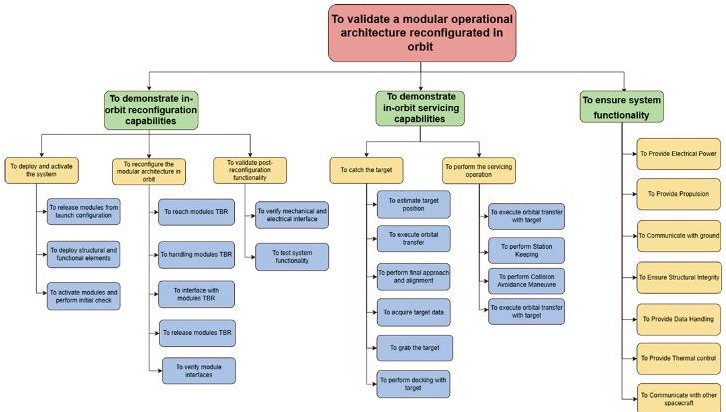

Fig. 3. Functional Tree

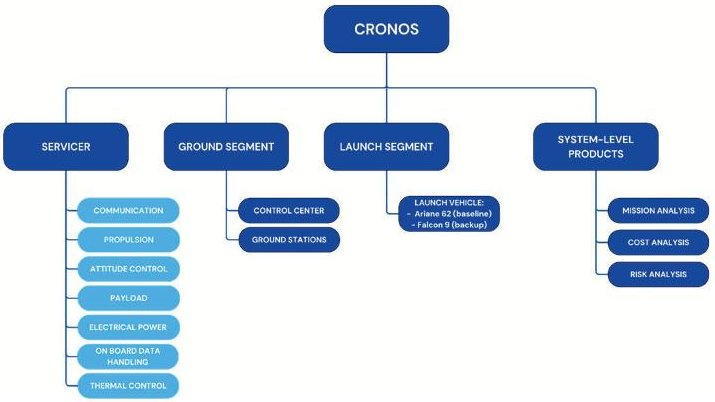

Fig. 4. Product Tree

## 3.2.3 Product Tree

Following the functional decomposition, a product tree was developed in COMET to translate the identified functions into tangible system elements. Initially defined at the system-of-systems level, the product tree incorporated both physical and mission-support elements e.g. mission planning and risk analysis. While a modular version of the product tree was briefly considered to better reflect the architecture, the original structure was retained due to limitations in COMET's ability to support flexible module allocation at this phase. The product tree, shown in Figure 4, requires the servicer to interact with both the ground control center, for the exchange of telemetry and telecommands, and the launch segment. To support the overall mission analysis, certain system-level products were included in the product tree even though they are not physical components, such as mission planning, cost assessment, and risk analysis.

## 3.2.4 Functional/Physical Block Diagram

To support the definition of the modular architecture, a Physical Block Diagram was developed, identifying data, electrical, and fluid connections between equipment, as illustrated in figure 5. Fluid connections were limited

<!-- PDF_PAGE: 6 -->

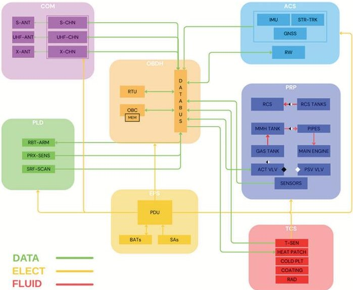

Fig. 5. Functional Physical Block Diagram

<table border="1"><tr><td>Mission Phase</td><td>Nominal Duration</td></tr><tr><td>Launch&amp;Early Orbit Phase(LEOP)</td><td>~5 days</td></tr><tr><td>Modularity Demonstration-Reconfiguration</td><td>~10 days</td></tr><tr><td>Modularity Demonstration-Functional Testing</td><td>~15 days</td></tr><tr><td>Transfer to Target</td><td>Minutes-hours1</td></tr><tr><td>Target Inspection</td><td>Minutes-hours</td></tr><tr><td>Mating Phase(Docking)</td><td>Minutes</td></tr><tr><td>Station Keeping&amp;Collision Avoidance Manoeuvre(SK&amp;CAM)</td><td>~5 years</td></tr><tr><td>Transfer to Station</td><td>Minutes-hours</td></tr><tr><td>Delivery Phase(Off-load)</td><td>Hours-days</td></tr><tr><td>Post-Servicing Operations(Refuel/Reconfig.)</td><td>TBD2</td></tr></table>

$ ^{1} $ Exact duration depends on orbital mechanics.

$ ^{2} $ To be refined once detailed operations are defined.

Fig. 6. Mission Phases

to the propulsion system, while data and electrical interfaces are distributed throughout the system. Selected interfaces between modules include mechanical, thermal, data, and electrical connections. Fluid transfer between modules was excluded due to complexity and risk. Preliminary component allocation was therefore based on required connection types, for example, a dedicated propulsion module houses both the main engine and the Reaction Control System (RCS).

## 3.3 CONOPS

## 3.3.1 Mission Phases

In Figure 6 are shown the phases of the demonstrative mission, including the nominal duration for each of them. This is considered the timeline of all the necessary phases to consider the demonstrative mission as a success.

## 3.3.2 Modes of Operations

The operative modes are defined at the subsystem level, this means that each sub system can independently operate in one of four modes depending on the mission phase

<table border="1"><tr><td></td><td colspan="4">Operative Modes</td></tr><tr><td>Mission Phases</td><td>Off Mode</td><td>Nominal Mode</td><td>Stand-By Mode</td><td>Emergency Mode</td></tr><tr><td colspan="5">LEOP</td></tr><tr><td>Launch and separation</td><td>Y</td><td>N</td><td>N</td><td>N</td></tr><tr><td colspan="5">Modularity Demonstration</td></tr><tr><td>Deployment</td><td>N</td><td>Y</td><td>Y</td><td>Y</td></tr><tr><td>Reconfiguration</td><td>N</td><td>Y</td><td>Y</td><td>Y</td></tr><tr><td>Functional test</td><td>N</td><td>Y</td><td>Y</td><td>Y</td></tr><tr><td colspan="5">In-Orbit Servicing Mission</td></tr><tr><td>Transfer to Target</td><td>N</td><td>Y</td><td>Y</td><td>Y</td></tr><tr><td>Target Inspection</td><td>N</td><td>Y</td><td>Y</td><td>Y</td></tr><tr><td>Mating</td><td>N</td><td>Y</td><td>Y</td><td>Y</td></tr><tr><td>Operation</td><td>N</td><td>Y</td><td>Y</td><td>Y</td></tr><tr><td>Transfer to Station</td><td>N</td><td>Y</td><td>Y</td><td>Y</td></tr><tr><td>Delivery</td><td>N</td><td>Y</td><td>Y</td><td>Y</td></tr><tr><td colspan="5">Post Servicing</td></tr><tr><td>Refuelling</td><td>Y</td><td>Y</td><td>Y</td><td>Y</td></tr></table>

Fig. 7. Modes of Operation

and operational context. During any given phase, different subsystems may simultaneously operate in different modes based on their specific roles and activity levels. Each subsystem can enter a maximum of four operative modes:

- Off Mode: The subsystem is powered down or inactive, with only essential units remaining operational for wake-up or safety mechanisms.

- Stand-By Mode: The subsystem is in a low-power, passive state, maintaining readiness to resume full activity rapidly if required.

- Nominal Mode: The subsystem is fully operational and actively performing its designated functions.

- Emergency Mode: The subsystem has entered a faultmanagement state due to detected anomalies or threshold violations. In this mode, it prioritises system safety, isolates faults, and may attempt autonomous recovery.

The actual operative mode of each subsystem is determined by a combination of the current mission phase and the real-time system status as shown in figure 7. Therefore, the behaviour of the overall spacecraft is the result of the combined mode configurations across all subsystems, dynamically adapting to mission progression and operational contingencies.

## 4. Technical Feasibility: modular spacecraft subsystems study

## 4.1 Structure

Our modular servicer is based on a standardised and reconfigurable architecture designed to handle different in-orbit service scenarios, from small cooperative satellites such as Amazonia 2 to large non-cooperative targets such as METOP-1C. The central element is a cubic structure with six symmetrical interfaces and an integrated support frame, called the Standard Block (STD), used in three modules (STD-1, STD-2, STD-3). This base is flanked

<!-- PDF_PAGE: 7 -->

by eight Specific Blocks (SPE), each customised to accommodate mission subsystems while maintaining at least two interface surfaces. The standard blocks ensure uniformity, symmetry, and consistent connections, while STD-1 and STD-2 contain batteries and PDUs and STD-3 houses the on-board computer (OBC). All modules use the iSSI standard to allow androgynous connections compatible with robotic systems, as demonstrated in flight in 2022 by iBOSS GmbH [5].

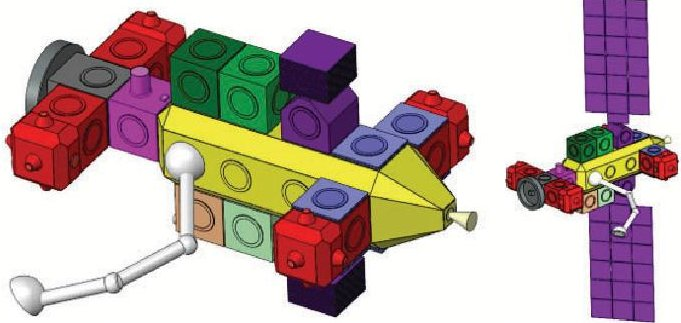

<table border="1"><tr><td colspan="2">STANDARD BLOCK</td><td>BLOCK ID</td><td>Nb of Blocks</td><td>Equipments concerned</td><td>Nb of interfacing plugs</td></tr><tr><td>STD-1</td><td>STD-1</td><td>1</td><td>Battery + PDU</td><td>6</td><td>6</td></tr><tr><td>STD-2</td><td>STD-2</td><td>1</td><td>Battery</td><td>6</td><td>6</td></tr><tr><td>STD-3</td><td>STD-3</td><td>1</td><td>OBC</td><td>6</td><td>6</td></tr><tr><td colspan="2">SPECIFIC BLOCK</td><td></td><td></td><td></td><td></td></tr><tr><td>SPE-1</td><td>SPE-1 - PRP MAIN</td><td>1</td><td>Main Propulsion</td><td>9</td><td>9</td></tr><tr><td>SPE-2</td><td>SPE-2 - TCS RAD</td><td>6</td><td>Radiator</td><td>2</td><td>2</td></tr><tr><td>SPE-3</td><td>SPE-3 - PRP RCS</td><td>4</td><td>RCS</td><td>5</td><td>5</td></tr><tr><td>SPE-4</td><td>SPE-4 - AOC</td><td>1</td><td>IMU+RW + Star Tracker + 2 GNSS</td><td>4</td><td>4</td></tr><tr><td>SPE-5</td><td>SPE-5 - COM ANT</td><td>1</td><td>UHF antennas + X&X Band antennas</td><td>4</td><td>4</td></tr><tr><td>SPE-6</td><td>SPE-6 - EPS PANELS</td><td>2</td><td>Solar Panels</td><td>3</td><td>3</td></tr><tr><td>SPE-7</td><td>SPE-7 - PLD ROBAR</td><td>2</td><td>Robotic Arm</td><td>2</td><td>2</td></tr><tr><td>SPE-8</td><td>SPE-8 - PLD MATING</td><td>1</td><td>Mating system + Lidar + Prox sensor</td><td>5</td><td>5</td></tr></table>

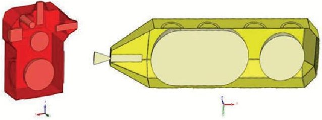

Fig. 8. Servicer block types, number and repartition

The servicer adopts a modular block architecture, initially divided into three sections (payload, body, propulsion) and then extended to functional blocks to ensure flexibility and mission dependency. The planned exchanges are mechanical, thermal, data, and power, while fluid flows are excluded to reduce risks and complexity, entrusted to dedicated propulsion blocks. The interfaces utilise a snap-fit mechanism that enables quick assembly, effective load transmission, and easy equipment replacement. The blocks have a centred centre of gravity to ensure stability. The modules integrate mechanical coupling, power transmission (5 kW), data (1 Gb/s), and heat transfer, supporting robotic operations in orbit. For the AOCS, the centre of gravity is enclosed by the RCS blocks, with 4 blocks of 4 thrusters each (6 DoF control), a reaction wheel to compensate for moments, and an axisymmetric structure for main propulsion.

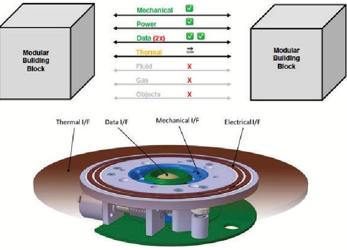

Fig. 9. HW architecture and dataflow within modules

The servicer has been designed to take on different modular configurations, so as to adapt to different mission scenarios and demonstrate the system's true reconfigurability in orbit. In the extended configuration, the blocks are extended along the +X axis, creating a sort of backbone that expands the operating volume and reach of the robotic arm, even if this entails greater inertial loads and therefore more stringent requirements for the AOCS. The compact 'CubeSat Tug' configuration, on the other hand, reduces the blocks to two standard and a few specific ones, resulting in a flattened layout and a mass of less than 600 kg, suitable for light and fast missions but with less energy, redundancy, and payload management capacity. For rideshare launches, such as on Falcon 9, the "Cluster" configuration has been proposed, in which the blocks are arranged radially around the propulsion system with a height reduced to 1.5 m, a solution compatible with circular adapters but more complex to wire and deploy. Finally, the reconfigurable in-orbit configuration features clusters of detachable blocks and iSSI joints on all edges, allowing for plug-and-play rearrangements during the mission and ensuring compatibility with robotic servicing operations. Overall, these variants offer great flexibility and adaptability to different scenarios, but balance operational benefits with compromises related to AOCS complexity, reduced redundancy, or increased mass.

## 4.2 Propulsion

The propulsion system of the has been designed to meet a series of fundamental requirements related to the nature of the mission: performing orbital transfers, ensuring rendezvous manoeuvres with the target, ensuring the ability to maintain position during prolonged operations, and intervening in the event of collision prevention. In ad-

<!-- PDF_PAGE: 8 -->

dition to these functional requirements, there are design constraints, including the need to operate over a multi-year time horizon, the reusability of the service vehicle, and full compatibility with the modular architecture that characterises the entire system. Multiple chemical and electrical options has been taken into account to find the best compromise for the design. The analysis performed, highlighted the advantages and critical points of each approach leading to a final choice towards single-propellant chemical propulsion, considered the most suitable in terms of balance between performance, complexity and mission constraints. The final architecture is therefore based on a single-propellant MMH (mono-methylhydrazine) system with helium pressurisation, a configuration that is widely established in the industry for its operational simplicity, reliability and high TRL level. An important aspect to highlight is that both the main propulsion system and the reaction control system use the same propellant and the same pressurisation chain, thus reducing the diversity of tanks and simplifying the integration of the subsystem. Orbital manoeuvres are divided between two subsystems: the main propulsion (PRP), responsible for transfers and collision avoidance manoeuvres, and the Reaction Control System (RCS), dedicated to attitude control and close approach operations. After capturing the target, the servicer and the satellite are treated as a coupled system, which entails a significant increase in the mass to be manoeuvred and, consequently, greater propellant consumption. In table 1 are summarized the inputs on which the design has been based on. Consequently, the total propellant mass

<table border="1"><tr><td>Initial mass,kg</td><td>599.2</td></tr><tr><td>Target mass,kg</td><td>500</td></tr><tr><td>Total $ \Delta V $ ,m/s</td><td>449</td></tr><tr><td>Isp,s</td><td>230</td></tr></table>

Table 1. Design input parameters

has been calculated as [6]:

$$
m _ {\mathrm {p r o p}} = m _ {0} \left(1 - e ^ {\frac {- \Delta V}{I _ {s p} \cdot g _ {0}}}\right) = 2 0 4. 1 1 \mathrm {k g}
$$

In table 2 is summarized the propellant mass budget for each manouvre.

For the PRP, the system includes a 54.8-litre spherical composite helium tank capable of storing 3.52 kg of gas at 400 bar. The MMH is contained in a 212-litre capsule-shaped tank, pressurised to 28 bar and designed for inorbit refuelling. The chain is completed by pressure and temperature transducers for monitoring, filters for protecting sensitive components, and a main motor capable of generating approximately 550 N of thrust, sufficient to complete all required manoeuvres in just over 12 minutes

Table 2. Propellant consumption per manoeuvre

<table border="1"><tr><td colspan="2">Propellant consumption</td></tr><tr><td>PRP</td><td>183.62kg</td></tr><tr><td>Initial Transfer</td><td>48.46kg</td></tr><tr><td>CAM</td><td>64.58kg</td></tr><tr><td>Transfer Back</td><td>70.57kg</td></tr><tr><td>RCS</td><td>20.50kg</td></tr><tr><td>Close Approach</td><td>7.99kg</td></tr><tr><td>Stationkeeping</td><td>12.51kg</td></tr></table>

of total ignition time. In table 3 are summarized the main engine characteristics.

Table 3. PRP Engine characteristics

<table border="1"><tr><td>Propellant</td><td>Hydrazine</td></tr><tr><td>Thrust</td><td>201.0-554.2N</td></tr><tr><td>Feed Pressure</td><td>6.9-28.9bar</td></tr><tr><td>Weight</td><td>2.4kg</td></tr><tr><td>Specific Impulse $I_{sp}$</td><td>223-237s</td></tr></table>

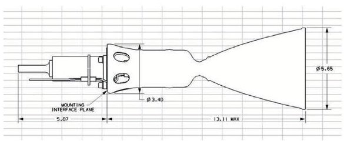

The same architectural philosophy has been adopted for the RCS, but divided into four independent modules, each with its own MMH tank (capacity 5.12 kg) and a small 1.53-litre helium tank (0.10 kg at 400 bar). Each module is equipped with four 1 N thrusters, for a total thrust of approximately 4 N, sized for attitude control and delicate close approach phases. In table 4 are summarized the main engine characteristics.

Table 4. RCS Thruster characteristics

<table border="1"><tr><td>Propellant</td><td>Hydrazine</td></tr><tr><td>Thrust</td><td>0.19-1.13N</td></tr><tr><td>Feed Pressure</td><td>4.8-28.3bar</td></tr><tr><td>Weight</td><td>0.37kg</td></tr><tr><td>Specific Impulse $I_{sp}$</td><td>220-233s</td></tr></table>

## 4.3 Attitude and Orbital Control System

A key element of the mission is the management of the system coupled with the target: since only the service

<!-- PDF_PAGE: 9 -->

vehicle has the AOCS, after docking the two satellites behave as a single body and the control capability depends directly on their mass ratio. For this reason, a dedicated analysis was conducted to assess the extent to which the service vehicle's AOCS is capable of ensuring stability and pointing accuracy even under conditions of significant mass imbalance. The results of the study identified three feasibility thresholds. In table 5 are summarized the results of the analysis. The AOCS architecture of the ser-

<table border="1"><tr><td>Mass ratio(at docking)</td><td>Feasibility</td><td>Consequences</td></tr><tr><td>1:1 to 1:5</td><td>Feasible</td><td>Slower slewing and response</td></tr><tr><td>1:5 to 1:10</td><td>Must be specifically dimensioned</td><td>Oversized actuators and slow response rates</td></tr><tr><td>&gt;1:10</td><td>Not feasible</td><td>Reaction wheels saturate, excessive propellant used and long control times</td></tr></table>

Table 5. Feasibility of docking mass ratios

vicer is designed to ensure three-axis stabilisation with a pointing accuracy of $ < 0.01^{\circ} $ , operational in all phases of the mission and with a hardware mass of $ \leq 15 \mathrm{~kg} $ (excluding RCS propellant). The measurement chain integrates GNSS, IMU and Star Tracker for attitude and orbit determination; the actuation chain combines Reaction Wheels for precision control and RCS for rapid manoeuvres, desaturation and degraded scenarios. The philosophy is lean and modular: solar sensors, magnetometers and magnetorquers (covered by star trackers and RCS/RW) have been eliminated, maintaining redundancy at the level of critical sensors/actuators. The main sensors present are:

- 2 Star Trackers for precision pointing with accuracy <0.01 $ ^{\circ} $;

- 2 IMUs, with dynamic range requirements $> = 2\mathrm{g}$ to correctly measure RCS-induced rotations in dynamic phases;

- 4 GNSS for position and velocity during transit, with position accuracy of m and velocity .1 m/s;

## While the actuators are:

- 4 reaction wheels for fine-grained control and propellant conservation. Based on the estimated servicer dynamics （m $ \approx $ 500 kg; J $ \approx $ 200 kg $ m^{2} $ ）and mission slews (1 deg/s), the required torque is $ \approx $ 0.05 N m;

- 4 RCS thrusters to supports fast slew, abort, RW desaturation, and control in coupled configuration. They are integrated with onboard chemical propulsion

## 4.4 On-Board Data Handling

Data management on board the servicer is based on a distributed architecture designed to ensure modularity,

scalability and robustness. In this configuration, each functional module is equipped with a local microcontroller dedicated to data pre-processing and management of internal sensors and actuators. Since on the market still there are not microcontroller compatible with SpaceFibre protocol[7], an FPGA has been considered as a bridge [8] to convert legacy protocols and enable integration with the common communication backbone, based on SpaceFibre. An on-board computer (OBC) acts as the central system master, coordinating the microcontrollers, collects and distributes telemetry and command data and ensures time synchronisation. This architectural choice provide the spacecraft a certain autonomy while simplifying in-orbit reconfiguration. So, when a module is added or replaced, the OBC recognises the new element and manages its integration without the need for changes to the entire system. The servicer uses SpaceFibre as its communication backbone, chosen after a comparison with SpaceWire [9]. SpaceWire is a mature and reliable standard, but limited in terms of bandwidth (hundreds of Mbit/s) and lacking native QoS and fault isolation capabilities, which are essential for a modular system. SpaceFibre, on the other hand, offers speeds in the order of Gbit/s, virtual channels, configurable QoS and integrated fault isolation, making it more suitable for managing data peaks (e.g. LiDAR and cameras) and reconfigurability in orbit. The FPGAs in the modules act as SpaceWire-SpaceFibre bridges, ensuring compatibility with existing components while also providing scalability to future architectures. Because not all modules are directly in communication with the OBDH one, three possible network configuration has been considered: serial, hybrid and parallel. In the serial configuration, all data coming from interfaces pass through the MCU in the relative module. It reduces cabling and complexity, but a failure in one module would interrupt the chain and there could also be problems due to possible bottlenecks; in the parallel configuration, each interface is connected with each other; this means that a module that is not directly in contact with the module that contains the OBC, can still communicate with it bypassing the intermediate one, even in case of failure of the latter. This solution increases the amount of cabling, and so EMI, but ensures fault isolation and operational continuity. The hy-

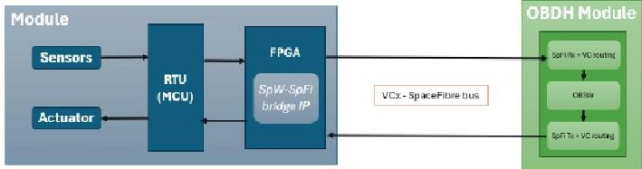

Fig. 10. HW architecture and dataflow within modules

<!-- PDF_PAGE: 10 -->

brid solution is a combination of both serial and parallel, in which the serial links are used, and switched to a parallel one in case of failure. It reduces EMI, like in the serial configuration, but increases the mass and especially the complexity, since switching capabilities should also be introduced in the system to re-route the signal. The parallel configuration has been chosen based on a tradeoff evaluating the impact of electromagnetic interference, complexity and scalability of the system. In figure 11, the

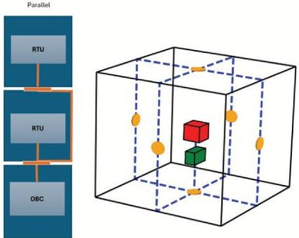

Fig. 11. Parallel Topology. On the left it is a 2D visualization, on the right in 3D

red box represents the MCU, the green one the FPGA, the yellow circle the interfaces and in blue the links through harness. The operator adopts a distributed approach to fault detection, isolation and recovery (FDIR): in addition to the central OBC, individual modules also perform local checks to monitor their own status. After the reconnection, each module can independently verify the continuity of the power supply, communications and thermal inputs, decreasing the dependence on the central control and increasing the overall resilience of the system. The OBDH architecture was calibrated based on the operator's data traffic profile. Analyses showed peaks of up to 75 Mbps during the most critical phases, such as target inspection and mating. To ensure robustness even in degraded conditions, a 20% margin was applied to computing and storage capacities. To support this sizing, a 512 GB mass memory unit (MMU) was integrated, capable of buffering about 217 GB of data during periods of communication interruption with the ground segment, ensuring operational continuity and information integrity.

<table border="1"><tr><td>Phase/Mode</td><td>Off Mode[kbps]</td><td>Nominal Mode[kbps]</td><td>Stand-By Mode[kbps]</td><td>Emergency Mode[kbps]</td></tr><tr><td>Launch and Separation</td><td>752.5</td><td>0</td><td>0</td><td>425.2</td></tr><tr><td>Deployment</td><td>0</td><td>4251.6</td><td>1275.5</td><td>425.2</td></tr><tr><td>Reconfiguration</td><td>0</td><td>4251.6</td><td>1275.5</td><td>425.2</td></tr><tr><td>Functional Test</td><td>0</td><td>22575.8</td><td>6772.7</td><td>2257.6</td></tr><tr><td>Transfer to Target</td><td>0</td><td>4252.7</td><td>1275.8</td><td>425.3</td></tr><tr><td>Target Inspection</td><td>0</td><td>75246.0</td><td>22573.8</td><td>7524.6</td></tr><tr><td>Mating</td><td>0</td><td>75246.0</td><td>22573.8</td><td>7524.6</td></tr><tr><td>Operation</td><td>0</td><td>381.8</td><td>1145.6</td><td>381.9</td></tr><tr><td>Transfer to Station</td><td>0</td><td>4252.7</td><td>1275.8</td><td>425.3</td></tr><tr><td>Delivery</td><td>0</td><td>75246.0</td><td>22573.8</td><td>7524.6</td></tr><tr><td>Refuelling</td><td>0</td><td>22499.0</td><td>6749.7</td><td>2249.9</td></tr></table>

Table 6. Data rate per phase and mode.

## 4.5 Payload

The servicer's Payload subsystem was designed as the key element ensuring the ability to physically interact with the target and support modular assembly and reconfiguration operations in orbit. Its main functions include:

- target inspection and characterization via sensors;

- capture and securing the client satellite;

- manipulation of the servicer modules for reconfiguration activities;

- support for servicing operations such as docking, refueling, or controlled release.

About payload design, some assumption has been taken into account:

- mass, geometry and capture interfaces are known, at least partially; this implies that we can pre-define capture strategy and tool selection.

- the servicer guarantee sufficient attitude and orbital control, reducing the payload complexity for proximity operation;

- the orbital environment is predictable, letting a precise sizing for thermal and radiation shieldings;

- mission lifetime and duty cycle are limited: the payload subsystem will be used for a finite number of times, implying that we can have lower long-term reliability requirements.

- standardized interfaces are available and let the payload to interact with all the modules for assembly and reconfiguration

Based on these assumption, a trade-off has been performed on capturing technologies, leading to choose robotic arm with an embedded sensor suite mating and capturing. The robotic arm has been considered the most versatile because capable of capturing target and manipulating the servicer's modular blocks. Between the solution analysed on the market, the GITAI inchworm robotic arm [10] seems the most interesting solution that suites with this design. Moreover, a sensor suite has been considered including a LiDAR for 3D scanning and relative navigation during mating phase, and a RGB camera as a proximity sensor to control docking operations with the target.

<!-- PDF_PAGE: 11 -->

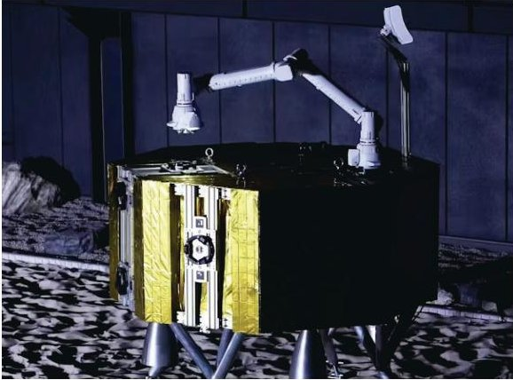

Fig. 12. GITAI Robotic Arm

## 4.6 Electric Power System

## 4.6.1 Requirements & Design Drivers

The Electrical Power System (EPS) of CRONOS [orbit 778 km, i=98.4 $ ^{\circ} $ ] must guarantee continuous power to the platform and payload during the eclipse (36 min) and propulsion phases. The main drivers are orbit, mission duration (4 years) and high-power activities. For critical subsystems (TM/TC, C&DH, AOCS), operational continuity is expected with a 20% margin on the power budget. The batteries are sized with reference to the worst-case scenario, considering the average load and DoD limitations, while the triple-junction GaAs solar panels [29.5% BOL $ \rightarrow $ 26.5% EOL with 0.75% annual degradation] must meet the requirements even at the end of their life. The EPS includes redundancy and protection against faults, over/under voltage and thermal conditions.

## 4.6.2 Assumpiotns & Trade-offs

In the preliminary design phase of the EPS, technical and operational assumptions based on similar missions were adopted, to be reviewed when more accurate data becomes available. Simulations of the 778 km orbit with an inclination of 98.4 $ ^{\circ} $ indicate a 36-minute eclipse and a 61.2-minute illuminated period, which form the basis for the energy balance and battery sizing. The solar panels are sized considering an annual degradation of 0.28% while the batteries assume a maximum depth of discharge of 80% to ensure durability. In addition, the specifications assume constant orientation towards the Sun to maximise production and MPPT stability, with a conversion efficiency set at 95

## 4.6.3 Baseline Design

The CRONOS EPS uses a 102 V regulated bus powered by two deployable solar wings with triple junction GaAs cells (5.85 m $ ^{2} $ , EOL efficiency 26.5% ). Regulation is performed by dedicated MPPTs for each string, which

Table 7. Trade-Off Power Generation Method

<table border="1"><tr><td>Figure of Merit</td><td>Weighting</td></tr><tr><td>Specific Power</td><td>0.333</td></tr><tr><td>Resistance to Degradation</td><td>0.200</td></tr><tr><td>Complexity</td><td>0.143</td></tr><tr><td>Cost</td><td>0.133</td></tr><tr><td>Lifetime</td><td>0.200</td></tr></table>

<table border="1"><tr><td></td><td>SPw</td><td>RTD</td><td>Cmplx</td><td>Cost</td><td>Life</td><td>Tot</td></tr><tr><td>SolarP.</td><td>1.000</td><td>0.05</td><td>0.800</td><td>1.00</td><td>0.357</td><td>0.655</td></tr><tr><td>RTG</td><td>0.063</td><td>1.00</td><td>0.400</td><td>0.01</td><td>0.200</td><td>0.476</td></tr><tr><td>PrimaryBatt.</td><td>0.250</td><td>0.125</td><td>1.000</td><td>0.20</td><td>0.143</td><td>0.297</td></tr></table>

Table 8. Trade-Off Solar Cell Technology

<table border="1"><tr><td>Figure of Merit</td><td>Weighting</td></tr><tr><td>Specific Power</td><td>0.333</td></tr><tr><td>Area/Power</td><td>0.133</td></tr><tr><td>TRL</td><td>0.267</td></tr><tr><td>Cost/Watt</td><td>0.200</td></tr><tr><td>Thermal</td><td>0.067</td></tr></table>

<table border="1"><tr><td></td><td>SP</td><td>A/P</td><td>TRL</td><td>C/W</td><td>Th</td><td>Tot</td></tr><tr><td>GaAs</td><td>1.000</td><td>1.000</td><td>1.000</td><td>0.286</td><td>1.00</td><td>0.857</td></tr><tr><td>Si</td><td>0.625</td><td>0.511</td><td>1.000</td><td>0.800</td><td>0.80</td><td>0.757</td></tr><tr><td>Thin-Film</td><td>0.750</td><td>0.288</td><td>0.778</td><td>1.000</td><td>0.64</td><td>0.738</td></tr></table>

Table 9. Trade-Off Solar Battery Technology

<table border="1"><tr><td>Figure of Merit</td><td>Weighting</td></tr><tr><td>Specific Energy</td><td>0.333</td></tr><tr><td>Cycle Life</td><td>0.267</td></tr><tr><td>Discharge Efficiency</td><td>0.200</td></tr><tr><td>Cost</td><td>0.067</td></tr><tr><td>Thermal Performance</td><td>0.133</td></tr></table>

<table border="1"><tr><td></td><td>SE</td><td>CL</td><td>DE</td><td>Cost</td><td>Th</td><td>Tot</td></tr><tr><td>Li-Ion</td><td>1.000</td><td>0.167</td><td>1.000</td><td>1.00</td><td>0.75</td><td>0.744</td></tr><tr><td>NiH2</td><td>0.455</td><td>1.000</td><td>0.729</td><td>0.32</td><td>1.00</td><td>0.719</td></tr></table>

optimize performance and also power the lithium-ion batteries (based on Saft VES180 cells, 665 Wh, 4.57 kg, DoD 80%) , sized to support critical loads during the 36 minutes of eclipse. Power distribution is managed by the Power Distribution Unit (PDU) [11] with protections such as

<!-- PDF_PAGE: 12 -->

Table 10. Trade-off for power regulation method

<table border="1"><tr><td>Figure of Merit</td><td>Weighting</td></tr><tr><td>Specific Mass</td><td>0.133</td></tr><tr><td>Efficiency</td><td>0.333</td></tr><tr><td>Granularity</td><td>0.267</td></tr><tr><td>Cost</td><td>0.133</td></tr><tr><td>Complexity</td><td>0.133</td></tr></table>

<table border="1"><tr><td></td><td>SM</td><td>Ef</td><td>Grn</td><td>Cost</td><td>Compl</td><td>Tot</td></tr><tr><td>S3R</td><td>1.000</td><td>0.816</td><td>0.300</td><td>1.000</td><td>1.00</td><td>0.845</td></tr><tr><td>MPPT</td><td>0.700</td><td>1.000</td><td>1.000</td><td>0.833</td><td>0.75</td><td>0.871</td></tr><tr><td>DPR</td><td>0.778</td><td>0.929</td><td>0.600</td><td>0.625</td><td>1.00</td><td>0.843</td></tr></table>

fuses and redundancy for critical subsystems, while noncritical systems are designed to shut down in the event of a failure or switch to low-power mode.

## 4.6.4 Budgets

Battery capacity is sized to support spacecraft operations during eclipse periods. Assuming an eclipse duration of 36 minutes and a worst-case average power draw of $ P_{avg}=653.45 $ W, the required energy storage is defined as:

$$
E _ {r e q} = P _ {a v g} \times t _ {e c l i p s e} = 6 5 3. 4 5 \times \frac {3 6}{6 0} = 3 9 2. 1 \mathrm {W h}
$$

$$
E _ {b a t t e r y} = \frac {E _ {r e q}}{0 . 8 \times 0 . 9 5} = 5 1 5. 9 \mathrm {W h}
$$

Applying an 80% maximum DoD and 95% BDR efficiency gives the final required battery capacity of:

The battery system is sized with margins to offer a capacity of 665 Wh of usable energy based on the selected Lithium-Ion cells. This is expected to provide sufficient margin for eclipse operations, given the estimated load.

## 4.7 Thermal Control System

The thermal control system (TCS) regulates the heat of the spacecraft and maintains the temperature necessary for the proper functioning of individual components throughout the mission. The most critical point of the mission is to adapt the entire TCS to the concept of modularity, which is a key element of this architecture for proper functioning. The design of the thermal control system starts from an analysis of the LEO environment, which is dominated by three external flows: direct solar flux ( $ \approx $ 1412 W/m $ ^{2} $ ), Earth albedo ( $ \approx $ 30% of solar, reduced to 700 km), and Earth IR radiation ( $ \approx $ 210-220 W/m $ ^{2} $ ). The satellite dissipates heat

mainly in the infrared, towards deep space (sink at 4 K) and towards Earth (effective sink at $ \approx $260 K).

## 4.7.1 Design Drivers

Table 11. Environmental parameters of orbital targets

<table border="1"><tr><td>Param.</td><td>ISAM</td><td>AMAZ.2</td><td>METOP-C</td></tr><tr><td>Solar flux [W/m2]</td><td>1412</td><td>1412</td><td>1412</td></tr><tr><td>Albedo eff. [%]</td><td>27</td><td>24</td><td>22</td></tr><tr><td>Albedo flux [W/m2]</td><td>~381</td><td>~339</td><td>~311</td></tr><tr><td>Earth IR [W/m2]</td><td>220-225</td><td>205-210</td><td>195-200</td></tr><tr><td>Deep sink [K]</td><td>4</td><td>4</td><td>4</td></tr><tr><td>Earth IR sink [K]</td><td>260</td><td>260</td><td>260</td></tr></table>

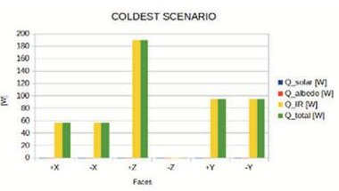

Fig. 13. Hottest vs Coldest scenario

## 4.7.2 Baseline Design

- Modular Thermal Interface:

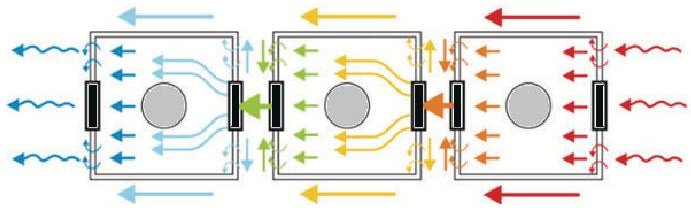

Fig. 14. Concept of heat flow through modules

The modular architecture of the satellite makes thermomechanical requirements challenging, as the blocks do not have a fixed orientation and the thermal load profiles vary with reconfiguration. Each module transfers heat via thermal interfaces to connected modules or dedicated radiators. The interface, located concentrically to the mechanical interface as an outer ring, allows for the separation of functional flows and greater efficiency. Its function is passive heat exchange, with requirements for reusability, high efficiency (<0.03 K/W), and compatibility with vacuum, thermal cycles, radiation, and vibrations. The technologies considered include elastic

<!-- PDF_PAGE: 13 -->

discs to tolerate misalignments, sandwich configurations to ensure contact pressure, micro-structured surfaces to increase the useful area, and copper-CNT composites, which improve conductivity by reducing mass [12]. Experimental data show that a conductive base material is not enough: surface preparation is crucial. The best results are obtained with low percentages of well-dispersed and vertically aligned CNTs, a promising and reusable solution in space environments.

## Passive Thermal Control System (PTCS):

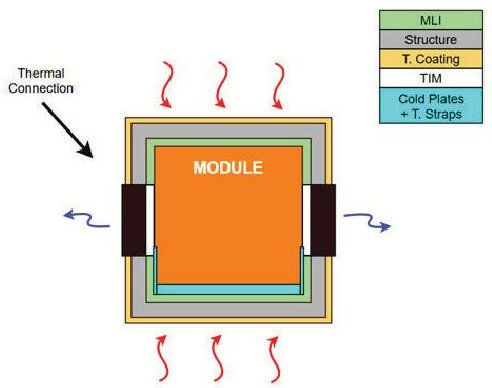

Fig. 15. Thermal Control Architecture

The PTCS manages heat flows through the satellite walls and maintains the modules at operating temperatures [13]. A 40 cm cube with circular ports was modelled, considering radiation, conduction, and convection transfers, and calculating the use of MLI (30 layers, 0.015 kg/m $ ^{2} $ ）and thermal paint （70 $ \mu $ m, 1400 kg/m $ ^{3} $ ）in thermal equilibrium. The total mass depends on the usable area and the number of modules. Inside, each module incorporates an aluminium cold plate （ $ 3 7 9 \times3 7 9 \times5 $ mm, 0.3 kg) to collect heat from dissipative components (batteries, avionics, PRP valves) and transfer it via graphite thermal straps (24 units, 0.3 kg each, 1 m long). To improve conduction, TIM Sil-Pads (12 pieces, 0.05 kg each) are provided, reducing contact resistance. For external dissipation, a reconfigurable radiator (RTP)[14] in high-conductivity graphite with a SMA Cu-Al-Ni actuator is used: it opens automatically between 20-60 $ ^{\circ} $ C and closes below 0 $ ^{\circ} $ C. This allows the radiative area to be varied from 0.144 to 0.432 $ m^{2} $ without power, dissipating up to 148 W at 60 $ ^{\circ} $ C and reducing heater requirements by 25 W at -20 $ ^{\circ} $ C.

- Active Thermal Control System (ATCS): A FEM analysis correlated external thermal conditions and subsystem consumption profiles, estimating operating temperatures and gradients on sensitive payload components in nominal and degraded scenarios. The results were validated with temperature sensors integrated into critical subsystems, providing realtime monitoring and comparison with the numerical model. Thermal patches and interface materials were also sized to dissipate heat and ensure localised thermal control, preserving payload integrity and performance throughout the mission.

## 4.8 Communication

## 4.8.1 Requirements and Design Drivers

The communication subsystem (COM) is responsible for relaying data between external structures. For the CRONOS project, the main structures with which it communicates are the ground stations on Earth and the external space station included in the mission. The objective of the COM subsystem is to receive commands from these infrastructures and send them data relating to the servicer. The main drivers of this subsystem include altitude, data rate, minimum elevation of ground stations, thermal constraints and radiation tolerance.

## 4.8.2 Assumptions and Trade-Offs

The servicer keeps the antenna aligned along the nadir axis with a maximum error of $ \pm 5^{\circ} $ at 900 km, while the ground stations operate with a minimum elevation of $ 5^{\circ} $ Patch antennas were chosen for uplink and downlink because they are compact and robust; larger or deployable antennas were discarded due to the risk of interference with the robotic arm and greater complexity.

## 4.8.3 Data flow categorisation

The communication system is functionally divided in two data streams:

- Telemetry & Telecommand (TM/TC): Telemetry (TM) involves the transmission of satellite status data to ground or space stations (temperature, anomalies, housekeeping, battery level), while telecommand (TC) consists of receiving commands, such as software updates, manoeuvres or payload activation, and these exchanges take place via RF link. In LEO, the S band is the standard for TM/TC [15] [16], thanks to its reliability proven in thousands of missions, low susceptibility to atmospheric attenuation and compatibility with many ground stations. Furthermore, S band equipment is inexpensive, lightweight and efficient compared to that of higher bands (X, Ku, K, Ka). For communications with the space station during critical phases, such as approach and docking, the UHF band is used, as proven by missions such as Soyuz and SpaceX Dragon. UHF also acts as a

<!-- PDF_PAGE: 14 -->

backup channel: in the event of an S-band failure, it ensures continuity of communications.

- Payload and data video: The servicer is equipped with an optical camera and a LiDAR sensor. Transmitting these large volumes of data in real time, particularly video, exceeds the capabilities of the S band, which normally only supports a few Mbit/s. To overcome this limitation, the X band is used to download payload data. This RF band allows much higher transmission speeds, often hundreds of Mbit/s, which are sufficient to send compressed images. Choosing higher RF bands could offer superior performance, but would increase the cost, mass and complexity of the system, risking the creation of an oversized system.

## 4.8.4 Inter-Satellite Link (ISL)

During proximity operations with a cooperative client satellite, data exchange between the two spacecraft is beneficial, so two approaches are proposed: data transfer via a ground station or direct communication between satellites, emphasising the simplicity of the first option. In fact, implementing a direct link would require the client satellite to be equipped with a dedicated RF channel for ISL, thus adding complexity and constraints, and real-time data exchange would not be considered critical during the docking phase. Instead, the service vehicle can remain in standby mode at a safe distance from the customer satellite, receiving periodic updates from the customer on its attitude, system status and relative motion. The service vehicle's on-board camera provides visual feedback to ground operators, allowing them to monitor the situation directly. Thanks to the modular design of the servicer, the ISL could be implemented at a later stage if mission requirements evolve.

## 4.9 Baseline Design

The communication subsystem is responsible for ensuring robust and continuous data exchange between the servicer, ground infrastructure and space station during all phases of the mission. It also supports both TM/TC telemetry and telecommand at low data rates and highspeed payload transmission, such as video and LiDAR. This architecture includes multiband functionality, redundancy and autonomous link management to meet the mission's performance, reliability and security requirements. The design exploits frequency diversity (S-band, UHF, Xband) and incorporates dedicated antennas and transmitters optimised for different types of data and link conditions. Finally, the subsystem is integrated with the OBDH for command execution and telemetry routing,

while cross-strapping allows switching between transmitter/SDR/transceiver in the event of unit failure.

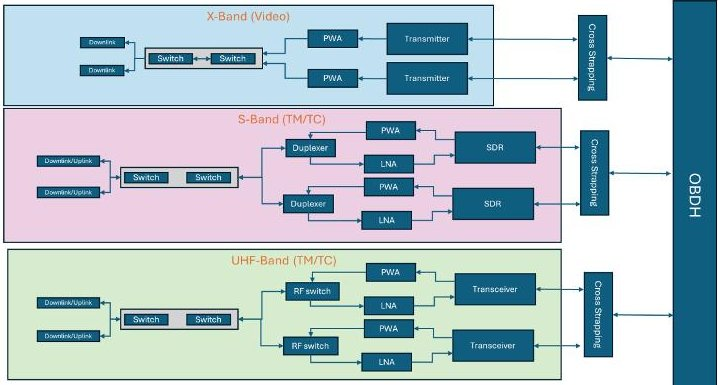

Fig. 16. Cronos Communication Architecture

## 5. Cost Analysis

## 5.1 Mass Estimation for Modular Spacecraft

Calculating the mass of a spacecraft is an important part of cost analysis because mass is often the main factor that affects cost. This process is more complicated for modular spacecraft than for traditional monolithic spacecraft. It needs to be broken down into overall mass, module-level mass, and subsystem-level contributions. Since there isn't much historical data on modular systems, we use well-known scaling laws and Cost Estimating Relationships (CERs) from traditional spacecraft to help us.

## 5.1.1 Overall Spacecraft Mass Estimation

$$
M _ {\mathrm {t o t a l}} = M _ {\mathrm {p a y l o a d}} + M _ {\mathrm {b u s}},
$$

The total dry mass can be expressed as:

where $ M_{\mathrm{payload}} $ is the mission payload and $ M_{\mathrm{bus}} $ encompasses the supporting spacecraft bus. Historical data shows that bus mass scales with payload mass, typically following either a linear or a power-law relationship:

$$
M _ {\mathrm {b u s}} = k \cdot M _ {\mathrm {p a y l o a d}} + c, \quad M _ {\mathrm {b u s}} = a \cdot M _ {\mathrm {p a y l o a d}} ^ {b}.
$$

Here, k and c represent a linear scaling factor and baseline bus mass, while a and b are regression coefficients Empirical evidence often finds b < 1, indicating diminishing returns: as payload size grows, required bus mass increases at a slower rate. For clarity and consistency, we adopt the linear form in this analysis, acknowledging that coefficients are drawn from historical spacecraft data.

## 5.1.2 Modular Mass Distribution

For modular spacecraft, bus mass is distributed among N modules:

<!-- PDF_PAGE: 15 -->

$$
M _ {\mathrm {b u s}} = \sum_ {i = 1} ^ {N} M _ {\mathrm {m o d u l e}, i}, \quad M _ {\mathrm {m o d u l e}, i} = p _ {i} \cdot M _ {\mathrm {b u s}},
$$

where $ p_{i} $ is the mass fraction assigned to module i, with $ \sum p_{i}=1 $ . Examples include propulsion modules dominated by propellant and thrusters, and power modules where solar arrays and batteries contribute significantly. In practice, $ p_{i} $ values are determined by expert judgment, subsystem complexity, or by analogy with existing spacecraft.

## 5.1.3 Subsystem Mass Estimation

Each module $i$ comprises $K_{i}$ subsystems:

$$
M _ {\mathrm {m o d u l e}, i} = \sum_ {j = 1} ^ {K _ {i}} M _ {\mathrm {s u b s y s t e m}, j, i}.
$$

Subsystems include structure, thermal control, communications, and power distribution. Their masses are estimated with scaling laws:

$$
M _ {\mathrm {s u b s y s t e m}, j, i} = \alpha_ {j} \cdot M _ {\mathrm {m o d u l e}, i} ^ {\beta_ {j}},
$$

where $ \alpha_{j} $ and $ \beta_{j} $ are coefficients calibrated from historical data. This allows subsystem estimates to reflect system requirements: e.g., propulsion scaling with $ \Delta V $ or power systems scaling with output capacity.

## 5.1.4 Scaling with Payload Mass

Payload mass $ ( M_{\mathrm{payload}}) $ is the primary input. Bus mass is then estimated, divided among modules, and broken into subsystems. This hierarchical model provides granularity and ensures scalability with mission needs, while highlighting the dependence on reliable historical datasets for the coefficients.

## 5.2 Custom Cost Model for Modular Spacecraft

Once the mass hierarchy is defined, cost can be estimated. In aerospace, mass is strongly correlated with cost, making it the principal driver in most CERs. Our custom cost model accommodates both subsystem-level estimates and higher-level mass-driven methods.

## 5.2.1 Cost Estimation from Historical Data

For subsystem j:

$$
C _ {\mathrm {s u b s y s t e m}, j} = \gamma_ {j} \cdot M _ {\mathrm {s u b s y s t e m}, j} ^ {\delta_ {j}},
$$

where $ \gamma_{j} $ and $ \delta_{j} $ are regression-derived coefficients from historical data [17, 18]. Typically, $ \delta_{j} < 1 $ reflecting economies of scale in production.

## 5.2.2 Cost per Kilogram

When CERs are not available, a cost-per-unit-mass approach is used:

$$
C _ {\mathrm {c o m p o n e n t}} = \mathrm {C o s t} / \mathrm {k g} \cdot M _ {\mathrm {c o m p o n e n t}}.
$$

This provides quick, high-level estimates, especially useful for individual components or early-stage trades.

## 5.2.3 Inflation Adjustment

Historical costs are normalized to a reference year:

$$
C _ {\mathrm {r e f}} = C _ {\mathrm {h i s t}} \cdot \frac {I _ {\mathrm {r e f}}}{I _ {\mathrm {h i s t}}},
$$

where I is the inflation index. Consistency across all datasets ensures robust CER derivation.

## 5.2.4 Module and Spacecraft Cost Aggregation

Total module cost is:

$$
C _ {\mathrm {m o d u l e}, i} = \sum_ {j = 1} ^ {K _ {i}} C _ {\mathrm {s u b s y s t e m}, j, i},
$$

and spacecraft bus cost:

$$
C _ {\mathrm {b u s}} = \sum_ {i = 1} ^ {N} C _ {\mathrm {m o d u l e}, i}.
$$

The full spacecraft cost is:

$$
C _ {\mathrm {t o t a l}} = C _ {\mathrm {b u s}} + C _ {\mathrm {p a y l o a d}}.
$$

## 5.2.5 Cost Modelling Framework (CostSpirits)

Part of our cost modelling infrastructure is implemented via an open-source Python tool named CostSpirits (MIT License), publicly available at https://github .com/Harsh223/CostSpirits. This tool is a Streamlit-based web application that supports spacecraft subsystem cost estimation and analysis using historical cost data and parametric cost models. It enables:

- Selection of subsystem categories (e.g. Structural/Mechanical, Electrical Power & Distribution, Propulsion, Thermal Control, Command, Control & Data Handling, etc.).

- Mass budget analysis: users can upload or fill in data templates, review the subsystem mass breakdown, and estimate costs accordingly.

- Inflation adjustment using NASA's New Start inflation indices to bring historical cost data to current-year values.

<!-- PDF_PAGE: 16 -->

- Generation of Excel reports (multiple sheets, with styled export) for documentation and further analysis.

The tool was integrated into our workflow to provide estimates for subsystem costs, support sensitivity studies, and cross-check manual CERs. For early-design trade-off analyses, CostSpirits helped to rapidly explore how variations in subsystem mass or mission duration affect overall cost.

## 5.3 Operational Expenses

Operational expenses (OpEx) represent a major share of life cycle cost. Baseline estimates are obtained using NASA's MOCET model [19-21], while modularity introduces unique costs in transportation, in-orbit servicing, and disposal.

## 5.3.1 Baseline with MOCET

MOCET relates OpEx to mission parameters such as duration, data rate, and ground support. This forms the baseline for mission planning, control, and data processing.

$$
C _ {\mathrm {t r a n s p o r t}} = c _ {\mathrm {l a u n c h}} \cdot M _ {\mathrm {m o d u l e}},
$$

## 5.3.2 Custom CERs for Transportation

Transporting modules to orbit introduces costs modeled as:

where $ c_{\mathrm{launch}} $ is derived from historical cost/kg to specific orbits [22, 23]. A more complete form includes servicing and disposal:

$$
C _ {\mathrm {t r a n s p o r t}} = c _ {\mathrm {l a u n c h}} \cdot M _ {\mathrm {m o d u l e}} + C _ {\mathrm {s e r v i c i n g}} + C _ {\mathrm {d i s p o s a l}}.
$$

## 5.3.3 Launch Cost per Kilogram

For each launch:

$$
\mathrm {C o s t} / \mathrm {k g} = \frac {\mathrm {L a u n c h C o s t}}{\mathrm {P a y l o a d M a s s}},
$$

adjusted to reference year. Aggregating across missions yields $ c_{\mathrm{launch}} $ for LEO, GEO, etc.

## 5.3.4 Servicing Costs

Servicing CERs can incorporate duration, number of modules, and mission complexity:

$$
C _ {\mathrm {servicing}} = \alpha_ {\mathrm {serv}} \cdot (\mathrm {D u r a t i o n}) ^ {\beta_ {\mathrm {serv}}} \cdot (\mathrm {M o d u l e s}) ^ {\gamma_ {\mathrm {serv}}} \cdot (\mathrm {C o m p l e x i t y})
$$

using analogies with HST servicing and ISS logistics.

## 5.3.5 Disposal Costs

Disposal depends on method (re-entry, graveyard orbit):

$$
C _ {\mathrm {d i s p o s a l}} = c _ {\mathrm {d i s p o s a l , m a s s}} \cdot M _ {\mathrm {m o d u l e}} + C _ {\mathrm {d i s p o s a l , f i x e d}}.
$$

This accounts for required propellant and mission overheads.

## 6. Conclusion & Next Steps

As we depend more and more on space assets, we need to change the way we design and maintain spacecraft. This paper has put together a complete framework for a standardized modular construction protocol that meets the urgent need for servicing, upgrades, and debris removal in space. This modular approach will make it possible to replace broken parts and add new technologies directly in space. This will greatly increase the length of missions, make them more adaptable, and create a more sustainable space environment. The suggested system is based on the ideas of interoperability and working together with other countries. It could help create a circular economy in space by cutting down on space debris and making better use of resources.

There are still technical problems to solve, like mass, volume, and integrating complex interfaces, but the overall benefits of modularity, like more mission flexibility, better servicing capabilities, scalability, and fault tolerance, show why it is so important for the future of space exploration. The ongoing advancement and implementation of standardized modular architectures are essential for guaranteeing the long-term viability and sustainability of our orbital activities, thereby facilitating the creation of more resilient and adaptable space infrastructure. This research also shows that modularity could make space more accessible to everyone by lowering costs and speeding up the production and deployment of satellites. The effects go beyond just making operations more efficient; they also usher in a new era of collaborative space development in which parts from different manufacturers can easily work together, speeding up innovation and lowering entry barriers. Future works will focus on improving the suggested interfaces and confirming the protocol through extensive testing and simulation, ultimately aiming for inorbit demonstrations that will prove the viability and transformative potential of this modular approach.

## Acknowledgements

$ \delta_{\mathrm{serv}} $ Students of the SEEDS XVII project "CRONOS" would like to express their deep appreciation for the invaluable support provided by the academic and professional

<!-- PDF_PAGE: 17 -->

tutors throughout their work and for the warm welcome during the three phases of the project.

During the first phase in Torino, Italy, special thanks go to Giuseppe Governale, Nicole Viola, and Roberta Fusaro from Politecnico di Torino for their guidance and support, both technical and otherwise. From the industry side, SEEDS-XVII is particularly grateful to the experts from Thales Alenia Space and ALTEC, in particular Cesare Lobascio (TAS), Eugenio Gargioli (TAS), Vittorio Ancona (TAS), and Rosa Sapone (ALTEC), as well as to ALTEC for providing the facilities in which the project was developed. Acknowledgements are also due to Simone Pizzurro (ASI) and Tommaso Pino (ASI) for their guidance during the Concurrent Engineering Sessions at ASI.

## References

[1] Space Stats Online, Orbital Launches by Year, https://spacestatsonline.com/launches/, Last update: August 28, 2025, 2025. [Online]. Available: https://spacestatsonline.com/launches/.

[2] "Ames modular common spacecraft bus,"

[3] "iBOSS driving flexibility and sustainability in space - CONNECT + TRANSFER," iBOSS. (), [Online]. Available: https://www.iboss.space (visited on 06/23/2025).

[4] "LM 400 satellite platform," Lockheed Martin. (), [Online]. Available: https : / / www . lockheedmartin . com / en - us / products / lm400.html (visited on 09/08/2025).

[5] M. K. R. A. University, "Building block-based "iboss" approach: Fully modular systems with standard interface to enhance future satellites," Sep. 2015.

[6] G. P. Sutton, Rocket Propulsion Elements. 9th edition.

[7] E. S. Agency. "Ecss-e-st-50-11c - spacefibre - very high-speed serial link." (2019), [Online]. Available: https://ecss.nl/standard/ecss-e-st-50- 11c-spacefibre-very-high-speed-serial link/ (visited on 06/25/2025).

[8] Star-Dundee. "Spacefibre-to-spacewire bridge ip core - datasheet." (2019), [Online]. Available: https : // www . star - dundee . com / wp - content / star _ uploads / product resources / datasheets / SpaceFibre Bridge-IP-Core-Data-Sheet.pdf (visited on 06/25/2025).

[9] E. S. Agency. "Ecss-e-st-50-12c rev.1: Spacewire links, nodes, routers and network." (2019), [Online]. Available: https://ecss.nl/standard/ ecss-e-st-50-12c-rev-1-spacewire links-nodes-routers-and-networks-15 may-2019/ (visited on 06/25/2025).

[10] S. Nakanose and K. Nakamura-Messenger, "Gitai usa: Providing safe and affordable means of labor in space," in ASCEND 2023. DOI: 10.2514/6.2023- 4744. eprint: https: //arc. aiaa. org/doi/ pdf/10.2514/6.2023-4744. [Online]. Available: https: //arc. aiaa. org/doi/abs/10. 2514/6.2023-4744.

[11] ESA, "Ecss-e-st-20-20c, electrical design and interface requirements for power supply," 2015.

[12] T. Hutsch, "Reusable and lightly loaded thermal interface for modular satellites based on powder metallurgically processed copper/cnt composite," 2018.

[13] NASA, "nasa passive thermal control engineering guidebook - nasa technical reports server (ntrs)." Sep. 2023.

[14] Y. Akizuki, "development and testing of the redeployable radiator for deep space explorer." vol. 165, Jan. 2020.

[15] NASA, "9.0 communications. nasa smallsat institute.,"

[16] C. C. for Space Data Systems (CCSDS), "Tc synchronisation and channel coding—recommended standard," 2019.

[17] J. Enright, "Modularity and spacecraft cost," Journal of Reducing Space Mission Cost, vol. 1, no. 2, pp. 101-115, 1998.

[18] M. R. Hayhurst and D. C. Judnick, "Historical mass power, schedule, and cost growth for nasa spacecraft," in 2016 IEEE Aerospace Conference, IEEE, 2016, pp. 1-11.

[19] NASA, Mission operations cost estimation tool (mocet), https: // software . nasa . gov / software/LAR-18894-1, 2025.

[20] M. R. Hayhurst and B. W. Wood, "Mission operations cost estimation tool (mocet)," in 2017 IEEE Aerospace Conference, IEEE, 2017, pp. 1-10.

[21] M. R. Hayhurst, B. W. Wood, and E. B. Tibor, "Mission operations cost estimation tool (mocet) 2020," in 2020 IEEE Aerospace Conference, IEEE, 2020, pp. 1-10.

<!-- PDF_PAGE: 18 -->

[22] Our World in Data, Cost of space launches to low earth orbit, https://ourworldindata.org/grapher/cost-space-launches-low-earth-orbit, 2025.

[23] Future Timeline, Launch costs to low earth orbit, 1980-2100, https: // www .futuretimeline . net/data-trends/6.htm, 2025.