<!-- PDF_PAGE: 1 -->

<div align="center">

# Model-based Toolchain for Core Flight System (cFS) Embedded Systems

</div>

HUGO VALENTE, Departamento de Ingeniería de Sistemas Telemáticos (DIT), Universidad Politécnica de Madrid ETS de Ingenieros de Telecomunicación, Madrid, Spain

MIGUEL DE MIGUEL, Departamento de Ingeniería de Sistemas Telemáticos (DIT), Universidad Politécnica de Madrid ETS de Ingenieros de Telecomunicación, Madrid, Spain

ANGEL PEREZ-MUNOZ, Departamento de Arquitectura y Tecnología de Sistemas Informáticos (DATSI), Universidad Politécnica de Madrid, Madrid, Spain

ALEJANDRO ALONSO, Departamento de Ingeniería de Sistemas Telemáticos (DIT), Universidad Politécnica de Madrid ETS de Ingenieros de Telecomunicación, Madrid, Spain

JUAN ZAMORANO, Departamento de Arquitectura y Tecnología de Sistemas Informáticos (DATSI),

Universidad Politécnica de Madrid, Madrid, Spain

JUAN DE LA PUENTE, Departamento de Ingeniería de Sistemas Telemáticos (DIT), Universidad Politécnica de Madrid ETS de Ingenieros de Telecomunicación, Madrid, Spain

The space domain is experiencing a paradigm shift with the rise of micro- and nanosatellites. Historically, launching a satellite required a big financial risk only sustained by governments or big companies. Nowadays, with the miniaturization of satellites, there has been a significant reduction in costs and, as a consequence, a greater opportunity for universities and smaller businesses to launch satellites into space. Companies are taking advantage of this reduction in launch and manufacturing costs to gain a competitive edge by adopting what is known as "Agile Space," which emphasizes rapid iterations. To facilitate this high development pace, specialized toolchains and frameworks are designed for satellite software development. In this article, we

Authors' Contact Information: Hugo Valente, Departamento de Ingeniería de Sistemas Telemáticos (DIT), Universidad Politécnica de Madrid ETS de Ingenieros de Telecomunicación, Madrid, Comunidad de Madrid, Spain; e-mail: hvalente1997@gmail.com; Miguel De Miguel, Departamento de Ingeniería de Sistemas Telemáticos (DIT), Universidad Politécnica de Madrid ETS de Ingenieros de Telecomunicación, Madrid, Comunidad de Madrid, Spain; e-mail: mmiguel@dit.upm.es; Ángel Pérez-Muñoz, Departamento de Arquitectura y Tecnología de Sistemas Informáticos (DATSI), Universidad Politécnica de Madrid, Madrid, Comunidad de Madrid, Spain; e-mail: angel.perez.munoz@upm.es; Alejandro Alonso, Departamento de Ingeniería de Sistemas Telemáticos (DIT), Universidad Politécnica de Madrid ETS de Ingenieros de Telecomunicación, Madrid, Comunidad de Madrid, Spain; e-mail: aalonso@dit.upm.es; Juan Zamorano, Departamento de Arquitectura y Tecnología de Sistemas Informáticos (DATSI), Universidad Politécnica de Madrid, Madrid, Comunidad de Madrid, Spain; e-mail: jzamora@fi.upm.es; Juan De La Puente, Departamento de Ingeniería de Sistemas Telemáticos (DIT), Universidad Politécnica de Madrid ETS de Ingenieros de Telecomunicación, Madrid, Comunidad de Madrid, Spain; e-mail: juan.de.la.puente@upm.es.

Permission to make digital or hard copies of all or part of this work for personal or classroom use is granted without fee provided that copies are not made or distributed for profit or commercial advantage and that copies bear this notice and the full citation on the first page. Copyrights for components of this work owned by others than the author(s) must be honored. Abstracting with credit is permitted. To copy otherwise, or republish, to post on servers or to redistribute to lists, requires prior specific permission and/or a fee. Request permissions from permissions@acm.org.

https://doi.org/10.1145/3706587

<!-- PDF_PAGE: 2 -->

provide a solution to reduce the development time of embedded software systems by ensuring consistency between the design and the implementation. We have integrated the core Flight System, a message-oriented framework developed by NASA based on a publish-subscribe architecture, with TASTE, a toolset from the European Space Agency. This integration combines modeling capabilities and automatic code generation, reducing error-prone repetitive tasks. It ensures consistency across different development stages allowing the end-user to focus on the implementation-specific details. To demonstrate the feasibility and advantages of this model-based toolchain, we present a case study of the UPMSat-2 microsatellite. This study demonstrates how this approach can be used to successfully support the development of embedded software systems.

CCS Concepts: Software and its engineering $ \rightarrow $ Real-time systems software; Message oriented middleware; Publish-subscribe/event-based architectures; Abstraction, modeling and modularity; Source code generation;

Additional Key Words and Phrases: Model-driven engineering, component-based software development, new space, flight software

ACM Reference Format:

Hugo Valente, Miguel de Miguel, Ángel Pérez-Muñoz, Alejandro Alonso, Juan Zamorano, and Juan de la Puente. 2025. Model-based Toolchain for Core Flight System (cFS) Embedded Systems. ACM Trans. Embedd. Comput. Syst. 24, 3, Article 51 (May 2025), 28 pages. https://doi.org/10.1145/3706587

## 1 Introduction

Old Space was characterized by space activity being controlled by nations. In the past several years, a paradigm shift has allowed a greater involvement of the private sector in space activity. A key driver was the miniaturization of satellites, which meant the costs of development and launching were reduced significantly, making it more accessible to smaller countries and private sector players.

This, in turn, led to a change in the way project managers perceive risk. Instead of aiming for perfect success rates in orbit, nowadays teams are more inclined to take risks and innovate. This paradigm shift is referred to as "New Space" [37]. With the entry cost to space reduced and the addition of these new players, the space market has experienced a growth from a few billion U.S. dollars in the 1980s to 469 billion U.S. dollars in 2021 [50].

However, while there has been a reduction in the cost of satellite manufacturing and launching, the software complexity and size, and hence the cost, has been increasing. While the Apollo 11 spacecraft that landed on the moon in 1969 had around 40 thousand lines of code, the spacecraft Orion that launched in 2014 is predicted to have around 2.23 million lines of code [7, 25].

NASA estimates a tenfold increase in flight software size every 10 years [13]. While size does not directly imply complexity, with the focus on innovation and more ambitious projects, both size and complexity are expected to increase. As a result, starting a flight software project from scratch can be expensive and act as a filter for organizations with limited economic resources. The adoption of toolchains, frameworks, software development kits, and design patterns can help manage the size and complexity of flight software and as a consequence allow to develop better quality software with less time and effort, consequently lowering the entry barrier of new players in the space market [33].

A comparative study [33] evaluated six different frameworks: core Flight System (cFS) [31], SAVOIR [51], CAST [8], GERICOS [45], KubOS [46], and NanoSat MO [10]. The selection criteria included aspects such as documentation, flight heritage, footprint, long-term support, usercommunity collaboration and consultative committee for space data systems (CCSDS) stan-

<!-- PDF_PAGE: 3 -->

dardization, which is the recommended space protocol by NASA [9]. This study found that cFS was the most suitable framework for flight software development.

cFS has been applied successfully in multiple space missions, often characterized by harsh conditions and criticality that require robust and safe software. cFS's proven track record in projects with varied and evolving requirements, such as in the case of space embedded systems, is attributed to the wide range of features supported, an active community, long-term support, and training kits that allow developers to rapidly familiarize themselves with cFS [6].

The conventional software development paradigm is based on a code-centric approach, where models are used in the initial stages or for documentation purposes [19, 32]. Not only does this use of models not increase productivity, but moreover, with time, code evolves, and the models become outdated, making them useless [48, 52]. Given the increase in software size and complexity, understanding the system by reading lines of code becomes an exceedingly difficult if not impossible task. To address these challenges, the Object Management Group (OMG) proposed Model-driven Engineering (MDE) as a solution [36].

MDE allows us to increase the abstraction of the system and hence the readability by shifting the focus from lines of code to architectural elements and the connections between them, using models as the cornerstone of software development activities [1,4,22,55]. This means that instead of using models for documentation, they are the primary development artifacts during the software development process [54]. Furthermore, this allows us to ensure consistency between the models and the code by generating code automatically from the models, increasing productivity and code quality while reducing development time and likelihood of repetitive error-prone tasks [22,28, 34,52]. However, despite these advantages the use is not widespread. Software engineers mention a lack of comprehensive features supported and a steep learning curve as major barriers to the adoption of these tools [11].

The European Space Agency (ESA) has developed The Asserted Set of Tools for Engineering (TASTE), a toolset that allows the use of Model-based Systems Engineering (MBSE) for heterogeneous, embedded, real-time systems [42]. TASTE provides capabilities for designing, implementing, building, deploying, and testing embedded technologies. Instead of imposing a specific language to the user, it allows users to code in the language they are most comfortable with and then takes care of the integration, i.e., TASTE allows for heterogeneous real-time systems and generates a homogeneous system. At its core, it uses technologies that are international standards such as Abstract Syntax Notation One (ASN.1) for data modeling, Architecture Analysis & Design Language (AADL) for architecture definition, and the Specification and Description Language (SDL) for behavior specification [43].

cFS's capabilities can be used within the TASTE architecture by integrating cFS as a middleware provider. The goal of this article is to present a toolset with advanced modelling and code generation capabilities, addressing gaps identified by users and aligning with current software development trends. We have developed a model-based toolchain supporting features such as N to M, component management, datastore, and events, coupled with automatic code generation for space embedded systems using a platform independent middleware that allows us to easily reuse the components in different platforms. The components are designed to be automatically generated to demonstrate and validate the integration of the different tools in a single unified toolchain.

The article is organized as follows: Section 1 describes the current state of the TASTE toolchain and the cFS framework. Section 2 describes the modified toolchain and our approach for generating cFS applications. Section 3 reports on the validation of these components and the case study results. Section 4 summarizes our work.

<!-- PDF_PAGE: 4 -->

The main contributions of this article include:

- Extension of the Graphical User Interface of TASTE, Space Creator, to integrate the cFS communication paradigm and representation of common cFS elements.

- Development and description of the integration process of the TASTE tools performed to generate cFS code.

- Testing and demonstration of the integrated and autogenerated system in meaningful space software platforms.

## 1.1 Background

1. 1.1 AADL. AADL is a component-based, textual, and graphical modeling language that supports elements that represent embedded software systems.

There are three types of components supported: software components, hardware components, and system components. It relies on components with clear interfaces and a separation between the type (specification) and implementation.

It is extensible by supporting the annotation of models in two ways: by defining property sets and by defining annex sublanguages. The AADL language allows us to annotate models with functional and non-functional properties. AADL allows extensive qualitative analysis early and throughout the lifecycle because of the well-defined semantics of the language. These capabilities support risk mitigation through the early discovery of system-level problems [17].

The AADLv2 metamodel contains more than 100 elements, which makes AADL a rich language.

1. 1.2 TASTE. The TASTE toolchain uses the following tools: Space Creator GUI, AADL Converter, Kazoo, Ocarina, and PolyORB-HI (Figure 1).


<div align="center">

Fig. 1. TASTE toolchain.

</div>

Note: for simplicity, we will only consider the tools that depend on the architectural elements that exist in AADL. There are other tools in the toolset such as Cheddar and Marzhin for timing analysis, ASN1SCC, which is an ASN.1 compiler, OpenGEODE, which is an SDL editor, among others; however, the focus of this article is on the tools that were modified to generate cFS compliant applications.

Space Creator is a Qt-based Graphical User Interface (GUI) to generate the description of the system. No coding is required, it relies on a block and interfaces between blocks to represent the components of the system and dependencies. This is the only tool the user interacts with. The files are serialized to the Extensible Markup Language (XML) for storage.

AADL Converter is responsible for parsing the XML files generated by the Space Creator GUI and converting them to the corresponding AADL models to ensure interoperability with the rest of the TASTE toolchain.

Kazoo was specifically created for TASTE and works as an orchestrator by calling the other tools and producing the final binary that corresponds to the system implementation. It is responsible for processing the input AADL models and generating code skeletons for the specified language, models, and scripts to build the entire system.

Ocarina is used to analyze and generate middleware from AADL models. It takes as input the AADL model generated by Kazoo and generates PolyORB-HI-C or PolyORB-HI-ADA middleware

<!-- PDF_PAGE: 5 -->

depending on the user's configuration. It is used by Kazoo to parse the models generated with the GUI. In Section 2, we explain how we add an alternative to PolyORB-HI and how the dependencies of the TASTE toolchain change with a new middleware and API provider, cFS.

TASTE does not enforce a specific programming language but functions as a link between technologies. Instead of forcing developers to use a specific programming language, the end-users can program in the language they feel most comfortable with, and TASTE handles the integration of the different languages. This allows for an easier cooperation between multidisciplinary teams, where each team can implement their part in their preferred programming language, with TASTE ensuring that the components will be integrated properly at runtime. This flexibility allows for a key TASTE feature, a layered architecture with a separation of low-level functions such as drivers, which can be implemented in C or Ada, from the high-level logic that can be implemented using model behavior with SDL or algorithms with Simulink [41].

1. 1.3 cFS. The cFS, developed by NASA Goddard Space Flight Center (GSFC), features a three-layered flight software architecture. It provides an application runtime environment that is independent from both operating system and hardware. cFS was originally developed as a NASA Class B software for GSFC science missions, based on the heritage of successful missions. Nonetheless, due to recent successes it has been upgraded to Class A. The cFS components were incrementally developed and officially released.

There are three key aspects to the cFS architecture: a dynamic run-time environment, layered software, and a component-based design. It is the combination of these key aspects that makes it suitable for reuse on any number of NASA flight projects and/or embedded software systems at a significant cost savings [35]. A set of cFS functionalities has been analyzed and has been found to be useful for the development of component-based critical systems, which require a high level of abstraction. These functionalities are provided by a group of cFS core applications that encapsulate a set of characteristics necessary for a component-based framework.

These applications are Software Bus, acting as a message broker for N to M publication subscription messaging, Event Services, for event management, Executive Services, for component management, Time Services, for providing the components a unified time access, and Table Services, for providing the components with a table like persistence storage. While cFS has been developed to be used in the context of space systems, the problems that it aims to solve are not space specific. For instance, Reference [38] applied cFS to a ground-based telescope to successfully demonstrate the usefulness of this approach before applying it to a telescope on the International Space Station. Similarly, Reference [21] applied cFS to a high-altitude balloon launched to study the solar corona at 39 km. These instances demonstrate that cFS is a viable solution for developing embedded systems in diverse domains.

## 1.2 Related Work

There are some commercial toolsets that rely on models for the automatic code generation of critical applications. Three worth mentioning are PragmaDev Studio [47], MATLAB/Simulink [30], and ASCET [16]. First, PragmaDev Studio is used for the specification, testing, and simulation of SDL models. Furthermore, it is capable of translating SDL specifications to C language for Real-Time OS (RTOS) such as VxWorks or FreeRTOS [20]. However, unlike TASTE, which integrates different modeling and programming languages, PragmaDev Studio relies exclusively on SDL to generate code for critical applications. Second, MATLAB/Simulink is widely used for control algorithms of critical applications in avionics. It can generate C/C++ code of the modelled system, including scheduler and drivers for a set of supported microcontrollers [26].

<!-- PDF_PAGE: 6 -->

However, it relies on synchronous data flows, while TASTE provides synchronous and asynchronous execution flows. Finally, ASCET is a software development framework for the development of real-time systems that can give direct feedback on the effect of design decisions, code generation, and integration of C with Simulink [18, 27]. TASTE offers similar functionalities with the added value of supporting not only C and Simulink but also C++, Ada, QGen, VHDL, SCADE, and SDL.

Regarding open-source tools, there are various alternatives used for the model-based development of embedded systems. The two worth mentioning are OSATE [49] and Papyrus-RT [14]. First, OSATE is an open-source Eclipse-based platform that provides modeling and analysis capabilities using AADL. It allows for modelling and simulation of the system architecture ensuring that real-time and safety requirements are met. However, two limitations worth mentioning are code generation and document generation. OSATE does not support document generation. Code generation is not supported out-of-the-box but can be achieved using Ocarina as an Eclipse plug-in [44]. However, TASTE does provide code generation as well as automatic generation of Interface Control Documents (ICDs), which contain a description of each parameter of an interface, such as the type, value constraints, whether they are optional, comments, and minimum and maximum number of bits that it can occupy. Finally, Papyrus-RT is an Eclipse-based modeling tool that supports UML-RT, a UML profile for real-time systems. It allows for hybrid modeling using both synchronized textual and graphical editors. In addition, Papyrus-RT provides a friendly user interface, code generation capabilities to C++, a runtime system that is extensible, modifiable, and portable to different target platforms with an OS abstraction layer, and observability and debugging by tracing the code execution in animated UML diagrams. Papyrus-RT is tailored for real-time and embedded systems design. However, the community is small with little activity with its latest version (1.0.0) was released on 13/07/2017, with no contributions ever since (as of 24/02/2023) [23].

Compared to current commercial tools, TASTE provides similar functionalities with the added benefit of being open-source. Furthermore, it stands out due to its focus on modularity with plug-in architecture, multi-language support, and active community support with constant updates.

In conclusion, as stated by the TASTE developers: "TASTE has no competitor for the technical issues it addresses" [40]. The TASTE toolchain has been the subject of many studies and updates since its early development. Three different lines are usually followed when extending TASTE, the extension of the development lifecycle support, the addition of new programming languages, and the implementation of new middleware. The first one has been the focus of References [5, 12], which added support for requirements and formal model verification.

TASTE supports a wide variety of programming languages such as C, Ada, SDL, Simulink, C++, Scada, among others. However, efforts are being made to increase the array of languages supported. Reference [39] focuses on the integration of QGen in the TASTE toolchain, ensuring consistency between the structural models specified in TASTE and the behavior models specified in MATLAB.

The third line, and the focus of this article, is the integration of new middleware. Reference [2] has extended TASTE to provide support for the MSP430 microcontroller with the FreeRTOS microkernel. However, previous works such as the one mentioned are based on a client-server communication paradigm. In contrast, our approach focuses on implementing a middleware that supports a publisher-subscriber communication paradigm, complemented by non-volatile persistency and events, integrating a new middleware to support these new functionalities.

ROS2 is an open-source middleware commonly used to speed up the process of developing robotic systems. Its design principles-modularity, reliability, and scalability-make ROS2 a framework that is not only applied in robotics but in other areas such as simulation and modelling, automotive systems, aviation, Internet of Things, education and research, industrial automation and control, healthcare and medical devices, and smart cities [29]. Overall ROS2 and cFS were

<!-- PDF_PAGE: 7 -->


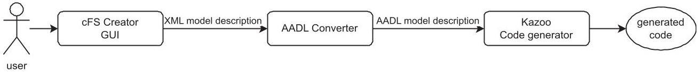


<div align="center">

Fig. 2. Toolchain overview.

</div>

built to address very similar challenges. Modularity, reusability, asynchronous communication, a dynamic runtime, and fault tolerance are essential features for both frameworks. A critical distinction between the two frameworks is in the memory footprint. cFS 6.6.0a has a Proportional Set Size, a metric used to measure memory footprint, of 2.2 MB compared to the ROS 2 Rolling Ridley 1 talker demo that amounts to 13.0 MB, making cFS more suitable for resource-constrained systems. Even Micro-ROS, a ROS2 version tailored for resource constrained systems, has a footprint of 10.7 MB for the ping pong example, which is nearly five times as big as the cFS footprint. This solidifies the distinguishing factor when comparing cFS with ROS2, cFS was designed to have a minimal footprint while supporting the essential features of a framework for embedded systems.

With this in in mind, the usage of cFS as a middleware, which has already been proven as one of the most suitable frameworks for the development of flight software [33], has also been proven as an effective middleware for embedded systems, since it provides the underlying infrastructure and hosts a runtime environment, simplifying the software development process [3]. These considerations led us to the conclusion that while ROS2 and cFS share many similarities that make both frameworks viable options, cFS is more suitable for space applications due to the nature of resource-constrained systems that require safety and certification.

## 2 Modified Taste Toolchain for Embedded Systems

As an output of the work done with industrial partners such as N7Space and SENER, in Reference [57] we identified the main functionalities that modern toolchains should support as a result of an analysis of the trends in software development to design models of reusable, scalable, and configurable components. These functionalities are not supported by the original TASTE toolchain, however due to the modular, extensible nature of the toolchain that supports model-based development and code generation, it can be used as the foundation to build upon. The functionalities are divided into four categories: N to M asynchronous communication, Datastore, Events, and Component Management.

In this section, we explain the components that make up the modified TASTE toolchain and how we propose to extend the TASTE toolchain to integrate the functionalities identified above in the toolchain, with a special focus on the communication system. To achieve this, we will take advantage of the functionalities provided by the cFS middleware. The method used to extend the TASTE toolchain was based on the method described in Reference [53].

## 2.1 Overview

The toolchain we have developed consists of three key components. The first is the graphical user interface, cFS Creator, which is the primary interface for users to generate cFS model descriptions. Based on the model description with the properties specified, the code generator, Kazoo, renders the templates to generate the C code for each component, as well as the CMake system description used by cFS to initialize the system. AADL Converter is the tool responsible for ensuring interoperability between the graphical user interface and the code generator by mapping the generated XML model description to an AADL model description that can be used by Kazoo. Figure 2 provides an overview of the toolchain, highlighting the main components.

<!-- PDF_PAGE: 8 -->


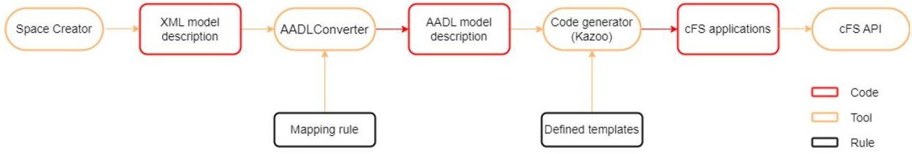


<div align="center">

Fig. 3. TASTE model driven transformation.

</div>


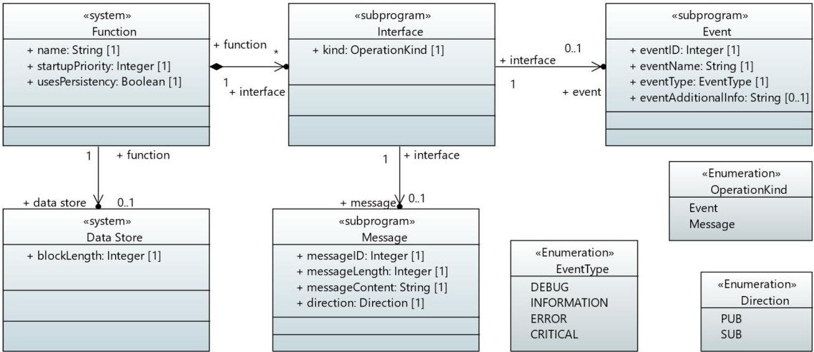


<div align="center">

Fig. 4. cFS conceptual model.

</div>

To ensure TASTE toolchain's interoperability and capability to generate code compliant with cFS, extensions to the TASTE toolchain have been implemented. The model-driven code transformation shows the transformation sequence that happens in the TASTE toolchain. It starts with the XML model description created from the XML metamodel specified in the Space Creator, the TASTE GUI. Using the mapping rules created, the AADL Converter tool converts the XML model description to an AADL model description that can be taken by Kazoo, the TASTE code generator, to generate the code skeletons for the platform chosen. By adding new templates and extending the parsing capabilities of Kazoo, we can generate cFS applications that can be deployed regardless of the underlying operating system and platform. As a result, our new toolchain relies on the tools shown in Figure 3.

When comparing with the original TASTE toolchain, PolyORB-HI and Ocarina, which were used to provide the API middleware to the different TASTE architecture, are now replaced with cFS. As a new API middleware provider, cFS adds new possibilities and capabilities into the TASTE code generation process. cFS is instrumental to provide the functionalities described in Section 2, such as N to M communication, data store, and events.

## 2.2 Tools

2. 2.1 cFS, the Middleware. To incorporate cFS into the TASTE toolchain, we examined its APIs to determine which ones could meet the identified functional requirements.

A conceptual model with the properties necessary to support the functionalities to include in the TASTE toolchain was created. Figure 4 summarizes the conceptual model of this analysis.

<!-- PDF_PAGE: 9 -->


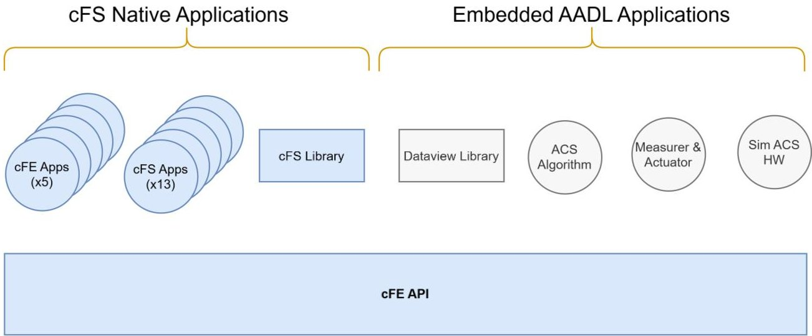


<div align="center">

Fig. 5. cFS middleware architecture.

</div>

These are the properties specified in the model description that will impact the generated code. The conceptual model can be divided into four categories: startup priority, datastore, messages and events.

To ensure the correct understanding of the goal of each property of the conceptual model, a combination of the graphical representation and a textual description was made to reduce ambiguity.

A datastore provides the ability to write to and read from data that survives a processor reset. It can be applied to any function component and is characterized by the block length needed to save or read the data as an integer. In AADL the datastore properties are attached to the system element. Events are notices sent as a response to some command or error. They are characterized by an ID with type integer, a name of type string, a type of type enumeration and an optional additional info of type string. In AADL the event properties are attached to the subprogram element. Messages is how data is shared between components. A message is characterized by an ID of type integer, a length of type integer, a content of type string and a direction of type enumeration. In AADL the message properties are attached to the subprogram element.

It is important to note that the features are achieved by TASTE's AADL systems thanks to and by incorporating cFS as a new middleware for the TASTE toolchain. This implies that the TASTE components obtain these functionalities using the API that cFS provides them, thus abstracting the components and their developers from the complexity behind the different characteristics (sockets, registers, etc.).

The generated architecture will consist of a set of cFS applications, some coming from the AADL systems themselves and other native cFS applications. AADL systems encapsulated in cFS applications obtain the functionalities using the APIs provided by cFS core, core Flight Executive, and the core cFS applications. The relation between the components and the middleware is presented in Figure 5.

## 2.2.2 Space Creator, the Graphical user Interface.

## Model extension

When specifying a new attribute or property added, there are several fields that need to be specified. Name refers to the property or attribute name. Scope specifies the AADL elements to attach the attribute or property to. The options are to attach it to function blocks, required interfaces, provided interfaces, comments or connections. The serialization type specifies whether it is an attribute or a property. The type of attribute or property refers to the data type. This could

<!-- PDF_PAGE: 10 -->


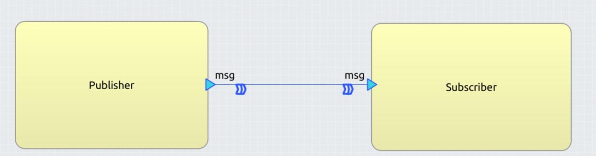


<div align="center">

Fig. 6. TASTE GUI Publisher Subscriber representation.

</div>


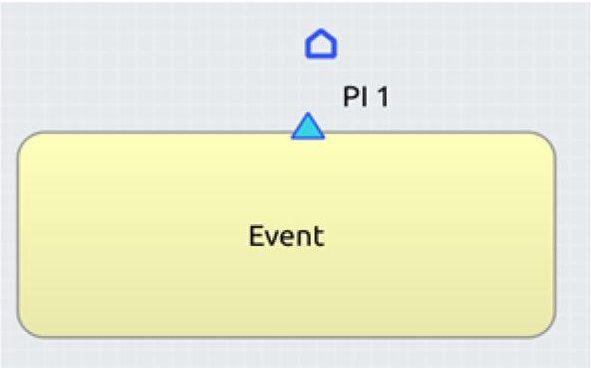


<div align="center">

Fig. 7. TASTE GUI Event representation.

</div>

be Integer, Real, String, Enumeration, or Boolean. The validation pattern or validator specifies the characters allowed to be specified. Not shown in the dialog box is the attribute validator. It allows for conditional attributes or properties that the user can only specify when other properties are specified. An example of when to apply this would be that we could only specify event properties such as the event ID when in the kind property Event is specified.

## Graphical extension

To represent the new cFS elements, changes were made to the graphical user interface to represent them more clearly and in this way make it easier for the user to study and understand the system. The icons used to represent messages and events were based on the SAVOIR notation [15].

While TASTE is based on the client-server communication paradigm, cFS is based on publisher-subscriber. This change in communication paradigm makes it necessary to show the data flow instead of the execution flow so the TASTE graphical user interface was adapted to show the flow of data based on the direction of the arrow as shown in Figure 6. In this example, we represent a Publisher-Subscriber connection where the msg is the interface and the arrows show the direction of how the data flows from the Publisher to the Subscriber.

In Figure 7, we see an event represented. While TASTE does not support events, it is a common functionality used in cFS to generate descriptive notices that can be read by the Flight Operations Team. Finally, in Figure 8 we see a Datastore represented. This allows the user to explicitly know the components that require persistency without diving into the source code.

2. 2.3 AADL Converter, the Translator between Tools. AADL Converter is the tool that ensures interoperability between Space Creator, the graphical user interface, and Kazoo, the code generator. Since they use different description languages, AADL Converter handles the conversion of

<!-- PDF_PAGE: 11 -->


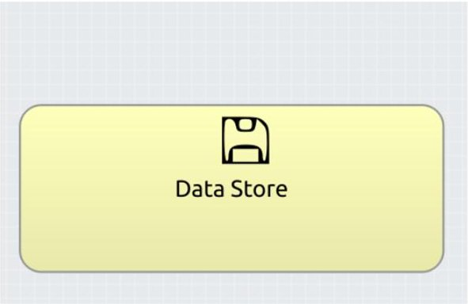


<div align="center">

Fig. 8. TASTE GUI Data store representation.

</div>


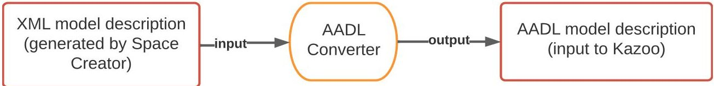


<div align="center">

Fig. 9. Conversion process from XML to AADL.

</div>

the model description generated by the Space Creator, which is in XML, to a valid AADL model description. Figure 9 depicts the goal of this tool.

Some considerations that need to be taken into account when using this tool is that the templates should generate an equivalent model description in AADL that Kazoo can read, and that special attention needs to be taken when mapping the properties, since these have to be mapped to valid properties specified in property sets that Kazoo will look for to parse the properties properly.

2. 2.4 Kazoo, the Code Generator. For the model to text transformation, the Kazoo Templating Engine is used. It implements the visitor pattern, which allows us to easily create new operations independent from the classes of an object structure by adding new visitor objects. This allows us to easily extend the current functionality supported. Figure 10 describes the code generation strategy used by Kazoo to generate the code skeletons based on the conceptual model defined before.

The AADL model description is parsed by the Kazoo parser, which creates an associative table with the modeling properties. This is done by specifying the name of the property to parse, a unique handle that is used inside the code templates, the property type, and a default value. This table is used to replace the specified placeholders with the actual values read from the models.

To support the cFS modeling concepts the code generator has been extended to support the new properties. This was achieved by extending the property set to add the new properties based on the conceptual model and then expose the new properties in the templates to, depending on the properties specified, generate the files or parts of the code to support the new functionalities.

Datastore is part of the functionality that was found to be common in space projects, however the original TASTE toolchain does not provide modeling support for it, rather leaving it as an implementation specific detail for the developer. An extension of Kazoo was made to support code generation of the datastore.

To extend the elements supported by AADL, a new property set named CFS was created. In this property set, we add the cFS properties necessary to support the new modeling elements.

Figure 11 shows how the message properties are represented in the TASTE property set.

We can see specified distinct types: integer and string. Furthermore, each property can only be attached to certain elements. Since messages are represented at the interface level, the message

<!-- PDF_PAGE: 12 -->


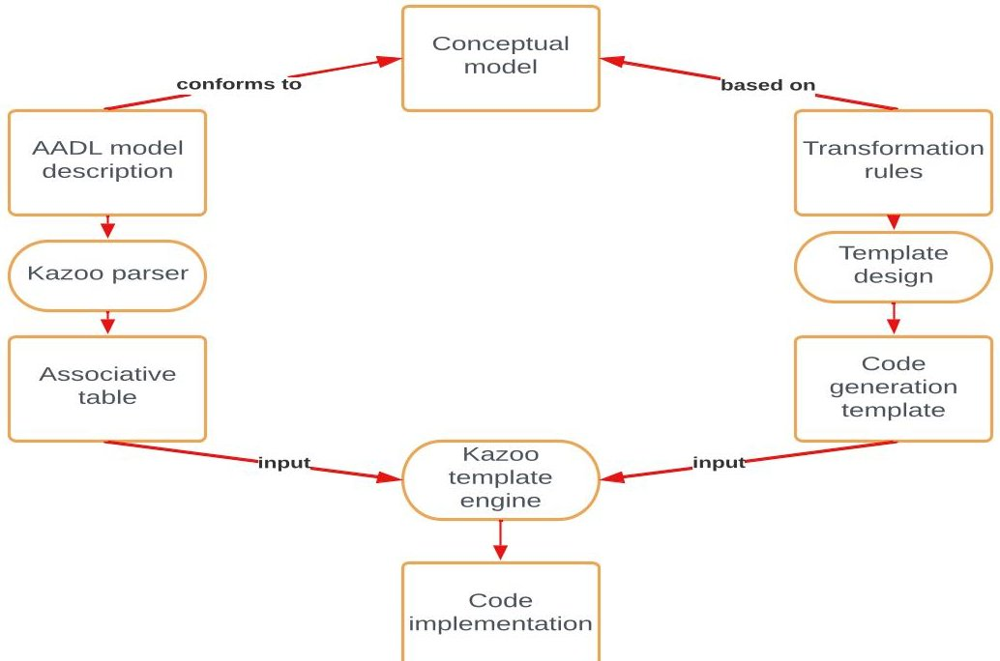


<div align="center">

Fig. 10. Kazoo code generation.

</div>

-- Message properties

MessageContent : aadlstring applies to (subprogram);

MessageID : aadlinteger applies to (subprogram);

MessageSize : aadlinteger applies to (subprogram);

Direction : enumeration (PUB,SUB) applies to (subprogram);

<div align="center">

Fig. 11. TASTE message property set.

</div>

```cpp

@@IF@@ @_Direction_@ = "PUB" and @_Kind_@ = MESSAGE_OPERATION

// Initialize message @_Name_@

@_Parent_Function_@_Data.MsgId_@_Name_@ =

@_Parent_Function_@_APP_COMMUNICATION_MID_@_Message_ID_@;

@_Parent_Function_@_Data.Size_@_Name_@ = asn1Scc@_Param_Types_@_REQUIRED_BITS_FOR_ENCODING;

status = CFE_MSG_Init(&@_Parent_Function_@_Data.MsgPtr_@_Name_@, @_Parent_Function_@_Data.MsgId_@_Name_@,

@_Parent_Function_@_Data.Size_@_Name_@);

@@END_IF@@

```

<div align="center">

Fig. 12. Excerpt of template for message initialization.

</div>

properties can only be attached to subprograms, which is the AADL equivalent of TASTE interfaces. The transformation rules are specified based on the modeling concepts represented in Space Creator. The template files contain two different types of text: the static text that will be rendered and the handles that reference dynamic text that will be rendered based on the properties specified in the model. The static text was written adhering to the C syntax and semantics, as well as using the proper API calls to take advantage of the functionalities provided by cFS. Since Kazoo is based on AdaCore Templates Parser, the handles must adhere to the AdaCore convention.

Based on the properties specified, certain files or sections of code might be generated depending on how the templates are built. An excerpt of a template that initializes a message is shown in Figure 12.

<!-- PDF_PAGE: 13 -->


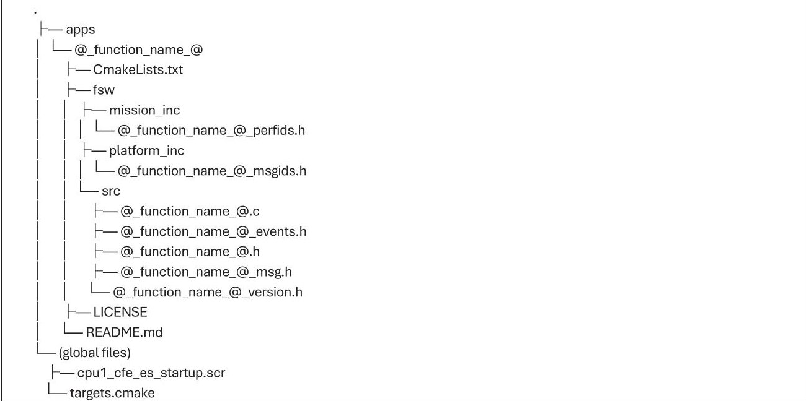


<div align="center">

Fig. 13. cFS generated files.

</div>

The kazoo templating engine takes as input the code generation templates and replaces the handles with the values present in the associative table. The outputs are the automatically generated files rendered with the properties defined by the user.

There are two types of generated files. Global configuration files that are created for the system, and application specific files. The files were generated with ready to compile functionality in mind. This means no changes are needed to deploy the applications created. The structure of the generated files is shown in Figure 13.

The global files are generated once and specify the project properties, such as the applications to be loaded, priorities, entry points, allocation of applications to cores, and more. The application specific files are generated repeatedly based on the number of components. It relies on the properties defined in Space Creator to properly render the templates and generate the source and header files with the capabilities needed, as well as to dynamically customize the name of the files generated, using the function_name handle.

Table 1 provides a brief description of the generated files.

The msg.h file allows us to send data to the ground station with information about the component's health and status. Telemetry is divided into two parts, the header and the payload. The header specifies the format of the message transmitted. The payload contains crucial component information such as command error counts and successful command execution counts. Telemetry allows the component to periodically send status information, enabling real-time monitoring and health assessment.

## 3 Upmsat2 Case Study

After the design and implementation of the new TASTE toolchain for the design of architectures based on components and the generation of code from these, tests and demonstrators were used to verify the correct functioning of the architecture modeling language and of the code generation. The chosen demonstrator has been presented in this case study, and it is a reduced-scale model of the UPMSat2 system, shown in Figure 14. The complexity of the software makes it ideal to validate our toolset, since it implements most of the functionalities described previously, taking

<!-- PDF_PAGE: 14 -->

<div align="center">

Table 1. cFS Generated Files Description

</div>

<table border="1"><tr><td>@_function_name_@.c</td><td>contains the main source code for the application</td></tr><tr><td>@_function_name_@.h</td><td>main header file. It contains main global typedef, prototypes, and miscellaneous defined</td></tr><tr><td>@_function_name_@_events.h</td><td>defines the event IDs for events generated via Event Services</td></tr><tr><td>@_function_name_@_msg.h</td><td>defines the commands and telemetry structures</td></tr><tr><td>@_function_name_@_perfids.h</td><td>defines the performance IDs used by performance monitoring apps to check the operation of certain processes</td></tr><tr><td>@_function_name_@_msgids.h</td><td>defines the communication IDs, these are the IDs with which we identify each type of message, command, and telemetry</td></tr><tr><td>CmakeLists.txt</td><td>adds the component files to the list of files that will be built</td></tr><tr><td>cpu1_cfe_es_startup_script.es</td><td>specifies the applications and libraries to be initialized</td></tr><tr><td>targets.cmake</td><td>identifies the target architectures and configurations and the apps to be built</td></tr></table>


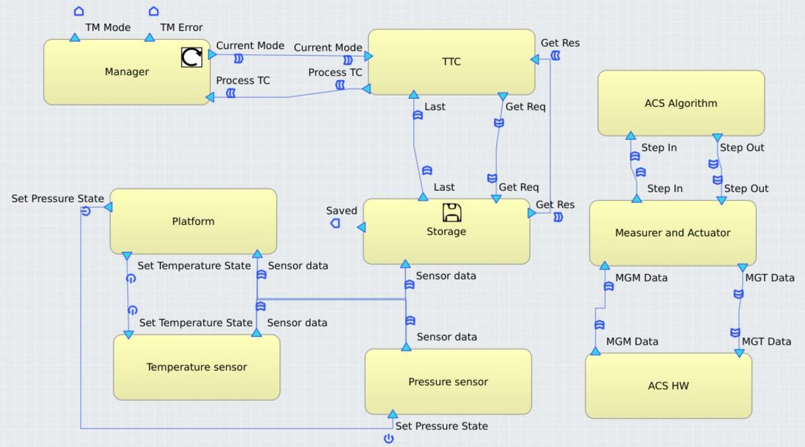


<div align="center">

Fig. 14. UPMSat2 system in cFS TASTE.

</div>

full advantage of the capabilities supported by the code generator. The generated skeletons for the use case can be found on GitHub at https://github.com/HugoValente11/cFS-UPM-Sat2-Skeletons.

The UPMSat2 was designed to be used as a technology demonstrator for scientific and educational applications. It carries multiple payloads and requires a robust communication system. The software design and implementation using the original TASTE toolchain is described in Reference [24].

A short description of the functionalities of each component follows:

- Temperature/Pressure sensors: These components are responsible for publishing the data obtained from the sensors.

- Platform: This component processes the sensors data, evaluates its correctness and manages the sensors state in case of an error.

<!-- PDF_PAGE: 15 -->

- Storage: This component uses the cFS datastore capabilities to store the sensor data in non-volatile memory, which can later be sent to the ground station.

- TTC: This component is responsible for receiving, decoding and executing the telecommands received as well as processing the telemetry

- Manager: This component is responsible for changing the mode of the satellite and sending events to the ground station with the mode or errors of the satellite

- ACS HW: This component is responsible for determining and controlling the attitude of the satellite by measuring the Earth's magnetic field with magnetometers and performing corrections using magnetorquers.

- ACS Algorithm: This component is responsible for calculating the corrections necessary to be made to the satellite attitude.

- Measurer and Actuator: This component is responsible for receiving the readings from the magnetometers and sending the corrections to the ACS HW component.

Unit tests such as 1 Publisher to 1 Subscriber, 1 Publisher to 2 Subscribers, 2 Publishers to 1 Subscriber, and finally 2 Publishers to 2 Subscribers were done to evaluate the messaging system. However, this use case allowed us to do a more comprehensive validation of the generated code by testing edge cases and identifying common use cases that were not initially contemplated in the supported patterns. Two examples are the following.

While testing the communication system, only primitive types were used and the expected results matched the actual results. However, when we tried to send more complex data structures such as the MGM Data show in the ACS subsystem, there was a mismatch between the sent values and the received ones. This led us to add ASN.1 encoders and decoders to pass data structures between components. This allows for consistency between the data model specified and the data passed between components and ensures that the encoders handle problems related to the passing of information in distributed systems such as different processors, endianness of the platform and word sizes.

Another edge case found was when we tested the roundtrip of the ACS subsystem. The messages were not being sent in the right sequence to complete the roundtrip due to an error in the template specification. We found that we were overwriting the software bus message header information, which was supposed to send messages from the Measurer and Actuator to the ACS Algorithm component, with the information from the Measurer and Actuator to the ACS HW. This was due to utilizing the same message pointer for both messages when they should be different, since they have different message ids, sizes, and structures. The solution found was to create a software bus message pointer for each message. The error was only caught when testing the use case, since when we tested the 2 Publishers to 2 Subscribers pattern, we used the same message id with integers to test the M Publishers N Subscribers pattern, which did not consider messages with different ids and sizes.

The result was a more refined and complete code generation approach that could more easily integrate the different components together.

Figure 15 illustrates the representation of the Storage component, which has three main functionalities added to the TASTE toolchain: events, messages and datastore, as well as startup priority.

The generated code snippet in Figure 16 demonstrates how the new template description shown in Figure 12 is rendered with the cFS system description shown in Figure 15.

To guarantee consistency between the design and the generated code a traceability analysis was conducted. This analysis verified that all properties and relationships specified in the AADL model were correctly translated to the signatures of all the functions generated, ensuring that the generated system architecture adheres to the intended design.

<!-- PDF_PAGE: 16 -->


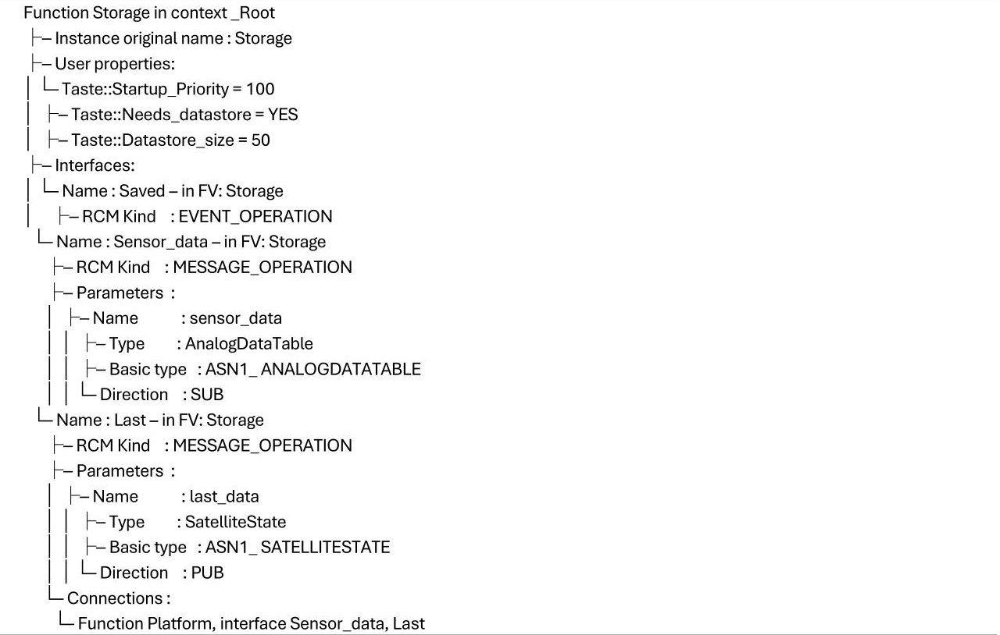


<div align="center">

Fig. 15. Storage tree description.

</div>

```cpp

// Initialize message Last

STORAGE_Data.MsgId_Last = STORAGE_APP_COMMUNICATION_MID_10;

STORAGE_Data.Size_Last = asn1Scc_AnalogDataTable_REQUIRED_BITS_FOR_ENCODING;

status = CFE_MSG_Init(&STORAGE_Data.MsgPtr_Last, STORAGE_Data.MsgId_Last, STORAGE_Data.Size_Last);

```

<div align="center">

Fig. 16. Generated code for the message initialization.

</div>

The traceability file, that can be found at https://github.com/HugoValente11/cFS-UPM-Sat2-Skeletons, provides the mapping between model elements and the corresponding code presentation.

For instance, the "SAVED" event ID (7) was confirmed to match the model. Data structures for the "Sensor data" subscription were correctly generated based on the ASN.1 models.

The traceability matrix covers most aspects of the system, component properties, events, data subscription, and publication, demonstrating alignment between the model and implementation. Verification tests included checking for correct data specification, reception and transmission, which were validated using compilation and execution tests.

This process demonstrates not only that the code reflects the design but also that it behaves as expected, improving the reliability of the system. Furthermore, the combination of the model representation of the system in a simplified manner with the automatic code generation ensures that the user has a better understanding of the system and its dependencies as well as saving the developer the effort of coding error-prone repetitive tasks such as in specifying the communication system.

Overall, we believe that the UPMSat2 system takes advantage of all the functionalities provided by the code generator and is considered as a valid use case to validate the code generator.

<!-- PDF_PAGE: 17 -->


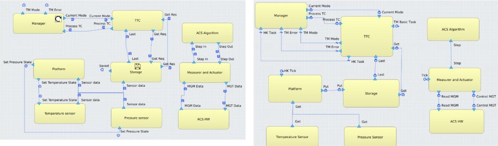


<div align="center">

Fig. 17. Graphical representation comparison: Modified cFS TASTE (left) vs. Original TASTE (right).

</div>

## 3.1 Toolchain Comparison-Original TASTE versus cFS TASTE

As discussed in Section 2.2.2, we adapted the Graphical User Interface to make it more intuitive for the publisher-subscriber communication paradigm and to clearly represent new functionalities such as Events and the Datastore. Figure 17 contrasts the graphical representation of the UPMSat-2 case study in cFS TASTE (on the left) with the original representation (on the right).

Our modified toolchain builds upon the original TASTE functionalities to integrate the Publisher-Subscriber communication paradigm using cFS. The transition from a Client-Server communication paradigm in the original TASTE toolchain to a Publisher-Subscriber communication paradigm in our modified toolchain, leads to a system with different interfaces and as a result a different system architecture.

This makes a direct comparison between both toolchains challenging due to their different execution environments and architecture. The UPMSat2 was originally implemented in Ada running on bare metal using a client-server communication paradigm, which provides complete control without any operating system overhead. In contrast, our use case uses Real-time Executive for Multiprocessor Systems (RTEMS) as the real-time operating system, integrated with cFS and core applications that rely on a Publisher-Subscriber communication paradigm. These differences in platform architecture, communication approach, and system abstraction make a direct performance and behavior comparison impractical.

Some advantages of our approach when compared with the original approach are described below.

In the original implementation, to ensure that the system was functioning correctly a timeout mechanism was implemented. If the timeout was not cleared within the expected interval, then that suggested an error or malfunction. As a result, the system triggered a reinitialization process to recover and return to a known, stable state.

In contrast, with cFS and the Publisher-Subscriber communication mechanism, failures are isolated to the component that experienced the error. Only that one component needs to be restarted. The error does not propagate to other parts of the system. This ensures that the rest of the system continues operating correctly, improving overall system resilience and reliability.

Another advantage of using cFS with the Publisher-Subscriber mechanism is that it allows us to develop loosely coupled systems. By interacting with a shared communication bus rather than directly, individual components can be added, updated or replaced without requiring changes to other parts of the system. This modularity improves maintenance and allows for easier integration of new functionality, making the system more adaptable to evolving requirements.

This can be further illustrated by considering how the system would need to be adapted if another sensor was added. Figure 18 shows a simplified example of how this subsystem would be

<!-- PDF_PAGE: 18 -->


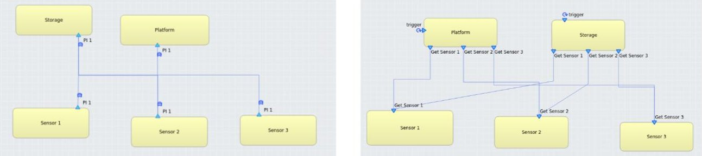


<div align="center">

Fig. 18. UPMSat2 subsystem comparison: Modified cFS TASTE (left) vs. Original TASTE (right).

</div>

<div align="center">

Table 2. Coupling between Components Comparison

</div>

<table border="1"><tr><td></td><td>Client-Server(direct dependencies)</td><td>Publisher-Subscriber(number of topics)</td><td>Coupling reduction</td></tr><tr><td>Storage</td><td>3</td><td>1</td><td>66%</td></tr><tr><td>Platform</td><td>3</td><td>1</td><td>66%</td></tr><tr><td>Sensors</td><td>1</td><td>1</td><td>0%</td></tr></table>

represented in our toolchain, as well as in the original one to demonstrate the advantages of our work.

Based on the figure, we can see how the complexity of the system is reduced using the Publisher- Subscriber paradigm. Table 2 shows the coupling between components for each paradigm.

Due to the loosely coupled nature of cFS, we can scale the system with minimal impact on the coupling due to the shared message bus. The more complex the system, the greater the reduction in coupling when compared with the client-server architecture. Furthermore, when compared with the original toolchain, we found a reduction of 61% in the integration time. This is due to the fact that in our toolchain only the implementation of Sensor 3 needs to be changed while in the original toolchain, we would also need to update the Platform and Storage components. These comparisons highlight the efficiency gains and lower integration effort achieved with our approach when compared to the client-server approach.

## 3.2 Platform Testing

The previous subsection validates the functionality of the modeling tools and the code generation process. In this subsection, we describe how we tested the actual execution of the system. To ensure an exhaustive evaluation and verify the correctness of all components of the toolchain, we adhered to recognized best practices. Each functionality was developed as a separate module, testing against the requirements defined in the H2020 European project AURORA using unit tests.

Due to the platform agnostic design of the models, and as a consequence of the template-based code generation, to guarantee cross platform compatibility, an iterative approach was done to ensure that the same application code could be compiled and executed in each platform. First, the automatically generated modules were tested in the Linux environment. Second, they were tested using TSIM, a LEON3 simulator. Finally, they were tested in the real platform that integrated cFS as the middleware, RTEMS as the OS and LEON3 as the hardware. Figure 19 illustrates how this process of rapid prototyping and incremental deployment was done.

With all functionalities tested individually, an integrative test was conducted by building a system that incorporated all these functionalities. The UPMSat-2 was used as a test system. The development process throughout was iterative, based on cycles of testing, feedback and modifications was applied. The method is elaborated in further detail in Reference [56].

<!-- PDF_PAGE: 19 -->


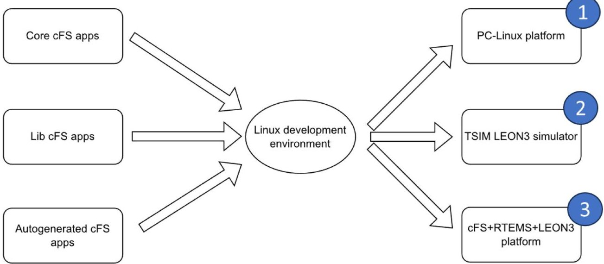


<div align="center">

Fig. 19. Incremental platform testing.

</div>


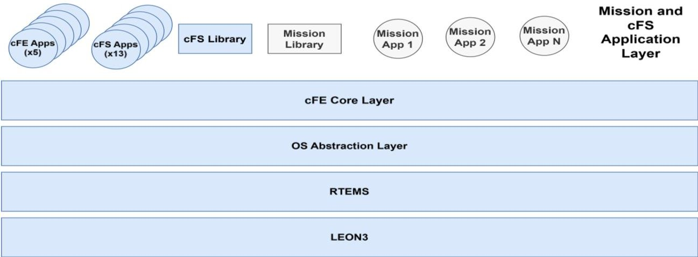


<div align="center">

Fig. 20. Platform architecture.

</div>

The On-board Computer developed for the UPMSat-2 microsatellite launched on September 3, 2020. It consists of a 32-bit LEON3 processor along with a set of devices such as bus, memory, and auxiliary controllers configured and synthesized on a Field-programmable Gate Array. For the platform based on LEON3, the operating system we used was RTEMS (Real-time Executive for Multiprocessor Systems), an Open-source Real-time Operating System. It is compatible with several computer systems based on ERC32, LEON2, LEON3, and LEON4 processors. It is widely used in the aerospace domain. Its POSIX interface makes RTEMS a viable choice for executing cFS applications. The architecture of the platform is depicted in Figure 20.

## 4 Conclusions

In this article, we have introduced a comprehensive toolchain designed for the automatic generation of software applications for embedded systems. We have detailed the distinct components of the toolchain and the necessary modifications to support a different middleware, highlighting how we integrated the tools together to apply model-based development techniques to generate embedded software applications. The toolchain leverages cFS core to introduce new functionalities such as Events, Data Store, and N to M communication, which can greatly simplify and improve the development process.

<!-- PDF_PAGE: 20 -->

The toolchain is particularly advantageous for space-related applications, where development time, effort, and system consistency are critical. By automating critical aspects of the software lifecycle, from modeling to testing, the toolchain minimizes the need for manual intervention, allowing developers to focus on implementation-specific details. This not only saves considerable time and resources but also improves the quality and consistency of software.

Our testing results demonstrate the effectiveness of the toolchain. We have successfully generated code for a significant platform combining LEON3 + RTEMS + cFS. The generated code has exhibited expected behavior, and the platform executed correctly the generated embedded applications.

This model-based approach to software development has been applied to the development of UPMSat-2, a microsatellite that has been in orbit since September 2020, proving that model-based development is a viable alternative to the more commonly used code-centric approach.

Our toolchain has several implications for the development of embedded applications, not just for space systems but for any application requiring the automatic generation of code. While the toolchain was developed for space systems, it can be used to build general embedded system, since it provides the essential functionalities commonly required by systems designed for data acquisition and control by providing N to M communication, persistency, and logging capabilities.

There is potential to be further improved. By supporting additional middleware and expanding the support of the software development lifecycle, it can be extended to other domains.

In summary, this toolchain provides a reliable, efficient, and cost-effective solution for the development of software applications for embedded systems. We recommend that further testing and integration with other tools are conducted to fully exploit the potential of the toolchain across various domains.

This software is available on GitLab at https://gitlab.com/aurora-software/cFS-Creator.

## References

[1] Muhammad Alam. 2006. Model driven security engineering for the realization of dynamic security requirements in collaborative systems. In Proceedings of the International Conference on Model Driven Engineering Languages and Systems. 278-287. https://doi.org/10.1007/978-3-540-69489-2_34

[2] Rafal Babski, Michal Kurowski, Konrad Grochowski, and Maxime Perrotin. 2020. Tiny runtime to run model-based software on cubesats. In Proceedings of the Model Based Space Systems and Software Engineering Workshop (MBSE'20). 3-4.

[3] Swee Balachandran, César A. Muñoz, María C. Consiglio, Marco A. Feliu, and Anand V. Patel. 2018. Independent configurable architecture for reliable operation of unmanned systems with distributed onboard services. In Proceedings of the AIAA/IEEE Digital Avionics Systems Conference. https://doi.org/10.1109/DASC.2018.8569752

[4] David Basin, Manuel Clavel, and Marina Egea. 2011. A decade of model-driven security. In Proceedings of ACM Symposium on Access Control Models and Technologies (SACMAT'11). 1-10. https://doi.org/10.1145/1998441.1998443

[5] Marco Bozzano, Roberto Cavada, Alessandro Cimatti, Alberto Griggio, Massimo Nazaria, Stefano Tonetta Fondazione, and Bruno Kessler. 2021. COMPASTA: Integration of the COMPASS and TASTE toolsets. In Proceedings of the Conference on Model Based Space Systems and Software Engineering.

[6] John W. Bradbury. 2020. Open Source Core Flight System (cFS) Flight Software (FSW) Verification & Validation (V&V) Final Summary-IV&V Analysis Technical Report. Retrieved from http://www.sti.nasa.gov.

[7] Theron Bradley. 2003. The NASA Heritage of Creativity: 2003 Annual Report of the NASA Inventions & Contributions Board.

[8] CCSDS. 2016. CAST flight software as a CCSDS OnBoard reference architecture. The Consultative Committee for Space Data Systems, Washington, DC.

[9] CCSDS. 2020. Space Packet Protocol: Recommended Standard. The Consultative Committee for Space Data Systems, Washington, DC.

[10] César Coelho, Otto Koudelka, and Mario Merri. 2017. NanoSat MO Framework: When OBSW turns into apps. In Proceedings of the IEEE Aerospace Conference. 1-8. https://doi.org/10.1109/AERO.2017.7943951

[11] Istvan David, Kousar Aslam, Ivano Malavolta, and Patricia Lago. 2023. Collaborative model-driven software engineering—A systematic survey of practices and needs in industry. J. Syst. Softw. 199, (2023). https://doi.org/10.1016/j.jss.2023.111626

ACM Trans. Embedd. Comput. Syst., Vol. 24, No. 3, Article 51. Publication date: May 2025.

<!-- PDF_PAGE: 21 -->

[12] Iulia Dragomir, Carlos Redondo, Tiago Jorge, Laura Gouveia, Iulian Ober, Ivan Kolesnikov, Marius Bozga, and Maxime Perrotin. 2022. Model-checking of space systems designed with TASTE/SDL. In Proceedings of the 25th International Conference on Model Driven Engineering Languages and Systems: Companion Proceedings. Association for Computing Machinery, 237-246. https://doi.org/10.1145/3550356.3561541

[13] Daniel L. Dvorak. 2009. NASA study on flight software complexity. In Proceedings of the AIAA Infotech@Aerospace Conference. 1-20. https://doi.org/10.2514/6.2009-1882

[14] Eclipse Foundation. 2023. Papyrus-RT. Retrieved February 23, 2023 from https://projects.eclipse.org/projects/ modeling.papyrus-rt

[15] ESSR. 2021. SAVOIR Onboard Software Reference Architecture. ESA.

[16] ETAS. ASCET-DEVELOPER. 2023. Retrieved February 24, 2023 from https://www.etas.com/en/products/ascet-developer.php

[17] Peter Feiler and David Gluch. 2012. Model-based Engineering with AADL: An Introduction to the SAE Architecture Analysis & Design Language (1st ed.). Addison-Wesley Professional, Boston, MA.

[18] Christian Ferdinand, Reinhold Heckmann, Hans Jörg Wolff, Christian Renz, Oleg Parshin, and Reinhard Wilhelm. 2008. Towards model-driven development of hard real-time systems integrating ASCET and aiT/StackAnalyzer. Lecture Notes in Computer Science (including subseries Lecture Notes in Artificial Intelligence and Lecture Notes in Bioinformatics) 4922 LNCS, (2008), 145-160. https://doi.org/10.1007/978-3-540-70930-5_10

[19] Robert France and Bernhard Rumpe. 2007. Model-driven development of complex software: A research roadmap. In Proceedings of the Future of Software Engineering (FoSE'07). 37-54. https://doi.org/10.1109/FOSE.2007.14

[20] Andres Felipe Fuentes Vasquez and Eugenio Tamura. 2018. From SDL Modeling to WSN Simulation for IoT Solutions. Springer International Publishing, Berlin. https://doi.org/10.1007/978-3-030-00353-1_13

[21] N. Gopalswamy, J. Newmark, S. Yashiro, P. Mäkelä, N. Reginald, N. Thakur, Q. Gong, Y. H. Kim, K. S. Cho, S. H. Choi, J. H. Baek, S. C. Bong, H. S. Yang, J. Y. Park, J. H. Kim, Y. D. Park, J. O. Lee, R. S. Kim, and E. K. Lim. 2021. The balloon-borne investigation of temperature and speed of electrons in the corona (BITSE): Mission description and preliminary results. Sol. Phys. 296, 1 (2021). https://doi.org/10.1007/s11207-020-01751-8

[22] Michael Hafner and Ruth Breu. 2008. Security Engineering for Service-oriented Architectures. Springer, Berlin. https://doi.org/10.1007/978-3-540-79539-1

[23] Nicolas Hili, Juergen Dingel, and Alain Beaulieu. 2017. Modelling and code generation for real-time embedded systems with UML-RT and papyrus-RT. In Proceedings of the IEEE/ACM 39th International Conference on Software Engineering Companion (ICSE-C'17). 509-510. https://doi.org/10.1109/ICSE-C.2017.168

[24] Jorge Garrido, Juan A de la Puente, Juan Zamorano, and Alejandro Alonso. 2013. Diseño e implementación del software del UPMSat-2 en el entorno de desarrollo TASTE. In Proceedings of the Computing Educator Diversity Initiative (CEDI'13).

[25] Paul A. Judas and Lorraine E. Prokop. 2011. A historical compilation of software metrics with applicability to NASA's Orion spacecraft flight software sizing. Innov. Syst. Softw. Eng. 7, 3 (2011), 161-170. https://doi.org/10.1007/s11334-011-0142-7

[26] J. Krizan, L. Ertl, M. Bradac, M. Jasansky, and A. Andreev. 2014. Automatic code generation from Matlab/Simulink for critical applications. In Proceedings of the Canadian Conference on Electrical and Computer Engineering. IEEE, 1-6. https://doi.org/10.1109/CCECE.2014.6901058

[27] U. Lefarth, U. Baum, T. Beck, and T. Zurawka. 1997. ASCET-SD - development environment for embedded control systems. In Proceedings of the 7th IFAC Symposium on Computer Aided Control Systems Design. 85-90. https://doi.org/ 10.1016/s1474-6670(17)43617-2

[28] Torsten Lodderstedt, David Basin, and Jurgen Doser. 2002. SecureUML: A UML-based modeling language for modeldriven security. In Proceedings of the International Conference on the Unified Modeling Language. 426-441.

[29] Steven Macenski, Tully Foote, Brian Gerkey, Chris Lalancette, and William Woodall. 2022. Robot operating system 2: Design, architecture, and uses in the wild. Sci. Robot. 7. https://doi.org/10.1126/scirobotics.abm6074

[30] Mathworks. MATLAB/Simulink. Retrieved January 9, 2023 from https://www.mathworks.com/products/matlab.html

[31] David McComas, Jonathan Wilmot, and Alan Cudmore. 2016. The core flight system (cfs) community: Providing low cost solutions for small spacecraft. In Proceedings of the 30th Annual AIAA/USU Conference on Small Satellites.

[32] Marjan Mernik. 2008. Model-driven engineering and its introduction with metamodeling tools. In Proceedings of the 9th International PhD Workshop on Systems and Control: Young Generation Viewpoint. 1-6.

[33] Danilo José Franzim Miranda, Mauricio Ferreira, Fabricio Kucinskis, and David McComas. 2019. A comparative survey on flight software frameworks for 'new space' nanosatellite missions. J. Aerospace Technol. Manage. 11, (2019). https://doi.org/10.5028/jatm.v11.1081

[34] Gunter Mussbacher, Daniel Amyot, Ruth Breu, Jean Michel Bruel, Betty H. C. Cheng, Philippe Collet, Benoit Combemale, Robert B. France, Rogardt Heldal, James Hill, Jörg Kienzle, Matthias Schottle, Friedrich Steimann, Dave Stikkolorum, and Jon Whittle. 2014. The relevance of model-driven engineering thirty years from now. In Proceed-

<!-- PDF_PAGE: 22 -->

ings of the Model-Driven Engineering Languages and Systems (MODELS'14). 183-200. https://doi.org/10.1007/978-3-319-11653-2_12

[35] NASA. NASA cFS. Retrieved June 23, 2022 from https://github.com/nasa/cfs

[36] Object Management Group. 2001. Model Driven Architecture (MDA) Architecture Board ORMSC.

[37] Deganit Paikowsky. 2017. What is new space? The changing ecosystem of global space activity. In Proceedings of the 67th International Astronautical Congress. 84-88. https://doi.org/10.1089/space.2016.0027

[38] Jongyeob Park, Jae Ok Lee, Jihun Kim, Su Chan Bong, Kyung Suk Cho, Seonghwan Choi, Bi Ho Jang, Young Deuk Park, Yong Jae Moon, Ji Hye Baek, Heesu Yang, Sujin Kim, Yeon Han Kim, Elizabeth Timmons, and Joseph Paul A. Swinski. 2022. Application of NASA core flight system to telescope control software for 2017 total solar eclipse observation. Publ. Astron. Soc. Pacific 134, 1033 (2022). https://doi.org/10.1088/1538-3873/ac5848

[39] Ángel G. Pérez, Miguel A. De Miguel, Hugo Valente, Jesús Zurera, Juan Zamorano, Alejandro Alonso, and Juan A. De La Puente. 2022. Integration of modelling languages for the development of space domain software applications. ADA User J. (2022), 3-11.

[40] Maxime Perrotin, Eric Conquet, Julien Delange, André Schiele, and Thanassis Tsiodras. 2012. TASTE: A real-time software engineering tool-chain overview, status, and future. In SDL 2011: Integrating System and Software Modeling. Springer, Berlin, 26-37.

[41] Maxime Perrotin, Eric Conquet, Julien Delange, and Thanassis Tsiodras. 2012. TASTE: An open-source tool-chain for embedded system and software development. In Proceedings of the European Congress on Embedded Real-Time Software (ERTS'12).

[42] Maxime Perrotin, Eric Conquet, Pierre Dissaux, Thanassis Tsiodras, and Jérôme Hugues. 2010. The TASTE Toolset: Turning human designed heterogeneous systems into computer built homogeneous software. In Proceedings of the European Congress on Embedded Real-Time Software (ERTS'10). 1-10.

[43] Maxime Perrotin, Marcel Verhoef, Damien Galano, and Konrad Grochowski. 2016. TASTE in action. In Proceedings of the 8th European Congress on Embedded Real Time Software and Systems (ERTS'16).

[44] Gracy Philip, Meenakshi Dsouza, and Abidha P. 2017. Model based safety analysis: Automatic generation of safety validation test cases. In Proceedings of the AIAA/IEEE Digital Avionics Systems Conference. https://doi.org/10.1109/DASC.2017.8102108

[45] Philippe Plasson, C. Cuomo, G. Gabriel, N. Gauthier, L. Gueguen, and L. Malac-Allain. 2016. Gericos: A generic framework for the development of on-board software. In Proceedings of the Conference on Data Systems in Aerospace (DA-SIA'16).

[46] Ryan Plauch. 2017. Building modern cross-platform flight software for small satellites. In Proceedings of the Small Satellites Conference.

[47] PragmaDev. PragmaDev Studio. Retrieved January 9, 2023 from https://www.pragmadev.com/.

[48] Muhammad Qaiser Saleem, Jafreezal Jaafar, and Mohd Fadzil Hassan. 2014. Model driven software development: An overview. In Proceedings of the International Conference on Computer and Information Sciences (ICCOINS'14)—A Conference of World Engineering, Science and Technology Congress (ESTCON'14). 13-17. https://doi.org/10.1109/ICCOINS. 2014.6868832

[49] Software Engineering Institute. 2016. OSATE. Retrieved October 23, 2023 from https://osate.org/.

[50] Space Foundation. 2022. The Space Report 2022.

[51] Jean-Loup Terraillon. 2009. SAVOIR: Reusing specifications to improve the way we deliver avionics. In Proceedings of the Conference on Embedded Real Time Software and Systems. 280.

[52] Damiano Torre, Marcela Genero, Yvan Labiche, and Maged Elaasar. 2022. How consistency is handled in modeldriven software engineering and UML: An expert opinion survey. Softw. Qual. J. 0123456789 (2022). https://doi.org/ 10.1007/s11219-022-09585-2

[53] Hugo Valente, Miguel A. De Miguel, Jesús Zurera, Ángel G. Pérez, Alejandro Alonso, Juan Zamorano, and Juan A. De La Puente. 2022. Extension of the modeling tool suite for development of embedded systems for the space domain. IFAC-PapersOnLine 55, 4 (2022), 286-291. https://doi.org/10.1016/j.ifacol.2022.06.047

[54] Markus Voelter, Christian Salzmann, and Michael Kircher. 2005. Model Driven Software Development in the Context of Embedded Component Infrastructures. In Proceedings of the Conference on Component-Based Software Development for Embedded Systems. 143-163.

[55] Chunying Zhao and Kang Zhang. 2007. Transformational approaches to model driven architecture - a review. In Proceedings of the 31st IEEE Software Engineering Workshop (SEW'07).

[56] Jesús Zurera, Miguel A De Miguel, Hugo Valente, Angel G Pérez, Alejandro Alonso, Juan Zamorano, and Juan A De La Puente. 2022. Design, development, and implementation of a cFS, RTEMS, and LEON3 platform. In Proceedings of the Conference on Data Systems in Aerospace (DASIA'22).

[57] Jesús Zurera, Hugo Valente, Miguel A De Miguel, Angel G Pérez, Juan Zamorano, Juan A De La Puente, and Alejandro Alonso. 2021. Requirements for a component-based modelling language for space missions. In Proceedings of the 6th Spanish Congress of Informatics (CEDI'21). 1-12.

ACM Trans. Embedd. Comput. Syst., Vol. 24, No. 3, Article 51. Publication date: May 2025.

<!-- PDF_PAGE: 23 -->

## Appendices

Mapping rules

<table border="1"><tr><td>XML Elements</td><td>AADL Constructs</td><td>Transformation logic</td></tr><tr><td>InterfaceView</td><td>Package</td><td>The interface view is mapped to an AADL package that contains the description of the entire system.</td></tr><tr><td>Function</td><td>System</td><td>Each XML function is mapped to an AADL system that specifies features (or ports) and properties.</td></tr><tr><td>Interface</td><td>Subprogram</td><td>Each XML interface is mapped to an AADL subprogram that contains the interface&#x27;s properties.</td></tr><tr><td>Connection</td><td>Connection</td><td>Each XML connection is mapped to an AADL connection.</td></tr><tr><td>Properties and Attributes</td><td>Property set</td><td>Each XML property or attribute is mapped to an AADL property that is declared in an AADL property set.</td></tr></table>

<!-- PDF_PAGE: 24 -->

## Template to support component management

Template to support component management

```cpp

int32 @_UPPER:Parent_Function_@_User_Start_@_Target_Name_@App(void)

{

    // Build token list with startup params for @_Target_Name_@ app

    const char * TokenList[] = {"CFE_APP", // Object type

    "@_LOWER:Target_Name_@_app", // Path/Filename

    "@_UPPER:Target_Name_@_APP_Main", // Entry point

    "@_UPPER:Target_Name_@_APP", // CFE_Name

    "100", // Priority

    "16384", // Stack size

    "0x0", // Load address

    "0" }; // Exception action, 0 - Just restart app, != 0 - cFE processor reset

    // Load app

    status = CFE_ES_ParseFileEntry(TokenList, 8);

    if (status != CFE_SUCCESS)

    {

        CFE_ES_WriteToSysLog("[@_UPPER:Parent_Function_@] Error adding the App, RC = %lu\n",

(unsigned long)status);

    }

    return status;

}

int32 @_UPPER:Parent_Function_@_User_Stop_@_Target_Name_@App(void)

{

    // Returns @_Target_Name_@ app id

    uint32 appId = @_UPPER:Parent_Function_@_Find_@_Target_Name_@AppId();

    // Stops application

    status = CFE_ES_DeleteApp(appId);

    if (status != CFE_SUCCESS)

    {

        CFE_ES_WriteToSysLog("[@_UPPER:Parent_Function_@] Error deleting the App, RC = %lu\n",

(unsigned long)status);

    }

    return status;

}

int32 @_UPPER:Parent_Function_@_Find_@_Target_Name_@AppId(void)

{

    int32 appId = CFE_ES_APPID_UNDEFINED;

    CFE_ES_AppId_t TempAppId;

```

<!-- PDF_PAGE: 25 -->

<div align="center">

# Model-based Toolchain for Core Flight System (cFS) Embedded Systems

</div>

```c

/*

** Search the ES Application table for the name that matches @_UPPER:Target_Name_@_APP

*/

for (int i = 0; i < CFE_PLATFORM_ES_MAX_APPLICATIONS; i++ )

{

    if (!strcmp(CFE_ES_Global.AppTable[i].AppName, "@_UPPER:Target_Name_@_APP"))

    {

        status = CFE_ES_GetAppIDByName(&TempAppId, CFE_ES_Global.AppTable[i].AppName);

        if (status == CFE_SUCCESS)

        {

            appId = TempAppId;

        }

        else

        {

            CFE_ES_WriteToSysLog("[@_UPPER:Parent_Function_@] Error getting the App ID of @_UPPER:Target_Name_@_APP, RC = %lu\n", (unsigned long)status);

        }

        break;

    }

} /* end for */

return appId;

}

```

<!-- PDF_PAGE: 26 -->

## Code generated to support component management

Code generated to support component management

```cpp

int32 PLATFORM_User_Start_Pressure_sensorApp(void) {

    // Build token list with startup params for Pressure_sensor app

    const char *TokenList[] = {"CFE_APP",                        // Object type

        "pressure_sensor_app",                        // Path/Filename

        "PRESSURE_SENSOR_APP_Main",                    // Entry point

        "PRESSURE_SENSOR_APP",                        // CFE_Name

        "100",                                        // Priority

        "16384",                                        // Stack size

        "0x0",                                        // Load address

        "0"};                                        // Exception action, 0 - Just restart

app, != 0 - cFE processor reset

    // Load app

    status = CFE_ES_ParseFileEntry(TokenList, 8);

    if (status != CFE_SUCCESS) {

        CFE_ES_WriteToSysLog("[PLATFORM] Error adding the App, RC = %lu\n", (unsigned long)status);

    }

    return status;

}

int32 PLATFORM_User_Stop_Pressure_sensorApp(void) {

    // Returns Pressure_sensor app id

    uint32 appId = PLATFORM_Find_Pressure_sensorAppId();

    // Stops application

    status = CFE_ES_DeleteApp(appId);

    if (status != CFE_SUCCESS) {

        CFE_ES_WriteToSysLog("[PLATFORM] Error deleting the App, RC = %lu\n", (unsigned long)status);

    }

    return status;

}

int32 PLATFORM_Find_Pressure_sensorAppId(void) {

    int32 appId = CFE_ES_APPID_UNDEFINED;

    CFE_ES_AppId_t TempAppId;

    /*

    ** Search the ES Application table for the name that matches PRESSURE_SENSOR_APP

    */

    for (int i = 0; i < CFE_PLATFORM_ES_MAX_APPLICATIONS; i++) {

        if (!strcmp(CFE_ES_Global.AppTable[i].AppName, "PRESSURE_SENSOR_APP")) {

            status = CFE_ES_GetAppIDByName(&TempAppId, CFE_ES_Global.AppTable[i].AppName);

            if (status == CFE_SUCCESS) {

                appId = TempAppId;

            }

        }

    }

}

```

<!-- PDF_PAGE: 27 -->

## Template to support datastore

```csharp

int32 @_UPPER:Name_@_User_Datastore_Init()

{

    // Check if there's data in Datastore,

    // if there is recover the data and store it in @_UPPER:Name_@_APP_Data.CDSData

    int32 status = CFE_SUCCESS;

    char cDSName[] = "@_LOWER:Name_@CDS";

    // Register CDS

    status          =        CFE_ES_RegisterCDS(&@_UPPER:Name_@_APP_Data.CDSHandlePtr,

@_UPPER:Name_@_DATASTORE_SIZE, cDSName);

    if (status == CFE_ES_CDS_ALREADY_EXISTS)

    {

        CFE_ES_WriteToSysLog("[@_UPPER:Name_@] CDS Already exists");

        // Critical Data Store already exists,

        // get a copy of its current contents and store it in @_UPPER:Name_@_APP_Data.CDSData

        // to see if we can work use it

        status          =        CFE_ES_RestoreFromCDS(&@_UPPER:Name_@_APP_Data.CDSData,

@_UPPER:Name_@_APP_Data.CDSHandlePtr);

        if (status != CFE_SUCCESS)

        {

            CFE_ES_WriteToSysLog("[SUB] Error restoring CDS, RC = 0x%08lX\n", (unsigned long)

status);

        }

    }

    else if (status != CFE_SUCCESS)

    {

        CFE_ES_WriteToSysLog("[@_UPPER:Name_@] Error registering CDS, RC = 0x%08lX\n", (unsigned

long) status);

    } else

    {

        // Success.

        CFE_ES_WriteToSysLog("[@_UPPER:Name_@] CDS Initialized successfully");

    }

    return status;

}

```

<!-- PDF_PAGE: 28 -->

Code generated to support datastore

```csharp

int32 STORAGE_User_Datastore_Init() {

    // Check if there's data in Datastore,

    // if there is recover the data and store it in STORAGE_APP_Data.CDSData

    int32 status = CFE_SUCCESS;

    char cDSName[] = "storageCDS";

    // Register CDS

    status = CFE_ES_RegisterCDS(&STORAGE_APP_Data.CDSHandlePtr, STORAGE_DATASTORE_SIZE, cDSName);

    if (status == CFE_ES_CDS_ALREADY_EXISTS) {

        CFE_ES_WriteToSysLog("[STORAGE] CDS Already exists");

        // Critical Data Store already exists,

        // get a copy of its current contents and store it in STORAGE_APP_Data.CDSData

        // to see if we can work with it

        status = CFE_ES_RestoreFromCDS(&STORAGE_APP_Data.CDSData, STORAGE_APP_Data.CDSHandlePtr);

    } else if (status != CFE_SUCCESS) {

        CFE_ES_WriteToSysLog("[STORAGE] Error registering CDS, RC = 0x%081X\n", (unsigned long) status);

    } else {

        // Success.

        CFE_ES_WriteToSysLog("[STORAGE] CDS Initialized successfully");

    }

    return status;

}

```

Received 13 March 2023; revised 30 September 2024; accepted 17 November 2024