<!-- PDF_PAGE: 1 -->

# On-Orbit Performance and Lessons Learned for Autonomous Angles-Only Navigation of a Satellite

Swarm

Justin Kruger Department of Aeronautics and Astronautics Stanford University Stanford, CA 94305 jjkruger@stanford.edu

Simone D'Amico

Department of Aeronautics and Astronautics Stanford University Stanford, CA 94305 damicos@stanford.edu

Abstract—This paper presents flight results and lessons learned from optical angles-only navigation of a satellite swarm, conducted during the Starling Formation-Flying Optical Experiment (StarFOX). StarFOX is a core payload of the NASA Starling mission, which consists of four propulsive CubeSats launched in July 2023. Prior angles-only flight demonstrations have been limited to a single observer and single target, and have relied upon a-priori target orbit knowledge for initialization, translational maneuvers to resolve target range, and external absolute orbit updates to maintain convergence. StarFOX removes these limitations by applying a new angles-only architecture called the Absolute and Relative Trajectory Measurement System (ARTMS), which integrates novel algorithms for image processing, batch orbit determination and sequential orbit determination. During StarFOX experiments from December 2023 to May 2024, images from on-board star trackers were used to perform multi-target and multi-observer relative navigation; to autonomously track and initialize navigation for unknown targets; and to perform simultaneous absolute and relative orbit determination without GPS. Relative positioning uncertainties （1 $ \sigma $ ）of 1.3% of target range are achieved for a single observer, reduced to 0.6% with multiple observers (without orbit control maneuvers). However, in-flight conditions proved more challenging than anticipated with respect to swarm visibility, image signal-to-noise ratios, image time-tag synchronization, and overall measurement reliability. The impact of these conditions on performance is studied by comparing in-flight telemetry to telemetry produced by an ARTMS digital twin running on the ground, using both in-flight measurement data and synthetic measurement data from pre-launch simulations. Usage of the digital twin facilitated efficient troubleshooting and mitigation via in-flight software updates. Upcoming StarFOX+ experiments in 2025 will extend ARTMS with additional capabilities, such as opportunistic detection and identification of passing resident space objects, which are preliminarily demonstrated via proof-of-concept simulations using StarFOX flight data.

## TABLE OF CONTENTS

1. INTRODUCTION ...1

2. MATHEMATICAL BACKGROUND ...2

3. NAVIGATION ARCHITECTURE ...4

4. ON-ORBIT TESTBED ...8

5. ON-ORBIT PERFORMANCE ...9

6. EXTENSIONS FOR STARFOX+ ...16

7. CONCLUSION ...17

ACKNOWLEDGMENTS ...18

REFERENCES ...19

BIOGRAPHY ...20

## 1. INTRODUCTION

DISTRIBUTED Space Systems (DSS) can offer many advantages when compared to traditional monolithic spacecraft, including improved accuracy, coverage, flexibility, robustness, and the ability to achieve entirely new objectives [1]. This has led to the deployment of a variety of DSS science missions [2] [3] [4] [5] and the proposed application of DSS to areas such as Space Situational Awareness (SSA) [6] and In-space Servicing, Assembly and Manufacturing (ISAM) [7]. However, robust navigation for DSS remains a technological challenge. The majority of DSS have been deployed in Earth orbit and their navigation systems assume availability of external metrologies such as Global Navigation Satellite System (GNSS) signals and frequent contact with the ground. Systems outside of Earth orbit may navigate via the Deep Space Network (DSN) or similar resources, but such methods impact timely decision-making for missions and are not easily scalable to future DSS. Furthermore, navigation for non-cooperative objects such as space debris cannot be performed with GNSS. It is therefore necessary to develop new self-contained navigation systems to enable usage of DSS in more varied scenarios, characterized by a high degree of autonomy and robustness. Minimal technical and financial costs for associated hardware are preferred so that miniaturized technology can be leveraged.

Angles-only navigation, in which observer spacecraft obtain bearing angles to target space objects using onboard VisionBased Sensors (VBS), is a compelling technology in this context. VBS are already ubiquitous on modern spacecraft in the form of star trackers. These sensors are passive and inexpensive with a high dynamic range and require minimal mass, volume, and power budgets [8]. If DSS observers are also equipped with an Inter-Satellite Link (ISL), as can be implemented with typical radio frequency hardware, measurements from multiple observers can be shared and fused to improve navigation performance. Accordingly, angles-only navigation generally requires no additional hardware even when used on small and inexpensive spacecraft. A further benefit is that optical sensors can obtain measurements of non-cooperative targets. However, bearing angles do not provide explicit target range information, which results in challenging observability conditions [9] [10]. Target range is only weakly observable and it is often difficult to simultaneously estimate absolute and relative orbit states [11].

These aspects have motivated extensive research in anglesonly navigation for spacecraft and prior attempts to conduct angles-only navigation in flight. These include the Orbital Express mission [12], the Advanced Rendezvous using GPS and Optical Navigation (ARGON) experiment [13] [14], and the Autonomous Vision Approach Navigation and Target

<!-- PDF_PAGE: 2 -->

Identification (AVANTI) experiment [15] [16]. Of these, ARGON and AVANTI are well-documented in literature.

ARGON (2012) was a key activity of the PRISMA mission, which was an in-orbit testbed for formation-flying and rendezvous technology developed by several European space centers. A single observer satellite ('Tango') obtained images of a noncooperative target satellite ('Mango') in Low Earth Orbit (LEO) during an approach from 30 km to 3 km of InterSatellite Distance (ISD). Navigation and control tasks were performed in a ground-in-the-loop manner using downlinked images. Target bearing angles were provided to a batch least-squares relative orbit determination algorithm, which estimated target Relative Orbit Elements (ROE) over the measurement period. This estimate was passed to a maneuver planner which generated guidance profiles to both achieve the rendezvous goal and improve range estimation performance. The ground-generated plan was then uplinked.

AVANTI (2016) was conducted during the FIREBIRD mission of the German Aerospace Center (DLR). It encompassed the rendezvous of the BIROS microsatellite and an ejected nanosatellite from 13 km to 50 m of ISD. In comparison to ARGON, AVANTI was more autonomous. Targets could be autonomously tracked in images with less reliance on orbit knowledge from Two Line Elements (TLE), an extended Kalman filter was used to perform ROE state estimation on board, and maneuver planning employed a model predictive control strategy for optimization. Passive safety was also enforced via eccentricity/inclination-vector separation. Nonideal conditions resulted in significant bearing angle measurement outages, as well as a degradation of attitude determination performance at closer ranges when target brightness outshone background stars in the Field Of View (FOV).

The impact of ARGON and AVANTI is felt in their successes and lessons learned. However, they are equivalently characterized by major limitations. Both systems did not consider multiple observers or multiple targets and focused on relative state estimation only, relying on external knowledge of the observer's absolute orbit (e.g. from a GNSS receiver) to maintain absolute state convergence. Additional reliances on accurate a-priori relative orbit information from the ground to initialize navigation, as well as frequent translational maneuvers to resolve the weakly observable ISD, reduced overall autonomy and efficiency.

The goal of the Starling Formation-flying Optical eXperiment (StarFOX) is to remove these limitations entirely. StarFOX is one of four experimental payloads of the NASA Starling mission managed by the NASA Ames Research Center [17], visualized in Figure 1. Starling consists of four propulsive 6U CubeSats in LEO and aims to increase the readiness of four enabling technologies for autonomous spacecraft swarms: decision-making, networking, maneuver planning, and absolute and relative navigation. Specifically, StarFOX applies the angles-only Absolute and Relative Trajectory Measurement System (ARTMS). ARTMS is a self-contained architecture [18] [19] that provides distributed, autonomous, scalable navigation capabilities for DSS orbiting an arbitrary central body, without reliance on maneuvers or external measurement sources. Starling was launched in July 2023 and over the ensuing months, a series of StarFOX experiments has explored ARTMS' flexibility for angles-only navigation in both single-observer and distributed multi-observer scenarios, using either ground-assisted or autonomous state initializations, with or without GNSS availability, in two swarm formations. The experiment campaign consequently builds upon ARGON

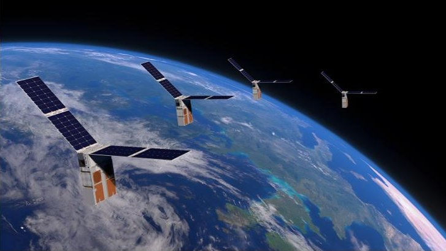

Figure 1. An artist's impression of the Starling swarm. Credit: Blue Canyon Technologies/NASA.

and AVANTI for a more wide-ranging and ambitious demonstration of angles-only navigation in orbit. Initial flight results [20] are the first demonstrations of autonomous angles-only navigation for a satellite swarm, encompassing multi-target and multi-observer relative navigation; autonomous initialization of navigation for unknown targets; and simultaneous absolute and relative orbit determination.

Though initial results were promising, significant challenges were also encountered during the early checkout and commissioning phases, which are explored in depth in this paper. The visibility of swarm targets in images, image signal-to-noise ratios, image time-tag synchronization, and the transfer of image measurements to ARTMS were each less consistent than expected, resulting in large measurement gaps and unintended system behavior. Performance was also impacted by large GPS velocity uncertainties and ISL dropouts. The impact of in-flight conditions on performance is studied by comparing in-flight ARTMS telemetry to telemetry produced by a digital twin of ARTMS running on the ground, using 1) in-flight measurement data and 2) synthetic measurement data generated using a pre-flight simulation framework. This analysis motivates lessons learned for the usage of optical angles-only navigation in flight. These lessons will similarly be applied to a StarFOX+ extended mission which augments ARTMS with new navigation capabilities, scheduled for 2025. Among these is opportunistic identification and tracking of Resident Space Objects (RSO) in the FOV by leveraging space catalog data, to support responsive SSA and resilient optical positioning.

Following this introduction, the angles-only navigation problem is mathematically defined in Section 2. ARTMS is described in detail in Section 3, with an overview of the Starling mission in Section 4. Section 5 presents quantitative and qualitative analysis of pre-flight, in-flight, and on-ground results across two key scenarios. In Section 6, flight data is leveraged to provide a demonstration of planned StarFOX+ RSO identification features, followed by conclusions.

## 2. MATHEMATICAL BACKGROUND

## Measurement Model

ARTMS produces angles-only measurements by computing the time-tagged bearing angles to objects detected in VBS images. Two rotating coordinate frames are defined. First, consider the Radial/Tangential/Normal (RTN) frame of an observer spacecraft, denoted $ \mathcal{R} $ . It is centered on and rotates with the observer and consists of orthogonal basis vectors $ \hat{x}^{\mathcal{R}} $ (directed along the observer's absolute position vector);

<!-- PDF_PAGE: 3 -->

$ \hat{z}^{\mathcal{R}} $ (directed along the observer's orbital angular momentum vector); and $ \hat{y}^{\mathcal{R}}=\hat{z}^{\mathcal{R}}\times\hat{x}^{\mathcal{R}} $ [21]. Similarly, define a frame $ \mathcal{W} $ using $ \hat{y}^{\mathcal{W}} $ (directed along the observer's velocity vector); $ \hat{z}^{\mathcal{W}}=\hat{z}^{\mathcal{R}} $ ; and $ \hat{x}^{\mathcal{W}}=\hat{y}^{\mathcal{W}}\times\hat{z}^{\mathcal{W}} $ . $ \mathcal{W} $ only differs from $ \mathcal{R} $ by a rotation of the observer flight path angle $ \phi_{f} $ about $ \hat{z}^{\mathcal{R}} $ with $ \phi_{f}\approx0 $ in near-circular orbits [21]. Finally, define the observer VBS coordinate frame $ \mathcal{V} $ consisting of orthogonal basis vectors $ \hat{x}^{\mathcal{V}},\hat{y}^{\mathcal{V}},\hat{z}^{\mathcal{V}} $ where $ \hat{z}^{\mathcal{V}}=\hat{x}^{\mathcal{V}}\times\hat{y}^{\mathcal{V}} $ is aligned with the camera boresight. The VBS may be pointed as necessary to keep targets in the FOV. In the case of StarFOX, it is chosen to always point the camera boresight in the velocity or anti-velocity direction for simplicity, such that $ \hat{z}^{\mathcal{V}} $ is aligned with $ \pm\hat{y}^{\mathcal{W}} $ . This was sufficient to image targets while avoiding imaging the limb of the Earth. Figure 2 illustrates this scenario.

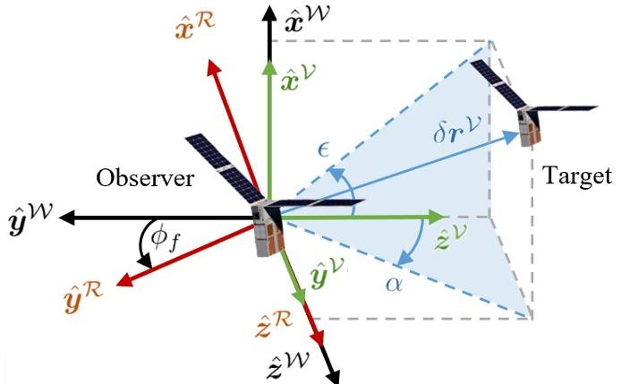

Figure 2. Definition of coordinate frames and bearing angles with VBS pointing in the $ - {\hat{y}}^{\mathcal{W}} $ direction.

Bearing angles consist of azimuth and elevation $ [\alpha ,\epsilon]^{\top} $ and subtend the line-of-sight vector $ \delta r^{\nu} $ from the observer to the target. The measurement model $ \boldsymbol{y} $ for the bearing angles from observer o to target t is [18]

$$
\delta \boldsymbol {r} ^ {\mathcal {V}} = \boldsymbol {r} _ {t} ^ {\mathcal {V}} - \boldsymbol {r} _ {o} ^ {\mathcal {V}} = \left[ \delta r _ {x} ^ {\mathcal {V}}, \delta r _ {y} ^ {\mathcal {V}}, \delta r _ {z} ^ {\mathcal {V}} \right] ^ {\top}
$$

$$
\boldsymbol {y} ^ {\mathcal {V}} \left(\delta \boldsymbol {r} ^ {\mathcal {V}}\right) = \left[ \begin{array}{c} \alpha \\ \epsilon \end{array} \right] ^ {\mathcal {V}} = \left[ \begin{array}{c} \arcsin \left(\delta r _ {y} ^ {\mathcal {V}} / \| \delta \boldsymbol {r} ^ {\mathcal {V}} \| _ {2}\right) \\ \arctan \left(\delta r _ {x} ^ {\mathcal {V}} / \delta r _ {z} ^ {\mathcal {V}}\right) \end{array} \right]
$$

Measurements and states are also referenced with respect to an inertial reference frame centered on an arbitrary central body, denoted $ \mathcal{I} $ . The inertial frame for StarFOX is the Earth-Centered Inertial (ECI) J2000 frame. Bearing angles are related to $ \mathcal{I} $ by rotating $ \delta r^{\mathcal{V}} $ into $ \mathcal{I} $ , as per $ \delta r^{\mathcal{I}}= \mathcal{V}\overrightarrow{R}^{\mathcal{I}} \delta r^{\mathcal{V}} $ where $ \mathcal{V}\overrightarrow{R}^{\mathcal{I}} $ denotes a rotation from frame $ \mathcal{V} $ into frame $ \mathcal{I} $ This rotation is generally computed by performing attitude determination using stars identified by the VBS [13]. Other relevant rotations $ \mathcal{R}\overrightarrow{R}^{\mathcal{I}} $ and $ \mathcal{V}\overrightarrow{R}^{\mathcal{I}} $ can be computed using the observer's absolute orbit estimate, assumed to be coarsely known. In practice, VBS measurement availability is affected by optical visibility constraints such as eclipse periods or attitude maneuvers by the observer.

## System State

Because angles-only navigation is characterized by weak observability [9], proper selection of the state parameterization is crucial to maximize estimation accuracy and robustness. ARTMS leverages quasi-nonsingular absolute Orbit Elements (OE) and Relative Orbit Elements (ROE). The

absolute orbit $ \alpha $ is defined as

$$
\begin{array}{l} \boldsymbol {\alpha} = \left[ a \quad e _ {x} \quad e _ {y} \quad i \quad \Omega \quad u \right] ^ {\top} \\ = \left[ a \quad e \cos \omega \quad e \sin \omega \quad i \quad \Omega \quad \omega + M \right] ^ {\top} \\ \end{array}
$$

where a,e,i, $ \Omega, \omega, M $ are the Keplerian orbit elements. The relative orbit of each target detected by the onboard sensor, denoted $ \delta \alpha $ , is described by the quasi-nonsingular ROE adopted by D'Amico [22]. Each of these ROE is function of the orbit elements of the target t and observer o, given by

$$
\begin{array}{l} \delta \boldsymbol {\alpha} = \left[ \delta a \quad \delta \lambda \quad \delta e _ {x} \quad \delta e _ {y} \quad \delta i _ {x} \quad \delta i _ {y} \right] ^ {\top} \\ = \left( \begin{array}{c} \delta a \\ \delta \lambda \\ | \delta \boldsymbol {e} | \cos \phi \\ | \delta \boldsymbol {e} | \sin \phi \\ | \delta \boldsymbol {i} | \cos \theta \\ | \delta \boldsymbol {i} | \sin \theta \end{array} \right) = \left( \begin{array}{c} \left(a _ {t} - a _ {o}\right) / a _ {o} \\ \left(u _ {t} - u _ {o}\right) + \left(\Omega_ {t} - \Omega_ {o}\right) \cos i _ {o} \\ e _ {x, t} - e _ {x, o} \\ e _ {y, t} - e _ {y, o} \\ i _ {t} - i _ {o} \\ \left(\Omega_ {t} - \Omega_ {o}\right) \sin i _ {o} \end{array} \right) \\ \end{array}
$$

where $ [\delta e_{x},\delta e_{y} ] $ are components of the relative eccentricity vector with phase $ \phi $ and $ [\delta i_{x},\delta i_{y} ] $ are components of the relative inclination vector with phase $ \theta. $

These state definitions have been previously studied in literature, resulting in development of accurate analytical dynamics models [23] [24]. Also, these states are slowly varying and enable accurate numerical integration using Gauss's Variational Equations (GVE) with large time steps for efficient onboard orbit propagation [25]. More importantly, the weakly observable range to each target is primarily captured by the $ \delta\lambda $ term in most relative motion geometries, especially for loose satellite formations and swarms. This allows ARTMS to maximize accuracy by applying separate state estimation techniques to different state components. Additionally, it has been shown that the semimajor axis of the observer's orbit is strongly observable using bearing angle measurements to a single target [11]. Combined, these properties enable accurate and computationally efficient estimation algorithms with minimal reliance on a-priori information. The complete estimated state vector x on board each spacecraft was

$$
\begin{array}{l} \boldsymbol {x} = \left[ \boldsymbol {\alpha} \boldsymbol {d} ^ {\mathcal {R}} \delta \boldsymbol {\alpha} _ {1} \delta \boldsymbol {d} _ {1} ^ {\mathcal {R}} \delta \boldsymbol {\alpha} _ {2} \delta \boldsymbol {d} _ {2} ^ {\mathcal {R}} \delta \boldsymbol {\alpha} _ {3} \delta \boldsymbol {d} _ {3} ^ {\mathcal {R}} \right] \\ \boldsymbol {d} ^ {\mathcal {R}} = \left[ d _ {x} ^ {\mathcal {R}} d _ {y} ^ {\mathcal {R}} d _ {z} ^ {\mathcal {R}} \right] ^ {\top} \\ \end{array}
$$

which encompasses observer OE, the ROE for up to three targets, as well as $ d^{\mathcal{R}} $ and $ \delta d^{\mathcal{R}} $ , which are empirical estimates of absolute and relative perturbing accelerations in $ \mathcal{R} $ .

## Dynamics Model

ARTMS propagates absolute orbits using fourth-order Runge-Kutta integration of the GVE. For state $ \alpha $ , the osculating OE of each spacecraft evolve according to

$$
\dot {\alpha} = G (\alpha) d ^ {\mathcal {R}}
$$

where $ G\in \mathbb{R}^{6\times 3} $ is the GVE matrix [26]. Depending on the orbit regime, common perturbations include spherical harmonic gravity terms, atmospheric drag, third-body gravity and solar radiation pressure [27]. In flight, ARTMS typically applies a 10x10 GGM01S [2] spherical harmonic gravity model, a Harris-Priester atmosphere model with cannonball drag $ ( C_{D}\approx 0.015) $ , and a 30 second RK4 step. Analytic dynamics models for the mean OE which include the effects

<!-- PDF_PAGE: 4 -->

of $ J_{2} $ gravity are used within ARTMS when computational efficiency is paramount, e.g. during multi-hypothesis tracking and sample-based batch orbit determination.

With regards to relative dynamics, the ROE provide useful geometric intuition regarding target relative motion. The curvilinear position vector of a target in the observer's RTN frame is defined as $ \delta r_{\mathrm{curv}}^{\mathcal{R}}=(\delta r,a_{o}\Theta,a_{o}\Phi) $ [28]. Here, $ \delta r,\Theta,\Phi $ are target-observer differences in orbit radii, angular in-plane separations and angular out-of-plane separations respectively. The curvilinear representation captures the effects of orbit curvature with improved accuracy and can be mapped back to rectilinear coordinates via

$$
\delta \boldsymbol {r} _ {\mathrm {r e c t}} ^ {\mathcal {R}} = \left[ \begin{array}{c} \left(a _ {o} + \delta r\right) \cos \Theta \cos \Phi - a _ {o} \\ \left(a _ {o} + \delta r\right) \sin \Theta \cos \Phi \\ \left(a _ {o} + \delta r\right) \sin \Phi \end{array} \right]
$$

As first shown by D'Amico [22], there exists a linear mapping between the ROE and $ \delta r_{\mathrm{curv}}^{\mathcal{R}} $ , defined as

$$
\delta \boldsymbol {r} ^ {\mathcal {R}} \approx a _ {o} \left[ \begin{array}{c} \delta a - \delta e _ {x} \cos u _ {o} \\ - 1. 5 \delta a + \delta \lambda + 2 \delta e _ {x} \sin u _ {o} - 2 \delta e _ {y} \cos u _ {o} \\ \delta i _ {x} \sin u _ {o} - \delta i _ {y} \cos u _ {o} \end{array} \right]
$$

The mapping was later extended to eccentric orbits by defining eccentric ROE [29] $ \delta\boldsymbol{\alpha}^{*} = [\delta a,\delta\lambda^{*},\delta e_{x}^{*},\delta e_{y}^{*},\delta i_{x},\delta i_{y}]^{\top} $ which revert to the quasi-nonsingular ROE for $ e_{o}\approx 0. $

Figure 3 presents relative motion in RTN for this mapping for small ISD. Components of oscillatory motion produced by the target's separation and relative orbit are shown in black, possessing the same frequency as the orbit. Components of oscillatory motion produced by orbit eccentricity are shown in red, acting at twice the frequency of the orbit. $ \delta a $ and $ \delta \lambda^{*} $ capture mean offsets in the radial and along-track directions respectively; magnitudes of $ \delta e^{*} $ and $ \delta i $ correspond to magnitudes of oscillations in the RT and RN planes respectively; and phases of $ \delta e^{*} $ and $ \delta i $ dictate the orientation and aspect ratio of the tilted ellipse in the RN plane. The eccentricity of the observer's orbit superimposes additional offsets and higher-frequency oscillations in the RT and RN planes.

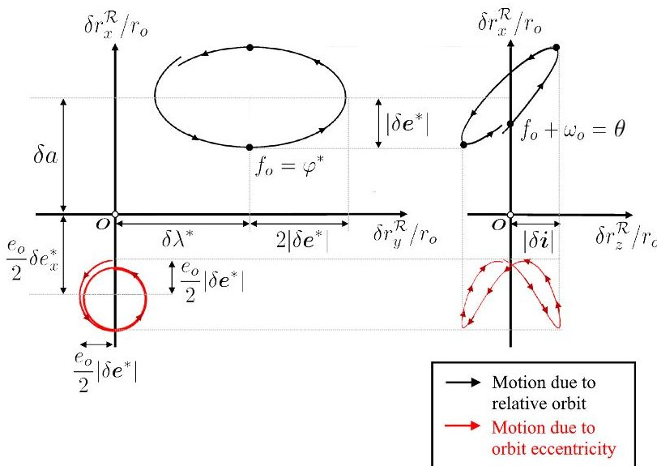

Figure 3. Components of target relative motion in the $ \hat{x}^{\mathcal{R}} $ $ -\hat{y}^{\mathcal{R}} $ (RT) and $ \hat{x}^{\mathcal{R}} $ $ -\hat{z}^{\mathcal{R}} $ (RN) planes.

## 3. NAVIGATION ARCHITECTURE

To simplify discussions, the following terminologies are adopted. The "observer" refers to the spacecraft hosting the instance of ARTMS being discussed. A "remote observer" is another spacecraft hosting ARTMS providing measurements over the ISL. The "local subsystem" includes an observer and all its "targets", which are the RSO detected by the onboard VBS. The "system" (or DSS) refers to the entire distributed space system, consisting of all involved observers and targets. Targets may be non-cooperative objects or spacecraft which do not actively assist navigation, or may be cooperative remote observers themselves. Figure 4 presents a notional illustration of a four-spacecraft DSS using ARTMS.

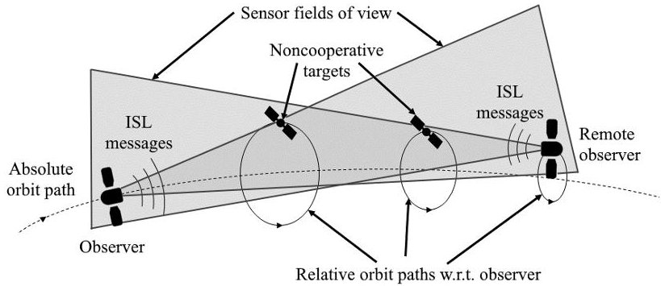

Figure 4. Notional illustration of ARTMS observers and targets for a four-spacecraft system (not to scale).

A high-level overview of ARTMS as implemented in the StarFOX flight software is shown in Figure 5. The architecture of three core modules based on algorithms recently developed at Stanford's Space Rendezvous Laboratory (SLAB): IMage Processing (IMP) [30], Batch Orbit Determination (BOD) [11], and Sequential Orbit Determination (SOD) [18]. The VBS provides time-tagged raw images, which are processed to obtain inertial bearing angles to target RSO. The ISL communicates orbit estimates and angles measurements between observers in the DSS, which allows ARTMS to perform distributed multi-observer navigation. The ground segment provides telecommands, maneuver plans and orbit estimates to each observer in the DSS, and receives ARTMS telemetry. If the spacecraft is equipped with a GNSS receiver, it optionally provides Position/Velocity/Time (PVT) navigation solutions to replace less timely orbit estimates from the ground. This constitutes the only a-priori information needed, i.e. to initialize, each observer must possess a coarse estimate of its own orbit at a single epoch.

The IMP module uses a coarse estimate of the observer's orbit and VBS images to produce batches of bearing angles and corresponding uncertainties to all visible targets without any a-priori relative orbit knowledge. Relative orbit information from SOD can be leveraged when available to reduce computation cost. IMP measurement batches are provided to the BOD and SOD modules. Additionally, IMP sends the orbit estimate and bearing angles to the ISL for transmission.

The BOD module uses the coarse estimate of the observer's absolute orbit and the batches of bearing angles provided by IMP to compute orbit estimates for all spacecraft in the local system (including itself and all targets observed by onboard cameras). This DSS state estimate is provided to SOD for initialization and fault detection.

The SOD module uses the state estimate from BOD to initialize a navigation filter that continuously estimates the

<!-- PDF_PAGE: 5 -->

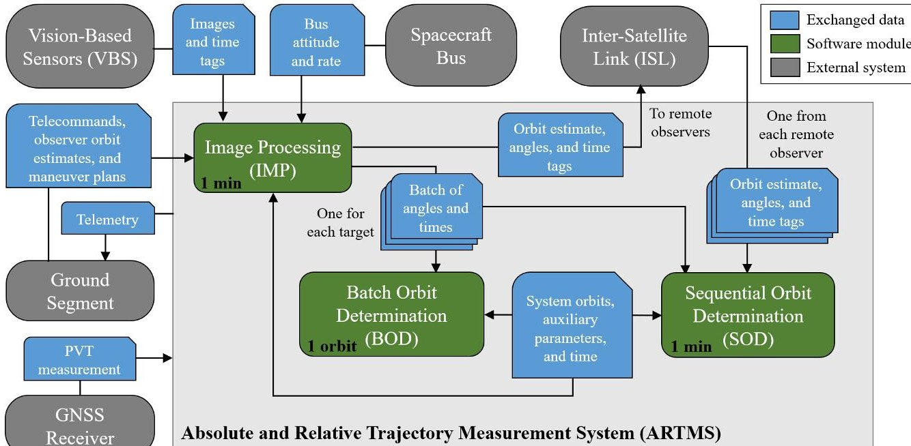

Absolute and Relative Trajectory Measurement System (ARTMS) local instance, identical on each observer spacecraft

Figure 5. A high-level overview of the ARTMS flight architecture.

orbits of all spacecraft in the local system as well as auxiliary parameters (e.g. ballistic coefficients or differential clock offsets). SOD seamlessly fuses measurements from IMP and from remote observers communicated over the ISL. SOD state estimates are provided to the ground and also to IMP to reduce the computation cost of tracking detected targets.

Overall, ARTMS provides real-time orbit estimates for the host spacecraft and each target detected by the onboard sensor. The only hardware requirements posed on the spacecraft are that it must have a VBS and ISL. Navigation is primarily autonomous in that minimal a-priori information is required and no external measurement sources are needed. The ISL enables cooperative navigation, and the system is distributed in the sense that each observer only navigates for its local subsystem, which may be a subset of the complete DSS.

## Image Processing

The objective of the IMP module is to produce batches of time-tagged bearing angle measurements to each target, using images from the onboard VBS. This is accomplished in two phases. First, each incoming image is processed and reduced to a set of inertial bearing angles that may correspond to resident space objects. Second, these candidate bearing angles are used to track known targets and detect new targets using an approach inspired by Multi-Hypothesis Tracking (MHT) [31]. Figure 6 presents an example image input, with typical sample rates of 60-120 seconds during StarFOX in LEO, equating to 50-100 images per orbit.

The first phase of IMP uses a set of state-of-the-art algorithms. An iterative weighted center of gravity or fast Gaussian fitting centroiding algorithm [32] is used to simplify the raw image into a list of pixel cluster centroids. Centroids are converted to unit vectors in the VBS frame using the calibrated sensor model. Next, the Pyramid star identification algorithm [33] is applied to remove Stellar Objects (SO) from the list of pointing vectors. Uncatalogued SO are detected by considering objects with unchanging inertial unit vectors between images. Similarly, camera hotspots are removed by considering objects with unchanging pixel coordinates. The VBS attitude is computed from the pointing vectors to identified stars in the inertial and sensor frames using the q-

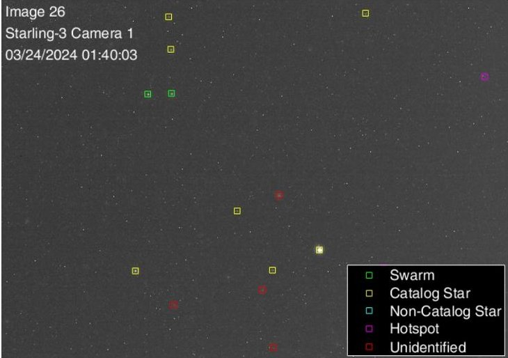

Figure 6. Part of a Starling flight image with point sources detected and identified by IMP.

method [34]. Attitude is computed using the same sensor which provides the bearing angle measurements to minimize calibration errors. The remaining minimalistic set of inertial unit vectors likely corresponds to known targets or other unknown objects in the FOV.

In the second phase, these measurement candidates must be consistently assigned to new targets or tracked targets without requiring a-priori relative orbit knowledge. To accomplish this, IMP employs the new Spacecraft Angles-only MUltitarget tracking System (SAMUS) [30], which has only two key requirements: 1) a coarse estimate of the observer's absolute orbit is available, and 2) targets must not perform unknown translational maneuvers during the tracking period. SAMUS is valid for eccentric orbits and has been specifically designed to meet the constraints of risk-averse angles-only navigation in space, i.e. to achieve close to 100% measurement assignment precision with low measurement frequencies and limited computational resources.

SAMUS applies the core concept of MHT in that as measurements arrive, many simultaneous hypotheses are maintained as to how they can be associated into target tracks. The

<!-- PDF_PAGE: 6 -->

algorithm converges towards the correct hypothesis over time, to enhance robustness of its outputs. MHT is chosen as a basis because it is mature and demonstrably accurate, with its primary disadvantage being the need to frequently and heuristically prune hypotheses for real-time computation [35]. To overcome this, SAMUS applies domain-specific knowledge to develop precise pruning criteria.

Recall Equation 8, which maps the ROE to a target's curvilinear position vector in the observer's RTN frame. In the map, u is the only quickly-varying term, while all other terms vary slowly in the presence of perturbations. Thus, target motion is described by periodic, parametric functions with known form. Even if the specific ROE in Equation 8 are unknown, its form provides expectations regarding target motion that can be leveraged. Given a set of past bearing angles measurements in a track and corresponding estimates of the observer's absolute orbit, Equation 8 can be rearranged into a pair of separable linear systems in azimuth and elevation, as in

$$
\left[ \begin{array}{c} \epsilon \\ \alpha \end{array} \right] ^ {\mathcal {R}} \approx \frac {r _ {o}}{a _ {o}} \left[ \begin{array}{c} x _ {1} - x _ {2} \cos \left(u _ {o} - x _ {3}\right) \\ x _ {4} + x _ {5} \sin \left(u _ {o} - x _ {6}\right) \end{array} \right]
$$

where $ x_{1,\dots,6} $ are scaled ROE equivalents in bearing angle space [30]. Terms $ r_{o}, a_{o}, u_{o} $ are computed from the observer orbit estimate. If a track consists of at least three bearing angles at different times, the six unknowns $ x_{1,\dots,6} $ can be solved for via least squares. Measurements in future epochs can then be predicted by propagating the observer orbit estimate and applying the fitted model, and goodness of fit can be assessed via fitting residuals.

To assess which hypotheses are physically reasonable, SAMUS applies a set of kinematic rules [30] derived from the parametric motion model. Only tracks which pass all rules are propagated. Briefly, the rules are summarized as: 1) track velocities must be below a set maximum, 2) track velocities must be consistent over time, 3) tracks should generally not feature acute angles, 4) tracks should turn in a consistent direction, 5) new measurements must be close to the predicted measurement. Their application greatly increases efficiency of MHT by preventing formation of unlikely tracks.

When multiple tracks pass all rules, SAMUS scores propagated tracks via ten criteria which assess how well each fulfills the expectations of Equation 8, the predicted measurement, and their prior motion. In contrast to traditional MHT methods which often rely on a single Mahalanobis distance metric for scoring SAMUS aims to be more robust. Often, target tracks intersect or are in close proximity in the image plane, or motion between images is on the order of VBS noise. A single scoring metric is therefore not robust. By using a larger set of metrics, consensus supports the correct choice over time, even if some metrics temporarily favor incorrect hypotheses. Additionally, scoring does not require probabilistic estimates of false alarm densities or target decay rates, which are not easily obtainable for spacecraft.

To initialize new tracks, SAMUS employs the Density-Based Spatial Clustering of Applications with Noise (DBSCAN) algorithm [36]. DBSCAN clusters require $ \geq n_{D} $ points within small radius $ \epsilon_{D} $ . Because targets are in similar orbits to observers, their velocities compared to other objects in the FOV are low. Previously untracked targets are initialized by applying DBSCAN to the merged set of unidentified measurements from the past several images, and applying the SAMUS kinematic rules to found clusters.

Finally, tracking is often interrupted by orbit eclipse periods. To connect shorter tracks on either side of an eclipse, the aforementioned linear system fit is computed for every possible set of paired tracks. The combination of compatible pairs which produces the least fitting residuals is chosen as output.

SAMUS is also able to cooperate with SOD and apply target state knowledge (if available) to reduce computation cost. Target state estimates from SOD are propagated into the current epoch to provide predicted measurements. The kinematic rules are replaced by a validity region around the prediction, computed via an unscented transform of the target state covariance. The Mahalanobis distance between predicted and assigned measurement is employed for scoring. Figure 7 presents an overview of core SAMUS operations.

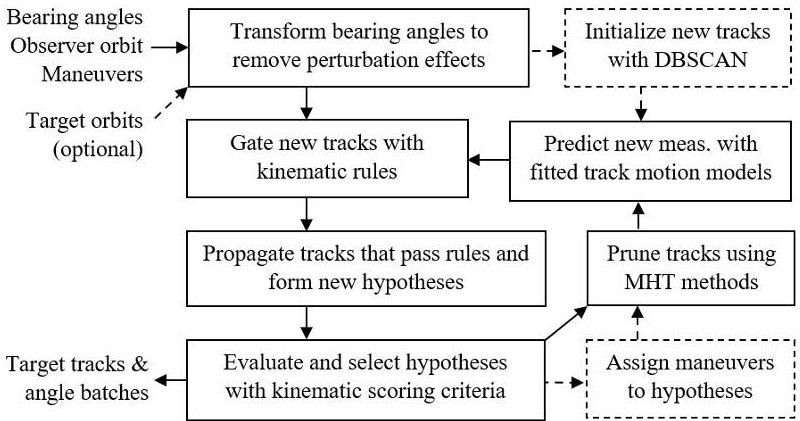

Figure 7. SAMUS algorithm summary and core sequence of operations.

## Batch Orbit Determination

The BOD module must produce orbit estimates for the local swarm with sufficient accuracy to initialize the SOD module, using only a coarse estimate of the observer's orbit and batches of bearing angles to each target from IMP. Nominally, the module operates on measurement batches of [50, 200] measurements across 1-2 orbits, per target. State estimation is accomplished using an algorithm that separately estimates the relative orbits of each target while simultaneously refining the observer's semimajor axis estimate [11]. When used in LEO, the algorithm applies a fully analytical dynamics model including the earth oblateness $ J_{2} $ perturbation developed by the authors to minimize computation time [23].

For each target, the system state is divided into estimated components $ x_{\mathrm{e s t}} $ and components known a-priori $ x_{\mathrm{p r i o r}} $ . For StarFOX, $ x_{\mathrm{e s t}} = [ a,\delta a,\delta e_{x},\delta e_{y},\delta i_{x},\delta i_{y} ] $ because these state components are more strongly observable, with $ x_{\mathrm{p r i o r}} = [ e_{x},e_{y},i,\Omega ,u] $ . To robustly determine the weakly observable $ \delta \lambda $ , a 1-D family of state estimates is computed for user-specified values of $ \delta \lambda $ . The set of $ \delta \lambda $ values is selected based on system limitations such as sensitivity of the VBS.

To initialize $ x_{\mathrm{est}} $ for each $ \delta\lambda $ sample, a is extracted from the observer's orbit estimate and $ [\delta a,\delta e_{x},\delta e_{y},\delta i_{x},\delta i_{y}]$ are set to zero. Iterative batch least squares refinement is then performed. Define the batch of true angle measurements from IMP as $ z_{\mathrm{meas}} $ for measurement epochs t, and a batch of modeled angle measurements $ z_{\mathrm{model}} $ , computed by propagating the estimated target state to each epoch in t. The difference between measured and modeled angles is

$$
\Delta \boldsymbol {z} = \boldsymbol {z} _ {\mathrm {m e a s}} - \boldsymbol {z} _ {\mathrm {m o d e l}} \left(\boldsymbol {x} \left(t _ {\mathrm {e s t}}\right), \boldsymbol {t}\right)
$$

where $ t_{\mathrm{est}} $ is the BOD estimation epoch. Subsequently, the

<!-- PDF_PAGE: 7 -->

state estimate update

$$
\Delta \boldsymbol {z} = \boldsymbol {S} _ {\mathrm {e s t}} \left(\boldsymbol {x} \left(t _ {\mathrm {e s t}}\right), \boldsymbol {t}\right) \Delta \boldsymbol {x} _ {\mathrm {e s t}}
$$

$$
\boldsymbol {x} _ {\mathrm {e s t}} \leftarrow \boldsymbol {x} _ {\mathrm {e s t}} + \Delta \boldsymbol {x} _ {\mathrm {e s t}}
$$

can be computed, where $ S_{\mathrm{est}}(\boldsymbol{x}(t_{\mathrm{est}}),\boldsymbol{t}) $ is a sensitivity matrix containing the partial derivatives of measurements with respect to state components, computed via linearization of the measurement model. The unknown $ \Delta x_{\mathrm{est}} $ is solved for via least squares. Refinement continues until an iteration limit is reached or $ \Delta x_{\mathrm{est}} $ is smaller than a convergence threshold.

The output state estimate is selected as the $ \delta\lambda $ candidate which produced the smallest measurement residual vector $ \Delta z $ . Figure 8 shows the norms of the converged measurement residual vectors for each candidate value of $ \delta\lambda $ in a single test case of the BOD algorithm. Next, the measurement noise matrix for each measurement (denoted $ R_{\mathrm{vbs}} $ ）is estimated using the measurement residuals corresponding to the final state estimate. This estimation of sensor noise using the post-fit measurement residuals allows operation even when an accurate a-priori model of sensor noise is unavailable.

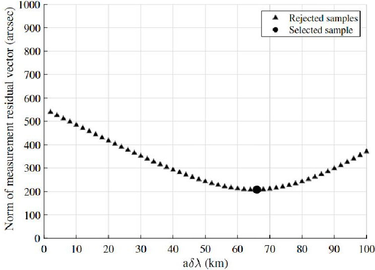

Figure 8. Behavior of converged measurement residuals for different $ \delta\lambda $ samples in the BOD module.

Finally, the covariance $ P_{\mathrm{est}} $ for estimated state components $ x_{\mathrm{est}} $ is computed as given by

$$
\boldsymbol {P} _ {\mathrm {e s t}} = \boldsymbol {Y} _ {\mathrm {e s t}} ^ {*} \left(N \boldsymbol {R} _ {\mathrm {v b s}} + \boldsymbol {Y} _ {\mathrm {p r i o r}} \boldsymbol {P} _ {\mathrm {p r i o r}} \boldsymbol {Y} _ {\mathrm {p r i o r}} ^ {\top}\right) \boldsymbol {Y} _ {\mathrm {e s t}} ^ {* \top}
$$

where $ Y_{\mathrm{est}}^{*} $ is the pseudoinverse of the measurement sensitivity matrix for estimated state components, $ Y_{\mathrm{prior}} $ is the measurement sensitivity matrix for a-priori information, $ P_{\mathrm{prior}} $ is the uncertainty of the a-priori information, and N is the number of provided bearing angle measurements. This formulation allows the BOD module to seamlessly transition between domains where uncertainty is driven by sensor performance and by errors in the a-priori information. The ROE in $ x_{\mathrm{est}} $ for each target are then appended to $ x_{\mathrm{prior}} $ and the mean refined observer semimajor axis, forming a complete orbit estimate for the local swarm.

## Sequential Orbit Determination

The SOD module continually refines estimates of the orbits of all spacecraft in the local swarm as well as auxiliary parameters (e.g. empirical accelerations) by seamlessly fusing measurements from all observers transmitted over the ISL.

SOD is based on a new adaptive, efficient Unscented Kalman Filter (UKF) with fully nonlinear dynamics and measurement models. In comparison to an extended Kalman filter, the UKF preserves higher order moments in the probability distribution, which enables maneuver-free convergence using angles only measurements from a single observer, without excessive computational cost [18].

Three additional features are included to maximize performance using measurements from multiple observers. First, adaptive process noise estimation is used to improve convergence speed and robustness to errors in the dynamics model [10]. Second, the state definition is organized in a way that exploits the structure of the Cholesky factorization to reduce the number of calls to the orbit propagator by almost a factor of two [37]. Third, measurements from remote observers are assigned to tracked targets using selection criteria based on the Mahalanobis distances between the estimated bearing angles to each target and each candidate measurement. Let $ \sigma_{jk} $ denote the Mahalanobis distance between the jth measurement from the remote observer and the predicted measurement to the kth target tracked by the local observer (which accounts for all relevant state uncertainties). To minimize erroneous assignments, the jth measurement from the remote observer is assigned to the kth target if three conditions are satisfied:

$$
\sigma_ {j k} \leq \epsilon_ {\mathrm {a s s i g n}}
$$

$$
\sigma_ {l k} \geq \epsilon_ {\mathrm {a m b i g}} \forall l \neq j
$$

$$
\sigma_ {j p} \geq \epsilon_ {\mathrm {a m b i g}} \forall p \neq k
$$

where $ \epsilon_{\mathrm{assign}} $ and $ \epsilon_{\mathrm{ambig}} $ are user-specified parameters that satisfy $ \epsilon_{\mathrm{ambig}} > \epsilon_{\mathrm{assign}} > 0 $ . These conditions ensure that 1) the measurement is close to the modeled measurement of the target using the current state estimate, 2) there is no other candidate measurement that fits the estimated state of the target, and 3) there is no other target with a state estimate that fits the measurement.

Figure 9 includes conceptual illustrations of four possible cases of modeled and observed measurements from a remote observer which (from left to right) show all conditions satisfied and violations of Condition 1, Condition 2, and Condition 3, respectively. Together, these conditions ensure that measurements are only assigned when the observed and modeled measurements uniquely agree with a statistical certainty determined by the values of $ \epsilon_{\mathrm{assign}} $ and $ \epsilon_{\mathrm{ambig}} $ . The values of these parameters should be selected based on the expected number of targets, relative motion geometry, sensor noise, and available orbit knowledge for general swarming missions. However, for scenarios similar to StarFOX, the authors have found that setting $ \epsilon_{\mathrm{assign}}=3 $ and $ \epsilon_{\mathrm{ambig}}=6 $ provide robust measurement assignment performance.

Finally, to aid robustness and error recovery, the SOD module performs autonomous health checks for the current state estimate after each filter update and attempts to automatically re-initialize if necessary. Re-initialization is performed if: 1) the Mahalanobis distance between the most recent BOD relative state estimate and current SOD relative state estimate is above a threshold, 2) the number of successive filter update steps which did not feature a measurement update is above a threshold, 3) the number of successive filter measurement update steps which featured a large pre-fit measurement residual is above a threshold, 4) the SOD state estimate is outside a valid range (as specified by the user). To re-initialize, the SOD module may either use ground-provided orbit estimates or the most recent BOD state estimate.

<!-- PDF_PAGE: 8 -->

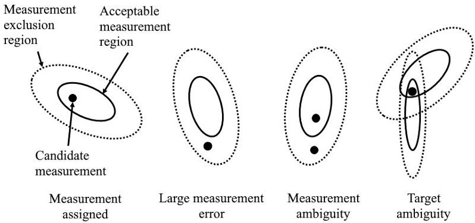

Figure 9. Conditions in which all measurement assignment criteria are satisfied (leftmost) and conditions that violate each criteria (right).

## 4. ON-ORBIT TESTBED

StarFOX is a core payload of the NASA Starling swarm mission, which consists of four 6U CubeSats. Starling was initially proposed in 2018 [17] as a testbed for autonomous swarming technologies, with four distinct experiment payloads focused on decision-making, networking, maneuvering, and navigation. The swarm was launched into approximately sun-synchronous LEO on July 17, 2023, with an initial LTAN of 01:45. Nominal experiment operations commenced in November 2023 and continued until May 2024 [38], with a final LTAN of 06:00.

## Bus Hardware

For StarFOX, each CubeSat carries two Blue Canyon Technologies Nano Star Trackers [8] (NST) aligned in antiparallel directions, either of which may collect imagery. Parameters are provided in Table 1. During each experiment, one NST is chosen as the experiment camera and is pointed in the velocity or anti-velocity direction, to image swarm members. Images are provided to ARTMS with a cadence of 60-120 seconds. The other NST provides a backup attitude solution.

Table 1. Intrinsic parameters of the NST.

<table border="1"><tr><td>Parameter</td><td>Value</td></tr><tr><td>Image Size (pixels)</td><td>1280×1024</td></tr><tr><td>FOV(°)</td><td>12×10</td></tr><tr><td>Pixel Size(μm)</td><td>5.3</td></tr><tr><td>Focal Length(mm)</td><td>30</td></tr><tr><td>Pixel Space</td><td>10-bit(grayscale)</td></tr></table>

StarFOX also receives inputs from the onboard GPS receiver, which optionally provides PVT solutions, and from the ISL, through CesiumAstro S-band software-defined radios. If the ISL is active, each spacecraft transmits a message to all other swarm members every 60 seconds and listens for messages from all other members. The payload processor for StarFOX is a Xiphos Q7S running at approximately 700 MHz. Finally, each satellite also possesses a cold gas propulsion system with four separate nozzles, used to conduct swarm phasing and reconfiguration maneuvers.

Figure 10 shows the four Starling spacecraft during integration at the NASA Ames Research Center. The spacecraft are denoted SV1, SV2, SV3 and SV4 or more affectionately as Inky, Blinky, Pinky, and Clyde.

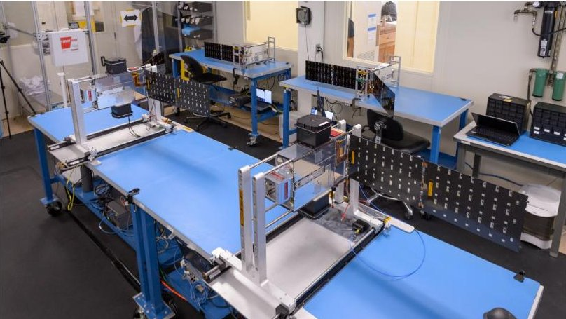

Figure 10. The four Starling CubeSats during integration. Credit: NASA/Dominic Hart (2022).

## Swarm Geometry

Swarm geometry for the Starling mission was determined by the differing needs of flight experiments and swarm safety considerations [20]. To provide varying geometry for StarFOX, two distinct formations were used: an in-train (IT) formation and a passive safety ellipse (PSE) formation. The IT formation features relatively little relative motion, with the swarm primarily separated in the velocity direction. The PSE formation provides additional relative motion (to aid anglesonly observability) as well as passive safety via relative eccentricity/inclination vector separation [39]. The swarm was initially placed into the IT formation, then transitioned into the PSE formation in March 2024.

Table 2 presents OE for SV4, and ROE for SV2 and SV3 (with respect to SV4), following the conventions of Equations 3 and 4. SV1 was not involved in StarFOX operations due to hardware complications. Figure 11 displays the relative motion geometry of the swarm in the RT and RN planes of SV4, in curvilinear coordinates.

## Table 2. Quasi-nonsingular OE/ROE of the swarm.

<table border="1"><tr><td>ID</td><td>In-Train Formation(02/05/24 00:00:00 UTC)</td></tr><tr><td>SV4</td><td>$\alpha=[6944\text{km},-0.00004,0.0016,99.4^{\circ},-151.1^{\circ},-47.9^{\circ}]$</td></tr><tr><td>SV2</td><td>$\delta\alpha=[21,-124350,110,202,79,1005]\text{m}$</td></tr><tr><td>SV3</td><td>$\delta\alpha=[-1,-79328,42,452,36,827]\text{m}$</td></tr><tr><td>ID</td><td>Passive Safety Ellipse(on05/08/24 at00:00:00 UTC)</td></tr><tr><td>SV4</td><td>$\alpha=[6948\text{km},-0.00009,0.0013,99.4^{\circ},-38.0^{\circ},-153.0^{\circ}]$</td></tr><tr><td>SV2</td><td>$\delta\alpha=[23,-52266,-471,-523,35,1811]\text{m}$</td></tr><tr><td>SV3</td><td>$\delta\alpha=[-30,155320,-297,-315,16,1144]\text{m}$</td></tr></table>

## Experiment Modes

For checkout and commissioning, StarFOX intended to demonstrate four primary navigation modes, as enabled by ARTMS:

1. Single observer, partially autonomous: initial target relative orbit estimates are provided by the ground and refined on board by IMP and SOD. GPS is used for observer absolute orbit estimation.

2. Single observer, fully autonomous: initial target relative orbit estimates are generated on board by IMP + BOD and refined on board by IMP and SOD. GPS is used for observer absolute orbit estimation.

3. Multi-observer, partially autonomous: multiple observers

<!-- PDF_PAGE: 9 -->

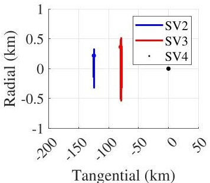

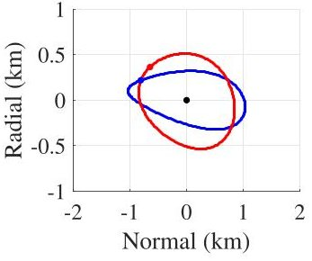

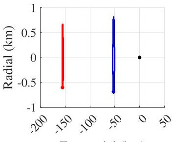

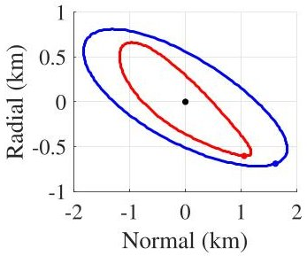

Figure 11. Swarm relative motion in the IT formation (upper) and PSE formation (lower).

share measurements over the ISL to estimate target relative orbits with improved accuracy. GPS is used for observer absolute orbit estimation.

4. Multi-observer, fully autonomous: multiple observers share measurements over the ISL to estimate target relative orbits with improved accuracy. Inter-satellite bearing angles are used for observer absolute orbit estimation.

Modes 1 and 3 are most relevant for cooperative swarm scenarios in Earth orbit; Mode 2 is most relevant for SSA in which unknown targets must be detected and tracked; and Mode 4 is most relevant for deep space applications in which GPS is unavailable.

## 5. ON-ORBIT PERFORMANCE

On-orbit performance is contextualized by a three-way comparison incorporating in-flight telemetry, an on-ground digital twin, and pre-flight simulations.

In the first case, ARTMS produces telemetry while operating in orbit and telemetry is downlinked and analyzed on the ground. Navigation performance is numerically assessed by comparing the ARTMS orbit estimate in telemetry to "ground truth" orbit states, produced by the NASA Starling Flight Dynamics team via batch processing of GPS flight data. Expected position errors and uncertainties in the ground truth are significantly less than 10 meters (1 $ \sigma $ ).

The second case is a digital twin of the swarm which aims to operate as similarly as possible to ARTMS in flight. ARTMS inputs (i.e., star tracker images and metadata, GPS data, timing data, and ISL data) are downlinked, and are processed in a flight-like manner using ARTMS flight software running on the ground. Telemetry from the on-ground twin can then be compared to the flight telemetry. The ARTMS twin operates in a MATLAB/Simulink environment on a PC, which interfaces with the C++ flight code via s-functions. Four separate instances of ARTMS can be simulated in parallel to model the complete swarm.

Table 3. Dynamics models for flight and simulations.

In the third case, the ARTMS twin operates on entirely

<table border="1"><tr><td>Model</td><td>Perturbations</td><td>Propagation</td></tr><tr><td>IMP</td><td>Keplerian (none)</td><td>Analytic</td></tr><tr><td>BOD</td><td>$J_{2}$ gravity</td><td>Analytic [40]</td></tr><tr><td>SOD</td><td>10x10 GGM01S gravity [2] Harris-Priester atmosphere with cannonball drag for 6U CubeSat</td><td>RK4 integrator 30s timestep</td></tr><tr><td>Simulation ground truth</td><td>120x120 GGM01S gravity [2] NRMLSISE-00 atmosphere with cannonball drag [41] SRP with conical Earth shadow and cannonball drag model Third-body lunisolar gravity from analytic ephemeris</td><td>RK4 integrator 10s timestep</td></tr></table>

Table 4. Default noise for pre-flight simulations.

<table border="1"><tr><td>Measurement</td><td>Noise(1σ)</td><td>Axes</td></tr><tr><td>GNSS position</td><td>[10,10,10]m</td><td>[hatx^I,haty^I,hatz^I]</td></tr><tr><td>GNSS velocity</td><td>[0.02,0.02,0.02]m/s</td><td>[hatx^I,haty^I,hatz^I]</td></tr><tr><td>A-priori position</td><td>[100,500,100]m</td><td>[hatx^R,haty^R,hatz^R]</td></tr><tr><td>A-priori velocity</td><td>[0.1,0.5,0.1]m/s</td><td>[hatx^R,haty^R,hatz^R]</td></tr><tr><td>VBS pixel brightness</td><td>1.5%</td><td>-</td></tr><tr><td>VBS PSF position</td><td>[15,15]^{\prime\prime}$</td><td>$[\alpha,\epsilon]$</td></tr><tr><td>VBS attitude</td><td>[6,6,20]^{\prime\prime}$</td><td>[hatx^V,haty^V,hatz^V]</td></tr></table>

synthetic measurement data. This is to provide an example of the nominal performance expected from simulation. Ground truth orbit data is generated by numerically integrating the positions and velocities of swarm members [42]. Applied dynamics models are specified in Table 3. Spacecraft are physically modeled as 6U CubeSats with fixed attitude such that the VBS boresight points in the $ \pm \hat{y}^{\mathcal{W}} $ direction. Four synthetic measurement types were generated from the ground truth: attitude quaternions, GPS PVT solutions, an a-priori swarm orbit state for initialization, and VBS images. Gaussian zero-mean measurement noise was added to measurements as per Table 4, informed by performance expectations for flight hardware. VBS images were generated using 3D vector graphics in OpenGL [43]. The visual magnitudes of swarm targets were modeled using a model which takes various flux sources, solar phase angle, and physical spacecraft properties into account [44]. The visual magnitudes, angles, and proper motions of stars were obtained from the Hipparcos catalog. Any objects within the camera FOV were then rendered using Gaussian point spread functions (PSF). Background noise is added to the image in the form of small variations in pixel brightness, producing centroiding errors of $ \sim0.1 $ pixels. A small amount of noise is also added to PSF positions to emulate errors in the camera lens distortion model which is used to convert between pixel coordinates and unit vectors in $ \mathcal{V} $ . Finally, 3-8 extra PSF were added to each image to emulate transiting RSO and non-catalog stars, with positions pulled from a uniform distribution across the FOV.

Using these sources, the performance of ARTMS is characterized across a trio of representative experiments: 1) a single-observer multi-target experiment in Navigation Mode 1 on 05/16/24; 2) a single-observer single-target experiment in Navigation Mode 2 on 05/08/2024; and 3) a multi-observer multi-target experiment in Navigation Mode 3 on 02/05/2024. Outcomes provide lessons learned for the application of optical angles-only navigation in space.

<!-- PDF_PAGE: 10 -->

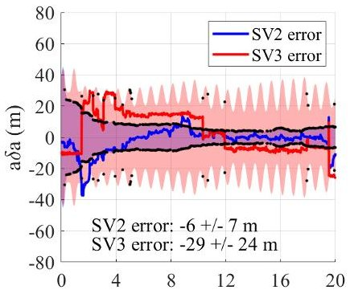

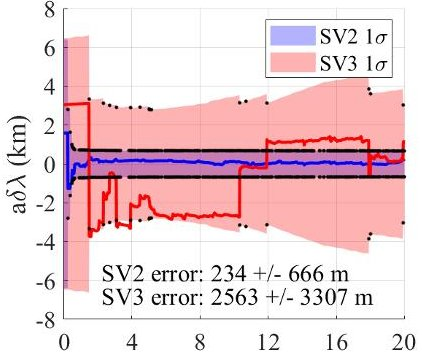

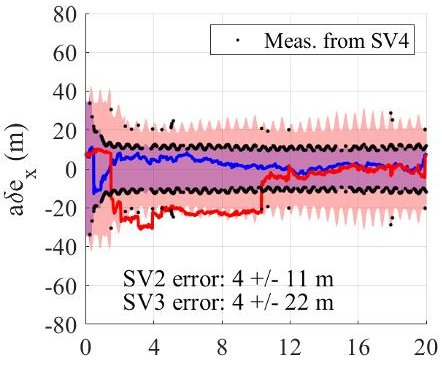

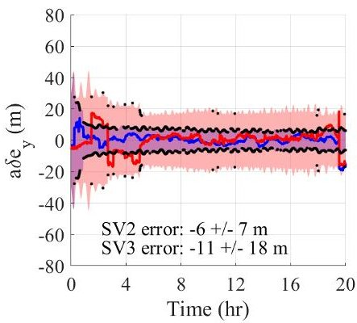

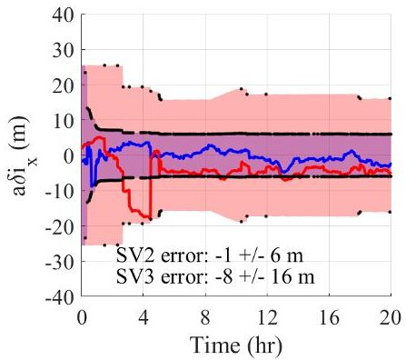

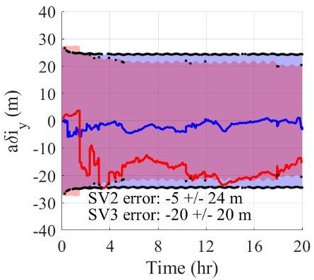

Figure 12. In-flight ROE estimation errors and uncertainties $ ( 1\sigma) $ for the single-observer multi-target case.

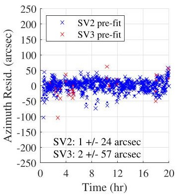

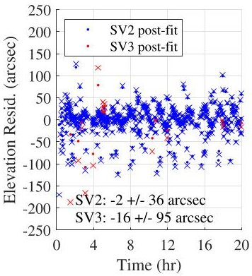

Figure 13. Pre-fit and post-fit measurement residuals in SOD for the single observer multi-target case.

## Single Observer Multi-Target

Figure 12 presents a baseline example of in-flight estimation performance, from SV4 telemetry on 05/16/2024. In this scenario, SV4 points its star tracker in the anti-velocity direction to image SV2 (at 50 km ISD) and SV3 (at 130 km ISD). Relative orbit estimates for SV2 and SV3 are initialized using stale information from the ground (approximately 3- 4 days old). Relative navigation is performed using bearing angles from SV4 only. Images were taken every 60 seconds. It can be seen in Figure 12 that SV4 successfully tracks and performs orbit estimation for multiple targets simultaneously, without requiring maneuvers for convergence, which is the first time this capability has been demonstrated in flight.

Performance displays expected trends for angles-only navigation. Error is primarily captured by the $ \delta\lambda $ ROE, which corresponds to the weakly-observable target range. Uncertainties (1 $ \sigma $ ) for a $ \delta\lambda $ at the end of the experiment period are 1.3% for SV2 and 2.6% for SV3, as a percentage of target range. Uncertainties in other ROE are less than 0.02% of target range because these state components are more strongly observable. Estimation errors generally remain within 1 $ \sigma $ bounds, indicating good filter health. Figure 13 presents pre-fit and postfit measurement residuals. Azimuth residuals are generally less than 50", whereas elevation residuals are larger, which suggests the possibility of additional uncertainties or error sources affecting the elevation angle in the VBS frame. However, no obvious biases are present in the residuals. In this experiment, bearing angle measurement noise of $ 4 0^{\prime \prime} $ （ $ 1 \sigma $ ） was assumed in the filter, because the value of $ 2 0^{\prime \prime} $ [8] [19] used during pre-flight testing was found to be insufficiently robust.

Results were partially affected by poor target visibility, most obviously for SV3. The visual magnitude of the swarm was significantly dimmer than expected, and as a result, targets with an ISD of more than 100 km could not be reliably detected by IMP. In Figure 12, fewer than 20 SV3 measurements were obtained over 12 orbits, as indicated by black dots. State uncertainties for SV3 are therefore large. Nevertheless, ARTMS was able to maintain a reasonable orbit estimate for both targets, validating the robustness of the architecture and its ability to maximize angles-only observability.

Comparative behavior during pre-launch simulations is displayed in Figure 14. Even though the modelled magnitude of SV3 in such that it is only detected by IMP in $ \sim 60\% $ of images, estimation performance is much improved because visibility remains more consistent and injected measurement noise is more idealized. A domain or sim2real gap therefore exists between the high-fidelity simulation environment and in-flight behavior. To reduce this gap and provide more realistic image inputs to ARTMS, a hardware-in-the-loop testbed known as the Optical Stimulator (OS) was leveraged during development [19] [43]. The OS shows synthetic images on a microdisplay and a system of movable lenses is used to stimulate a camera, calibrated to be geometrically and radiometrically similar to what would be observed on orbit. The resulting combination of software- and hardware-in-the-loop simulations successfully facilitated the verification of ARTMS such that in-flight success could be achieved.

<!-- PDF_PAGE: 11 -->

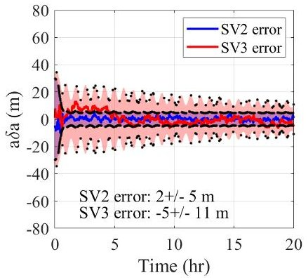

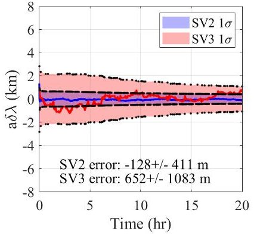

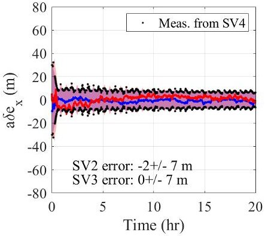

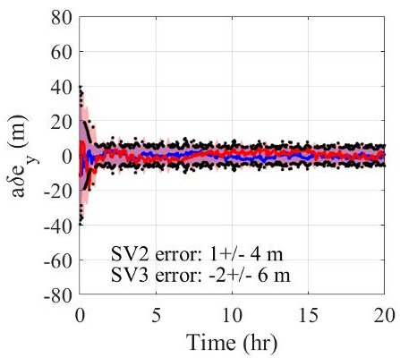

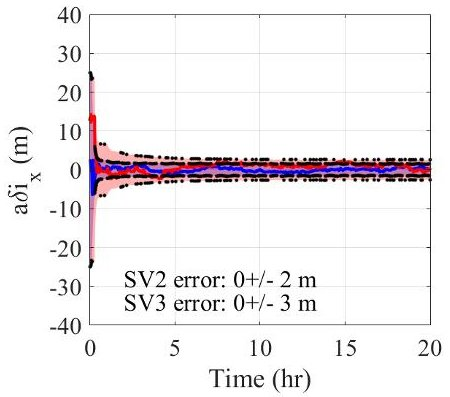

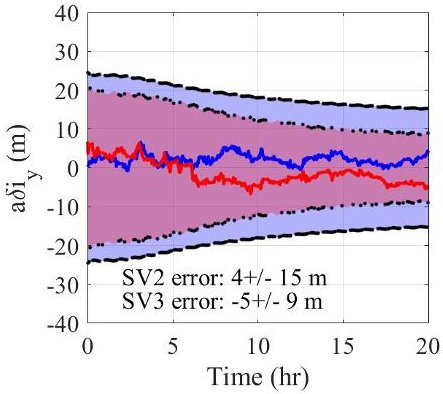

Figure 14. Simulated ROE estimation errors and uncertainties (1 $ \sigma $ ) for the single-observer multi-target case.

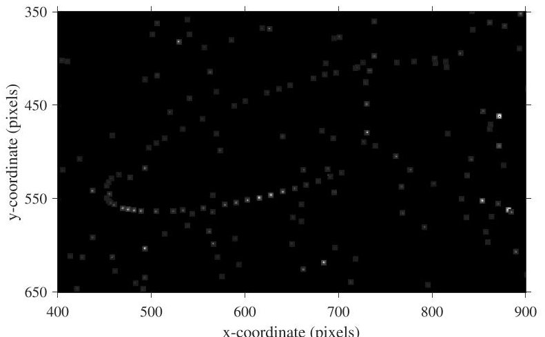

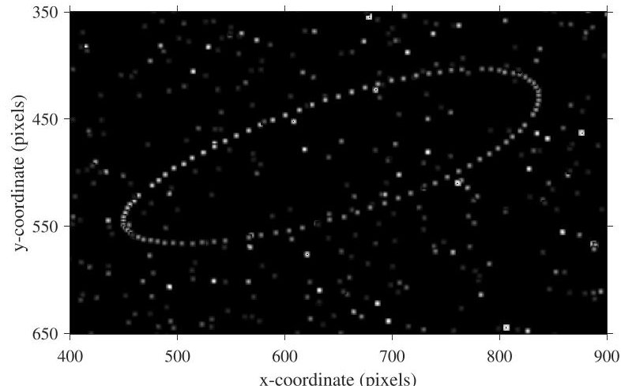

Figure 15. Regions of interest saved by IMP across 100 minutes on 05/08/24, in flight (left) and in simulation (right).

## Autonomous Initialization

Autonomous initialization of relative navigation for an unknown target was achieved on 05/08/24, which is the first time this capability has been demonstrated for an anglesonly target in flight. In this scenario, SV2 points its star tracker in the velocity direction to image SV4 (at 50 km ISD). No a-priori relative orbit information for SV4 is provided. GPS is used to maintain SV2's absolute orbit estimate. SV2 begins by performing multi-hypothesis tracking with IMP to detect potential targets in the FOV. Every 1.5 hours, BOD attempts to compute a relative orbit initialization using IMP measurement batches. If the computed orbit is reasonable (i.e., is within state and uncertainty tolerances), it is used to initialize SOD and formal navigation commences. Images were taken every 60 seconds.

The discrepancy between pre-flight and in-flight visibility is visualized in Figure 15, which displays the detected regions of interest (ROI) saved in IMP telemetry in orbit and in

simulation. The orbit has no eclipse period and in simulation, the target spacecraft remains consistently visible throughout. In flight, the target is significantly dimmer, to the extent that it is often not detected above background noise by IMP, leading to missing ROI. Figure 16 provides a numeric comparison of total summed pixel intensities for ROI corresponding to SV4, noting that each ROI is 20x20 pixels in size. The ROI intensity values are normalized such that a value of '0' in Figure 16 corresponds to the intensity of the dimmest detected ROI throughout the experiment period. Variations in intensity correspond to variations in spacecraft attitude and solar phase angle during the orbit, but flight ROI intensities remain consistently lower than simulated ROI.

The rate of missing measurements on board the spacecraft was also higher than anticipated. Nominally, 1320 images would be processed by IMP throughout the 22-hour experiment, whereas in practice, only 563 images were processed during the same timespan on 05/08/24, implying a success rate of 43%. IMP rejects the current image if its time-tag is

<!-- PDF_PAGE: 12 -->

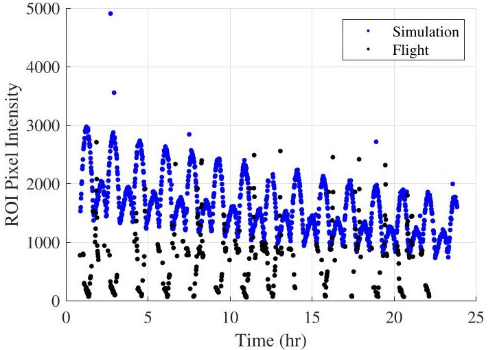

Figure 16. Summed pixel intensity of the 20x20 regions of interest corresponding to detected targets.

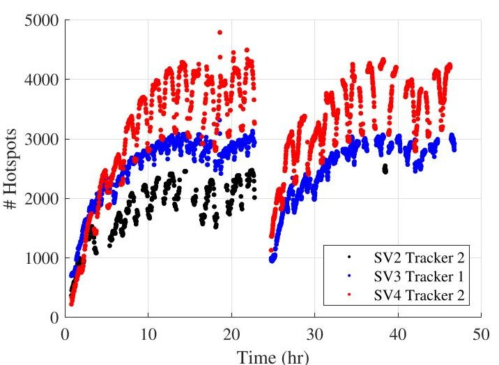

Figure 17. Number of hot pixels in images from 03/24/24-03/26/24.

identical to the previous image that was processed (indicating the image is not actually new), or if image status data is out of bounds. Thus, it appears that the star tracker was sometimes unable to take a new photo when commanded, or the photo was not successfully transferred to the payload. The target was subsequently visible in only 338 images, reducing measurement rates further to 26% of the nominal rate.

Image quality was additionally degraded by the presence of hot pixels in images. Figure 17 displays the number of hot pixels from three star trackers over 48 hours commencing on 03/24/24, during which complete images were downlinked. The number of hot pixels increases rapidly towards a peak of several thousand as each star tracker is asked to regularly provide images. After 24 hours, the star trackers are reset, which allows hot pixels to temporarily dissipate. In the worse case, nearly 0.5% of all pixels in the image were affected, and it became necessary to update the ARTMS flight software to filter out hot pixels more effectively.

Overall, pre-flight simulations assumed a worse-case target measurement rate of 40% up to 100 hot pixels, and target visibility up to 200 km ISD. Each of these assumptions was violated in orbit, implying a lack of realism when producing simulated images. It is therefore critical to ensure image properties such as target brightness, noise sources, and background illumination conditions are accurately modeled in

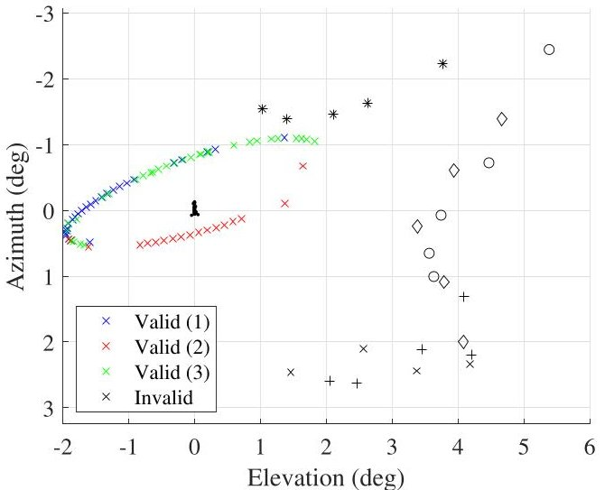

Figure 18. Track hypotheses produced by SAMUS.

software. Despite these challenges, however, IMP could successfully perform MHT by applying SAMUS to unidentified bearing angles. Figure 18 presents target track hypotheses over the first 8 hours of telemetry, where distinct colors indicate distinct valid hypotheses and distinct black markers indicate distinct pruned hypotheses. The blue, red and green segments follow the expected elliptical kinematics of a target in a similar orbit. In contrast, the black segments display large velocity or direction changes which are considered physically unreasonable. Of note is the track made up of repeated measurements near $ [\alpha,\epsilon]=[0,0] $ , which persisted as a possible in-train target (i.e. a target with very little relative motion) for 36 minutes before being pruned.

IMP performance is assessed by characterizing bearing angle measurement errors in I compared to ground truth bearing angles in I derived from GPS, as in Figure 19. Errors in flight are numerically similar to those from the on-ground twin, though slight differences occur because image inputs on the ground must be reconstructed from partial ROI and the missing information necessarily affects object detection and centroiding. Some systematic errors are present in azimuth and elevation, partially due to a drift in image timetags; the star tracker time did not stay synchronized with the on-board clock (which itself was synchronized to GPS time), meaning that image time-tags became inaccurate. This drift was observed to vary between experiments and was approximately +300 ms on 05/08/24. A separate software update was required to allow user-specified corrections to the time drift on board. Measurement errors after correcting for this drift are shown in the third plot in Figure 19, whereas errors for the simulation case are shown in the right-most plot and follow a more idealized distribution. In simulation, the combination of image noise, camera model errors and attitude determination errors produced 20" (1 $ \sigma $ ) of error. In flight, errors display a larger standard deviation and retain a bias even after correcting for the time drift. Sources of this bias are currently not well-understood, but may include changes to star tracker calibration post-launch or similar.

Crucially, IMP performance was sufficiently accurate to support angles-only navigation in flight, in adverse conditions. Even so, it is likely that the issues with time drifts and unreliable image transfers could have been discovered earlier during integration. Limited resources meant that realistic image inputs could not be passed to ARTMS after integration with the satellite bus, and many of its execution paths could

<!-- PDF_PAGE: 13 -->

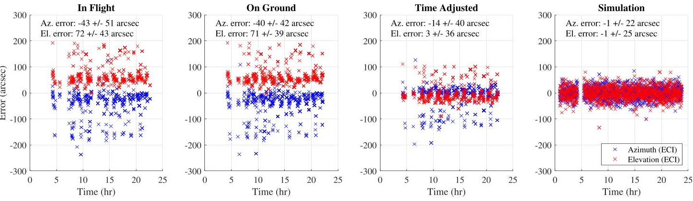

Figure 19. Measurement errors for target bearing angles in the ECI frame produced by IMP.

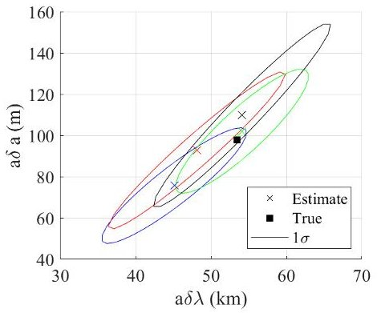

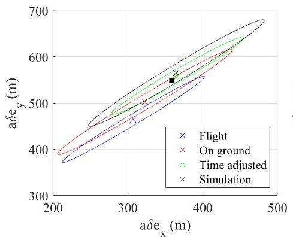

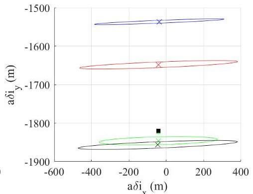

Figure 20. ROE estimates and $ 1 \sigma $ uncertainties from the BOD initialization.

not be exercised during this phase. As a result, extensive troubleshooting was required in flight. The on-ground digital twin therefore proved vital in that it could enable effective troubleshooting via playback of flight data.

BOD performance is summarized in Table 5, which displays the target $ \delta\lambda $ estimates produced by BOD. The first successful initialization occurred 7.75 hours after experiment start, at the third recorded BOD call. (Some intermediate BOD calls were not recorded due to insufficient measurements or unavailable telemetry.) Inconsistent image measurement rates in IMP meant correct tracks were often pruned too early, and were only rarely being propagated above the minimum length of 20 measurements required for BOD to run. Despite these obstacles, BOD was able to produce a first valid initialization using only 28 measurements, with $ a\delta\lambda $ errors of less than 20% of the 53 km ISD.

Table 5. BOD estimation performance for $ \delta \lambda $

<table border="1"><tr><td>Time</td><td># Meas</td><td>Span</td><td>aδλ error</td><td>aδλ uncert. (1σ)</td></tr><tr><td>1.75 hr</td><td>24</td><td>0.9 hr</td><td>25.45 km</td><td>56.26 km</td></tr><tr><td>6.25 hr</td><td>22</td><td>2.0 hr</td><td>-14.16 km</td><td>15.66 km</td></tr><tr><td>7.75 hr</td><td>28</td><td>3.5 hr</td><td>-8.33 km</td><td>9.64 km</td></tr><tr><td>9.25 hr</td><td>42</td><td>1.5 hr</td><td>-20.51 km</td><td>24.23 km</td></tr><tr><td>10.75 hr</td><td>67</td><td>3.0 hr</td><td>-5.92 km</td><td>11.53 km</td></tr><tr><td>12.25 hr</td><td>105</td><td>4.5 hr</td><td>-6.14 km</td><td>7.53 km</td></tr><tr><td>13.75 hr</td><td>135</td><td>6.0 hr</td><td>-6.60 km</td><td>5.80 km</td></tr><tr><td>16.75 hr</td><td>145</td><td>7.5 hr</td><td>-7.03 km</td><td>4.72 km</td></tr><tr><td>19.75 hr</td><td>159</td><td>7.8 hr</td><td>-4.44 km</td><td>3.94 km</td></tr></table>

BOD outputs were impacted in practice by poorer-than expected GPS performance. During 05/08/24, mean position uncertainties reported by the SV2 GPS receiver were 9.79 $ \pm $ 3.61 m/s and mean velocity uncertainties were 1.16 $ \pm $ 0.41 m/s (1 $ \sigma $ ). Though position uncertainties were in line with pre-flight expectations (as per Table 4), velocity uncertainties were two orders of magnitude larger, corresponding to large

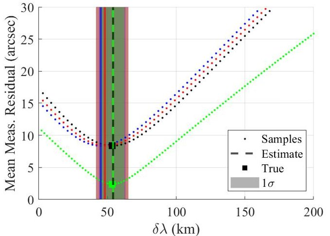

Figure 21. Estimation performance and measurement residuals for $ \delta\lambda $ in BOD.

uncertainties in semi-major axis when converted to OE. As opposed to SOD which sequentially filters measurements to reduce velocity uncertainties over time BOD relies on only the current PVT solution from the GPS receiver of the observer when computing an initialization. Uncertainty in the absolute orbit estimate becomes coupled to uncertainties in the BOD relative orbit estimate and as a result, output BOD uncertainties were often too large to be acceptable for initializing SOD. To compensate, it was necessary to tune BOD to reduce output state uncertainties by a factor of 5, while also allowing BOD to refine its semi-major axis estimate as part of the initialization process [11]. Subsequently, errors were generally well-characterized by the estimated $ 1 \sigma $ uncertainty. BOD is therefore relatively robust to large errors in a; an error of 1 m/s in velocity corresponds to a shift of more than 1 km in semi-major axis at Starling's altitude. An exception is when measurement batches span larger time periods, as in the last three rows of Table 5, whereupon BOD can become over-

<!-- PDF_PAGE: 14 -->

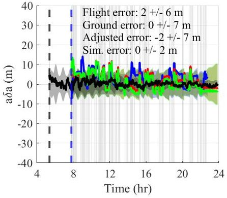

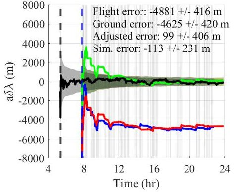

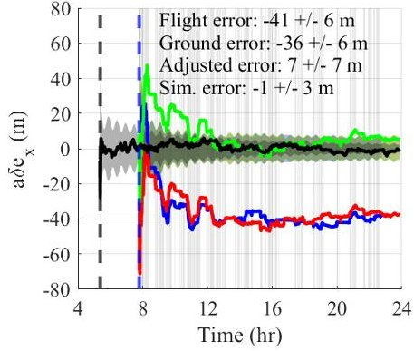

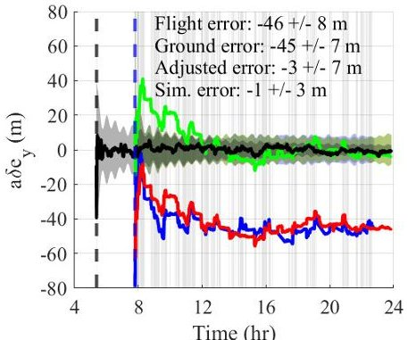

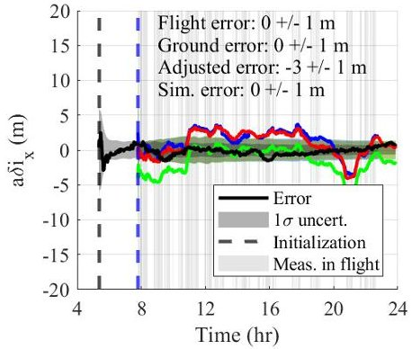

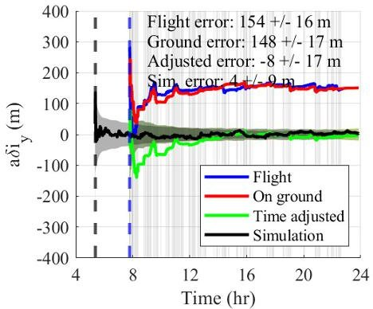

Figure 22. ROE estimation errors and uncertainties (1 $ \sigma $ ) for the autonomous initialization case.

confident. The current flight implementation of BOD does not directly compute the effects of dynamics model errors on measurements, instead relying on a scaling factor of N in Equation 14 to empirically compensate. However, this is a potential source of over-confidence as the propagation time increases and corresponding dynamics errors grow larger.

Estimation performance for the initialization at t=7.75 hours is visualized in Figures 20 and 21. Figure 20 displays true ROE, estimated ROE, and estimated 1 $ \sigma $ bounds for flight telemetry (blue), the on-ground twin (red), the on-ground twin with corrected time-tags (green), and the simulation (black). The on-ground twin again produces similar outputs to the flight telemetry, with some variation due to missing image information. Correcting for the star tracker time drift significantly reduces errors in the estimated ROE, achieving performance closer to the pre-flight simulation. The simulation outputs remain the most accurate due to more idealized measurement noise and a larger number of measurements in the batch. Figure 21 displays the mean residuals corresponding to individual $ \delta\lambda $ samples, mirroring the color scheme of Figure 20. The expected convex behavior is evident, and selecting the sample which produced the least residuals led to a reasonable initialization for the weakly observable $ \delta\lambda $

SOD performance post-initialization is visualized in Figure 22. The blue line corresponds to estimation errors from inflight telemetry, and the red line corresponds to the on-ground twin. It is clear that even if state uncertainties are converging a strong bias is present in the state error for $ \delta \lambda $ $ \delta e_{x} $ $ \delta e_{y} $ and $ \delta i_{y} $ due to image timing errors on board. The green line in Figure 22 corresponds to estimation performance after the timing errors are corrected, which removes the bias in all estimated ROE. The black line represents performance in simulation, which is similar to the performance achieved after correcting for time errors. Initialization occurs earlier in simulation due to increased target measurement rates. Target measurements in flight are indicated with vertical grey bars, showing lengthy periods without new measurements.

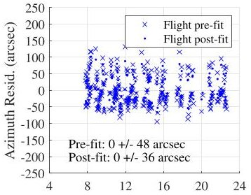

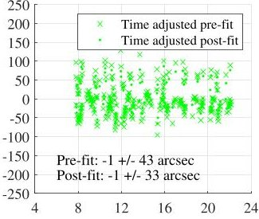

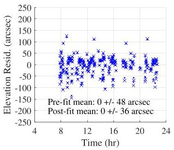

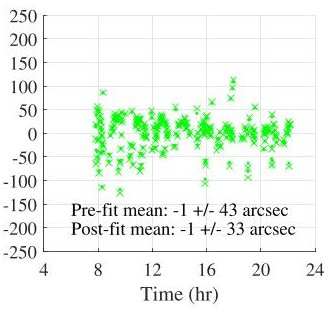

Figure 23. SOD pre-fit and post-fit measurement residuals for the autonomous initialization case.

Filter measurement residuals are plotted in Figure 23. Residuals appear to be zero-mean across the experiment period and post-fit residuals are consistently smaller than pre-fit residuals. The image timing errors do not produce an obvious bias in the residuals themselves, suggesting the time drift is unobservable with the available inputs. This is consistent with previous work by the authors [45] [46] which has shown that differential clock offsets between observers are observable using only bearing angles. However, absolute clock offsets are unobservable with bearing angles.

## Multi-Observer Multi-Target

Figure 24 presents estimation performance from SV4 telemetry on 02/05/2024. In this scenario, SV4 points its star tracker in the anti-velocity direction to image SV2 (at 130 km ISD) and SV3 (at 80 km ISD). Relative orbit estimates for SV2 and

<!-- PDF_PAGE: 15 -->

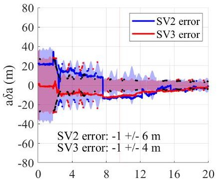

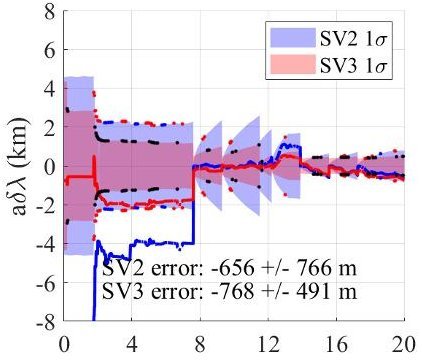

Figure 24. In-flight ROE estimation errors and uncertainties $ (1\sigma) $ for the multi-observer multi-target case.

Figure 25. On-ground ROE estimation errors and uncertainties (1 $ \sigma $ ) for the multi-observer multi-target case.

SV3 are initialized using stale information from the ground (3-4 days old). GPS is used to maintain SV4's absolute orbit estimate. Relative orbit estimation is performed using bearing angles from multiple observers over the ISL, such that SV4 additionally receives ISL measurements from SV2 (measuring SV3 and SV4) and SV3 (measuring SV2). Images were taken every 120 seconds.

The colored dots in Figure 24 mark instances when a measurement broadcast by a remote observer was used to update local state estimates on SV4. It can be seen that SV4 utilizes measurements from all three spacecraft, which is the first time

this distributed and adaptive multi-observer capability has been demonstrated in flight. Results reveal certain advantages of multi-observer navigation. Firstly, SV4 only obtains 5 local measurements of SV2 throughout the experiment period. It must instead rely on measurements of SV2 from SV3 (and SV3 from SV2) to update its on-board orbit estimate for SV2. Thus, multiple observers are able to provide added robustness when measurements are sparse (compared to e.g. SV3 in Figure 12). Secondly, state uncertainty is reduced compared to an equivalent single observer case. Uncertainties （1 $ \sigma $ ）for a $ \delta\lambda $ at the end of the experiment period are 0.6% for SV2 and SV3, as a percentage of target range. Uncertainties in other

<!-- PDF_PAGE: 16 -->

ROE are less than 0.01% of target range. The additional geometric information provided by multi-observer measurements significantly improves angles-only observability.

Anomalies are also evident in Figure 24, such as sudden decreases in the a $ \delta \lambda $ uncertainty at several time instants, e.g. at t=8 hours. This is due to unintended behavior when the SOD filter resets. As part of the ISL message, swarm members broadcast their absolute orbit estimate, which allows the receiving spacecraft to match any remote measurements to local state estimates. Typically, this orbit estimate is retrieved from the SOD filter. However, when SOD re-initializes (e.g. due to a large number of skipped measurement updates), the SOD estimate becomes temporarily invalid, and the on-board GNSS solution is sent instead as backup. When SV4 received this GNSS solution, it interpreted it as a measurement that could be used to update the relevant target's state estimate. GNSS improves observability in this scenario which led to sudden decreases in that target's state uncertainty.

## Achievement of Key Objectives

Figure 25 displays performance using the on-ground twin when remote GNSS updates were disabled. Behavior closer to expectations is observed, without rapid growth or decrease in the covariance. Towards the end of the experiment, the steady-state uncertainty for SV3 appears to be slowly converging towards the level achieved in Figure 24. Some sudden changes in estimation are present, including occasional regions where estimation error is outside 1 $ \sigma $ bounds, due to sparse target visibility and limited measurement information. However, errors remain within 3 $ \sigma $ bounds.

Ten StarFOX experiment goals were defined prior to launch, informed by overall Starling objectives and pre-flight performance expectations [19]. These goals, and StarFOX outcomes during the initial experiment phase, are presented in Table 6. All thresholds were successfully achieved and the majority of goals were successfully achieved, through either flight experiments or on-ground processing of flight data [20]. As of May 2024, StarFOX has encompassed the first ever onorbit demonstrations of 1) convergence of angles-only state estimates without maneuvers, 2) angles-only navigation for multi-target and multi-observer systems, and 3) initialization of angles-only relative navigation for an unknown target. The first demonstrations of simultaneous absolute and relative navigation using only bearing angles were also achieved using flight data. This acts to greatly increase the technology readiness level for autonomous angles-only navigation.

These outcomes provide a number of lessons learned, with a particular focus on incorporating realistic image simulations and thorough integration testing when using optical sensors. Outcomes also illustrate the importance of flexibility and robustness to overall system design. Efforts were made during ARTMS' development to allow the system to adapt to differing conditions, in either an autonomous fashion (via different software execution paths, contingencies, and checks) or in a user-defined fashion (via tunable telecommand parameters). These decisions are what have enabled successful navigation even when on-orbit conditions have proven detrimental.

## 6. EXTENSIONS FOR STARFOX+

The initial success of StarFOX has led to the proposal of a StarFOX+ extended mission phase, scheduled for 2025. StarFOX+ will extend ARTMS with new navigation capabilities. Five core extensions are under development:

1. Unknown RSO identification in IMP. Identify unknown RSO detected in images by matching them to known objects from a space object catalog, to support SSA applications.

2. Fast BOD. Apply new algorithms [47] or multi-observer methods [48] to reduce the number of measurements required to generate an initial relative orbit estimate in BOD, to support SSA applications.

3. Auxiliary state estimation in SOD. Estimate auxiliary states of the swarm online [45] [46] including differential ballistic coefficients, differential inter-satellite clock offsets, and sensor biases, to support long-term autonomy.

4. Adaptive noise compensation in SOD. Apply online adaptive noise compensation techniques [49] to provide improved robustness in regimes where dynamics and/or measurement errors are not well-characterized.

5. Data fusion for ranging in SOD. Leverage the ISL for inter-satellite ranging and apply data fusion in SOD to improve navigation accuracy and robustness [48].

Additional extended mission phases denoted as "Inspector" and "Fast Autonomous Lost-in-space Catalog-based Optical Navigation" (FALCON) are also under development. Inspector will explore using angles-only navigation to support satellite inspection, servicing and rendezvous applications, while FALCON will enable resilient optical positioning, navigation and timing for the observer via bearing angles to known RSOs. Current progress with StarFOX+ is illustrated below using results from a prototype of the unknown RSO identification algorithm, leveraging StarFOX flight images.

## Resident Space Object Identification

In flight, a significant proportion of detected objects in the FOV could not be concretely classified as stars, swarm targets, or pixel hotspots by the IMP algorithm. For example, across 500 images from SV3 on 03/24/24, the following classifications were made: 14532 total detections, 3386 catalog stars, 122 swarm targets, 4593 hotspots, 154 non-catalog stars, and 6097 unclassified detections.

It is likely that some unclassified objects are stars which could not be identified due to measurement errors and ambiguities or visual artefacts produced by the camera. However, other objects may be RSOs (e.g. active satellites, inactive satellites, or debris) transiting through the FOV. For SSA applications, it is useful to be able to identify such objects and leverage these measurements to improve the timeliness and accuracy of space object catalogs, such as those maintained by SpaceTrack [50]. Consider crowd-sourcing opportunistic measurements of RSOs from existing satellite star trackers to provide enhanced global SSA knowledge.

Within IMP, the new RSO identification pipeline is implemented as an extra step after swarm targets have been identified. It is assumed that a regularly updated catalog file can be provided to the spacecraft. The catalog file consists of TLEs of relevant RSOs. Current RSO catalogs extend to approximately 60,000 distinct ID numbers, and to operate within uplink bandwidth limits and on-board data storage limits, the catalog must be reduced beforehand to contain only those RSOs which are likely to be visible. This can be conducted via filtering based on similarity in their OE to the observer, predicted minimum distance from the observer, camera FOV and attitude profile, and so on.

Upon receiving a new star tracker image, IMP applies the SGP4 model [51] to propagate TLEs to the image epoch. TLEs are defined in the True Equator Mean Equinox (TEME) reference frame, which must be converted to ARTMS' J2000

<!-- PDF_PAGE: 17 -->

Table 6. Summary of StarFOX performance goals and initial flight results.

<table border="1"><tr><td>#</td><td>Objective</td><td>Threshold</td><td>Goal</td><td>Initial Result</td></tr><tr><td>1</td><td>Tracking multiple targets simultaneously</td><td>1 target</td><td>3 targets</td><td>2 targets(in flight)</td></tr><tr><td>2</td><td>Accuracy of relative position knowledge with one observer</td><td>Estimate produced</td><td>1% error relative to ISD</td><td>0.5% error relative to ISD(in flight)</td></tr><tr><td>3</td><td>Convergence time for relative position knowledge with one observer</td><td>Convergence observed</td><td>6 orbits</td><td>2 orbits(in flight)</td></tr><tr><td>4</td><td>Accuracy of relative position knowledge with multiple observers</td><td>Estimate produced</td><td>0.1% error relative to ISD</td><td>0.5% (in flight)0.1% (on ground)</td></tr><tr><td>5</td><td>Convergence time for relative position knowledge with multiple observers</td><td>Convergence observed</td><td>2 orbits</td><td>1 orbit(in flight)</td></tr><tr><td>6</td><td>Accuracy of relative position knowledge in presence of maneuvers</td><td>Estimate produced</td><td>0.1% error relative to ISD</td><td>Estimate produced(in flight)</td></tr><tr><td>7</td><td>Convergence time for relative position knowledge in presence of maneuvers</td><td>Convergence observed</td><td>2 orbits</td><td>Convergence observed(in flight)</td></tr><tr><td>8</td><td>Accuracy of absolute position knowledge with multiple observers</td><td>Estimate produced</td><td>1km error</td><td>850m error(on ground)</td></tr><tr><td>9</td><td>Convergence time for absolute position knowledge with multiple observers</td><td>Convergence observed</td><td>24 hours</td><td>Convergence observed(on ground)</td></tr><tr><td>10</td><td>Time to produce autonomous relative orbit initialization</td><td>Initialization produced</td><td>2 orbits</td><td>5 orbits(in flight)</td></tr></table>

reference to accurately compute RSO bearing angles in the image. Furthermore, TLEs do not contain definitive orbit uncertainty information. To provide an approximate measure of uncertainties, an empirical model is defined by examining the deviation of Starling TLEs provided by Space-Track (and propagated using SGP4) from true Starling positions derived from on-board GPS. Figure 26 illustrates orbit propagation errors over one day using various dynamics models, including SGP4, the SOD on-board model, and the ground-truth simulation model. Differences between true and propagated positions are expressed as the ROE of the propagated orbit with respect to the true orbit, to provide geometric intuition.

The ground-truth dynamics model achieves meter-level errors in all ROE apart from $ \delta \lambda $ ; the majority of error stems from inaccuracies in the simulated atmospheric drag model, which manifests as a growing drift in the along-track direction. The on-board dynamics model in SOD achieves ten-meterlevel errors in all ROE, again with the exception of $ \delta \lambda $ SGP4 produces errors of hundreds of meters in all ROE, with several kilometers of error in the along-track direction after one day. While SGP4 is by far the least accurate, it is also an analytic model which does not require numerical propagation, and thus enables orbit prediction for hundreds or thousands of catalog objects without an infeasible computational cost. Based on the results of Figure 26, a model $ \sigma_{\delta\alpha} $ is defined to capture TLE uncertainties in ROE, where

$$
\boldsymbol {\sigma} _ {\delta \alpha} = \sigma_ {p} \left[ 1 5 0, 5 0 0 + 1 5 0 0 t _ {p}, 3 0 0, 3 0 0, 3 0 0, 3 0 0 \right] ^ {\top} \mathrm {m}
$$

The factor $ \sigma_{p} $ is a tunable confidence level and $ t_{p} $ is propagation time in days. Though this model is empirical and does not equally apply to all RSO, it aims to provide a rough indication of TLE uncertainties in practice.

Subsequently, the uncertainty in ROE for the $ j $th RSO with respect to an observer can be converted to a covariance $ \Sigma_{\mathrm{RSO}}^{j} $ for its predicted bearing angles in $ \mathcal{V} $ , via an unscented transform. Let $ \sigma_{jk} $ denote the Mahalanobis distance between the bearing angles $ y_{\mathrm{RSO}}^{j} $ of the $ j $th catalog RSO, and bearing angles $ y_{\mathrm{UO}}^{k} $ of the $ k $th unclassified object detected by the observer, with

$$
\sigma_ {j k} = \sqrt {\left(\boldsymbol {y} _ {\mathrm {R S O}} ^ {j} - \boldsymbol {y} _ {\mathrm {U O}} ^ {k}\right) ^ {\top} \left(\boldsymbol {\Sigma} _ {\mathrm {R S O}} ^ {i}\right) ^ {- 1} \left(\boldsymbol {y} _ {\mathrm {R S O}} ^ {j} - \boldsymbol {y} _ {\mathrm {U O}} ^ {k}\right)}
$$

To minimize erroneous assignments, the jth object is only matched to the kth object if the three conditions of Equations 15-17 are satisfied.

When implementing the above method, 65 unclassified objects in the previous 500 images were identified as cataloged RSO. Six examples of detected RSOs are presented in Figure 27. The most commonly visible RSOs in the StarFOX dataset are Starlink satellites, because the Starling absolute orbit has a similar altitude to several Starlink constellation shells. However, a variety of active and inactive satellites are visible, including known debris pieces. It is therefore possible to use RSO catalog data to identify objects in images from a spaceborne star tracker, supporting the intention of StarFOX+ to perform similar identifications in orbit.

Though this initial work provides a proof of concept, several questions remain to be addressed, including the computational cost of catalog management; the maximum TLE age before uncertainties become too large; optimal algorithm tuning for robust identification; and frequency of image measurements. For example, increasing measurement rates from 60 seconds per image to 30 seconds per image (or less) would increase the number of detection opportunities, as well as the chance of obtaining multiple sequential images of a detected object. This may allow the commencement of tracking for previously unknown RSOs, to later be added to a global catalog. Furthermore, it is desirable to use measurements of known RSOs to improve the observer's orbit estimate in an inverse manner, within SOD, by leveraging the RSO as a known beacon for triangulating observer position.

## 7. CONCLUSION

This paper discusses on-orbit performance and lessons learned from the Starling Formation-flying Optical eXperiment (StarFOX), which is the first in-flight demonstration of autonomous angles-only navigation for a satellite swarm. StarFOX is a core experiment payload of the NASA Starling mission, managed by the NASA Ames Research Center. Starling consists of four identical 6U CubeSats and was launched in July 2023. Prior demonstrations of anglesonly navigation in orbit have performed navigation for single

<!-- PDF_PAGE: 18 -->

Figure 26. Propagation errors for dynamics models when compared to Starling GPS data on 03/24/24.

observers and single targets only, and have required external orbit information and/or system maneuvers to achieve orbit determination. To overcome these limitations, StarFOX applies the new angles-only Absolute and Relative Trajectory Measurement System (ARTMS). The ARTMS architecture provides autonomous, distributed, and scalable navigation for distributed systems in deep space using inexpensive optical sensors. Its multi-observer multi-target framework is able to achieve complete swarm orbit determination with minimal external orbit information and without maneuvers.

Initial StarFOX experiments have applied ARTMS in flight to successfully perform swarm navigation. Star trackers were used to image other swarm spacecraft and obtain bearing angle measurements, optionally shared over an inter-satellite crosslink. Observers could navigate for multiple target spacecraft and displayed maneuver-free angles-only convergence, achieving relative position estimation uncertainties of 1.3% of target range (1 $ \sigma $ ). Multiple observers were able to cooperate to estimate relative orbits with an improved 0.6% position uncertainty relative to range (1 $ \sigma $ ). StarFOX has also provided the first demonstrations in which an unknown target is detected and tracked by an observer and a relative state initialization is autonomously computed in flight.

StarFOX encountered several challenges on orbit which impacted navigation performance, including poor target visibility, poor signal-to-noise ratios, missed image measurements, and image timing errors. Comparisons between inflight telemetry and simulations have revealed discrepancies

Figure 27. Examples of detected RSO in Starling flight images. Ellipses indicate $ 3\sigma $ position uncertainty regions and arrows indicate relative velocity vectors.

in the fidelity of synthetic image simulations pre-launch. Furthermore, a lack of realistic image measurements during integration with satellite hardware prevented diagnosis of several critical issues, which had to be mitigated through in-flight software updates. Despite these issues, efficient troubleshooting was enabled through usage of an on-ground software twin which could play back flight data in a similar manner to the swarm. StarFOX was subsequently able to achieve the majority of its objectives on orbit and presents a significant step towards the autonomy of future distributed missions. Development is now ongoing for a StarFOX+ extended mission which will augment ARTMS with new navigation capabilities, such as identification of tracking of resident space objects external to the Starling swarm.

## ACKNOWLEDGMENTS

NASA Starling is funded by the Small Spacecraft Technology Program (SSTP) within the NASA Space Technology Mission Directorate. StarFOX development was supported by SSTP cooperative agreement number 80NSSC18M0058 and by the Air Force Office of Scientific Research award number FA9550-21-1-0414. The authors acknowledge the contributions of Joshua Sullivan and Adam W. Koenig towards StarFOX development, and Sage Wu for work on StarFOX+ RSO identification. The authors also thank the NASA Ames Starling team for their tireless support of StarFOX efforts.

<!-- PDF_PAGE: 19 -->

## REFERENCES

[1] S. D'Amico, M. Pavone, S. Saraf et al., "Miniaturized Autonomous Distributed Space System for Future Science and Exploration," in 8th International Workshop on Satellite Constellations and Formation Flying, Delft, The Netherlands, 2015.

[2] B. D. Tapley, S. Bettadpur, M. Watkins, and C. Reigber, "The gravity recovery and climate experiment: Mission overview and early results," Geophysical Research Letters, vol. 31, no. 9, 2004.

[3] G. Krieger, A. Moreira, H. Fiedler et al., "TanDEMX: A Satellite Formation for High-Resolution SAR Interferometry," IEEE Transactions on Geoscience and Remote Sensing, vol. 45, no. 11, pp. 3317-3341, 2007.

[4] S. D'Amico, J.-S. Ardaens, and R. Larsson, "Spaceborne Autonomous Formation-Flying Experiment on the PRISMA Mission," Journal of Guidance, Control, and Dynamics, vol. 35, no. 3, pp. 834-850, 2012.

[5] J. Burch, T. Moore, R. Torbert, and B. Giles, "Magnetospheric multiscale overview and science objectives," Space Science Reviews, vol. 199, no. 1-4, pp. 5-21, 2016.

[6] M. J. Holzinger and M. K. Jah, "Challenges and potential in space domain awareness," Journal of Guidance, Control, and Dynamics, vol. 41, no. 1, pp. 15-18, 2018.

[7] D. Arney, R. Sutherland, J. Mulvaney et al., "On-orbit Servicing, Assembly, and Manufacturing (OSAM) State of Play," NASA, Tech. Rep., 2021.

[8] S. Palo, G. Stafford, and A. Hoskins, "An Agile MultiUse Nano Star Camera for Constellation Applications," in Proceedings of the Small Satellite Conference, Logan, UT, 2013.

[9] D. C. Woffinden and D. K. Geller, "Observability Criteria for Angles-Only Navigation," IEEE Transactions on Aerospace and Electronic Systems, vol. 45, no. 3, pp. 1194-1208, 2009.

[10] J. Sullivan and S. D'Amico, "Adaptive Filtering for Maneuver-Free Angles-Only Navigation in Eccentric Orbits," in 27th AAS/AIAA Space Flight Mechanics Conference, San Antonio, TX, 2017.

[11] A. W. Koenig and S. D'Amico, "Observability-Aware Numerical Algorithm for Angles-Only Initial Relative Orbit Determination," in 2020 AAS/AIAA Astrodynamics Specialist Conference, Lake Tahoe, CA, 2020.

[12] R. B. Friend, "Orbital Express Program Summary and Mission Overview," in Proceedings of SPIE, R. T. Howard and P. Motaghedi, Eds., vol. 6958, 2008.

[13] S. D'Amico, J.-S. Ardaens, G. Gaias et al., "Noncooperative Rendezvous Using Angles-Only Optical Navigation: System Design and Flight Results," Journal of Guidance, Control, and Dynamics, vol. 36, no. 6, pp. 1576-1595, 2013.

[14] G. Gaias, S. D'Amico, and J.-S. Ardaens, "Angles-Only Navigation to a Noncooperative Satellite Using Relative Orbital Elements," Journal of Guidance, Control, and Dynamics, vol. 37, no. 2, pp. 439-451, 2014.

[15] G. Gaias and J.-S. Ardaens, "Flight Demonstration of Autonomous Noncooperative Rendezvous in Low Earth Orbit," Journal of Guidance, Control, and Dynamics, vol. 41, no. 6, pp. 1337-1354, 2017.

[16] J.-S. Ardaens and G. Gaias, "Angles-Only Relative

Orbit Determination in Low Earth Orbit," Advances in Space Research, vol. 61, no. 11, pp. 2740-2760, 2018.

[17] H. Sanchez, D. McIntosh, H. Cannon, C. Pires, J. Sullivan, S. D'Amico, and B. O'Connor, "Starling-1: Swarm Technology Demonstration," in 32nd Annual Small Satellite Conference, Logan, UT, 2018.

[18] J. Sullivan, A. W. Koenig, J. Kruger, and S. D'Amico, "Generalized Angles-Only Navigation Architecture for Autonomous Distributed Space Systems," Journal of Guidance, Control, and Dynamics, vol. 44, no. 6, pp. 1087-1105, 2021.

[19] J. Kruger, A. W. Koenig, and S. D'Amico, "The Starling Formation-Flying Optical Experiment (StarFOX): System Design, Experiment Design and Pre-Flight Verification," Journal of Spacecraft and Rockets, pp. 1-23, 2023.

[20] J. Kruger, S. Hwang, and S. D'Amico, "Starling Formation-Flying Optical Experiment: Initial Operations and Flight Results," in Proceedings of the 38th Small Satellite Conference, Logan, Utah, 2024.

[21] D. A. Vallado and W. D. McClain, Fundamentals of Astrodynamics and Applications, 4th ed. Hawthorne, California: Microcosm Press, 2013.

[22] S. D'Amico, "Autonomous Formation Flying in Low Earth Orbit," Ph.D. dissertation, Delft University, 2010.

[23] A. W. Koenig, T. Guffanti, and S. D'Amico, "New State Transition Matrices for Relative Motion of Spacecraft Formations in Perturbed Orbits," Journal of Guidance, Control, and Dynamics, vol. 40, no. 7, pp. 1749-1768, 2017.

[24] T. Guffanti and S. D'Amico, "Linear Models for Spacecraft Relative Motion Perturbed by Solar Radiation Pressure," Journal of Guidance, Control, and Dynamics, vol. 42, no. 9, pp. 1962-1981, 2019.

[25] J. Sullivan, T. A. Lovell, and S. D'Amico, "Angles-Only Navigation for Autonomous On-Orbit Space Situational Awareness Applications," in AAS/AIAA Astrodynamics Specialist Conference, Snowbird, UT, 2018.

[26] K. T. Alfriend, Ed., Spacecraft Formation Flying: Dynamics, Control, and Navigation. Butterworth- Heinemann/Elsevier, 2010.

[27] O. Montenbruck and E. Gill, Satellite Orbits: Models, Methods and Applications. Springer, 2012.

[28] J. Sullivan, A. Koenig, and S. D'Amico, "Improved Maneuver-Free Approach to Angles-Only Navigation for Space Rendezvous," in 26th AAS/AIAA Space Flight Mechanics Meeting, Napa, CA, 2016.

[29] J. Sullivan and S. D'Amico, "Nonlinear Kalman Filtering for Improved Angles-Only Navigation Using Relative Orbital Elements," Journal of Guidance, Control, and Dynamics, vol. 40, no. 9, pp. 2183-2200, 2017.

[30] J. Kruger and S. D'Amico, "Autonomous angles-only multitarget tracking for spacecraft swarms," Acta Astronautica, vol. 189, pp. 514-529, 2021.

[31] B.-n. Vo, M. Mallick, Y. Bar-shalom et al., "Multitarget Tracking," in Wiley Encyclopedia of Electrical and Electronics Engineering, J. G. Webster, Ed. Springer International Publishing, 2015.

[32] X. Wan, G. Wang, X. Wei, J. Li, and G. Zhang, "Star Centroiding Based on Fast Gaussian Fitting for Star Sensors," Sensors, vol. 18, no. 9, 2018.

<!-- PDF_PAGE: 20 -->

[33] D. Mortari, M. A. Samaan, C. Bruccoleri, and J. L. Junkins, "The Pyramid Star Identification Technique," Navigation, vol. 51, no. 3, pp. 171-183, 2004.

[34] J. R. Wertz, Spacecraft Attitude Determination and Control. Springer Science & Business Media, 2012.

[35] S. Blackman, "Multiple hypothesis tracking for multiple target tracking," IEEE Aerospace and Electronic Systems Magazine, vol. 19, no. 1, pp. 5-18, 2004.

[36] M. Ester, H.-P. Kriegel, J. Sander, and X. Xu, "A density-based algorithm for discovering clusters in large spatial databases with noise," in Proceedings of the Second International Conference on Knowledge Discovery and Data Mining, 1996, p. 226-231.

[37] N. Stacey and S. D'Amico, "Autonomous swarming for simultaneous navigation and asteroid characterization," in AAS/AIAA Astrodynamics Specialist Conference. Snowbird, UT, 2018.

[38] S. Miller, C. Adams, N. Alem, H. Cannon et al., "Starling CubeSat Swarm Technology Demonstration Flight Results," in Proceedings of the 38th Small Satellite Conference, Logan, Utah, 2024.

[39] O. Montenbruck, M. Kirschner, S. D'Amico, and S. Bettadpur, "E/I-Vector Separation for Safe Switching of the GRACE Formation," Aerospace Science and Technology, vol. 10, no. 7, pp. 628-635, 2006.

[40] D. Brouwer, "Solution of the problem of artificial satellite theory without drag," Astronomical Journal, vol. 64, no. 1274, pp. 378-397, 1959.

[41] J. Picone, A. Hedin, D. P. Drob, and A. Aikin, "NRLMSISE-00 Empirical Model of the Atmosphere: Statistical Comparisons and Scientific Issues," Journal of Geophysical Research: Space Physics, vol. 107, no. A12, pp. SIA-15, 2002.

[42] V. Giralo and S. D'Amico, "Development of the Stanford GNSS Navigation Testbed for Distributed Space Systems," in Proceedings of the 2018 International Technical Meeting of the Institute of Navigation, Reston, VA, 2018, pp. 837-856.

[43] C. Beierle and S. D'Amico, "Variable magnification optical stimulator for training and validation of spaceborne vision-based navigation," Journal of Spacecraft and Rockets, vol. 56, no. 4, pp. 1060-1072, 2019.

[44] R. L. Cognition, "Large phase angle observations of GEO satellites," in Sensors and Systems for Space Applications VI, vol. 8739, International Society for Optics and Photonics. SPIE, 2013, pp. 194-205.

[45] J. Kruger, K. Wallace, A. W. Koenig, and S. D'Amico, "Autonomous Angles-Only Navigation for Spacecraft Swarms around Planetary Bodies," in 2021 IEEE Aerospace Conference, Big Sky, MT, 2021.

[46] K. Iiyama, J. Kruger, and S. D'Amico, "Autonomous Distributed Angles-Only Navigation and Timekeeping in Lunar Orbit," in ION International Technical Meeting, Long Beach, CA, 2022.

[47] M. Willis and S. D'Amico, "Fast Angles-Only Relative Navigation Using Polynomial Dynamics," in 11th International Workshop on Satellite Constellations and Formation Flight, Milano, Italy, 2022.

[48] J. Kruger, "Flight algorithms for autonomous tracking and navigation of distributed space systems using intersatellite bearing angles," Ph.D. dissertation, Stanford University, 2024.

[49] N. Stacey and S. D'Amico, "Adaptive and dynamically constrained process noise estimation for orbit determination," IEEE Transactions on Aerospace and Electronic Systems, vol. 57, no. 5, pp. 2920-2937, 2021.

[50] Space-Track. [Online]. Available: https://space-track.org/

[51] D. Vallado and P. Crawford, SGP4 Orbit Determination American Institute of Aeronautics and Astronautics, 2008.

## BIOGRAPHY

Justin Kruger received B.S. degrees in physics and mechatronics engineering from the University of Western Australia (2016) and M.S. and Ph.D. degrees in aeronautics and astronautics from Stanford University (2024). For his Ph.D. dissertation, Justin received the Stanford Aeronautics and Astronautics Department's William F. Ballhaus prize and the ION Satellite Division's Bradford

Parkinson award. He also received the M Charles Fogg Best Paper award at the 2021 IEEE Aerospace Conference. Justin is currently a postdoctoral scholar with the Stanford Space Rendezvous Laboratory, where his research focuses on angles-only navigation algorithms for distributed space systems in both Earth orbit and deep space. Applications include responsive space situational awareness; resilient optical positioning; autonomous rendezvous and proximity operations; and cislunar navigation. Recently, he has led development of the Starling Formation-Flying Optical Experiment in collaboration with the NASA Ames Research Center.

Simone D'Amico Simone D'Amico is Associate Professor of Aeronautics and Astronautics (AA), W.M. Keck Faculty Scholar in the School of Engineering, and Professor of Geophysics (by Courtesy). He is the Founding Director of the Stanford Space Rendezvous Laboratory, Co-Director of the Center for AEroSpace Autonomy Research (CAESAR), and Director of the Undergraduate Program in Aerospace Engineering at Stanford. He has 20+ years of experience in research and development of autonomous spacecraft and distributed space systems. He developed the distributed Guidance, Navigation, and Control (GNC) system of several formation-flying and rendezvous missions and is currently the institutional PI of four autonomous satellite swarms funded by NASA (STARLING, STARI) and by NSF (VISORS, SWARM-EX) with one of them operational in orbit right now (Starling). Besides academia, Dr. D'Amico is in the Advisory Board of four space start-ups focusing on distributed space systems for future applications in SAR remote sensing, orbital lifetime prolongation, and space-based solar power. He was the recipient of several awards, most recently the 2024 NASA Ames Honor Award for the Starling mission, Best Paper Awards at IAF (2022), IEEE (2021), AIAA (2021), AAS (2019) conferences, and the M. Barry Carlton Award by IEEE (2020). He received the B.S. and M.S. degrees from Politecnico di Milano (2003) and the Ph.D. degree from Delft University of Technology (2010).