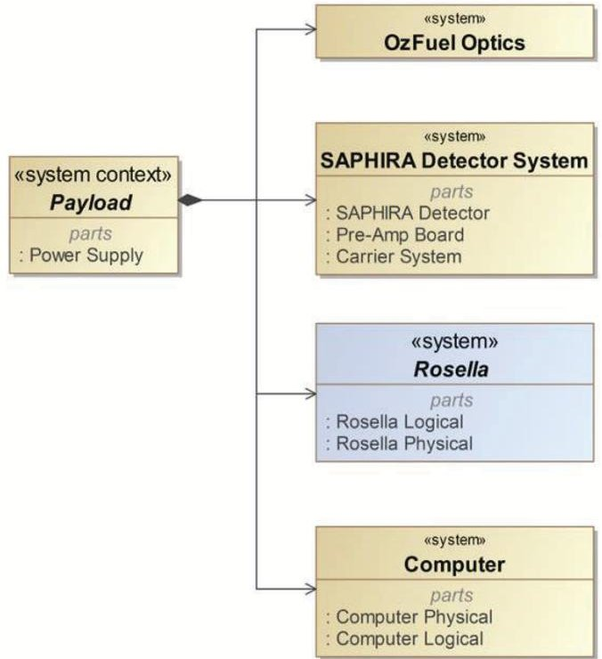
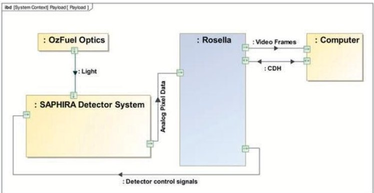
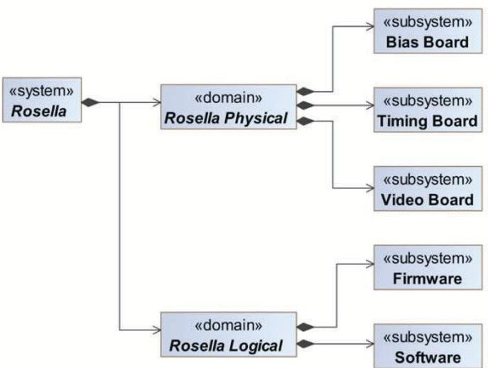
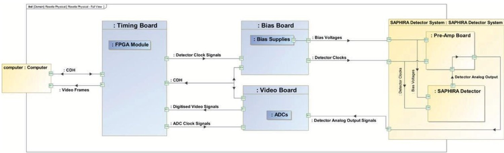
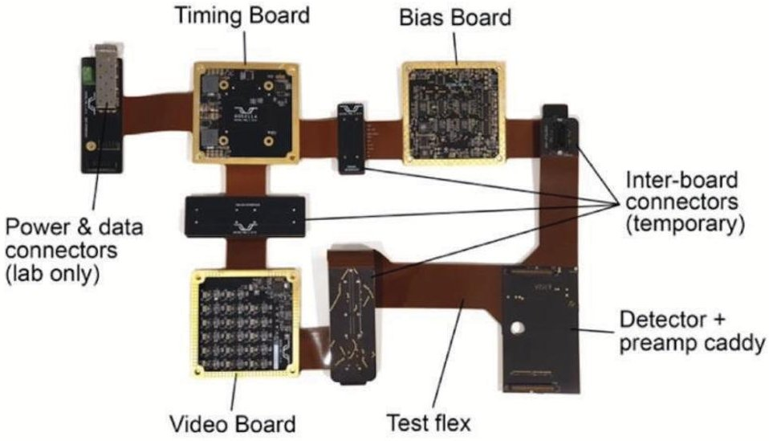

<!-- PDF_PAGE: 1 -->

IAC-25,D1,6,4,x101037

# Rosella System: A Systems Engineering Approach to Developing a Detector Controller Solution for Small Satellite Earth Imaging

Hana Benhizia $ ^{a} $ $ ^{*} $ , Gregory Jolley $ ^{a} $ , Alexey Grigoriev $ ^{a} $ , Mike Ellis $ ^{a} $ , Annino Vaccarella $ ^{a} $ , Nian Jiang $ ^{a} $ , Joice Mathew $ ^{a} $ , Warrick Schofield $ ^{a} $ , Rob Sharp $ ^{a} $ , Marc White $ ^{a} $

$ ^{a} $ Research School of Astronomy and Astrophysics, Advanced Instrumentation and Technology Centre, Australian National University, Mount Stromlo Observatory, Cotter road, Weston Creek, ACT 2611, Australia

* Corresponding Author

## Abstract

The rapid growth of small satellite Earth observation missions is driving demand for sensor systems that deliver high sensitivity and stability within tight size, weight, and power constraints. Although detector technology has advanced, performance is often limited by the electronic readout noise, either inherent to the detector or introduced by the readout electronics. For missions that must capture subtle changes in vegetation, water, or the atmosphere from low Earth orbit, or highly sensitive astronomical observations, reducing controller noise (to sub-electron levels) is essential to unlock the full potential of modern detectors. The challenge becomes especially critical at high ground resolution, where signal return is reduced and integration times are limited by image motion blur.

The Rosella Project, developed at the Australian National University's (ANU) Advanced Instrumentation and Technology Centre (AITC), addresses this challenge. The Rosella system is a compact, modular detector control architecture, occupying a U-class form factor envelope, consistent with small spacecraft design specifications. Rosella is engineered to be highly configurable for seamless integration across a range of scientific-grade CMOS-based detectors and spacecraft. The first application, used as a design reference, is the OzFuel-1 payload, part of ANU's program to deploy a constellation monitoring forest flammability across SWIR wavelengths. As a technology demonstrator, OzFuel-1 is using the Leonardo SAPHIRA eAPD detectors, with Rosella driving all 32 parallel output amplifiers for the 320 x 256 array.

Development follows a structured Systems Engineering (SE) process with three model stages: Laboratory Prototype (LP), Engineering Model (EM) and Flight Model (FM). The Laboratory prototype is currently under testing at the Mount Stromlo Observatory laboratories and is the main focus of this paper.

This paper outlines the system engineering framework applied to the Rosella Laboratory Prototype. It will address how requirements are managed in Cameo/MagicDraw System Modelling Language (SysML), their verification process, and the supporting system architecture. It also outlines the roadmap toward a Flight Model and future steps required to achieve the targeted controller performance.

Keywords: Detector Controller, Infrared remote sensing, small satellites, Cameo System Modeler, Verification and Validation, Earth Observation.

## Acronyms/Abbreviations

ADC Analog-to-Digital Converter

AITC Advanced Instrumentation and Technology Centre

ANU Australian National University

ASIC Application-Specific Integrated Circuit

BDD Block Definition Diagram

CDH Commands and Data Handling

CDS Correlated Double Sampling

CMOS Complementary Metal-Oxide-Semiconductor

eAPD electron Avalanche Photodiode

EM Engineering Model FM Flight Model FPGA Field Programmable Gate Array IBD Internal Block Diagram LP Laboratory Prototype MBSE Model-based Systems Engineering SysML System Modelling Language

## 1. Introduction

The Rosella program at ANU builds on in-house expertise derived from an extensive program of development for ground-based astronomical instrumentation. The high-performance analogue detector focal plane arrays used for astronomy required high-performance control electronics. While some

<!-- PDF_PAGE: 2 -->

bespoke ASIC solutions are available, these can prove costly when development and evolution are required. The emerging contemporary solution is for high performance digital electronic solutions based on FPGA frameworks. Rosella represents a translation of the large format FPGA-based solution adopted for ground-based astronomy to a smaller form factor compatible with LEO operations while still retaining the highest possible signal fidelity and frame rates etc.

Rosella addresses this limitation by miniaturising the controller design while retaining the precision timing, bias generation and stabilisation, and low-noise performance required to operate the scientific-grade CMOS-based sensor arrays. Due to the astronomical heritage, the primary development focus has been with advanced infrared detectors such as the Leonardo SAPHIRA eAPD detectors and Teledyne Hawaii HxRG series. Rosella bridges high-performance image sensors and conventional computing hardware, enabling scientific detectors to be used beyond large observatories. Designed for small satellites platforms and constellations, Rosella is intended to meet demanding performance requirements while maintaining a compact form factor and adaptability to mission-specific needs.

A Rosella prototype was first developed in 2019 to validate Rosella's core functionalities and top-level requirements, including precise timing, biasing, data acquisition and telemetry, under controlled laboratory conditions. The prototype system was deployed on-sky at the ANU 2.3m telescope as a proof of concept in a real imaging environment. Development was temporarily paused during the COVID-19 pandemic but resumed at the end of 2023 as part of the iLAuNCH Trailblazer Universities program.

The system engineering approach described in this paper builds on the foundations of the previous work, adapting and extending it to support the current laboratory prototype development pathway. The following section presents the Rosella contextual architecture, situating it within the broader operational environment.

## 2. Rosella System Context

Rosella's first application is the OzFuel-1 Short Wave Infrared (SWIR) payload, which is developed as part of the ANU-led Resilience Mission to provide landscape flammability risk data at a continental scale [1,4,5,6,7]. In this mission, the OzFuel-1 optics direct incident light onto the Leonardo SAPHIRA detector, supported by its carrier system and pre-amplifier, while Rosella provides precise timing, biasing, variable gain, and low-noise readout required for detector operation. The electronics

architecture digitises analog pixel data across multiple channels, formats it for downstream processing and telemetry, and communicates with external payload systems via a standard protocol for seamless satellite integration.

Figure 1(a) shows the contextual architecture of Rosella's laboratory prototype within the OzFuel-1 payload, while Figure 1(b) illustrates its high-level operating principle and key interactions with adjacent subsystems.

Fig. 1(a). Rosella System Context.

Fig. 1(b). High-level operating principle of Rosella within the OzFuel-1 payload.

Within the payload architecture, Rosella serves as the dedicated detector controller, providing the interface between the CMOS focal plane and the onboard operations control computer system. Upstream, it supplies detector clock signals, bias voltages, and synchronisation pulses while receiving analog pixel data;

<!-- PDF_PAGE: 3 -->

downstream, on-board command and control and provides digital data handling and image frame transfer. In this configuration, Rosella functions as the central control and data acquisition unit for the CMOS focal plane array detector. Table 1 provides the detector specifications.

Table 1: Leonardo SAPHIRA eAPD detector specifications.

<table border="1"><tr><td>Parameter</td><td>Value</td></tr><tr><td>Size</td><td>320x256 pixels</td></tr><tr><td>Pixel size</td><td>24μm</td></tr><tr><td>Spectral sensitivity/ cutoff</td><td>$\sim$0.8-3.5um[3]</td></tr><tr><td>Typical Read noise with avalanche gain</td><td>Sub-electron($\sim$0.5e- rms at gain $\sim$80)</td></tr><tr><td>Max pixel clocks</td><td>10MHz</td></tr><tr><td>Number of outputs</td><td>Configurable:4,8,16,32 outputs</td></tr></table>

## 3. Rosella System Engineering Approach

The Rosella program applies a tailored systems engineering approach to ensure the detector controller meets both current and emerging mission and stakeholder requirements, while remaining adaptable to diverse small satellite platforms. Research environments naturally foster experimentation and rapid exploration of new ideas; however, these strengths can also lead to evolving requirements and designs that are not immediately ready for deployment. To transition these into operational space systems, Rosella applies systems engineering practices that emphasise clear requirements definition, robust architecture design, and systematic verification. By ensuring that every requirement can be traced through design, implementation, and testing, Rosella aims to create a reliable path from laboratory prototypes to mission-ready hardware. In this way, the approach provides the discipline needed to bridge the gap between research prototypes and industry-standard, deployable systems.

To address the uncertain or evolving needs, Rosella follows an incremental and iterative development cycle of design, build, and test, with strong emphasis on prototyping and early models, such as the Laboratory Prototype and Engineering Model, before committing to flight hardware. This methodology enables progressive refinement of requirements and architecture while preserving end-to-end traceability. In addition, Rosella applies model-based practices, using architecture frameworks as a centralised repository and single source of truth throughout the project lifecycle.

While electronics engineering constitutes most of the work, Rosella is the product of close collaboration between instrument scientists, detector specialists, mechanical and software engineers, and space mission experts, each contributing critical perspectives to its design and validation. This collaboration ensures the electronics deliver ultra-low noise and high data throughput, while the overall system remains mechanically robust, mission-ready for the rigours of space, seamlessly coupled with advanced detectors, and aligned with scientific end-user needs. Such a multidisciplinary approach underpins Rosella's ability to bridge laboratory innovation with operational deployment.

In the following sections, we provide a detailed description of Rosella's system architecture and requirements management, outline the adopted development model philosophy, and present an overview of the supporting tools employed in the process.

## 3.1 Rosella System Architecture

Rosella's systems engineering approach to defining its architecture is closely shaped by the unique challenges of developing a compact, flexible and high-performance detector controller for small satellite missions. Rosella must deliver precision timing, biasing, and low-noise readout similar to traditional astronomical controller, within a miniaturised design, and remain flexible enough to operate a range of infrared detectors. Meeting these requirements demanded early coordination across hardware, software, and mission-specific needs, ensuring that trade-offs between performance, power, and adaptability were addressed from the outset.

This approach led to Rosella system architecture, with dedicated Bias, Video, and Timing boards that aim to provide a modular platform for detector operation [8]. While maintaining the precise control and readout needed for the scientific-grade detectors, this architecture enables flexibility through features such as reconfigurable detector modes and real-time reprogramming, including region-of-interest readouts for dynamic mission needs.

<!-- PDF_PAGE: 4 -->

Fig. 2. Rosella Product Breakdown Structure.

The Bias Board supplies precise and stable DC voltages including variable gain bias for detector operation.

The Rosella breakdown structure in Figure 2 is structured into two complementary domains: Physical and Logical. The Physical domain encompasses three hardware subsystems:

The Timing Board, built around an FPGA, provides system clock, configures bias supplies, triggers the ADCs, and manages data acquisition. Its FPGA architecture supports high-throughput parallel digitisation and user-defined detector clock patterns stored in RAM, enabling dynamic reconfiguration for functions such as high-speed readout of regions of interest.

The Video Board receives detector's analog pixel outputs, applies low-noise amplification and digitises up to 32 channels using high-resolution ADCs, to generate science-grade data streams.

The Logical domain contains the programmable elements of the controller. The Firmware manages real-time sequencing, data flow, and low-level hardware interfacing, while the Software provides higher-level command, configuration, and data-handling functions including flexible reprogramming of detector modes.

Building on this modular architecture, Figure 3 illustrates the internal interfaces between Rosella's boards, the SAPHIRA Detector System, and the payload computer. The Timing Board generates detector clocks, issues ADC synchronisation pulses, and manages command, telemetry, and video frame transfer with the computer. The Bias Board supplies stable bias voltages and clock drivers to the detector, operating in coordination with the Timing Board. The Video Board digitises the detector's analog outputs and returns the processed video frames via the Timing Board to the computer.

Within the detector chain, the Bias Board and the Video Board connect via the Pre-Amplifier Board to, respectively, deliver bias voltages and detector clocks to the SAPHIRA detector and receive analog outputs from the detector. These functional connections are currently demonstrated in the laboratory prototype, shown in Figure 4. The prototype is presented in its non-stacked configuration, with temporary inter-board connectors used only for testing. In the forthcoming Engineering Model, each board will incorporate independent stackable connectors, consistent with small satellite platform specifications.

Fig. 3. Rosella Key Internal Interfaces.

<!-- PDF_PAGE: 5 -->

Fig. 4. Rosella Laboratory Prototype.

## 3.2 Rosella Requirement Management

To maintain alignment between mission objectives, stakeholder needs, and system design, Rosella follows an iterative and incremental requirements management process. Rosella requirements are initially derived from high-level drivers such as compactness, modularity, configurability, low-noise performance, and adaptability to infrared detectors, and then progressively decomposed into system, subsystem, and board-level specifications.

In the case of the Rosella Laboratory Prototype, developed as a continuation of earlier work [2,3], the approach combined both top-down and bottom-up strategies. Existing design decisions were captured as constraint requirements, while high-level requirements are preserved to maintain alignment with the intended end state. Capturing both constraints and objectives created a framework that clarifies the gap between the current system and the desired performance, and guides the definition of a clear roadmap to bridge it. Within this framework, requirements could be systematically decomposed into lower-level specifications while also identifying design changes needed to achieve the desired performance in subsequent development stages.

All Rosella requirements are captured in a centralised model-based framework, where they are uniquely identified, traceable, and linked to architectural elements and verification methods. Iterative prototyping cycles spanning the Laboratory Prototype, Engineering Model, and Flight Model (see Section 4 on Model Philosophy)

are used to validate requirements progressively, with updates and refinements recorded to preserve end-to-end traceability.

Verification and validation are planned at multiple levels, starting with board-level functional tests, to confirm that each electronic module is functional and meets its key performance targets prior to integration. These early checks ensure that critical requirements are satisfied at the component level, reducing the risk of faults propagating during later assembly. On this foundation, integrated system demonstrations then verify correct interface operation, confirm overall performance meets the project's objectives, and provide the confidence to progress to the next development stage.

This process combines structure with flexibility allowing Rosella to manage evolving needs while reducing risk and ensuring a reliable path from concept to mission-ready hardware.

## 3.3 Rosella System Engineering Tool

The Rosella project utilises Cameo Systems Modeler (MagicDraw SysML) as its primary systems engineering tool, providing a centralised environment for requirements management, architecture modelling, and traceability.

All requirements are captured within the model and linked to both verification methods and architectural elements, ensuring a single source of truth across the project lifecycle.

<!-- PDF_PAGE: 6 -->

SysML Block Definition Diagrams (BDDs) and Internal Block Diagrams (IBDs) are used to represent the system architecture and interfaces, as well as associated behavioural flows. By integrating requirements, architecture, and verification activities within the same model, Rosella enables cross-disciplinary teams to work from a shared reference, reducing ambiguity and promoting consistency in design.

## 4. Models Philosophy

Rosella development follows a three-model philosophy, progressing from the Laboratory Prototype to the Engineering Model and finally to the Flight Model.

The Laboratory Prototype is a 16-bit detector controller supporting up to four readout channels in Correlated Double Sampling (CDS) mode and low speed data transfer. It is used to validate core functionalities and establish noise performance baselines and is currently undergoing extensive functional and performance testing.

The Engineering Model will extend the capability to 32 readout channels and introduce a modular, stackable design through board-to-board feedthroughs. It will be used to validate the high-speed computer interface (up to 1 Gbit/s), full 32-channel readout operation, the mechanical design and the thermal management concept.

The Flight Model will be the fully space-qualified unit designed for integration with small satellite platforms.

While differences across these models exist in interfaces, data throughput, environmental qualification and component selection, architectural consistency is maintained to progressively raise technology readiness and mitigate development risk. Table 2 summarises key technical specifications across these models.

Table 2.Rosella Models Development Roadmap.

<table border="1"><tr><td>Key specification</td><td>LP</td><td>EM</td><td>FM</td></tr><tr><td>Detector Compatibility</td><td>SAPHIRA</td><td>SAPHIRA</td><td>SAPHIRA</td></tr><tr><td>Number of channels</td><td>4</td><td>32</td><td>32</td></tr><tr><td>Data transfer rate</td><td>115kb/s</td><td>1Gb/s</td><td>1Gb/s</td></tr><tr><td>Reading speed</td><td>2MHz</td><td>2MHz</td><td>2MHz</td></tr><tr><td>Data Resolution</td><td>16bit</td><td>16bit</td><td>16bit</td></tr><tr><td>TRL</td><td>4</td><td>5</td><td>7</td></tr></table>

## 5. Testing Philosophy

Rosella is adopting the ECSS testing standards for its testing process. The Laboratory Prototype is currently undergoing characterisation, functional, and performance testing in conjunction with the SAPHIRA detector, following a structured testing process that documents each test, the corresponding requirements, the associated test procedures, test reports and any anomalies or non-conformances observed.

Each test plan, procedure, and associated report is uniquely identified and recorded in Cameo Systems Modeler against the requirements they verify. This approach ensures full traceability of testing activities and provides a clear, auditable record of compliance with requirements.

## 6. Conclusions and Future Work

Rosella is planned to evolve from the current Laboratory Prototype to an Engineering Model and ultimately to a fully qualified Flight Model by the end of 2026. The Engineering Model will incorporate stackable connectors, improved board integration, and early consideration of radiation-tolerant design, while the Flight Model will be space-qualified and ready for payload integration. In this configuration, Rosella is envisioned not only as the detector controller for missions such as OzFuel-1 but also as a versatile platform adaptable to a broad range of scientific and commercial applications requiring high-sensitivity imaging within strict power, mass, and volume constraints.

As part of this progression, the broader Rosella architecture is being developed to accommodate interfaces with external systems. These include data links to the satellite payload computer for command, data handling, and telemetry, as well as potential integration with onboard processors such as those developed by Spiral Blue for in-situ image processing. While some of these external interfaces are still being refined, the current plan is to ensure that Rosella provides flexible, standards-compliant communication pathways that support both conventional spacecraft architectures and emerging edge-computing solutions. This forwardlooking approach positions Rosella as a scalable element capable of supporting not only current detector needs but also future mission concepts that demand adaptable high-performance payload controllers.

<!-- PDF_PAGE: 7 -->

## References

[1] J. Mathew, J. Gilbert, Infrared Remote Sensing Using Low Noise Avalanche Photodiode Detector, IAC-22-B1.3.10, 73rd International Astronautical Congress, Paris, France, 2022, 18-22 September.

[2] J. Gilbert, A. Grigoriev, Linear-mode avalanche photodiode arrays for low-noise near-infrared imaging in space, IAC-19-A7.3.10x49665, 70th International Astronautical Congress, Washington D.C., United States, 2019, 21-25 October.

[3] J. Mathew, Emu: a case study for TDI-like imaging for infrared observation from space, 13 May 2022 https://www.spiedigitallibrary.org/conference-proceedings-of-spie/12729/127291B/OzFuel-a space-based-vegetation-fuel-flammability monitoring-system/10.1117/12.2679957.full

[4] N. Younes, M. Yebra, OzFuel: a space-based vegetation fuel flammability monitoring system, 19 October 2023, https://www.spiedigitallibrary.org/conference-proceedings-of-spie/12729/127291B/OzFuel-a space-based-vegetation-fuel-flammability monitoring-system/10.1117/12.2679957.short

[5] OzFuel Phase A Study Report, Space-based Australian Forest Fuel Flammability Monitoring 04 November 2022, https://www.unsw.edu.au/content/dam/pdfs/unswcanberra/space/2023-04-research/2023-04- 990391422-OzFuel-Report-Publication_FA_0.pdf

[6] I. Vaughn, J. Mathew, OZFUEL-1: A bushfire risk reduction space telescope, IAC-25 B1.3.10.x101385, 76th International Astronautical Congress, Sydney, Australia, 2025, 29 September 03 October.

[7] N. Younes, M. Yebra, OzFuel-1: Towards and imaging spectrometer to monitor forest fuel flammability from space, IAC-25-B1.2.6, x97473, 76th International Astronautical Congress, Sydney, Australia, 2025, 29 September-03 October.

[8] G. Jolley, A. Vaccarella, The configurable detector control solution for small satellite missions, IAC25-B4.IP.5.x99580, 76th International Astronautical Congress, Sydney, Australia, 2025, 29 September - 03 October.