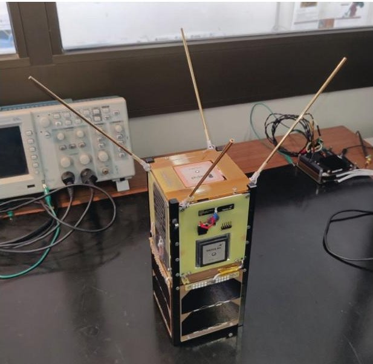

<!-- PDF_PAGE: 1 -->

IAC-25,B2,6,4,x101868

# SMILE-IoT: results from a global University partnership project for joint Internet-of-Things in-orbit demonstrations results evaluation

Paolo Marzioli $ ^{*a} $ , Riccardo Garofalo $ ^{a} $ , Luca Gugliermetti $ ^{b} $ , Lorenzo Frezza $ ^{a} $ , Michela Boscia $ ^{a} $ , Fabrizio Piergentili $ ^{a} $

$ ^{a} $ Department of Mechanical and Aerospace Engineering, Sapienza University of Rome, via Eudossiana 18, 00184 Rome, Italy.

$ ^{b} $ Department of Architecture and Design, Sapienza University of Rome, via Flaminia 359, 00196 Rome, Italy

* Corresponding Author email: paolo.marzioli@uniroma1.it

## Abstract

The possibilities unveiled by a broader deployment of Internet-of-Things (IoT) technologies on-board University satellites and space engineering projects can address a large multiplicity of global issues, including a more accurate resources monitoring, precision agriculture, until reaching space capacity and Space Traffic Management topics.

The SMILE-IoT initiative is coordinated by Sapienza University of Rome (S5Lab research group) since 2024 for reaching to out to a broad number of University researchers involved in IoT-related investigations for space-based demonstrations.

The international partnerships included 7 countries (Italy, France, Albania, Japan, South Korea, Panama and Dominican Republic) with Universities as partners and Embassies, NGOs and companies supporting the project. The initiative is funded by the Rome Technopole Foundation through the Sapienza-Rome Technopole 2024 call for Internationalization projects. The addressed topics include:

- The investigation on actual performances of IoT data relay systems with nano-satellites (mainly on-going with Kyushu Institute of Technology in Japan)

- The application of miniaturized satellite IoT communication chips for formation flying and future Active Debris Removal (conducted with the expertise of the Yonsei University in South Korea)

- The investigation on potential IoT applications to solve climate and ecosystem issues in non-space faring countries, such as the sargassum algae proliferation in Dominican Republic (with partnership with INTEC) and precision agriculture in rural areas in Panama (with UTP as partner);

- The implementation of vehicle-to-satellite relay systems for climate monitoring through low-altitude balloon, realized through a collaboration with PSL in France;

- Structural monitoring and advanced monitoring of urbanization through a collaboration with UPT in Albania.

The coordinator entity, Sapienza S5Lab, is deploying its experience in IoT missions, acquired through the WildTrackCube-SIMBA CubeSat mission, launched in 2021 through the International Astronautical Federation competition awarded in 2019, and financed by ASI, and through the CORAL 2U satellite mission, financed by ESA, with Thales Alenia Space Italia and Telespazio,S.p.A. to be launched in September 2025.

The preliminary results include best practices and lessons learned from the recent IoT experimentation on-board University satellites. A digital twin for IoT performances is under development for several study cases and operational scenarios, including wildlife, cattle, water and resource monitoring, UAV-to-satellite links, mixed optical and IoT data for improved accuracy of site monitoring. The project will be on-going until the end of 2025, with the possibility to involve more interested partners.

This paper will deal with the SMILE-IoT initiative, describing in detail its technical tasks, results, obtained lessons learned and possible future spin-outs.

Keywords: Internet-of-Things, CubeSat, Space, Sustainability, Network

## 1. Introduction

The emergence of the so-called New Space Economy [1] and the consequent acceleration of the miniaturization of space payloads and ease of access to

<!-- PDF_PAGE: 2 -->

orbital payloads, enabling hundreds of nano- satellite platforms to reach orbit and complete their missions, is requiring to make the communication, traffic coordination and management processes more efficient.

In this context, Internet-of-Things technologies [2], [3] are able to create instrumentation networks in-orbit and at ground, making in-situ resource management possible at inexpensive costs, and allowing a deeper coordination among space payloads.

A wise usage of IoT technologies can be indeed crucial for preserving a certain degree of sustainability in all the in-orbit operations. IoT can indeed respond to critical objectives for space sustainability, including:

- Radio-Frequency Interference (RFI) risk minimization, due to spectrum sharing over commercially available frequencies, as per ;

- Coordination for proximity operations, space traffic and conjunctions, which can be managed by standardized messages through operators and potentially exchanged between satellites;

- Support to Active Debris Removal and In-Orbit Servicing (ADR, IOS) operations, in the nearfuture perspective of serviced and removed spacecraft, handles, grappling points and similar can be equipped with IoT nodes in order to coordinate the maneuvers in close proximity;

- Access to space for all, when equipping CubeSats with such transmitters, their inexpensive costs and simplicity can provide an efficient payload to allow actors from Non-Space Faring Countries to access space, as per many missions before;

- In-Situ monitoring via inexpensive RF (Radio Frequency) transmitters, as demonstrated through numerous missions.

The SMILE-IoT project (Sustainable Space Missions and Innovative Low-Cost Experimentation through Internet-of-Things), proposed by Sapienza University of Rome (S5Lab research group) in 2024 and funded by Sapienza and the Rome Technopole foundation under the "Call for internationalization" funding, represents an international effort to investigate how miniaturized IoT modules can enhance the sustainability of space operations and open new frontiers for low-cost experimentation. Coordinated by Sapienza University of Rome with partners spanning Europe, Asia, and the Americas, the initiative targets CubeSat- and PicoSat-class missions, where compact, low-power communication payloads can be most effectively demonstrated. The project's objectives are threefold: to establish a network of institutions working collaboratively on IoT applications in space; to evaluate performance metrics and generate digital twins of IoT-enabled systems across multiple mission profiles; and to define standardized use cases that extend beyond space

into terrestrial domains such as smart cities and environmental monitoring. By leveraging lessons learned from missions like WildTrackCube-SIMBA (Sapienza, 2021 [4]) and KITSUNE (Kyutech, 2022 [5]), SMILE-IoT will test IoT architectures for diverse applications, including orbital traffic management, inter-satellite communication, and in-situ scientific sensing. These activities are structured within a clear research roadmap, from analysis of in-orbit demonstrators to the design of hardware testbeds and mission simulations, culminating in the creation of guidelines and interoperable digital twins. Beyond its technical deliverables, SMILE-IoT also emphasizes capacity building and inclusivity: partners from countries such as the Dominican Republic, Panama, and Albania will contribute use cases tied to coastal monitoring, urban resilience, and infrastructure management, showcasing how space-based IoT can be aligned with the UN Sustainable Development Goals. In doing so, SMILE-IoT bridges the gap between cutting-edge aerospace research and global sustainability challenges, reinforcing the dual role of IoT technologies as enablers of safer, more responsible space operations and as tools for societal benefit on Earth.

## 2. The SMILE-IoT initiative

The SMILE-IoT (Sustainable Space Missions and Innovative Low-Cost Experimentation through Internet of Things) project is an international initiative designed to explore the integration of IoT technologies into small satellite missions as a means of advancing space sustainability, accessibility, and innovation. The project stems from the recognition that the growing number of satellites in orbitand the associated challenges of congestion, collision risk, and debris management- requires low-cost, scalable solutions that can be rapidly deployed and validated. IoT-based modules, with their compact form factors, low power consumption, and flexibility, represent a promising approach to these challenges. By embedding IoT payloads into CubeSat and PicoSat-class missions, SMILE-IoT will investigate how distributed networks of satellites and sensors can support a variety of tasks, from space traffic management to environmental monitoring.

A key strength of SMILE-IoT is the international network of partners assembled around its objectives. The project is coordinated by the S5Lab of Sapienza University of Rome, which brings to the consortium a long track record of CubeSat missions and IoT experiments, including the WildTrackCube-SIMBA satellite launched in 2021. Sapienza contributes expertise in space mission analysis, onboard data processing, digital twin development, and IoT prototyping for both spaceborne and terrestrial

<!-- PDF_PAGE: 3 -->

applications. Complementing this, the CITERA (Interdepartmental Center for Territory, Building Restoration, and Environment) at Sapienza adds competence in digital twin approaches for smart cities and environmental impact monitoring, ensuring that the knowledge generated in orbit has clear pathways for terrestrial spin-off.

On the international side, the Kyushu Institute of Technology (Kyutech, Japan) plays a central role, leveraging its status as one of the most prolific developers of university satellites. Kyutech has already operated CubeSats with IoT payloads, including the KITSUNE mission, and has deployed ground-based sensor networks for performance evaluation. Its contribution will be critical in benchmarking IoT payload performance across different orbital regimes and supporting the project's aim of developing predictive models and guidelines for standardized use. Furthermore, Kyutech's Principal Investigator has longstanding involvement in ISO standardization efforts for CubeSat subsystems, allowing SMILE-IoT to extend its influence into the domain of international norms.

The Yonsei University Department of Satellite Systems (South Korea) brings additional capabilities in proximity operations, formation flying, and Active Debris Removal (ADR). Its participation highlights one of the most forward-looking aspects of SMILE-IoT: the application of low-power IoT communications for coordinating multi-satellite missions and enabling safe rendezvous with debris. Similarly, the École Normale Polytechnique Supérieure in Paris contributes expertise in atmospheric science and stratospheric platforms, focusing on balloon-based probing of the Arctic. This involvement ensures that SMILE-IoT considers not only orbital but also near-space mission envelopes, where IoT can enable distributed, low-cost telemetry systems.

Further south, the Instituto Tecnológico de Santo Domingo (INTEC, Dominican Republic) and the Universidad Tecnológica de Panamá (UTP) are engaged in the development of their countries' first national satellites, with strong emphasis on coastal and environmental monitoring. Their role in SMILE-IoT is tied to testing ground-based sensors and integrating IoT systems for applications directly connected to sustainability and disaster resilience. These contributions exemplify the project's commitment to capacity building, offering developing nations a platform for technological advancement and meaningful participation in the global space sector. Finally, the Polytechnic University of Tirana (Albania) contributes through its work with Sapienza on IoT-enabled monitoring of buildings and infrastructures, reinforcing

the cross-sectoral transfer of IoT from space systems to urban resilience and smart city frameworks.

The research plan of SMILE-IoT is structured into Work Packages (WPs) that frame its technical and scientific activities. WP2000 (IoT Mission Analysis) focuses on the evaluation of CubeSat demonstrators such as WildTrackCube-SIMBA and KITSUNE, mapping the in-orbit performance of IoT communication modules and comparing them against laboratory results. This effort is complemented by WP2200, which extends IoT experimentation to groundbased sensor networks connected via satellite links, with applications in disaster monitoring, coverage of remote regions, and resilience against terrestrial communication failures. Together, these activities establish a baseline for IoT architectures that operate seamlessly across space and Earth environments.

In parallel, WP3000 (New Space Mission Profiles) targets the exploration of IoT for innovative mission envelopes. Subtasks include WP3100, which investigates IoT applications in Space Traffic Management, such as satellite identification and collision avoidance coordination; WP3200, which considers proximity navigation and ADR scenarios; and WP3300, which applies IoT to stratospheric and suborbital platforms for distributed telemetry. These tasks directly address pressing challenges in orbital sustainability while highlighting cost-effective alternatives to large-scale observation missions.

The outputs of these activities converge in WP4000 which synthesizes findings into use cases, standardized mission profiles, and digital twins of IoT-enabled communication systems. By combining real mission data, hardware-in-the-loop testing, and large-scale simulations, WP4000 will generate flexible performance maps applicable across multiple mission types. These models will be instrumental in reducing development risks and accelerating the adoption of IoT payloads in future space missions. Finally, WP5000 is dedicated to dissemination and spin-out, ensuring that SMILE-IoT builds lasting partnerships, contributes to international standardization efforts, and promotes knowledge sharing through conferences and academic publications.

Through this structured roadmap, SMILE-IoT aspires to deliver not only scientific and technological results—such as validated digital twins and technical guidelines—but also a sustainable international partnership network that endures beyond the project timeline. By uniting partners across Europe, Asia, and the Americas, and by involving both established space actors and emerging nations, the initiative positions itself as a catalyst for innovation in space-based IoT.

<!-- PDF_PAGE: 4 -->

More broadly, it demonstrates how nanosatellite technologies can contribute to the dual goals of space sustainability and global digital transition, advancing the shared vision of an inclusive, resilient, and responsible future in space.

## 3. Results and international collaboration

3. 1 Evaluation of potential mission profiles for IoT insitu monitoring missions

A parametric study over potentially effective mission profiles for IoT-based in-situ monitoring CubeSats has been developed at S5Lab since 2024, with a publication available on wildlife monitoring [6] descending from the WildTrackCube-SIMBA mission lessons learned, that paved the way towards a more generic evaluation of in-situ monitoring miniaturized missions, which can be applicable to CubeSats.

Building on the experience gained through the WildTrackCube-SIMBA mission, which originally validated low-power IoT links between CubeSats and ground-based devices, an extended parametric study was carried out to evaluate how this concept can evolve toward in-situ monitoring applications. The study explored how complementary platforms-satellites, stratospheric balloons, and unmanned aerial vehicles (UAVs)could be integrated to enhance the performance of IoT-enabled sensor networks, particularly in terms of link budgets, data throughput, coverage, energy demand, and system costs. This represents a natural extension of SIMBA's proof-of-concept, shifting from animal tracking to broader applications such as atmospheric sensing, environmental surveillance, and local infrastructure monitoring.

The baseline architecture considered small, low-power IoT nodes equipped with miniaturized sensors (GNSS for position, inertial units, environmental probes such as temperature and humidity, and optional advanced modules such as radiation or pressure sensors). Each node transmits telemetry data through a LoRa-based link to higher platforms—CubeSats in low Earth orbit, stratospheric balloons, or UAVs depending on the mission scenario. The goal of the parametric study was to systematically compare the performance of these segments and determine how they could be combined to maximize sustainability and efficiency in future IoT-enabled space missions.

The results confirmed that CubeSats remain essential for global in-situ monitoring, since their orbital mechanics provide visibility over virtually any location on Earth. However, they are constrained by limited pass durations (a few minutes per orbit over a region of interest) and low achievable data rates. This makes them effective for collecting sparse datasets over large areas,

for instance monitoring atmospheric parameters or collecting distributed radiation measurements, but less suited to applications requiring continuous or highdensity time series.

Stratospheric platforms, such as high-altitude balloons or experimental airships, emerged as a regional complement to CubeSats. Operating at 20-30 km altitude, these vehicles can maintain quasi-stationary positions over hundreds of kilometers of coverage, with link margins and data rates significantly higher than the satellite case. They can provide continuous monitoring for days or weeks, enabling persistent environmental data collection (e.g., long-term atmospheric sounding or regional air quality studies). The trade-off is a higher energy demand on the sensors and heavier power storage requirements, which in turn increases the mass and limits the deployment of IoT nodes to platforms capable of carrying larger batteries. Still, the ability to provide uninterrupted relay services over a defined region represents a major advantage for environmental and disaster-monitoring missions.

UAVs, on the other hand, offered the most favorable performance in terms of data density and flexibility. Flying at altitudes from a few hundred meters to a few kilometers, UAVs enable high-throughput communication with very high link margins, allowing IoT nodes to transmit data at sub-minute intervals. Fixed-wing drones can cover larger regions per sortie (hundreds of $ km^{2} $ ), making them well suited for systematic surveys or infrastructure inspections. Rotary-wing UAVs, though limited in endurance, are ideal for localized or time-critical monitoring—such as targeted measurements during extreme weather events or inspections of specific facilities. Importantly, the shorter slant ranges in UAV scenarios drastically reduce power requirements, allowing IoT nodes to be lighter and more energy efficient, while still transmitting large amounts of data.

In summary, this parametric analysis demonstrates how platforms equivalent to those used through the WildTrackCube-SIMBA project can evolve from a single demonstration CubeSat into a multi-platform, scalable architecture for in-situ monitoring. By integrating spaceborne, stratospheric, and atmospheric assets, IoT-enabled sensor networks can provide continuous, flexible, and sustainable datasets for applications ranging from environmental modeling to infrastructure resilience. This evolution underscores the role of nanosatellite-driven IoT as a foundational technology not only for space-based experiments.

## 3.2 Network coordination for future research actions

The project results also include a series of imminent actions which will be performed in partnership among the groups, which are reported hereunder:

<!-- PDF_PAGE: 5 -->

- A CubeSat IoT board has been produced for a Korean CubeSat, which will be integrated by Yonsei University (partner of the project) in the near future. Such board will have the capability of communicating with a multiplicity of IoT chips at ground and in-space, including the CORAL CubeSat (see the next paragraphs for more information). The board has been jointly engineered by Italian and Korean engineers and scientists to make it flexible cross-platform to many CubeSat design styles;

- Sapienza and CubeSats are collaborating on a joint student project, named CUKET, that has the additional objective of testing IoT-based intrasatellite link capabilities that can serve for long appendages data transmission or for leaning the harnessing processes and design for small satellites. This project, named LIONS, is managed by a group of researchers at Sapienza University of Rome, with a different primary objective related to GNSS-based navigation;

- Through a project coordinated by IILA (Italian Latin American International Organization) and MAECI (Italian Ministry for Foreign Affairs and International Cooperation) [7], Sapienza S5Lab researchers are jointly developing the first national satellites in Dominican Republic and Panama. While the satellites are in late design stage and will be produced and tested soon, the ground stations of both nations have been developed in 2025. The chance of providing their satellites with the standardized protocols and by helping their development with the SMILE-IoT project lessons learned are important to assure the success of the mission;

- The collaboration with the Ecole Polytechnic Superieure - PSL in Paris, which is partner of the project, has led to the development of miniaturized IoT chips for hot air balloon platforms telemetry uplink to satellites. Such system is descending from the requirements studied for resources monitoring. A detailed overview of the project ABEAR, which is managed by EPS, is provided in chapter 4;

- The CORAL project, managed by Thales Alenia Space Italia, with Telespazio and Sapienza S5Lab as partners, funded by ESA, will bring IoT-based inter-satellite link telemetry sharing capabilities to space through the launch of a 2U CubeSat in October 2025. This project, even if not linked to SMILE-IoT, will profit from some of the international networking results of the project during the operations. The project is better presented in paragraph 4.

## 4. Other important projects and imminent results

## 4.1 ABEAR project: Balloon telemetry IoT uplink

Within the broader framework of the SMILE-IoT initiative, the ABEAR project (Arctic Balloon Experiment for Atmospheric Research) represents a pioneering attempt to extend Internet-of-Things experimentation into the upper atmosphere under extreme environmental conditions. The project is led by the Laboratoire de Meteorologie Dynamique (LMD) of the École Normale Supérieure - PSL (France), which has a long tradition in atmospheric science and stratospheric ballooning. ABEAR aims to deploy a series of balloons equipped with IoT communication payloads, specifically LoRa-based radios, in the Arctic region to assess the feasibility of continuous atmospheric monitoring using low-power networks.

The technical challenge addressed by ABEAR is twofold. First, balloon campaigns in polar regions are traditionally short-lived, often limited to a few hours before harsh weather terminates operations. By launching multiple balloons in sequence from the Svalbard Islands, the project seeks to maintain a persistent observational presence in the Arctic boundary layer for several days, extending the temporal coverage of standard atmospheric campaigns. Second, the project explores how IoT protocols—originally designed for terrestrial sensor networks—can be adapted for balloon-to-satellite links, overcoming the limitations of line-of-sight ground communication as balloons drift far from base stations.

In this context, ABEAR functions as a testbed for space-oriented IoT architectures. LoRa radios, known for their low power consumption, resilience to interference, and capacity to support multiple nodes, are tested as the enabling technology for long-range telemetry in dynamic conditions. Preliminary experiments carried out with the WildTrackCubeSIMBA satellite already demonstrated the feasibility of direct LoRa transmissions from atmospheric nodes to a CubeSat in low Earth orbit, highlighting both the promise of the technology and the challenges posed by antenna alignment, Doppler shifts, and synchronization. ABEAR builds directly on these lessons, refining the communication chain and validating LoRa's suitability for extreme environments where conventional high-power radios are not practical.

The project's relevance to SMILE-IoT lies in its demonstration of how IoT experimentation can progress incrementally: from ground-based tests, to airborne demonstrators such as ABEAR, and eventually to CubeSat and inter-satellite applications. ABEAR's methodology exemplifies the philosophy of SMILE-

<!-- PDF_PAGE: 6 -->

IoT, which promotes scalable and low-cost approaches to sustainable space missions. By proving that lightweight, inexpensive communication nodes can sustain reliable telemetry even in the Arctic, ABEAR paves the way for future IoT networks that could be deployed not only for environmental monitoring but also for Space Traffic Management (STM), where distributed nodes in orbit need to coordinate autonomously.

In sum, ABEAR provides a concrete case study of how university-led initiatives can serve as incubators for disruptive technologies. Owned and operated by the École Normale Supérieure - PSL, the project is both a continuation of atmospheric science heritage and a forward-looking contribution to the digital transition of aerospace systems. By coupling balloon-based monitoring with IoT experimentation, ABEAR strengthens the foundations of SMILE-IoT and demonstrates how academic research can generate dual benefits: advancing climate and environmental science on Earth while simultaneously preparing technologies for sustainable space operations.

## 4.2 CORAL: inter-satellite telemetry distribution

The CORAL mission is a 2U technology demonstrator developed by Sapienza University of Rome's S5Lab in partnership with Thales Alenia Space Italia (prime) and Telespazio, under an ESA Invitation to Tender contract. CORAL's aim is to validate intersatellite telemetry/telecommand based on lightweight IoT paradigms, proving that small, low-power radios using spread-spectrum modulation can stitch satellites into an autonomous, resilient, and low-latency network layer above Earth. In doing so, CORAL directly addresses three converging pressures in today's orbit: RF spectrum sustainability, constellation scalability, and the need for near-real-time responsiveness without constant ground intervention.

## CORAL Mission Objectives

1) Demonstrate a distributed, inter-satellite telemetry & telecommand fabric.

CORAL's prime objective is to show that satellites can exchange housekeeping and control data directly using compact, low-power, spread-spectrum radios reducing reliance on ground passes and enabling timecritical actions between spacecraft. By validating address-based, store-and-forward behaviors and peer-to-peer forwarding, CORAL targets a path to globally accessible, low-latency satellite operations across LEO formations and small constellations.

2) Quantify latency, availability, and scalability metrics for future mega-constellations.

Beyond "does the link work," CORAL is instrumented to measure end-to-end link performance across operating modes and orbital geometries, generating latency distributions, contact probabilities, and network scalability indicators relevant to 5G/6G NTN integration and autonomous fleet operations. The goal is to translate single-sat demos into constellationlevel design inputs—routing choices, duty-cycle policies, and power budgets—for large swarms where ground visibility or bandwidth is intermittent.

3) Advance RF spectrum stewardship for crowded LEO.

Spread-spectrum techniques (e.g., chirp spread spectrum, frequency-hopping, and direct-sequence families) inherently provide robustness to interference, coexistence, and low spectral footprints. CORAL will compare and tune these strategies in-orbit—evaluating link reliability vs. occupancy and adaptive duty cycling—with the intent to reduce congestion and make better use of scarce RF resources in support of longterm space sustainability and Space Traffic Management (STM) needs.

4) Enable autonomy at the edge for STM-relevant functions.

By letting satellites publish/subscribe status to neighbors (e.g., health, mode, ephemeris snippets), the network can support decentralized awareness that ultimately benefits STM: faster anomaly propagation, quicker safe-mode coordination, and seeds for onboard deconfliction aids where ground is seconds to minutes away. CORAL will treat these as operational use-cases, not just link tests, generating procedures and lessons for real-world adoption.

5) Provide a reconfigurable in-orbit lab for protocol evolution.

A reprogrammable software-defined radio (SDR) complements multiple spread-spectrum terminals. The SDR will characterize the in-band noise at CORAL's orbit and emulate/replicate protocol behaviors, enabling on-orbit A/B testing of waveform parameters (spreading factor equivalents, hopping patterns, symbol rates/coding) and medium-access strategies without new hardware. This allows CORAL to track evolving standards and stress-test interoperability during the same mission.

6) Validate cross-mission interoperability using a legacy partner satellite.

CORAL will conduct functional link tests with WildTrackCube-SIMBA (S5Lab, 2021) to show backwards-compatible inter-satellite exchanges between a new demonstrator and a flown nanosatellite. This scenario is essential for brownfield constellations where new nodes should add capabilities without refitting the entire fleet.

7) Deliver adoption artifacts—playbooks, thresholds, and reference cases.

<!-- PDF_PAGE: 7 -->

Beyond papers, the mission targets engineering artifacts: link-budget envelopes per mode, recommended parameter sets by geometry (leader follower, drifting, cross-track), telemetry schemas for distributed operations, and ops timelines for duty-cycled experiments—resources that reduce integration risk for first adopters.

## Payload Philosophy: a Family of Spread Spectrum Terminals

Instead of hinging on a single waveform, CORAL flies a mix of spread-spectrum communication payloads designed to compare chirp-based schemes, frequency-hopping approaches, and direct-sequence-style variants in-orbit, at multiple frequency bands. The payload set spans commercial off-the-shelf (COTS) CSS-class terminals and FHSS-capable terminals, complemented by the dual-channel SDR for on-orbit reconfiguration and protocol emulation. This multi-modulation strategy broadens interoperability testing, explores cross-band trade-offs, and yields a richer data set on coexistence and link reliability than any single-radio demonstration could provide.

## Development Status, Launch Path, and Operations Outline

CORAL completed assembly and environmental qualification through vibration and thermal-vacuum campaigns spanning June 2024 to March 2025, followed by handover at JAXA Tsukuba on 6-7 August 2025. Deployment to LEO is planned from the ISS via JSSOD with a target launch date of 21 October 2025. Post-commissioning, operations transition to sequenced payload sessions, progressively exercising each spreadspectrum mode and the SDR lab functions, with periodic interoperability trials targeting the partner satellite.

## Anticipated Impact

For constellations: a measured pathway to embed low-power, spread-spectrum ISLs that offload ground segments, shrink latency, and improve resiliency during ground outages. For 5G/6G NTN: empirical inputs on how LEO-edge telemetry fabrics interact with terrestrial cores and scheduling. For STM and spectrum policy: evidence that lightweight, spectrally considerate links can scale across dense LEO without eroding coexistence, helping frame practical stewardship guidance. And for New Space ecosystems: a demonstration of how university-industry-agency teaming accelerates low-TRL concepts into actionable, in-orbit capability.

Figure 1: CORAL Proto-Flight Model satellite.

## 5. Conclusions

The rapid rise of the New Space economy-driven by payload miniaturization and cheaper access to orbithas multiplied the number of nanosatellites and, with it, the urgency to make communication and traffic coordination far more efficient. In this landscape, Internet-of-Things (IoT) technologies offer a pragmatic pathway to build lightweight, low-power instrumentation networks both in orbit and on the ground. Properly designed, these networks can support radio-frequency stewardship, enable standardized message exchange for proximity operations and conjunction handling, and lower barriers to entry by giving CubeSats inexpensive, capable transmitters for in-situ monitoring. The central thesis of this work is that IoT, when treated as a system-level strategy rather than a single radio choice, is directly relevant to space sustainability: it reduces RF interference risk via smart spectrum sharing, improves coordination for ADR/IOS and formation activities, and democratizes access to meaningful space experiments.

Within this context, SMILE-IoT (Sustainable Space Missions and Innovative Low-Cost Experimentation through IoT) consolidates an international network coordinated by Sapienza University of Rome (S5Lab) to push IoT from isolated demos to reusable methods. The initiative targets CubeSat- and PicoSat-class missions and couples in-orbit experimentation with digital-twin modeling, performance mapping, and standardized use cases that spill over into terrestrial domains such as smart cities and environmental monitoring. Partners span Europe, Asia, and the Americas—Kyutech for benchmarking and standardization, Yonsei for proximity and ADR know-how, ENS/PSL for atmospheric and balloon platforms, and institutions in

<!-- PDF_PAGE: 8 -->

the Dominican Republic, Panama, and Albania for coastal monitoring and urban resilience—ensuring that results are both scientifically grounded and globally relevant. Work packages range from flight data analysis of existing demonstrators (e.g., WildTrackCubeSIMBA, KITSUNE) and satellite-backed ground sensor networks, to new mission profiles for STM, proximity navigation, and stratospheric and suborbital telemetry, converging in a library of digital twins, guidelines, and interoperable profiles.

Building on WildTrackCube-SIMBA, a parametric study generalized the mission logic from wildlife tracking to broader in-situ monitoring. It compared satellite, stratospheric, and UAV segments across link budgets, throughput, coverage, energy, and cost. The outcome is a layered architecture: CubeSats provide sparse but global access; stratospheric platforms deliver continuous regional presence with higher link margins; and UAVs enable dense, flexible, and low-cost local data. This triad is not redundant but complementary, enabling sustained datasets for atmospheric sensing, environmental surveillance, and infrastructure health while keeping power and budgets realistic.

Two near-term projects exemplify how the network translates theory into practice. ABEAR, owned and led by the École Normale Supérieure - PSL (Laboratoire de Météorologie Dynamique), advances balloon-borne IoT in the Arctic by launching a sequence of low-altitude flights from Svalbard to sustain presence in the boundary layer. The campaign tackles the hard parts persistent communication beyond line-of-sight, Doppler and synchronization effects, and robustness in harsh conditions—turning balloons into credible nodes of a space-aware IoT mesh and offering a rehearsal for balloon-to-satellite and satellite-to-satellite relays. In parallel, the CORAL mission-developed by Sapienza S5Lab with Thales Alenia Space Italia (prime) and Telespazio under ESA funding-pushes the concept into orbit by demonstrating inter-satellite telemetry/telecommand using families of spreadspectrum modulation payloads (including, but not limited to, chirp-based, frequency-hopping, and direct-sequence approaches) plus a reconfigurable SDR "lab" in flight. CORAL extends beyond proof-of-link: it aims to quantify latency and availability at constellation scale, exercise publish/subscribe behaviors relevant to STM, compare spectral occupancy versus reliability across modes, and deliver adoption artifacts-parameter envelopes, ops playbooks, and reference procedures. Following environmental qualification and handover at JAXA Tsukuba, ISS deployment is planned with operations that include interoperability trials with WildTrackCube-SIMBA.

In conclusion, the paper argues and evidences that IoT is not merely a cost-saving radio choice but a systems approach to sustainable space operations. SMILE-IoT provides the organizing framework and modeling backbone; ABEAR shows how airborne campaigns can mature protocols and hardware in extreme conditions; and CORAL elevates the effort to inter-satellite networking with measurable, reusable outcomes for future constellations and 5G/6G NTN integration. Together, these efforts chart a credible path from university-scale prototypes to operationally meaningful capabilities that reduce latency, improve spectral coexistence, and strengthen autonomous coordination in crowded LEO. The immediate next steps are to complete the planned flight campaigns, publish the comparative performance maps and operational guidelines, and expand the partner testbeds so that emerging missions can adopt a ready-to-use, standards-conscious IoT stackaccelerating both scientific return and the long-term sustainability of the orbital environment.

## Acknowledgements

The SMILE-IoT project has been funded by the European Union - Next Generation EU - Mission 4, Component 2, Unique Identifier (CUP) B83C22002820006, in the framework of the Sapienza Rome Technopole Call for Research Internationalization - Research Line 1

Some of the results of this paper refer to the WildTrackCube-SIMBA, the ABEAR and the CORAL projects, whose funding sources are gratefully acknowledged by the authors.

CORAL is funded by ESA under an Invitation to Tender contract and initiative whose prime is Thales Alenia Space Italia and Sapienza S5Lab and Telespazio are participating as subcontractors.

## References

[1] J. D. Fargnoli, "Space Finance for 'New Space' and Small Satellites," in Handbook of Small Satellites: Technology, Design, Manufacture, Applications, Economics and Regulation: With 476 Figures and 92 Tables, 2020, pp. 1231-1262. doi: 10.1007/978-3-030-36308-6 70.

[2] P. Marzioli et al., "Internet-of-Things sensor applications on the Sapienza S5Lab CubeSats: from wildlife monitoring to inter-satellite link research," presented at the Proceedings of the International Astronautical Congress, IAC, 2023.

[3] Z. Qu, G. Zhang, H. Cao, and J. Xie, "LEO Satellite Constellation for Internet of Things,"

<!-- PDF_PAGE: 9 -->

IEEE Access, vol. 5, pp. 18391-18401, 2017, doi: 10.1109/ACCESS.2017.2735988.

[4] L. Frezza et al., "From 1KUNS-PF to WildTrackCube-SIMBA: Strengthening the cooperation between Italy and Kenya in nanosatellite manufacturing and operations," in Proceedings of the International Astronautical Congress, IAC, Virtual congress, 2020.

[5] P. Lepcha et al., "Assessing the Capacity and Coverage of Satellite IoT for Developing Countries Using a CubeSat," Applied Sciences (Switzerland), vol. 12, no. 17, 2022, doi: 10.3390/app12178623.

[6] Paolo Marzioli et al., "Performance Analysis of a Wildlife Tracking CubeSat Mission Extension to Drones and Stratospheric Vehicles," Drones, vol. 8(4); 124, 2024, doi: https://doi.org/10.3390/drones8040129.

[7] P. Marzioli et al., "Space Capacity building programmes in Dominican Republic and Panama: Lessons learned from the first nano-satellite design and Mission Control Center development," presented at the Proceedings of the International Astronautical Congress, IAC, 2023.