<!-- PDF_PAGE: 1 -->

IAC-25,B4,IP,46,x100098

# Sounding Balloons as a Low-Cost Platform for CubeSat Subsystem Validation: Insights from the Cloudview Missions

Theo Fitch $ ^{a} $ , Shuo Feng $ ^{a} $ , Peter Moody $ ^{a} $ , Micah Chapman $ ^{a} $

$ ^{a} $ GU Orbit, University of Glasgow, G12 8QQ, Scotland, United Kingdom E-mail: uog.orbit@gmail.com

## Abstract

Testing CubeSat subsystems in relevant environments prior to launch is often limited by high costs and restricted access to specialized facilities. High-altitude sounding balloons offer a cost-effective alternative by exposing hardware and software to near-space conditions, enabling iterative validation of critical technologies. This paper presents the Cloudview series of missions conducted by GU Orbit, the University of Glasgow's student-led CubeSat society, which use sounding balloons as a test platform for subsystem development. Cloudview-01, launched in 2023, demonstrated the feasibility of testing avionics, onboard image processing, and passive thermal control at high altitude, while also identifying key challenges such as the failure of a commercial communications module and insufficient thermal regulation. These outcomes directly informed the design of Cloudview-02, scheduled for launch in 2025, which will test improved thermal control methods, a redesigned communications subsystem, a CubeSat chassis, and an antenna deployment mechanism. Cloudview-02 will also validate a custom image compression algorithm, extending earlier work in onboard image processing. Beyond technical demonstrations, the Cloudview program has advanced student-led mission development through the adoption of model-based systems engineering and agile workflows, ensuring continuity despite constraints such as high turnover and limited funding. A balloon trajectory simulator, verified against flight data, has further improved mission planning and reduced risk. The results of these missions confirm that sounding balloons provide a practical and scalable approach for CubeSat subsystem testing, offering rapid iteration cycles and near-space environmental conditions that support mission readiness. The Cloudview program highlights how iterative, low-cost balloon campaigns can bridge the gap between academic research and operational space missions, while simultaneously providing students with valuable experience in satellite engineering and systems development.

## 1. Introduction

CubeSat development is prohibitively expensive for student teams, with access to launch opportunities, environmental testing facilities, and advanced hardware often exceeding the financial and technical resources of university societies . While commercial and academic missions have driven rapid innovation in the small satellite sector, studentled projects must often adapt to strict budgetary constraints and limited access to infrastructure.

High-altitude balloon (HAB) missions provide a practical and cost-effective intermediate step, enabling subsystem testing in near-space environments without the prohibitive expense of orbital deployment. At altitudes approaching 35 km, HAB flights expose hardware to low temperatures, reduced atmospheric pressures, and operational isolation, requiring subsystems to operate autonomously in conditions that approximate aspects of the space environment. This makes them valuable platforms for validating avionics, communications, imaging, and thermal control

designs before committing to the cost and complexity of a CubeSat launch.

In addition to their technical benefits, balloon campaigns allow for rapid iteration cycles, offering students hands-on experience in mission design, integration, and testing under real flight conditions. By bridging the gap between laboratory experiments and orbital deployment, high-altitude balloon platforms serve as an accessible gateway for student teams to build capability in space systems engineering.

This paper outlines the Cloudview-01 and Cloudview-02 missions undertaken by GU Orbit, the student Cubesat society at the University of Glasgow. Details of the organisation are provided in Section 2, Section 3 is an evaluation of the high altitude environment for environmental testing of CubeSat subsystems, Section 4 provides technical details of the Cloudview missions so far and Section 5 outlines the educational impact of the program.

<!-- PDF_PAGE: 2 -->

## 2. Background

GU Orbit is a student-led society at the University of Glasgow founded in 2019 with over 50 currently active members. The organisation aims to provide hands on experience for students through the design, manufacturing and launch of space related projects. The most notable project to date is OirthirSAT, a 3U Cubesat using efficient in-orbit processing to provide reliable data on UK coastlines for erosion monitoring. This project won the LaunchUK Nanosat Design Competition in 2022 and has since seperated from GU Orbit.

Similar to other university organisation, GU Orbit undergoes constant and forced evolution through high turn over of members and knowledge as senior members graduate and new members join. As a consequence of this, we aim to complete annual projects to educate new members, provide clear goals and tasks, greatly simplifying handover procedures and task management. This allows each project to build upon the previous ones, increasing technical capabilities of the organisation whilst providing a natural onboarding process. Each project builds towards the long term goal of launching student designed and manufactured hardware into space.

Astraeus-01 is the current long term project of GU Orbit. After a period of research and evaluation of potential payloads and missions based on their global impact, technological barriers it was determined the mission should be a 3U Cubesat capable of monitoring likelihood of wildfire occurrence and potential severity [1]. Currently there are a number of satellites monitoring this, Astraeus would add to current capabilities, providing consistent data with reduced processing requirements for proactive management. This will be achieved through advanced onboard and ground-based machine learning algorithms, generating realistic hazard maps with optimized data downlink, delivering actionable insights with minimal delay [2]. We believe that this mission is a crucial step towards meeting the growing demand for accurate wildfire risk data and aligning with global trends in onboard data processing and space sustainability by using a in-house dragsail deployment mechanism.

## 2.1 Project Management

## 2.1.1 Team Structure

representing a key subsystem found in a CubeSat: Structures & Deployment (S&D), Communications, On-Board Computing (OBC), Attitude Determination and Control Systems (ADCS), Thermal Management, Electrical Power System (EPS), and Payload which is split into Imaging and Software.

GU Orbit is split into a technical and non-technical branch. The non-technical branch handles procurement sponsorships, outreach and general management of the society. The technical branch is split into 8 sub-teams, each

Each subteam is lead by a subteam leader who ensures completion of tasks related to that subsystem and support the systems engineers in their work formally defining project scopes and objectives.

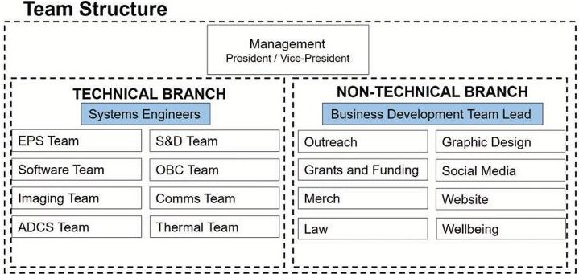

Fig. 1: Team structure diagram of GU Orbit.

## 2.1.2 Team Mentor

GU Orbit has an academic mentor from the University of Glasgow, who has acted as the main technical advisor for Astraeus-01. Dr Matteo Ceriotti aids with questions relating to the orbital parameters as well as several of the systems budgets, such as the power budget. Dr. Ceriotti has also helped with involving GU Orbit with the space scene, introducing congresses and conferences which we can participate in and his mentorship is greatly appreciated.

## 2.1.3 Personnel Availability

GU Orbit is comprised of students from various academic disciplines at different points of their academic career, therefore, each student has distinct responsibilities and schedules. It was considered to be crucial for effective project management to monitor the time periods where team members may have other responsibilities, such as exams, or course work. In order to address this problem, availability trackers were developed to record each member's availability, this was done at a sub-team level and a separate one was used for the board members. This tracker was used to ensure that appropriate measures were taken in order to ensure progress continued even during times when some individuals were unavailable to work. Additionally, this tracker was used to ensure the team did not

<!-- PDF_PAGE: 3 -->

have a single point of failure for any necessary requirements. This table was also useful to monitor the required turnover period caused by certain students graduating; ensuring appropriate handover.

## 3. High Altitude Environment

High-altitude balloon (HAB) missions provide a cost-effective means of exposing CubeSat subsystems to a range of near-space environmental conditions, but their utility as test platforms also comes with important limitations. A balanced assessment of their strengths and shortcomings is therefore essential in understanding their role in mission development.

Low Temperatures: At altitudes between 20-35 km, temperatures as low as $ - 5 0 \mathrm {^o C} $ subject avionics, batteries, and sensors to conditions that stress thermal control strategies. HAB missions therefore provide a valuable opportunity to evaluate passive and active thermal regulation.

Low Pressure: Stratospheric pressures in the range of 1-10 mbar significantly reduce convective cooling, offering partial validation of thermal models and hardware behaviour in near-vacuum conditions.

High Solar and UV Exposure: Reduced atmospheric shielding increases exposure to solar irradiance and UV flux, useful for testing optical sensors and coatings.

Operational Autonomy: HAB payloads must operate fully autonomously once launched, reflecting the self-sufficiency required of CubeSats in orbit. Communications delays, power budgeting, and onboard data handling are therefore realistically exercised.

However, HAB flights cannot replicate all critical aspects of the space environment.

No Microgravity: Balloons cannot simulate orbital free-fall conditions. As such, components that depend on microgravity dynamics like reaction wheels, magnetorquers, or other attitude determination and control system (ADCS) actuators cannot be effectively tested. Only sensors can be partially evaluated, and even then, in non-representative conditions.

Limited Radiation Exposure: The stratosphere does not replicate the ionizing radiation environment of low Earth orbit, meaning that radiation tolerance of components must still be verified through ground-based testing.

Incomplete Vacuum Simulation: Although low pressure is achieved, it is not equivalent to hard vacuum. This limits the fidelity of thermal behaviour, outgassing studies, and mechanisms testing compared to dedicated vacuum chamber trials.

Dynamic Differences: While balloon burst and landing impose mechanical stresses, these are not comparable to the vibration and shock environments of a rocket launch. Structural testing therefore remains incomplete without additional facilities.

In practice, HAB missions are best understood as an intermediate step between laboratory testing and orbital deployment. They offer rapid iteration, reduced costs, and meaningful subsystem validation, while lowering the risk of costly failures once a satellite reaches space. However, they are not a replacement for environmental qualification campaigns. Instead, HAB flights should be viewed as complementary, providing early feedback that strengthens subsystem readiness before exposure to the full space environment.

Table 1: Summary of High Altitude Balloon testing capabilities.

<table border="1"><tr><td>Feature/Subsystem</td><td>Testability</td></tr><tr><td>Thermal response(low temperatures)</td><td>Yes</td></tr><tr><td>Low-pressure operation(1-10mbar)</td><td>Partial</td></tr><tr><td>Solar/UV exposure</td><td>Yes</td></tr><tr><td>Autonomous operation and fault handling</td><td>Yes</td></tr><tr><td>Communications hardware and protocols</td><td>Yes</td></tr><tr><td>Rapid iteration and design feedback</td><td>Yes</td></tr><tr><td>Microgravity effects(ADCS dynamics)</td><td>No</td></tr><tr><td>Launch vibration and shock</td><td>No</td></tr><tr><td>Ionizing radiation levels inLEO</td><td>No</td></tr><tr><td>Full vacuum behaviour</td><td>No</td></tr><tr><td>Long-duration orbital operation</td><td>No</td></tr><tr><td>True orbital trajectory dynamics</td><td>No</td></tr></table>

## 4. Cloudview Missions

The Cloudview program consists of a series of highaltitude balloon missions designed to validate CubeSat subsystems in near-space conditions. Cloudview-01, launched and successfully recovered in 2023, provided a proof of concept and valuable lessons that informed subsequent development. Cloudview-02, scheduled for launch in 2025, builds on this experience with an expanded payload and improved subsystem designs. The following subsections outline the technical details of each mission, highlighting both demonstrated results and anticipated capabilities.

<!-- PDF_PAGE: 4 -->

4. 1 Cloudview-01

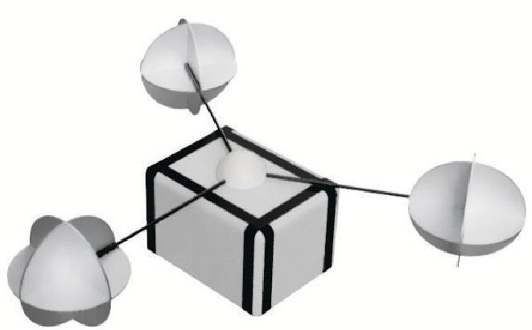

Fig. 2: Render of fully assembled Cloudview-01.

Initiated in 2022 and launched in September 2023, CloudView-01 aimed to be an opportunity for GU Orbit members to train, test and hone their satellite skills before our next satellite endeavour, Astraeus-01. CloudView-01 endeavoured to to be a test platform for running our software with some of the other peripheral equipment that a standard satellite would need, such as communication systems, an On-Board Computer, imaging systems and more, alongside additional equipment and systems needed for a high-altitude balloon mission.

CloudView-01 was a successful mission reaching over 35km in altitude and was tracked after a four hour journey. Suspended by the helium-filled balloon, the operational platform contained a NIR+Green+Blue (NGB) camera as the imaging payload, MSP430 as the OBC, Nvidia Jetson Nano to run the software, HAB-FLEXTRAC-434 for the communication system, a 20,000 mAh battery and a chemical-based exothermic device all contained within a 37.5 by 28 by 26 $ cm^{3} $ polystyrene box. Additionally, a rotational dampening system, which also acted as a radar reflector, and a 1.5m parachute were attached to the operational platform too.

At 7am on the 17th of September 2023, the payload, attached to the helium balloon, was released. The system reached an altitude of 38km before the balloon popped and the operational platform was released, deploying its parachute. The operational platform, launched from Dallaspidal, travelled North East, passing over the river Spey and the town of Aberlour, finally landing in the ward of Keith & Cullen where, the now honorary GU Orbit member, Colin, noticed CloudView in his field, contacted us and secured it until we could arrive to bring it home. The

Table 2: Summary of Cloudview Mission Parameters

<table border="1"><tr><td>Parameter</td><td>Value</td></tr><tr><td>Status</td><td>Successful</td></tr><tr><td>Weight</td><td>3.5kg</td></tr><tr><td>Size</td><td>37.5x28x26cm</td></tr><tr><td>Altitude</td><td>~35km</td></tr><tr><td>Camera</td><td>NIR/G/B</td></tr><tr><td>Power</td><td>max15W</td></tr><tr><td>Frequency</td><td>434.868MHz</td></tr><tr><td>Modulation</td><td>LoRa</td></tr><tr><td>Launch Balloon</td><td>3.5m3He</td></tr></table>

reconstructed flight path is shown in Figure 3.

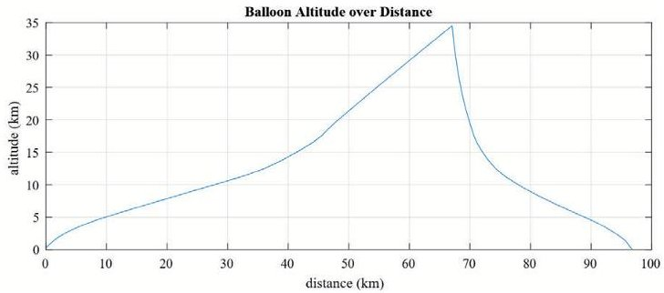

Fig. 3: Altitude and distance travelled by Cloudview-01.

Overall the mission was a success, with data being recovered from the loaded SD cards. There was a failure in the COMMS system, no telemetry was downlinked successfully after take-off, with recovery only made possible by a member of the public calling the phone number written on the payload box. The major issues are attributed to a poor documentation and testing regime, a lesson which has been taken forward to future projects as we have adapted the ECSS documentation standard to fit the shortened project life cycle associated with HAB missions.

## 4.2 Cloudview-02

Cloudview-02 is an ongoing mission which began in September of 2024, it has been a great success, improving upon Cloudview-01 in every subsystem and proving the efficacy of increased documentation and testing standards. The launch was initially scheduled for June 2025, aligning with senior members graduating, but this has been pushed back to October 2025 to allow new members to gain AIT experience before the upcoming Orcus (Cloudview-03) mission. A summary of the features of each subsystem is provided in the corresponding sub sections below.

<!-- PDF_PAGE: 5 -->

## 4.2.1 Structures & Deployment

The structures and deployment subsystem for Cloudview-02 has been designed to replicate aspects of a CubeSat platform while ensuring reliable operation in a high-altitude balloon environment. The payload is housed within a thermally isolating styrofoam enclosure, which provides environmental protection during ascent and descent. Inside this enclosure, the team developed a custom 3U CubeSat chassis (Fig. 4), enabling representative subsystem integration and testing of a satellite-like structural configuration. A render of the full payload with the interior exposed is shown in Fig. 5. The chassis meets the CubeSat mechanical requirements as described in the CubeSat Design Specification [3].

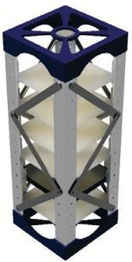

Fig. 4: Render of 3U CubeSat chassis for interior of Cloudview-02.

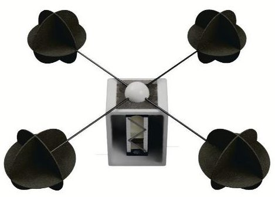

Fig. 5: Render of interior of Cloudview-02.

To enable communications testing, an antenna deployment module was mounted to the bottom of the enclosure. The system integrates two deployable antennas alongside two fixed antennas (Fig. 6), providing both mechanical validation of the deployment mechanism and functional evaluation of the communications subsystem in flight con-

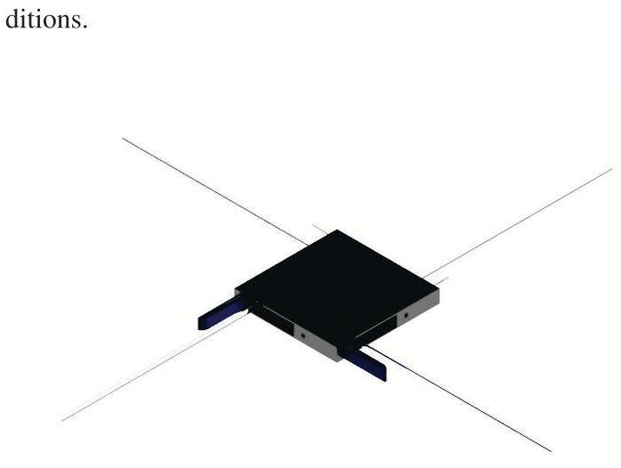

Fig. 6: Render of Cloudview-02 antenna assembly.

For dynamic stability and tracking, the payload incorporates four radar reflectors and mass stabilizers, mounted at the ends of lightweight carbon fibre rods connected to a central hub on the top of the enclosure. This arrangement increases radar visibility during flight and improves mass distribution for more stable descent dynamics.

## 4.2.2 COMMS

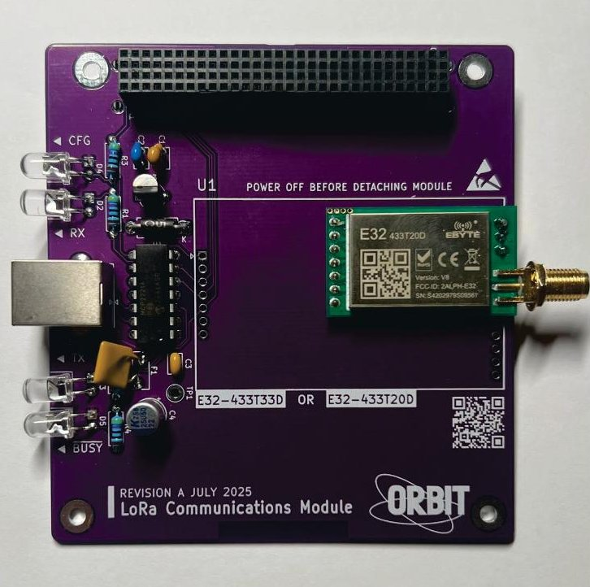

Fig. 7: Image of the LoRa Communications board for Cloudview-02.

<!-- PDF_PAGE: 6 -->

The LoRa Communications Module takes 9600 bps serial (UART) data sent by the OBC and transmits them in LoRa packets on the 434MHz UHF band. To simplify assembly and reduce cost, the airbourne unit is made physically identical to the ground station unit, except for the use of a lower powered LoRa tranceiver to adhere to OfCom regulations [4].

## 4.2.3 OBC

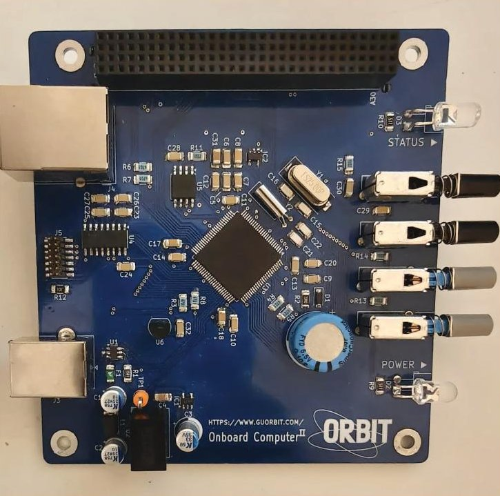

Fig. 8: Image of the OBC mainboard for Cloudview-02.

The onboard computer module is designed around the STM32F407 microcontroller. It is connected to all other subsystems via various UART / I2C / SPI busses on the 120-pin stacking connector. It is tasked to regularly poll sensor data from these subsystems, record the data onto a NOR flash, and forward them to the COMMS module to be downlinked. When specific parameters are met, the OBC also triggers signal to activate the burn wire, therefore deploying the RF antenna.

## 4.2.4 ADCS

The ADCS board for Cloudview-02 has been designed primarily as a sensor platform to characterise flight dynamics during the mission. It integrates a Raspberry Pi as the microcontroller unit, a BMP280 barometer, a GT-U7 GPS receiver, and a BN0085 IMU, all interfaced via $ \mathrm{I}^{2} \mathrm{C} $ . The board operates at 3.3 V and communicates both internally

and with the OBC through the same bus. As the system is intended for data collection rather than active control, no closed-loop ADCS functionality is implemented. Overvoltage protection was omitted, as this function is managed by the EPS board.

## 4.2.5 Thermal

The thermal subsystem for Cloudview-02 is based on a refined passive management approach, building on lessons learned from the chemical-based system employed in Cloudview-01. A thermal analysis has been carried out to predict performance under high-altitude conditions, ensuring that sensitive electronics remain within operational limits throughout the flight. While Cloudview-02 will continue to rely on passive methods, development of an active thermal control system is ongoing for future missions, aimed at providing greater temperature regulation and subsystem resilience.

## 4.2.6 Software

The software team has focused on improving reliability and functionality across the mission stack. The custom image segmentation algorithm, first demonstrated in Cloudview-01, is undergoing further optimisation to increase accuracy and efficiency during flight. All telemetry will be logged to onboard SD cards to guarantee data recovery even in the event of communications issues. Additionally, post-processing of captured images will be conducted after recovery to evaluate onboard algorithm performance and validate mission objectives.

## 4.2.7 Imaging

The imaging subsystem for Cloudview-02 is focused on both hardware adaptation and software refinement to support the mission's objectives. The team is responsible for researching and acquiring suitable imaging hardware, with many off-the-shelf components requiring in-house modification to meet specific needs, such as the removal of built-in IR filters. A particular emphasis has been placed on near-infrared (NIR) imaging, which enables collection of additional data relevant to vegetation health and moisture content. Previous work on image distortion correction, addressing effects introduced by terrain or atmospheric interference, will also be applied to improve image fidelity. For Cloudview-02, imaging will be performed using a modified Pi Camera alongside an Insta360 camera, the latter providing external views of the payload enclosure during flight.

<!-- PDF_PAGE: 7 -->

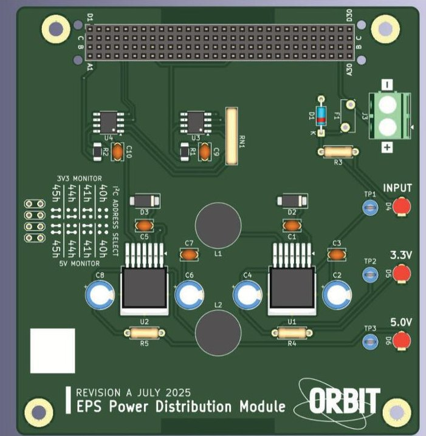

Fig. 9: Image of EPS Power Distribution board of Cloudview-02

The EPS Power Distribution Module efficiently steps down the battery voltage (14.8V nominal, varies depending on the state of charge) using buck converters to supply other subsystems with the 5V and 3.3V power they require. Additionally, the voltage and current output data is collected by a pair of INA219 high-side power monitors, and is available to the OBC via the I2C bus.

## 5. Educational Impact

final section outlining how this program benefits students in a cost effective way

Beyond their technical contributions, the Cloudview missions have provided a highly effective educational platform for training the next generation of space engineers. By adopting high-altitude balloons as a subsystem test environment, students are able to experience the challenges of a near-space mission while avoiding the prohibitive costs, long development cycles, and technical barriers associated with orbital launch.

The low-cost nature of balloon campaigns enables rapid iteration, allowing students to design, build, and fly hardware within the span of an academic year. This short feedback loop provides immediate lessons from both successes and failures, reinforcing core engineering practices such as requirements definition, risk analysis, verification planning, and post-flight evaluation. In contrast, CubeSat missions launched to orbit often span several years, meaning that students may graduate without seeing the outcome of their work. Cloudview ensures that entire cohorts can participate in the full lifecycle of a mission.

Equally important, the reduced technical burden of balloon-based testing lowers the entry barrier for student involvement. Subsystems such as power distribution, communications, and thermal control can be developed to representative levels of complexity without requiring full space qualification. This balance allows students to engage with authentic engineering problems while maintaining manageable project scope.

The program has also fostered the adoption of professional engineering practices within a student-led context. The use of model-based systems engineering (MBSE), agile workflows, and subsystem integration campaigns has given participants direct experience with methods that mirror industry standards. Team members are thus equipped with both technical skills and project management experience highly relevant to future careers in the space sector.

By bridging the gap between classroom learning and operational space projects, the Cloudview missions demonstrate how low-cost, iterative flight campaigns can serve as a scalable model for student-led space education. They provide meaningful hands-on training, promote continuity across student cohorts, and position participants to contribute effectively to academic, commercial, and governmental space initiatives.

## 6. Conclusion

The Cloudview series of high-altitude balloon missions developed by GU Orbit demonstrates that low-cost, iterative flight campaigns provide an effective platform for CubeSat subsystem testing and student-led mission development. These missions expose hardware and software to near-space conditions like low temperatures, reduced pressures, and autonomous operation, allowing rapid validation of thermal, communications, and imaging systems while mitigating the cost and technical burden of orbital launches.

While balloon flights cannot replicate microgravity, full vacuum, radiation, or launch dynamics, they offer a practi-

<!-- PDF_PAGE: 8 -->

cal intermediate step that bridges laboratory testing and orbital deployment. Beyond technical validation, the Cloudview program has advanced student education in systems engineering, model-based workflows, and project management, providing valuable hands-on experience.

Overall, the results confirm that high-altitude balloons are a scalable, low-cost tool for both mission readiness and STEM training, offering a reproducible approach for student-led CubeSat programs.

## References

[1] J. P. Puente, T. Fitch, G. Ciacchella, N. Goldring, A. Mohammad, and J. Fitzgerald. Astraeus-01 mission proposal: A student cubesat for autonomous wildfire risk assessment enhanced by technology demonstration. In Proceedings of the 75th International Astronautical Congress (IAC 2024), Milan, Italy, 2024.

[2] A. Bodrogai, M. Tsinidis, S. Rennie, J. Fitzgerald, and J. Patile. Ai-based wildfire risk assessment from low-cost multispectral data: Collection, processing, and analysis for sub-6u cubesat missions. In Proceedings of the 75th International Astronautical Congress (IAC 2024), Milan, Italy, 2024.

[3] The CubeSat Program, Cal Poly SLO. Cubesat design specification (1u-12u), rev. 14.1 (cp-cds-r14.1). Technical Report / Standard CP-CDS-R14.1, California Polytechnic State University, San Luis Obispo, 2022. Effective February 2022; Public domain.

[4] Ofcom. The united kingdom frequency allocation table (ukfat). Technical report, Office of Communications (Ofcom), United Kingdom, 2017. Last updated 16 March 2023; see "UK Frequency Allocation Table 2017" (PDF).

<!-- PDF_PAGE: 9 -->

## Appendix A. Cloudview-02 Mainboard Schematics

## 1.1 On-Board Computer (OBC)

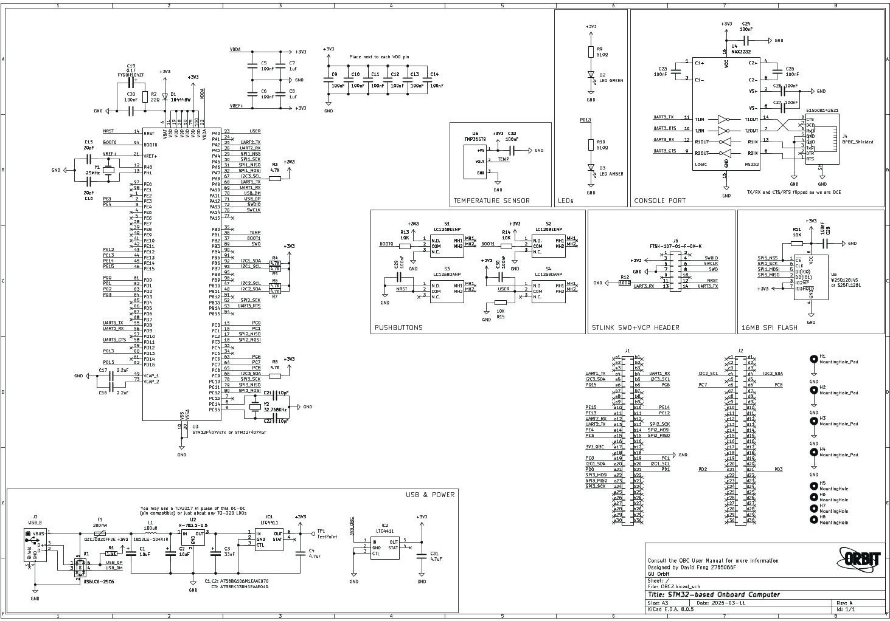

Fig. A1: On-Board Computer schematic

<!-- PDF_PAGE: 10 -->

## 1.2 LoRa Communications Board

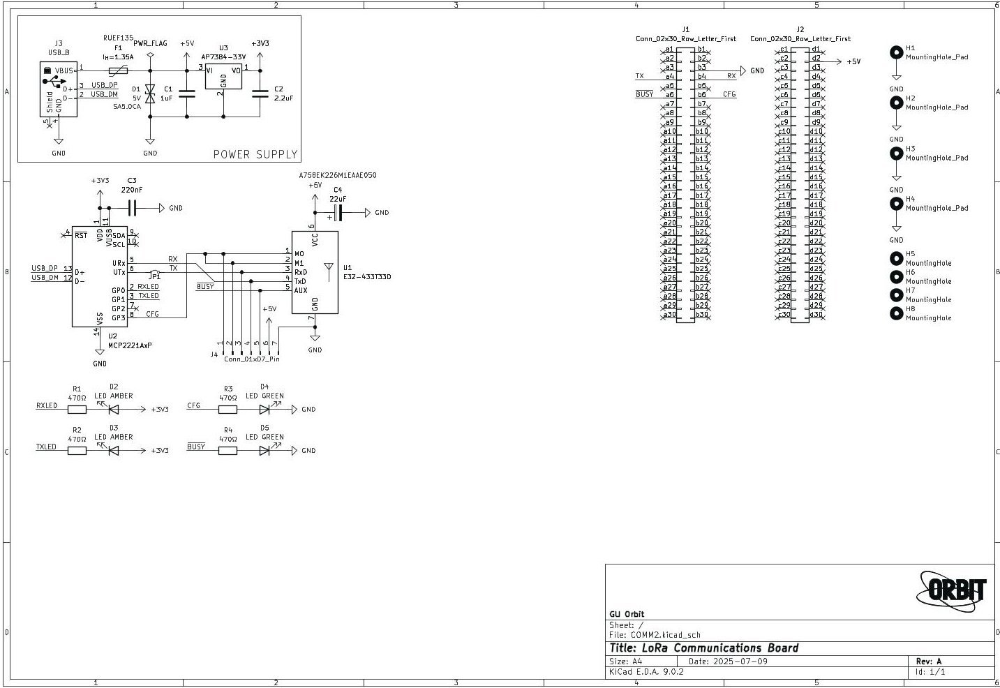

Fig. A2: LoRa communications board schematic.

<!-- PDF_PAGE: 11 -->

## 1.3 EPS Power Distribution Board

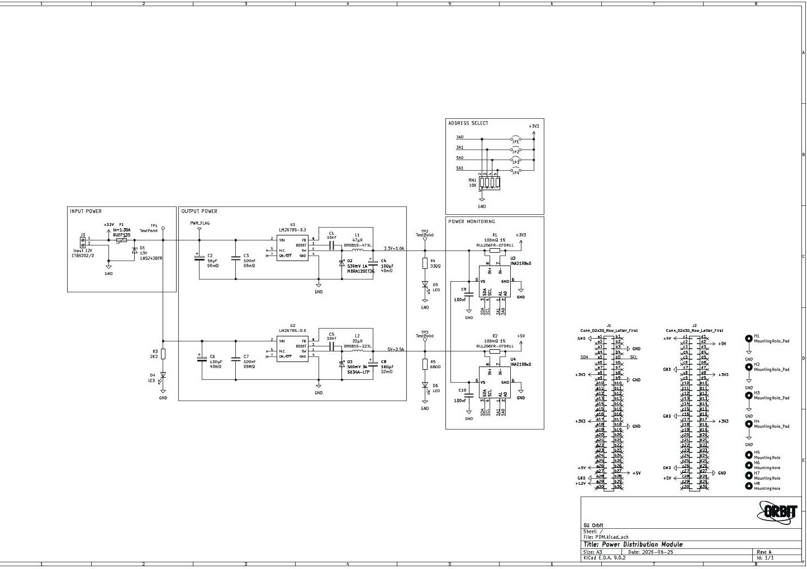

Fig. A3: EPS power distribution board schematic.

