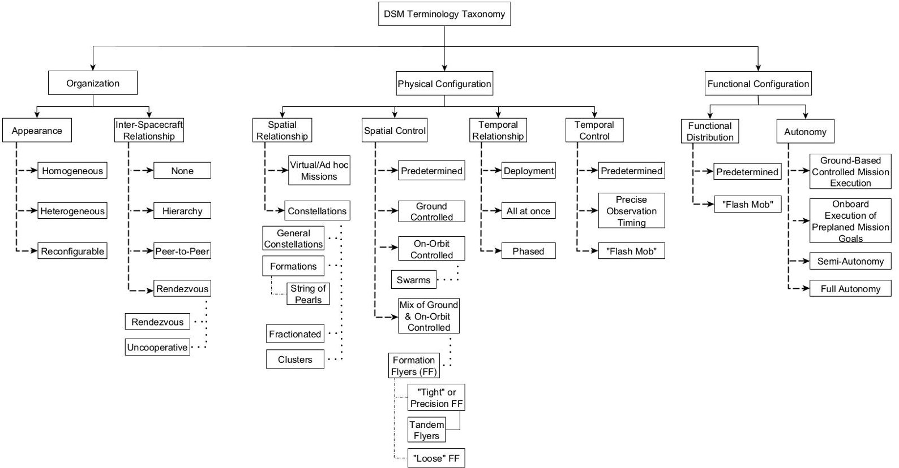
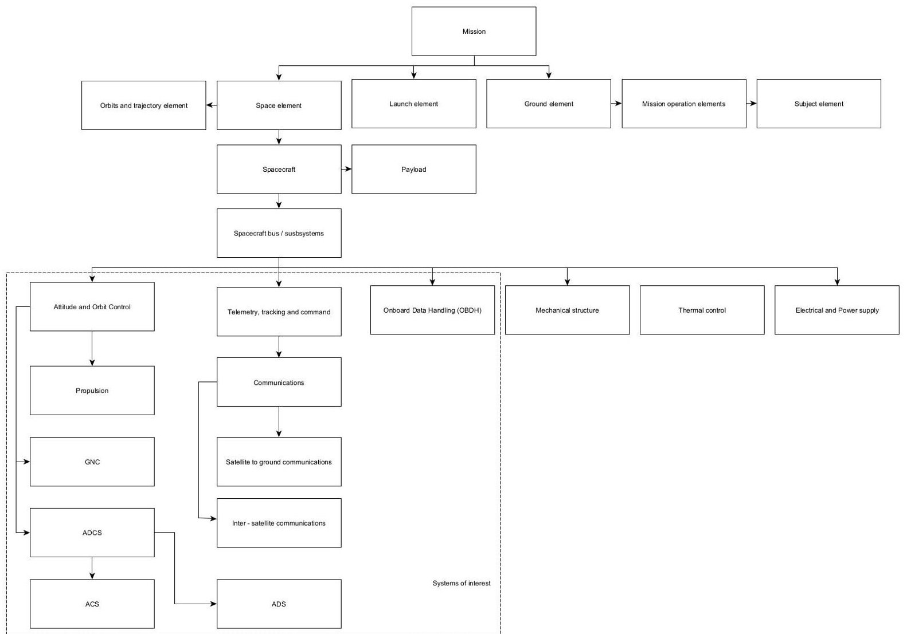
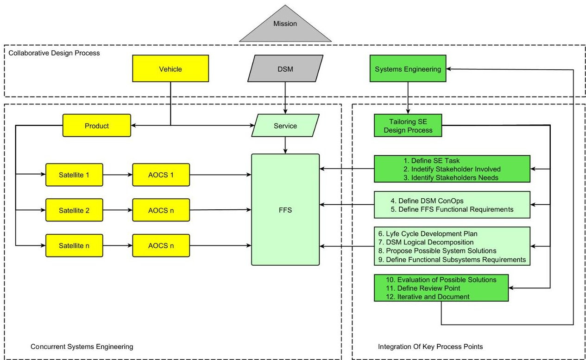
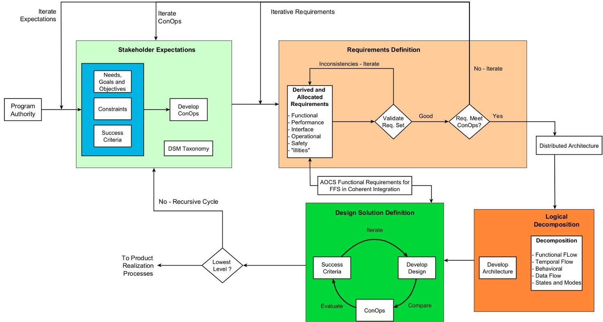
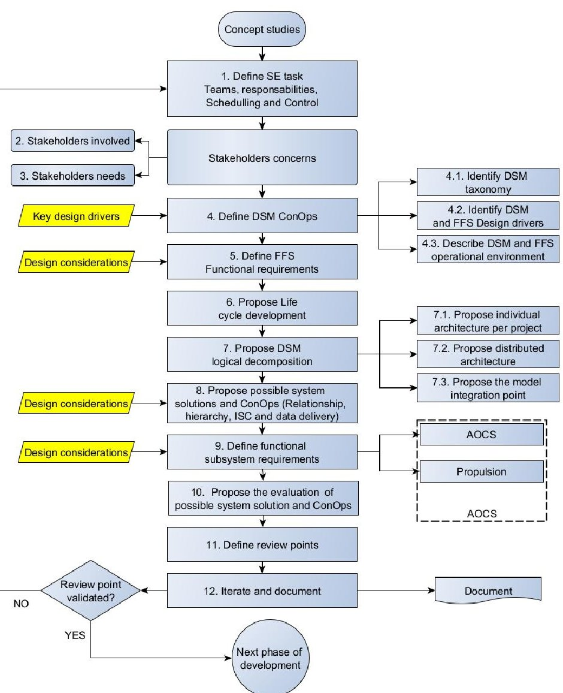
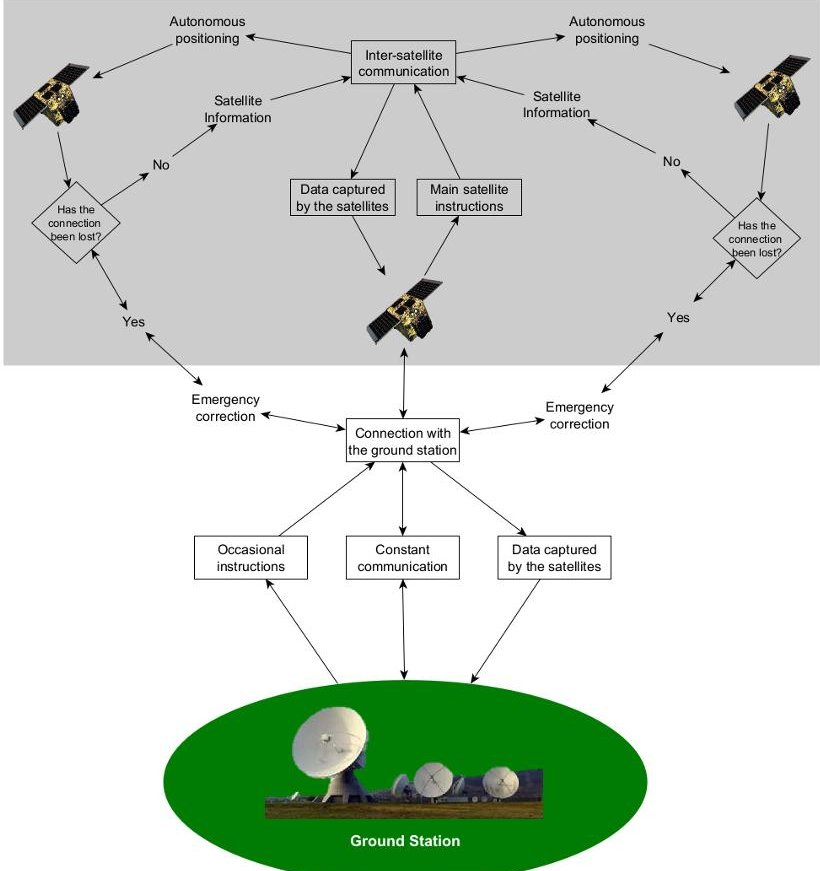
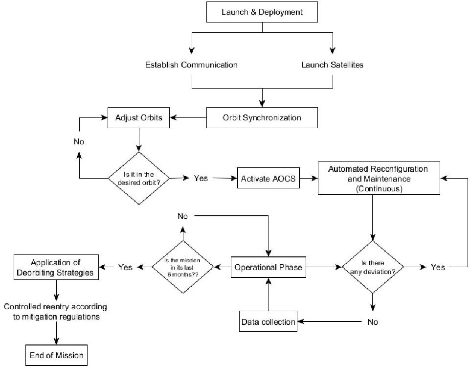
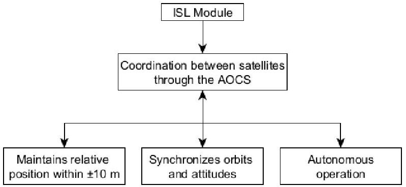

<!-- PDF_PAGE: 1 -->

Article

# Tailoring the Systems Engineering Design Process for the Attitude and Orbit Control System of a Formation-Flying Small-Satellite Constellation

Iván Felipe Rodríguez $ ^{1,2,*} $ $ ^{1} $ , Geilson Loureiro $ ^{1} $ , Danny Stevens Traslaviña $ ^{2} $ and Cristian Lozano Tafur $ ^{2} $

$ ^{1} $ Instituto Nacional de Pesquisas Espaciais, São Jose dos Campos 12227-010, SP, Brazil; geilson.lourieiro@inpe.br

$ ^{2} $ Fundación Universitaria Los Libertadores, Bogotá 111221440, Colombia;

dstraslavinan@libertadores.edu.co (D.S.T.); clozanot@libertadores.edu.co (C.L.T.)

* Correspondence: ivan.baron@inpe.br; Tel.: +57-314-3478292

Academic Editors: Igor Korobiichuk and Claudio Zunino

Received: 3 May 2025

Revised: 3 July 2025

Accepted: 31 July 2025

Published: 21 August 2025

## Abstract

Citation: Rodriguez, I.F.; Loureiro, G.; Traslaviña, D.S.; Tafur, C.L. Tailoring the Systems Engineering Design Process for the Attitude and Orbit Control System of a Formation-Flying Small-Satellite Constellation. Appl. Syst. Innov. 2025, 8, 117. https://doi.org/10.3390/ asi8040117

Copyright: 2025 by the authors. Published by MDPI on behalf of the International Institute of Knowledge Innovation and Invention. Licensee MDPI, Basel, Switzerland. This article is an open access article distributed under the terms and conditions of the Creative Commons Attribution (CC BY) license (https://creativecommons.org/licenses/by/4.0/).

This research proposes a tailored Systems Engineering (SE) design process for the development of Attitude and Orbit Control Systems (AOCS) for small satellites operating in formation. These missions, known as Distributed Spacecraft Missions (DSMs), involve groups of satellites—commonly referred to as satellite constellations—whose primary objective is to maintain controlled relative positioning in three dimensions. In these configurations, each satellite may serve a specific role. For instance, one may act as a navigation reference, while another functions as a communication relay. These roles support synchronized control and ensure mission cohesion. To achieve precise relative positioning, the system must integrate specialized sensors and maintain continuous inter-satellite communication. This capability enables precise navigation across both the space and ground segments, while ensuring high control accuracy. As such, the development of AOCS must be approached as a complex systems challenge, involving the coordinated behavior of multiple autonomous elements working toward a shared mission objective. This study tailors the SE process using the ISO/IEC 15288 standard and incorporates a Model-Based Systems Engineering (MBSE) approach to enhance traceability, consistency, and architectural coherence throughout the system lifecycle. As a result, it proposes a customized SE process for AOCS development that begins in the mission's conceptual phase and addresses the specific functional and operational demands of formation flying. A conceptual example illustrates the proposed process. It focuses on subsystem coordination, communication needs, and the architecture required to support an AOCS for autonomous satellite formations.

Keywords: attitude and orbit control system (AOCS); formation flying satellites (FFS); tailored systems engineering (SE); distributed spacecraft missions (DSM); inter-satellite communication (ISL); small satellite constellation; remote sensing in LEO

## 1. Introduction

Satellites have become one of the foundational applications of space technology, primarily due to their indispensable role in modern life. They enable a wide range of critical services, including cellular communication, internet connectivity, precision navigation, and more [1]. Satellites play a vital role in everyday life and are expected to become even more important in the coming years due to their integration into everyday activities. This trend

<!-- PDF_PAGE: 2 -->

is driven by technological advancements that enable the development of smaller, lighter, and more cost-effective spacecraft [2].

Evidence of this growth is reflected in the satellite sector's substantial contribution to the global space economy. By 2019, satellites accounted for approximately 74% of total space-related revenues, estimated at around USD 366 billion [3]. This trend is reaffirmed by data from BryceTech [4], which reported that by 2022, total industry revenue had risen to USD 386 billion, with the satellite industry still comprising a significant 72% of that figure.

The continuous evolution of satellite technology has enabled the miniaturization of essential components such as onboard computers, sensors, actuators, and batteries, facilitating the development of small satellites. However, due to their limited size, these satellites cannot individually match the performance of a single large satellite. As a result, deploying multiple small satellites becomes necessary to distribute tasks and/or payloads among several spacecraft [5].

This approach, which relies on distributing payloads, increases the range of missions that small satellites can support, including both space-based operations and Earth science applications. Examples include distributed aperture radars; optical and infrared interferometry for enhanced detection of stars and exoplanets; virtual co-observation and stereo imaging platforms for space and terrestrial observation; and the Constellation Observing System for Meteorology, Ionosphere, and Climate (COSMIC) [6].

Space missions involving multiple spacecraft are referred to as Distributed Spacecraft Missions (DSMs) [5,7]. These missions can achieve or even exceed the performance of large monolithic satellites while mitigating several inherent limitations, such as high costs, increased complexity, and prolonged development timelines. Additionally, distributing payloads across multiple platforms simplifies system architecture, reduces manufacturing requirements, and facilitates the deployment of smaller, lighter satellites. This distributed configuration enhances both system flexibility and robustness, while the spatial separation of sensors enables broader observational coverage and improved temporal resolution [1,5,8].

These advantages become even more evident during operational deployment. Distributing functionality across a coordinated and interoperable satellite formation increases mission adaptability and responsiveness, enabling in-orbit reconfiguration to accommodate alternative objectives or support simultaneous mission profiles. Moreover, DSM architecture exhibits intrinsic fault tolerance: while the failure of a monolithic satellite can lead to total mission loss, distributed systems can maintain functionality with minimal performance degradation.

Supporting this, Chan et al. [9] demonstrated that a well-designed satellite constellation can provide global coverage and redundancy, meeting the demands of global communication, navigation, meteorology, positioning, space exploration, and scientific research. As a result, DSMs offer a more resilient operational framework, capable of graceful performance degradation in the face of failures—ultimately outperforming conventional single-satellite paradigms [6,10].

To maintain relative positioning in a Distributed Spacecraft Mission (DSM), a Formation Flying System (FFS) approach is required. According to Le Moigne [7], a FFS can be defined as "two or more spacecraft that conduct a mission such that the relative distances and 3D spatial relationships (i.e., distances and angles between all spacecraft) are controlled by direct detection by a spacecraft of at least one other state of the spacecraft." A similar but more concise definition is provided by Jennifer Roberts [6], who describes it as "the on-orbit position maintenance of multiple spacecraft relative to measured separation errors."

In this context, spacecraft operating under the FFS paradigm must be capable of maintaining constant or time-varying configurations through coordinated maneuvers. To extend the operational lifespan of the formation, each satellite must be able to perform individual

<!-- PDF_PAGE: 3 -->

tasks such as formation keeping, transitioning between configurations, maintenance, refueling, repairs, upgrades, and non-contact support operations. Such tasks inherently require a minimum level of onboard autonomy [6,11].

This autonomy, in turn, demands the integration of a critical system: Guidance, Navigation, and Control (GNC). The GNC subsystem is essential for enabling precise navigation, rendezvous, docking, and maintenance operations. It also allows satellites to adapt to external factors such as irregular gravitational fields or long communication delays with Earth. Onboard autonomy enables satellites to respond in real time to local conditions by actively controlling their attitude and position relative to one another. This ensures precise coordination, enhanced mission performance, and faster responses to contingencies [12].

GNC systems prioritize onboard autonomy, which benefits the mission in two main ways: first, by reducing or eliminating the need for ground station intervention, and second, by lowering overall mission costs [12].

By processing data from multiple onboard sensors, the GNC system can determine optimal trajectories for different scenarios. This capability enables real-time decisionmaking and continuous adjustments to maintain precise positioning and orientation [11].

D'Amico [13] highlights this by distinguishing between two main control approaches: ground-based control and autonomous onboard control [14]. He explains that groundbased operations are limited by visibility constraints, which reduce control accuracy and hinder optimal use of onboard resources. In contrast, autonomous control ensures real-time adaptation to local conditions, provides full situational awareness, and maximizes the utilization of onboard resources [13].

In a Formation Flying System (FFS), maintaining precise relative distances between satellites is essential. This requirement is challenged by various environmental disturbances encountered in space [15]. These factors must be carefully considered during the mission design phase, as ensuring collision-free flight is one of the primary constraints in FFS. Meeting this requirement demands highly stable position control and the capability to perform precise reorientation maneuvers, which are critical for the successful execution of the mission. This becomes particularly important given the typically short distances between satellites within the formation [16].

This need leads to the requirement for specialized sensors and communication systems that enable navigation and high-precision control. A notable solution is the use of intersatellite link (ISL) systems, which enable the formation of a mesh network within the constellation.

These networks support a wide range of applications, from large-scale Internet of Things (IoT) deployments to autonomous transportation systems. In satellite systems, ISL are commonly used for inter-satellite ranging and communication [17,18].

However, ISLs are not the only type of communication links. Farrea and Kerry et al. [17] identify three main types of communication links: ISLs, uplinks, and downlinks. Among them, ISLs are the most widely used in DSMs, particularly due to their support in high-speed communication, enhanced bandwidth, and increased security.

ISLs support direct communication between neighboring satellites, which reduces the risks of jamming and signal interference. In contrast, uplinks and downlinks are more susceptible to security threats such as eavesdropping and replay attacks, unless robust encryption and secure communication channels are implemented.

Several additional benefits are associated with ISLs. These include real-time connectivity, the formation of global networks through the linking of satellites in various orbits, high data transfer capacity, flexible bandwidth and data rate management, and potentially

<!-- PDF_PAGE: 4 -->

lower power consumption. Additionally, optical ISLs may reduce the need for frequency coordination, offering further operational advantages [15].

According to Radhakrishnan et al. [19], control accuracy is directly affected by the distance between satellites. Although Formation Flying Systems (FFSs) can allow relatively large inter-satellite distances, they still require medium to high levels of control precision.

Therefore, the development and integration of an Attitude and Orbit Control System (AOCS) is critical for ensuring mission success for both conventional and distributed spacecraft missions. AOCS governs a satellite's ability to maintain or adjust its orientation and orbital position, directly affecting energy management (e.g., solar panel pointing), communication link stability, payload performance, and onboard data handling.

During the initial deployment phase, the AOCS typically employs low-cost sensors such as magnetometers, sun sensors, and gyroscopes to estimate the spacecraft's angular velocity and orientation. Classical algorithms, such as TRIAD [20] or QUEST [21-23], are commonly applied to determine the attitude quaternion. These are followed by control strategies such as B-dot damping for detumbling, Proportional-Derivative (PD) control for stabilization, or reaction wheel-based fine pointing [24,25].

In formation-flying missions, however, traditional Attitude and Orbit Control System (AOCS) architectures may be inadequate, given the additional requirements for relative navigation and inter-satellite coordination. These missions require the integration of inter-satellite links (ISLs), cooperative estimation techniques, and distributed control laws that can adapt to dynamic communication topologies. Recent approaches explore consensus-based control, leader-follower strategies, and model predictive control tailored for formation reconfiguration scenarios [24,25].

The integration of AOCS, GNC, and ISL systems has become a fundamental requirement, demanding the use of efficient tools across all spacecraft design domains. Unifying the functionalities of these three systems within a single platform presents a significant engineering challenge, highlighting the need for a multidisciplinary design approach to ensure seamless system integration.

As Larson et al. [26] emphasize, the environmental harshness of space and the inherent complexity of space missions necessitate rigorous engineering practices. This need is further emphasized by the findings of Vafa et al. [15], who reported that environmental conditions in space account for approximately 28% of spacecraft failures. Given these challenges, and the low tolerance for risk in space systems, the application of Systems Engineering (SE) supported by a robust methodological framework becomes essential [26].

This framework should facilitate the integration, interaction, analysis, and evaluation of various constraints-technical, legacy, cost, and schedule—along with design drivers. Systems Engineering is a multidisciplinary approach that identifies needs and designs solutions for real complex systems [26]. According to Wingate [27], establishing a solid foundation for project success and minimizing cost and schedule implications can be achieved by appropriately applying tailored Systems Engineering models with a standardized process to ensure the right amount of process is applied to project processes [27].

Therefore, the objective of this research is to propose a tailored Systems Engineering framework for the integrated development of AOCS. This framework addresses the specific requirements of inter-satellite communication for small satellites operating in autonomous formation flight, taking into account both Systems Engineering principles and the full space system lifecycle.

## 2. Materials and Methods

The methodology employed in this research is based on the adaptation of general process tailoring principles, aligned with recognized standards such as ISO/IEC 15288.

<!-- PDF_PAGE: 5 -->

This standard defines a lifecycle and process framework and provides guidance on how to tailor it to meet specific project needs [28].

ISO/IEC 15288 recognizes tailoring as a standard practice in Systems Engineering involving the adjustment of the level of rigor in processes to suit the specific needs of a project. Tailoring refers to the necessity for appropriately scaled processes, ensuring the application of the right amount of processes. The purpose of the tailoring process is to adapt standard processes to particular concerns, providing specific outcomes [29].

Adcock [28] outlines a set of detailed activities required to complete the tailoring process. Mulqueen et al. [30] suggest a tailoring Systems Engineering approach for space products as applied by Marshall Spaceflight Center (MSFC) Advanced Concepts Office (ACO).

As this research focuses on the Attitude and Orbit Control System (AOCS) for formation-flying satellites, a modified approach to lifecycle tailoring is proposed. The approach follows these key steps:

1. Identify the theoretical foundations and conceptual models relevant to the study.

2. Identify a set of Systems Engineering processes and related projects applicable to the research.

3. For each project within the structure of this model, identify processes, activities, the relationship, and interfaces between the projects.

Address AOCS development at a detailed (low) level.

4. Define the features of the System of Interest (SoI).

5. Identify the SoI functional requirements for monolithic elements and FFS.

6. Identify processes, activities, the relationship, and interfaces between SoIs.

Based on the NASA system design process, it is necessary to identify stakeholder expectations and to develop Concept of Operation (ConOps), to define requirements, develop logical decomposition and architecture, define design solutions, and iterate between processes.

However, in this case, the ConOps is developed based on system key design drivers identified from missions and SoIs developed related to FFS.

7. Identify key design drivers related to DSM, FFS, and AOCS subsystems.

8. Propose a tailored SE design process.

9. Propose systems design process activities.

It is important to note that this study does not propose the development of a specific system design. Rather, it focuses on defining the development process, taking into account alternative approaches identified during analysis.

Through this tailored methodology, the aim is to align processes and activities with the specific needs of AOCS development for satellites flying in formation. This alignment enhances efficiency and increases the likelihood of achieving mission success.

## 3. Theoretical Framework

This section defines key concepts related to Systems Engineering (SE), Model-Based Systems Engineering (MBSE), and the space mission lifecycle. It also expands upon topics introduced in Section 1, including Distributed Spacecraft Missions (DSMs), satellite constellations, and Formation Flying Systems (FFSs).

The main objective is to establish a clear conceptual foundation for understanding how the Attitude and Orbit Control System (AOCS) integrates into the overall satellite architecture. By clarifying these foundational elements, this section supports the development of a tailored SE framework for the design and implementation of AOCS in formation-flying small-satellite constellations.

<!-- PDF_PAGE: 6 -->

## 3.1. Distributed Spacecraft Missions

Based on the definitions provided in Section 1 by J. Le Moigne and Jennifer Roberts [6,7] and considering the previously discussed advantages of DSMs over monolithic architectures, it is important to highlight that DSMs still face significant challenges.

In particular, the development of small satellites can sometimes result in costs comparable to those of monolithic missions. This is largely due to the complexity required to meet demanding mission objectives. Moreover, each satellite must be equipped with its own core subsystems, and with this, the associated overhead may equal or even exceed that of a single larger satellite, potentially undermining the benefits of distribution.

Operating a distributed architecture also increases ground-based complexity, requiring more sophisticated coordination and control systems. Nevertheless, these drawbacks are often offset by the relatively lower cost and reduced mission risk [7,31].

Despite these challenges, DSMs exhibit several characteristics that enhance their reliability and cost-effectiveness. These include high data resolution across one or more dimensions (temporal, spatial, or spectral), lower launch costs, higher data bandwidth improved data continuity, and enhanced inter-mission validation [31].

DSMs can be classified according to three primary characteristics: organizational structure, physical configuration, and functional distribution. This taxonomy is proposed by Le Moigne et al. [31], who categorize DSMs based on these dimensions, as illustrated in Figure 1.

Figure 1. DSM terminology taxonomy, adapted from [31].

In this context, a satellite constellation is defined by its physical configuration and spatial relationships and refers to a mission comprising multiple spacecraft that operates collaboratively as a unified system to achieve a common objective, as illustrated in Figure 1. Constellations can be classified into four subcategories: general constellations, formations, fractionated systems, and clusters.

## 3.2. Systems Engineering Process

According to NASA's Systems Engineering (SE) Handbook [32], SE is defined as "a methodical, multidisciplinary approach for the design, realization, technical management,

<!-- PDF_PAGE: 7 -->

operations, and retirement of a system." NASA defines a system as "a set of elements that function together to produce the capability required to meet a need." These elements may include hardware, software, equipment, facilities, personnel, processes, and procedures each contributing to the achievement of system-level outcomes [32].

Applying SE from the earliest stages of the space product lifecycle helps to meet stakeholders' functional, physical, and operational performance requirements. It also supports cost and schedule optimization within predefined constraints. In addition, SE aids in organizing the project structure, with key objectives including the management of technical aspects, coordination of project teams, and oversight of cost and scheduling efforts [32].

In contrast, Model-Based Systems Engineering (MBSE) is defined as the formalized application of modeling to support system requirements, design, analysis, optimization, verification, and validation. MBSE involves the integration of engineering models and simulations from the early stages of the project and continues to evolve throughout system development [33].

## Space Mission Lifecycle

Lifecycle is defined by Adcock [28] as "the evolution with time of a system, covering the whole life (lust to dust) of that system." A project's lifecycle involves a series of distinct stages, each with specific objectives aligned with the mission's evolving goals. Additionally, the lifecycle must remain synchronized with related operational systems, as well as with other systems contributing to the mission design.

Drawing on the Systems Engineering philosophies of both NASA and the European Cooperation for Space Standardization (ECSS), the project framework encompasses a broad set of study areas. These philosophies share a common emphasis on an integrated development approach to space mission design. This approach spans the full training and operational lifecycle processes—from design, development, and testing, to operations, support services, and eventual system decommissioning.

Table 1 illustrates the space mission project lifecycle as defined in the Systems Engineering frameworks of NASA and ECSS [34].

Table 1. Typical lifecycle of a space mission defined by ECSS and NASA [34].

<table border="1"><tr><td colspan="2">Phase ID</td><td colspan="2">Phase name</td></tr><tr><td>ECSS</td><td>NASA</td><td>ECSS</td><td>NASA</td></tr><tr><td>0</td><td>Pre-A</td><td>Mission analysis/needs analysis</td><td>Concept Studies</td></tr><tr><td>A</td><td>A</td><td>Feasibility</td><td>Concept and Technology Development</td></tr><tr><td>B</td><td>B</td><td>Preliminary definition</td><td>Preliminary Design and Technology Completion</td></tr><tr><td>C</td><td>C</td><td>Detailed definition</td><td>Final Design and Fabrication</td></tr><tr><td>D</td><td>D</td><td>Qualification and production</td><td>System Assembly, Integration and Test, Launch and Checkout</td></tr><tr><td>E</td><td>E</td><td>Operation/utilization</td><td>Operations and Sustainment</td></tr><tr><td>F</td><td>F</td><td>Disposal</td><td>Closeout</td></tr></table>

## 3.3. Attitude and Orbit Control System

Regardless of the mission's objective, a typical space mission architecture includes three core components: the space segment, the launch segment, and the ground segment.

<!-- PDF_PAGE: 8 -->

Within the spacecraft bus, the Attitude and Orbit Control System (AOCS) plays a critical role. It is responsible for two main functions: maintaining the satellite in its designated orbital trajectory and ensuring precise attitude controlboth of which are essential for accurate pointing of mission-specific instruments. Due to the critical nature of these functions, the AOCS is typically designed with full redundancy, thereby enhancing mission reliability and minimizing the need for ground-based intervention.

According to Macdonald and Badescu [34], the AOCS integrates the Guidance, Navigation, and Control (GNC) system with the Attitude Determination and Control System (ADCS). The ADCS itself is composed of two subsystems: the Attitude Determination System (ADS) and the Attitude Control System (ACS).

Figure 2 presents the AOCS within the mission architecture hierarchy for a Distributed Spacecraft Mission (DSM).

Figure 2. AOCS of DSM in a mission architecture hierarchy.

According to the taxonomy proposed by Le Moigne et al. [31], the functional configuration of a DSM can be classified based on autonomy into Ground-Based Controlled Mission Execution, Onboard Execution of Pre-Planned Mission, Semi-Autonomy, and Full Autonomy [31].

A semi-autonomous DSM represents a hybrid model that combines onboard autonomy with ground control. It enables adaptive mission execution and onboard procedures for operational control. In contrast, a fully autonomous DSM must exhibit self-awareness having internal knowledge of its capabilities and current state. It must also be self-situated, aware of its environment and operational context, and capable of monitoring and adapting its behavior accordingly [31].

<!-- PDF_PAGE: 9 -->

In any case, it is also necessary to consider the type of communication, mission architecture, levels, and types of hierarchy among satellites. Additionally, according to Ridolfi et al. [35], within the main activities for the design of a space product is the design of the subsystems considering the interaction and impact of the integration between them [35]. In this case, the ADCS, ACS, and propulsion system are essential.

As noted by Ardaens et al. [36], in formation flying missions, the AOCS must interface with multiple subsystems, including inter-satellite links (ISLs) and the Telemetry, Tracking, and Command (TT&C) system. It is also essential to account for interactions with the payload, the electrical subsystem, and the structural subsystem.

To maintain relative positioning within the formation, each satellite must be aware of the positions of the other spacecraft. This can be achieved through ground-based control or via inter-satellite communication. Therefore, the communication subsystem and its protocols must be carefully considered during the design phase.

Furthermore, the cross-link communications topology in a Formation Flying System (FFS) should be taken into account-particularly a centralized configuration involving a "mothership" and multiple "daughter" spacecraft. In this setup, the mothership maintains a master-slave relationship with each daughter spacecraft.

Alternatively, hybrid topologies can be adopted. In such configurations, each spacecraft may share equal operational status and is individually responsible for navigation control, determined by processing collective positional data received via cross-links from all other spacecraft. Hybrid topologies are also possible.

To support autonomous formation flying, a robust cross-link communication system must be implemented. The system design should account for several requirements, including the number of satellite members, antenna configurations, orbital parameters, geometry of the formation (static or dynamic), inter-satellite distances, and topological flexibility, among other factors [37].

## 4. Tailored Systems Engineering Process for AOCS of Small Satellites Flying in Formation

This section presents the core contribution of this research: a tailored Systems Engineering (SE) process for the development of Attitude and Orbit Control Systems (AOCS) in formation-flying missions.

While grounded in established frameworks such as ISO/IEC 15288, NASA's Systems Engineering Handbook, and the ECSS standards, the proposed approach incorporates the taxonomy Distributed Spacecraft Mission (DSM), formation-specific design drivers, and inter-satellite communication considerations from the conceptual phase onward.

The resulting process addresses both architectural and operational challenges associated with autonomous satellite constellations. It offers a structured sequence of activities aligned with mission-level coordination and subsystem integration.

The tailored SE process is specifically designed for the integration of AOCS in small satellites engaged in autonomous formation flights. The proposed lifecycle framework supports the concurrent and coordinated development of multiple spacecraft. It establishes key milestones and system models to enable informed decision-making, improve system understanding, and manage complexity.

Additionally, it emphasizes the unique challenges posed by distributed spacecraft missions, including the need for real-time coordination, subsystem interoperability, and cross-platform autonomy.

Kaslow et al. [33] identify several key reference models for space systems development including the INCOSE Systems Engineering Handbook [30], NASA's Systems Engineering Handbook, Applied Space Systems Engineering [38], and Space Mission Engineering [39].

<!-- PDF_PAGE: 10 -->

The SE defined by the European Cooperation for Space Standardization (ECSS) also plays a critical role.

Despite differences in implementation, these approaches are structured around lifecycle stages, ranging from system conceptualization to system decommissioning. For instance, Wertz et al. [39] propose the Space Mission Engineering process as a representative development flow, while Larson et al. [26] describe the Applied Space Systems Engineering Flow.

According to NASA's Systems Engineering Handbook [32], the SE process is characterized by an iterative interaction among system design processes. It highlights four primary stages: stakeholder expectation definition, requirements definition, logical decomposition, and design solution development.

Moreover, it is important to consider the collaborative design process proposed by Mulqueen et al. [30], which begins with mission and system-level functional analysis to identify high-level goals and requirements. This process continues through three iterative and parallel flows involving mission definition, vehicle development, and systems engineering.

On the other hand, Loureiro et al. [40] emphasize that for problems requiring solutions involving multiple spacecraft, it is necessary to model all lifecycle concepts and architectures—including, but not limited to, operational elements. In this context, the Concurrent Systems Engineering (CSE) approach is introduced, in which the integration dimension comprises both products and services. These include the people, methods, and tools that collectively implement lifecycle processes.

Beyond SE, CSE, and collaborative methodologies, it is essential to analyze and develop each mission solution while considering the integration of both mission-level and subsystem-level products and services. This includes the distributed systems architecture and satellite subsystems.

In response to these needs, a tailored Systems Engineering process is proposed specifically for the development of the AOCS for small satellites operating in formation, as illustrated in Figure 3.

Figure 3. Tailored SE design process.

<!-- PDF_PAGE: 11 -->

As previously defined in Section 3.1, Distributed Spacecraft Mission (DSM) configurations imply a distributed system architecture that must be carefully considered when deriving system requirements and the Concept of Operations (ConOps).

Figure 4 illustrates the integration of DSM taxonomy within a Model-Based Systems Engineering (MBSE) framework, specifically aligned with NASA's system design process. This representation demonstrates how stakeholder expectations—the traditional starting point of any SE process—can be shaped by the structural and functional configurations defined by the DSM classification. By incorporating these configurations early in the development process, it becomes possible to derive mission-level ConOps that more accurately reflect the distributed and autonomous characteristics of Formation Flying Systems (FFS).

Figure 4. DSM MBSE from NASA system design process.

The model begins with the identification of stakeholders and proceeds through the iterative definition of mission needs, ConOps, and system requirements all directly influenced by the DSM taxonomy. This ensures that key architectural constraints, such as inter-satellite communication, levels of autonomy, and coordination strategies, are addressed from the earliest stages of the system design process. As a result, the approach supports the development of tailored system architectures that reflect both the physical layout and the operational relationships among satellites within the formation.

According to NASA [32], ECSS [41], Larson [26], and Wertz et al. [39], the development of a Concept of Operations (ConOps) within the Systems Engineering (SE) process requires the definition of mission statements that capture stakeholder needs and expectations from a high-level perspective. Additionally, key design drivers and design considerations must be incorporated into the SE design process-particularly for the Attitude and Orbit Control System (AOCS) in Formation Flying Systems (FFS).

Figure 5 illustrates the integration of these elements within the tailored SE process, highlighting how mission statements, stakeholder expectations, and system-specific design drivers influence the development of the AOCS architecture.

<!-- PDF_PAGE: 12 -->

Figure 5. Flowchart of the SE design process for AOCS of FFS.

The tailored Systems Engineering (SE) process proposed in this study establishes a structured sequence of steps to guide the development of the Attitude and Orbit Control System (AOCS) for formation-flying missions. The process begins with the definition of key engineering activities and the establishment of a team structure that reflects the distributed nature of the system. Stakeholders are identified early in the process to capture expectations related to autonomy, coordination, and formation control. The Distributed Spacecraft Mission (DSM) taxonomy is then applied to classify the system architecture, which in turn informs the logical decomposition of the system. This classification supports the design of a coherent and coordinated distributed configuration, aligning both the physical and operational aspects of the formation.

## 1. Define Systems Engineering task.

1. 1. Define SE team.

1. 2. Define SE team responsibilities.

1. 3. Define Systems Engineering scheduling and control.

2. Identify all stakeholders involved.

3. Identify stakeholders needs.

4. Define baseline DSM ConOps, identifying and classifying risk.

4. 1. Identify DSM taxonomy.

4. 2. Identify DSM and FFS design drivers.

In this case, key systems drivers present in the mission, product and service, to approach the system requirements. According to Murali, system drivers are the principal

<!-- PDF_PAGE: 13 -->

mission parameters or characteristics, for small satellite missions, proposed the common systems drivers [42] showed in Table 2.

Table 2. Typical systems drivers [42].

<table border="1"><tr><td>Driver</td><td>What Limits Driver</td><td>What Driver Limits</td></tr><tr><td>Size</td><td>Available weight</td><td>Payload size</td></tr><tr><td>On-orbit weight</td><td>Altitude, inclination, launch vehicle</td><td>Payload weight, survivability, design and manufacturing cost</td></tr><tr><td>Power</td><td>Size, weight</td><td>Payload and bus design, on-orbit life</td></tr><tr><td>Data rate</td><td>Storage, processing, antenna sizes, limits of existing systems</td><td>Information sent to the user, demand for onboard processing</td></tr><tr><td>Communications</td><td>Coverage, availability of ground stations or relay satellites</td><td>Coverage, timeliness, ability to command</td></tr><tr><td>Pointing</td><td>Cost, weight</td><td>Resolution, geolocation, and system accuracy, increase spacecraft cost</td></tr><tr><td>Number of spacecraft</td><td>Cost</td><td>Coverage, frequency, and overlap</td></tr><tr><td>Altitude</td><td>Performance demands, weight</td><td>Performance, survivability, coverage, and communications</td></tr><tr><td>Coverage</td><td>Orbit, scheduling, payload field of view and observation time</td><td>Data frequency and continuity</td></tr><tr><td>Scheduling</td><td>Timeline and operations, decision-making, communications</td><td>Coverage, responsiveness, mission utility</td></tr><tr><td>Operations</td><td>Cost, communications</td><td>Frequently, the principal cost driver, principal error source</td></tr></table>

Table 3 presents the DSM drivers derived from the taxonomy proposed by Le Moigne et al. [8], consideration organization, physical and functional configuration.

Table 3. DSM drivers.

<table border="1"><tr><td></td><td colspan="2">DSM Drivers</td></tr><tr><td>Driver</td><td>What Limits Driver</td><td>What Driver Limits</td></tr><tr><td>Appearance</td><td>Bus, payload, and operational characteristics</td><td>Member characteristics</td></tr><tr><td>Inter-spacecraft relationship</td><td>Degree of capability, maneuvers</td><td>Focal points for communication, control and command, rendezvous and docking</td></tr><tr><td>Spatial relationship</td><td>Common result of the missions</td><td>Mission design layout</td></tr><tr><td>Spatial control</td><td>Mission control characteristics</td><td>Control mission degree</td></tr><tr><td>Temporal relationship</td><td>Temporal deployment</td><td>Number of members deployment at the same time</td></tr><tr><td>Temporal control</td><td>Control determination time</td><td>Control accuracy time</td></tr><tr><td>Functional distribution</td><td>Mission functionalities</td><td>Mission compatibility and cooperative capabilities</td></tr><tr><td>Autonomy</td><td>System control autonomy</td><td>Control distribution</td></tr></table>

<!-- PDF_PAGE: 14 -->

Table 4. FFS drivers.

<table border="1"><tr><td colspan="3">Formation Flying System Drivers</td></tr><tr><td>Spatial Relationship</td><td>Spacecraft Distribution</td><td>Position and Relative Distance in Orbit Between Satellites</td></tr><tr><td>Spatial control</td><td>AOCS capabilities</td><td>Degree of precision and accuracy of control</td></tr><tr><td>Autonomy</td><td>System autonomy capacity</td><td>Degree of operation independently of external control</td></tr><tr><td>Communication</td><td>Data transfer type, data transfer time, spatial perspective, relationship between segments, satellites hierarchy</td><td>Connection format between satellites, data transfer schedule, distance between satellite and line of sight, communication between satellites and the ground station, number of satellites that collect information and communicate with the ground station</td></tr><tr><td>Onboard data handling(OBDH)</td><td>Software, task distribution</td><td>Spacecraft telemetry, storage and execution of application software, operating system, data processing time</td></tr></table>

## 4.3. Describe DSM operational environment.

Based on key design drivers, considerations about mission are proposed as follows:

- Time of operation phases;

- Precision degree of the operational ranges;

- Multiple spacecraft operation;

- Individual spacecraft operation characteristics in order to state the DSM appearance;

- On-orbit spacecraft hierarchical layout;

- Real-time decision-making degree;

- On-orbit spacecraft control decision-making degree;

- Number of members deployed at the same time;

- On-orbit cooperative maneuverings degree between spacecraft.

5. Define FFS functional requirements.

The FFS must also consider DSM design drivers. Based on Leitner [43], Underwood and Tiraplegui, and relevant needs identified for designing a system capable of performing formation flying activities [44], a series of FFS design considerations can be proposed as follows:

- On-orbit position and relative distance of satellites;

- Degree of precision and accuracy of control;

- Degree of operation independently of external control;

- Communication format data transfer schedule between satellites and ground station;

- On-orbit satellite task distribution and execution;

- Coupled dynamics capabilities to simultaneously managing position and attitude;

- Synchronization capabilities to simultaneously managing position and attitude;

- Flexibility of adjusting the relative and absolute position of satellites;

- Level of regional disturbances during the operation;

- Activities execution per orbit;

- Consider the collision risk management;

- Consider the eclipse (shadow) projected between spacecraft.

6. Propose whole lifecycle development plan.

7. Propose DSM logical decomposition.

7. 1. Propose individual architectures per project.

<!-- PDF_PAGE: 15 -->

7. 2. Propose the integration of architectures.

7. 3. Propose a distributed architecture.

8. Propose possible system solutions and ConOps.

8. 1. Identify satellite relationships.

All spacecraft shall consider the following:

- Support themselves during operation;

- Collaborate to accomplish the mission;

- Keep their position and distance between satellites according to degree of precision and accuracy of control required by the FFS;

- Reconfigure their position and distance between satellites according to degree of precision and accuracy of control required by the FFS;

- Contribute to the required degree of autonomy independent of external control;

- Independent free-flight capability;

- Established size for satellite;

- ISL capability.

In other hand, at least one spacecraft shall communicate with ground station.

8. 2. Define satellite hierarchy.

8. 3. Define ICS.

According to Anyanhun and Edmonson, an Inter-Satellite Communication System (ICS) can help mitigate Size, Weight, and Power (SWaP) constraints, among other limitations typically faced by groups of small spacecraft [45]. Furthermore, the design of the ICS in a Distributed Spacecraft Mission (DSM) has a significant impact on the overall performance of the Formation Flying System (FFS). According to Underwood, the requirements for ICS in DSMs must consider the following aspects [46]:

- Frequency allocations established by regulatory body;

- Altitude operation;

- DSM global coverage;

- Space environment;

- Viewing geometry;

- User-to-user delay;

- Power system capacity;

- Offered communication services;

- Physical interactions;

- Satellite time in darkness;

- Effect of space-based routing (user-sat-user);

- Ground-based routing (user-sat-ground station-wire-user).

- According to Sun et al., due to the restricted distribution of ground facilities, some system administrators are unable to track satellites throughout their entire operation. As a result, ISLs are required to ensure timely transmission of telemetry or telecommand, as well as effective ranging [47]. In line with this, Leitner [43] emphasizes that for each satellite, the ICS must take into account the following considerations:

- Hardware available;

- Network and protocols;

- Software required for implementation;

- Robustness of the communication;

- Distance between spacecraft;

- Potentially tight power constraints;

- Ability to continuously measure the coarse range between the vehicles.

<!-- PDF_PAGE: 16 -->

Finally, according to Horne et al. [37], it is first necessary to identify cross-link communications requirements common to a cross-section of proposed missions considering internal cross-link networking operations and external networking interface operations [37]. In this way, it is necessary to add cross-link communications considerations as follows:

- Cross-link communications;

- Internal cross-link networking operations;

- External networking interface operations.

8. 4. Define data delivery process.

Subramanian et al. [48] highlight the importance of understanding subsystem interconnections. In particular, the On-Board Data Handling (OBDH) system plays a central role in On-Board Computing (OBC). It is responsible for managing temperature monitoring, receiving commands from ground stations, and processing energy and data for the control subsystem. In Formation Flying Systems (FFS), the control subsystem also depends on data received from other satellites via inter-satellite communication links [48].

According to Grocott et al. [49], each spacecraft's OBC forms part of a broader distributed architecture. Despite the decentralized nature of FFS, every satellite requires core components such as a Housekeeping Computer (HKC), overcurrent protection circuits, and the capability to execute Time-Tagged Commands (TTC).

The OBDH architecture includes a Payload On-Board Computer (POBC), Instrument On-Board Computers (IOBCs), Internal Data Storage (IDS), and an Attitude Determination and Control Computer (ADCC), which is responsible for all AOCS-related tasks [49].

Based on these insights, several key design considerations regarding the integration of OBDH and AOCS in formation flying missions can be proposed:

- Onboard Attitude System Software flight code of each spacecraft.

- On-orbit execution tasks time.

- Control commands from ground station.

- Autonomous control degree.

- Pre-established tasks from ground control according to autonomous control degree.

- On-orbit decision-making according to autonomous control degree.

- Satellite hierarchy.

- Common software among spacecraft.

- Based on Blanquart et al., design considerations about software [50] can be approached as follows:

- Reference AOCS software architecture definition.

- Code generation from the ground.

- Onboard automatic code generation.

- Common language.

- Evolutions implementation of lifecycle time.

- Manual coding faults by automatization.

- Tools used for embedded software.

- Types of AOCS functions suitable for code generation.

- Shared processes between AOCS and software engineering teams.

- Assure the feasibility and availability of every representative operation

9. Define functional Subsystems requirements (AOCS).

According to ECSS [51], for the Attitude and Orbit Control System (AOCS) of monolithic satellite missions in operation, it is possible to define requirements in the following categories: functional requirements; failure detection, isolation, and recovery (FDIR) requirements; operational requirements,; and performance requirements.

<!-- PDF_PAGE: 17 -->

## 9.1. ADCS.

Additionally, Wertz et al. [39] proposed a six-step ADCS design, including control modes definition, quantification of environmental disturbance, type of control selection, size, hardware selection, and control algorithms definition.

However, ADCS in FFS according Leitner [43] should define systems design considerations about the following:

- Autonomous vehicle control degree.

- Orbit corrections from the ground degree.

- Sensor relationships between vehicles for measuring relative position and boresight.

- Processors distributed between vehicles.

## 9.2. Propulsion subsystem.

On the other hand, it is important to consider that orbit control within the AOCS is partially executed by the propulsion subsystem, which has its own set of requirements. According to the ECSS [51], the propulsion system must conform to the mission requirements outlined in the technical specification, encompassing in-orbit operations, the full in-orbit operational life, and end-of-life disposal procedures.

In addition to the nominal propulsion requirements defined for monolithic satellite missions, Reichbach et al. emphasize that, in the context of Formation Flying Systems (FFS), system integrity must also be considered. This generally refers to the spacecraft's ability to maintain accurate position and attitude, as well as the level of signal noise generated during propulsion system operations. These factors are critical in determining the reliability of the data collected during the mission [52].

10. Propose the evaluation of possible system solutions and ConOps.

10. 1. Define compliance measures.

10. 2. Define decision-making model.

11. Define the review point for the validation of the systems solution and ConOps.

12. Iterate and document.

As this is an iterative process, any inconsistencies identified during its execution can be addressed by repeating the necessary phases until the desired level of effectiveness is achieved. To ensure transparency and alignment with the defined objectives, it is essential to document each iteration thoroughly.

## 5. Conceptual Implementation of the Tailored SE Process for AOCS in FFS

This section presents a conceptual application and evaluation of the tailored Systems Engineering (SE) process proposed for the development of the Attitude and Orbit Control System (AOCS) in Formation Flying Systems (FFS). It outlines the intended architectural configuration and subsystem interactions. The resulting conceptual design aims to demonstrate how the proposed SE framework can be instantiated and assessed under idealized mission conditions.

The approach is grounded in principles and methodologies from established frameworks—such as those developed by NASA and the European Cooperation for Space Standardization (ECSS)but it is distinguishes by its high degree of adaptability, particularly for missions involving small satellites operating autonomously in formation flight. The methodology further supports the development of system architectures that enable the integration of key subsystems, including AOCS, inter-satellite links (ISLs), and Guidance, Navigation, and Control (GNC), within a unified and traceable engineering framework.

<!-- PDF_PAGE: 18 -->

This integration expands the potential applications of Distributed Spacecraft Missions (DSM) and FFS.

Whereas traditional models often focus on specific lifecycle phases or isolated technical components, the proposed framework emphasizes integration and synchronization points across subsystems. This ensures coherent operation in distributed missions and enables a seamless transition from requirements definition to final system validation.

The integrative nature of this approach improves the traceability of requirements from the mission level down to the subsystem level and facilitates interoperability among heterogeneous elements within a satellite constellation. The proposed architecture is founded on principles of collaborative and concurrent design, enhancing system adaptability to evolving mission demands. Additionally, the formalized and traceable nature of the design process supports the visualization and integration of engineering models across all phases of the system lifecycle.

Despite its benefits, the proposed approach presents several challenges, including maintaining precise relative positioning among satellites, ensuring interoperability across heterogeneous platforms, and accommodating the unique payload constraints of each satellite within the formation.

Upon completion of the tailored Systems Engineering process, a conceptual design is outlined to illustrate how the methodology may be applied to a distributed mission scenario. The example considers a formation consisting of three small satellites: one designated as the primary unit responsible for maintaining communication with the ground segment, and two secondary units exchanging data via inter-satellite links. This configuration reflects a possible allocation of roles based on early architectural decisions derived from DSM taxonomy and mission-level requirements.

The primary satellite serves as a navigation and coordination reference, while the secondary satellites perform relative positioning adjustments autonomously. Basic redundancy is included, enabling each satellite to independently re-establish ground contact in the event of communication failure, thereby ensuring mission continuity. Though simplified, this example helps to visualize how subsystem roles, autonomy levels, and inter-satellite communication requirements can be addressed through the proposed Systems Engineering process.

Additionally, each satellite is equipped with backup systems that allow direct communication with the ground segment should the link with the primary satellite be lost, further enhancing operational resilience. Figure 6 presents a visual representation of this conceptual system design.

Figure 7 presents the conceptual mission lifecycle, which is derived upon completion of the tailored Systems Engineering process. This lifecycle encompasses all phases from the launch and initial communication with the constellation to the satellite's deorbiting maneuver at the end of its designated mission lifetime.

Within this context, the importance of the inter-satellite link (ISL) system is underscored. Its capability to maintain continuous connectivity among satellites enables the sustained operation of the Attitude and Orbit Control System (AOCS), which remains critical throughout the mission. The AOCS autonomously ensures that the follower satellites maintain accurate relative positioning with respect to the primary satellite, thereby preserving formation integrity and supporting precise mission execution. Figure 8 illustrates the role of the ISL system within the overall mission architecture, highlighting its interaction with the AOCS subsystem and its contribution to coordinated satellite operations.

<!-- PDF_PAGE: 19 -->

Figure 6. Operation of the mission's conceptual design.

Figure 7. Conceptual mission lifecycle.

Figure 8. Role of the ISL system.

<!-- PDF_PAGE: 20 -->

It is important to note that the design cycle presented here remains open-ended, as the conceptual model has not yet undergone detailed performance analysis or validation through simulation or physical testing.

The tailored Systems Engineering (SE) process introduced in this paper differs from conventional approaches by integrating DSM taxonomy and formation flying design drivers from the earliest stages of system development.

Although established frameworks such as those from NASA and the ECSS offer comprehensive lifecycle guidance, they primarily address monolithic systems and do not fully account for the coordination, autonomy, and inter-satellite communication challenges inherent to distributed missions.

Compared to conceptual design methodologies like those of Mulqueen, or integration-centered models such as Loureiro's, the proposed framework introduces a formation-specific perspective. This enables more coherent and mission-aligned AOCS development for small-satellite constellations operating autonomously in formation.

## 6. Conclusions

This research focuses on adapting Systems Engineering (SE) processes for small satellites operating in formation, covering the transition from traditional SE approaches for monolithic satellites and AOCS to considerations specific to Distributed Spacecraft Missions (DSM) and Formation Flying Systems (FFS). The proposed methodology adopts a concurrent and integrated architectural approach, enabling the simultaneous and harmonized design of system elements. This supports coordinated operation among multiple satellites and reflects the inherently interconnected nature of the mission.

The tailored SE process facilitates the early integration of the AOCS within the overall mission design for FFS, addressing both satellite-level and subsystem-level requirements to fulfill functional mission objectives. It supports a concurrent development strategy that improves requirement traceability, promotes subsystem interoperability, and ultimately enhances overall mission reliability and performance. This concurrent architecture enables not only the development of a single satellite but also the simultaneous design of all formation members. The need for concurrent development of both the mission and its constituent elements becomes evident, as it significantly improves system-level operational reliability.

Unlike traditional SE methodologies that often treat AOCS development in a generalized or fragmented manner, the proposed framework incorporates formation-specific design drivers, inter-satellite communication requirements, and autonomy considerations from the conceptual phase. This enables the creation of a cohesive, mission-aligned engineering process, in which multidisciplinary collaboration is embedded from the outset—reinforcing traceability and deepening system understanding throughout the project lifecycle.

The methodology adopted in this work enables the definition of the DSM taxonomy and the hierarchical decomposition of the mission architecture into its respective functionalities. This facilitates the effective capture, modeling, and management of the mission's distributed nature. By integrating principles from Model-Based Systems Engineering (MBSE), the framework also enhances the traceability of stakeholder expectations, functional requirements, and subsystem roles in complex, distributed configurations. The approach ensures that the design of each individual spacecraft is aligned with the collective mission objectives, while subsystems are harmonized to support formation maintenance, coordination, and control.

The orbital configuration and spatio-temporal relationships among satellites introduce unique challenges to subsystem design—particularly regarding inter-satellite commu-

<!-- PDF_PAGE: 21 -->

nication, varying autonomy levels, and ground segment interaction. These challenges necessitate a redefinition of AOCS strategies across multiple DSM types. This research offers a detailed and scalable approach for the development of AOCS in autonomous satellite formations, providing both theoretical and practical foundations to better understand subsystem interdependencies and to support the integration of complex systems in future space missions.

One of the main contributions of this work is the establishment of a concrete link between generalized SE standards, such as ISO/IEC 15288; and the specific operational challenges posed by DSM and FFS missions. The proposed approach offers a robust methodological foundation from which system and subsystem requirements may be derived. Rather than establishing specific technical specifications, the study focuses on identifying key design drivers and mission considerations that can inform the definition of the Concept of Operations (ConOps) and functional requirements, serving as the basis for verification and validation processes.

Finally, this research does not aim to prescribe detailed system or subsystem requirements. Instead, it highlights relevant design considerations and key drivers that can inform system development. These elements can subsequently be used to support formal verification and validation processes, ensuring alignment with both mission objectives and operational constraints.

## 6.1. Lessons Learned

During the development of this research, several key factors were identified as critical to the successful design and implementation of the mission.

Firstly, the involvement of multiple systems in both the design and implementation phases highlighted the need of multidisciplinary collaboration in the development of various subsystems. This collaboration required expertise in areas such as control systems, telecommunications, software, and others, enabling a comprehensive understanding of each subsystem from the early stages of development.

Additionally, the identification of harmonization points such as inter-satellite communication links and subsystem interfaces is essential for ensuring compatibility and interoperability among elements with varying levels of autonomy, decision-making capability, and control precision. Maintaining system coherence requires rigorous traceability of requirements and decisions throughout the entire project lifecycle.

## 6.2. Limitations

One of the main limitations in the implementation of the proposed model is the lack of practical validation through real missions, which hinders its immediate application. Although simulations and case studies can provide valuable insights, there are operational, environmental, and integration-related variables that can only be observed during the actual development and execution of a space mission. Additionally, the high level of specialized technical expertise required across multiple disciplines poses a barrier to implementation, particularly in organizations with limited resources or in academic settings where practical, multidisciplinary collaboration is not yet fully established.

## 6.3. Future Research

Future research will focus on implementing validation steps to complete the Systems Engineering loop established in this study. This will involve numerical simulations, design trade-off analyses, and prototyping to verify that the tailored SE process results in effective, feasible, and mission-compliant AOCS architectures for FFS.

Additionally, this approach shows promise for broader mission scenarios, particularly through the development of advanced control algorithms capable of dynamically adapting

<!-- PDF_PAGE: 22 -->

to surrounding space conditions, the scalability of the customized SE process for larger satellite constellations, its real-world applications. Testing the proposed SE process will be essential to validate its effectiveness and assess the adaptability of the proposed approach in practical scenarios.

The development of more robust systems, along with accessible support tools that facilitate automation and implementation in real-world environments, represents a key area for future research. In this context, the exploration of multidisciplinary collaborative environments could support requirement traceability, model interoperability, and early architecture validation, making the proposed process both effective and viable for practical applications.

Key areas include the development of advanced control algorithms capable of dynamically responding to changing space conditions, the scalability of the tailored SE process to larger satellite constellations, and its practical application. Nonetheless, several challenges persist, such as the complexity of integrating multiple subsystems, constraints on available resources, and the need for robust inter-satellite communication systems.

Future work will focus on implementing verification and validation activities to close the SE loop, allowing observed performance outcomes to inform iterative refinement of system requirements and architecture.

Author Contributions: Conceptualization, I.F.R., D.S.T. and C.L.T.; methodology, I.F.R., G.L. and C.L.T.; validation, I.F.R., G.L. and D.S.T.; formal analysis, I.F.R.; investigation, I.F.R. and D.S.T.; resources; writing—original draft preparation, D.S.T. and C.L.T.; writing—review and editing, I.F.R.; supervision, G.L.; project administration, I.F.R. All authors have read and agreed to the published version of the manuscript.

Funding: This research was funded by Instituto Nacional de Pesquisas Espaciais and Fundación Universitaria Los Libertadores, grant number ING-51-25.

Data Availability Statement: The original contributions presented in this study are included in the article. Further inquiries can be directed to the corresponding author.

Conflicts of Interest: The authors declare no conflicts of interest.

## Abbreviations

The following abbreviations are used in this manuscript:

<table border="1"><tr><td>ACO</td><td>Advanced Concepts Office</td></tr><tr><td>ACS</td><td>Attitude Control System</td></tr><tr><td>ADCC</td><td>Attitude Determination and Control Computer</td></tr><tr><td>ADCS</td><td>Attitude Determination and Control System</td></tr><tr><td>ADS</td><td>Attitude Determination System</td></tr><tr><td>AOCS</td><td>Attitude and Orbit Control Systems</td></tr><tr><td>ConOps</td><td>Concept of Operation</td></tr><tr><td>COSMIC</td><td>Constellation Observing System for Meteorology, Ionosphere, and Climate</td></tr><tr><td>CSE</td><td>Concurrent Systems Engineering</td></tr><tr><td>DSM</td><td>Distributed Spacecraft Mission</td></tr><tr><td>FDIR</td><td>Failure Detection, Isolation and Recovery</td></tr><tr><td>FF</td><td>Formation Flight</td></tr><tr><td>FFS</td><td>Formation Flying System</td></tr><tr><td>GNC</td><td>Guidance, Navigation, and Control</td></tr><tr><td>HKC</td><td>Housekeeping Computer</td></tr><tr><td>ICS</td><td>Inter-satellite Communication System</td></tr><tr><td>IDS</td><td>In-termal Data Storage</td></tr><tr><td>IOBCs</td><td>Instrument On-Board Computers</td></tr></table>

<!-- PDF_PAGE: 23 -->

<table border="1"><tr><td>IoT</td><td>Internet of Things</td></tr><tr><td>ISL</td><td>Inter-Satellite Link</td></tr><tr><td>MBSE</td><td>Model-Based Systems Engineering</td></tr><tr><td>MSFC</td><td>Marshall Spaceflight Center</td></tr><tr><td>OBC</td><td>On-Board Computing</td></tr><tr><td>OBDH</td><td>On-Board Data Handling</td></tr><tr><td>POBC</td><td>Payload On-Board Computer</td></tr><tr><td>SE</td><td>Systems Engineering</td></tr><tr><td>SoI</td><td>System of Interest</td></tr><tr><td>TT&amp;C</td><td>Telemetry, Tracking, and Command</td></tr><tr><td>TTC</td><td>Time-Tagged Commands</td></tr></table>

## References

1. Alzubairi, A.; Tameem, A.; Kada, B. Spacecraft formation flying orbital control for earth observation mission. Sci. Afr. 2024, 26, e02391. [CrossRef]

2. Marcuccio, S.; Ullo, S.; Carminati, M.; Kanoun, O. Smaller Satellites, Larger Constellations: Trends and De-sign Issues for Earth Observation Systems. IEEE Aerosp. Electron. Syst. Mag. 2019, 34, 50-59. [CrossRef]

3. Dolgopolov, A.V.; Smith, P.M.; Stroup, T.; Christensen, C.B.; Starzyk, J.; Jones, T. Analysis of the Commercial Satellite Industry, Key Indicators and Global Trends. In Proceedings of the Accelerating Space Commerce, Exploration, and New Discovery Conference, ASCEND 2020, Virtual, 16-18 November 2020; American Institute of Aeronautics and Astronautics Inc, AIAA: Reston, VA, USA, 2020. [CrossRef]

4. Bryce Tech. State of the Satellite Industry Report, BRYCE, Washington. Available online: https://brycetech.com/reports/reportdocuments/SIA_SSIR_2022.pdf (accessed on 13 July 2022).

5. Wagner, K.M.; Schroeder, K.K.; Black, J.T. Distributed space missions applied to sea surface height monitoring. Acta Astronaut. 2021, 178, 634-644. [CrossRef]

6. Roberts, J.A. Satellite Formation Flying for an Interferometry Mission; Cranfield University: Bedford, UK, 2005; Available online: https://hdl.handle.net/1826/1114 (accessed on 10 February 2025).

7. Le Moigne, J. Distributed Spacecraft Missions (DSM) Technology Development At NASA Goddard Space Flight Center. Available online: https://ieeexplore.ieee.org/document/8519065 (accessed on 5 February 2025).

8. Bandyopadhyay, S.; Foust, R.; Subramanian, G.P.; Chung, S.-J.; Hadaegh, F.Y. Review of Formation Flying and Constellation Missions Using Nanosatellites; American Institute of Aeronautics and Astronautics Inc.: Reston, VA, USA, 2016. [CrossRef]

9. Chang, Y.-K.; Hwang, K.-L.; Kang, S.-J. SEDT (System Engineering Design Tool) development and its application to small satellite conceptual design. Acta Astronaut. 2007, 61, 676-690. [CrossRef]

10. Chen, L.; Li, C.; Guo, Y.; Ma, G.; Zhu, B. Spacecraft formation-containment flying control with time-varying translational velocity. Chin. J. Aeronaut. 2020, 33, 271-281. [CrossRef]

11. Brandonisio, A.; Bechini, M.; Civardi, G.L.; Capra, L.; Lavagna, M. Closed-loop AI-aided image-based GNC for autonomous inspection of uncooperative space objects. Aerosp. Sci. Technol. 2024, 155, 109700. [CrossRef]

12. Capannolo, A.; Zanotti, G.; Lavagna, M.; Cataldo, G. Formation flying orbits and GNC design in binary as-teroid systems. Adv. Space Res. 2024, 73, 5714-5725. [CrossRef]

13. D'Amico, S. Autonomous Formation Flying in Low Earth Orbit; Ridderprint BV: Alblasserdam, The Netherlands, 2010.

14. Radhakrishnan, R.; Edmonson, W.W.; Afghah, F.; Rodriguez-Osorio, R.M.; Pinto, F.; Burleigh, S.C. Survey of Inter-Satellite Communication for Small Satellite Systems: Physical Layer to Network Layer View. September 2016. Available online: http://arxiv.org/abs/1609.08583 (accessed on 10 February 2025).

15. Sedghi, V.; Safavi, S.M. Radiation effects on photo diode modeling in space environment for laser in-ter-satellite links. Radiat. Phys. Chem. 2024, 218, 111591. [CrossRef]

16. Scala, F.; Gaias, G.; Colombo, C.; Martín-Neira, M. Design of optimal low-thrust manoeuvres for remote sensing multi-satellite formation flying in low Earth orbit. Adv. Space Res. 2021, 68, 4359-4378. [CrossRef]

17. Farrea, K.A.; Baig, Z.; Doss, R.; Liu, D. Zero trust-based authentication for Inter-Satellite Links in NextGen Low Earth Orbit networks. Ad Hoc Networks 2025, 174, 103817. [CrossRef]

18. Li, X.; Yang, Z.; Wang, K.; Cao, L.; Qin, J.; Tang, M. Integrated signal dynamic power distribution method for inter-satellite ranging and communication links in navigation constellation. Adv. Space Res. 2022, 70, 2953-2960. [CrossRef]

19. Wei, Y.; Ben-David, N.; Friedman, M.; Blelloch, G.E.; Petrank, E. FliT: A Library for Simple and Efficient Persistent Algorithms. In Proceedings of the ACM SIGPLAN Symposium on Principles and Practice of Parallel Programming, PPOPP, Virtual, 2-6 April 2022; Association for Computing Machinery: New York, NY, USA, 2022; pp. 309-321. [CrossRef]

<!-- PDF_PAGE: 24 -->

20. Wertz, J.R. Spacecraft Attitude Determination and Control; Springer: Dordrecht, The Netherlands, 1978; Volume 73. [CrossRef]

21. Shuster, M.D.; Oh, S.D. Three-axis attitude determination from vector observations. J. Guid. Control. 2012, 4, 70-77. [CrossRef]

22. Friedman, R.B. Gathering diagnostic statistics. J. Med. Syst. 1978, 2, 25-30. [CrossRef]

23. Pedregal, P.; Ubeda, V. Optimal attitude control of satellites. SeMA J. 2024, 82, 69-88. [CrossRef]

24. Ran, D.; Sheng, T.; Cao, L.; Chen, X.; Zhao, Y. Attitude control system design and on-orbit performance analysis of nano-satellite— 'tian Tuo 1'. Chin. J. Aeronaut. 2014, 27, 593-601. [CrossRef]

25. Xiang, T.; Meng, T.; Wang, H.; Han, K.; Jin, Z.-H. Design and on-orbit performance of the attitude determination and control system for the ZDPS-1A pico-satellite. Acta Astronaut. 2012, 77, 182-196. [CrossRef]

26. Larson, W.J.; Wertz, J.R. Space Mission Analysis and Design, 3rd ed.; Springer: Berlin/Heidelberg, Germany, 2005.

27. Wingate, L.M. The Future of Systems Engineering. In Systems Engineering for Projects; Auerbach Publications: Boca Raton, FL, USA, 2019; pp. 243-272. [CrossRef]

28. Adcock, R.D. Tailoring Systems Engineering Lifecycle Processes to meet the challenges of Project and Pro-gramme applications. INCOSE Int. Symp. 2005, 15, 1034-1046. [CrossRef]

29. ISO/IEC. Systems and Software Engineering-System Life Cycle Processes. 2023. Available online: https://cdn.standards.iteh.ai/samples/81702/5bd543dddf94457488c8cd8871897567/ISO-IEC-IEEE-15288-2023.pdf (accessed on 15 February 2025).

30. Mulqueen, J.; Maples, C.D.; Fabisinski, L. Tailoring Systems Engineering Processes in a Conceptual Design Environment: A case study at NASA Marshall Spaceflight Center's ACO. INCOSE Int. Symp. 2012, 22, 100-114. [CrossRef]

31. Le Moigne, J.; Adams, J.C.; Nag, S. A New Taxonomy for Distributed Spacecraft Missions. IEEE J. Sel. Top. Appl. Earth Obs. Remote. Sens. 2020, 13, 872-883. [CrossRef]

32. NASA. NASA Systems Engineering Handbook; NASA: Washington, DC, USA, 2007; Volume SP-2016-6105 Rev2. Available online: https://soma.larc.nasa.gov/stp/dynamic/pdf_files/nasa_systems_engineering_handbook_Rev2.pdf (accessed on 17 February 2025).

33. Kaslow, D.; Anderson, L.; Asundi, S.; Ayres, B.; Iwata, C.; Shiotani, B.; Thompson, R. Developing a CubeSat Model-Based System Engineering (MBSE) Reference Model-Interim Status. In Proceedings of the 2015 IEEE Aerospace Conference, Big Sky, MT, USA, 7-14 March 2015; IEEE: New York, NY, USA, 2015.

34. Macdonald, M.; Badescu, V. International Handbook of Space Technology; Springer: Berlin/Heidelberg, Germany, 2014. [CrossRef]

35. Ridolfi, G.; Mooij, E.; Corpino, S. A System Engineering Tool for the Design of Satellite Subsystems. In Proceedings of the AIAA Modeling and Simulation Technologies Conference, Chicago, IL, USA, 10-13 August 2009.

36. Ardaens, J.S.; D'Amico, S.; Ulrich, D.; Fischer, D. Tandem-X Autonomous Formation Flying System; Institute of Transport Research: Darlington, Australia, 2008.

37. Horne, W.; Kwadrat, C.F.; Edwards, B.L. Inter-Satellite Communications Considerations and Requirements for Distributed Spacecraft and Formation Flying Systems. In Proceedings of the 2002 Space Operations Conference, Houston, TX, USA, 8-10 October 2002.

38. Larson, W.J.; Douglas Kirkpatrick, J.; Jon Sellers, L.; Thomas, D.; Verma, D. Applied Space Systems Engineering. Available online: https://books.google.com/books/about/Applied_Space_Systems_Engineering.html?id=nLU8swEACAAJ (accessed on 7 April 2025).

39. Wertz, J.R.; Everett, D.F.; Puschell, J. Space Mission Engineering: The New SMAD (Space Technology Library); Microcosm Press: Portland, OR, USA, 2011; Volume 28, Available online: https://books.google.com/books/about/Space_Mission_Engineering. html?id=VmQmtwAACAAJ (accessed on 7 April 2025).

40. Loureiro, G.; Panades, W.; Silva, A. Lessons learned in 20 years of application of Systems Concurrent Engineering to space products. Acta Astronaut. 2018, 151, 44-52. [CrossRef]

41. Smith, A. Space engineering. Space Sci. 2004, 443-458. [CrossRef]

42. Naveen Murali, B.; State, M. A Systems Engineering Approach to Small Satellite Mission Formalization; Theses and Dissertations. 2006. Available online: https://scholarsjunction.msstate.edu/td/323 (accessed on 3 July 2025).

43. Leitner, J. Formation flying system design for a planet-finding telescope-occulter system. In Proceedings of the UV/Optical/IR Space Telescopes: Innovative Technologies and Concepts III, San Diego, CA, USA, 26-28 August 2007; SPIE: Bellingham, WA, USA, 2007; p. 66871D. [CrossRef]

44. Tiraplegui, S.; Serrano, D.; Peñin, L.F.; Contreras, R.; Rodríguez, G.; Villa, J.R.; Galano, D.; Rougeot, R.; Mellab, K. Proba-3: Challenges and Needs for Sub-Millimetre Autonomous Formation Flying. In Proceedings of the 8th European Conference for Aeronautics and Aerospace Sciences (EUCASS), Madrid, Spain, 1-4 July 2019. [CrossRef]

45. Anyanhun, A.I.; Edmonson, W.W. Inter-satellite communication MBSE design framework for small satellites. In Proceedings of the 2017 Annual IEEE International Systems Conference (SysCon), Montreal, QC, Canada, 24-27 April 2017; IEEE: New York, NY, USA, 2017. [CrossRef]

46. Underwood, C.; Pellegrino, S.; Lappas, V.J.; Bridges, C.P.; Baker, J. Using CubeSat/micro-satellite technology to demonstrate the Autonomous Assembly of a Reconfigurable Space Telescope (AAReST). Acta Astronaut. 2015, 114, 112-122. [CrossRef]

<!-- PDF_PAGE: 25 -->

47. Sun, L.; Wang, Y.; Huang, W.; Yang, J.; Zhou, Y.; Yang, D. Inter-satellite communication and ranging link assignment for navigation satellite systems. GPS Solut. 2018, 22, 38. [CrossRef]

48. Subramanian, G.P.; Foust, R.; Chen, D.; Chan, S.; Taleb, Y.; Rogers, D.L.; Kokkat, J.; Bandyopadhyay, S.; Morgan, D.; Chung, S.-J.; et al. Information-driven systems engineering study of a formation flying demonstration mission using six CubeSats. In Proceedings of the 53rd AIAA Aerospace Sciences Meeting, Kissimmee, FL, USA, 5-9 January 2015; American Institute of Aeronautics and Astronautics Inc, AIAA: Reston, VA, USA, 2015. [CrossRef]

49. Grocott, S.C.O.; Ibrahim, N.S.; Diaconu, D.; Dwyer, M.; Elliott, J.; Kekez, D.; Majid, I.; Pranajaya, F.; Stan, M.; Zee, R. NEMO-AM: High Fidelity Autonomous Nanosatellite for Earth Observation and Aerosol Monitoring. In Proceedings of the 4S Symposium, Majorca, Spain, 26-30 May 2014.

50. Blanquart, J.-P.; Rossignol, A.; Thomas, D. Toward Model-Based Engineering for Space Embedded Systems and Software. January 2006. Available online: https://hal.science/hal-02270353v1 (accessed on 1 April 2025).

51. ECSS. Space Engineering Satellite Attitude and Orbit Control System (AOCS) Requirements ECSS Secretariat ESA-ESTEC Require-ments & Standards Division Noordwijk, The Netherlands. August 2013. Available online: https://ecss.nl/wp-content/uploads/standards/ecss-e/ECSS-E-ST-60-30C30August2013.pdf (accessed on 20 January 2025).

52. Reichbach, J.; Sedwick, R.; Martinez-Sanchez, M. Micropropulsion system selection for precision formation flying satellites Precision Formation Flying Satellites Department of Aeronautics and Astronautics in partial fulfillment of the requirements for. In Proceedings of the 37th Joint Propulsion Conference and Exhibit, Salt Lake City, UT, USA, 8-11 July 2001. [CrossRef]

Disclaimer/Publisher's Note: The statements, opinions and data contained in all publications are solely those of the individual author(s) and contributor(s) and not of MDPI and/or the editor(s). MDPI and/or the editor(s) disclaim responsibility for any injury to people or property resulting from any ideas, methods, instructions or products referred to in the content.