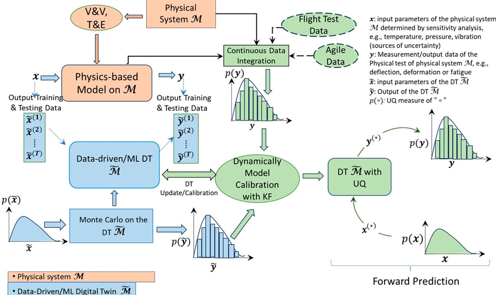
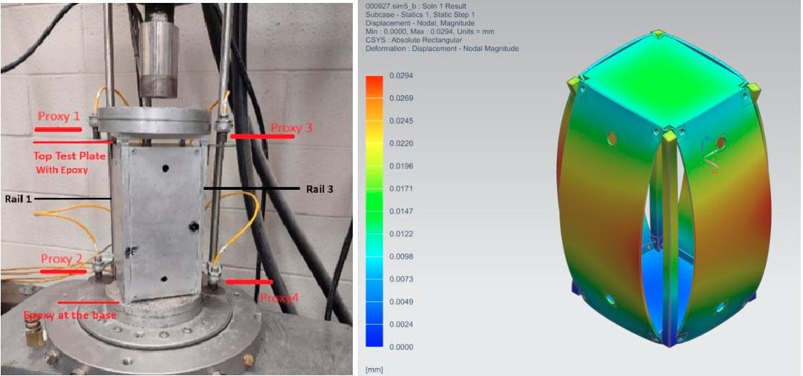
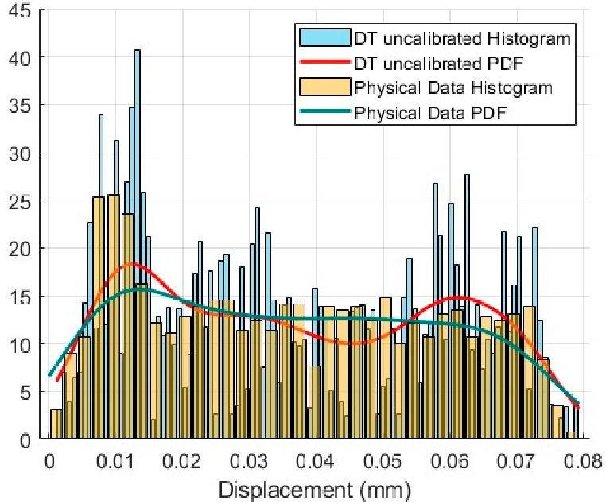
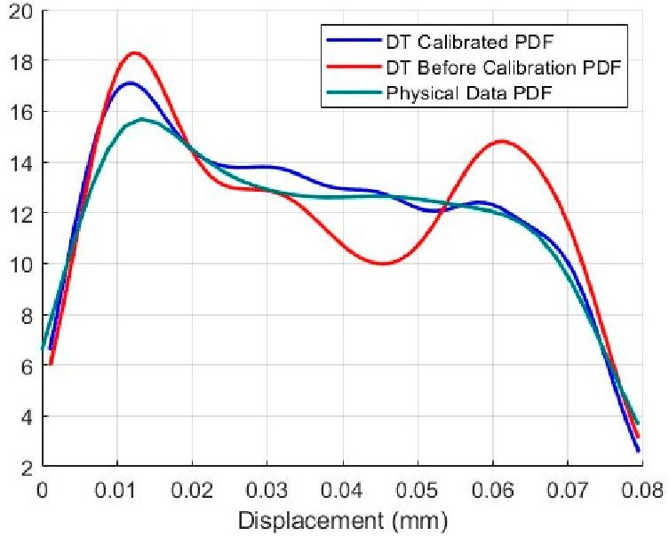
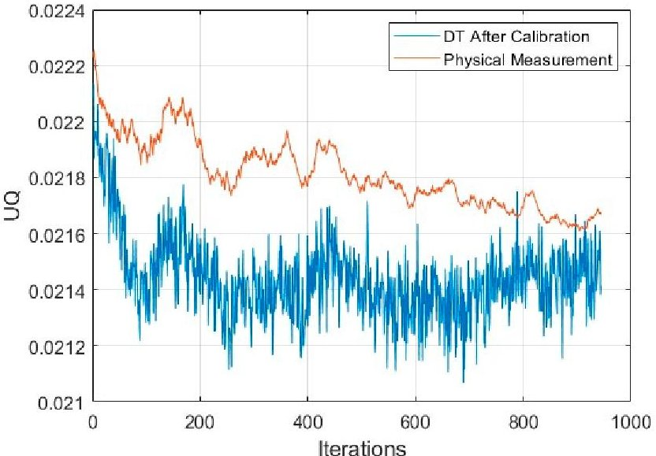
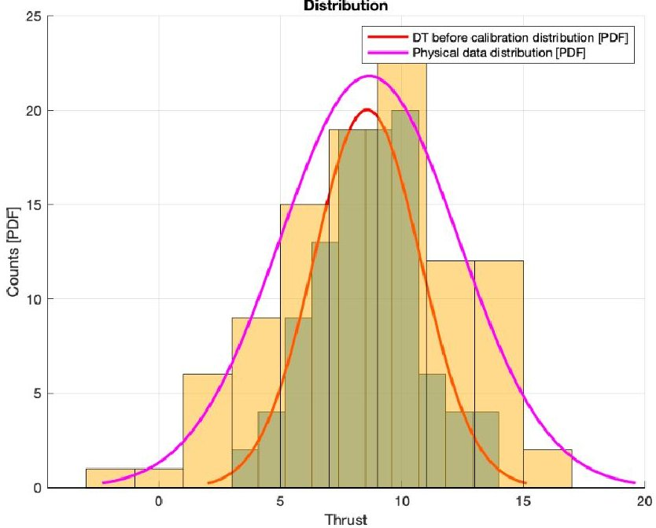
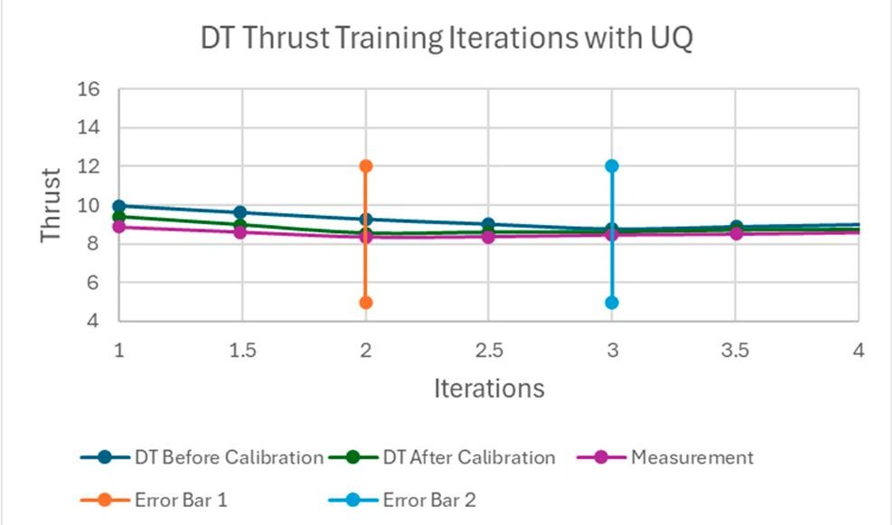
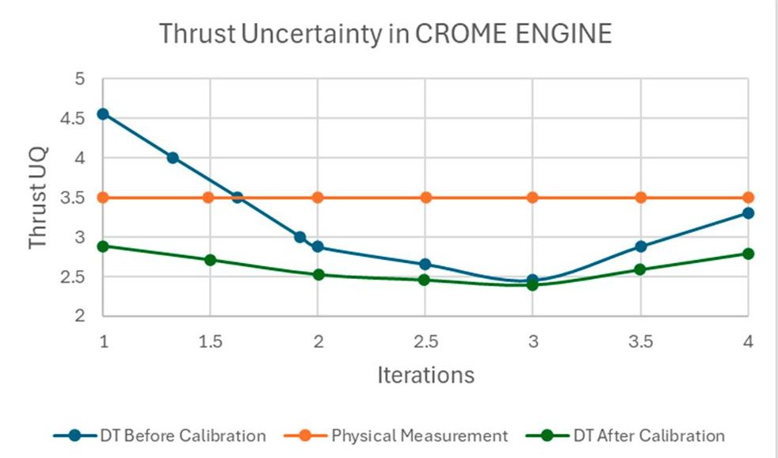

<!-- PDF_PAGE: 1 -->

Article

# Test and Evaluation of AI/ML Enhanced Digital Twin

Mario Reyes Garcia, Jesus Castillo and Afroza Shirin $ ^{ \textcircled{1} D} $

Aerospace and Mechanical Engineering, University of Texas at El Paso (UTEP), El Paso, TX 79968, USA; mcreyes@utexas.edu (M.R.G.); jjcastillo9@miners.utep.edu (J.C.)

* Correspondence: ashirin@utep.edu

## Abstract

A Digital Twin (DT) is not just a collection of static digital models at the component level of a physical system, but a dynamic entity that evolves in parallel with the physical system it mirrors. This evolution starts with physics-based or data-driven physics models representing the physical system and advances to Authoritative Virtualization or DT through continuous data assimilation, and ongoing Digital Engineering (DE) Test and Evaluation (T&E) processes. This paper presents a generalizable mathematical framework for the DE Test and Evaluation Process that incorporates data assimilation, uncertainty quantification, propagation, and DT calibration, applicable to diverse physical-digital systems. This framework will enable the DT to perform operations, control, decisionmaking, and predictions at scale. The framework will be implemented for two cases: (i) the DT of the CubeSat to analyze the CubeSat's structural deformation during its deployment in space and (ii) the DT of the CROME engine. The DT of the CubeSat will be capable of predicting and monitoring structural health during its space operations. The DT of the CROME engine will be able to predict the thrust at various conditions.

check for updates

Academic Editor: Yongzhi Qu

Copyright: 2025 by the authors. Licensee MDPI, Basel, Switzerland. This article is an open access article distributed under the terms and conditions of the Creative Commons Attribution (CC BY) license (https://creativecommons.org/licenses/by/4.0/).

Citation: Garcia, M.R.; Castillo, J.; Shirin, A. Test and Evaluation of AI/ML Enhanced Digital Twin. Systems 2025,13,656. https://doi.org/ 10.3390/systems13080656

Keywords: digital engineering; digital twin; uncertainty quantification; uncertainty propagation; model calibration

Received: 28 May 2025

Revised: 24 July 2025

Accepted: 28 July 2025

Published: 4 August 2025

## 1. Introduction

A Digital Twin (DT) is not merely a collection of static digital models at component levels of a physical system, but a dynamic representation that evolves alongside the physical system it mimics. This dynamic evolution begins with a series of digital models, physics-based or data-driven physics models representing the physical system, and progresses to Authoritative Virtualization through continuous data assimilation, and Digital Engineering (DE) Test and Evaluation (T&E) processes [1,2]. The DE T&E refers to the digital engineering Test and Evaluation process, which includes the broader T&E loop, and specific verification and validation (V&V) steps. The DE T&E process incorporates the verification and validation (V&V) of the digital model and continuous T&E of the digital model against defined requirements and operational conditions to replicate the physical system and test the system performance, reliability, and failure scenarios through uncertainty quantification (UQ), uncertainty propagation, and reducing the uncertainty of the digital model by appropriate calibration [3]. The V&V processes ensure that the digital models accurately represent the physical system, and that the system performs its intended functions. Continuous evaluation and calibration feedback loops are used to refine and improve the system, ensuring optimal performance reliability and failure scenarios. Consequently, it gains the ability to guide decision-making and influence the

<!-- PDF_PAGE: 2 -->

system's operations to meet specific objectives, adapting to changes at scale. The DE T&E process is a continual feedback process of V&V, combining and comparing both the digital model and the physical system, quantifying the uncertainty and its propagation, starting from the physical system to the digital model, making the digital model exhibit erroneous behavior if it is not handled carefully. Prior efforts, such as the AIAA definition of Authoritative Virtualization and the predictive DT foundation proposed by Kapteyn et al. in [4], emphasize the need for model fidelity, data assimilation, and continual synchronization between physical and digital counterparts. However, these frameworks often lack a closed-loop mechanism that combines data-driven learning with rigorous test and evaluation (T&E) processes. This study addresses this gap by proposing an integrated framework that incorporates physics-based and data-driven modeling, uncertainty quantification (UQ), uncertainty propagation, and dynamic calibration through Kalman filtering. The approach enables adaptive digital twins capable of real-time prediction, decision-making, and control while maintaining traceable uncertainty bounds across operational conditions.

An adaptive DT should modify its behavior in response to changes in the environment or its components. In this context, the digital model is used to represent the relevant behavioral characteristics of the physical system under study, with additional capabilities of capturing the behaviors over time or different operational conditions wherein the physical system might not even be tested. Additionally, neither system is free of uncertainty, and in the case of inconsistency between the two systems, it is important to understand if this is due to uncertainty or to unexpected divergence. More generally, uncertainty is an inherent property of any physical system and can be affected by inaccuracies in sensor readings, looseness in mechanical parts, or inexact comparisons [5-9]. These uncertainties can lead to erroneous behaviors. However, in theory, physics-based simulation models can help mitigate these uncertainties and thus correct their affected behaviors; in practice, they are subject to time constraints and are not free of uncertainty either.

This paper aims to establish a framework for a continual DE T&E and V&V process by combining and comparing physical test data, physics-based simulation data, and a data-driven digital model to reduce uncertainty and ensure that the digital model closely behaves like the physical system through UQ and propagation, and continual calibration. The framework will enable the DT to operate, control, make decisions, and predict at scale. The objectives of the framework are as follows: (i) to establish a framework for DE T&E through continuous data assimilation between the system's measurement data and the DT model data; (ii) to conduct UQ for both physical and model data, and propagate this uncertainty through the connected physical and digital models, (iii) digital model calibration as new data are available to make the digital model adaptive; and (iv) to enable the DT to predict at scale. The framework will be implemented for two cases: (i) the DT of the CubeSat to analyze the CubeSat's structural deformation during its deployment in space and (ii) the DT of the CROME engine. The DT of the CubeSat will be capable of predicting and monitoring structural health during its space operations. The DT of the CROME engine will be able to predict the thrust at various operating conditions.

This paper makes the following original contributions:

- Proposes a unified Digital Twin (DT) Test and Evaluation (T&E) framework that incorporates uncertainty quantification (UQ), model calibration, and continuous verification and validation (V&V) through a Kalman filter loop;

- Introduces a real-time data assimilation mechanism that updates the DT using physically observed data only when the measurement uncertainty is demonstrably lower than the current model prediction;

<!-- PDF_PAGE: 3 -->

- Demonstrates the predictive convergence and fidelity of the framework using two case studies: a CubeSat structural response (98% fidelity, 2.14% uncertainty) and a CROME engine thrust model (UQ reduced from 3.5 lbf to 2.6 lbf).

- Employs an Artificial Neural Network-based Digital Twin (ANN DT) to emulate physical system behavior where physics-based models are incomplete or not tractable

- Shows practical potential for deployment in high-uncertainty environments, where adaptive learning and continuous system evaluation are necessary for safety and reliability.

The structure of the paper is as follows. Section 2 describes the methods used to build the framework. Sections 3 and 4 apply the framework to two case studies: the DT of the CubeSat for structural health monitoring and the DT of the CROME engine for thrust prediction. Sections 5 and 6 present the discussion and conclusions.

## 2. Methods

This study hypothesizes that a combination of continual data assimilation and Kalman filter (KF)-based calibration can systematically reduce the predictive uncertainty of data-driven Digital Twins over time. The methodology consists of four main stages: (1) physical system testing and uncertainty modeling, (2) ANN-based Digital Twin model training, (3) Monte Carlo (MC) simulation for uncertainty quantification, and (4) KF-based calibration. Each stage is structured to incrementally improve the Digital Twin's ability to mirror its physical counterpart with high fidelity.

1. Physical test of the physical system, data generation and integration, and UQ of the data: As discussed in Section 1, the physical system is subject to uncertainty, and it is often difficult to test all operating conditions. First, a set of input parameters that are sensitive to the system responses are chosen. A preliminary sensitivity analysis is performed to rank these input parameters based on their influence on the outputs. Based on this, the dominant input variables are retained for physical testing and Digital Twin training. A set of physical tests is performed under the input parameter set and then augmented using physics-based simulations run on the digital model. These simulations serve as surrogates for the physical tests when direct testing is infeasible or limited. A two-way V&V and DE T&E process is performed between the physical system and the physics-based simulation of the digital model to ensure consistency across modalities. Data integration is structured to receive actual flight test data or any other agile measurement data. The uncertainty of the physical system is quantified by incorporating sensor noise, actuator imprecision, and measurement error. For each retained input-output pair, uncertainty is modeled using probabilistic distributions, typically Gaussian. These uncertainty measures are then propagated through the dataset. Details for each case study are described in the deployment sections.

2. A data-driven model of the DT and UQ of the DT leveraging Monte Carlo: Based on the available data from the first step, including input-output samples with quantified uncertainty bounds, a data-driven model is developed to represent the target behavior of the DT. An artificial neural network (ANN) is trained to approximate the system's input-output mapping, capturing the nonlinear behavior associated with the selected dominant parameters. The ANN architecture is optimized using ReLU activation, the Adam optimizer, and the mean squared error as the loss function. This model captures the objectives of the DT and is continuously updated in the next stage. The resulting ANN-based DT model is parameterized and provides an initial predictive capability.

3. Monte Carlo (MC) simulation for uncertainty quantification: The DT output uncertainty is quantified using MC simulations, where input samples are drawn from

<!-- PDF_PAGE: 4 -->

their respective distributions and propagated through the trained model. The resulting output is expressed as a probability distribution, which characterizes the DT's uncertainty prior to calibration.

4. A Kalman filter (KF)-based uncertainty propagation and calibration of the DT process by comparing the UQ measures of the physical system and DT: The process continuously assimilates physical measurement data and evaluates the DT by comparing its uncertainty with that of the physical system. A KF is used to perform this comparison. The DT prediction and its associated uncertainty are treated as prior estimates, while the physical measurements serve as new observations. When new data become available, the KF checks whether the uncertainty associated with the physical test data is lower than the DT's current prediction uncertainty. If this condition is satisfied, the physical data are accepted, and the ANN model parameters are updated accordingly. If the physical measurement has higher uncertainty than the DT's prediction, the update is bypassed to prevent drift or corruption due to noisy or low-fidelity data. This selective assimilation ensures that only statistically more informative measurements contribute to the model, maintaining the integrity of the DT throughout its evolution. Over time, as more high-quality data become available, the DT is incrementally updated, and its prediction uncertainty is reduced. The output of this process is a calibrated DT with lower prediction error and updated uncertainty bounds. In general, although an initial DT built from limited training data may appear to have low uncertainty, it is progressively adjusted as more reliable physical data are integrated. The KF-based update loop thus ensures convergence of the Digital Twin toward the behavior of the physical system while preserving stability throughout the estimation process.

A schematic of this overall framework is shown in Figure 1. A schematic of the overall framework is shown in Figure 1. The DT T&E loop integrates uncertainty-aware modeling, model calibration, and real-time updates driven by physical measurements. The process begins with limited but high-quality physical and simulation data. Sensitivity analysis and UQ identify the most influential parameters and assign probabilistic bounds. An ANN is trained using this uncertainty-aware dataset to construct the initial DT. The DT is trained to capture the physical system's input-output behavior, and its uncertainty is quantified using Monte Carlo simulations. As real-time physical test data become available, the DT is evaluated and calibrated through a Kalman filter, which selectively updates the model parameters based on uncertainty comparisons between the DT predictions and physical observations. If the physical data exhibits lower uncertainty, the model is updated; otherwise, the data is discarded. This assimilation loop is repeated as more data become available, incrementally improving model fidelity and reducing prediction uncertainty. The data assimilation interface manages synchronization between the physical and digital domains and ensures consistent uncertainty propagation and correction. Through this iterative process, the DT evolves to provide more accurate predictions and robust system-level decision-making under uncertainty.

<!-- PDF_PAGE: 5 -->

- UQ propagation, comparison through KF and DT calibration/update

Figure 1. This flowchart illustrates the overall framework for the testing and evaluation (T&E) of AI/ML-enhanced Digital Twins. Sensitivity analysis informs the parameter selection of the physical system and uncertainty bounds of the input-output of the physical system. A data-driven system or an ANN is trained to create an initial DT $ \tilde{M} $ using this dataset, followed by Monte Carlo analysis to characterize the UQ of the DT. Continuous flight or agile test data are assimilated and compared to DT predictions using a Kalman Filter. If the incoming data exhibit lower uncertainty, the DT is updated or calibrated. This loop enables dynamic calibration, resulting in a predictive DT that adapts over time to physical system behavior under uncertainty. When the DT is calibrated, the DT is ready for future predictions. The $ ^{*} $ represents the future prediction.

## 3. Method Deployment to Build a DT of the CubeSat Chassis

The framework is instantiated to develop the DT of the CubeSat chassis, focusing on predicting deformation and assessing structural health. The CubeSat example models the mechanical deflection of a structural panel under load using finite element analysis (FEA), with uncertainty introduced by load variability and sensor resolution.

The objective of the physical system is to perform structural load tests and determine the maximum deflection of the chassis under different mission conditions. Accordingly, the sensitive input to the system is the applied structural load. The DT of the physical system is designed to predict the maximum deflection of the chassis for a given mission structural load. Therefore, the structural load is used as the input parameter, and the maximum deflection is used as the output in the DT.

## 1. Physical test of the physical system, data generation and integration, and UQ of data:

For the physical test, several structural loads were applied to the CubeSat chassis, representing loads it may experience during mission operations. Figure 2 shows the test setup: the left image corresponds to the physical setup, and the right image shows the physics-based simulation using a finite element analysis (FEA) of the digital model under

<!-- PDF_PAGE: 6 -->

the same load conditions. Structural loads ranging from 400 lbf to 5000 lbf were considered. The details of the physical test have been presented in [10]. Comparing physical test data with simulation data shows that the proximity sensor used in the physical setup exhibits up to 10% error in measuring deformation. Additionally, deformation data were collected from the physics-based simulation under the same set of mission load scenarios. For uncertainty quantification of the input (structural load), random variations up to 10% were added. Similarly, for output uncertainty (maximum deflection), variations up to 10% were introduced. The uncertainty in both point and distributed loads was modeled using variance computed from the data and corresponding probability density functions. The uncertainty in the output (deflection) was derived from the probability density functions of the maximum deflection.

Figure 2. The physical setup of the chassis of the CubeSat (left). The physics-based simulation using the FEA of the digital model of the same physical system (right).

## 2. A data-driven model of the DT and UQ of the DT leveraging Monte Carlo:

As a data-driven model, the artificial neural network (ANN) was used for the DT. The ANN DT provided an adaptive mechanism for modeling nonlinear behavior not captured by the first-principles physics model. It allowed for the DT to learn complex input-output mappings directly from operational data, supported real-time inference, and improved robustness when structural or thermodynamic models are incomplete or oversimplified.

The ANN used one hidden layer with 64 neurons, ReLU activation, Adam optimizer （lr=0.001），MSE loss, and 200 training epochs. The ANN estimated the CubeSat's maximum deflection under given structural loads.

## 3. UQ of the DT leveraging MC:

An MC simulation was conducted on the ANN to evaluate the output distribution corresponding to the probabilistic variation in input loads. The ANN's hyperparameters form the model's parameter set P. Output uncertainty was obtained from the probability density functions of the maximum deflections estimated via MC. Figure 3 presents the probability density functions of maximum deflections from both the physical system and the initial, uncalibrated DT. These distributions were computed using kernel density estimation. This initial DT was constructed using a limited subset of the available data. Out of the full dataset, 50% was used for training and testing the ANN, and the remaining data were reserved for calibration in the next step.

<!-- PDF_PAGE: 7 -->

Figure 3. The PDF of the maximum deflections of the physical system vs. the PDF of the maximum deflections of the DT before calibration.

## 4. A KF-based uncertainty propagation and calibration of the DT process by comparing the UQ measures of the physical system and DT:

Once the ANN DT was trained and the UQ of the deflection was determined by the MC simulation, a KF was constructed to propagate the uncertainty of the DT starting from the physical system to DT. The KF compared the UQ measures of the maximum deflections obtained from the DT and the physical test data. If the UQ measure of the maximum deflection of the physical test was less compared to that of the DT, the KF accepted the data and improved the parameter set P to calibrate the DT. As new data are available (or the iteration goes on), the KF continued to update the DT accordingly. Figures 3-5 clearly show that the DT was updated as new data were integrated, and the DT converged to confirm the test data. Figure 5 shows the UQ propagations of the DT as iterations go on. Initially, the UQ of the DT was less as it was built on a limited set of data and was predicted appropriately. But as new data came (or the iteration goes on), the UQ of the physical system reduced, and the DT also adjusted the parameters and behaved more like the physical system. Figure 4 shows the PDFs of the DT before and after calibration.

Figure 4. The PDF of the maximum deflections of the DT before and after calibration.

<!-- PDF_PAGE: 8 -->

Figure 5. The UQ of the maximum deflections of the physical system vs. the UQ of the maximum deflections of the DT as the calibration process through the KF continued.

The sensitivity of the DT model was addressed through two mechanisms: (1) UQ via Monte Carlo Simulation, where model outputs were evaluated over sampled input ranges to quantify predictive variance; and (2) KF-based parameter update monitoring, where large residual deviations or convergence delays were used as indicators of model sensitivity. These sensitivity dynamics are reflected in the evolution of residual trends and UQ bounds shown in this case study. The argument is also true for the DT of the CROME engine.

Adequacy between the digital model and the physical system was assessed by analyzing the residual error trends and confirming that model predictions remain consistently within the uncertainty bounds of the measured data after calibration. When residuals stabilized and fell within expected limits, the DT was considered sufficiently accurate for predictive deployment. The argument is also true for the DT of the CROME engine.

## 5. Fidelity Check of the DT

The uncertainty quantification (UQ) of the DT after calibration was approximately 0.02146 (2.14%) , indicating that the DT achieved a fidelity of around 98%. To evaluate this, an input load of x = 2400 lbf was applied. The DT predicted a maximum deflection of y = 0.0356 mm, while the physical system recorded a maximum deflection of 0.0353 mm. The resulting error was approximately 1% (<2.14%) , which falls within the UQ margin.

A second fidelity check was conducted using a higher input load of 5000 lbf. Under this condition, the physical system reached a maximum deflection of 0.0735 mm, which was identified as a critical failure threshold due to tensile yield strength [9]. The DT prediction under the same load was 0.0704 mm, yielding a 0.14% error. Based on the probability density function estimated using kernel density estimation (KDE), the probability of failure at this load level was computed to be 94%.

## 4. Method Deployment to Build a DT of the CROME Engine

The framework was instantiated to develop the DT of the CROME engine. The CROME engine testbed evaluates thrust performance under varying chamber pressures, and that model error arises from fuel consumption dynamics and tank pressurization inconsistencies.

The first step was to define the objective of the physical system and identify the sensitive parameters. For the DT of the CROME engine, the objective was to predict thrust output, and the sensitive inputs were the mass flow rates of liquid methane $ \mathrm{(L C H_{4})} $ and liquid oxygen $ \mathrm{(L O_{2})}. $

<!-- PDF_PAGE: 9 -->

## 1. Physical test of the physical system, data generation and integration, and UQ of the data:

The CROME engine test facility provided a set of thrust measurements across a range of $ \mathrm{L C H_{4}} $ and $ \mathrm{L O_{2}} $ mass flow rates. The uncertainty of the sensitive input, namely the flow rates, was determined by the sensor error, which was $ \pm0.1 $ lbm/s based on vendor specifications. The uncertainty in the thrust measurements was calculated from the standard deviation between the measured data and the thrust predicted by the original engine model. The uncertainty of the physical test data was found to be $ \pm3.4 $ lbf. This relatively large uncertainty is attributed to the fact that the tests were conducted in a low-pressure tank. A physics-based computational fluid dynamics (CFD) model of the CROME engine was developed using STAR-CCM+. The physical test data and simulation outputs were then used together to support the development of the data-driven DT model.

## 2. A data-driven model of the DT:

The physical test data and the StarCCM+ simulation data were used to develop the data-driven DT model of the CROME engine using an Artificial Neural Network (ANN). The ANN was configured as a single-layer network with training and validation sets. The input set was determined by the mass flow rates of $ \mathrm{L C H_{4}} $ and $ \mathrm{L O_{2}} $ . The output set was the thrust of the CROME engine. The hyperparameters of the ANN were set as the DT model parameter set P. After training the ANN DT model and validating it with the physical data, a DT model was obtained that is associated with the parameter set P and a particular uncertainty. The initial uncertainty of the DT model with PPP may be considerably large, but the parameter set PPP will be updated through the UQ, UQ propagation, and the DT model calibration process, and the uncertainty of the DT model will be improved.

## 3. UQ of the DT leveraging Monte Carlo:

The MC simulation was used on the ANN DT model to estimate the thrust of the CROME engine, considering a distribution of the mass flow rates. The MC was set up by the DT model data on the range of the variable mass flow rate with a standard deviation according to the sensor data (sensor data has an uncertainty of $ \pm 0. 1 $ lbm/s) from the vendor. The DT model with MC became a core structure in the DT model for UQ. Hence, the DT predicted the thrust value with a UQ value for the outputs.

## 4. A KF-based uncertainty propagation and calibration of the DT process by comparing the UQ measures of the physical system and DT:

A KF was initialized to propagate the uncertainty of the ANN DT and calibrate the ANN DT with the parameter set P. The KF processing connected (designates a space for the physical measurement data uncertainty and the ANN DT predicted uncertainty) the physical measurement data and the DT data with a parameter set P. Initially, the KF gain was set in a way that it chose the smaller value by comparing the UQ of the DT and the UQ physical measurement data. When new test data were available (that means the thrust value and associated mass flow rates), the KF compared the UQ values of thrust values obtained from DT and the physical measurement data. If the UQ of the DT was larger than the UQ of the measurement data, the KF considered the new test data valuable, added it to the training dataset, and re-trained the ANN DT model by updating the parameter P. If the UQ of the DT was smaller than the UQ of the measurement data, the KF did not add the new data to the training set of the ANN DT. This procedure continues as new test data are available and the parameter set P is updated for DT model calibration. This is a continual process as more new physical data are available in which the KF connects the physical measurement data and DT model data, quantifies the uncertainty, propagates the uncertainty starting from input to the output of the system, and calibrates the DT

<!-- PDF_PAGE: 10 -->

model accordingly, that is, the ANN DM, is calibrated through the UQ propagation through connected physical measurement data and the DT model data. As the process goes on, the uncertainty of the DT model and physical data converges to a smaller common value.

## 5. Numerical Simulation and Results

The numerical simulation of the process was carried out. The uncertainty of the physical measurement data was obtained as $ \mp $ 3.5 lbf. It was noted that the physical test data exhibited a comparatively large uncertainty, which was attributed to the fact that the tests were conducted in a low-pressure tank. An MC simulation was also utilized to evaluate the uncertainty of the ANN-based DT model. As part of the KF configuration, the measurement data and the ANN DT model data were anchored with their respective uncertainties. At this stage, the uncertainty of the physical measurement data was 3.5 lbf, while the uncertainty of the DT model was 2.8 lbf. The probability distributions corresponding to the physical test data and the DT model data are presented in Figure 6.

Figure 6. The distributions of the DT data and the physical test data.

Three new physical test data points were added one by one, and the process was iterated while recalculating the KF gain and tracking the uncertainty of both datasets. Figure 7 shows the thrust values estimated by the DT model before calibration, the DT model after calibration, and the physical test measurements, as the KF propagated the uncertainty and calibrated the DT model. The thrust values predicted by the DT after calibration improved with each new data point added as the iterations proceeded. Figure 8 presents the uncertainty of the DT model before and after calibration, alongside the uncertainty of the physical test measurements. Although the total number of iterations was limited, the results demonstrate that the DT uncertainty decreased after each calibration step. At the fourth iteration, the uncertainty of the DT was 2.6 lbf. This uncertainty can be converted into a fidelity percentage. The fidelity of the DT at the fourth iteration was 70.5%, corresponding to an error of 29.5%.

Figure 7 demonstrates the DT model predictions before and after training with the KF designed for uncertainty propagation, respectively. The untrained DT could predict an estimate of the deformation of the sleeper-seat with a level of fidelity of uncertainty. After processing and filtering, the trained uncertainty propagation DT model could predict the deformation parallel to the physical system data. The updated noise covariance of the DT model got reduced and approached the best level of fidelity as more physical data

<!-- PDF_PAGE: 11 -->

measurements were introduced in the KF training, effectively reducing the uncertainty of the model for evaluation. The results are partially presented in [11,12].

Figure 7. The thrust of the CROME engine is estimated by the DT model before calibration, DT after calibration, and the measurement of the physical test data.

Figure 8. The uncertainty in the thrust of the CROME engine is estimated by the DT model before calibration, DT after calibration, and the measurement of the physical test data.

## 5. Discussions

The framework for the T&E of AI/ML-enhanced DT models provides a comprehensive approach to quantifying uncertainty, uncertainty propagation, and model calibration. The application of this framework on two case studies, the CubeSat's structural deformation and the CROME engine thrust prediction, illustrates how DT models can evolve and adapt to mirror their physical counterparts accurately. The primary challenge faced in creating an effective DT model is the inherent uncertainty present in both the physical systems and digital models. These uncertainties, if not properly managed, could lead to erroneous predictions and reduce the overall reliability of the DT model.

Through data assimilation between the physical systems and DT, the framework demonstrated its ability to reduce uncertainty and improve the fidelity of the DT model. The continual feedback loop involving validation, verification, and calibration is key to refining the DT's performance. The use of Monte Carlo (MC) simulations, coupled with artificial neural networks (ANNs) for modeling, proved effective in predicting structural health (CubeSat) and thrust conditions (CROME engine). Furthermore, the integration of a

<!-- PDF_PAGE: 12 -->

Kalman filter (KF) for uncertainty propagation and model calibration allowed for real-time adjustments to the DT models, which enhanced the accuracy and reliability of predictions as new data became available.

In the CubeSat case, the Digital Twin achieved a fidelity of approximately 98% with uncertainty decreasing to 2.14% . In the CROME engine case, the initial Digital Twin uncertainty of 2.8 lbf was reduced to 2.6 lbf after four KF iterations, resulting in a fidelity of 70.5% The greater accuracy in the CubeSat application is attributed to better-bounded loading conditions and reduced measurement variability, whereas the CROME engine's performance reflects the impact of sensor and tank-related noise. These outcomes provide quantitative support for the underlying hypothesis and are consistent with previously established predictive Digital Twin methodologies [1,4,13]. The framework is adaptable to evolving data streams and offers potential for deployment in complex, dynamic environments requiring continuous system monitoring and calibration.

This framework assumes moderate observability of system dynamics and relies on the availability of at least low-rate sensor measurements. Limitations include sensitivity to sensor calibration errors, the assumption of Gaussian noise in the KF framework, and the simplification of nonlinear dynamics in the ANN DT. In extreme data-scarce environments or highly nonlinear systems, future work may require integrating the Bayesian Network [13] or Probabilistic Graphical Model [4] for robustness.

## 6. Conclusions

This study introduced a detailed framework for the T&E of AI/ML-enhanced Digital Twins, focusing on UQ, uncertainty propagation, and continuous model calibration. By leveraging data-driven models, uncertainty quantification, and continuous calibration through a Kalman filter (KF), the framework ensured that the DT models could accurately replicate the behavior of their physical systems, even under varying conditions. The proposed framework was validated through two case studies: the CubeSat's structural deformation and the CROME engine's thrust prediction. The achieved results support this conclusion: in the CubeSat case, DT fidelity reached approximately 98%, with uncertainty reduced to 2.14%; in the CROME engine case, thrust uncertainty was reduced from 3.5 lbf to 2.6 lbf after four KF updates, confirming the DT's ability to learn from test data and converge toward physical accuracy. Although applied to two aerospace case studies, the proposed framework is system-agnostic. It can be extended to any Digital Twin application involving measurable inputs and outputs, and requiring predictive convergence, such as energy systems, autonomous vehicles, and industrial robots. The framework's real-time adaptability and predictive capabilities are crucial for applications where system performance must be monitored and optimized over time.

This proposed framework enables the online updating of Digital Twins in hardware-in-the-loop (HIL) or mission-critical systems with minimal instrumentation. It provides a scalable path for embedded autonomy, particularly in systems like small satellites, engine health monitoring, or flight control, where the direct measurement of latent variables is limited. Future research should focus on improving the framework's scalability and data management to better handle complex systems with limited or noisy data. This framework holds potential for broad applications in system monitoring, operational control, and decision-making across various engineering fields.

Author Contributions: Conceptualization and methodology, A.S.; software and validation, M.R.G. and J.C.; formal analysis, investigation, writing, review, and editing, M.R.G., J.C. and A.S.; supervision, A.S. All authors have read and agreed to the published version of the manuscript.

<!-- PDF_PAGE: 13 -->

Funding: This material is based on research sponsored by the Air Force Research Laboratory under agreement number FA 8650-20-2-5700. The U.S. Government is authorized to reproduce and distribute reprints for Governmental purposes, notwithstanding any copyright notation thereon.

Data Availability Statement: Data is unavailable due to privacy policy.

Conflicts of Interest: The authors declare no conflict of interest.

## References

1. AIAA Digital Engineering Integration Committee. Digital Twin: Definition & Value—An AIAA and AIA Position Paper; AIAA: Reston, VA, USA, 2020.

2. Freeman, L.; Beling, P.; Esser, K.; Wach, P.; Kerr, G.; Salado, A.; Werner, J.; Hobson, S. Positioning test and evaluation for the digital paradigm. J. Test Eval. 2023, 44, 1-11.

3. Collins, M.C.; Senechal, M.K. Test and Evaluation as a Continuum. J. Test Eval. 2023, 44, 1-16.

4. Kapteyn, M.G.; Pretorius, J.V.R.; Willcox, K.E. A probabilistic graphical model foundation for enabling predictive digital twins at scale. Nat. Comput. Sci. 2021, 1, 337-347. [CrossRef] [PubMed]

5. Hahner, S.; Heinrich, R.; Reussner, R. Architecture-Based Uncertainty Impact Analysis to Ensure Confidentiality. In Proceedings of the IEEE/ACM 18th Symposium on Software Engineering for Adaptive and Self-Managing Systems (SEAMS), Melbourne, Australia, 15-16 May 2023; pp. 126-132.

6. Hahner, S.; Seifermann, S.; Heinrich, R.; Reussner, R. A Classification of Software-Architectural Uncertainty regarding Confidentiality. In Proceedings of the SECRYPT, Lisbon, Portugal, 11-13 July 2022.

7. Herzallah, R. Uncertainty in control problems: A survey. In Proceedings of the 16th IFAC World Congress, Prague, Czech Republic, 4-6 July 2005; IFAC Proceedings Volumes 38.1, pp. 82-90.

8. Ramirez, A.J.; Jensen, A.C.; Cheng, B.H.C. A taxonomy of uncertainty for dynamically adaptive systems. In Proceedings of the 7th International Symposium on Software Engineering for Adaptive and Self-Managing Systems, SEAMS 2012, Zurich, Switzerland, 4-5 June 2012; IEEE Computer Society: Los Alamitos, CA, USA, 2012.

9. Jezéquel, J.-M.; Vallecillo, A. Uncertainty-aware Simulation of Adaptive Systems. ACM Trans. Model. Comput. Simul. 2023, 33, 1-19. [CrossRef]

10. Martell, J.A.; Siddique, A.A.; Flores-Abad, A.; Osegueda, R.A.; Luna Fong, S.A.; Choudhuri, A.R.; Quintana, J. Development of a digital engineering testing framework for CubeSat applications. J. Test Eval. 2024, 45. [CrossRef]

11. Castillo, J.; Reyes Garcia, M.; Shirin, A. Test and Evaluation Procedure to Develop a Digital Twin of the CHROM Engine. In Proceedings of the AIAA SCITECH 2025 Forum, Orlando, FL, USA, 6-10 January 2025; p. 0288.

12. Reyes Garcia, M.; Castillo, J.; Shirin, A. Test and Evaluation Procedure to Develop a Digital Twin of the Sleeper-Sat. In Proceedings of the AIAA SCITECH 2025 Forum, Orlando, FL, USA, 6-10 January 2025; p. 0287.

13. Freeman, L.J.; Wach, P.; Justin Krometis, P.B.; Atharva Sonanis, J.P. Digital Engineering Enhanced T&E of Learning-Based Systems; Acquisition Research Program: Monterey, CA, USA, 2023.

Disclaimer/Publisher's Note: The statements, opinions and data contained in all publications are solely those of the individual author(s) and contributor(s) and not of MDPI and/or the editor(s). MDPI and/or the editor(s) disclaim responsibility for any injury to people or property resulting from any ideas, methods, instructions or products referred to in the content.