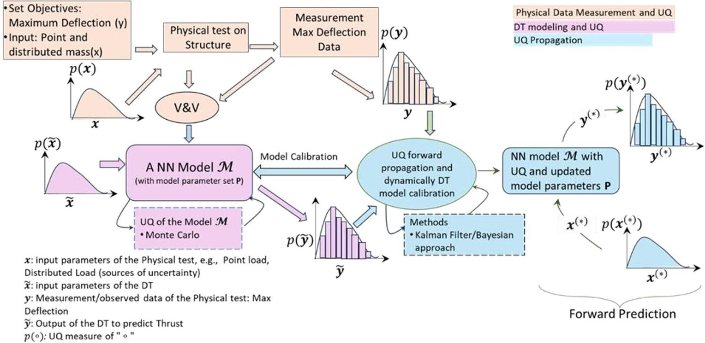
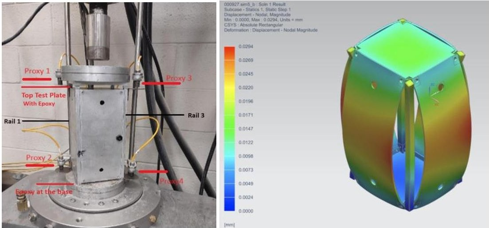
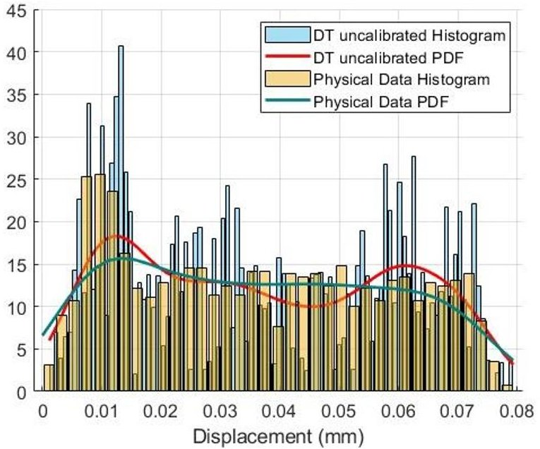
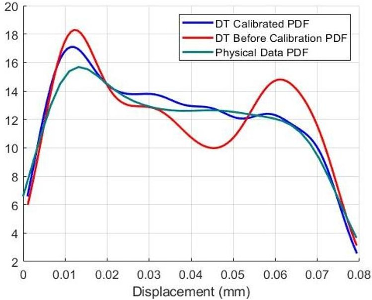
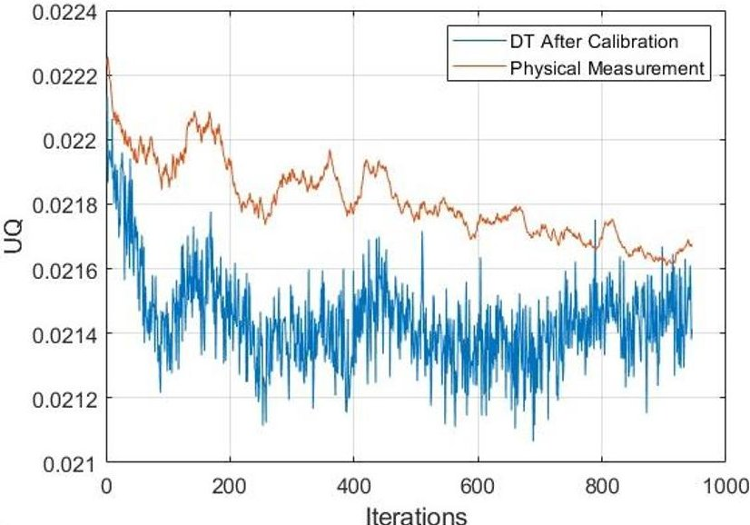

<!-- PDF_PAGE: 1 -->

# Test and Evaluation Procedure to Develop a Digital Twin of The Sleeper-sat

Mario Rayes Garcia $ ^{1} $ , Jesus Castillo $ ^{2} $ and Afroza Shirin $ ^{3 *} $

University of Texas at El Paso (UTEP), El Paso, Texas 79968, USA

Keywords: Digital Engineering, Digital Twin, Uncertainty Quantification Uncertainty Propagation, Model Calibration

## Abstract

A Digital Twin (DT) is not just a collection of static digital models at the component level of a physical system but a dynamic entity that evolves in parallel with the physical system it mirrors. This evolution starts with physics-based or data-driven physics models representing the physical system and advances to Authoritative Virtualization or DT through continuous data assimilation and ongoing Digital Engineering Test and Evaluation processes. This paper aims to create a mathematical framework for the DE Test and Evaluation Process, which incorporates data assimilation to link physical and digital models, uncertainty quantification, uncertainty propagation, and DT calibration process. This framework will enable the DT to perform operations, control, decision-making, and predictions at scale. The framework will be implemented to develop the DT of the Sleeper-sat to analyze the Sleeper-sat's structural deformation during its deployment in space. The Sleeper-sat will be a variant of previously constructed Sleeper-sats from the Aerospace Center at UTEP. The DT of the Sleeper-sat will be capable of predicting and monitoring structural health during its space operations.

## I. Introduction

A Digital Twin (DT) is not merely a collection of static digital models at component levels of a physical system but a dynamic representation that evolves alongside the physical system it mimics. This dynamic evolution begins with a series of physics-based or data-driven physics models representing the physical system and progresses to Authoritative Virtualization through continuous data assimilation and Digital Engineering Test and Evaluation processes. Consequently, it gains the ability to guide decision-making and influence the system's operations to meet specific objectives, adapting to changes at scale. Although the potential of digital twins is well-recognized, developing advanced digital twins requires mathematical and computational

<!-- PDF_PAGE: 2 -->

frameworks to evolve from a set of digital models to Authoritative Virtualization through a Test and Evaluation Process. This paper aims to develop a mathematical framework for the DT Test and Evaluation Process through data assimilation that connects the physical and digital models, along with uncertainty quantification, uncertainty propagation, and DT calibration. This will enable the DT to operate, control, make decisions, and predict at scale. The objectives of the algorithm are: (i) to establish a mathematical framework for DT Test and Evaluation (T&E) through continuous data assimilation between the system's measurement data and the DT model data; (ii) to conduct Uncertainty Quantification (UQ) for both physical and model data, and propagate this uncertainty through the connected physical and digital models, including model calibration; and (iii) to enable the DT to predict at scale. The framework will be applied to develop the DT of the Sleeper-sat to analyze the Sleeper-sat's structural deformation during its deployment in space. The Sleeper-sat will be a variant of previously constructed Sleeper-sats from the Aerospace Center at UTEP. The DT of the Sleeper-sat will be capable of predicting and monitoring structural health during its space operations.

## II. Methods

To establish a T&E process through continual data assimilation connecting the physical and digital model, uncertainty quantification, uncertainty propagation, and calibration of the DT, enabling the DT to operate, the algorithm encompasses (i) UQ of the physical test data of a physical system (ii) a data-driven model of the structural system of the Sleeper-sat, (iii) uncertainty quantification of the data-driven model leveraging Monte Carlo, and (iv) a Kalman filter-based uncertainty propagation and calibration process. The process will continuously assimilate both physical measurement data and the data-driven digital model data physical

Figure 1: A mathematical framework connecting the Sleeper-sat and DT of the structural model for UQ, UQ Propagation, and Model Calibration.

<!-- PDF_PAGE: 3 -->

system to infer the future predict with a certain level of fidelity. A schematic of the algorithm is shown in Figure 1.

## III. Method Deployment to Built a DT of the Sleeper-sat

## 1. UQ of the physical test data of a physical system

We consider a DT of the structure of the sleeper-sat that can provide deformation or structural health information. To build the physical test data, we consider. We model the structural loads on the sleeper-sat that it faces during mission by a point mass and a uniform distributed mass across the structure. In Figure 2, the left-side figure shows the test setup of the physical system, and the right-side figure shows the physics-based simulation of the digital model of the physical system under the same structural load conditions. The structural deformation and forces applied to the structure are captured for over the range from 400 lbf to 5000 lbf. Comparing the physical test data and the physics-based simulation data shows that the proxy-mater sensor of the physical setup has a maximum of 10% error in the deformation measurement. For the UQ of the output (deformation), we also add up to 10% variations. The uncertainty of the input (the point load and the distributed load) is constructed by variance from all data and probability density functions using the variance. Our output or the maximum deflection is found by from test setup of the structure under the inputs. We then obtain the UQ from the probability density functions of the max deflection.

Figure 2: The physical setup of the chassis of the CubeSat (left). The physics-based simulation using the FEA of the digital model of the same physical system (right).

## 2. Data-driven digital model of the Sleeper-sat structural model

The DT artificial neural network (ANN) is constructed as a single-layer ANN and trained to estimate a distribution of the sleeper-sat DT maximum deflection given a distribution of a point and distributed loads applied on the structure. Initially, our DT model is trained on a simulated database with assumed variances. This does not represent our physical system of interest yet,

<!-- PDF_PAGE: 4 -->

however. The DT is built as an ANN for the purpose of optimizing and evaluation of our model. As the DT gets refined with our physical measurements and their uncertainties, the model will iteratively approach a better estimate of the sleeper-sat deformation and propagate its uncertainty.

## 3. UQ of the digital model using Monte Carlo

A Monte Carlo (MC) simulation is modeled to estimate the max deflection of the sleeper-sat given a probability distribution of the forces applied. The hyperparameters of the ANN are set as the DT model parameter set P. The UQ of the output is determined from the probability density functions of the max deflections obtained from the MC simulations. In Figure 3, we plot the PDFs of the maximum deflection of the DT and the maximum deflection of the physical system. The PDFs are computed by Kernel Density Estimation. We refer to this DT as an uncalibrated one, as this digital model is built from a limited amount or an initial set of data. The uncalibrated DT will be calibrated in the next step. Out of all the data, we use 50% of the data to train and test the ANN DT, and we keep introducing the rest of the data gradually in the calibration process.

Figure 3: The PDF of the maximum deflections of the physical system vs. the PDF of the maximum deflections of the DT before calibration.

<!-- PDF_PAGE: 5 -->

## 4. Kalman filter for the propagation and calibration

Once the DT ANN is trained using our MC simulation and can quantify the uncertainty of the sleeper-sat deformation given the input parameters probability density function, a Kalman Filter (KF) is constructed to propagate the uncertainty of our DT and obtain a better estimate for our deflection values. The KF compares the UQ measures of the maximum deflections obtained from the DT and the physical test data. If the UQ measure of the maximum deflection of the physical test is less compared to that of the DT, the KF accepts the data and improves the parameter set P to calibrate the DT. As new data is available (or the iteration goes on), the KF will continue to update the DT accordingly. But as new data comes (or the iteration goes on), the UQ of the physical system reduces, and the DT also adjusts the parameters and behaves more like the physical system. Figure 4 shows the PDFs of the DT before and after calibration. Figure 3-5 clearly shows that the DT is updated as new data are integrated, and the DT converges to confirm the test data.

Figure 4: The PDF of the maximum deflections of the DT before and after calibration.

## 5. Fidelity Check of DT

The UQ of the DT after calibration is around 0.02146 (2.14%) , which indicates that the fidelity of the DT is about 98%. To test the fidelity of the DT, we set the input load of x=2400 lbf. The DT predicts the maximum deflection of y=0.0349 mm. For the same load, the physics system finds the maximum deflection of 0.0353 mm. Comparing the DT output and the physical test output, the error is about 1% (< 2.14%). For another fidelity check, we consider a similar test for a higher load of x=5000 lbf for which the maximum deflection y=0.0735 mm, a critical deflection causing failure due to tensile yield strength. The DT predicts the maximum deflection of 0.0704 mm with 0.14% error. Additionally, using the PDF using the KDE, the probability of failure is 94%.

<!-- PDF_PAGE: 6 -->

Figure 5: The UQ of the maximum deflections of the physical system vs. the UQ of the maximum deflections of the DT as the calibration process through the KF is continued.

## IV. Discussions

The framework for T&E of AI/ML-enhanced DT models provides a comprehensive approach to quantifying uncertainty, uncertainty propagation, and model calibration. The application of this framework on this case study, the CubeSat's structural deformation, illustrates how DT models can evolve and adapt to mirror their physical counterparts accurately. The primary challenge faced in creating an effective DT model is the inherent uncertainty present in both the physical systems and digital models. These uncertainties, if not properly managed, could lead to erroneous predictions and reduce the overall reliability of the DT model.

Through data assimilation between the physical systems and DT, the framework demonstrates its ability to reduce uncertainty and improve the fidelity of the DT model. The continual feedback loop involving validation, verification, and calibration is key to refining the DT's performance. The use of MC simulations, coupled with ANN for modeling, has proven effective in predicting structural health (CubeSat). Furthermore, the integration of a Kalman Filter (KF) for uncertainty propagation and model calibration allows for real-time adjustments to the DT models, which enhances the accuracy and reliability of predictions as new data becomes available.

<!-- PDF_PAGE: 7 -->

## V. Conclusions

This study presents a robust framework for T&E of AI/ML-enhanced Digital Twins, successfully applied to the CubeSat and CROME engine. By leveraging data-driven models, uncertainty quantification, and continuous calibration through a Kalman Filter, the framework ensures that the DT models can accurately replicate the behavior of their physical systems, even under varying conditions. The framework's real-time adaptability and predictive capabilities are crucial for applications where system performance must be monitored and optimized over time. Future research should focus on improving the framework's scalability, enhancing computational efficiency, and refining the uncertainty propagation mechanisms to better handle complex and data-limited scenarios.

## Acknowledgments

This material is based on research sponsored by Air Force Research Laboratory under agreement number FA 8650-20-2-5700. The U.S. Government is authorized to reproduce and distribute reprints for Governmental purposes, notwithstanding any copyright notation thereon.

## References

[1] AIAA Digital Engineering Integration Committee. "Digital Twin: Definition & Value—An AIAA and AIA Position Paper." AIAA: Reston, VA, USA (2020).