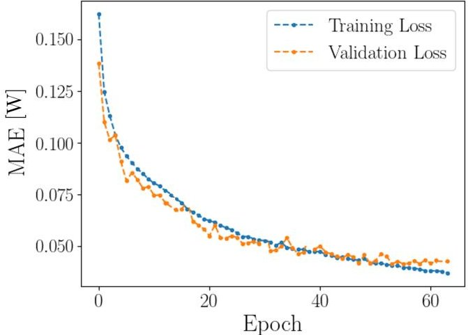
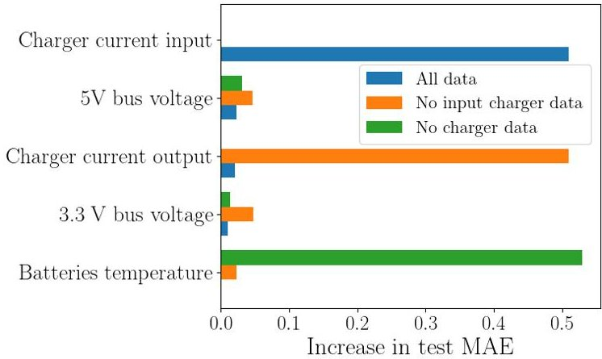
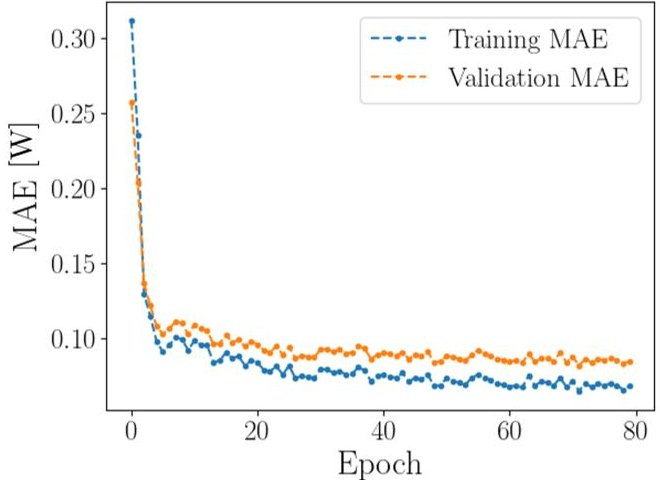
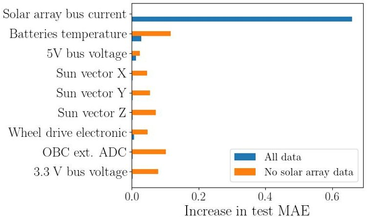
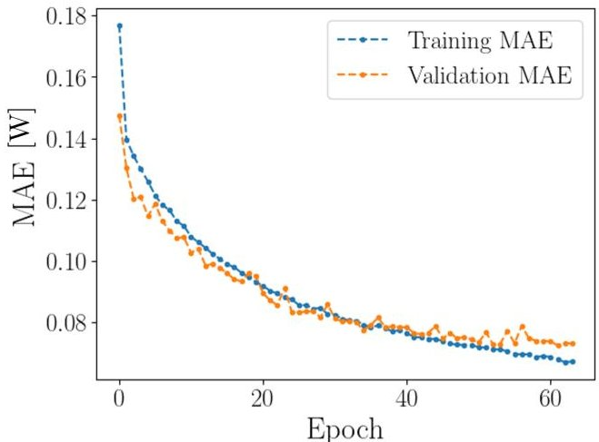
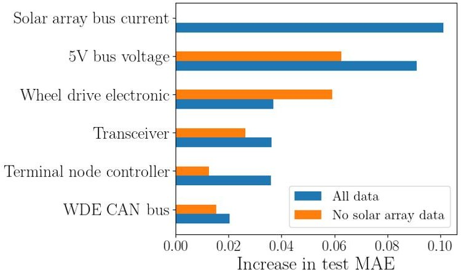
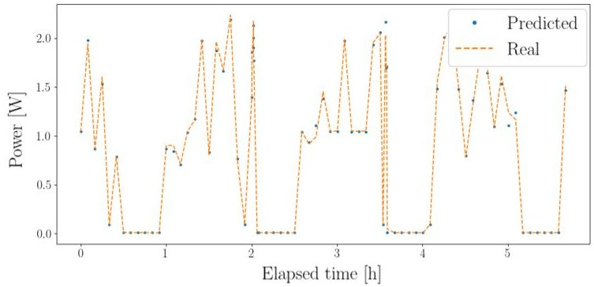
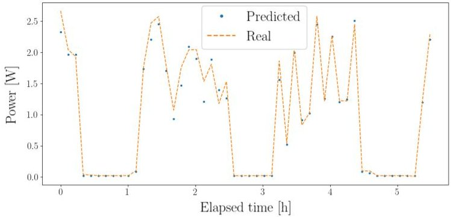
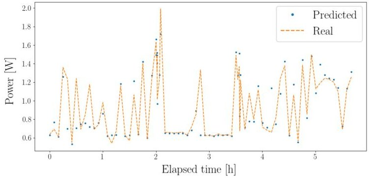

<!-- PDF_PAGE: 1 -->

# Toward Learning-Based Power Subsystem Simulation for Scalable Digital Twins in Distributed Space Systems

Angel Pan Du $ ^{1} $ and Andreas M. Hein $ ^{1} $

Abstract—Simulating the full set of satellite subsystems with high fidelity is essential for both mission design and operational planning. However, conventional simulators are often computationally intensive and difficult to scale, particularly in the context of distributed space systems (DSS) such as constellations, swarms, or formation-flying architectures. This work explores the use of machine learning (ML) as a lightweight, data-driven alternative for modeling the power subsystem, specifically, the prediction of solar array power output, battery input power, and battery output power. Using open-access telemetry from the BEESAT-4 CubeSat mission, Multilayer Perceptron (MLP) models were trained to estimate these quantities based on a wide range of onboard sensor data. The models achieved high accuracy, with mean absolute errors below 2% of the respective power ranges. Permutation Feature Importance analysis revealed that subsystem activity indicators, such as charger currents, sun vector orientation, and communication system states, play a critical role in power behavior. These findings demonstrate the feasibility of using ML to approximate subsystem dynamics with minimal computational overhead, and provide insights into sensor prioritization for future Digital Twin (DT) implementations in space systems.

## I. INTRODUCTION

Modern satellite missions rely on the accurate simulation of onboard subsystems to ensure reliability, optimize performance, and support decision-making throughout the mission lifecycle. As satellite architectures evolve toward more distributed configurations, such as constellations, swarms, and formation-flying systems, the complexity of these simulations increases significantly. In such distributed space systems (DSS), the interactions between subsystems become more dynamic and interdependent, requiring scalable modeling approaches that can keep pace with operational demands and system growth significantly with the number of operating units [1].

Within each satellite, the power subsystem plays a fundamental role in enabling the operation of all other subsystems. It supplies energy to critical components such as communication modules, attitude control systems, and payloads, and its performance is influenced by environmental conditions, orbital dynamics, and subsystem activity. In this sense, the power subsystem acts as a functional central node, given their interconnectivity across subsystems [2]. For example, a surge in communication activity or a maneuver by the attitude control system will directly affect power consumption, while a drop in solar input due to eclipse conditions will impact all downstream operations. Any disruption or failure

within the power subsystem can trigger severe and cascading consequences throughout the spacecraft, potentially leading to mission degradation or even complete loss. Statistical analyses underscore this vulnerability, with a notable 27% of on-orbit spacecraft failures directly attributed to issues within the power subsystem [3]. Solar arrays and batteries, in particular, are critical for sustaining satellite functionality, and their performance is tightly coupled with orbital dynamics, thermal environment, and different mission operational scenarios. As a result, the ability to accurately predict power generation and storage behavior is fundamental to the overall simulation of the system.

Many current physics-based models possess a high degree of precision, but as mentioned above, these can experience a slower computational performance for large-scale DSS [4]. This limitation motivates the exploration of alternative solutions to maintain high accuracy while reducing computational overhead. In this context, machine learning (ML) emerges as a promising solution. By leveraging historical data and system telemetry, ML models can learn complex, nonlinear relationships within and across subsystems, enabling rapid and accurate predictions without the need for extensive numerical simulations.

The use of ML in subsystem modeling not only enhances computational efficiency but also aligns with the broader vision of developing Digital Twins (DTs) for space systems [5]. DTs are virtual duplicates that mirror the performance of physical assets in real time, and their utility hinges on the ability to simulate satellite subsystems with both speed and precision [6]. Using ML-based models on the power subsystem for DSS can thus offer a foundational step toward achieving scalable and dynamically responsive DTs.

This paper investigates the application of ML techniques to predict the behavior of the power subsystem, specifically the power of solar arrays and batteries. By addressing this critical subsystem, the aim is to demonstrate how data-driven models can contribute to more efficient and larger scale simulations, with the ultimate objective of supporting the design, verification, and operation of next-generation space architectures.

## II. BACKGROUND

Over the past decades, a variety of simulation platforms have been developed to support the design, analysis, and operation of satellite systems. These tools aim to reproduce the behavior of multiple subsystems within an integrated environment. Tools such as SIMULUS [7], Sedaro [8], Basilisk [9], [10], STK [11], GMAT [12], and Orekit [13]

<!-- PDF_PAGE: 2 -->

represent a spectrum of capabilities which are essential for mission planning and validation, offering detailed insights into subsystem interactions and system-level performance.

Nevertheless, these tools often come with significant limitations. Many require the integration of multiple third-party software components, complex configuration procedures, and substantial computational resources. This complexity becomes even more pronounced in the context of DSS. The need for more lightweight, modular, and data-driven alternatives is increasingly evident, especially for subsystems like power, which serve as a central node in satellite operations and are tightly coupled with other system behaviors.

In recent years, artificial intelligence (AI) has emerged as a transformative tool in space engineering, offering new paradigms for data analysis, system modeling, and autonomous decision making [14]. Within satellite systems, ML has been applied in various domains, including on-board data processing [15], [16], fault detection [3], [17], imagery [18], [19], and communications optimization [20], [21]. One common ML architecture used in these applications is the Multilayer Perceptron (MLP) [21], [17], [18], [19], a type of feedforward artificial neural network composed of multiple layers of interconnected nodes. MLPs are capable of learning complex nonlinear mappings between input and output spaces, making them suitable for tasks such as signal classification, anomaly detection, and predictive modeling [22].

Despite the growing adoption of ML in satellite operations, its application to the power subsystem remains relatively unexplored. This presents a compelling opportunity, by training ML models on historical telemetry and operational data, it is possible to predict solar array output and battery performance with high accuracy, while significantly reducing the computational burden associated with traditional simulation methods. Such models could serve as lightweight surrogates for physics-based simulators, enabling faster design iterations and real-time operational support, particularly in DSS contexts where scalability is paramount.

In the context of DTs, the identification of key parameters that influence subsystem behavior is essential for building accurate and efficient virtual representations. For the power subsystem, this involves understanding which variables, such as solar incidence angles or batteries temperature, most significantly affect energy generation and storage. Once these parameters are known, it becomes possible to determine the minimal set of sensors required to monitor the physical system in real time. This targeted sensing strategy not only reduces hardware complexity and data transmission needs but also enhances the responsiveness and scalability of the DT framework.

## III. METHODOLOGY

Building upon the limitations identified in conventional simulation platforms and the emerging role of ML in satellite systems, this work proposes a data-driven approach to model the power subsystem of a satellite. Specifically, the methodology focuses on predicting the solar array power output and

both the input and output power of the onboard batteries. These predictions aim to serve as lightweight surrogates for physics-based simulations, enabling scalable and efficient modeling within DSS.

## A. Data Source

The dataset used in this study originates from the BEESAT-4 mission, developed by the Technical University of Berlin and funded by the German Aerospace Center (DLR). BEESAT-4 is a 1U CubeSat, designed to validate advanced technologies in orbit, featuring DLR's Phoenix GPS receiver for precise orbit determination [23]. The mission provides open-access telemetry data [24], including measurements of the power subsystem, which are used to train and evaluate the machine learning models in this study.

In particular, a subset of available telemetry was selected, focusing on variables relevant to satellite power generation, storage, and consumption, as well as environmental and attitude-related parameters that can influence power behavior. The features included in this subset can be grouped into the following categories:

- Power Subsystem: solar array currents and bus voltage, battery voltages and temperatures, charger input and output currents, 5V and 3.3V bus voltages.

- Attitude and Orbit Control System (AOCS): gyroscope rates, reaction wheel speeds, AOCS quaternions, desired quaternions, sun vector components, magnetic field vectors, magnetic coil states and polarities.

- Thermal: external analog-to-digital converter (ADC) temperatures, magnetic field sensor temperatures, onboard computer and payload temperatures.

- Communications and system state: transceiver signal strengths, system mode indicators, controller area network (CAN) bus activity, antenna deployment status, onboard computer IDs, and startup flags.

- Orbital parameters: Earth-centered inertial (ECI) coordinate position.

From these inputs, the target variables — namely, the solar array power, battery input power, and battery output power can be derived by combining the corresponding voltage and current measurements. To ensure the integrity of the learning process, the voltage and current values used in these calculations were excluded from the input features during the training of their respective prediction models.

The data set comprises 39,300 samples, each containing these multiple telemetry features mentioned above.

## B. Model Architecture

To model the behavior of the power subsystem, an MLP architecture was selected. An MLP is a neural network composed of an input layer, one or more hidden layers, and an output layer. The neurons represent a linear combination of the outputs of the previous layer followed by a non-linear function. This architecture is suitable for regression tasks and has been successfully applied in other satellite subsystems, such as communications optimization and onboard data processing, making it a natural choice for this application. Given

<!-- PDF_PAGE: 3 -->

this precedent, the present study investigates whether MLPs can be effectively extended to predict the power subsystem performance.

Although telemetry data are inherently sequential and more advanced time series models such as long-short-term memory (LSTM) networks could potentially capture temporal dependencies more effectively, this study prioritizes simplicity and computational efficiency. The use of MLP serves as a first step in evaluating the feasibility of data-driven modeling for satellite power subsystems. By selecting a lightweight architecture, the aim is to establish a baseline performance without the added complexity of temporal models, aligning with the broader objective of exploring practical and scalable ML solutions in space systems. Future work could explore more sophisticated temporal models, particularly for tasks involving forecasting or anomaly detection, where dynamic behavior plays a more critical role.

## C. Training and Validation

The dataset was randomly partitioned using a 85-15 split, allocating 85% for training and validation, and 15% for testing. The training set is used to fit the model parameters, the validation set supports hyperparameter tuning and helps prevent overfitting, and the test set provides an unbiased evaluation of the generalization capability of the model. To enhance robustness, k-fold cross-validation was also employed. This technique divides the dataset into k subsets, training the model k times with a different subset held for validation each time [25]. In this case, 5 folds were applied to the 85% portion, meaning that the model was trained five times, each time using a different 17% subset for validation and the remaining 68% for training. The performance metrics, including the loss values, were averaged across the five folds to obtain a reliable estimate of the model predictive accuracy. This approach ensures that the model performance is not overly dependent on a particular data split and provides a more reliable estimate of its predictive accuracy.

Several loss functions were tested to evaluate model performance, including: mean squared error, which penalizes larger errors more heavily; L1 loss, that computes the absolute error offering robustness to outliers; and smooth L1 loss, which combines the benefits of MSE and L1 providing stability and smooth gradients [26].

Furthermore, hyperparameter tuning was performed to optimize model performance by testing various activation functions, such as ReLU, ReLU6, leaky ReLU, tanh, and sigmoid [27], and experimenting with different optimizers including Adam, Stochastic Gradient Descent (SGD), Adagrad, Adadelta, and RMSprop [28]. A summary of the hyperparameter ranges tested is presented in Table I, which outlines the configurations explored during model development.

The relative error was initially considered as the evaluation metric due to its intuitive interpretation as a percentage of the true value. However, it proved unsuitable for this dataset, as many target values approach zero, making the relative error unstable or undefined. Therefore, the Mean Absolute Error (MAE) was adopted as the primary metric, offering a more

TABLE I: Training parameter ranges for the prediction models

<table border="1"><tr><td>MLP Layers</td><td>3-10</td></tr><tr><td>Hidden neurons</td><td>32-1024</td></tr><tr><td>Epochs</td><td>5-100</td></tr><tr><td>Batch sizes</td><td>8-128</td></tr><tr><td>Learning rates</td><td>$10^{-5}-10^{-2}$</td></tr><tr><td>Dropout</td><td>0.0-0.3</td></tr><tr><td>Activation functions</td><td>ReLU,ReLU6,leakyReLU,tanh,and sigmoid</td></tr><tr><td>Optimizers</td><td>Adam,SGD,Adagrad,Adadelta,and RMSprop</td></tr><tr><td>Loss functions</td><td>MSE,L1Loss,SmoothL1Loss</td></tr></table>

robust and interpretable measure of prediction accuracy in absolute terms.

## D. Feature Importance Analysis

To better understand which input variables influence the model predictions more significantly, the Permutation Feature Importance (PFI) was applied [29]. This technique provides a model-agnostic measure of feature relevance by evaluating the change in prediction error when the values of a single feature are randomly shuffled. The underlying idea is that if a feature is important, permuting its values will disrupt the ability of the model to make accurate predictions, thereby increasing the error.

The process begins by establishing a baseline score on an untouched dataset, in this case it would be the MAE, as previously discussed, using the test subset. Subsequently, for a single feature, its values are randomly shuffled, and the model performance is re-evaluated on this newly corrupted dataset. This shuffling and scoring process is repeated multiple times to ensure a stable and reliable importance estimate. Ultimately, the final feature importance is calculated as the difference between the baseline score and the average score across all permutations. This importance of a feature j, denoted as $ i_{j} $ , is formally defined by Eq. (1):

$$
i _ {j} = s - \frac {1}{K} \sum_ {k = 1} ^ {K} s _ {k, j},
$$

where s is the reference score in the original data, K is the number of shuffling repetitions, and $ s_{k,j} $ is the model score in the data with the feature j shuffled in repetition k.

This method was chosen for its simplicity, interpretability, and compatibility with any supervised learning model, including neural networks. However, it is important to acknowledge its limitations, particularly in handling correlated features and capturing interaction effects. More advanced explainability techniques, such as SHAP (SHapley Additive exPlanations) or LIME (Local Interpretable Model-Agnostic Explanations) [30], [31], could offer deeper insights into model behavior by accounting for feature interactions and providing localized attributions. Nonetheless, given the exploratory nature of this study, PFI offers a practical and sufficiently informative approach for initial analysis. By applying PFI to the trained MLP, the most influential parameters for

<!-- PDF_PAGE: 4 -->

the different predictions are identified. These insights are valuable not only for model refinement but also for informing the design of digital twins (DTs), as they help determine which physical sensors are essential for real-time monitoring and prediction.

## IV. RESULTS AND DISCUSSION

This section presents the results of the ML models for the three different prediction tasks within the satellite power subsystem. The models were trained and evaluated independently, using tailored input features and training configurations for each case. The following subsections detail the prediction of solar array power, battery input power, and battery output power. For each, the performance of the model, the selected features and the training outcomes are discussed. In particular, the Adam optimizer consistently emerged as the optimal choice in all simulations. To provide a comparative overview and facilitate reproducibility, a summary of the identified hyperparameters that perform best in each prediction, with their respective resulting MAE, is provided in Table II.

## A. Solar array power prediction

The model for predicting solar array power was trained using the full set of telemetry features described in Section III-A, excluding those directly used to compute the target variable. This ensures that the model learns from indirect indicators and avoids trivial correlations.

The training and validation loss curves, corresponding to their MAE, shown in Fig. 1, exhibit adequate learning behavior, with both losses decreasing steadily over epochs and stabilizing, indicating successful convergence without signs of overfitting. This model achieved a MAE of 0.0306 W in the test subset. Given that the solar array power values in this subset range from 0 to 7 W, this error represents less than 0.44% of the full scale.

Fig. 1: MAE from the training and validation sets from the solar array power prediction with the model configuration from Table II

To assess feature relevance, PFI was applied and the results, presented in Fig. 2, highlight that features related to the power subsystem, such as the input and output currents

of the charger and the voltage safety checks, from the 5V and 3.3V buses, are the most influential. This aligns with physical expectations, as these parameters reflect the energy flow and regulation of the system.

Fig. 2: PFI from the test set from the solar array power, across different model inputs with the respective model configurations from Table II

To further evaluate the robustness of the model, since the correlation between features was not fully explored, key features were selectively removed. Firstly, removing charger input currents slightly increased the MAE to 0.0486 W, which can be considered within an acceptable margin. Secondly, removing the output currents from the charger led to a more noticeable degradation, with the MAE rising to 0.1038 W. PFI from these two models are also represented in Fig. 2.

It is noteworthy that, in this last configuration, battery temperature sensors emerged as more influential, hinting their indirect role in power regulation. This suggests that in the absence of measurements from the batteries chargers, the model learned to rely on secondary indicators like thermal output to infer the system's power regulation state, highlighting the complex interplay between features.

In summary, the most critical features for predicting solar array power are the charger currents, followed by the buses voltage safety measurements, and battery temperatures. These findings not only validate the learning process of the model, but also inform sensor prioritization.

## B. Batteries input power

The same modeling procedure described in the previous subsection was applied to predict the battery input power. As before, all telemetry features were used except those directly involved in calculating the prediction output. The training and validation loss curves, equivalent to their MAE, illustrated in Fig. 3, demonstrate a smooth and consistent decline over epochs, stabilizing toward convergence. In this case, the results obtained were an MAE of 0.0248 W in the test subset. Since the battery input power values in this subset range from 0 to 2.6 W, this error corresponds to approximately 0.95% of the full scale.

A strong dependence on the currents of the solar panel bus was manifested through the PFI analysis from Fig.

<!-- PDF_PAGE: 5 -->

TABLE II: Optimal achieved MAE from the different predictions with their corresponding model hyperparameters

<table border="1"><tr><td colspan="2">Prediction</td><td>MLP Layers</td><td>Loss Function</td><td>Activation function</td><td>Hidden neurons</td><td>Learning rate</td><td>Epochs</td><td>Batch size</td><td>Dropout</td><td>MAE [W]</td></tr><tr><td rowspan="3">Solar array power</td><td>All inputs</td><td>8</td><td>L1Loss</td><td>LeakyReLU</td><td>850</td><td>10-4</td><td>50</td><td>32</td><td>0.1</td><td>0.0306</td></tr><tr><td>No input charger data</td><td>6</td><td>L1Loss</td><td>ReLU6</td><td>256</td><td>10-4</td><td>80</td><td>32</td><td>0.15</td><td>0.0486</td></tr><tr><td>No charger data</td><td>5</td><td>L1Loss</td><td>ReLU</td><td>256</td><td>10-3</td><td>64</td><td>16</td><td>0.1</td><td>0.1038</td></tr><tr><td rowspan="2">Batteries input power</td><td>All inputs</td><td>6</td><td>L1Loss</td><td>ReLU</td><td>256</td><td>10-4</td><td>80</td><td>32</td><td>0.15</td><td>0.0248</td></tr><tr><td>No solar array data</td><td>7</td><td>Smooth L1Loss</td><td>ReLU</td><td>512</td><td>10-4</td><td>64</td><td>64</td><td>0.25</td><td>0.0708</td></tr><tr><td rowspan="2">Batteries output power</td><td>All inputs</td><td>5</td><td>L1Loss</td><td>Sigmoid</td><td>512</td><td>10-3</td><td>64</td><td>16</td><td>0.20</td><td>0.0695</td></tr><tr><td>No solar array data</td><td>6</td><td>L1Loss</td><td>LeakyReLU</td><td>64</td><td>10-3</td><td>50</td><td>32</td><td>0.15</td><td>0.1098</td></tr></table>

Fig. 3: MAE from the training and validation sets from the batteries input power prediction with the model configuration from Table II

4, which is physically intuitive, since battery charging is influenced by the energy harvested from the solar arrays. To test the robustness of the model, these features were removed, resulting in an increased MAE of 0.0708 W. In this configuration, the most influential features became the batteries temperature, followed by the OBC external ADC temperature and the Sun vector components along the X, Y, and Z axes.

Fig. 4: PFI from the test set from the batteries input power, across different model inputs with the respective model configurations from Table II

The OBC ext. ADC refers to an analog-to-digital converter associated with the onboard computer, typically used to monitor environmental or internal system parameters such as temperature or voltage levels. Its relevance in this context

probably stems from its role in monitoring thermal conditions and electrical health, which indirectly affect battery charging efficiency. The Sun vector represents the direction of the incoming solar radiation relative to the body frame of the satellite. Its importance is justified by the fact that the orientation of the satellite with respect to the Sun directly affects the illumination of solar panels, and thus the energy available for charging the batteries.

To synthesize, the most critical features for predicting battery input power are the solar panel bus currents, followed by batteries temperature, OBC ADC and Sun vector readings.

## C. Batteries output power

The prediction of battery output power followed the same methodology as in previous tasks, excluding direct contributors to the target variable. The training and validation loss curves, corresponding to their MAE, are shown in Fig. 5, and these indicate consistent learning behavior with a stable convergence pattern. An MAE of 0.0695 W on the test subset was accomplished. This value represents approximately 1.96% of the full scale, which is from 0 to 3.54 W. While still within acceptable bounds, this error is higher than in the previous tasks, suggesting a more complex dependency structure.

Fig. 5: MAE from the training and validation sets from the batteries output power prediction with the model configuration from Table II

The PFI, shown in Fig. 6, revealed that the most influential feature was again the solar bus current, which is expected given its role in overall power distribution. However, several additional features also exhibited significant importance,

<!-- PDF_PAGE: 6 -->

such as the wheel drive electronic, transceiver, terminal node controller and wheel drive electronics controller area network (WDE CAN) bus. All of these parameters are binary signals that indicate whether their respective subsystems are active.

Fig. 6: PFI from the test set from the batteries output power, across different model inputs with the respective model configurations from Table II

Firstly, the wheel drive refers to the actuator for attitude adjustments. Secondly, the transceivers and terminal node controllers are digital components that manage radio communication and internal data routing, respectively. Lastly, the WDE CAN bus facilitates the specific communication between the wheel drive system and other subsystems. Although these features do not directly quantify power consumption, their activation states provide valuable contextual information. Collectively, these components highlight the broader interdependence between the power subsystem and other functional units.

In this model, the 3.3V bus, which was more relevant in previous tasks, appeared to be of reduced importance. This may be attributed to its limited involvement in powering high-consumption components, which are typically the primary drivers of battery discharge. To assess model sensitivity, the most important feature was removed, resulting in a substantial increase in MAE to 0.1098 W.

Considering the above, battery output power is influenced by a broader set of subsystem activities compared to input power. The performance of the model reflects this complexity, with key predictors spanning power distribution, actuators, and communication systems. These findings reinforce the interconnected nature of power consumption across satellite subsystems and highlight the importance of monitoring both electrical and operational states.

Fig. 7 summarizes the model predictions over a sample time window, compared with the real telemetry data. Due to the limited availability of open-access satellite telemetry, the BEESAT-4 mission was selected as a representative case. Although the study focuses on a single mission, this is sufficient for a feasibility assessment of applying ML to model satellite power subsystems, which is the aim of this work. The framework is designed to be modular and scalable, although mission-specific factors may require model retraining for other platforms. Future work will explore transfer

learning and mission adaptation to improve generalizability, as well as evaluate model robustness under anomalous or degraded conditions to enhance reliability in non-nominal scenarios.

(a) Solar array power

(b) Batteries input power

(c) Batteries output power

Fig. 7: Comparison between real and predicted power data over time.

## V. CONCLUSIONS AND FUTURE WORK

This study demonstrates the feasibility and effectiveness of using ML to model the satellite power subsystem, specifically to predict solar array power output, battery input power, and battery output power. By training MLP models on BEESAT4 CubeSat telemetry, high predictive accuracy was achieved, with MAE of 0.0306 W for solar array power, 0.0248 W for battery input power, and 0.0695 W for battery output power. These values represent 0.44%, 0.95%, and 1.96% of the full scale of their respective measurements, underscoring the precision of the model relative to their operational range.

A key outcome of this work is the identification of the most influential parameters for each prediction task. Charger currents and bus voltage safety sensors were critical for solar array power estimation, while solar panel bus currents and sun vector orientation played a central role in battery

<!-- PDF_PAGE: 7 -->

input power prediction. Moreover, the batteries temperature appeared to be of relevance as well. For battery output power, subsystem activity indicators, such as attitude control, communication, and internal data routing, emerged as dominant features, highlighting the interconnected nature of satellite operations.

Although this study does not include a direct comparison with conventional physics-based simulators, the structure and behavior of the ML models suggest that they could offer computational advantages. This possibility would make them promising candidates for integration into scalable simulation frameworks, particularly in the context of distributed space systems where efficiency is critical. However, quantifying these potential gains remains an open research question.

Thus, future work could include a systematic evaluation of computational performance against traditional simulators to better understand the trade-offs between accuracy and efficiency. Such comparisons would help validate the practical benefits of ML-based modeling and guide their integration into real-time or large-scale mission planning tools.

Furthermore, future research could explore the integration of real-time telemetry in ML techniques to continuously adapt to the mission, enhancing fidelity and responsiveness for DT implementations. Alternatively, the current approach can be extended to serve as a simplified surrogate model within larger simulation frameworks, for mission design and operational planning.

In conclusion, this work contributes to the growing body of research on data-driven satellite modeling and lays the groundwork for more intelligent, scalable, and responsive space system simulations.

## ACKNOWLEDGMENT

This project has received funding from the Horizon Europe research and innovation programme under the Marie Skłodowska Curie grant agreement No 101120117. Funded by the European Union. Views and opinions expressed are however those of the authors only and do not necessarily reflect those of the European Union or European Research Executive Agency. Neither the European Union nor the granting authority can be held responsible for them.

## REFERENCES

[1] J. A. Ruiz-de-Azua, C. Araguz, A. Calveras, E. Alarcón and A. Camps, "Towards an Integral Model-Based Simulator for Autonomous Earth Observation Satellite Networks," IEEE International Geoscience and Remote Sensing Symposium (IGARSS 2018), Valencia, Spain, 2018, pp. 7403-7406, doi: 10.1109/IGARSS.2018.8517811.

[2] J. Lee, E. Kim and K. G. Shin, "Design and Management of Satellite Power Systems," IEEE 34th Real-Time Systems Symposium, Vancouver, BC, Canada, 2013, pp. 97-106, doi: 10.1109/RTSS.2013.18.

[3] M. Hedayati, Ailin Barzegar, and A. Rahimi, "Fault Diagnosis and Prognosis of Satellites and Unmanned Aerial Vehicles: A Review," Applied Sciences, vol. 14, no. 20, pp. 9487-9487, Oct. 2024, doi: 10.3390/app14209487.

[4] C. Araguz, E. Bou-Balust, and E. Alarcón, "Applying autonomy to distributed satellite systems: Trends, challenges, and future prospects," Systems Engineering, vol. 21, no. 5, pp. 401-416, Mar. 2018, doi: 10.1002/sys.21428.

[5] W. Yang, Y. Zheng and S. Li, "Application Status and Prospect of Digital Twin for On-Orbit Spacecraft," IEEE Access, vol. 9, pp. 106489-106500, 2021, doi: 10.1109/ACCESS.2021.3100683.

[6] Y. Jiang, S. Yin, K. Li, H. Luo and O. Kaynak, "Industrial applications of digital twins," Philosophical Transactions of the Royal Society A: Mathematical, Physical and Engineering Sciences, vol. 379, no. 22072021, doi: 10.1098/rsta.2020.0360.

[7] ESA-ESOC, "SIMULUS-NG: a new era for satellite simulation," esa.int, 2020. https://esoc.esa.int/content/simulus-ng-new-era-satellite simulation

[8] Sedaro, "Sedaro Platform," 2019. https://www.sedaro.com/

[9] P. W. Kenneally, S. Piggott, and H. Schaub, "Basilisk: A Flexible, Scalable and Modular Astrodynamics Simulation Framework," Journal of Aerospace Information Systems, vol. 17, no. 9, pp. 496-507, 2020, doi: 10.2514/1.1010762.

[10] Autonomous Vehicle Systems (AVS) Laboratory, "Welcome to Basilisk: an Astrodynamics Simulation Framework." https://hanspeterschaub.info/basilisk/

[11] Ansys, "Ansys STK: Software for Digital Mission Engineering and Systems Analysis." https://www.ansys.com/products/missions/ansysstk

[12] NASA, "General Mission Analysis Tool (GMAT)." https://software.nasa.gov/software/GSC-17177-1

[13] CS Group and others, "Orekit: An accurate and efficient core layer for space flight dynamics applications." https://www.orekit.org/

[14] P. A. Oche, G. A. Ewa and N. Ibekwe, "Applications and Challenges of Artificial Intelligence in Space Missions," in IEEE Access, vol. 12, pp. 44481-44509, 2024, doi: 10.1109/ACCESS.2021.3132500

[15] R. K. Verma, R. K. Verma, A. Chaudhary, H. Bhati and G. Bisht, "Advanced AI & ML Applications in Satellite Image Processing & Industry," 3rd International Conference on Disruptive Technologies (ICDT), Greater Noida, India, 2025, pp. 66-69, doi: 10.1109/ICDT63985.2025.10986339.

[16] Ahmad, Hafez, and Jhara, Shakila Islam, "AI-Driven Approaches for Real-Time Satellite Data Processing and Analysis," Accelerating Informatics for Earth Science, Jun. 2024, doi: 10.13140/RG.2.2.36652.27528.

[17] A. Rahimi and A. Saadat, "Fault isolation of reaction wheels onboard three-axis controlled in-orbit satellite using ensemble machine learning," Aerospace Systems, vol. 3, pp. 119-126, 2020, doi: 10.1007/s42401-020-00046-x.

[18] Augustynek, Krzysztof, and Kornel Warwas. "Real-time drive functions optimisation of the satellite by using MLP and RBF neural network." Dyn. Syst. Control Stability, 2015, pp. 53-64.

[19] Y. V. Venkatesh and S. Kumar Raja, "On the classification of multispectral satellite images using the multilayer perceptron," Pattern Recognition, vol. 36, no. 9, pp. 2161-2175, Sep. 2003, doi: 10.1016/s0031-3203(03)00013-x.

[20] L. Massaccesi, "Machine Learning Software for Automated Satellite Telemetry Monitoring," Master Thesis, Università di Bologna, 2020.

[21] L. Xie, Y. Zhuang, X. Zhuang, and X. Zeng, "Satellite Interference Signal Classification Using Improved MLP Model," 2021 IEEE International Conference on Unmanned Systems (ICUS), vol. 19, no. 2771-7372, pp. 635-640, Oct. 2022, doi: 10.1109/icus55513.2022.9986568.

[22] H. Taud and J. F. Mas, "Multilayer Perceptron (MLP)," in Geomatic Approaches for Modeling Land Change Scenarios, M. Camacho Olmedo, M. Paegelow, JF. Mas, and F. Escobar, Eds., Springer, 2017, pp. 451-455, doi: 978-3-319-60801-3_27.

[23] J. Harbeck et al., "Lessons learned from operating three CubeSats until their consecutive re-entries," in Small Satellites Systems and Services Symposium (4S 2024), May 2024, doi: 10.1117/12.3061559.

[24] StudOps, "BEESAT-4 Data Sets," 2023, Available: https://www.tu.berlin/en/raumfahrttechnik/teaching/student initiatives/studops/experiments

[25] P. Refaeilzadeh, T. Lei and H. Liu, "Cross-validation," Encyclopedia of database systems, Springer, Boston, MA, 2009. pp. 532-538, doi: 10.1007/978-0-387-39940-9_565

[26] I. Goodfellow, Y. Bengio, and A. Courville, "Deep Learning," Genet Program Evolvable Mach, vol. 19, pp. 305-307, 2018, doi: 10.1007/s10710-017-9314-z

[27] Y. LeCun, Y. Bengio and G. Hinton, "Deep Learning," Nature, vol. 521, no. 7553, pp. 436-444, 2015, doi: 10.1038/nature14539.

[28] S. Ruder, "An overview of gradient descent optimization algorithms," 2017, doi: 10.48550/arXiv.1609.04747

[29] H. Kaneko, "Interpretation of machine learning models for data sets with many features using feature importance," vol. 8, no. 25, pp. 23218-23225, 2023, doi: 10.1021/acsomega.3c03722

<!-- PDF_PAGE: 8 -->

[30] D. Gaspar, P. Silva, and C. Silva, "Explainable AI for intrusion detection systems: LIME and SHAP applicability on multi-layer perceptron," IEEE Access, vol. 12, pp. 30164-30175, 2024, doi: 10.1109/ACCESS.2024.3368377

[31] A. Salih, Z. Raisi-Estabragh, I. Boscolo Galazzo, P. Radeva, P., S. E. Petersen, K. Lekadir, and G. Menegaz, "A perspective on explainable artificial intelligence methods: SHAP and LIME," Advanced Intelligent Systems, vol. 7, no. 1, 2025, doi: 10.1002/aisy.202400304