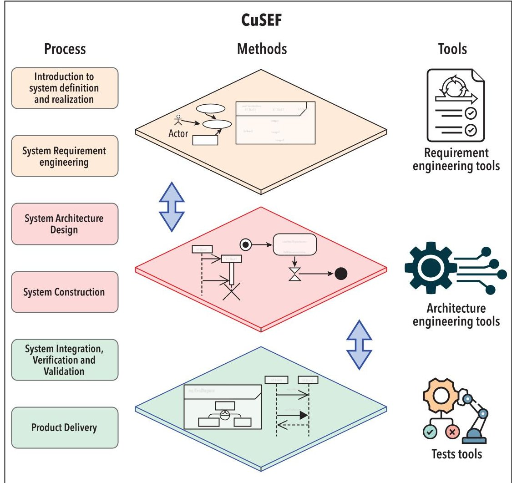

<!-- PDF_PAGE: 1 -->

# Towards a CuSEF (CubeSat Systems Engineering Framework)

Mamadou Lamine Ndao, mamadou-lamine.ndao@expleogroup.com; Prof. Claude Baron, claude.barron@laas.fr; and Dr. Ines Ben Hamida, ines.ben-hamida@expleogroup.com

Copyright 2025 by Mamadou Lamine Ndao, Claude Baron, and Ines Ben Hamida. Permission granted to INCOSE to publish and use.

## ABSTRACT

CubeSat missions are increasingly adopted by NewSpace actors despite their limited resources and fast-paced development cycles, often leading to high failure rates. Traditional systems engineering standards such as ISO/IEC/IEEE 15288 and ECSS-E-ST-10C are rarely applied because they are considered too complex for very small entities (VSEs). This paper introduces the CubeSat systems engineering framework (CuSEF), a lightweight yet rigorous framework tailored for CubeSat class IV/V missions. CuSEF adapts ISO 29110 as a structural foundation and incorporates selected ECSS requirements to ensure mission reliability. The framework combines a simplified lifecycle model with model-based systems engineering (MBSE) practices and leverages artificial intelligence (AI) to accelerate tasks such as requirements drafting and test case generation. Early application of CuSEF demonstrates improvements in cost, schedule, and robustness without compromising agility. Future work includes large-scale validation across diverse CubeSat teams and enhanced integration of digital continuity and AI-driven design optimization.

KEYWORDS: CubeSat, systems engineering, ISO 29110, ECSS-E-ST-10C, NewSpace, MBSE, artificial intelligence, lightweight processes, small satellite development

## INTRODUCTION

CubeSat technology has lowered the barrier to entry into space, enabling small organizations and universities to rapidly design and launch miniature satellites. This trend has also created a market in which companies are jostling to sell these systems and the services they provide.

CubeSat projects are very often carried out in very specific contexts with small teams and limited budgets. What's more, in the face of stiff competition, industry players are trying to compress development time to keep costs down and deliver the product as quickly as possible. This leads to a very high mission failure rate.

A key factor of this high failure rate is the lack of a rigorous yet lightweight systems engineering process adapted to these small, fast-paced projects. Traditional standards

for systems engineering (such as the ISO/IEC/IEEE 15288 lifecycle standard or space agency process standards like the European Cooperation for Space Standardization (ECSS)) are often not applied on CubeSat projects, as they can be overly complex, resource-intensive, or ill-suited to the constraints of CubeSat-class missions. NewSpace teams (small start-ups or academic groups with limited budgets and personnel) typically operate in a "garage development" style - ad hoc design-build efforts using off-the-shelf parts (Venturini 2018) - which can result in missed engineering steps and inadequate testing. This observation raises the following research question: How can a systems engineering framework be designed to preserve the methodological rigor of space standards while remaining lightweight and practical enough

for CubeSat-scale projects?

This paper introduces the CubeSat Systems Engineering Framework (CuSEF), tailored for NewSpace, that bridges the gap between heavyweight standards and the practical realities of CubeSat development. CuSEF combines a simplified process model with modern methods and tools to provide structure without undue burden. By adapting the ISO 29110 standard for very small entities and integrating essential requirements from the ECSS space engineering guidelines, the framework aims to enhance the reliability of CubeSat missions while optimizing development cost and time (Ndao 2024a). The following sections review the state of the art, detail the CuSEF framework (its process, methods, and toolset), discuss expected benefits, and conclude with future perspectives.

<!-- PDF_PAGE: 2 -->

Figure 1. CuSEF framework presentation

## STATE OF THE ART AND FOUNDATION OF THE CUSEF

CubeSats were initially developed as educational tools in academic environments, but over the past decade they have been increasingly adopted by commercial NewSpace companies and governmental programs for operational missions. These projects are typically carried out by small teams - often micro-enterprises or student groups - working with limited resources and tight schedules. However, numerous studies have shown that such missions suffer from a high failure rate, particularly in academic contexts. According to an analysis by the Aerospace Corporation, only about 45% of academic CubeSat missions achieve full success, compared to 77% for commercial projects where teams are more experienced and processes more structured (NASA 2018, Venturini 2018). The causes are well known compressed development cycles, poor documentation, incomplete testing, and the lack of systems engineering expertise in teams.

In this context of CubeSat projects, full-scale systems engineering standards are rarely applied. Standards such as ISO 15288, which defines a comprehensive lifecycle for complex systems, are often considered disproportionate to the scope

of CubeSat missions. Similarly, the ECSS-E-ST-10C standard, while highly relevant to space projects, contains a dense set of prescriptive requirements and documentation deliverables. As Ndao (2024b) highlights, it is "not suitable for systems engineering for Class IV and V CubeSats due to the high number and complexity of requirements." Class IV and V CubeSats are nanosatellites of low (Class IV) to very low (Class V) complexity, generally small in size (1U to 3U), with a simple architecture, using commercial technologies (COTS) and developed with lean processes typical of educational missions, technology demonstrators, or low-criticality projects. Full compliance would overwhelm small development teams and exceed available time and resources - especially considering ECSS was originally designed for large institutional programs.

To overcome this, some initiatives have sought to create tailored frameworks for very small teams. One promising foundation is ISO/IEC 29110-4-1:2018, a standard specifically aimed at Very Small Entities or VSEs. (VSEs are organizations with fewer than 25 people.) It offers simplified lifecycle processes that are more accessible and less burdensome than traditional standards (ECSS 2023). ISO

29110 defines lightweight project management and engineering practices suitable for software and systems development in small structures. In theory, ISO 29110 can help structure CubeSat projects. In practice, its generic form lacks key domain-specific elements essential for space missions such as space environmental testing, model philosophy, or mission-level verification strategies. Therefore, to truly support CubeSat Class IV and V projects, a new approach is needed: building on the ISO 29110 process baseline, while enriching it with selected ECSS requirements, and complementing them with appropriate methods and tools. This allows for the development of an engineering framework that is both realistic and robust.

## CUSEF FRAMEWORK PRESENTATION

CuSEF aligns processes, methods, and tools to provide a small CubeSat team with an appropriate level of rigor, avoiding the complexity of traditional standards (see Figure 1).

## a. Process: ISO 29110 framework + ECSS supplements

The CuSEF process is built upon the ISO/IEC 29110-4-1:2018 framework, which is structured into six lightweight phases: introduction to system definition and realization, system requirements engineering, system architecture design, system construction, system integration verification and validation, and product delivery. This lifecycle is specifically suited for VSEs (ISO 29110 2023). To ensure relevance for space missions, the process is enriched with targeted contributions from the ECSS standards, focusing only on high-value elements such as design reviews, mission analysis, and selected document requirements definitions (ECSS 2023). The result is a "minimum viable process" process flow that retains all critical milestones and deliverables (Ndao 2024b) without inflating cost or duration.

## b. Methods

CuSEF is based on a model-based systems engineering (MBSE) approach that centralizes requirements, design, and analysis within a coherent digital model. The process begins with simplified diagrams. - the horned beast to define mission needs and the octopus to map external context-followed by functional decomposition and allocation to subsystems. Key trade-off analyses (mass, power, thermal) are performed early in the model. This structured yet lightweight method ensures coherence, traceability, and design rigor, while remaining suited to the constraints of small CubeSat teams.

<!-- PDF_PAGE: 3 -->

## c. Tools: MBSE+AI

To support these methods, CuSEF integrates a toolchain that includes MBSE platforms like Capella or Cameo Systems Modeler, which facilitate architecture modeling, automatic document generation, and consistency checks. Artificial intelligence is also leveraged to accelerate engineering tasks: large language models assist in drafting requirement sets, and tools like Expleo Sophia can generate test procedures fully traceable to the system requirements in just a few seconds (Expleo 2023). Finally, CuSEF promotes the use of open APIs to link requirement management tools, system models, and test benches - ensuring

continuous data synchronization across the engineering lifecycle.

With these bricks, a small team has a "just enough" framework: discipline, visibility, and automation without bureaucracy.

## CONCLUSIONS

CuSEF demonstrates that a well-balanced mix of ISO 29110 processes, tailored ECSS requirements, MBSE models, and AI support can increase CubeSat reliability without stifling agility. Ongoing missions will provide quantitative measures of success; meanwhile, early results show gains in cost, schedule, and robustness.

Future work will focus on extending

the validation of the framework through experiments with small enterprises and university CubeSat teams, to consolidate its applicability across diverse NewSpace contexts. In parallel, the MBSE dimension of CuSEF will be expanded and detailed including the specification of modeling languages, toolchains, and traceability mechanisms - to reinforce digital continuity throughout the engineering lifecycle. Additional research will also explore AI-driven design space exploration and the publication of open-access models so that the broader NewSpace community can adopt, validate, and evolve the framework collaboratively.

## REFERENCES

ECSS. 2023. Software Product Assurance - Block 4. European Cooperation for Space Standardization. (Definition of very small entity and ISO 29110 simplified process for small teams).

- Expleo. 2023. Expleo Sophia: GenAI Test Case Generator. Expleo.com. (Use of generative AI to produce test cases from requirements, demonstrating AI tool integration in systems engineering).

- Guardigli, M. et al. 2023. "Integrating MBSE into CubeSat Development: BOREALIS Mission Case Study." Aerospace 12 (3): 256. (Benefits of MBSE in small satellite design - single source of truth, reduced development time, etc.).

- NASA/Aerospace Corporation. 2018. "8-Steps to Improving Small Sat Mission Success." The Aerospace Corporation - Aerospace.org article. (Guidelines for CubeSat success and common issues; "garage" development context).

- Ndao, M. L., and C. Baron. 2024a. "Simplification of the ECSS-E-ST-10C for Class IV and V CubeSat." 10th IEEE Int. Symposium on Systems Engineering (ISSE 2024). (Noting ECSS-E-ST-10C unsuitability for small CubeSats).

- Ndao, M. L. and C.Baron. 2024b. "An Adaptation of the ISO/IEC/IEEE 29110 System Engineering Process for CubeSats Development. 34th Annual INCOSE International Symposium, INCOSE, July, Dublin, IE. (hal-04798057).

- Venturini, C. C. 2018. "Improving Mission Success of CubeSats." 32nd Annual AIAA/USU Conference on Small Satellites. (Statistics on CubeSat failure rates in academia vs industry).

- (Interviews in) Venturini, C. C. 2018. "Improving Mission Success of CubeSats." AIAA/USU Conf. (On the importance of documentation for knowledge transfer in high-turnover teams).

## ABOUT THE AUTHORS

Mamadou Lamine Ndao is a PhD candidate in embedded systems engineering at the University of Toulouse. His research focuses on model-based systems engineering (MBSE) for nanosatellite projects, integrating ISO 29110 and ECSS-E-ST-10C standards. He has contributed to missions like GAINDESAT-1A and DJIB1A and developed CuSEF, a CubeSat systems engineering framework.

Professor Claude Baron (M'94) received the PhD in computer science from Institut national des sciences appliquées de Toulouse, Toulouse, France, in 1995. She is a professor of computer science with the University of Toulouse, Toulouse, France, where she develops her research activities with the LAAS-CNRS Laboratory. Her current research interests include systems engineering, collaborative engineering, and project management. Ms. Baron was a recipient of IEEE and INCOSE awards for her results.

Dr. Ines Ben Hamida is a mechatronics engineer with a PhD in mechanical systems from the University of Poitiers (2021), where she focused on dimensional synthesis algorithms for parallel robots. She is currently an R&D engineer at Expleo Group, working on the integration of systems engineering processes in innovative project development.