<!-- PDF_PAGE: 1 -->

Article

# Towards a Unified Modeling and Simulation Framework for Space Systems: Integrating Model-Based Systems Engineering with Open Source Multi-Domain Simulation Environments

Serena Campioli *ID, Giacomo Luccisano *ID, Davide Ferretto ID and Fabrizio Stesina ID

Department of Mechanical and Aerospace Engineering (DIMEAS), Politecnico di Torino, 10129 Turin, Italy; davide.ferretto@polito.it (D.F.); fabrizio.stesina@polito.it (F.S.)

* Correspondence: serena.campioli@polito.it (S.C.); giacomo.luccisano@polito.it (G.L.)

## Abstract

Academic Editor: Hyun-Ung Oh

Academic Editor: Hyun-Un

Received: 31 July 2025

Revised: 17 August 2025

Accepted: 18 August 2025

Published: 21 August 2025

Citation: Campioli, S.; Luccisano, G.; Ferretto, D.; Stesina, F. Towards a Unified Modeling and Simulation Framework for Space Systems: Integrating Model-Based Systems Engineering with Open Source Multi-Domain Simulation Environments. Aerospace 2025,12,745. https://doi.org/10.3390/ aerospace12080745

The increasing complexity of modern space systems requires a more integrated and scalable approach to their design, analysis, and verification. Model-Based Systems Engineering (MBSE) has emerged as a powerful methodology for managing the complexity of systems through formalized modeling practices, but its integration with dynamic and domain-specific simulations remains limited. This paper presents the first version of the unified Modeling and Simulation (M&S) framework MOSAiC (Modeling and Simulation Architecture for integrated Complex systems), which connects MBSE with open source, multi-domain simulation environments, with the goal of improving traceability, reusability, and fidelity in the system lifecycle. The architecture proposed here leverages ARCADIA-based models as authoritative sources, interfacing with simulation tools through standardized data exchanges and co-simulation strategies. Using a representative space mission scenario, the framework ability to align functional and physical models with specialized simulations is demonstrated. Results show improved consistency between system models and simulation artifacts, reduced integration costs, and improved early validation of design choices. This work supports the broader vision of digital engineering for space systems, suggesting that a modular, standards-based approach to unifying MBSE and simulation can significantly improve system understanding and development efficiency.

Copyright: 2025 by the authors. Licensee MDPI, Basel, Switzerland. This article is an open access article distributed under the terms and conditions of the Creative Commons Attribution (CC BY) license (https://creativecommons.org/licenses/by/4.0/).

Keywords: systems engineering; model-based systems engineering; CubeSat; preliminary design; open source; modeling and simulation

## 1. Introduction

According to the International Council on Systems Engineering (INCOSE), Systems Engineering (SE) is a comprehensive and cross-disciplinary methodology that supports the effective development, deployment, operation, and eventual decommissioning of complex engineered systems. It relies on established systems thinking, scientific and technical principles, and management practices [1]. Fundamentally, SE takes a broad, integrated view over a full project lifecycle, and it is responsible for ensuring coordination and oversight among the various disciplines involved, being characterized by a recursive approach.

Throughout the lifecycle of a system, models and tools play a vital role. Traditionally much of critical information has been managed in the form of documents created using standard office software, such as Microsoft Word or Excel. These document-based approaches tend to tie the content to a specific format or viewpoint intended for a particular

<!-- PDF_PAGE: 2 -->

audience. Consequently, multiple documents are often produced to suit different stakeholders, leading to redundancy and overlapping content [2]. This fragmentation makes it difficult to establish and maintain a single, consistent source of truth, as well as seamless dependability and traceability [3]. Over time, especially in complex projects with frequent updates and document revisions, the risk of data inconsistency increases significantly.

At its core, Model-Based Engineering (MBE) emphasizes the use of models as the primary means of guiding system development, covering specification, design, integration, validation, and even operational phases [4]. For many organizations, adopting MBE represents a significant departure from conventional document-centric methods and traditional lifecycle models, which often rely on a strict, linear "waterfall" structure involving sequential phases, such as system definition, design, and qualification. One of the primary challenges in bridging the gap between traditional engineering disciplines, including Systems Engineering and MBE, lies in the shift in emphasis: rather than supporting the engineering process primarily through documentation, MBE relies on the progressive development of increasingly detailed digital models. These models serve not just as artifacts but as active tools for communication, decision-making, and system understanding throughout the project lifecycle.

Focusing on the Systems Engineering side, INCOSE SE Vision 2020 [5] defines ModelBased Systems Engineering (MBSE) as "the formalized application of modeling to support system requirements, design, analysis, verification and validation activities beginning in the conceptual design phase and continuing throughout development and later life cycle phases". Moreover, Bindschadler et al. [6] highlight how using MBSE techniques enhances rigor and repeatability in developing complex systems, ultimately lowering costs and risks. It also facilitates structured, reusable representations of requirements and operation processes, improving overall system design efficiency. At the same time, it is to be noted how, while these benefits can result in significant long-term savings, the adoption of MBSE may also introduce shortterm cost increases due to the need for new tools, training, and adjustments to existing workflows [7].

Several studies are available in the literature concerning the exploitation of MBSE techniques in the early stages of space missions and system design. Ref. [8] proposes a model-based approach for an effective design and the verification of space tug in the conceptual phase. Notably, [9,10] propose approaches to characterize small satellite configurations and behaviors along typical missions, mainly focusing on the architectural analysis of space segments. The description of methodologies and approaches to move from a document-based approach to a model-based one is, in fact, a very common trend in the literature since many years ago, as also specified in [2]. But it usually fails to move beyond the pure hierarchical view of system architecture, with a potential lack of connection with the simulation world. On the other hand, works like [11,12] try to bridge this gap, proposing solutions to link the architecture analysis with simulation execution and initial mission analysis by exploiting proprietary tools and related plug-ins. The aim is to ensure seamless integration of software and development environments by seeking a flexible structure for the connectors and adapters, which is, in any case, limited to specific applications because this also does not rely on interoperability standards [13]. To partially mitigate this problem, the use of open access development platforms is growing, as shown in [14], also in conjunction with Agile methodologies.

Moreover, Scholz and Juang [15] highlight the advantages of Open Design the integration of Open Source Software (OSS) and Open Source Hardware (OSHW)particularly within domains such as space mission development. This paradigm is especially beneficial for resource-constrained projects, as commonly encountered in academic environments. By promoting transparency and data sharing across institutions, Open Design supports the

<!-- PDF_PAGE: 3 -->

creation of more cost-effective, reliable, and innovative solutions. The collaborative nature of the open source community, characterized by extensive peer review and the reuse of proven designs, further contributes to enhanced system robustness.

In the context of CubeSat and small-satellite development, adopting an open source approach streamlines the design process by enabling the reuse of existing hardware and software modules. It also facilitates interdisciplinary and inter-institutional collaboration, as contributors can work independently on various subsystems without the constraints imposed by proprietary limitations or non-disclosure agreements [15].

In this work, an MBSE approach was adopted and enriched by integrating simulation techniques, aiming to enhance the overall effectiveness and robustness of system architecture development. By exploiting the open access tool Capella and combining the structured, model-centric methodology of MBSE with the dynamic insights offered by simulations, the authors sought not only to improve the precision and consistency of architectural definitions but also to foster innovation in the early stages of design. This integrated approach serves as a starting point for validating design choices, exploring alternatives, and mitigating risks early in the development process. Ultimately, it contributes to a more rigorous and reliable SE workflow, supporting informed decision-making throughout the lifecycle of complex systems. To demonstrate the applicability and benefits of the proposed framework, a small satellite mission for wildfire monitoring was used as a case study.

This paper is organized as follows. Section 2 presents the context and background of the modeling and simulation domains, including an overview of the Architecture Analysis and Design Integrated Approach (ARCADIA) method. Section 3 then introduces the proposed integrated Modeling and Simulation (M&S) framework, detailing the modeling and analysis modules. Subsequently, Section 4 validates the framework to a wildfire-monitoring satellite case study mission, presenting its results, as well as architectures and budgets analyses. Section 5 provides a critical discussion of the results and lessons learned. Finally, Section 6 concludes the paper with a summary of the proposed work and directions for future work.

## 2. Modeling and Simulation

## 2.1. Modeling Context

Throughout the SE lifecycle, a consistent volume of information is created, gathered, and maintained, ranging from details about the system under development to its constituent components and external interfaces or environments. MBSE addresses the complexity of managing this information by organizing it within integrated models. These models serve as a centralized and authoritative repository, offering a unified reference point, often described as a "single source of truth", that captures the technical foundation of the system in a structured and accessible way. These methods enable the collection of all relevant information, such as stakeholder-specific views, requirements, behavioral models, and system relationships, within compact, organized, and easily navigable digital models. This integrated structure allows teams to trace and validate assumptions, design decisions, and system behaviors throughout the product lifecycle.

In MBSE, depending on the stage, models can be abstract representations, collecting contributions from different disciplines to address specific needs, especially at an early stage of the system development, and later evolve in more detailed and concrete depictions, aligning with the physical implementation of the system.

A model is a representation, either graphical, mathematical, or physical, of a concept, phenomenon, relationship, structure, or system. A variety of models, with their associated modeling languages, have been used to tackle various aspects of a system and different

<!-- PDF_PAGE: 4 -->

types of systems, but, in general, they can be grouped into three main types, as specified in Table 1.

Table 1. Types of system models by primary characteristics and uses.

<table border="1"><tr><td>Type</td><td>Description</td><td>Ref</td></tr><tr><td>Descriptive</td><td>Describes logical relationships within a system and between systems, including component hierarchy, interconnections, functional roles, and test cases used to verify requirements.
Examples include functional or physical architectures and 3D geometric representations.</td><td>[16]</td></tr><tr><td>Analytical</td><td>Defined by mathematical relations that enable quantifiable analysis of system parameters.
Dynamic models capture the system&#x27;s behavior over time.
Static models perform calculations without time-based variation.</td><td>[16]</td></tr><tr><td>Hybrid Descriptive-Analytical</td><td>Integrates both descriptive and analytical elements to provide a comprehensive model of the system.</td><td></td></tr></table>

Further classification can be performed for both descriptive and analytical models, according to their domain of representation. They can be characterized based on the (i) properties of the systems (e.g., performance, mass properties, power, etc.), (ii) design and technology implementations (e.g., electrical, software, mechanical, etc.), (iii) subsystems and products (e.g., power distribution), or (iv) system applications (e.g., aerospace systems, medical devices, etc.). A single model can incorporate different domain categories.

System models support the system's analysis, specification, design, verification, and validation, while also facilitating the communication of specific information. Table 2 reports the main purposes of the models, throughout the product lifecycle.

Table 2. Applications of system models across the lifecycle.

<table border="1"><tr><td>Purpose</td><td>Description</td></tr><tr><td>Characterize existing system</td><td>Existing systems may suffer from poor documentation; modeling aids in maintenance and evaluation for potential improvements.</td></tr><tr><td>Mission and system concept formulation and evaluation</td><td>Models are employed early in the system lifecycle to(i)define and evaluate different mission and system concepts,(ii)perform trade-space evaluation,and(iii)ensure system requirements align with stakeholder needs before advancing to detailed design phases.</td></tr><tr><td>System design synthesis and requirement flowdown</td><td>Models support system architecture solutions and flowing mission/system requirements down to system components.</td></tr><tr><td>Support for system integration and verification</td><td>Models help integrate software and hardware components into a unified system and support system verification activities.</td></tr><tr><td>Support for training</td><td>Models form the basis of simulators used for training personnel.</td></tr><tr><td>Knowledge capture and system design evolution</td><td>Models capture and preserve critical design knowledge within an organization for future reference and evolution.</td></tr></table>

<!-- PDF_PAGE: 5 -->

If system models are used to define the different parts/components of the system, on the one hand, descriptive models can be employed for system architecture, identifying and segmenting the system's components, as well as defining their interconnections and relationships. On the other hand, analytical models can characterize physical and quality performances to establish the necessary values for specific properties of components, ensuring that they meet the general requirements of the system. Furthermore, an executable system model that shows the interaction among system components can be implemented to verify that component requirements align with system behavioral expectations. Hence, each type of model captures different dimensions of the same system, and component designs shall meet the requirements specified by the system models. Consequently, the design and analysis models must be integrated to guarantee traceability back to the requirements. Various design disciplines such as electrical, mechanical, and software develop their own models, each reflecting distinct aspects of the overall system. It is clear that these different models need to be sufficiently integrated to provide a unified solution for the system.

However, to the authors' best knowledge at the moment of writing and as discussed by Nowodzienski and Navas [17], most of the models implemented today with modeling languages such as Unified Modeling Language (UML), Systems Modeling Language (SysML), or methodologies like ARCADIA, are mainly descriptive, with limited prediction capabilities. Descriptive models are typically characterized by inherent ambiguities and simplifications, which, while facilitating the early adoption of MBSE methodologies within large and complex aerospace projects, may also introduce uncertainties that compromise the reliability of system analysis and decision-making. This becomes particularly problematic in safety-critical and high-performance domains, where accuracy and traceability are critical. In response to the limited predictive power of purely descriptive MBSE models, recent research has emphasized the need to tightly integrate simulation capability into system models (e.g., Nowodzienski and Navas [17]; Zeigler et al. [18]). Moreover, the ongoing development of SysML v2 [19] is especially relevant. By introducing a more precise syntax and improved support for integration with analytical and simulation tools, it aims to reduce ambiguities and strengthen the predictive potential of system models. Although still under development and adopted in its early stages, SysML v2 represents a significant step toward enabling models that are not only descriptive but also analytically robust. Numerous industry studies and case studies in aerospace show that simulation-enriched MBSE enables engineers to observe and analyze system behavior dynamically, thereby improving the fidelity of system verification and validation [20-24]. Furthermore, they enhance stakeholder communication, support the iterative refinement of system requirements and architecture, and enable the automated exploration of the design space, contributing to a more robust and informed engineering process.

## 2.2. Simulation Context

Positively, INCOSE SE Vision 2035 [25] anticipates that the future of Systems Engineering will be strongly driven by Model-Based Systems Engineering models leveraging advanced modeling techniques and integrated simulation capabilities to improve the management of system complexity, as well as to increase overall efficiency and reliability.

In this work, simulation was interpreted as a cognitive process aimed at predicting outcomes [26], a comprehensive interpretation encompassing not only computer-executable models, but also any form of reasoning based on a model. This broader perspective allows simulation to be considered as a component of a control mechanism, thereby serving as a powerful tool in guiding the development of system architectures that align with both system objectives and stakeholder expectations.

<!-- PDF_PAGE: 6 -->

Simulation plays a key role in enabling earlier feedback loops within the development lifecycle, as represented in Figure 1. Indeed, achieving high design quality remains a major challenge, especially in early development phases and for complex system. Studies show that 50-70% of design errors occur before implementation [17], and these errors intensify with increasing system complexity, particularly in software-driven domains. The associated cost of correcting design errors grows significantly across the lifecycle. Therefore, simulation enables earlier detection, reducing rework. In particular, executable models and computer-assisted simulations, which generate simulation artifacts directly from system models, provide the broadest validation scope. They can assess functional performance, dynamic interactions, and mission feasibility. However, these techniques demand greater initial setup effort and ongoing maintenance, especially when integrating multi-domain simulations.

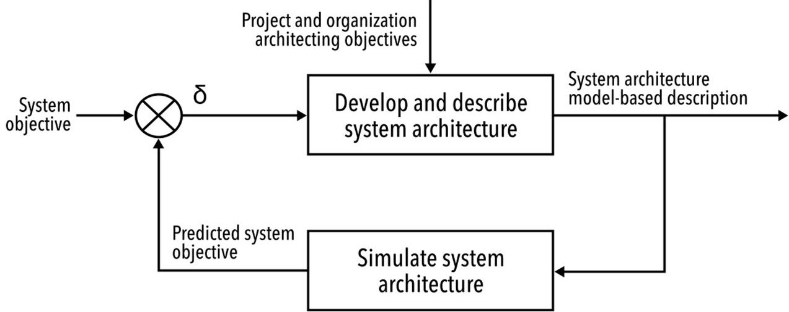

Figure 1. Simulation in architecture design process [17].

## 2.3. ARCADIA Method

Historically, systems engineers have employed various modeling techniques such as Structured Analysis and Design Technique (SADT) [27,28] and Structured Analysis for Real-Time (SA/RT) [29,30], as well as methods based on Petri nets and finite-state machines. Although these approaches have been foundational, they are limited in terms of expressiveness, integration with system requirements, and interoperability with other formalisms. Therefore, the introduction of UML [31] brought renewed attention to modeling in engineering contexts. However, early versions of UML were primarily developed for object-oriented software design and proved inadequate for addressing the complexity of multidisciplinary systems. Hence, to bridge this gap, the SysML [32] was introduced in 2006-2007 as a UML extension tailored for SE applications. SysML enhanced modeling capabilities by incorporating support for system requirements, physical domains (e.g., mechanical, electrical), and continuous flows. Despite these advancements, SysML's close inheritance from UML often presented usability challenges for system engineers lacking a software background.

In response, Thales Group developed the ARCADIA method [33], along with a dedicated modeling formalism, to support the design and validation of complex systems across diverse domains. Since its adoption in 2011, ARCADIA has been successfully applied in sectors such as aerospace, defense, railways, and air traffic control, among others. The method is supported by Capella, an open source modeling tool originally developed in-house, as Melody Advance, which provides robust capabilities for large-scale, operational Systems Engineering within an MBSE context.

The ARCADIA method provides a structured approach for capturing and analyzing customer needs, defining product architecture collaboratively across engineering disci-

<!-- PDF_PAGE: 7 -->

plines, and supporting early validation and justification of design decisions. It is particularly well suited for the development of complex systems where multiple constraints (e.g., cost, performance, safety, security, reusability, resource consumption, and mass) must be carefully balanced. Drawing on the architectural principles of ISO/IEC/IEEE 42010 Systems and software engineering—Architecture description [34], ARCADIA structures system development into distinct viewpoints that guide architectural reasoning. These include four primary perspectives, as shown in Table 3: two focused on understanding the problem space, namely, operational analysis and system need analysis, and two addressing the solution space, logical architecture and physical architecture. This separation between needs and solutions supports clarity and traceability in both system modeling and stakeholder communication.

Table 3. ARCADIA engineering perspectives and objectives.

<table border="1"><tr><td>Category and Perspective</td><td colspan="2">Objective</td></tr><tr><td rowspan="2">Need&amp;Context</td><td>1.Operational Analysis</td><td>What the stakeholders need to accomplish.</td></tr><tr><td>2.System Need Analysis</td><td>What the system has to accomplish for the stakeholders.</td></tr><tr><td rowspan="2">Solution</td><td>3.Logical Architecture</td><td>How the system will work to fulfill expectations.</td></tr><tr><td>4.Physical Architecture</td><td>How the system will be developed and built.</td></tr></table>

## 3. Proposed Integrated Framework

The proposed framework, named Modeling and Simulation Architecture for integrated Complex systems (MOSAiC), integrates modeling and simulation, leveraging hetero-functional graph theory [35], enabling progressive model refinement. and ensuring alignment between stakeholder needs, system design, and simulation-driven validation across all abstraction levels. This approach supports early verification, while facilitating design trade-offs and reducing risks associated with late-stage changes. As presented in the following sections, it is composed of two modules: the (i) System and Operation Modeling module and (ii) Analysis and Simulation module.

## 3.1. System and Operation Modeling Module

This module—and more broadly the framework—is structured around four hierarchical modeling levels, in line with the ARCADIA method: (i) Actors; (ii) System; (iii) Subsystem; (iv) Components. Each level addresses specific concerns and contributes to the system's overall fidelity, as shown in Figure 2.

At the Actor level, the analysis captures and formalizes stakeholder needs, user roles, and development roadmaps. This phase aims to elicit and structure operational expectation, which are then translated into high-level capabilities and mission requirements, as well as representative usage scenarios. These elements serve as inputs for the subsequent architectural and behavioral modeling activities, as well as providing useful information for programmatic planning.

The System level focuses on the definition of high-level functions alongside with a structured representation of the system's behavior, expressed through operational states. Following the definition provided by Bonnet et al. [36], a state reflects an operating condition or status on structural elements of the system. In adapting this interpretation to the methodology need, states are used to represent the mission phases defined in the Concept of Operations (ConOps), reflecting the operational lifecycle of the mission.

<!-- PDF_PAGE: 8 -->

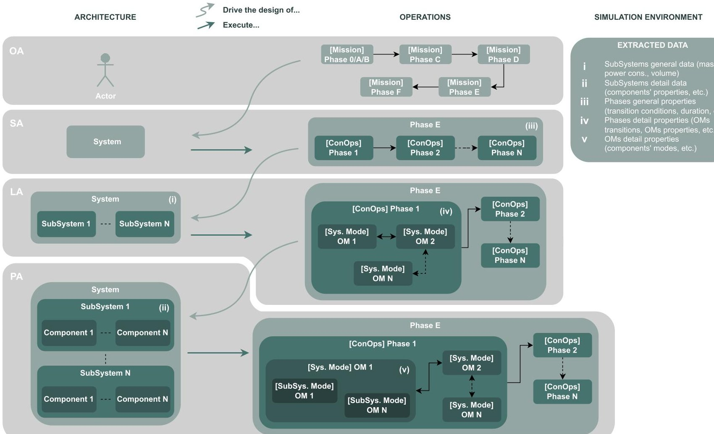

Figure 2. MOSAiC modeling framework capabilities and relative dependencies.

As the design progresses, the Subsystem level decomposes system functions into more detailed logical functions, allocated to subsystem elements, refining the functional architecture and enabling interface analysis among subsystems. This level supports, in the context of this work, the definition of a more detailed ConOps with the various system Operating Modes (OMs) per mission phase. It is worth highlighting that, as defined in [36], a mode describes how the system, subsystem, or component behaves under specific operational configurations, e.g., nominal or safe. Therefore, system and subsystem modes are implemented to describe the internal operational configuration of the system itself, tailored to functional needs.

At the most granular level, the Component level introduces physical constraints, physical behavior, and performance requirements. It involves further function breakdown and allocation to physical components to then conduct increasingly detailed simulation to verify performance.

A key innovation of MOSAiC lies in its explicit and rigorous cross-referencing among architectural modeling and the representation of mission phases, operations, and modes. Unlike conventional practices, where these aspects may be developed in relative isolation, this methodology calls for their simultaneous definition across each modeling layer. This parallel process—the capture of operations and modes in tandem with architectural definition—not only enhances traceability but also promotes improved insight into the system's required behaviors and configurations.

By progressively refining operational concepts in parallel with structural decomposition, the approach enables the early identification of critical functional and performance drivers. At higher abstraction levels, operational scenarios inform architectural decisions, guiding the allocation of functions and the structuring of interfaces. As the system model becomes more detailed, these architectural insights reciprocally guide the definitions of

<!-- PDF_PAGE: 9 -->

system and subsystem modes, ensuring that behavioral characterizations reflects the actual system's configuration and capabilities.

This bidirectional interaction between what the system shall do (operations and mission modes) and how it is realized (architecture and components) allows for a more informed and coherent derivation of lower-level elements. In particular, it ensures that physical components and functions are not specified in isolation, but rather emerge naturally from the operational needs identified at higher levels. Conversely, the explicit structure and behavior of the architecture at each level provide a necessary foundation for defining meaningful operational modes that reflect realistic and implementable system states.

The resulting modeling framework, as illustrated in Figure 2, supports a continuous feedback loop between operational needs and system realization. This results in a more robust, traceable, and verifiable system definition—and ultimately enhances both design fidelity and system understanding throughout the development lifecycle.

## 3.2. Analysis and Simulation Module

Simulations are embedded throughout the framework, evolving from preliminary estimation for design support to detailed performance assessment and requirement verification. This continuous integration of simulation ensures that the systems behavior remains consistent with stakeholder expectations while supporting the iterative system and subsystem refinement, as well as verification and validation activities.

The Analysis and Simulation module uses the multi-level architectural and operational Modeling module as the central source of truth for the data required for the scenario-based dynamic simulation of structural and behavioral system phenomena. Instead of considering simulation as an independent layer by itself, the framework conceptualizes simulation as a unification mechanism actively pulling from—and injecting into—all applicable system model layers: System, Subsystem, and Component. The layers are intrinsically interconnected with operating layers characterized by Mission Phases, System and Subsystem Operating Modes (OMs), and defined transitions providing smooth interfusion between static system description and operating dynamics.

In fact, as illustrated in Figures 2 and 3, the framework facilitates a coherent but adaptable description of the system on numerous dimensions of information. On one dimension, the architecture is successively broken down from the highest-level entities through subsystems and down through the individual components. Each level produces relevant simulation data, including the following (see Figure 2): (i) general subsystem data such as mass, power consumption, and volume, (ii) detailed subsystem characteristics, including individual component properties, (iii) high-level ConOps phase attributes such as transition conditions and expected durations, (iv) detailed ConOps phase elements, including OM transitions and their specific properties, and (v) in-depth OM-level details, such as the modes of individual components and their configurations.

Simulation models are developed incrementally, starting with low-fidelity representations based on coarse overall parameters, such as general subsystem mass, volume, and power consumption. As the design process progresses, increasing levels of detail are progressively incorporated into the model, including mode transitions, subsystem modes, reconfigurations in the system, and component-level constraints. The use of a layered modeling approach ensures that simulation outputs remain consistent with the evolving system architecture and the maturing mission concept, while also providing continuous performance feedback aligned with stakeholder expectations and mission requirements.

<!-- PDF_PAGE: 10 -->

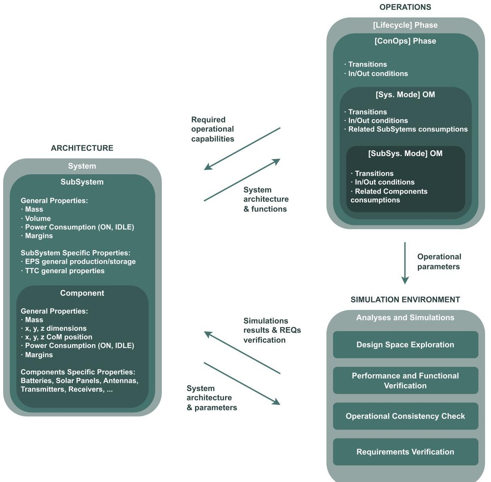

Figure 3. Inter-dependencies between Modeling module and Analysis and Simulation module.

As depicted in Figure 3, the Analysis and Simulation module is designed to serve a wide range of analytical objectives. While originally conceived as a tool to support early design phases, simulation continues to play a critical role throughout system development, adapting to the increasingly sophisticated analysis needed in parallel with the growing complexity of the system.

The simulation process typically begins with Design Space Exploration, the initial simulation-driven activity. Its primary aim is to evaluate the feasibility and trade-offs among various architectural and operation design alternatives. At this early stage, simulations are based on coarse approximations, such as estimated power budgets, timing sequences, or mass envelopes, and are used to assess the behaviour of candidate system configurations. These early simulations enable engineers to rapidly iterate through different architectural configurations, resource allocations, and mission sequences. Crucially, they support early-stage decision-making by supporting broad trade-offs, such as redundancy vs. weight or complexity vs. robustness, at the minimum modeling overhead. Additionally, this approach helps filter out infeasible designs, allowing engineering efforts to focus on refining the most viable options.

As the system architecture and operational concepts become more defined, the focus naturally shifts toward Performance and Functional Verification. At this stage, simulation acts as a verification method to assess whether the evolving design meets the high-level functional requirements of the mission. This is achieved by modeling mission phases and their corresponding system and auxiliary system operating regimes, and then subjecting these to dynamic simulation environments. The results enable the assessment of

<!-- PDF_PAGE: 11 -->

critical performance indicators, such as energy throughput, system availability and task execution times, under both nominal operating conditions and probable contingencies. Such simulations allow the early identification of performance shortfall, functional misalignment or unforeseen degradations, thereby enabling corrective actions well before hardware implementation.

As design maturity increases, simulations assume an essential role in ensuring Operational Consistency. With more detailed designs come complex behavioral and architectural inter-dependencies. Simulating the full system across the complete mission timeline, including all phase mode transitions, enables engineers to check consistency between the system architecture and the ConOps definition. These simulations are instrumental in revealing discrepancies between the intended operational behavior and the actual OM behavior. For instance, a subsystem might be correctly specified as standalone, yet it behaves unexpectedly across a multi-phase sequence or violates mode operational constraints. Identifying such issues early through simulation helps mitigate integration risks and build confidence in the system's end-to-end operational logic.

Finally, simulation reaches its most developed and accurate application in Low-level Requirement Verification. At this stage, the model has adequate fidelity, down to the Component level, to establish whether the system satisfies its quantitative requirements. These may include compliance with thermal budgets within cyclic loads, acceptable battery Depths of Discharge (DoD's) during eclipse periods, or sustained operation within payload peak duty cycles. Unlike earlier qualitative/exploratory phases, this stage features a direct linkage between formal requirement specifications and simulation results. Simulations thereby not only support the refinement of the final design but also play a central role in completing the verification and validation process, serving as a basis for compliance documents and certification processes.

In addition to these core objectives, the architecture of the framework is designed to operate within a context-aware environment. The two-way interaction between the architectural model and the operational scenario, spanning both mission phases and their corresponding operating modes, guarantees simulation is not performed in isolation, but rather within a realistic execution environment where system behaviors manifest. This means that the analysis at any given subsystem mode is carried out with full awareness of the global system state, the constraints imposed by the current mission phase, and all inter-dependencies among components.

This tight integration between model and simulation establishes a dynamic feedback loop that lies at the heart of agile and responsive system development. Simulation results are not static or isolated but are directly fed back into the architecture, enabling real-time refinements. For instance, performance bottlenecks identified through simulation may trigger the redistribution of tasks across subsystems, shifts in the timing of interfaces, or the redefinition of operational sequences. Likewise, changes in mission criteria, such as extended phase durations, new strategies in contingency handling, or re-prioritized mission objectives can be rapidly explored through modified simulation executions. By altering parameters or reconfiguring structural elements within the model, engineers can rapidly assess the impact of such changes and make informed, timely design decisions.

Ultimately, the M&S design method implemented within the framework fosters a coherent and controllable environment where system architecture, behavioral characteristics, and verification activities remain all explicitly defined and aligned throughout the entire range of abstraction levels. From high-level architecture to component-level behavioral dynamics, the method relies on a common model whose products go directly into simulation logic and analysis. This end-to-end consistency significantly reduces the risk of misinterpretation between design intent and implementation, minimizes late-stage sur-

<!-- PDF_PAGE: 12 -->

prises, and enhances traceability from stakeholder requirements to engineering execution. Moreover, it allows the system to evolve in response to changed technical requirements, stakeholder priorities, and mission constraints, all without compromising design integrity or verification rigor.

## 4. Application and Results

## 4.1. Case Study Overview

For validation purposes, the MOSAiC framework was applied to the design and analysis of the FIRE-EYE mission, a multi-satellite constellation dedicated to real-time wildfire detection and monitoring in the Mediterranean region. The mission offers a representative and complex use case for assessing the integration of MBSE and simulation, as it involves both system-level architectural challenges and domain-specific performance evaluations. As mentioned, the mission addresses the increasing threat of wildfires in the Mediterranean through the deployment of a satellite-based system for near-real-time hotspot detection, mapping, and alerting. The system architecture involves a constellation of 4816U satellites, launched using Falcon 9 and deployed into Sun-synchronous orbits. Each satellite carries a three-camera imaging payload and is designed for a seven-year operational life, after which it will undergo atmospheric re-entry. This case study represents a comprehensive satellite system designed to enhance wildfire prediction, detection, and response. It leverages modern space technologies and robust engineering practices to deliver a timely and regionally relevant solution to wildfire management challenges in the Mediterranean.

The system modeling process followed the ARCADIA methodology, and it was implemented using the Capella tool.

The initial Operational Analysis (OA) involved identifying and structuring the mission's stakeholders, such as civil protection agencies, meteorological institutes, and end-users in affected countries, along with their operational needs. These included near-realtime hotspot detection, alert generation, pre-event risk forecasting, and post-event damage assessment. This phase resulted in the definition of operational capabilities and key usage scenarios that framed the architecture design process.

Subsequently, the System Analysis (SA) phase translated the operational needs into a set of high-level system functions and requirements. Core functions included wildfire hotspot identification, geolocation, image acquisition, on-board processing, data downlink, and alert dissemination. Constraints derived from stakeholder needs (e.g., latency, area coverage, revisit time) were decomposed into system-level performance and interface requirements.

At the Logical Architecture (LA) level and, with an increased level of detail, at the Physical Architecture (PA) level, dynamic and domain-specific simulations were integrated into the system model using the proposed framework. This integration allowed for early validation of architectural choices and performance trade-offs.

Three key simulation domains were interfaced with the MBSE model: (i) Orbital Analysis; (ii) Power Budget Simulation; (iii) Link Budget Evaluation. A simple coverage and access simulation was performed: using input data derived from Capella models, the simulation assessed parameters such as revisit time, field-of-regard, and daily coverage. The results informed refinements in satellite phasing and launch sequencing. Additionally, power analysis was conducted to validate the power and energy balance across satellite operations. Component-level specifications from the logical model were passed to a custom simulation framework to verify compliance with system-level autonomy and mission duration requirements. Finally, communication simulations were used to verify the feasibility of data downlink scenarios, accounting for antenna configurations, ground

<!-- PDF_PAGE: 13 -->

station visibility, and bandwidth allocation. Simulations provided feedback to optimize the subsystem design and ensure the real-time data delivery objective.

## 4.2. OA Results

As briefly mentioned, the OA in Capella was exploited to conduct the stakeholder need analysis. Firstly, the authors identified a high-level mission capability representing the mission goal: [SCI-OBJ] for the near-real-time monitoring of wildfires in the Mediterranean area. Additionally, a second capability was identified, [STANDARD] Mission Lifecycle, mainly representing the standard product lifecycle activities needed to develop and operate the spacecraft. Subsequently, the main stakeholders interested in the mission were identified and linked to the different capabilities, as depicted in Figure 4.

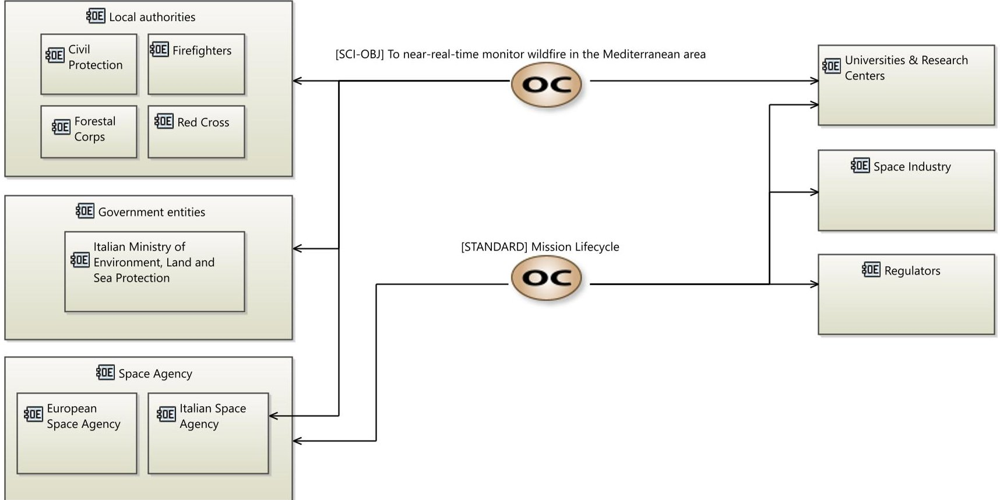

Figure 4. Mission capabilities.

Among them, it is interesting to highlight the Local Authorities, including Civil Protection, Firefighters, Forestal Corps, and Red Cross, who have a specific interest in near-real-time hotspot detection and mapping services, particularly to identify ignition points, map wildfire extent and behavior over time, and implement a near-real-time alerting system.

Subsequently, activities allocated to the stakeholders and interactions between these entities were identified. This step supports the identification of the needs and objectives of the users. The OA in Capella involves the creation of a domain model [37], independent from the future system to be realized, as the idea is to voluntarily create a level of abstraction from the system under study in order to focus on the "real" needs of the different stakeholders. With reference to the [STANDARD] Mission Lifecycle, Figure 5 shows an overall visualization of stakeholder activities and their interactions.

<!-- PDF_PAGE: 14 -->

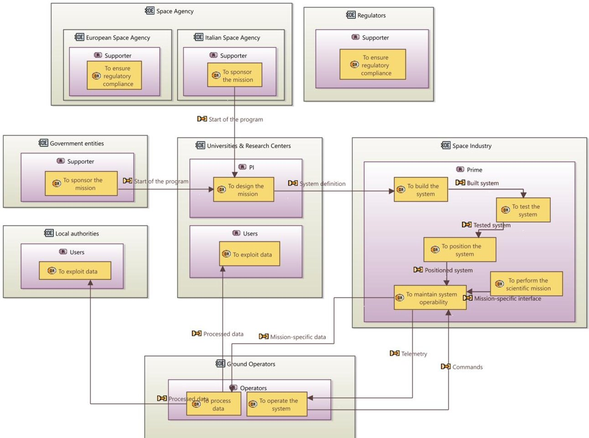

Figure 5. Stakeholders and Actors involved in the mission with related activities.

## 4.3. SA Results

Once the stakeholder need analysis was performed, the capabilities and activities previously identified, as well as the Actors, served as the foundation for the SA, where the system, as a black box, is now central to the analysis. The first step consists of the characterization of the functional analysis and, notably, the decomposition of the high-level functions, derived from the previous operational level, into more detailed functions. The main system sub-functions are reported in Figure 6 to show how the system-level functions from the activities in OA, which are now parent functions in SA, were derived, with a particular distinction between the standard spacecraft functions and the mission-specific ones.

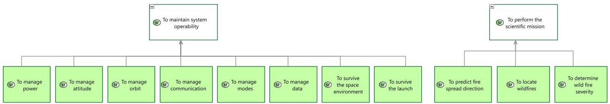

Figure 6. System function snapshot.

Subsequently, the different functions are allocated on the system and Actors and all functional exchanges are identified, as reported in Figure 7. This representation, together with the modeling of the different states, as shown in Figure 8, allowed for preliminary ConOps modeling, as well as for the derivation of the high-level mission and functional requirements.

<!-- PDF_PAGE: 15 -->

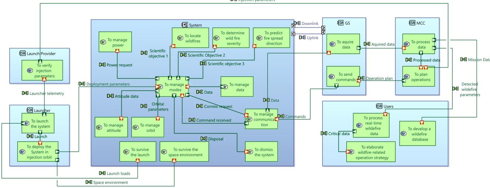

Figure 7. System architecture.

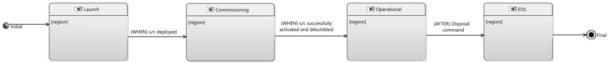

Figure 8. ConOps.

The state diagram presented in Figure 8 illustrates the high-level phase sequence of the mission ConOps as discrete system states. Each state represents a distinct operational phase in the mission lifecycle, beginning with Launch, followed by Commissioning, Operational, and End-of-Life phases. Transitions between these states are driven by mission-critical events such as spacecraft deployment, activation and de-tumbling, and the issue of a disposal command. This approach supports a clear and structured representation of the mission timeline, enabling effective traceability between operational phases and system functions.

## 4.4. LA Results

Once the SA was completed, providing a high-level system functional decomposition and a preliminary operational behavior of the system, the first design choices were implemented at the LA level, moving from a "black-box" to a "white-box" approach and detailing the internal system structure outlining the subsystems and their functions.

This phase focuses on the identification and definition of logical components, namely the subsystems, through the allocation of functions derived from the SA functions.

The result is a clear breakdown of system to subsystem functions, as depicted in Figure 9, enabling a more detailed view of the subsystem needs and behavior, allowing the definition of low-level requirements. In parallel, as shown in Figure 10, functional exchanges and component exchanges have been defined, deriving the internal and external interfaces, which are important for the following physical design.

<!-- PDF_PAGE: 16 -->

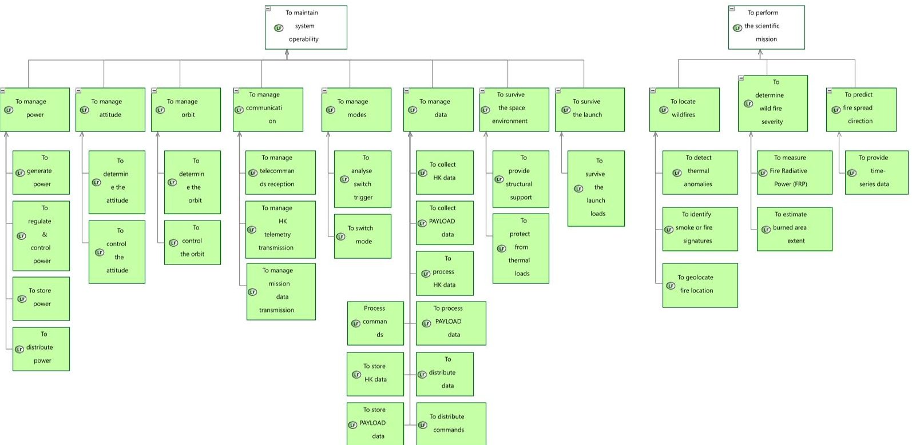

Figure 9. Subsystem function snapshot.

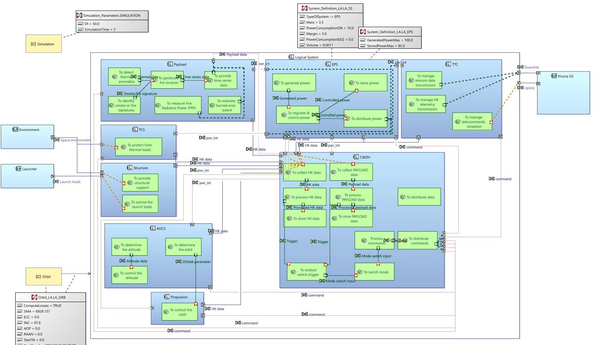

Figure 10. Logical architecture.

To support early validation and trade-offs, simulations were coupled with the modeling part thanks to the Property Values Management Tools (PVMT) Capella add-on [38]. PVMT enriches Capella elements with additional user-defined properties, such as power consumption, mass, dimension, and margins, which can be associated with Components, Actors, and exchanges. Examples of modeled properties can be found in Appendix A. Furthermore, operative modes were modeled in Capella as modes in a state diagram, explicitly linked to the ConOps states for consistency. Each mode, shown in Figure 11, represents an operational condition of the system, often triggered by environmental conditions, visibility

<!-- PDF_PAGE: 17 -->

constraints, or command inputs, and the usage of the PVMT add-on enables the association of the relevant subsystem property values defined.

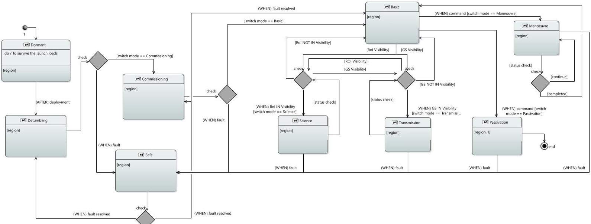

Figure 11. Operative modes.

In parallel with the architectural modeling activities, a custom Python-based parser was developed to systematically extract structured information from the Capella model. The custom parser was specifically implemented to interface directly with the extended logical architecture towards the automated extraction of user-defined attributes embedded through the PVMT extension. The extracted dataset includes subsystem-level parameters such as mass, volume, and power consumption—both static and mode-dependent—as well as functional and component exchanges, OMs definitions, and their associated transition conditions.

A notable feature of the parser is its ability to capture the execution environment of each subsystem, ensuring that simulations are grounded on the actual usage conditions specified in the model. This includes the interpretation of system-level OM, represented by state machines in the Capella and correlated with certain phases in the ConOps. These OMs govern behavioral transitions and conditionally enable or disable subsystems, functions, or elements, each associated with distinct consumption profiles. Capturing this level of detail has been proved crucial in enabling simulations to reflect the contextual and time-varying nature of system behaviors and interactions as well as resource utilization over the mission time.

Leveraging this comprehensive dataset, and as described in Section 3.2, a series of early-stage quantitative analyses can be performed, including preliminary estimations of mass, volume, power, and link budgets. Of particular note, the accuracy of power and communication link budgets assessments was significantly enhanced through the dynamic modeling of operational mode transitions. By simulating mission execution over time and tracking the activation of modes, it was possible to verify whether preconditions for each OM were satisfied (e.g., orbital position, visibility windows, or system health status) and to calculate resulting power consumption profiles based on subsystem properties defined in the model.

This approach enabled the simulation framework to move beyond static profiling and into predictive performance analysis under realistic mission conditions. When combined with high-level ground segment definitions, which were also modeled within Capella to capture visibility timelines and communication windows. Integrated with basic orbital analysis data, the simulation framework could accurately estimate data transfer opportunities, coverage durations, and potential outage periods. These insights were instrumental in

<!-- PDF_PAGE: 18 -->

validating the consistency of the modeled architecture with the intended operations and in identifying early trade-offs, such as revising subsystem duty cycles or reassessing storage needs for power and data buffering during blackout periods.

Overall, this early feedback loop enabled more informed and data-driven design decisions, provided justification for architectural refinements, and strengthened the confidence in the system's capacity to meet mission-level constraints, while moving onto the Physical Architecture layer (i.e., the Component level).

## 4.5. PA Results

Finally, at the PA level, the system design reached its most concrete and implementation oriented form. This stage focused on refining the architecture down to the actual physical components that would constitute the final system, bridging the gap between functional intent and tangible realization. The refinement process began by decomposing the logical functions defined in the previous architectural levels into component-level functions, which were then allocated to specific physical elements.

During this process, critical design decisions were made, such as the selection of solar panels for power generation and the definition of battery subsystems for energy storage. These choices were informed by both functional requirements and operational constraints, including energy availability and duty cycles obtained with the preliminary analyses conducted at the previous level. As a result, the physical architecture not only supported the execution of system functions but also ensured that the system would be physically realizable and compliant with the key mission constraints.

Figures 12 and 13 illustrate this evolution using the Electrical Power Subsystem (EPS) as an example. Figure 12 presents the decomposition of EPS-related logical functions, along with specific considerations such as energy production targets, power regulation needs, and storage capacity planning. These functions are then translated into concrete architectural elements, shown in Figure 13, where solar panels, batteries, and power distribution units are physically instantiated and interconnected.

At this stage, the use of the PVMT became even more critical. Properties previously applied at the Subsystem level are now refined to reflect detailed, component-specific values. These included power consumption in different operational states, physical dimensions, redundancy margins, and mass properties. In addition to enriching the fidelity of the architectural model, this granularity ensures the continuation of the operationalbased design approach initiated at the LA level. The OMs defined earlier continued to govern system behavior, now with increased precision. For example, different modes would activate different sets of components or trigger alternative power routing schemes, enabling simulation to accurately reflect the behavior of the real system under varying mission conditions.

Simulations were extended accordingly, leveraging the enhanced resolution of the physical model to perform feasibility analyses across multiple domains—e.g., power and data, reported in Figures 14 and 15—under realistic mission scenarios. The previously developed Python parser was updated to extract detailed PA-level information from the Capella model, including not only component properties but also dynamic behaviors tied to mode transitions and mission phases. With this data, it is possible to simulate how the system would operate across the full timeline of a representative mission operative phase, dynamically assessing whether subsystem interactions, power supply and demand, and data downlink/uplink remained within acceptable bounds.

<!-- PDF_PAGE: 19 -->

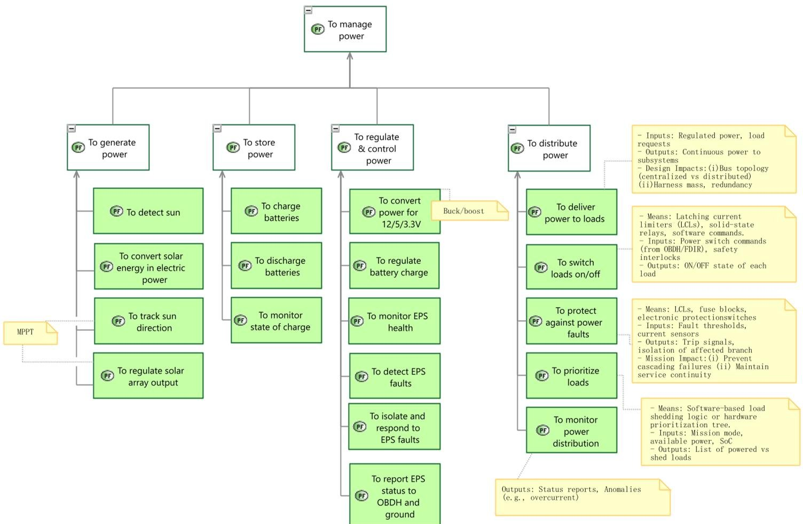

Figure 12. Physical functions—EPS.

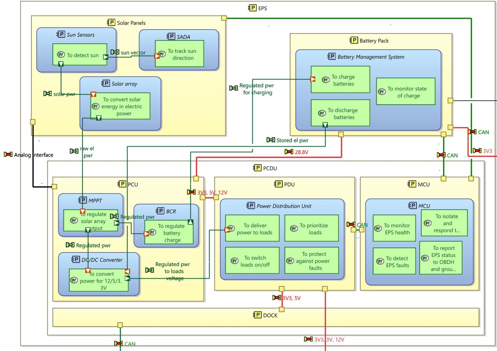

Figure 13. Physical architecture—EPS.

<!-- PDF_PAGE: 20 -->

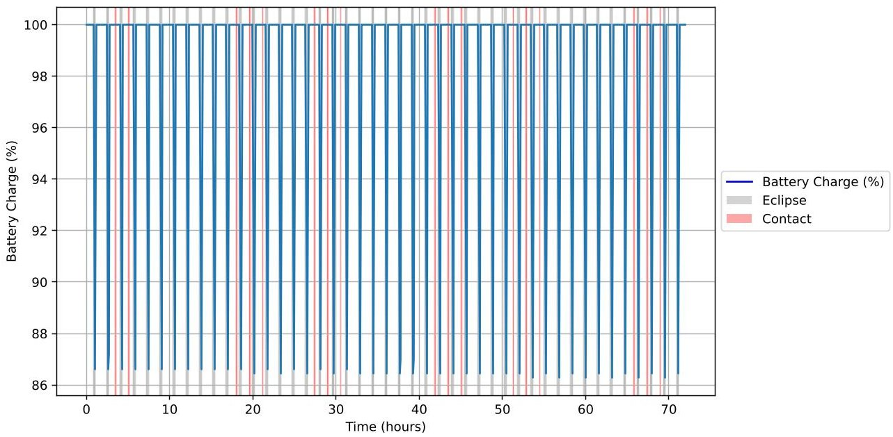

Figure 14. FIRE-EYE battery consumption plot.

Total Uplink: 57.97 MB, Total Downlink: 30.47 MB

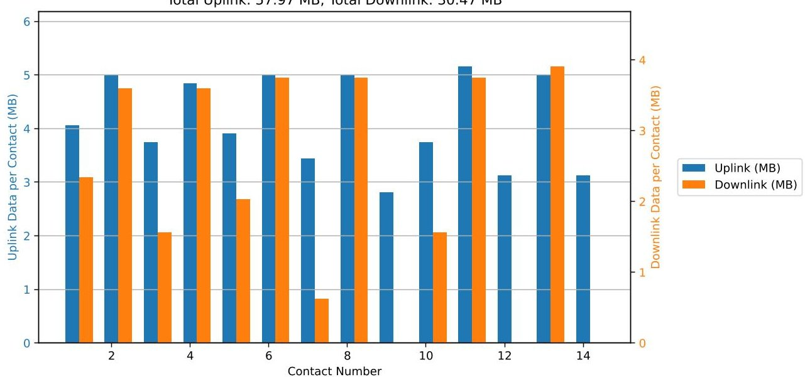

Figure 15. FIRE-EYE data budget per contact.

These simulations were executed by properly considering the overall context, meaning that each component's activity and resource consumption were evaluated within the temporal and operational boundaries defined by the mission. For instance, during a communications phase, the simulation would evaluate whether the power budget allowed for the simultaneous operation of the antenna, transmitter, and data processor. Similarly, during eclipse periods, the simulation would verify whether battery capacity was sufficient to sustain system operation until sunlight was available for recharging.

The end result was a comprehensive verification of physical feasibility, grounded in real design data and reflective of time-dependent mission behavior. This reinforced the architectural decisions made and provided quantitative evidence that the design could meet its performance objectives under the range of operating conditions expected in flight. Moreover, it allowed for the early identification of potential bottlenecks or failure points—such as inadequate battery sizing, overlapping power demands, or conflicting data flows—thus informing corrective actions early in the design process, before costly implementation steps were taken.

Through this detailed M&S effort, the Physical Architecture phase not only solidified the system configuration but ensured a robust, validated path from mission requirements to an implementable design, tightly coupled to its operational context.

<!-- PDF_PAGE: 21 -->

To support simulations during the progressive development of the physical architecture, when only a subset of the subsystems had been fully refined down to the component level, a mixed-resolution simulation strategy was implemented. This approach ensured that system-level analyses could continue even as only parts of the architecture transitioned from logical to physical representation.

This flexibility was achieved through an enhancement of the Analysis and Simulation module, which was extended to handle hybrid data extraction at both Logical Architecture and Physical Architecture levels. More specifically, the parser was designed to interpret both architectural and behavioral elements at varying levels of maturity. It did so by leveraging the realization links defined in Capella, tracing parent-child relationships between LA and PA elements. When a PA-level element, such as a component or mode, was found to realize a corresponding LA-level function or mode, the simulation used the detailed PA-level parameters (e.g., component-specific power consumption, mass, or behavior). Otherwise, the simulation defaulted to the LA-level abstractions.

This capability was especially valuable during architectural convergence, allowing early subsystem-level physical modeling to immediately inform simulations without waiting for full system completion. A concrete validation of this method was performed using the EPS and the Telemetry, Tracking and Control (TTC) subsystems, both of which were among the first to be modeled in full detail at the PA level. Similarly, the Basic OM, one of the key mission modes, was fully defined within the PA context, including mode-specific properties and transitions.

During simulation runs that included the Basic mode, the Analysis and Simulation module recognized the availability of PA-level data for EPS and TTC and thus applied their detailed parameters—such as component-specific power consumption profiles and operating margins—within the simulation. Meanwhile, other subsystems and modes that had not yet been detailed in PA continued to use logical-level abstractions from LA. This hybrid resolution allowed the simulation to produce a more accurate and nuanced performance assessment of the system in its current state, particularly with respect to power and communication resource usage, while maintaining full system-level coherence.

This capability proved critical in enabling incremental validation and early trade studies, even as detailed design work proceeded in parallel. It allowed engineers to isolate and analyze the performance of key physical subsystems within operational scenarios, while also maintaining a holistic view of the entire architecture. As a result, valuable insights could be gathered, such as verifying that EPS and TTC components were not overloading the available energy budget in Basic mode, well before all components were fully defined. This iterative, mixed-resolution simulation approach ensured continuity in the design-validation loop and avoided unnecessary bottlenecks in system analysis due to staggered subsystem development.

## 5. Discussion

The proposed M&S framework was developed with the entire space mission and system lifecycle in mind, as these complex, multidisciplinary systems require traceability, consistency, and early validation. It covers several abstraction layers, from stakeholder-level needs to component-level design, thus making it suitable for model-driven engineering environments where stakeholder involvements, progressive refinement, and simulation-based assessment are critical.

Even though this framework is not restricted to a specific space application, it can be especially effective in the field of small-satellite missions, where resource constraints and short schedules require a quick and cheap way to perform "design and verification"

<!-- PDF_PAGE: 22 -->

iterations—especially at the beginning of the product lifecycle—and a high degree of integration and interaction between Systems Engineering and performance verification.

As already explored by Luccisano et al. [39], and in alignment with the Open Design principles discussed, i.e., by Scholz and Juang [15], the proposed framework was developed entirely using open source tools. This ensures not only accessibility and reproducibility but also the potential for community-driven evolution. Its open source nature represents a strategic asset in academic contexts, where openness, adaptability, and collaborative development are critical to both education and research. By lowering barriers to entry, the framework empowers universities and research institutions to engage in advanced Systems Engineering activities, promoting shared progress and innovation in the field of space systems design.

Within this context, the integration of M&S into the proposed framework proves particularly effective. It not only strives for architectural coherence and traceability but also provides simulation-based validation for any level of abstraction. This is achieved through a layered modeling approach that aligns well with the iterative and exploratory nature of space system development. By maintaining strong connections between operational concepts, system architecture, and component-level implementations, the framework supports progressive elaboration of both system behavior and performance expectations.

The bundling of Capella with arbitrary simulation tools specifically put together exemplifies how flexible as well as extensible the framework can become. This integration enables a seamless flow of information from the model to the simulation environment, where dynamic mission scenarios can be evaluated in light of evolving architectural definitions. The ability to conduct mixed-resolution simulations—combining logical-level and physical-level representations—proved particularly valuable, allowing analyses to proceed even as parts of the architecture remained under development. This flexibility aligns directly with the needs of agile development cycles and supports incremental validation without requiring complete model finalization.

Moreover, the explicit modeling of Operating Modes and their impact on component behavior enables highly context-sensitive simulations. By associating performance parameters with these modes, and linking them to specific mission phases, the framework ensures that simulation results are not merely static estimates, but dynamic reflections of actual operational timelines and conditions. This approach enhances the credibility of early performance predictions and supports more informed trade-off decisions during design refinement.

Importantly, the use of open source modeling tools such as Capella, combined with an open simulation pipeline, reinforces the framework's accessibility and replicability. This makes it particularly suited for academic and early-stage mission teams, where budget constraints often prohibit the use of commercial solutions. By promoting openness at both the tooling and methodological levels, the framework aligns with more macro-trends for Open Design and enables the democratization of access to state-of-the-art Systems Engineering capabilities.

In summary, the integration of model-driven engineering with simulation based on a common yet extendable foundation makes the proposed framework a usable yet effective mission validation instrument. It closes the gap between abstract definitions of systems and quantitative analysis of that system behavior in a way that facilitates moving from static documentation to living executable models. This enhances both the reliability and agility of the design process, especially in the high-risk, resource-limited context of smallsatellite missions.

<!-- PDF_PAGE: 23 -->

## 6. Conclusions

This paper presented a Modeling and Simulation framework for the design, analysis, and simulation of space missions and systems, with a particular focus on the application to small-satellite missions. The proposed framework enables a structured progression from stakeholder requirements down to component-level architecture, integrating simulation activities at every level of abstraction to support early validation, traceability, and system coherence.

A key feature is the tight integration between architectural modeling—using the Capella tool and the ARCADIA method—and simulation. This allowed dynamic, operational-based analyses to be performed incrementally as the system matured, even in cases where only partial physical architecture was available. The mixed-resolution simulation capability ensured that feasibility studies and performance evaluations could be conducted continuously throughout the development lifecycle.

The framework's open source foundation reinforces its suitability for academic and resource-constrained environments, promoting accessibility, collaboration, and community-driven evolution. By enabling context-aware simulations rooted in operational modes and mission phases, the approach not only improves technical robustness but also empowers mission teams to make informed design decisions with confidence.

Future work will aim to expand the simulation capabilities to include more refined orbital and environmental modeling, incorporate automated requirement tracing, automate CAD generation and time-aware thermal analyses, and explore the integration of hardware-in-the-loop or digital twin approaches. Nevertheless, the results presented demonstrate the effectiveness and adaptability of the framework as a comprehensive dynamic MBSE solution for complex space missions.

Author Contributions: Methodology, S.C. and G.L.; software, S.C. and G.L.; validation, S.C., G.L., D.F. and F.S.; writing—original draft preparation, S.C. and G.L.; writing—review and editing, D.F. and F.S.; supervision, D.F. and F.S. All authors have read and agreed to the published version of the manuscript.

Funding: The research of G.L. was carried out within the Space It Up project funded by the Italian Space Agency (ASI) and the Italian Ministry of University and Research (MUR), under contract n. 2024-5-E.0—CUP n. I53D24000060005.

Data Availability Statement: All models and codes presented in this work are available in a public repository, under the GNU GPLv3 license (https://www.gnu.org/licenses/gpl-3.0.html, accessed on 17 August 2025), at the following link: https://gitlab1.polito.it/aer-se-public/MOSAiC (accessed on 17 August 2025).

Conflicts of Interest: The authors declare no conflicts of interest. The funders had no role in the design of the study; in the collection, analyses, or interpretation of data; in the writing of the manuscript; or in the decision to publish the results.

## Abbreviations

The following abbreviations are used in this manuscript:

AIV/T Assembly, Integration, Verification, and Test

ARCADIA Architecture Analysis and Design Integrated Approach

CAE Computer-Aided Engineering

CoM Center of Mass

ConOps Concept of Operations

DoD Depth of Discharge

EPS Electrical Power Subsystem

INCOSE International Council on Systems Engineering

<!-- PDF_PAGE: 24 -->

<table border="1"><tr><td>LA</td><td>Logical Architecture</td></tr><tr><td>MBE</td><td>Model-Based Engineering</td></tr><tr><td>MBSE</td><td>Model-Based Systems Engineering</td></tr><tr><td>M&amp;S</td><td>Modeling and Simulation</td></tr><tr><td>MOSAiC</td><td>Modeling and Simulation Architecture for integrated Complex systems</td></tr><tr><td>OA</td><td>Operational Analysis</td></tr><tr><td>OM</td><td>Operating Mode</td></tr><tr><td>OSS</td><td>Open Source Software</td></tr><tr><td>OSHW</td><td>Open Source Hardware</td></tr><tr><td>PA</td><td>Physical Architecture</td></tr><tr><td>PVMT</td><td>Property Values Management Tools</td></tr><tr><td>SA</td><td>System Analysis</td></tr><tr><td>SADT</td><td>Structured Analysis and Design Technique</td></tr><tr><td>SA/RT</td><td>Structured Analysis for Real-Time</td></tr><tr><td>SE</td><td>Systems Engineering</td></tr><tr><td>SysML</td><td>Systems Modeling Language</td></tr><tr><td>TTC</td><td>Telemetry, Tracking and Control</td></tr></table>

UML Unified Modeling Language

## Appendix A

<table border="1"><tr><td>Name</td><td>Type</td><td>Default Value</td></tr><tr><td>Orbit_LA</td><td></td><td></td></tr><tr><td>LA_ORB</td><td></td><td></td></tr><tr><td>Scope</td><td>[LOGICAL]</td><td></td></tr><tr><td>EClass Rule</td><td>Constraint</td><td></td></tr><tr><td>ComputeLosses</td><td>booleanProperty</td><td>true</td></tr><tr><td>SMA</td><td>floatProperty</td><td>0.1km</td></tr><tr><td>ECC</td><td>floatProperty</td><td>0.0</td></tr><tr><td>INC</td><td>floatProperty</td><td>0.0deg</td></tr><tr><td>AOP</td><td>floatProperty</td><td>0.0deg</td></tr><tr><td>RAAN</td><td>floatProperty</td><td>0.0deg</td></tr><tr><td>StartTA</td><td>floatProperty</td><td>0.0deg</td></tr><tr><td>StartEpoch</td><td>stringProperty</td><td>YYYY,MM,DD,hh,mm,ss</td></tr><tr><td>LA_LOSS</td><td></td><td></td></tr><tr><td>Scope</td><td>[LOGICAL]</td><td></td></tr><tr><td>Property Rule</td><td>ComputeLosses</td><td>= true</td></tr><tr><td>EClass Rule</td><td>Constraint</td><td></td></tr><tr><td>LossPolarization</td><td>floatProperty</td><td>0.0dB</td></tr><tr><td>LossAtm</td><td>floatProperty</td><td>0.0dB</td></tr><tr><td>LossRain</td><td>floatProperty</td><td>0.0dB</td></tr></table>

(a)

<table border="1"><tr><td>Name</td><td>Type</td><td>Default Value</td></tr><tr><td>Modes</td><td></td><td></td></tr><tr><td>inCondition</td><td></td><td></td></tr><tr><td>Eclipse</td><td></td><td></td></tr><tr><td>GS_in_LOS</td><td></td><td></td></tr><tr><td>ROI_in_LOS</td><td></td><td></td></tr><tr><td>Fault</td><td></td><td></td></tr><tr><td>Modes</td><td></td><td></td></tr><tr><td>Scope</td><td>[LOGICAL, PHYS...</td><td></td></tr><tr><td>EClass Rule</td><td>Mode</td><td></td></tr><tr><td>Priority</td><td>integerProperty</td><td>0</td></tr><tr><td>IsDefault</td><td>booleanProperty</td><td>false</td></tr><tr><td>InCondition</td><td>inCondition</td><td>Eclipse</td></tr><tr><td>ROI</td><td></td><td></td></tr><tr><td>Scope</td><td>[LOGICAL, PHYS...</td><td></td></tr><tr><td>Property Rule</td><td>InCondition</td><td>= ROI_in_LOS</td></tr><tr><td>EClass Rule</td><td>Mode</td><td></td></tr><tr><td>LatStart</td><td>floatProperty</td><td>0.0 deg</td></tr><tr><td>LatEnd</td><td>floatProperty</td><td>0.0 deg</td></tr><tr><td>LonStart</td><td>floatProperty</td><td>0.0 deg</td></tr><tr><td>LonEnd</td><td>floatProperty</td><td>0.0 deg</td></tr></table>

(b)

<table><thead><tr><th>Name</th><th>Type</th><th>Default Value</th></tr></thead><tbody><tr><td>System_Definition_LA</td><td></td><td></td></tr><tr><td>Type_system_LA</td><td></td><td></td></tr><tr><td>General</td><td></td><td></td></tr><tr><td>EPS</td><td></td><td></td></tr><tr><td>TTC</td><td></td><td></td></tr><tr><td>Sys_Modulation</td><td></td><td></td></tr><tr><td>BPSK</td><td></td><td></td></tr><tr><td>QPSK</td><td></td><td></td></tr><tr><td>DPSK</td><td></td><td></td></tr><tr><td>LA_SS</td><td></td><td></td></tr><tr><td>Scope</td><td>[LOGICAL]</td><td></td></tr><tr><td>TypeOfSystem</td><td>Type_system_LA</td><td>General</td></tr><tr><td>Mass</td><td>floatProperty</td><td>0.0 kg</td></tr><tr><td>PowerConsumptionON</td><td>floatProperty</td><td>0.0 W</td></tr><tr><td>Margin</td><td>floatProperty</td><td>0.0 %</td></tr><tr><td>PowerConsumptionIDLE</td><td>floatProperty</td><td>0.0 W</td></tr><tr><td>Volume</td><td>floatProperty</td><td>0.0 m3</td></tr><tr><td>LA_EPS</td><td></td><td></td></tr><tr><td>Scope</td><td>[LOGICAL]</td><td></td></tr><tr><td>Property Rule</td><td>TypeOfSystem</td><td>= EPS</td></tr><tr><td>EClass Rule</td><td>LogicalComponent</td><td></td></tr><tr><td>GeneratedPowerMax</td><td>floatProperty</td><td>0.0 W</td></tr><tr><td>StoredPowerMax</td><td>floatProperty</td><td>0.0 Wh</td></tr><tr><td>LA_COMM</td><td></td><td></td></tr><tr><td>Scope</td><td>[LOGICAL]</td><td></td></tr><tr><td>Property Rule</td><td>TypeOfSystem</td><td>= TTC</td></tr><tr><td>EClass Rule</td><td>LogicalComponent</td><td></td></tr><tr><td>PowerRx</td><td>floatProperty</td><td>0.0 W</td></tr><tr><td>GainRx</td><td>floatProperty</td><td>0.0 dB</td></tr><tr><td>NoiseTemperatureRx</td><td>floatProperty</td><td>0.0 K</td></tr><tr><td>LossRx</td><td>floatProperty</td><td>0.0 dB</td></tr><tr><td>DataRateRx</td><td>floatProperty</td><td>0.0 Mbps</td></tr><tr><td>GainLNA</td><td>floatProperty</td><td>0.0 dB</td></tr><tr><td>Modulation</td><td>Sys_Modulation</td><td>BPSK</td></tr><tr><td>RequiredBER</td><td>floatProperty</td><td>0.0</td></tr><tr><td>PowerTx</td><td>floatProperty</td><td>0.0 W</td></tr><tr><td>GainTx</td><td>floatProperty</td><td>0.0 dB</td></tr><tr><td>DataRateTx</td><td>floatProperty</td><td>0.0 Mbps</td></tr><tr><td>LossTx</td><td>floatProperty</td><td>0.0 dB</td></tr></tbody></table>

(c)

<table><thead><tr><th>Name</th><th>Type</th><th>Default Value</th></tr></thead><tbody><tr><td>✓ System_Definition_PA</td><td></td><td></td></tr><tr><td>Type_system_PA</td><td></td><td></td></tr><tr><td>Type_component_EPS_PA</td><td></td><td></td></tr><tr><td>Type_storage_EPS_PA</td><td></td><td></td></tr><tr><td>Rechargeable</td><td></td><td></td></tr><tr><td>Non rechargeable</td><td></td><td></td></tr><tr><td>Type_generation_EPS_PA</td><td></td><td></td></tr><tr><td>Type_component_TTC_PA</td><td></td><td></td></tr><tr><td>Modulation_PA</td><td></td><td></td></tr><tr><td>PA_SS</td><td></td><td></td></tr><tr><td>Scope</td><td>[PHYSICAL]</td><td></td></tr><tr><td>TypeOfSystem</td><td>Type_system_PA</td><td>General</td></tr><tr><td>Mass</td><td>floatProperty</td><td>0.0 kg</td></tr><tr><td>Dimension x</td><td>floatProperty</td><td>0.0 m</td></tr><tr><td>Dimension y</td><td>floatProperty</td><td>0.0 m</td></tr><tr><td>Dimension z</td><td>floatProperty</td><td>0.0 m</td></tr><tr><td>CM_x</td><td>floatProperty</td><td>0.0</td></tr><tr><td>CM_y</td><td>floatProperty</td><td>0.0</td></tr><tr><td>CM_z</td><td>floatProperty</td><td>0.0</td></tr><tr><td>PowerConsumptionON</td><td>floatProperty</td><td>0.0 W</td></tr><tr><td>PowerConsumptionIDLE</td><td>floatProperty</td><td>0.0 W</td></tr><tr><td>Imax</td><td>floatProperty</td><td>0.0 K</td></tr><tr><td>Imin</td><td>floatProperty</td><td>0.0 K</td></tr><tr><td>Margin</td><td>floatProperty</td><td>0.0 %</td></tr><tr><td>PA_EPS</td><td></td><td></td></tr><tr><td>Scope</td><td>[PHYSICAL]</td><td></td></tr><tr><td>TypeOfComponent</td><td>Type_component_EPS_PA</td><td>General</td></tr><tr><td>PA_EPS_Storage</td><td></td><td></td></tr><tr><td>Scope</td><td>[PHYSICAL]</td><td></td></tr><tr><td>Property Rule</td><td>TypeOfComponent</td><td>= Storage</td></tr><tr><td>TypeOfStorage</td><td>Type_storage_EPS_PA</td><td>Rechargeable</td></tr><tr><td>PA_EPS_Storage_Rechargeable</td><td></td><td></td></tr><tr><td>Scope</td><td>[PHYSICAL]</td><td></td></tr><tr><td>EnergyDensity</td><td>floatProperty</td><td>0.0 Wh/kg</td></tr><tr><td>EnergyEfficiency</td><td>floatProperty</td><td>0.0 %</td></tr><tr><td>DoD</td><td>floatProperty</td><td>0.0 %</td></tr><tr><td>SellDischarge</td><td>floatProperty</td><td>0.0 %</td></tr></tbody></table>

(d)

Figure A1. PVMT properties definition example. They can be applied to: (a) Constraints (e.g., orbit). (b) Modes & States. (c) LA elements for preliminary analyses. (d) PA elements for detailed analyses.

<!-- PDF_PAGE: 25 -->

## References

1. Systems Engineering Definition. Available online: https://www.incose.org/about-systems-engineering/system-and-sedefinitions/system-engineering-definition (accessed on 27 May 2025).

2. May, C.; Carnevale, A.E.; Friedman, K.; Dyas, J. Benefits of Introducing MBSE Early Into NASA's Lifecycle Phases for the Moon to Mars Architecture. In Proceedings of the AIAA Avitation Forum and Ascend 2025, Las Vegas, NV, USA, 21-25 July 2025. [CrossRef]

3. Tundis, A.; Ferretto, D.; Garro, A.; Brusa, E.; Muhlhauser, M. Dependability Assessment of a Deicing System through the RAMSAS method. In Proceedings of the 2017 IEEE International Systems Engineering Symposium (ISSE), Vienna, Austria, 11-13 October 2017; pp. 1-8. [CrossRef]

4. Estefan, J. Survey of Model-Based Systems Engineering (MBSE) Methodologies; INCOSE: San Diego, CA, USA, 2008. [Google Scholar].

5. INCOSE-TP-2004-004-02 Ver. 2.03: Systems Engineering Vision 2020. 2007. Available online: https://sdincose.org/wp-content/uploads/2011/12/SEVision2020_20071003_v2_03.pdf (accessed on 27 May 2025).

6. Bindschadler, D.L.; Smith, R.R.; Valerio, C.P.; Schimmels, K.A. A structured, model-based systems engineering methodology for operations system design. In Space Operations: Contributions from the Global Community, 1st ed.; Cruzen, C., Schmidhuber, M., Lee, Y., Kim, B., Eds.; Springer: Cham, Switzerland, 2017; pp. 271-290. [CrossRef]

7. Beers, L.; Weigand, M.; Nabizada, H.; Fay, A. MBSE Modeling Workflow for the Development of Automated Aircraft Production Systems. In Proceedings of the 2023 IEEE 28th International Conference on Emerging Technologies and Factory Automation (ETFA), Sinaia, Romania, 12-15 September 2023; pp. 1-8. [CrossRef]

8. Cresto Aleina, S.; Ferretto, D.; Stesina, F.; Viola, N. A Model-Based approach to the preliminary design of a space tug aimed at early requirement's verification. In Proceedings of the Sapce Transportation Solutions and Innovations Symposium, Held at the 67th International Astronautical Congress (IAC) 2016, Guadalajara, Mexico, 26-30 September 2016; IAC-16,D2,IP,11,x34331. [Google Scholar]

9. Kaslow, D.; Ayres, B.; Cahill, P.T.; Hart, L.; Yntema, R. A Model-Based Systems Engineering (MBSE) Approach for Defining the Behaviors of CubeSats. In Proceedings of the 2017 IEEE Aerospace Conference, Big Sky, MT, USA, 4-11 March 2017; pp. 1-14. [CrossRef]

10. Spangelo, S.C.; Kaslow, D.; Delp, C.; Cole, B.; Anderson, L.; Fosse, E.; Gilbert, B.S.; Hartman, L.; Kahn, T.; Cutler, J. Applying Model Based Systems Engineering (MBSE) to a Standard Cubesat. In Proceedings of the 2012 IEEE Aerospace Conference 2012, Big Sky, MT, USA, 3-10 March 2012; pp. 1-20. [CrossRef]

11. Gregory, J.; Berthoud, L.; Tryfonas, T.; Prezzavento, A.; Faure, L. Investigating the Flexibility of the MBSE Approach to the Biomass Mission. IEEE Trans. Syst. Man, Cybern. Syst. 2021, 51, 6946-6961. [CrossRef]

12. Gregory, J.; Berthoud, L.; Tryfonas, T.; Faure, L.; Prezzavento, A. The Spacecraft Early Analysis Model: An MBSE Framework for Early Analysis of Spacecraft Behavior. IEEE Trans. Syst. Man, Cybern. Syst. 2025, 1-13. in press. [CrossRef]

13. Vagliano, I.; Ferretto, D.; Brusa, E.; Morisio, M.; Valacca, L. Tool Integration in the Aerospace Domani: A Case Study. In Proceedings of the 2017 IEEE 41st Annual Computer Software and Applications Conference (COMPSAC), Turin, Italy, 4-8 July 2017; pp. 731-736. [CrossRef]

14. Buitrago-Leiva, J.N.; Mejía, J.J.; Puerta-Ibarra, J.F.; Acero-Niño, I.F.; Guarnizo-Saavedra, A.F.; Rodriguez-Ferreira, J.; Rojas-Rodriguez, L.; Hernández-Torres, F.L.; Arango-Cotacio, C.E.; Salazar-Morales, J.E.; et al. Preliminary Design of Satellite Systems through the Integration of Model-Based System Engineering and Agile Methodologies: Application to the ColStar Mission. Aerospace 2024, 11, 758. [CrossRef]

15. Scholz, A.; Juang, J.N. Toward open source CubeSat design. Acta Astronaut. 2015, 115, 384-392. [CrossRef]

16. Singam, C.; Carter, J. Model-Based Systems Engineering (MBSE). 2025. Available online: https://sebokwiki.org/wiki/Model-Based_Systems_Engineering_(MBSE) (accessed on 28 May 2025).

17. Nowodzienski, P.; Navas, J. From Model-based to Model and Simulation-based Systems Architectures - achieving quality engineering through descriptive and analytical models. INSIGHT 2023, 26, 40-50. [CrossRef]

18. Zeigler, B.P.; Mittal, S.; Traore, M.K. MBSE with/out Simulation: State of the Art and Way Forward. Systems 2018, 6, 40. [CrossRef]

19. Friedenthal, S. SYSML v2 Overview & Demo. 2023. Available online: https://www.incose.org/docs/default-source/workinggroups/mbse-initiative/sysml-2-documents/sysml_v2_overview_demo.pdf?sfvrsn=50b971c7_2 (accessed on 16 August 2025).

20. Bemmami, K.E.; David, P. Managing the use of simulation in systems engineering: An industrial state of practice and a prioritization method. Comput. Ind. 2021, 131, 103486. [CrossRef]

21. Younse, P.; Cameron, J.; Bradley, T.H.Comparative analysis of model-based and traditional systems engineering approaches for simulating a robotic space system architecture through automatic knowledge processing. Syst. Eng. 2022, 25, 360-386. [CrossRef]

22. Ma, J.; Wang, G.; Lu, J.; Vangheluwe, H.; Kiritsis, D.; Yan, Y. Systematic Literature Review of MBSE Tool-Chains. Appl. Sci. 2022, 12, 3431. [CrossRef]

23. Wenyue, W.; Junjie, H.; Yinxuan, M.; Jinjie; Zhiang, L. Application and development of MBSE in aerospace. J. Phys. Conf. Ser. 2022, 2235, 012021. [CrossRef]

<!-- PDF_PAGE: 26 -->

24. Booth, T.M.; Ghosh, S. A modular simulation-based MBSE approach applied to a cloud-based system. INCOSE Int. Symp. 2024, 34, 2413-2430. [CrossRef]

25. INCOSE. Systems Engineering Vision 2035. 2021. Available online: https://www.incose.org/publications/se-vision-2035 (accessed on 11 June 2025).

26. Luzeaux, D.; Wippler, J.L. Beyond the Crawley's FCF, a new paradigm for architecture elaboration and conceptualization. In Proceedings of the 2017 IEEE International Systems Engineering Symposium (ISSE), Vienna, Austria, 11-13 October 2017; pp. 1-7. [CrossRef]

27. Davis, W.S. Tools and Techniques for Structured Systems Analysis and Design, 1st ed.; Addison-Wesley: Boston, MA, USA, 1983.

28. Ross, D.T.; Schoman, K.E. Structured analysis for requirements definition. IEEE Trans. Softw. Eng. 1977, SE-3, 6-15. [CrossRef]

29. Hatley, D.; Pirbhai, I. Strategies for Real-Time System Specifications (SA-RT), revised ed.; Dorset House Publishing Co., Inc.: New York, NY, USA, 1991.

30. Ahmed, S.B.; Moalla, M.; Courvoisier, M. Towards a design methodology for flexible manufacturing systems command combining SA-RT and object Petri nets. In Proceedings of the IEEE Symposium on Emerging Technologies and Factory Automation (ETFA) '95, Paris, France, 10-13 October 1995; Volume 1, pp. 83-94. [CrossRef]

31. Roques, P. UML in Practice: The Art of Modeling Software Systems Demonstrated Through Worked Examples and Solutions, 1st ed.; Wiley: Hoboken, NJ, USA, 2004.

32. Casse, O. SysML in Action with Cameo Systems Modeler, 1st ed.; ISTE Press: London, UK; Elsevier: Amsterdam, The Netherlands, 2018. [CrossRef]

33. Voirin, J.-L. A Description of the ARCADIA Method V2. 2023. Available online: https://mbse-capella.org/resources/arcadia-reference/html/output/ARCADIA (accessed on 12 June 2025).

34. ISO/IEC/IEEE 42010: Systems and Software Engineering—Architecture Description. Available online: http://www.isoarchitecture.org/42010/ (accessed on 11 June 2025).

35. Schoonenberg, W.C.; Khayal, I.S.; Farid, A.M. Hetero-functional Graph Theory Preliminaries. In A Hetero-Functional Graph Theory for Modeling Interdependent Smart City Infrastructure; Springer International Publishing: New York, NY, USA, 2018; pp. 23-35. [CrossRef]

36. Bonnet, S.; Voirin, J.-L.; Exertier, D.; Normand, V. Modeling system modes, states, configurations with Arcadia and Capella: Method and tool perspectives. In Proceedings of the 27th Annual INCOSE International Symposium, Adelaide, Australia, 15-20 July 2017; Volume 27, pp. 548-562. [CrossRef]

37. Roques, P. Systems Architecture Modeling with the Arcadia Method: A Practical Guide to Capella, 1st ed.; ISTE Press: London, UK; Elsevier: Amsterdam, The Netherlands, 2017. [CrossRef]

38. Navas, J. Easily Enrich Capella Models with Your Domain Extensions (by Thales). Webinar Capella. Available online: https://youtu.be/ieVmw54YE94?si=KljxfbC-Qn6LscCH (accessed on 27 July 2025).

39. Luccisano, G.; Salas Cordero, S.; Gateau, T.; Viola, N. Open-Source Data Formalization through Model-Based Systems Engineering for Concurrent Preliminary Design of CubeSats. Aerospace 2024, 11, 702. [CrossRef]

Disclaimer/Publisher's Note: The statements, opinions and data contained in all publications are solely those of the individual author(s) and contributor(s) and not of MDPI and/or the editor(s). MDPI and/or the editor(s) disclaim responsibility for any injury to people or property resulting from any ideas, methods, instructions or products referred to in the content.