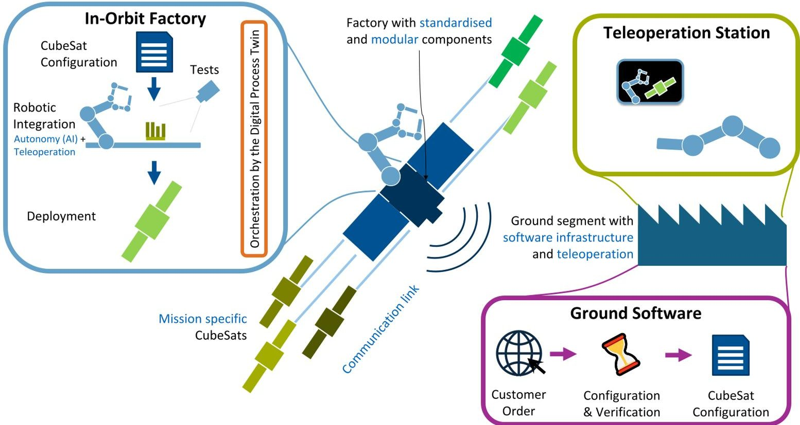
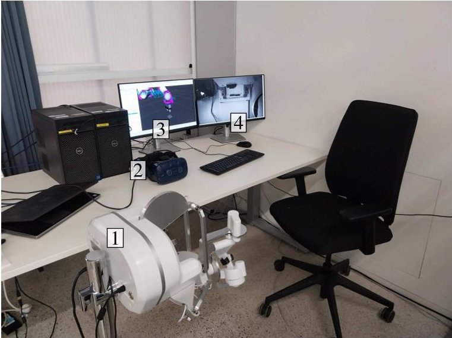
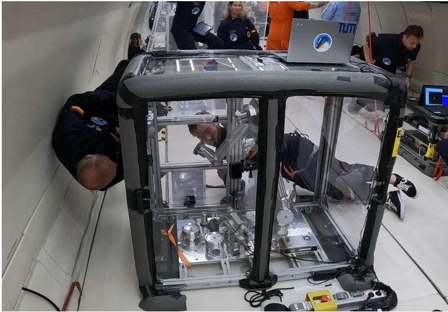
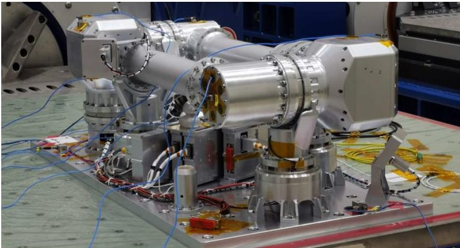
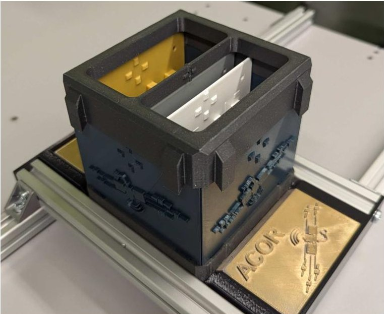
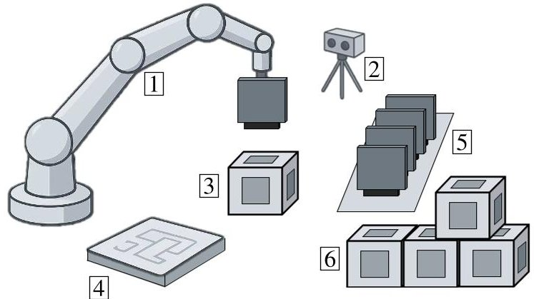
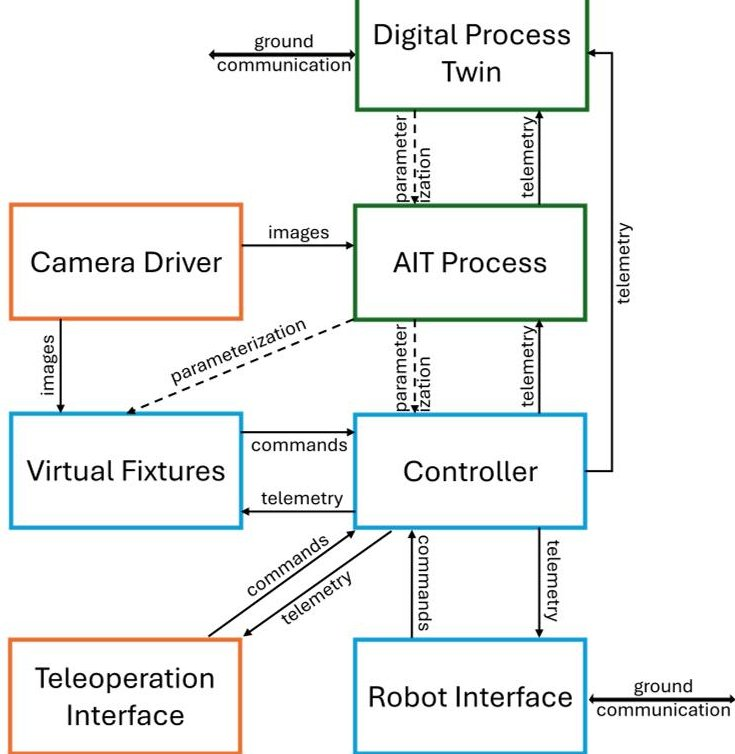

<!-- PDF_PAGE: 1 -->

IAC-25-D1,1,10,x101959

Towards an In-Orbit CubeSat Factory

Maximilian Mühlbauer $ ^{a,b*} $ , Florian Leutert $ ^{c} $ , Christian Plesker $ ^{d} $ , Thomas Hulin $ ^{b} $ , Maximilian Maier $ ^{e} $ Maxime Chalon $ ^{e} $ , João Silvério $ ^{b} $ , Klaus Schilling $ ^{c,f} $ , Benjamin Schleich $ ^{d} $ , Alin Albu-Schäffer $ ^{b,a,c} $

$ ^{a} $ School of Computation, Information and Technology, Sensor Based Robotic Systems and Intelligent Assistance Systems, Technical University Munich, Friedrich-Ludwig-Bauer-Str. 3, Garching, Germany.

$ ^{b} $ German Aerospace Center (DLR), Robotics and Mechatronics Center (RMC), München Str. 20, 82234 Weßling, Germany.

$ ^{c} $ Zentrum für Telematik e.V., Magdalene-Schoch-Straße 5, 97074 Würzburg, Germany.

$ ^{d} $ Product Life Cycle Management (PLCM), Technical University of Darmstadt, Otto-Berndt-Str. 2, 64287 Darmstadt, Germany. $ ^{e} $ KINETIK Space GmbH, Friedrichshafenerstr. 1, 82205 Gilching, Germany.

$ ^{f} $ Department of Robotics and Telematics, Julius-Maximilians-Universität Würzburg, Am Hubland, 97074 Würzburg, Germany. $ ^{*} $ Corresponding author, maximilian.muehlbauer@tum.de

## Abstract

Current satellites must be designed to withstand the vibrations of a rocket launch and are manufactured long before their operational start in orbit, thus creating long lead times, high expenses, and mission inflexibility. In-orbit assembly represents a paradigm shift in the field of satellite production and deployment, vastly increasing flexibility. Last minute configuration changes can be performed and new business models such as customized production directly in space become possible. Our approach has the potential to revolutionize the way satellites are manufactured and deployed. In-orbit assembly is furthermore a necessity for ever larger space structures which cannot be launched in one piece. Our concept of an In-Orbit Factory aims to pioneer a solution, by providing an adaptive just-in-time production. Pivotal for its economic success is a framework for the transition from initial teleoperated assembly towards full autonomy. This allows for a quick start with improved throughput at full capacity. The market size for small satellites was estimated at $3 billion in 2022 and is expected to rise to $15 billion in 2032, opening opportunities for our concept. Our approach of a tight integration of a space-ready robot equipped with advanced control algorithms and factory software is central to the development of In-Space Servicing, Assembly and Manufacturing (ISAM) capabilities.

The envisioned system consists of a robotic arm equipped with a gripper and a camera at the end effector, mounted on an assembly table containing modular CubeSat subsystems. Those subsystems are to be integrated into a chassis with a backplane, that is connected to a satellite development board to allow for automated testing of the CubeSat already during assembly. The robotic arm is controlled using a space qualified On Board Computer (OBC) executing the low-level robot control software as well as the higher-level application software. To this end, an adaptive approach of Virtual Fixtures is implemented, supporting both teleoperation as well as fully autonomous execution. Feedback obtained during the teleoperation phase also allows for a self-improvement of the approach. A Digital Process Twin (DPT) orchestrates the system at high level, enabling a holistic process mapping. With this process understanding, it is possible to detect errors at an early stage and to make automated, knowledge-based decisions for their solution.

This paper will present the envisioned in-orbit factory concept and analyze the currently available solutions as well as the research gaps to realize the factory. While the implementation using readily available CubeSats will allow for an inexpensive evaluation in space, the solution can easily be scaled to the assembly of larger structures as the challenges remain largely similar.

Keywords: AI, In-Orbit Factory, Teleoperation, Digital Twin, AIT, Robotic Manufacturing

<!-- PDF_PAGE: 2 -->

## Acronyms

Acronyms

AI Artificial Intelligence. 3-6, 8

AIT Assembly, Integration, Testing. 4-6, 8, 9

CIB Centralized Information Base. 5

CSID CubeSat Subsystem Interface Definition. 3

DoF degree of freedom. 6-8

DPT Digital Process Twin. 1, 3-5, 8

DT Digital Twin. 5

FDIR Fault Detection, Isolation and Recovery. 4-6

ISAM In-Space Servicing, Assembly and Manufacturing. 1, 2, 9

ISOS In-Space Operations And Services. 2

LEO Lower Earth Orbit. 3

OBC On Board Computer. 1, 4, 8

SC Shared Control. 4-8

VF Virtual Fixture. 4, 6-9

VR Virtual Reality. 6

## 1. Introduction

Automated factories are a reality on Earth, yet, they have not been implemented in space as of now. ForFabSat [1] for example implements an automated research production line for CubeSats [2] on Earth, which we are also considering in this work. In-orbit factories, as a central component to In-Space Servicing, Assembly and Manufacturing (ISAM) activities, would enable novel ways of deploying satellites to space, significantly advancing and making production in orbit more adaptive. Such factories would allow for the rapid deployment of satellites fully customized to the client's needs, reducing the time from satellite definition to successful deployment in orbit to a few hours instead of today's months to years. Launch risks can also be removed through the production in orbit while the proposed failure-tolerant assembly approach also allows to deal with inaccuracies and other problems during satellite production. Furthermore, satellites can be tested and potentially repaired just before their actual deployment, which is especially important as defect rates range from 2.5% for Starlink satellites [3] up to 25% for CubeSats [4].

## 1.1 Motivation

Current satellite designs need to both withstand the vibrations of a rocket launch and also fit into the space requirements of rocket launchers, often necessitating complex deploy mechanisms for solar panels and antennas even for small satellites [6]. These mechanisms regularly exhibit failures [7], often leading to substantial capability losses or the use of fuel for unjamming maneuvers, effectively reducing the lifetime of the satellite. Prominent recent examples include the JUICE mission to Jupiter, where complex satellite motions were needed to successfully unjam the antenna [8]. Even more extreme cases are the ViaSat-3,

where due to a failure to fully deploy the antenna only 10% of the data throughput can be achieved or the Inmarsat I6 F2 satellite which was a complete write off, both leading to large insurance claims [9].

In-orbit assembly represents a paradigm shift in the field of satellite production and deployment, vastly increasing flexibility. Problems such as the aforementioned could be mitigated through robotic assembly in space, as no complex deployment mechanisms are required but large structures can instead be constructed from scratch. Last minute configuration changes can also be performed and new business models such as customized production directly in space, or readily available replacement satellites for use in a formation become possible, thus revolutionizing the way satellites are being manufactured.

## 1.2 Market and Strategy

According to multiple market forecasts, the global satellite market is set to multiply in the coming years [10, 11]. This increase is largely driven from big constellations with similar satellites which are particularly suited for automated assembly. Based on this increased standardization, the production of individual satellites using standardized modules will become increasingly viable.

The increasing importance of ISAM activities is also reflected by the growing number of such missions and companies as listed in NASA's ISAM state of play publication [12]. Such robotic in-orbit activities also take an important role on national level in the space strategy of the Federal Government of Germany [13] as well as on level of the European Union, where such activities known under the term "In-Space Operations And Services (ISOS)" are planned to be regulated, to e.g. require servicing capabilities for publicly owned satellites [14].

## 1.3 Related Work

Performing precise assemblies in orbit is possible thanks to torque-sensitive robots such as DLR's TINA [15] and CAESAR [16] arms. Using such lightweight robot technology, the MOSAR project [17] realized the assembly of modular satellites on Earth. PULSAR [17] aimed at assembling a large mirror structure for a future telescope. Both projects were however using relatively big, preassembled units, thus limiting the amount of achievable customization of the assembled product. Beyond the assembly itself, supply of such in-orbit factories must be ensured. Thus recently, projects such as StarFAB [18] started investigating the infrastructure required for such factories, including robotic workcells, warehouses and logistics.

Starting the development of factories for large structures however involves high risk and cost. Our approach is therefore to leverage commonly and relatively cheaply

<!-- PDF_PAGE: 3 -->

Fig.1. The overall concept consisting of the in-orbit factory with robotic CubeSat integration and testing and a ground segment with teleoperation station as human interface to the factory and ground software providing the customer interface and deriving the required configuration. Adapted from [5].

available CubeSats as a testbed for the development of an in-orbit factory. Their small size allows to store a large number of components in a single robot's workspace while the standardisation of subsystems allows to create many different satellites from just a few different components. When constraining the used components to simple subsystems, potentially even simple gantry robots could be used for assembly as done in the Orbital Locker project [19].

## 1.4 A Flexible Factory Approach

Our approach should however be able to assemble CubeSats without such constraints. The authors have already explored the required technologies to realize such factory throughout the Space Factory 4.0 [20], AI-In-Orbit Factory [21, 22] and ACOR [5] projects. There, individual solutions for aspects of the assembly problem have been implemented on commercially available hardware. As of now, a full implementation on space-grade hardware which can easily be adapted for a cost-effective real space mission has not been done. In this work, we therefore

- analyze the requirements for such in-orbit factory,

- survey currently available solutions and

- detail a holistic and realizable factory concept.

In particular, we focus on a scalable factory concept that can already start operating with proven technologies and human assistance through teleoperation with a transition towards full autonomy with improved throughput. This design will allow to leverage advanced Artificial Intelligence (AI) algorithms, incrementally introducing them during operation.

## 2. Concept of the In-Orbit Factory

The overall factory concept is depicted in Fig.1. It consists of a ground segment hosting the order website for customers, components of the Digital Process Twin (DPT) checking the configuration and planning the assembly as well as the teleoperation station which is the human interface to the factory. In space, a larger satellite deployed to Lower Earth Orbit (LEO) contains the robotic assembly cell with a general purpose space robot arm equipped with a specialized gripper, a storage of CubeSat components following the CubeSat Subsystem Interface Definition (CSID) standard, a CubeSat ejection facility as well as a docking interface for resupplying stock through servicer spacecrafts. This factory layout allows to build arbitrary CubeSats with subsystems following the CSID standard. By following this standard, even components developed after an operational start of the factory can be resupplied.

<!-- PDF_PAGE: 4 -->

While the hardware setup, except for the generalpurpose robotic arm, is tailored to the assembly of CubeSats, the real innovation of the factory concept is its software. As explored in previous projects [5, 20-22], the software is based on three main software components,

- a DPT orchestrating and supervising the assembly (Section 4.1.1),

- an Assembly, Integration, Testing (AIT) process ensuring proper integration and functioning of the final product (Section 4.1.2),

- a robotic assembly system with full automation and teleoperation capabilities (Section 4.1.3),

which are all to be implemented on the space-grade On Board Computer (OBC) of the factory. Designed using the power and flexibility of AI algorithms and with embedded Fault Detection, Isolation and Recovery (FDIR) capabilities, this software stack will be usable beyond CubeSat assembly. To account for challenges arising from different operating conditions in space, the concept is equipped with a novel control architecture allowing for both autonomous as well as teleoperated automation. For this, a Shared Control (SC) approach based on Virtual Fixtures (VFs) (virtual force fields) will be extended to include transitions from teleoperated to automated assembly modes. Furthermore, learning algorithms for self-improvement of the algorithms need to be researched which allow to adapt motions through teleoperation to achieve fully automated assemblies.

## 3. Hardware and Software Requirements

To realize the in-orbit factory, especially the hardware of the assembly cell sent to orbit is critical as it determines the factory's capabilities. While the communication is to be realized using existing satellite communication networks, the robot, storage and gripper hardware is unique and should be flexible enough to also cope with future CubeSat modules. The software should be designed to evolve over time with learnings from factory operations, therefore, its update capabilities are especially important. The specific requirements for the factory will be outlined in the following.

## 3.1 Assembly Cell

As outlined in Section 2, the main hardware component of the factory is the assembly cell which is mounted on a satellite. The satellite, CubeSat deployment mechanisms such as PPOD [23] or ACES [24] potentially requiring adaptations as well as the docking interface for resupplying the factory are beyond the scope of this work and require further investigations. We focus on the requirements for the robotic assembly of the satellites.

A minimal CubeSat configuration consists of a backplane to which individual subsystems can be connected to, rails as support structure as well as side panels [25]. The robot must be equipped with a gripper which can handle all of those components; a redesign, especially of the mechanical support structure, might be required as it is currently designed for assembly by hand. For an optical inspection of the satellite components, a camera is required. Placing this camera in the robot's hand furthermore allows us to use advanced control methods, e.g., for subsystem insertion [26, 27]. Another camera is required for the human operator teleoperating the robotic arm from Earth. For further testing of the subsystems, a satellite development board is required in the robot's workplace. This development board allows to perform electrical and software testing of subsystems passing optical inspection as well as to update their software before integration. Recovery options such as replacing parts or resoldering of joints remain outside of scope of the initial factory, such defective parts have to be discarded. It is therefore important that only subsystems passing all inspections on Earth are sent to the factory in order to minimize such occurrences.

To support the robotic AIT process under zero gravity conditions, storage and assembly area have to be designed with holder systems preventing components from floating. The storage area has to support the individual retrieval of subsystems, temporary storage for complex assembly procedures as well as the storage of defective units. The assembly area has to provide fixtures both for the initially place backplane as well as for the satellite structure which is assembled after the subsystems. Those fixtures need to be retractable to allow a deployment of the finalized satellite.

While the lifetime of the factory has yet to be defined, the robot as well as the computer systems controlling the robot and the assembly have to withstand space conditions throughout its time in operation. To this end, a space-grade torque sensitive robotic arm as well as a radiation hardened OBC with sufficient computational power to execute all software components is required.

## 3.2 Factory Software

The factory software is responsible for commanding the robot, orchestrating the assembly and testing as well as for the communication both with the ground station as well as with the CubeSat during assembly. The controllers for commanding the robot have to be executed in real time to ensure the robot receives commands at its control rate. In case of the TINA robot, a rate of 100 Hz has to be achieved [28], depending on the required accuracies, higher rates of up to 1 kHz as used in lightweight robots on Earth [29] might be required. This component of the factory furthermore

<!-- PDF_PAGE: 5 -->

has the highest reliability requirements, as a stable and safe control of the robot without damaging the factory has to be achieved even when the high-level components do not send new commands or malfunction. Furthermore, a low resource usage of these controllers has to be achieved to leave enough resources to execute high-level processes especially for algorithms involving computer vision.

These high-level algorithms are responsible for orchestrating the whole AIT procedure. After receiving the assembly plan from the ground software, the required assembly order, testing procedure and motions have to be planned. Different as well as previously unknown satellite configurations must be supported by the involved algorithms. FDIR elements are to be used to detect component or assembly inaccuracies and errors and adapt the build process to rectify them. As tight tolerances in the assembly make the process especially vulnerable to inaccuracies which can also not be tuned beforehand under Earth gravity conditions, control algorithms able to handle these unknown conditions are required. To this end, as human intervention might be required especially for initializing the factory production, a teleoperation interface is required. The human operator should be supported by SC algorithms which allow for a transition to fully autonomous assembly, therefore enabling a quick start and ramp-up of production without having to tune different controllers.

## 3.3 Teleoperation Station

As human interface to the factory, a teleoperation station on ground such as the one depicted in Fig. 2 is required. This station should consist of a haptic input device which lets the human command the robot in the factory while providing force feedback both from the remote environment as well as from SC methods. Furthermore, displays are required to show a video signal from the factory to provide the human with visual feedback from the assembly.

## 3.4 Ground Software

The ground software needs to provide three distinct functionalities: a customer-facing interface to let them define the CubeSat they want to order, the planning module checking the feasibility of the requested design and selecting the required subsystems as well as the teleoperation software. The latter two also communicate with the factory; for the teleoperation, even a real time communication is required. As with any robot controller, also the software commanding the teleoperation input station has to fulfill safety and stability requirements. Furthermore a stable telerobotic coupling needs to be ensured in order to guarantee safety of the factory. As computers with high computational power are available cheaply on Earth, resource usage is less constrained than inside the actual

factory.

## 4. Implementation of the In-Orbit Factory

Solutions for subproblems of realizing an In-Orbit Factory have already been implemented and tested on Earth. We now analyze components that are already available and outline missing developments to realize our vision of a factory in Earth's orbit.

## 4.1 Currently Available Solutions

As outlined before, approaches for production on Earth can serve as starting point for production in orbit. In the previous project Space Factory 4.0 [20], Industry 4.0 principles were leveraged to make the production process with customizeable CubeSats resulting in a large number of possible configurations feasible. In [22], this approach was further flexibilized using AI methods in order to e.g. automate the testing procedure. As human intervention in the factory is prohibitively expensive, FDIR approaches were researched in [5].

Common to these projects was the division of the factory operations into a high-level assembly planning and orchestration using a DPT, an AIT process responsible for testing and automated assembly as well as the teleoperation as human interface to the factory. We believe that these pillars are indispensible backbones for an in-orbit factory and thus detail the work that has already been done in their domains. A strong focus will also be placed on algorithms that have already been implemented on space hardware.

## 4.1.1 Assembly Planning and Orchestration

The first step in the assembly process is the CubeSat definition from a customer. Already in [20], a web interface was developed which allows for an intuitive definition of the CubeSat to be built and which verifies the feasibility of the final assembly. Also, the required Digital Twins (DTs) for individual subsystems and the CubeSat as well as the required Centralized Information Base (CIB) were outlined. In [5, 22], a more process-centric view through the newly developed DPT allowed a higher-level process orchestration. This DPT instantiates and parametrizes individual DTs as required for the current assembly step. Through the DT interface to the robot, the AIT as well as the teleoperation process, the DPT is able to detect anomalies in the robotic integration beyond test failures of CubeSat components. Leveraging knowledge gained from previous assemblies, errors and recoveries, the DPT is then able to plan corrective steps. Combining all these developments, the theoretical foundations for the required assembly planning and orchestration for realization of the factory are already available.

<!-- PDF_PAGE: 6 -->

Fig. 2. A possible teleoperation station layout with haptic input device 1, a Virtual Reality (VR) display for visualizing the remote video stream with overlaid information 2 and screens 3, 4 displaying the robot state and in-hand camera information.

## 4.1.2 Assembly, Integration and Testing

The AIT process as presented in [20] is responsible for executing the planned assembly with actual subsystem hardware and physical testing. It can realize a fully autonomous robotic integration of highly modular satellite subsystems to a functioning assembly. This process was then enhanced using different AI approaches to make this process more robust and reliable [22]. For example, force sensitivity of the robot arm was used to secure the insertion of subsystem boards to the satellite bus, and learning algorithms were leveraged to improve the performance of this integration step. Optical inspection was used to inspect components, to verify placement tolerances as well as to detect potential defects on them as soon as possible during the integration process. FDIR approaches were then implemented on process level (securing the building process itself) as well as on system level (ensuring later functionality of the produced satellite) with the aim of further increasing reliability and robustness of the autonomous production [5].

While the AIT processes were tested with different subsystems and a backplane, building a fully functioning satellite model was not possible to date as some pieces of the satellite are not yet designed for robotic assembly. Integration of the satellite chassis, solar panel as well as parts currently requiring wired connections are thus to be investigated. This will require satellite hardware changes for the feasibility of a fully autonomous robotic integration.

Fig. 3. Interaction experiment with the 4-degree of freedom (DoF) SpaceDREAM robot during a parabolic flight within the RoboGrav project [33].

## 4.1.3 Teleoperation Process

During factory ramp up (e.g., to correct unmodeled inaccuracies of the robot under zero gravity conditions) as well as to provide a fallback in failure cases, the teleoperation process provides the human interface to the in-orbit factory. A teleoperation controller developed for delays up to 3 s [30] can be used which allows for a safe control of the factory from Earth with expected delays of around 800 ms while providing force feedback from the environment to the human operator. Having force feedback is indispensable as it allows the human to control the forces exerted on the environment, therefore increasing transparency as well as safety handling fragile parts. A possible teleoperation setup is shown in Fig. 2.

Pure teleoperation is however very challenging, as in the non-contact case, only visual feedback is available to the human. Even when multiple views or VR are provided, manipulation details such as depth perception are challenging as only limited bandwith is available for transmitting images from the factory, leading to low-resolution visuals. Haptic cues transported through VFs [31] are therefore required to guide the human operator. Within previous projects, a fixture framework optimally supporting during such challenging assembly scenarios has been developed [27, 32]. These fixtures have already been coupled with a teleoperation controller [22] with preliminary results indicating a useful guidance.

## 4.1.4 Space Robot and Control

For the envisioned factory, a space-ready version of the TINA robot [15] is planned to be used. This robot has already been equipped with the SC algorithms [27, 32] developed in previous projects and was tested on DLR's

<!-- PDF_PAGE: 7 -->

Fig. 4. The space-grade robot used in the SpaceDREAM and RoboGrav projects [28, 33] which, after an extension to 6 DoFs, can be used to implement our factory concept. This robot is based on DLR's lightweight robot technology [29], allowing for sensitive interaction with the environment.

42 $ ^{\mathrm{nd}} $ parabolic flight campaign [28, 33, 34]. Results indicate that a performance comparable to a torque controlled robot on Earth can be achieved, enabling a quick extension of these controllers for the in-orbit factory. Initially developed to support the human operator, the SC methods can be extended to support a transition towards fully autonomous execution [32]. This is, e.g., possible as the VFs are implemented using an impedance control scheme where the trajectory direction either receives no guidance for full human control or can be equipped with a velocity controller. Automation is therefore possible through a simple reparameterization of the controllers which, unlike a complete change of controllers, allows to tune assembly procedures through human corrections as e.g. outlined in previous work [5] and leverage those corrected motions also in autonomous operation.

## 4.2 Required Developments

To implement the in-orbit factory in a space-ready setup to the requirements outlined in Section 3, albeit on Earth and without capabilities for restocking components or launching the assembled CubeSat, requires an integration of the aforementioned developments as well as new hardware and software components which will be detailed in the following.

## 4.2.1 Hardware Developments

The central piece of the in-orbit factory is a space-grade robotic arm. To this end, the TINA arm [15], which is based on torque-sensitive lightweight robot technology [29], and designed with space grade components should be used. Lightweight robot technology has already been used to develop the assembly algorithms during our earlier projects.

Fig. 5. 3D-printed prototype of a CubeSat structure that can be joined by a robot using snap-in connections.

Furthermore, the robot is comparatively low cost and can be operated both on Earth as well as under zero gravity conditions [33], significantly easing tests of algorithms and enabling a demonstration of the results on real hardware on Earth. While the robot has been extended from its previous version of 4 joints to 6 joints (Fig. 4), thus allowing it to reach arbitrary poses in its workspace, a gripper, including gripper fingers for handling subsystems, as well as the satellite structure have to be developed. The end effector furthermore has to be equipped with a camera that can see both the grasped objects as well as their placement location, to be used both for inspection and control algorithms.

On the basis of existing CubeSat designs, adaptations to allow for a fully autonomous assembly are required. Central components of current CubeSats, involving the backplane and modular subsystems, are already largely suited for a robotic assembly. Subsystems, however, still have to be selected from already produced satellites, to provide a range of different systems at least providing computation, power, and attitude control to the satellite in different configurations. The current rail system with tight tolerances and a connection through screws however cannot be assembled with a robot under zero gravity conditions. This structure could possibly be replaced by elements which are joined by snap-in connections as shown in Fig. 5.

The final missing piece for the factory are holder systems for both the satellite to be assembled as well as for the component storage. These holders must securely store components and prevent them from floating under zero gravity conditions. An exemplary sketch of the full factory layout is shown in Fig. 6, where also the stereo camera setup for teleoperation as well as the satellite development

<!-- PDF_PAGE: 8 -->

Fig. 6. Envisioned factory layout with space robot 1, stereo camera setup 2 for teleoperation and inspection and the CubeSat to be assembled 3. The robot's workspace furthermore contains a satellite conductor test board 4, a subsystem storage 5 as well as a storage for the satellite's structure 6.

board for powering and testing of subsystems is placed.

## 4.2.2 Software Developments

Previous software developments have rested on the three pillars of a DPT, the AIT and a teleoperation process which have all been implemented on different systems. For the realization of the factory on one robotic system, the individual components have to be tightly integrated Especially the AIT process needs to be modularized such that it can be orchestrated from the DPT and uses the SC framework for motion generation. The former will allow for a direct supervision by the DPT and leverages its potential for anomaly detection and correction while the latter enables a direct integration with the teleoperation process. By representing the required motions as VFs, they can both be executed by a human operator through the remote teleoperation station or be automated. This allows for a quick operational start of the factory with human corrections while later switching to full autonomy - the factory can therefore generate revenue right from its operational start without excessive tuning while switching to higher throughput using full autonomy once possible inaccuracies have been corrected. Fig. 7 shows the complete envisioned software stack inside the in-orbit factory.

As outlined in the requirements, the central requirement for the software stack is a real time execution of the controller to ensure safe and stable operation of the robot arm. The envisioned controller's performance has already been tested on a space-grade OBC on a parabolic flight under 0 g conditions [28,34]. Still, the extension of this controller to 6 DoFs has to be tested. Furthermore, the fine manipulation capabilities of the robot equipped with this controller need to be verified. The remainder of the software stack however needs an implementation on space grade hardware, ensuring performance with limited resources. To this end, the current DPT implementation needs to be partitioned into a component that needs to be executed inside the factory and a component that can be executed on Earth. This partitioning as well as the integration with other components furthermore requires the integration of a reliable real time communication as well as data transfer infrastructure while respecting the available bandwidth. Based on available sensor data and hardware specifics, the AI approaches of the DPT need to be retrained to the factory to ensure successful failure detection and orchestration. Within the AIT process, especially computationally intensive operations such as image analysis need to be analyzed and prioritized. For example, pre-selected images could be sent to Earth for a more detailed analysis given enough bandwidth of the factory.

Fig. 7. Overview of the software stack components planned for the in-orbit factory. The VFs, controller and robot interfacing components have already been tested together with the space-grade robot in [33, 34]. Orange boxes depict processes close to the hardware, the green boxes highlight the DPT and AIT process which need to be adapted to the space-grade OBC.

## 5. Testing of the In-Orbit Factory

After implementing all required components on the robotic workcell, integration testing can be performed by realizing a full CubeSat assembly. Before that, individual software components can be tested and software quality can

<!-- PDF_PAGE: 9 -->

be ensured through strict coding standards. Even though the initial implementation is designed to be tested on Earth only, adhering to this testing protocol will significantly ease a potential space mission.

## 5.1 Software Quality

As in [28], a new space approach should be used for software development to limit costs. All software components should use a code formatter to avoid whitespace changes and employ code checking. To this end, cppcheck can be used for C++ check and a combination of ruff and mypy for Python code which should also be fully typed. Appropriate formatting and checking should be applied to other languages as well. Safety-critical components, especially those interfacing the robot, should also come with a set of manual and automated tests to ensure that no unwanted or dangerous robot motions are being executed.

## 5.2 Component Testing

Tests for individual components, considering the robot arm as a black box, can be divided in three parts: testing of newly developed CubeSat subsystems, testing of the software and finally testing of parts of the factory workcell. In order to keep costs manageable and to achieve a fast operational start, subsystems should be reused as much as possible from existing satellites which are already spaceproven. Subsystems requiring adaptation need to be requalified.

Software testing should largely be handled by unit tests where inputs from other components as well as the behaviour of e.g. the robot are simulated. This is especially relevant to test interfaces as components are to be developed by different project partners. Furthermore, testing time on the hardware can be reduced by this approach. Such simulated development was already leveraged to develop the robot's software [28] even before the hardware was available.

Finally, the newly developed parts of the workcell have to be tested as well. The main concern at this level is the robot's workspace, meaning that all subsystems, inspection and insertion positions can be reached as well as the accuracy. For example, subsystems have to be grasped and inserted reliably and repeatably to be able to perform the assembly. This will likely require calibration of the robot, tuning of the controllers as well as the development of procedures to correct for inaccuracies during operations which can be used later on to account for differences under zero gravity conditions.

## 5.3 Integration Testing

After all components of Fig. 7 have been verified to produce reasonable outputs, individual components can be

integrated. Instead of directly using the robot hardware, simulation should be used to compute the robot's motions. Once satisfying results are achieved, the integration of subsystems can be tested using real hardware. Using the AIT process and self-testing capabilities of the CubeSat, success of the assembly can be verified right after each step. With the fully assembled satellite, functional self-testing can be performed as would be for a manually assembled satellite to ensure correct assembly. Finally, a full optical inspection of all connections and the satellite chassis should be performed to verify that a fully functional satellite has been produced. This inspection should first be performed using the robot's in-hand camera to create a baseline which can later be reused in-orbit and then be compared to a manual inspection.

## 6. Conclusion and Outlook

In this work, we argue that small satellites can be produced on demand according to customer specifications in an autonomous and teleoperated In-Orbit Factory directly in space. Expertise on CubeSat production gained from the Space Factory 4.0 - AI-In-Orbit-Factory - ACOR project series is to be extended, implemented, and validated on a space-compatible lightweight robot. Result of the proposed approach is thus a demonstrator showcasing the adaptive in-orbit assembly of a CubeSat using a space-compatible robotic arm. Teleoperation aided by advanced Virtual Fixtures will allow for a quick start of production, transitioning to full automation with improved process stability. The whole platform and software infrastructure will be designed to be space ready. A fast and inexpensive space demonstration of the proposed system is thus possible to prove the results. Individual components developed during the project could also be reused, for example in on-orbit servicing, robotic factories for CubeSats or other components, personal assistance robotics as well as in surgical systems on Earth.

While the algorithms and workcell will be developed specifically for CubeSats because of their small size and low cost, the developed algorithms are central to other InSpace Servicing, Assembly and Manufacturing activities as well. Challenges such as differences in system operations on Earth and under zero gravity conditions, accuracy deterioration under space condition as well as the required software stack for complex robot operations are also valid for larger space structures. Our factory approach can therefore help to explore these challenges while keeping cost and risk limited to learn for more expensive projects using larger structures. Finally, the results will also be indispensable for resilient structures, both through the quick assembly of replacement for potentially malfunctioning satellites as well as for the servicing of existing satellites.

<!-- PDF_PAGE: 10 -->

## Acknowledgement

Results laying the basis required for this in-orbit factory concept were achieved within the Space Factory 4.0 (50RP1710-50RP1712), AI-In-Orbit Factory (50RP2030A-C) and ACOR (50RP2240A-C) projects funded by the Federal Ministry for Economic Affairs and Energy (BMWE).

## References

[1] F. Leutert, M. Krauss, M. Scholz, and K. Schilling, "Forfabsat: A research factory to analyze series production for networks of small satellites," in IAF Space Systems Symposium, ser. IAC 2024, International Astronautical Federation (IAF), 2024, pp. 203-210. DOI: 10.52202/078372-0021.

[2] The CubeSat Program, "Cubesat design specification," Cal Poly, Feb. 2022.

[3] M. McFall-Johnsen, About 1 in 40 of spacex's starlink satellites may have failed. that's not too bad, but across a 42,000-spacecraft constellation it could spark a crisis. Accessed on June 18, 2024, 2020. [Online]. Available: https://www. businessinsider .com/spacex-starlink internet-satellites-percent-failure rate-space-debris-risk-2020-10.

[4] T. Villela, C. A. Costa, A. M. Brandao, F. T. Bueno, and R. Leonardi, "Towards the thousandth cubesat: A statistical overview," International Journal of Aerospace Engineering, vol. 2019, no. 1, p. 5063145, 2019. DOI: 10.1155/2019/5063145.

[5] M. Mühlbauer et al., "AI-based Robust and Failure-Tolerant Processes for In-Orbit Manufacturing of Modular Small Satellites," in 75th International Astronautical Congress, IAC 2024, Oct. 2024. DOI: 10.52202/078372-0010.

[6] J. Sauder, C. Gebara, N. H. Reddy, and C. J. García-Mora, "A framework for small satellite deployable structures and how to deploy them reliably," Communications Engineering, vol. 3, no. 1, May 2024 ISSN: 2731-3395. DOI: 10.1038/s44172-024-00210-7.

[7] A. Rivera and A. Stewart, "Study of spacecraft deployables failures," in 19th European Space Mechanisms and Tribology Symposium (ESMATS) 2021, 2021.

[8] R. Le Letty et al., "The successful recovery of the juice rime antenna deployment," in Proceedings of the 20th European Space Mechanisms And Tribology Symposium ESMATS, 2023.

[9] D. Swinhoe, Paying the premium: Why 2023 was a bad year for space insurance, Accessed on August 06, 2025, 2024. [Online]. Available: https://www datacenterdynamics .com/en/analysis paying-the-premium-why-2023-was-a-bad year-for-space-insurance/.

[10] Goldman Sachs, The global satellite market is forecast to become seven times bigger, Accessed on August 19, 2025, 2025. [Online]. Available: https://www.goldmansachs.com/insights articles/the-global-satellite-market is-forecast-to-become-seven-times bigger.

[11] Allied Market Research, Satellite market, Accessed on August 19, 2025, 2023. [Online]. Available: https://www.alliedmarketresearch.com/satellite-market.

[12] D. Arney et al., In-space servicing, assembly, and manufacturing (isam) state of play - 2024 edition, 2024.

[13] Bundesministerium für Wirtschaft und Klimaschutz (BMWK), Raumfahrtstrategie der Bundesregierung. Sep. 2023.

[14] European Commission. Directorate General for Defence Industry and Space., EU Space Act: the EU's ambition for a cleaner, safer and more competitive space sector. LU: Publications Office, 2025. DOI: 10.2889/7724304.

[15] M. Maier et al., "Tina: Small torque controlled robotic arm for exploration and small satellites," in Proceedings of the International Astronautical Congress, IAC, 2019.

[16] A. Beyer et al., "Caesar: Space robotics technology for assembly, maintenance, and repair," in Proceedings of the International Astronautical Congress, IAC, Oct. 2018.

[17] P. Letier et al., "Mosar : Modular spacecraft assembly and reconfiguration demonstrator," in 15th Symposium on Advanced Space Technologies in Robotics and Automation, NLD, May 2019.

[18] M. Deremetz et al., "Starfab: Concept of operations and preliminary design of an orbital automated hub for in space operation and service activities," in IAF Space Systems Symposium, ser. IAC 2024, International Astronautical Federation (IAF), 2024, pp. 72- 79. doi: 10.52202/078372-0008.

<!-- PDF_PAGE: 11 -->

[19] L. Freitag, J. Dingley, D. Saptari, J. Homer, and K. Cahoy, "Planning for in-space robotic assembly of modular cubesats," in 2025 IEEE Aerospace Conference, IEEE, Mar. 2025, pp. 1-8. DOI: 10.1109/aero63441.2025.11068792.

[20] T. Weber Martins et al., "Space factory 4.0-new processes for the robotic assembly of modular satellites on an in-orbit platform based on ,industrie 4.0" approach," in Proceedings of the International Astronautical Congress, IAC, 2018.

[21] F. Kempf et al., "Ai-in-orbit-factory - ai approaches for adaptive robotic in-orbit manufacturing of modular satellites," in Proceedings of the International Astronautical Congress, IAC, Oct. 2021. [Online]. Available: https://elib.dlr.de/144939/.

[22] F. Leutert et al., "Ai-enabled cyber-physical in-orbit factory - ai approaches based on digital twin technology for robotic small satellite production," Acta Astronautica, vol. 217, pp. 1-17, Apr. 2024, ISSN: 0094-5765. DOI: 10.1016/j.actaastro.2024.01.019.

[23] The CubeSat Program, "Poly picosatellite orbital deployer mk. iii rev. euser guide," California Polytechnic State University, Mar. 4, 2014.

[24] National Aeronautics and Space Administration, "Advanced cubesat ejectorsystem (aces)," 2015.

[25] S. Busch, "Cubesat subsystem interface definition," UNISEC Europe, Aug. 24, 2017.

[26] M. Mühlbauer, F. Steinmetz, F. Stulp, T. Hulin, and A. Albu-Schäffer, "Multi-phase multi-modal haptic teleoperation," in 2022 IEEE/RSJ International Conference on Intelligent Robots and Systems (IROS), IEEE, Oct. 2022. DOI: 10.1109/iros47612.2022.9981525.

[27] M. Mühlbauer et al., "A probabilistic approach to multi-modal adaptive virtual fixtures," IEEE Robotics and Automation Letters, vol. 9, no. 6, pp. 5298-5305, Jun. 2024, ISSN: 2377-3774. DOI: 10.1109/LRA.2024.3384759.

[28] M. Mühlbauer, M. Chalon, M. Ulmer, and A. Albu-Schaffer, "Software for the spacedream robotic arm," in 2025 IEEE Aerospace Conference, IEEE, Mar. 2025, pp. 1-10. DOI: 10.1109/aero63441. 2025.11068537.

[29] G. Hirzinger et al., "Dlr's torque-controlled light weight robot iii-are we reaching the technological limits now?" In 2002 IEEE International Conference on Robotics and Automation, IEEE, 2002, pp. 1710-1716. DOI: 10.1109/robot.2002.1014788.

[30] M. Panzirsch et al., "Exploring planet geology through force-feedback telemanipulation from orbit," Science Robotics, vol. 7, no. 65, Apr. 2022 ISSN: 2470-9476. DOI: 10.1126/scirobotics.ab16307.

[31] L. Rosenberg, "Virtual fixtures: Perceptual tools for telerobotic manipulation," in Proceedings of IEEE Virtual Reality Annual International Symposium, 1993, pp. 76-82. DOI: 10.1109/VRAIS.1993.380795.

[32] M. Mühlbauer, B. Weber, S. Calinon, F. Stulp, A. Albu-Schäffer, and J. Silvério, "A unified framework for probabilistic dynamic-, trajectory- and visionbased virtual fixtures," 2025. arXiv: 2506.10239 [cs.R0]. [Online]. Available: https://arxiv.org/abs/2506.10239.

[33] H. Maurenbrecher et al., "Robograv - towards force sensitive space manipulators," in Proceedings of the 17th International Symposium on Artificial Intelligence, Robotics and Automation in Space (iSAIRAS), 2024.

[34] M. Mühlbauer, M. Chalon, and A. O. Albu-Schäffer, "Control system for a torque-sensitive space robotic arm," in 76th International Astronautical Congress, IAC 2025, Sep. 2025.