<!-- PDF_PAGE: 1 -->

IAC-25,E2,4,4,x95441

Validation of Alba CubeSat's Thermal Model: from simulations to experimental testing

Monica Mozzato $ ^{a} $ $ ^{*} $ , Pasquale Berardino $ ^{a} $ , Salvatore Civiello $ ^{a} $ , Mattia Martello $ ^{a} $ , Luca Trevisan $ ^{a} $ , Antonio Abbatecola $ ^{c} $ , Samuele Enzo $ ^{b} $ , Stefano Lopresti $ ^{b} $ , Alessandro Francesconi $ ^{c} $

$ ^{a} $ University of Padova, Via Venezia, 1, Padova, 35131, Italy

$ ^{b} $Centre of Studies and Activities for Space (CISAS) "Giuseppe Colombo", University of Padova, via Venezia, 15, Padova, 35131, Italy

$ ^{c} $ Department of Industrial Engineering, University of Padova, Via Venezia, 1, Padova, 35131, Italy

## Abstract

Thermal modelling is a critical aspect of spacecraft design, ensuring components operate within safe temperature limits in the harsh environment of space. The paper reports a case study on the validation of the thermal model for AlbaSat, developed by the student project Alba CubeSat from the University of Padova. AlbaSat is a 2U CubeSat entirely developed by student which participated in the Fly Your Satellite! Design Booster programme in 2024 and was supported by ESA during the development of its satellite design. The team has now been selected for the ESA Fly Your Satellite! Test Opportunity programme, which ensures the chance to conduct thermal tests at ESA's facilities "ESEC-Galaxia" in Belgium, allowing the students to test the CubeSat's thermal performance in a thermal vacuum chamber (TVAC). This opportunity enables the comparison of results with those from thermal analyses and the validation of the thermal model through the creation of a digital twin. The paper provides a detailed description of the Structural-Thermal Model (STM) developed by the students to ensure an accurate representation of the CubeSat thermal behaviour. It outlines the setup and methodology of the thermal analyses conducted using the Radian Systems software, highlighting the specific configurations and assumptions made during the simulations. The mathematical results will be compared with the data collected by the thermocouples during thermal balance procedure to understand which assumptions worked and which parameters could be further improved to obtain even more reliable results. A key aspect of this research is its educational value. The entire process, from analysis to testing and validation, is carried out by students, offering hands-on experience in spacecraft thermal application.

Keywords: Thermal Model, Thermal simulations, CubeSat, TVAC.

<!-- PDF_PAGE: 2 -->

## Acronyms

ADCS Attitude Determination and Control System.

CAD Computer Aided Design.

CCRs Corner Cube Retroreflectors.

COTS Commercial Off-The-Shelf.

DUT Device Under Test.

EQM Engineering Qualification Model.

ESA European Space Agency.

FEM Finite Element Method.

FFT Fully Functional Test.

FM Flight Model.

FR4 Flame-Resistant composite material.

IS Impact Sensor.

LEO Low Earth Orbit.

MEMS Micro Electro-Mechanical Systems.

MRR Modulating Retroreflector.

MSE Mean Squared Error.

MVS Microvibration Sensor.

PCBs Printed Circuit Boards.

QPL Quantum Payload.

SLR Satellite Laser Ranging.

SQC Space Quantum Communication.

STM Structural Thermal Model.

TRP Temperature Reference Point.

TVAC Thermal Vacuum Chamber.

WCC Worst Cold Case.

WHC Worst Hot Case.

## 1. Introduction

The increasing demand for small satellites, especially CubeSats, has significantly transformed the space industry in recent years [1],[2]. These platforms provide affordable and flexible access to space, but their miniaturized size poses several engineering challenges, particularly in thermal control [3]. Due to the limited surface area and thermal inertia, CubeSats are highly sensitive to environmental variations such as direct solar radiation, Earth albedo, and eclipse phases [4]. In this context, the development of a reliable thermal model is crucial to predict the temperature evolution of the components and to ensure the correct functioning of the subsystems during the mission [5].

Thermal modelling plays a fundamental role throughout the design process, allowing engineers to simulate heat exchanges, evaluate different configurations, and identify potential risks before integration and testing [6]. However, numerical analyses alone are not sufficient to guarantee the accuracy of results, especially when simplifying assumptions are introduced to reduce computational complexity [7]. For this reason, an experimental validation of the model is essential to assess its reliability and to improve the quality of thermal predictions for flight conditions.

This paper focuses on the development and validation of the thermal model for AlbaSat, a 2U student-built satellite developed at the University of Padova within the Fly Your Satellite! Design Booster programme [8], supported

by the European Space Agency (ESA). In addition to its technical results, this work also highlights the strong educational impact, as it provides students with hands-on experience in spacecraft thermal engineering, bridging the gap between theory and practical application.

A brief presentation of the Alba CubeSat student project is provided in Section 2. The methodology adopted to design and build the Structural Thermal Model (STM) is presented in Section 3, followed by the setup of the thermal analyses carried out with Radian Systems software and the assumptions applied during the simulations, which are described in Section 4. Furthermore, Section 5 reports the Thermal Vacuum Chamber (TVAC) testing campaign conducted at ESEC-Galaxia in Belgium, as part of the ESA Fly Your Satellite! Test Opportunity programme. The data collected are compared with results from numerical simulations in Section 6 to evaluate the accuracy of the model and identify possible improvements. Finally, the conclusion of the research is presented in Section 7.

## 2. Alba CubeSat UniPD

Alba CubeSat is a student project launched in 2019 at the University of Padova to provide hands-on experience in space engineering and link theoretical knowledge with practical application [9],[10]. The project focuses on the development of AlbaSat, a 2U CubeSat designed to perform innovative experiments and address key research topics. The mission pursues four main objectives: (1) measuring sub-millimetre space debris in Low Earth Orbit (LEO); (2) studying the onboard micro-vibration environment; (3) demonstrating precise orbit determination using laser ranging; and (4) investigating potential satellite quantum communication systems. To better understand these objectives, the following section provides a detailed description of the technologies developed for each of them.

- Space Debris Measurement: Sub-millimetre space debris poses a significant risk to satellites, and current models require validation through in-situ measurements due to limitations in ground-based observations. AlbaSat carries an Impact Sensor (IS) with resistive stripes on a $ 1 0 \times2 0 \mathrm{c m}^{2} $ surface aligned with the orbital velocity, to detect and count collisions with micro-debris [11].

- Micro-Vibration Study: Micro-vibrations, often caused by reaction wheels, can compromise the performance of precision payloads [12]. AlbaSat integrates a Microvibration Sensor (MVS) composed of a three-axis Micro Electro-Mechanical Systems (MEMS) accelerometer and a digital signal processor, interfaced with the onboard computer. This experiment provides information on micro-vibration

<!-- PDF_PAGE: 3 -->

effects specific to CubeSats and supports the design of future high-precision nanosatellite systems.

- Precise Orbit Determination: Accurate positioning is essential for mission success. AlbaSat carries Corner Cube Retroreflectors (CCRs) for Satellite Laser Ranging (SLR) from the ground and an innovative Modulating Retroreflector (MRR) that optimizes mass and space usage while enabling precise orbit determination.

- Satellite Quantum Communication Investigation: Quantum Communication offers secure data transfer, but testing is currently limited to specialized satellites such as Micius [13]. AlbaSat aims to evaluate the feasibility of Space Quantum Communication (SQC) on nanosatellites, employing the MRR coupled with a deformable lens system. This approach enables future quantum-enabled CubeSat constellations and supports testing of Quantum Ground Stations.

Through these objectives, AlbaSat contributes both to scientific research and to the development of student expertise in space engineering, providing a versatile platform for technology demonstration and innovative experiments. In addition, AlbaSat is primarily built with Commercial Off-The-Shelf (COTS) components, ensuring subsystems compatibility and offering a reliable platform for testing payload technologies developed inhouse.

## 3. Structural-Thermal Model (STM)

AlbaSat is a 2U CubeSat with a total mass of 1.9 kg. Its structure is a flight-proven standard structure composed of rails, brackets, and panels, which are screwed together to form the external frame of the satellite. The Computer Aided Design (CAD) model and its reference coordinate system are shown in Fig. 1.

Four of the six external faces (-Z, -X, +Y, and -Y) are equipped with solar panels, while the +X face hosts the Impact Sensor detector, part of the IS payload. The STM integrates two Engineering Qualification Model (EQM) payloads (IS and MVS) within a structure identical to the Flight Model (FM). The other subsystems are represented by dummies designed to be both thermally and mechanically representative of their flight-model counterparts.

To accurately reproduce the mass distribution and thermal properties of the satellite (Table 1 and Table 2), the following design choices were adopted:

- aluminium blocks matching the mass of the corresponding subsystem components;

- Flame-Resistant composite material (FR4) plates representing the Printed Circuit Boards (PCBs) of the different subsystems;

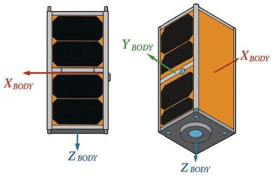

Fig.1. External Structure: Side and Isometric views

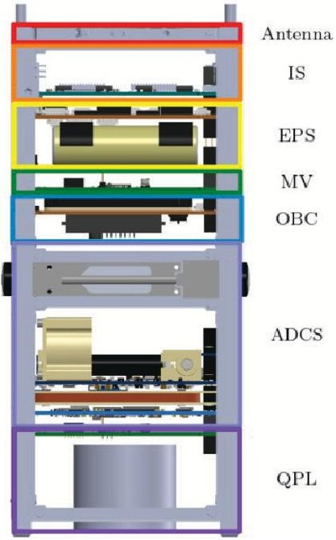

Fig. 2. Subsystems within the satellite

- black Kapton tape applied where necessary to reproduce the correct thermal behaviour;

- aluminium plates with the same thickness, geometry, and mass as the close-out panels used in the flight model;

- FR4 plates partially covered with black Kapton tape to optically represent the solar panels of flight model.

In order to guarantee safe and reliable satellite operations, the thermal loads (Table 4) generated by the subsystems replaced by dummy masses, were reproduced implementing dedicated heaters. These devices were configured to simulate the two extreme operative situations in terms of wasted heat dissipation.

During the first one, the Nominal Mode, all the devices are operative and require electrical power. Accordingly,

<!-- PDF_PAGE: 4 -->

Table 1. Materials Thermal Properties

<table border="1"><tr><td>Material</td><td>Capacity[J/(kg·K)]</td><td>Conductivity[W/(m·K)]</td><td>Emissivity(ε)</td><td>Absorbance(α)</td></tr><tr><td>Al 6061-T6</td><td>896</td><td>167</td><td>0.05</td><td>0.125</td></tr><tr><td>Al 6072-T6</td><td>896</td><td>170</td><td>0.05</td><td>0.125</td></tr><tr><td>FR4</td><td>600</td><td>0.55</td><td>0.85</td><td>0.8</td></tr><tr><td>Stainless Steel</td><td>500</td><td>16.2</td><td>0.6</td><td>0.8</td></tr><tr><td>BK7</td><td>858</td><td>1.114</td><td>0.05</td><td>0.25</td></tr><tr><td>PET-G</td><td>1130</td><td>0.29</td><td>0.9</td><td>0.1</td></tr><tr><td>Kapton</td><td>1090</td><td>0.2</td><td>0.8</td><td>0.3</td></tr><tr><td>Black Kapton</td><td>1090</td><td>0.17</td><td>0.85</td><td>0.9</td></tr><tr><td>Poly Imide</td><td>1200</td><td>0.17</td><td>0.8</td><td>0.3</td></tr></table>

Table 2. Coatings Optical Properties

<table border="1"><tr><td>Coating</td><td>Emissivity(ε)</td><td>Absorbance(α)</td></tr><tr><td>Al An-T2</td><td>0.8</td><td>0.5</td></tr><tr><td>Al An-T3</td><td>0.85</td><td>0.9</td></tr><tr><td>FR4</td><td>0.85</td><td>0.8</td></tr><tr><td>Black Kapton</td><td>0.85</td><td>0.9</td></tr><tr><td>PET-G</td><td>0.9</td><td>0.05</td></tr></table>

all heaters were switched on to simulate the maximum heat dissipation. In contrast, in the second main critical scenario, during the Safe Mode, only the vital subsystems are activated and only a limited number of heater devices were turned on to reproduce the reduced heat dissipation.

These two critical scenarios were reproduced in the TVAC: the (Worst Hot Case (WHC)), that corresponds to the Nominal Mode during the heating phase, and the Worst Cold Case (WCC), represented by the Safe Mode during the cooling phase. Figure 3 shows the CAD model of the STM with the dummy masses installed.

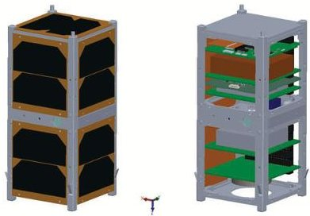

Fig. 3. STM CAD model with solar panels (left) and without (right).

## 4. Numerical Methods

This section describes the digital thermal model of AlbaSat used to perform thermal simulations, providing details on materials, coatings and relevant parameters such as thermo-optical properties.

## 4.1 Radian Systems Software

Founded in 2019, Radian is a cloud-based program, established to provide a comprehensive, end-to-end solution for thermal analysis. The platform covers the entire thermal analysis process, from the initial modelling of a design to the definition of critical parameters [14]. Radian enables the simulation of thermal models under specific operational environments, such as thermo-vacuum enclosures or orbital flight. In particular, the enclosure setup allows simulating and analysing the STM thermal behaviour by setting a series of parameters that guide the study case and influence the results: Starting STM Temperature $ ( T_{0} ) $ Enclosure Temperature $ ( T_{enc} ) $ Time Simulation $ ( t_{sim} ) $ and Integration Step $ (\Delta t) $ [15]. The software uses a robust mathematical method for the discretization and resolution of the thermal simulation: the Lumped Parameter Method. In contrast to the Finite Element Method (FEM), which divides a body into a mesh of microscopic elements, the Lumped Parameter Method treats the body as a series of lumped masses, i.e. objects considered as their mass concentrated in a single point, at uniform temperatures. In this approach, each node represents a discrete portion of sub-system, to which a concentrated mass and a uniform temperature are assigned. The temperature of each node is calculated by solving an energy balance equation, considering both radiative and conductive contributions. This type of approach significantly simplifies computational complexity, enabling faster simulations, while maintaining sufficient accuracy. The resulting equations form a system of ordinary differential equations that describe the thermal evolution of each node. The

<!-- PDF_PAGE: 5 -->

Lumped parameter equations in Radian are solved by the Newton-Raphson iterative method [4].

## 4.2 Thermal Model Setup

This section presents the thermal design, including characteristics, requirements, materials and thermal contacts defined in the digital model of the STM. [16].

## 4.2.1 Geometrical Characteristics

The thermal model is based on the AlbaSat Simplified 3D Model, with additional modifications such as removing small holes and streamlining complex geometries. This approach ensures less computational effort, still maintaining a good representation of the thermal behaviour of the STM, while maintaining the simulation speed and an adequate accuracy of the results.

## 4.2.2 Materials & Coatings

The materials and coatings used in the thermal model setup were chosen to represent those used in the STM and the complete list is reported in Table 1 and in Table 2. The thermo-physical and thermo-optical properties of each material were obtained from datasheets and chosen considering specific material surface finishing.

## 4.2.3 Thermal Contacts

To accurately simulate the thermal behaviour of the satellite, particular attention was given to modelling the thermal contacts between different components [17]. The choice of the contacts type was governed by several factors, primarily the material involved, as shown in Table 3. All contact conductance coefficients $ \left(h_{c}\right) $ were empirically calculated, by estimation derived from the literature [18]. These coefficients were then multiplied for the contact area of every interface to obtain the precise contact conductance value $ \left(H_{c}\right). $

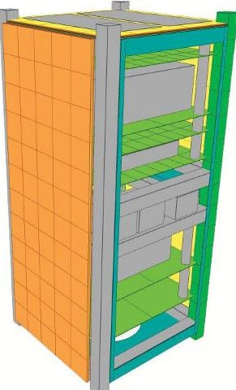

Fig. 4. AlbaSat thermal model

## 4.2.4 Mesh

## 4.2.5 Thermal loads

Another crucial aspect of the thermal model setup was the meshing process. In Radian, applying a mesh to an object corresponds to subdivide it into a defined number of sub-objects treated as lumped masses. This type of mesh is useful for simulating and observing the interaction and temperature profile of different regions of the same component. To achieve an accurate temperature distribution and improve the correlation between the thermal model and the thermal vacuum test results, a finer mesh was applied to the components equipped with thermocouples in the STM.

As described in Section 3, subsystems have different power consumption and heat dissipations, considering WHC and WCC. In the Radian environment, the internal power generations are modelled using static thermal loads applied on rectangular plate objects used to simulate the heaters placed in the STM. Regarding MVS and IS subsystems, for which the STM presents the real hardware, the thermal load is instead applied directly on the control board objects. The thermal load values used in both WHC and WCC are reported in Table 4.

<table border="1"><tr><td>Type</td><td>Conductance[W/(m2·K)]</td></tr><tr><td>An-Al(Type III)→An-Al(Type II)</td><td>500</td></tr><tr><td>FR4→An-Al(Type II)</td><td>150</td></tr><tr><td>FR4→Stainless Steel</td><td>400</td></tr><tr><td>Stainless Steel→An-Al(Type II)</td><td>750</td></tr><tr><td>FR4→Black Kapton</td><td>60</td></tr><tr><td>An-Al(Type II)→Kapton</td><td>145</td></tr></table>

Table 3. Thermal Contacts

Table 4. Subsystem Thermal Loads

<table border="1"><tr><td>Subsystem</td><td>Heat Loads in WHC[W]</td><td>Heat Loads in WCC[W]</td></tr><tr><td>Impact Sensor</td><td>0,3</td><td>0,3</td></tr><tr><td>EPS</td><td>2,4</td><td>0</td></tr><tr><td>MVS</td><td>0,036</td><td>0,036</td></tr><tr><td>OBC</td><td>0,9506</td><td>0,864</td></tr><tr><td>ADCS</td><td>0,8204</td><td>0,17</td></tr><tr><td>QPL</td><td>0,6</td><td>0</td></tr></table>

<!-- PDF_PAGE: 6 -->

## 4.2.6 Enclosure Settings

In accordance with the conditions provided by the TVAC for the WHC, the enclosure was set up with an initial temperature $ ( T_{enc} ) $ of 50 $ ^{\circ} C $ , a starting thermal model temperature $ ( T_{0} ) $ of 25 $ ^{\circ} C $ , an integration step $ (\Delta t) $ of 20 s and a simulation time $ ( t_{sim} ) $ of 20,23 h. Instead, considering the WCC, the enclosure was set up with an initial temperature $ ( T_{enc} ) $ of -50 $ ^{\circ} C $ , an integration step $ (\Delta t) $ of 20 s and a simulation time $ ( t_{sim} ) $ of 18,83 h. Radian allows the use of the output of a different simulation as starting thermal model temperature $ ( T_{0} ) $ , hence the $ T_{0} $ was taken from the results of the WHC Fig. 6. In addition, to perform the simulations, only radiative heat exchanges were considered, in order to accurately represent the thermal environment of the vacuum chamber, neglecting convective and conductive effects.

## 4.3 Simulation Results

The following sections present the results obtained from the thermal simulations in both WHC and WCC, including the temperature variation during the simulations and the equilibrium temperature reached by each subsystem.

## 4.3.1 Worst Hot Case (WHC)

Running a simulation in this scenario, the results illustrated in Fig. 5 and Fig. 6 were obtained. The temperature profile exhibits an initial rapid increase followed by a stabilization. The system reaches equilibrium after approximately 10 hours without significant oscillations. In particular, external components (e.g. Temperature Reference Point (TRP), solar panel faces) show a faster variation compared to the overall trend, whereas Quantum Payload (QPL) and Attitude Determination and Control System (ADCS) control boards exhibit a slower response before converging.

## 4.3.2 Worst Cold Case (WCC)

Running a simulation in this scenario, the results illustrated in Fig. 7 and in Fig. 8 were obtained. The temperature profile exhibits an initial decrease followed by a stabilization. The system reaches equilibrium after approximately 16 hours without significant oscillations, due to the high initial temperature condition provided by WHC. Also in this case, external components (e.g. TRP, solar panel faces) show a faster but less evident variation compared to the overall trend, whereas QPL and ADCS control boards again exhibit a slower response before converging.

## 5. Experimental Test Campaign

The objectives of the campaign were to assess the robustness and validate the design of the in-house developed MVS and IS payloads by conducting qualification-

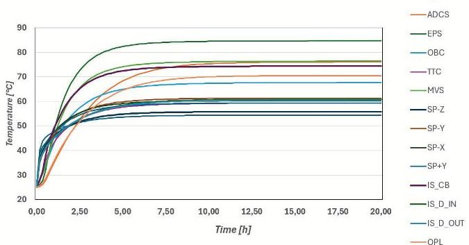

Fig. 5. Numerical Results: Hot case

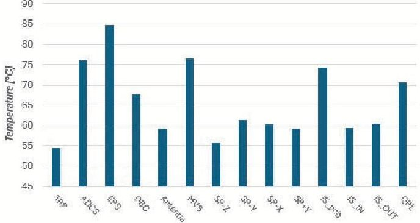

Fig. 6. Temperatures on the thermocouples at t = 19,66 h

level tests in representative environments and system configuration. The thermal model of AlbaSat was validated by comparing test results with numerical simulations, enabling refinement and calibration. The campaign offered valuable hands-on experience in assembly and integration, enabling the team to enhance their skills and gain confidence in the system. The test campaign consisted of both a thermal balance phase and a thermal cycling phase. The thermal balance test is the most important one for the scope of this research activity, because the data, acquired through this test, were used to correlate the thermal model. Fully Functional Test (FFT) were performed multiple times throughout both phases, as well as before the start and after the conclusion of the entire test. Visual inspections were conducted before placing the Device Under Test (DUT) inside the chamber and again after its removal, to verify the structural integrity of both the payloads and the DUT itself. During the test, the IS payload exhibited communication and data transmission issues when subjected to elevated temperatures; however it is important to note that this malfunction did not affect the sensors and all the data used for the correlation.

## 5.1 Device Under Test

The DUT used for the test campaign is the STM of AlbaSat, described in detail in Section 3. While it was

<!-- PDF_PAGE: 7 -->

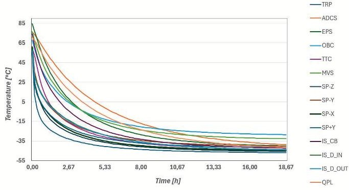

Fig. 7. Numerical Results: Cold Case

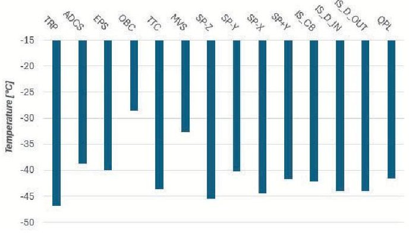

Fig. 8. Temperatures on the thermocouples at t = 18,83 h

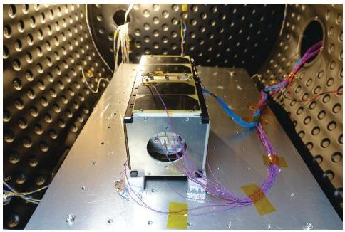

Fig. 9. DUT on the thermal plate, inside TVAC

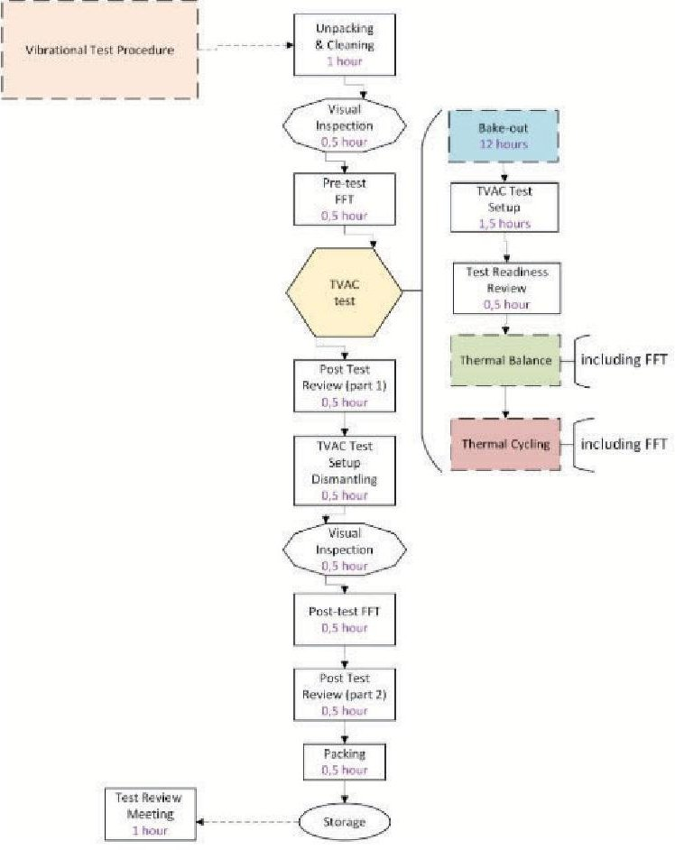

placed on a thermal plate inside the TVAC, the test was conducted using thermal radiation as the primary heat source. Hence, to minimize conduction and ensure maximum consistency with the numerical simulation setup, PET-G was used as the material of the mechanical interface between the DUT and the thermal plate.

The DUT was placed at the center of the thermal plate and installed on 4 PET-G standoffs as Fig. 9 portrays. The -Y side is oriented toward the top of the chamber and the +Z side was oriented toward the chamber door. To fix the stand-offs on the thermal plate, aluminum tape was used.

Fig. 10. Test sequence diagram

## 5.2 TVAC Test Procedure

The DUT was placed in the oven with all panels disassembled, and after the bake-out phase, a visual inspection was carried out with no anomalies detected (Fig. 10). Before the panels were reassembled, the thermocouples were installed in accordance with the ESA guidelines; below, the type-T thermocouples are listed with their relative position in Table 5.

The DUT was then mounted inside the thermal vacuum chamber, and the pressure was gradually reduced to $ 1 0^{-5} $ hPa (Table 6). Initially, a functional test was performed under low vacuum, followed by a hot temperature plateau reached overnight [TRP temperature equal to 58.9 $ ^{\circ} \mathrm{C} $]. Once stabilized, an FFT was performed, although intermittent communication issues were observed with the IS subsystem, which reoccurred several times during the campaign. Subsequently, the DUT was cooled to the cold plateau, reaching approximately $ - 3 9 \mathrm{~} ^ {\circ} \mathrm{C} $ on the TRP, although the thermocouple TC111, placed on the ADCS dummy mass, provided unreliable readings, as shown in previous temperature diagrams (Fig. 13).

Over the following days, three complete thermal cycles were carried out, each consisting of a hot and a cold

<!-- PDF_PAGE: 8 -->

Table 5. Thermocouples installed

<table border="1"><tr><td>TC name</td><td>Subsystem</td><td>Position</td></tr><tr><td>QPL</td><td>Quantum Payload</td><td>+Z side of the QPL aluminium mass</td></tr><tr><td>OBC</td><td>On Board Computer</td><td>-Z side of OBC control board</td></tr><tr><td>TTC</td><td>Antenna</td><td>+Z side of Aluminium mass</td></tr><tr><td>EPS</td><td>Electrical Power System</td><td>-Y side of the plastic case</td></tr><tr><td>ADCS</td><td>Attitude Determination and Control System</td><td>-Y side of the Aluminium mass</td></tr><tr><td>SP-Z</td><td>Solar panel</td><td>the SP on the-Z side</td></tr><tr><td>SP-Y</td><td>Solar Panel</td><td>the SP on the-Y side of the top unit</td></tr><tr><td>SP-X</td><td>Solar Panel</td><td>the higher SP on the-X side of the top unit</td></tr><tr><td>SP+Y</td><td>Solar Panel</td><td>the higher SP on the+Y side of the top unit</td></tr><tr><td>TRP</td><td>Structure</td><td>[-X,-Y] rail, precisely on its-Y side in the top unit</td></tr><tr><td>MVS</td><td>Micro-vibration Sensor</td><td>+Z side of the MVS control board</td></tr><tr><td>IS_CB</td><td>Impact Sensor Payload</td><td>+Z side of the IS control board</td></tr><tr><td>IS_D_IN</td><td>Impact Sensor Payload</td><td>internal side of the IS detector</td></tr><tr><td>IS_D_OUT</td><td>Impact Sensor Payload</td><td>external side of the IS detector</td></tr></table>

Table 6. Test levels and pressure

<table border="1"><tr><td></td><td>Hot case</td><td>Cold case</td></tr><tr><td>TRP Temperature</td><td>60℃</td><td>-40℃</td></tr><tr><td>Pressure</td><td>10-05hPa</td><td>10-05hPa</td></tr></table>

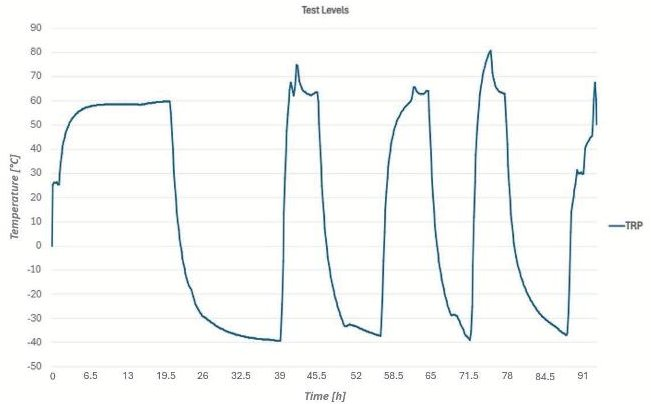

Fig. 11. Test levels: TRP

phase.

On the last day, the chamber was brought back to approximately $ 3 0 \mathrm {^o C} $ and repressurized. A final FFT confirmed the operational status of the DUT before shutdown. Post-test inspections revealed no external damage and the device was packed for return. Finally, the functionality and system-level robustness of the STM were verified, focusing on the integrated behaviour of the MVS and IS

payloads in their FM configurations.

## 5.3 Experimental Results

The data used to validate the numerical model comes from the thermal balance test. Two test cases were performed: a hot plateau at approximately 60 $ ^{\circ} \mathrm{C} $ on the TRP and a cold plateau at $ - 4 0 \mathrm{~}^\circ \mathrm{C} $ on the TRP. Stabilization was considered achieved once all sensors exhibited a temperature gradient lower than 0.5 $ ^{\circ} \mathrm{C} $ over 5 hours.

In the hot case, Fig. 12, the TRP was driven to 60 $ ^{\circ} \mathrm{C} $ and stabilization was achieved after all monitored sensors converged to steady values within the defined gradient threshold. Power cycling effects can be clearly observed on some thermocouples located close to the heaters, visible as oscillations around the stabilization temperature.

In the cold case, Fig. 13, the TRP was cooled down to approximately $ - 4 0 \mathrm {^o C} $ . The same stabilization criterion was applied to determine steady-state conditions. During this phase, the thermocouple mounted on the ADCS dummy mass started providing inconsistent readings, diverging significantly from the expected trend. After inspection by ESA Academy operators, the malfunction of this thermocouple was confirmed; consequently, its data were discarded from the thermal model correlation during the cold plateau, while it was decided to keep for the hot plateau, because the thermocouple registered the expected trend during this phase of the test.

Overall, the remaining thermocouples showed consistent trends and reached stabilization within the expected time-frame, allowing the dataset to be used for subsequent thermal model correlation.

<!-- PDF_PAGE: 9 -->

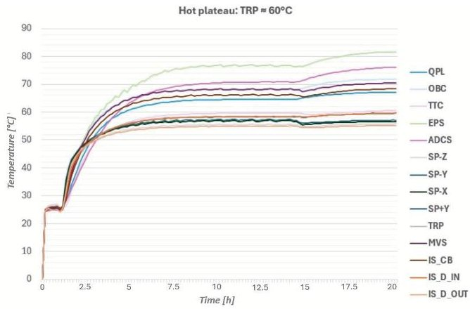

Fig. 12. Thermal Stabilization (Hot case)

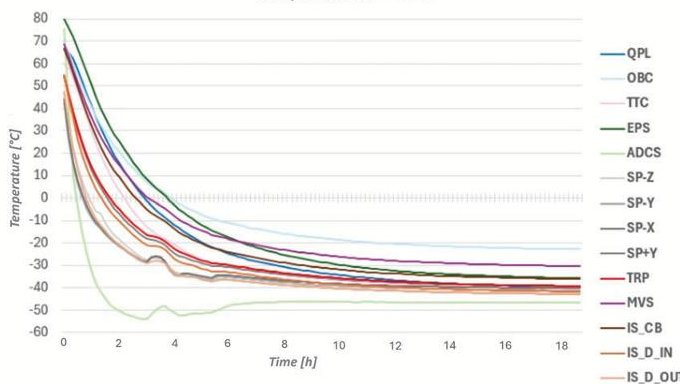

Fig. 13. Thermal Stabilization (Cold case)

## 6. Model Correlation

To enhance the precision of the thermal models for the AlbaSat mission, this section focuses on a correlation between the thermal model and the results from the TVAC test. The objective of these thermal balance correlations is to refine thermal properties within current and future models, with specific emphasis on conductances at interfaces and material properties, as well as the radiative optical properties. To assess the correlation, the Pearson coefficient [19] has been used.

## 6.1 Pearson Coefficient

The Pearson correlation coefficient is a statistical measure that quantifies the strength and direction of the linear relationship between two numerical datasets. Its value lies within the interval: $ - 1\leq r\leq 1 $; where:

- $ r=1 $ indicates a perfect positive linear correlation;

- $ r=-1 $ indicates a perfect negative linear correlation;

- $ r=0 $ indicates no linear correlation.

The general formula for calculating r between two sets of variable $ X=\{x_{1},x_{2},\ldots,x_{n}\} $ and $ Y=\{y_{1},y_{2},\ldots,y_{n}\} $ is:

$$
r = \frac {\sum_ {i = 1} ^ {n} \left(x _ {i} - \bar {x}\right) \left(y _ {i} - \bar {y}\right)}{\sqrt {\sum_ {i = 1} ^ {n} \left(x _ {i} - \bar {x}\right) ^ {2}} \sqrt {\sum_ {i = 1} ^ {n} \left(y _ {i} - \bar {y}\right) ^ {2}}}
$$

where:

- $ \bar{x} $ is the mean of the values in X,

- $ \bar{y} $ is the mean of the values in Y,

- n is the number of observed data pairs.

A value of r close to 1 implies a strong linear correlation, whereas a value close to 0 indicates a weak or no linear correlation [20].

## 6.2 Hot thermal balance

In the hot case, both simulations and experimental data exhibit a temperature trend that tends to stabilize around the target value of $ 6 0 \mathrm {^ \circ C} $ (Fig. 12 and Fig. 5). The most notable difference between the two approaches lies in the fact that the experimental data display oscillations induced by power cycling, particularly in the regions close to the heaters. This phenomenon is significantly reduced, or even absent, in the simulations, which represent an idealized scenario compared to real testing conditions.

Based on the comparison between the test data and the model predictions, a Pearson correlation coefficient of 0.917 was obtained (Section 6.1). More specifically, the largest temperature deviation was observed at the thermocouple on the MVS control board, with a difference of 6 $ ^{\circ} \mathrm{C} $ (Fig. 14). In this case, the simulated temperatures exceed the test results, representing a conservative condition from a safety perspective. Despite this local discrepancy, the overall correspondence between the model and the experimental data is strong, as confirmed by the high Pearson coefficient, which is close to unity and highlights the reliability of the numerical predictions.

## 6.3 Cold thermal balance

For the cold case, the simulation and test both indicate successful achievement of steady-state near $ - 4 0 \mathrm {^ \circ C} $ with most sensors showing parallel cool-down trajectories and final stabilization within the defined gradient threshold. Since a clear discrepancy was observed in the ADCS dummy mass thermocouple, as mentioned in Section 5.3, the related data were excluded from the correlation analysis.

Excluding the faulty sensor results, the correlation in the cold case, between simulated and measured values,

<!-- PDF_PAGE: 10 -->

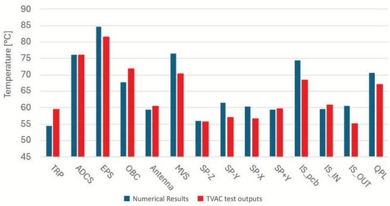

Fig.14. Comparison Radian-TVAC: Hot stabilization at t=19,66 h

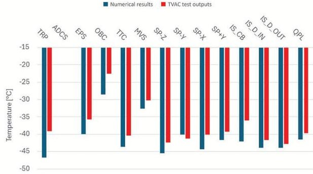

Fig. 15. Comparison Radian-TVAC: Cold stabilization at t = 18,83 h

shows a strong agreement. Both diagrams (Fig. 13 and Fig. 7) confirm the capacity of the system to reach and maintain thermal equilibrium under the prescribed conditions.

The comparative analysis between the experimental measurements and the model prediction values yielded a Pearson correlation coefficient of 0.914 (Section 6.1), indicating a strong linear association. As in the previous case, this high coefficient close to unity confirms the strong consistency between simulation and experimental data, highlighting the predictive reliability of the model.

## 7. Conclusion

The thermal vacuum test campaign provided valuable insights into the thermal behaviour of AlbaSat and allowed a direct comparison with the numerical simulations developed using Radian Systems software. The correlation analysis highlighted a strong agreement between test data and simulation results, with Pearson correlation coefficients of 0.917 for the hot case and 0.914 for the cold case. These near-unity values indicate a strong linear dependence between the measured and simulated temperature profiles, confirming that the key thermal phenomena of the system are accurately captured under vacuum conditions. Moreover, the consistency between the experimental and the predicted trends supports the reliability of the thermal mathematical model, thereby increasing confidence in its predictive capability for flight-like scenarios. However, the Pearson correlation coefficient must be interpreted carefully, as it remains invariant to systematic offsets. Therefore, in future work, combining this metric with absolute error analysis (e.g., Mean Squared Error (MSE)) could further enhance model validation robustness.

At the same time, the campaign revealed specific areas for improvement. In particular, a more detailed analysis of the thermo-optical properties of the materials and the thermal conductances at the interfaces could further refine the accuracy of the thermal model. These improvements would reduce discrepancies at local hotspots and transient phases, leading to a more robust digital twin of the satellite.

Overall, the results obtained validate the modelling approach adopted for AlbaSat and demonstrate the effectiveness of the test methodology. Beyond the technical outcomes, the project also provided significant educational value, enabling the student team to gain hands-on experience in spacecraft thermal engineering and in the process of correlating numerical models with experimental data. Future developments will focus on refining material characterizations, improving boundary condition definitions, and applying the validated model to support flight operations.

## Acknowledgments

The authors wish to thank Radian Systems for granting access to the Radian software, which was fundamental for the thermal analyses conducted during the test campaign. Special thanks go to David Criado Pernia for his support and to Laura Gonzalez Llamazares for her invaluable guidance and for making this collaboration possible. Further acknowledgments go to the ESA experts Loris Franchi, Maxime Alves, Enol Vilchez Llamazares, Panagiotis Bountzioukas that supported Alba CubeSat during the Fly Your Satellite! Test Opportunity programme and the test campaign at ESEC-Galaxia.

## References

[1] T. et al. Villela. "Towards the thousandth CubeSat: A statistical overview". In: International Journal of Aerospace Engineering (2019).

[2] A. Toorian, K. Diaz, and S. Lee. "The CubeSat Approach to Space Access". In: Proceedings of IEEE Aerospace Conference, Big Sky, MT, USA. 2008.

[3] NASA Small Spacecraft Institute. Thermal Control of Small Satellites. https://www.nasa.gov/smallsat institute/sst-soa/thermal-control.

<!-- PDF_PAGE: 11 -->

[4] Narimane Blanchete and Abdellah Bah. "Thermal design, analysis and test: Framework for CubeSat in low Earth orbit". In: Results in Engineering 24 (2024).

[5] C. Atar and M. Aktas. "Advances in Thermal Modeling and Analysis of Satellites". In: Gazi University Journal of Science 35, no.1 (2022), pp. 42-58.

[6] David G. Gilmore. Spacecraft thermal control handbook. 2002.

[7] Chantal Cappelletti, Simone Battistini, and Benjamin K. Malphrus. CubeSat Handbook - From Mission Design to Operations. 2020.

[8] The European Space Agency. Fly Your Satellite! Design Booster About. https: // www . esa . int / Education/CubeSats_-_Fly_Your_Satellite/Fly_ Your_Satellite!_Design_Booster_About2.

[9] Federico Basana et al. "AlbaSat: an educational satellite for a multi-objective mission in LEO". In: Proceedings of the International Astronautical Congress, IAC. Vol. 2023. International Astronautical Federation, IAF. 2023.

[10] Luca Lion et al. "Overview of the AlbaSat mission the first CubeSat from University of Padova". In: 4S Symposium 2024 Proceedings. 2024.

[11] Samuele Enzo et al. "SPRISS: Scalable and precise resistive impact sensor for smallsats, architecture description and tests". In: Acta Astronautica 223 (2024), pp. 25-35.

[12] C. Atar and M. Aktas. "Micro-vibration suppression methods and key technologies for highprecision space optical instruments". In: Acta Astronautica 180 (2021), pp. 417-428.

[13] Liao Sheng-Kai, Cai Wen-Qi, and Liu Wei-Yue. "Satellite-to-ground quantum key distribution". In: Nature (2017).

[14] Radian Systems. Radian Systems. https://radian systems/.

[15] S. Corpinoa et al. "Thermal design and analysis of a nanosatellite in low earth orbit". In: Acta Astronautica (2015).

[16] Chen Yang, Xinbin Hou, and Li Wang Qian. "Thermal design, analysis and comparison on three concepts of space solar power satellite". In: Acta Astronautica (2017).

[17] M. A. Lambert and L. S. Fletcher. "Thermal Contact Conductance of Non-Flat, Rough, Metallic Coated". In: Journal of Heat Transfer (2002).

[18] M. A. Lambert and L. S. Fletcher. "A review of the thermal contact conductance of junctions with metallic coatings and films". In: AIAA Meeting paper, 30th Aerospace Sciences Meeting and Exhibit (1992).

[19] Jeimmy Nataly BuitragoLeiva, Ines Terraza Palanca, and Luis Contreras-Benito. "The 3Cat-4 Spacecraft Thermal Analysis and Thermal Vacuum Test Campaign Results". In: Aerospace (2024).

[20] Shaun Turney. Pearson Correlation Coefficient (r) Guide Examples. 2022.