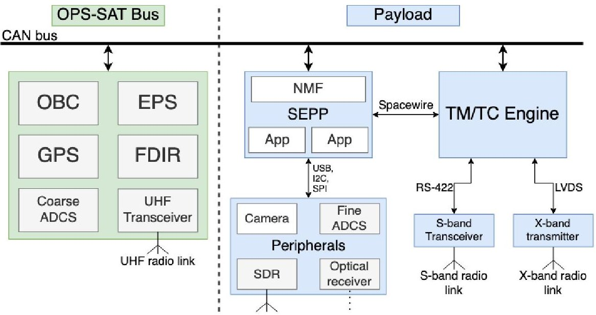
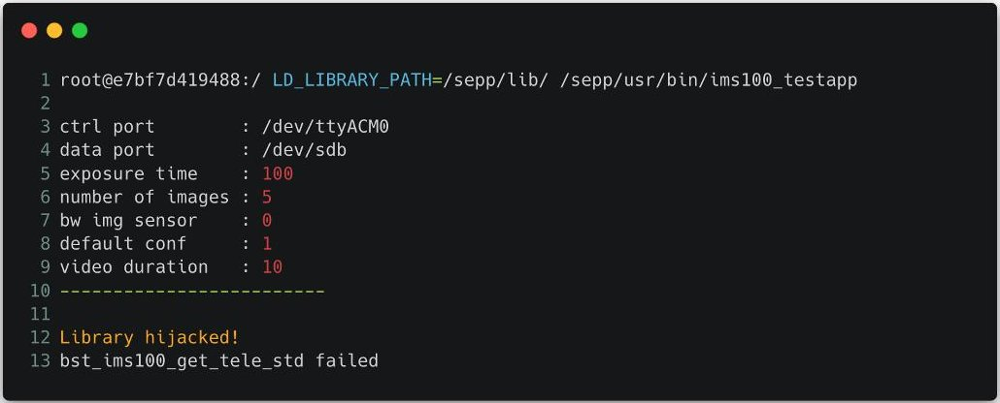
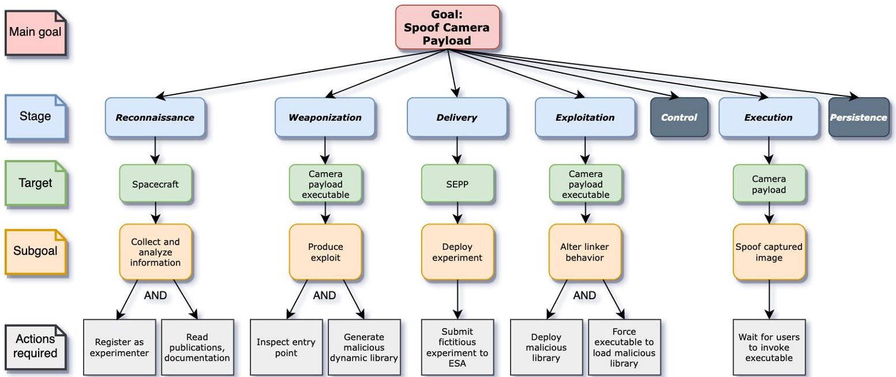
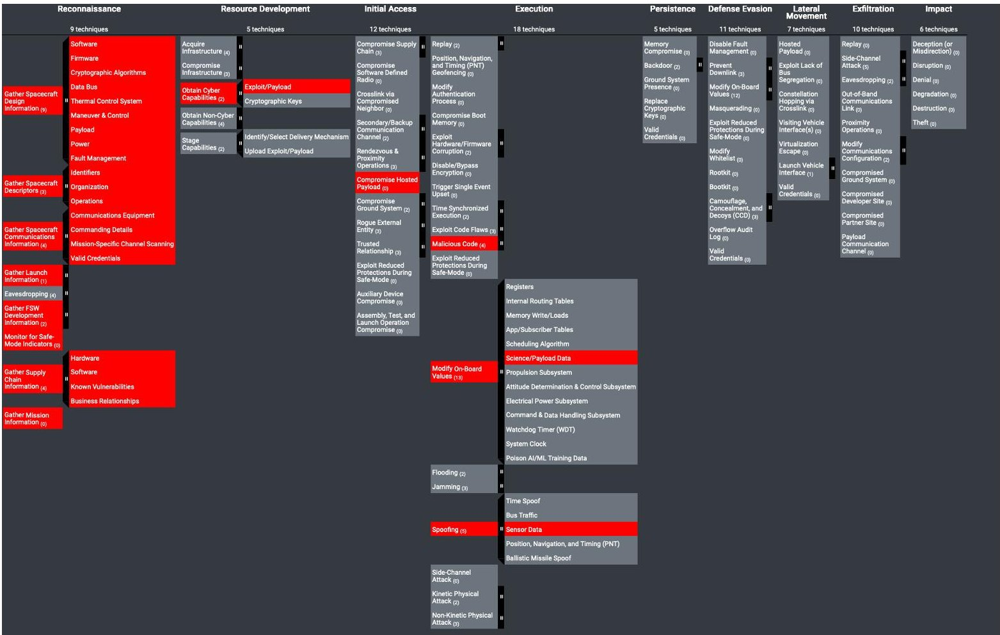
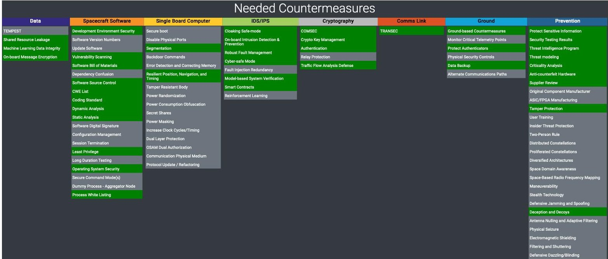

<!-- PDF_PAGE: 1 -->

# A Hosted Payload Cyber Attack Against Satellites

Matteo Calabrese $ ^{*} $ Norwegian University of Science and Technology, 7491 Trondheim, Norway

Georgios Kavallieratos $ ^{\dagger} $ Norwegian University of Science and Technology, 2815 Gjovik, Norway

Gregory Falco $ ^{\ddagger} $ Cornell University, Ithaca, New York, 14850

The increased utilization of small satellites, particularly CubeSats, has been propelled by technological advancements and the widespread incorporation of Commercial Off-The-Shelf (COTS) components. This transition has ushered in a paradigm of faster and more cost-effective missions, giving rise to novel trends such as the Internet of Space Things (IoST) and Space as a Service (SaaS) in the space domain. However, this shift comes with a concomitant rise in spacecraft architecture complexity, expanding the attack surface for potential cyber threats. Despite these advancements, space cybersecurity has lagged behind, largely adhering to traditional security-through-obscurity approaches, thereby endangering the security of future missions and critical infrastructure. This work delves into the OPS-SAT mission as a case study, presenting one of the most advanced CubeSat missions to date. OPS-SAT introduces innovative mission capabilities and novel concepts in space operations. In this study, we assume the role of malicious users, crafting and executing a cyber attack against the primary payload of the OPS-SAT spacecraft, within an emulated environment. The success of the attack is scrutinized, and the resultant impacts across the system are systematically enumerated. The study culminates in a formalized representation of the attack using established threat modeling frameworks, including attack trees and the SPARTA matrix. This approach offers a comprehensive examination of the OPS-SAT mission's susceptibility to cyber threats, providing insights that can inform future cybersecurity strategies for advanced small satellite missions.

## Acronyms

ADCS Attitude Determination & Control System.

API Application Programming Interface.

APT Advanced Package Tool.

CCSDS Consultative Committee for Space Data Systems.

COTS Commercial, Off-The-Shelf.

ELF Executable and Linkable Format. ESA European Space Agency.

FDIR Failure Detection, Isolation, and Recovery. FGPA Field-Programmable Gate Array.

GPS Global Positioning System. GSaaS Ground Station as a Service.

NIST National Institute of Standards and Technology. NMF NanoSat MO Framework.

OBC On-Board Computer.

OPKG Open Package Management.

OS Operating System.

OSINT Open-Source Intelligence.

IoT Internet of Things.

SDR Software-Defined Radio.

SEPP Satellite Experimental Processing Platform.

SoC System-on-Chip.

SSH Secure Shell.

TM/TC Telemetry and Telecommand. TTP Tactics, Techniques, and Procedures.

USB Universal Serial Bus.

<!-- PDF_PAGE: 2 -->

## I. Introduction

The proliferation of small satellites has experienced a pronounced ascent in recent years, attributable to advancements in technology, the widespread utilization of Commercial, Off-The-Shelf (COTS) components, cost-effective launch opportunities, and enhanced mission operations facilitated by the advent of Ground Station as a Service (GSaaS) [1]. A paradigm shift in the philosophy guiding space missions, encapsulated by the mantra "faster, better, cheaper," has given rise to missions characterized by high-risk, high-value propositions, a trend exemplified by CubeSats [2,3]. The ascendancy of small satellites has engendered conceptual frameworks such as the internet of space things and space as a service. Anticipating the integration of the upcoming generation of space missions, it is conceivable that the existing space segment constituting critical infrastructure will assimilate fleets of smaller spacecraft [4]. Nevertheless, commensurate with the enhancement of their capabilities, the concomitant escalation in complexity augments their vulnerability to cyber threats, expanding their attack surface [5].

OPS-SAT stands as an exemplary manifestation of the New Space paradigm, representing one of the most sophisticated CubeSat missions developed to date. Originating as a space laboratory, this mission marks the inaugural CubeSat venture undertaken by the European Space Agency (ESA). Despite its diminutive 3U CubeSat form factor, OPS-SAT incorporates highly advanced capabilities, predominantly leveraging COTS components in its design. Noteworthy innovations encompass in-flight reconfigurability, multi-user control functionalities, space applications integration, and Internet-enabled command. Furthermore, OPS-SAT adopts the pioneering open-source flight software engineered by ESA, affording users the unique capability to execute applications in the space environment without necessitating a comprehensive understanding of the underlying system architecture [6,7].

This study endeavors to enhance awareness regarding the cybersecurity landscape within the domain of satellites. Employing OPS-SAT as a focal point, the research unfolds as a comprehensive case study, including the presentation and examination of an orchestrated attack directed at the OPS-SAT mission. Within the confines of a simulated real-life scenario, we envision an authorized user with malevolent intent. Subsequently, the attack scenario is scrutinized and emulated within a terrestrial setting. The ensuing section delineates the ramifications of the simulated attack. Finally, the attack is formalized and elucidated through the application of threat modeling frameworks. Notably, existing literature lacks documentation of cyberattacks on space vehicles; thus, this study's exposition of an attack on OPS-SAT serves as a noteworthy real-life example. Beyond its illustrative purpose, this incident underscores the tangible consequences of a plausible cyber event occurring in the space domain. The findings of this research aspire to spur collaborative efforts directed at fortifying the cybersecurity posture of emerging small satellite platforms $ ^{*} $ . In summary, this work makes the following contributions:

- A comprehensive exploration of the OPS-SAT mission, delineating and identifying its innovative capabilities;

- The conceptualization of a cyber attack targeting the mission's primary payload to achieve camera payload spoofing;

- A detailed examination and visualization of the outcomes stemming from the executed cyber attack, employing established threat modeling methodologies;

- Presentation of a set of cybersecurity countermeasures designed to mitigate the impact of the conducted attack.

The organizational structure of this study is delineated as follows: In Section II, a comprehensive compilation of related work within the realm of space cybersecurity is presented. Section III elucidates the experimental methodology, providing insights into the tools employed and assumptions underpinning the study. In Section IV, an in-depth exploration of the case study is conducted, acquainting the reader with the intricacies of the mission's architecture and detailing the salient systems pertinent to the outlined attack scenario. Section V delves into the examination of study results, employing selected tools for visualization while concurrently addressing extant limitations and proposing potential avenues for improvement.

DISCLAIMER This study would not have been possible without the cooperation and support of ESA and the OPS-SAT team. They agreed to collaborate and provided the production system image of the main payload system, enabling the experimental work conducted in this work. Their team was also instrumental in providing assistance and additional knowledge whenever required. Therefore, they have been kept informed about this study, including the early notification of the results. It is worth noting that future versions of the NanoSat MO Framework and Satellite Experimental Processing Platform, to be deployed on ESA's upcoming CubeSat missions, OPS-SAT-2 and $ \Phi $ -SAT, address the identified shortcomings.

*Some material included in this work was previously released in the master's thesis "Space Oddity: Space Cybersecurity Lessons from a Simulated OPS-SAT Attack" by Matteo Calabrese

<!-- PDF_PAGE: 3 -->

## II. Related work

Numerous surveys documented in the literature have undertaken a comprehensive examination of cybersecurity considerations within space infrastructure, particularly focusing on satellites [8-11]. These surveys delve into a thorough exploration of existing threats, attacks, risks, and countermeasures, thus contributing to a holistic comprehension of the cybersecurity landscape in the realm of space systems. In specific studies, such as [12], a spoofing attack is scrutinized through the application of MATRIX and STPA-Sec methodologies. Furthermore, an analysis of data tampering in satellites is presented in [13], employing the STRIDE methodology, with [14] expounding on the critical implications of data tampering by integrating the National Institute of Standards and Technology (NIST) cybersecurity framework within the context of a small satellite vehicle. The literature extends its purview to include instances such as [5], documenting the spoofing of Global Positioning System (GPS) signals by leveraging software-defined radios. Security threats specifically targeted at CubeSats receive attention in [15, 16], with analytical approaches, such as attack trees, facilitating the systematic analysis of results. A comprehensive taxonomy of general threats against satellites, spanning environmental, physical, and digital-cyber-technical risks, is provided by Boschetti and Falco in [17]. Moreover, the discussion of recent cybersecurity incidents in satellites, accounting for both their physical and financial impact, is presented in [18]. In [19], Willbold et al. conduct a comprehensive security analysis, encompassing several satellites, including OPS-SAT. Their work commences with the establishment of a taxonomy delineating threats against satellite firmware, followed by the enumeration of vulnerabilities identified through security analysis. This comprehensive analysis brings to light a pervasive deficiency in satellite firmware security, emphasizing the imperative for heightened scrutiny in this domain. Conclusively, Didelot delivers a non-academic contribution in [20], wherein he scrutinizes the security aspects of both the OPS-SAT payload and the open-source framework developed by ESA, identifying recurrent vulnerabilities that align with our findings.

## III. Methodology

The primary objective of the outlined attack is to manipulate the camera payload within the system. In the event of the attack's success, the compromised camera payload will exhibit a behavior wherein images selected by the attacker are delivered each time a user initiates the camera program. Emphasizing simplicity, the attack is designed to be as straightforward as possible, thereby demonstrating the potential compromise of the mission with minimal resource allocation. Furthermore, the attack strategy is crafted to employ techniques specifically relevant to infiltration targeting Linux systems, aligning with the underlying operating system present on the main payload. To demonstrate that the stated objective is within reach of individuals with constrained security expertise, the attack methodology aims to leverage existing tools wherever feasible, minimizing the need for custom implementations. This approach is intended to underscore the pragmatic feasibility of compromising the mission while adhering to a resource-efficient and technically streamlined modus operandi.

The chosen protagonist in this scenario is an authenticated user with registered credentials for the mission. ESA refers to users who have undergone registration on the mission's developer platform and have been accorded privileged access rights as "experimenters". In our capacity as experimenters, we possess access to exhaustive mission-related data, comprehensive documentation, and the suite of software tools integral to the mission's operations. In our roles as security researchers, an additional layer of access extends to the system image of the primary payload. Some mission-related information is publicly accessible on the internet, and Open-Source Intelligence (OSINT) methodologies are employed to augment the comprehension of the target. To facilitate a controlled and secure experimental environment, a local software-based emulation of the primary payload will be employed, simulating the operational characteristics of the authentic target. This emulation, employed for both development and testing purposes, aligns with considerations of cost-effectiveness and security. This emulation framework has been integral to the iterative processes of development, testing, and validation of the attack.

The longstanding practice of threat modeling within the domain of IT security has proven instrumental in fortifying cybersecurity measures. Established models, including but not limited to attack trees and STRIDE, serve as effective tools for visualizing and categorizing potential threats [21, 22]. In recent times, a notable evolution in threat modeling tools has emerged specifically tailored for the space domain. Drawing inspiration from their IT counterparts, these tools, such as TREKS [23] and SPACE-SHIELD [24], are designed to systematically classify Tactics, Techniques, and Proceduress (TTPs) targeting space systems. One prominent exemplar within this new cohort of tools is SPARTA [25]. In conjunction with attack trees, SPARTA is chosen to be applied to the formulated attack, facilitating the systematic classification and enumeration of its constituent steps. The application of SPARTA in this context contributes to the generalization of the presented case study. By doing so, the insights gained become potentially transferable to other

<!-- PDF_PAGE: 4 -->

small satellite missions that may exhibit analogous attack surfaces and vulnerabilities.

To date, the absence of documented cyber attacks against space vehicles highlights a notable gap in our understanding of potential threats within this domain. The current study seeks to address this gap by presenting a realistic scenario, providing a tangible example in the absence of documented cases. Space threat modeling, as a practice, has primarily relied on theoretical knowledge and experiences drawn from IT contexts, as genuine instances have been lacking. The simulation of an incident scenario presents a valuable opportunity to apply space threat modeling tools to an actual mission, transcending the reliance on theoretical constructs. OPS-SAT, as a pioneering mission, serves as an exemplary reference model for future CubeSats. Notably, OPS-SAT represents one of the initial forays into incorporating terrestrial IT and Internet of Things (IoT) technologies into the space environment. This transformative integration renders attacks pertinent to terrestrial systems applicable in space, bridging the divide between ground-based threats and their potential manifestation in space. The introduction of advanced capabilities inherently expands the attack surface, underscoring the imperative for robust cybersecurity measures. The adoption of SPARTA as the chosen threat modeling tool is motivated by its offering of the most comprehensive collection of TTPs and countermeasures, coupled with its dynamic updating mechanism.

## A. Assumptions

1) Experimenters have access to mission resources, including documentation, system architecture design, satellite bus details, and production code. This grants them a significant advantage over an attacker who lacks access to these resources. However, since the registration process is open to anyone, it is reasonable to assume that the attacker possesses insider knowledge.

2) Every form of interaction with the spacecraft that may be required during the attack scenario is legitimate and permitted as per the mission's design.

3) The possession of the Satellite Experimental Processing Platform (SEPP) system image allows for a more efficient and expedited security analysis of the system. However, an attacker could either obtain the system image illegitimately or gain the same knowledge about the system through legitimate channels. Therefore, this advantage primarily serves as a starting point for this work and does not impact the effectiveness or feasibility of the attack.

## IV. OPS-SAT Case Study

Launched in 2019, OPS-SAT is the inaugural CubeSat mission by the ESA, designed with the primary objective of facilitating experimentation on a fully operational spacecraft. Distinguished by its incorporation of state-of-the-art COTS technology, OPS-SAT also adopts contemporary standards such as the Consultative Committee for Space Data Systems (CCSDS) File Delivery Protocol (CFDP). Noteworthy advancements featured in OPS-SAT encompass the introduction of shared access and control for ground users, referred to as experimenters. Additionally, the spacecraft introduces a novel dimension with in-flight reconfigurability, thereby enabling the execution of on-demand space missions. OPS-SAT is also the first mission to utilize the open-source NanoSat MO Framework (NMF) software developed by ESA, a move that heralds the advent of space applications. Through high-level Application Programming Interfaces (APIs), OPS-SAT facilitates the interaction of payloads and on-board services with space software. An innovative aspect of OPS-SAT lies in the democratization of software development for the spacecraft's flight software, allowing developers to create applications without necessitating an in-depth understanding of the underlying spacecraft architecture. Furthermore, the spacecraft affords experimenters the capability to control applications remotely over the internet, both through a web-based interface and by Secure Shell (SSH) access to the primary payload [6, 7, 26, 27].

The architecture of OPS-SAT is structured around a primary payload known as Satellite Experimental Processing Platform (SEPP), constituting the core mission apparatus. Complementing the SEPP, OPS-SAT integrates a variety of secondary payloads that enhance its operational capabilities. These include an S-band transponder for the transmission of payload data and Telemetry and Telecommand (TM/TC), a miniaturized, high performance X-band transmitter, a GPS system, a Software-Defined Radio (SDR) for dynamic radio experimentation, an HD Camera for high-quality visual data capture, an optical uplink receiver for receiving commands through laser pulses, and a fine Attitude Determination & Control System (ADCS) for precise spacecraft orientation control [7]. A simplified architectural diagram is shown in the Figure 1.

ESA has established a dedicated process to grant access to the OPS-SAT mission, requiring interested users (i.e., experimenters) to register on the developer platform. Once access is granted, experimenters gain access to mission resources such as documentation, code, and example experiments. ESA covers all operational costs associated with

<!-- PDF_PAGE: 5 -->

Fig.1 Simplified architecture of OPS-SAT. Adapted from [7].

experimenter missions and does not impose any charges for accessing these resources, making user-defined missions free of charge. The application submission process for deploying an experiment into space is as follows: first, experimenters develop and test their applications locally using tools provided by ESA, which offer the ability to simulate the satellite environment. Subsequently, the experiment can be submitted to ESA for further testing on target hardware in their ground laboratories. Finally, once all requirements are met and tests are successfully completed, the application is uploaded onto the spacecraft. At this stage, experimenters have the freedom to control their applications through an online web-based interface or their own custom mission control software [7].

The OPS-SAT mission provides users with a high degree of control by design. Consequently, its attack surface must contend with both external attackers and potential insider threats. ESA states that the mission is designed with the concept of a malicious experimenter in mind, with their approach to securing the satellite emphasizing recoverability rather than strict hardening measures [28, 29]. During the study conducted on OPS-SAT, there was no explicit indication of the spacecraft's specific cyber defense capabilities. The architecture includes a Failure Detection, Isolation, and Recovery (FDIR) system, designed to identify abnormal behavior in the system and take appropriate actions, such as isolation or restart, to ensure survivability of the spacecraft [28, 29]. However, the criteria for payload reset decisions are solely based on "parameters exceeding fault limits" [28], with no mention of specific detection capabilities for cyber attacks within the payload environment.

## A. Satellite Experimental Processing Platform

At the heart of the satellite's payload section lies the SEPP, consisting of an ALTERA Cyclone V System-on-Chip (SoC) module. It encompasses vital elements such as RAM, CPUs, Field-Programmable Gate Array (FGPA), and mass memory, providing substantial processing power. Operating on an embedded Linux Operating System (OS) that supports various programming languages, the SEPP is equipped with a common command line interface and executes middleware (i.e., the NMF) to expose payloads and peripherals to applications. The SEPP plays a pivotal role in coordinating experiments, managing their initiation, termination, and updates. Despite its significance, its functionality is not indispensable for the fundamental operation of the satellite, thus the On-Board Computer (OBC) has the capability to reset the SEPP in the event of issues [6,7,29].

The application installation process employs the Open Package Management (OPKG) tool, analogous to the Advanced Package Tool (APT) on consumer Linux distributions. Inside the SEPP, each experiment is allocated a dedicated directory within the OS home folder, serving as the storage location for code, configuration files, and data. Diverging from conventional Linux configurations, applications belonging to different experimenters are not executed through distinct system users (and thus, with different privileges); instead, the main process responsible for their management operates under a user named "supervisor," which also holds root privileges. In effect, space applications run with no restriction on their capabilities, inheriting the supervisor's privileges.

<!-- PDF_PAGE: 6 -->

## B. Attacking The SEPP

Undoubtedly, the SEPP emerges as the primary and most coveted target within the satellite's architecture. Its pivotal role as the executor of user code positions it as the main entry point for attackers seeking to compromise the satellite. A successful breach of the SEPP grants access to all secondary payloads and peripherals, amplifying its significance from an attacker's perspective. Functioning as the interface between applications and the satellite, the SEPP is susceptible to exploitation through various attack paths facilitated by system misconfigurations detailed in the preceding section. In this context, the camera payload is selected as the specific target for the attack. Access to the camera payload can be achieved through two distinct avenues: the NMF API and an executable invoked via the terminal, accessible to both users and space apps that do not rely on the NMF. For the sake of simplicity, the chosen attack vector focuses on compromising the executable interfacing with the camera payload.

The camera payload executable manifests as a straightforward Executable and Linkable Format (ELF) executable coded in C. Through further analysis, it is discerned that the executable operates as a dynamically linked binary, relying on a custom shared library. Within this shared library are non-standard functions that fundamentally dictate the program's behavior. These characteristics collectively establish conditions conducive to a prevalent attack vector within the Linux domain known as library hijacking $ ^{\dagger} $ . Library hijacking entails the creation of a malevolent shared library object meticulously crafted to mimic the legitimate counterpart employed by the targeted executable. The crux of the attack lies in attempting to coerce the dynamic linker into loading the malicious library during the execution of the program. If successful, and the dynamic linker loads the malicious library in lieu of the authentic one, the targeted program will inadvertently execute the code embedded within the nefarious library. This methodology exemplifies the exploitation of vulnerabilities within the dynamic linking process, thereby compromising the integrity of the camera payload executable.

In the construction of the malicious library, a strategic selection is made regarding a legitimate function suitable for payload injection. Opting for a function anticipated to be invoked in every execution, an init function responsible for initializing the Universal Serial Bus (USB) device is identified as a suitable candidate. Given its inherent role, this function is presumed to be called each time the binary is invoked. Leveraging the online tool "fakelib," $ ^{ \ddagger} $ the malicious library is crafted, featuring code that supplants the normal behavior of the program. To compel the dynamic linker to load the crafted malicious library, the manipulation of an environment variable named LD_LIBRARY_PATH is employed. This variable instructs the dynamic linker to seek shared library objects in a designated path of the attacker's choosing. Consequently, when the camera executable necessitates the dynamically linked library, the linker prioritizes the specified path. As a consequence, the program, instead of interfacing with the HD camera device via USB as intended, returns an image predetermined by the attacker. The logic embedded in the crafted library is succinctly outlined in Algorithm 1. Notably, provisions are made to eliminate any existing captures, as executing the attack while preserving the program's original functionality could result in the user encountering both the authentic image taken by the camera and an additional capture reflecting the attacker's chosen image, thereby unmasking the attack.

<table border="1"><tr><td colspan="2">Algorithm 1 Payload logic detail</td></tr><tr><td>1:</td><td>cwd $ \leftarrow $ FIND_EXPERIMENTER_DIRECTORY( )</td></tr><tr><td>2:</td><td>if $ \exists $ a camera capture file $ \in $ cwd then</td></tr><tr><td>3:</td><td>REMOVE(cwd, capture)</td></tr><tr><td>4:</td><td>end if</td></tr><tr><td>5:</td><td>new_capture $ \leftarrow $ GENERATE_SPOOFED_IMAGE( )</td></tr><tr><td>6:</td><td>WRITE(cwd, new_capture)</td></tr></table>

The transience of the environment variable's impact necessitates consideration of its applicability to all users. Without explicit setting by other users, the camera executable will proceed to function normally. To extend the influence system-wide and ensure all users are affected, incorporation of this environment variable into the run-time configuration of the system is essential. Various avenues exist to achieve this, and three notable options include:

1) /etc/environment: This configuration file contains environment variables definitions pertaining to the whole system.

2) /etc/ld.so.preload: This configuration file instructs the linker to automatically preload libraries in a certain location within the file system.

<!-- PDF_PAGE: 7 -->

Fig. 2 Output of the camera executable demonstrating the successful execution of malicious code. The last error is due to the lack of a device connected to the emulated environment.

3) ~/.bashrc, ~/.profile, and similar: These configuration files are shell-specific and can include environment variable definitions to be loaded within the shell context.

In tandem with configuring the environment variable, strategic consideration is given to the placement of the malicious library. To minimize suspicion, the library is discreetly positioned within a path where shared libraries typically reside, such as /usr/lib. Exploiting the permissive permissions within the operating system, this location allows the library to blend inconspicuously among other shared libraries, thereby mitigating the likelihood of detection.

The successful execution of the attack is demonstrated in our locally emulated environment. In this controlled setting, the dynamic linker effectively loads the malicious library, enabling the binary to run seamlessly without manifesting any discernible errors. From the user's perspective, the execution appears indistinguishable from a legitimate capture process, creating the impression of a successful image capture. Figure 2 showcases the output of the binary, incorporating a simple message introduced by the loaded malicious library.

## V. Results

## A. Discussion

The preceding section outlines the successful execution of a payload spoofing attack, wherein the camera executable, whether invoked by an application or directly through the terminal, returns images chosen by the attacker. Remarkably, the simplicity of the attack is underscored by its minimal resource requirements, as all requisite tools and information are readily accessible on the internet. However, the implications of this seemingly straightforward attack extend beyond the realm of camera payload manipulation. The success of the payload spoofing attack serves as a strategic entry point into the broader system. While manipulating the camera payload is a rudimentary illustration, the potential ramifications of the attack become more pronounced when considering payloads of greater importance. Given the communication links between the SEPP and all the secondary payloads, spacecraft bus, and radio interfaces, lateral movement within the system becomes feasible. Controlling radio interfaces can open avenues for unauthorized communication links from the ground, while manipulation of the ADCS allows for potentially hazardous maneuvering of the satellite. If the bus system is found to be vulnerable, then this attack establishes a conduit for more sophisticated objectives. Satellite architectures, traditionally lacking segmentation, permit unrestricted communication between components. To ensure the persistence of the attack, malicious alterations to the system image stored on mass memory could be made, enabling the attack to survive SEPP reboots.

## B. Visualization

To elucidate the sequential progression of the attack, we employ attack trees as a visualization tool, following the approach established by Falco in [16]. This method categorizes steps into distinct attack stages aligned with the cyber kill-chain model, as illustrated on the left in Figure 3. Notably, steps greyed out within the attack tree represent

<!-- PDF_PAGE: 8 -->

Fig. 3 Attack tree representation of the attack. Stage-based categorization inspired by the cyber kill-chain model. Greyed out stages are not implemented in this study.

logical enhancements to the attack, although not implemented in the current work. In addition to attack trees, we utilize the SPARTA matrix to encapsulate the TTPs employed in our attack. Figures 4 showcases the outcomes, offering a comprehensive depiction of the attack's execution. Both visualization tools provide insights into the structure of the attack, enabling the identification of potential countermeasures.

The SPARTA Navigator tool further enhances this capability by automatically suggesting countermeasures, thereby contributing to the proactive defense against similar cyber threats. The outcomes of these countermeasures are visually presented in Figure 5. SPARTA's countermeasure recommendations align with the Defense-in-Depth model conceptualized by The Aerospace Corporation [30]. This model arranges attack surfaces and security mechanisms into stratified layers, with the outer layers predominantly focused on prevention through governance and risk management, while the inner layers encompass lower-level security mechanisms situated closer to the spacecraft. The tabulated manifestation of this model is depicted in Figure 5, with the outer layers positioned to the right and the inner layers to the left. Within each defensive layer, the green tiles highlight pertinent countermeasures corresponding to the TTPs employed in the attack.

## C. Limitations

Certain aspects of the attack scenario have not been implemented, leaving some considerations unexplored. For instance, the decision on where to generate the malicious library - whether on the satellite or on the ground - remains undetermined. If generated on the ground, the challenge arises of uploading it without detection. The absence of information regarding the existence of a security monitor on board adds a layer of uncertainty. As discussed in Section IV, to our knowledge, the FDIR mechanism does not provide protection against cyber attacks. Consequently, no exploration into defense evasion techniques has been undertaken. Persistence, while acknowledged in the presented attack scenario, has not been subjected to detailed scrutiny. In this study, the attack persists as long as the SEPP remains unaltered, with ESA asserting the ability to restart the SEPP promptly with a simple command when necessary. Finally, the presented attack scenario does not achieve further objectives, primarily due to the inherent complexity of emulating the entire satellite and its various data buses. Nonetheless, noteworthy vulnerabilities were identified by Willbold et al. in the OPS-SAT bus firmware, indicating substantial deficiencies [19]. Considering the satellite's architecture, contemplating a compromise of the bus from the SEPP is not implausible. Chaining multiple attacks could conceivably confer complete control of the spacecraft upon an attacker, emphasizing the potential severity of such exploits within the broader satellite security landscape.

<!-- PDF_PAGE: 9 -->

Fig. 4 SPARTA matrix highlighting the TTPs of the attack. Tiles highlighted in red are part of the scenario presented in this work. Produced using the SPARTA Navigator tool and matrix version 1.5.

Fig. 5 Countermeasures suggested to thwart the attack, as generated by the SPARTA website. Columns define layers of protection, tiles highlighted in green indicate suggested mechanisms within a specific layer and in relation to attack TTPs.

<!-- PDF_PAGE: 10 -->

## D. Future Work

There are several aspects that could be further investigated to enhance the study and contribute to the improvement of space cybersecurity. Some of these include:

- Exploring bus system exploitation: A comprehensive study of the potential consequences of a combined SEPP compromise and bus system compromise would be valuable.

- Evaluating different attack models: Considering alternative attack paths into OPS-SAT, such as scenarios where the attacker is an outsider and not a registered experimenter, would offer a broader perspective on potential vulnerabilities and their implications. Willbold et al. already provide the foundation of such a study in [19], having devised attacker models relevant to this scenario.

- Improving system emulation: In their study, Willbold et al. successfully produced an emulated environment of the NanoMind instruction set architecture, enabling them to simulate the command handling functionality of the OBC used on OPS-SAT. This achievement represents a significant step towards a more comprehensive emulation of the entire satellite system. By complementing the OBC emulation with an improved SEPP emulation, we would be closer to achieving a full system emulation. Creating a digital twin of the entire satellite would provide a powerful testing and research tool.

- Exploring exfiltration of confidential data: Investigating techniques for exfiltrating data from other experiments covertly, leveraging weak user management and loose access control in the SEPP, would highlight potential risks posed to sensitive information.

- Addressing attack persistence: Investigating techniques to achieve attack persistence, such as infecting the SEPP's mass storage, would provide a deeper understanding of the challenges in maintaining a long-term presence within the satellite's systems.

## VI. Conclusions

This research employs the advanced OPS-SAT CubeSat mission as a pivotal case study, delineating a practical cyber incident scenario through the formulation of an attack targeting the mission's primary payload. Subsequently, threat modeling methodologies are deployed to systematize the attack and elucidate its tactics, techniques, and procedures. The swift evolution of recent nanosatellite missions introduces innovative capabilities and paradigms; however, this progression leads to a heightened vulnerability due to the augmented intricacies within their architectural frameworks. Consequently, threats hitherto observed in terrestrial information technology infrastructure manifest newfound relevance in the space domain, posing risks to emergent missions. This case study, along with its associated attack scenario, seeks to support a discourse elucidating the prevailing state and significance of cybersecurity within the realm of satellites. Proposing further research endeavors aimed at discerning novel threats against space infrastructure, it advocates for a paradigm shift within this domain. Emphasis is placed on discontinuing the outdated security-through-obscurity approach in favor of a secure-by-design paradigm. Failure to embrace this shift may culminate in the saturation of already trafficked orbits with vulnerable spacecraft, thereby posing a substantial threat to the viability and prosperity of the coming generation of space infrastructure.

## References

[1] Villela, T., Costa, C. A., Brandao, A. M., Bueno, F. T., and Leonardi, R., "Towards the Thousandth CubeSat: A Statistical Overview," International Journal of Aerospace Engineering, Vol. 2019, 2019. https://doi.org/10.1155/2019/5063145.

[2] Pate-Cornell, M., and Dillon, R., "Success factors and future challenges in the management of faster-better-cheaper projects: lessons learned from NASA," IEEE Transactions on Engineering Management, Vol. 48, No. 1, 2001, pp. 25-35. https://doi.org/10.1109/17.913163.

[3] Toorian, A., Diaz, K., and Lee, S., "The CubeSat Approach to Space Access," 2008 IEEE Aerospace Conference, 2008, pp. 1-14. https://doi.org/10.1109/AERO.2008.4526293.

[4] Poghosyan, A., and Golkar, A., "CubeSat evolution: Analyzing CubeSat capabilities for conducting science missions," Progress in Aerospace Sciences, Vol. 88, 2017, pp. 59-83. https://doi.org/10.1016/j.paerosci.2016.11.002.

[5] Falco, G., "The Vacuum of Space Cyber Security," 2018 AIAA SPACE and Astronautics Forum and Exposition, 2018. https://doi.org/10.2514/6.2018-5275.

<!-- PDF_PAGE: 11 -->

[6] Evans, D., and Merri, M., "OPS-SAT: A ESA nanosatellite for accelerating innovation in satellite control," SpaceOps 2014 Conference, American Institute of Aeronautics and Astronautics, Pasadena, CA, 2014. https://doi.org/10.2514/6.2014-1702. URL https://arc.aiaa.org/doi/10.2514/6.2014-1702.

[7] European Space Agency, "OPS-SAT (Operations nanoSatellite)," [Online], 2023. URL https://www.eoportal.org/satellite missions/ops-sat.

[8] Pavur, J., and Martinovic, I., "Building a launchpad for satellite cyber-security research: lessons from 60 years of spaceflight," Journal of Cybersecurity, Vol. 8, No. 1, 2022, p. tyac008.

[9] Jiang, W., "Software defined satellite networks: A survey," Digital Communications and Networks, 2023.

[10] Tedeschi, P., Sciancalepore, S., and Di Pietro, R., "Satellite-based communications security: A survey of threats, solutions, and research challenges," Computer Networks, Vol. 216, 2022, p. 109246.

[11] Kavallieratos, G., and Katsikas, S., "An exploratory analysis of the last frontier: A systematic literature review of cybersecurity in space," International Journal of Critical Infrastructure Protection, 2023, p. 100640.

[12] Ingols, K., Skowyra, R., and States, M. L. L. L. U., "Guidelines for Secure Small Satellite Design and Implementation: FY18 Cyber Security Line-Supported Program," AD1099003, 2019.

[13] Hasan, R., and Hasan, R., "Towards a Threat Model and Security Analysis of Spacecraft Computing Systems," 2022 IEEE International Conference on Wireless for Space and Extreme Environments (WiSEE), IEEE, 2022, pp. 87-92.

[14] Scholl, M., and Suloway, T., "Introduction to cybersecurity for commercial satellite operations," Tech. rep., National Institute of Standards and Technology, 2021.

[15] Falco, G., and Boschetti, N., "A Security Risk Taxonomy for Commercial Space Missions," AIAA Ascend 2021, 2021. https://doi.org/10.2514/6.2021-4241.

[16] Falco, G., Viswanathan, A., and Santangelo, A., "CubeSat Security Attack Tree Analysis," 2021 IEEE 8th International Conference on Space Mission Challenges for Information Technology (SMC-IT), 2021, pp. 68-76. https://doi.org/10.1109/SMCIT51442.2021.00016.

[17] Boschetti, N., Gordon, N., and Falco, G., "Space Cybersecurity Lessons Learned from The ViaSat Cyberattack," AIAA Ascend 2022, 2022.

[18] Van Camp, C., and Peeters, W., "A world without satellite data as a result of a global cyber-attack," Space Policy, Vol. 59, 2022 p. 101458.

[19] Willbold, J., Schloegel, M., Vögele, M., Gerhardt, M., Holz, T., and Abbasi, A., "Space Odyssey: An Experimental Software Security Analysis of Satellites," 2023 IEEE Symposium on Security and Privacy (SP), IEEE Computer Society, 2023, pp. 1-19. https://doi.org/10.1109/SP46215.2023.00131, URL https://www.computer.org/csdl/proceedings-article/sp/2023/933600a001/ 1NrbXrwDZuw.

[20] Didelot, M.-M., "How I hacked an ESA's experimental satellite," [Online], 2021. URL https://www.deadf00d.com/post/how-to-hack-an-esa-experimental-satellite.html.

[21] Moore, A. P., Ellison, R. J., and Linger, R. C., "Attack modeling for information security and survivability," Tech. rep., Carnegie-Mellon University, 2001.

[22] Microsoft, "STRIDE model," [Online], 2023. URL https://learn.microsoft.com/en-us/azure/security/develop/threat-modeling tool-threats.

[23] Oakley, J., "Targeting, Reconnaissance, & Exploitation Kill-Chain for Space Vehicles - TREKS," [Online], 2023. URL https://treksframework.org/the-framework.

[24] European Space Agency - ESA, "Space Attacks and Countermeasures Engineering Shield - SPACE-SHIELD," [Online], 2023. URL https://spaceshield.esa.int/.

[25] The Aerospace Corporation, "SPARTA: Space Attack Research and Tactic Analysis," [Online], 2023. URL https://aerospace. org/sparta.

[26] Coelho, C., Koudelka, O., and Merri, M., "NanoSat MO framework: When OBSW turns into apps," 2017 IEEE Aerospace Conference, 2017, pp. 1-8. https://doi.org/10.1109/AERO.2017.7943951.

<!-- PDF_PAGE: 12 -->

[27] Coelho, C., Marin, A., Deconinck, F., Babkina, I., Ars, J., and Pastena, M., "NanoSat MO Framework: Enabling AI Apps for Earth Observation," Small Satellite Conference, 2021. URL https://digitalcommons.usu.edu/smallsat/2021/all2021/111.

[28] Evans, D. J., "OPS-SAT: FDIR Design on a Mission that Expects Bugs - and Lots of Them," SpaceOps 2016 Conference, SpaceOps Conferences, American Institute of Aeronautics and Astronautics, 2016. https://doi.org/10.2514/6.2016-2481, URL https://arc.aiaa.org/doi/10.2514/6.2016-2481.

[29] Zeif, R., Henkel, M., Hörmer, A., Kubicka, M., Wenger, M., and Koudelka, O., "The redundancy and fail-safe concept of the OPS-SAT payload processing platform," 2018 International Astronautical Congress (IAC), 2018.

[30] Bailey, B., "Cybersecurity Protections for Spacecraft: A Threat Based Approach," The Aerospace Corporation, 2021.