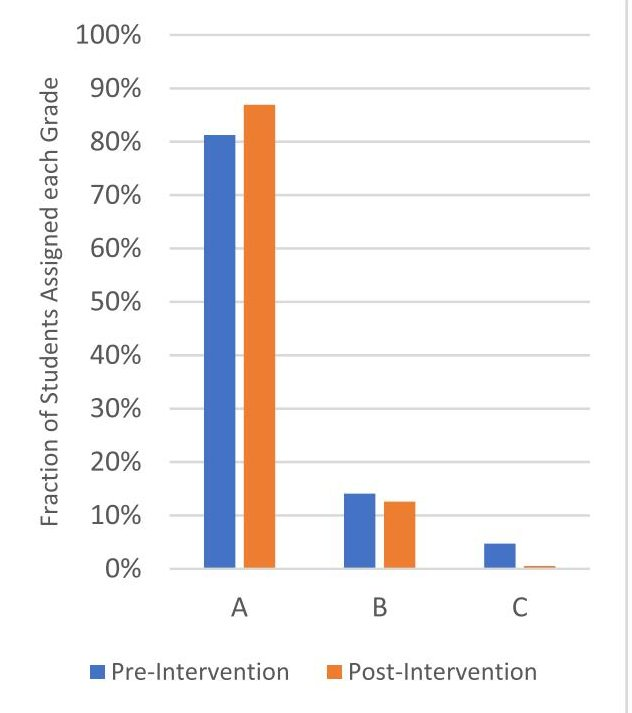
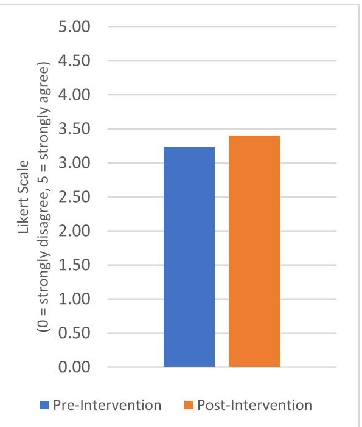
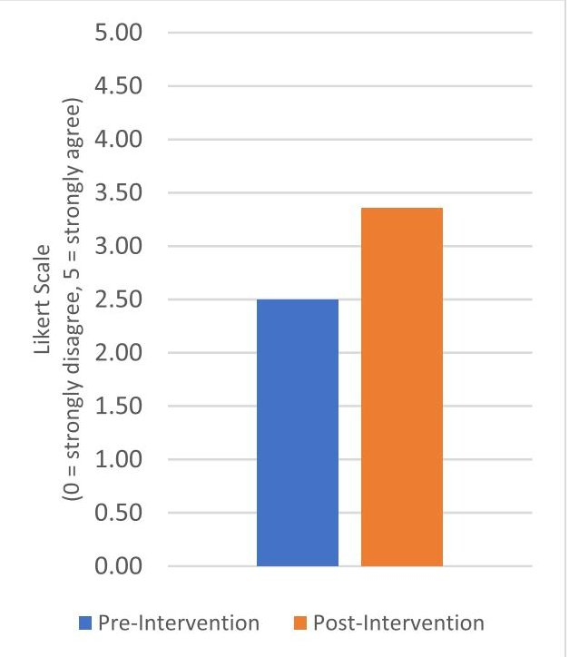
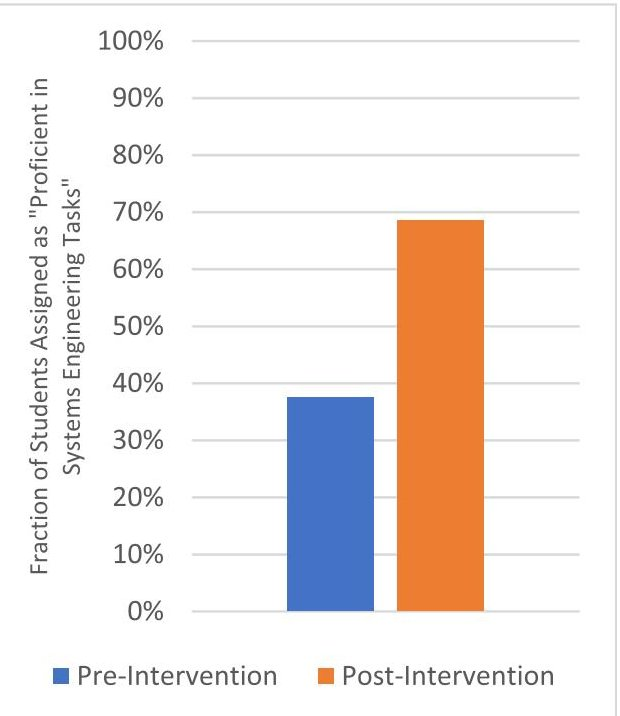
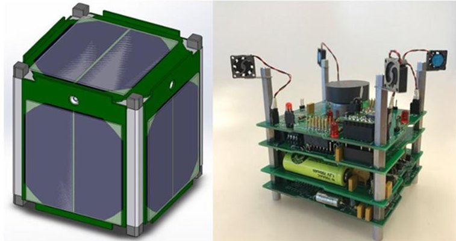
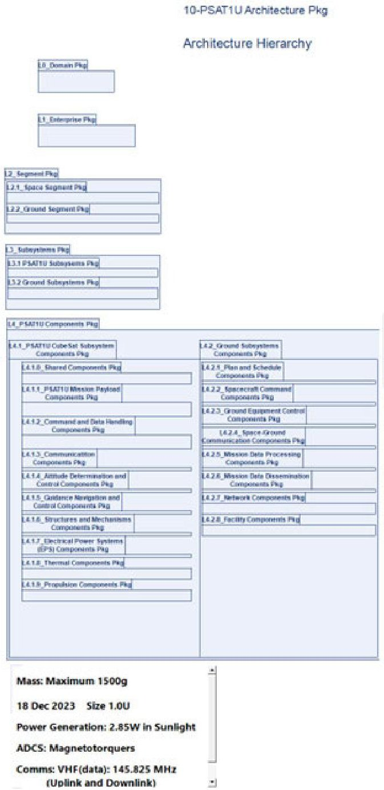

<!-- PDF_PAGE: 1 -->

Received 7 April 2024, accepted 23 April 2024, date of publication 1 May 2024, date of current version 31 May 2024. Digital Object Identifier 10.1109/ACCESS.2024.3395632

APPLIED RESEARCH

# A Tailored Systems Engineering Process for Developing Student-Built CubeSat Class Satellites

JOHN M. GREGORY $ ^{1} $ , RONALD M. SEGA $ ^{1} $ , (Life Fellow, IEEE), THOMAS H. BRADLEY $ ^{1} $ , (Member, IEEE), AND JIN S. KANG $ ^{2} $

$ ^{1} $ Department of Systems Engineering, Colorado State University, Fort Collins, CO 80523, USA $ ^{2} $ Aerospace Engineering Department, United States Naval Academy, Annapolis, MD 21402, USA

Corresponding author: John M. Gregory (john.m.gregory84@gmail.com)

This work involved human subjects or animals in its research. The authors confirm that all human/animal subject research procedures and protocols are exempt from review board approval.

ABSTRACT CubeSats have become an important component of space systems engineering education and research activities across the globe. A variety of universities and government stakeholders have developed educational materials and coursework to train students to follow systems engineering processes in developing these systems, but these materials generally recommend that students follow traditional, industry-derived systems engineering processes without acknowledging the technical and managerial limitations of the workforce in an undergraduate learning environment. This research seeks to develop a more modern model-based systems engineering approach that is tailored to the capabilities, time constraints, and resources typical of undergraduate space systems design and development courses. The considerations for and procedures followed to develop these systems engineering processes are presented here, and the results of implementation of these processes in successive cohorts of undergraduate students performing CubeSat design and development are presented. The results show a significant improvement in instructor and subject matter expert-assessed student learning and student performance. The causes of these results are elucidated with evidence of improved understanding of the systems engineering process, and improved cohort-to-cohort information flow. The Systems Engineering Handbook that is the subject and object of this study is available for other educators and students at https://hdl.handle.net/10217/237534.

INDEX TERMS CubeSats, engineering education, model-based systems engineering (MBSE), systems engineering (SE).

## I. INTRODUCTION

CubeSats are a subset of small satellites distinguished by their form factor, typically with volumes in multiples of $ 1 0 \mathrm{c m}^{3} $ and mass no greater than 1.33 kg [1]. Because their simple architectures reduce the complexity of development and launch [2] and because of their relatively fast development cycle [2], CubeSats are well-suited for use in education [3] and research [4]. They can provide space system design

The associate editor coordinating the review of this manuscript and approving it for publication was Martin Reisslein $ ^{ID} $ .

experience and access to space at a fraction of the cost of conventional satellites [5].

In educational contexts, the design and development of a CubeSat is challenging technically and organizationally. In general, CubeSats are relatively low-powered, low mass, and low cost. They rely on un-qualified commercial off the shelf components, and are typically not the primary payload on any launch. As a result, they are not powered on prior to launch and have limited control and propulsion capabilities. Therefore, many launched CubeSats do not succeed in accomplishing their missions. A recent study found that

<!-- PDF_PAGE: 2 -->

more than 40% of student-built university CubeSat projects fail without even partial mission success, with an additional 24% failing prior to full mission completion [6]. Student educational projects are typically time-limited (constrained to the semester schedule), and relatively low-budget. The workforce for student projects is generally inexperienced, roles are poorly defined, and project, personnel and technical management skills are generally poor. Although developers of CubeSats typically accept more risk than those designing more complex space systems, failed projects limit the types of learning that students can engage with (i.e. failed projects will not be able to train students in data processing). These challenges suggest that there is a need for improved systems engineering educational materials to train undergraduate students to design CubeSats space systems, to enable the rigor of a systems engineering process.

Systems Engineering (SE) is a discipline that offers technical and management tools for developing complex engineered systems. Large space-focused organizations conduct a robust set of SE processes that are aimed to increase the likelihood of successful systems and missions. Various educational and organizational resources exist to communicate the tools and procedures associated with systems engineering. For example, the Department of Defense Acquisition Guideline [7] describes the standard SE procedures governing acquisition and development of US defense systems to include space systems. NASA's Systems Engineering Handbook [8] describes a rigorous SE process for the development of flight and ground systems. INCOSE's Object-Oriented Systems Engineering Method provides a functional decomposition approach to model-based systems engineering (MBSE) of hardware and software systems [9]. These and other practitioner-oriented system engineering processes use modern tools, a wide set of options and decisions, and detailed models and procedures to enable the design of a variety of complex systems.

Due to the complex nature of these processes, as well as the time and resource constraints intrinsic to undergraduate educational environments, it would be ineffective to implement a comprehensive SE process along the lines of [7], [8], and [9]. Indeed, many popular systems engineering education textbooks and syllabi are oriented towards graduate and professional students, or are developed from graduate course curricula. Examples of systems education textbooks derived from and oriented towards graduate courses include Systems Engineering Principles and Practice, $ 3^{\mathrm{rd}} $ Edition, Kossiakoff [10] and Effective Model-based Systems Engineering, Borky and Bradley [11].

The systems engineering of CubeSats to achieve both educational and technical goals has been the subject of recent research efforts. CubeSats have been used as example systems to train undergraduate students in modern systems engineering processes including MBSE [12], Agile Development [13], and Digital Engineering [14]. Generally, these studies present a technical focus; their objectives are improvement of project performance using a student workforce. As a result, a research gap exists in that fewer researchers have sought to develop or demonstrated systems

engineering methods and frameworks that can improve student learning of systems engineering principles.

In response to these challenges, this research proposes tests, and evaluates a CubeSat-specific, MBSE-enabled systems engineering process that can be readily adopted by universities. This process is derived from more comprehensive SE and Systems Architecting processes, but is scaled and scoped to support undergraduate learning in the context of a space mission and CubeSat design course. The efficacy of this process in improving student learning of SE concepts and in improving CubeSat launch readiness is tested through its implementation in 3 successive Naval Academy cohorts at the US Naval Academy (USNA) over the period 2019-2022.

## II. METHODS

This section presents the methods for development of the curriculum, and for its assessment in the context of the undergraduate capstone engineering course.

## A. CURRICULUM DEVELOPMENT

In order to create a product appropriate for use in an undergraduate engineering setting, we consulted students and faculty and identified guidelines and requirements. First, in order to be useful, the information therein must be technically accurate and represent the current state of systems engineering practice. Next, the material contained within the guide must be accessible to students so that it can be understood without seeking additional referenced Importantly, the guide must also be concise to increase the likelihood that students will have the time and resources to review and apply more of the material. And finally, the guide must be application-relevant, specifically to the engineering challenges that students in the capstone course are likely to encounter.

In contrast, the goal of the NASA Systems Engineering Handbook, last revised in 2019, is to "bring the fundamental concepts and techniques of systems engineering to the National Aeronautics and Space Administration (NASA) personnel in a way that recognized the nature of NASA systems and the NASA environment [8]. The NASA SE Handbook is a comprehensive and space-focused guideline, and as such, served as the basis for the tailored guide developed in this study. To map content from the NASA SE Handbook to students and eventually into the tailored framework, we broke down the NASA Handbook by section, and provided detailed definitions to students and instructors in the fall of Academic Year 2019-2020 regarding the competencies described in each chapter of the Handbook under topics such as "System Design", "Product Realization" and "Technical Management". At the outset, a students and instructors were briefed about each of the competencies, and initial surveys were completed that allowed both groups to identify which Systems Engineering competencies would be most valuable to include in a tailored guide.

From these initial results, the need to provide detailed SE guidelines for several competencies was established. The most critical areas identified by students and instructors during the first iteration of the development were topics

<!-- PDF_PAGE: 3 -->

of "Technical Risk Management", "Technical Data Management", "Interface Management", "Product Integration" and "Product Verification". Based on these results, the corresponding material in the NASA SE Handbook was reviewed, extraneous materials not pertinent to generic space systems or CubeSats was removed, as were references to NASA-specific documents, and the remaining material was packaged together and provided to students and instructors in a preliminary version of the tailored framework.

Two additional key topics (not included in the NASA SE Handbook) were identified by instructors as critical for inclusion in the guide and were added to the content above. First, the application of the CubeSat was identified as a key subject in which the students would have to be trained. At USNA, the Parkinson Sat 1U CubeSat (PSAT1U $ ^{1} $ ) project serves the purpose of providing a standard modular baseline design study and applied capstone experience for aerospace engineering students. Second, MBSE has been identified by industry and researchers as a key paradigm of modern and future systems engineering [13].

## B. PARKINSON SAT 1U EXAMPLE

The PSAT1U system was developed as a simple architectural template for CubeSat designs at USNA. PSAT1U is a 1U-sized (10 x 10 x 10 cm) CubeSat that is architected to be designed, developed, and put together by students. Its purpose is to serve as a modular CubeSat architecture, when engineered to use COTS accessible parts, a complete satellite bus development can be completed in three weeks. The well understood nature of the PSAT1U allows students to focus on designing and implementing their preferred on-board payload and mission systems without spending significant time carrying out trade studies on subsystems and components. The tailored handbook devotes a chapter to describing the architecture of PSAT1U.

## C. MBSE INTEGRATION

All of the systems engineering and CubeSat information in the tailored handbook are developed and presented using a Model Based Systems Engineering (MBSE) paradigm. The MBSE paradigm has been found to improve the performance of product design processes [14] (in this case of the CubeSat), and is hypothesized to improve the learning of SE and MBSE concepts to undergraduate engineering students. The CubeSat System Reference Model (CSRM) was chosen as a CubeSat specific MBSE template. The reference model provides the "logical elements [which] can be reused as a starting point for a mission-specific CubeSat logical architecture" [15]. As such, the CSRM is itself a modular architecture which enables the design of a variety of mission-oriented CubeSats. The reference model gives the student a scaffolded starting point when developing a new instance of CubeSat. The MBSE model serves as a standardized template that enables the model-based development of CubeSat class satellites by USNA midshipmen.

## D. CURRICULUM DEPLOYMENT

The capstone engineering experience at USNA Aerospace Engineering is a two-course sequence (EA469 and EA470), offered fall and spring semesters of students' $ 4^{\mathrm{th}} $ and final year of the BS degree. Prior to the development of the tailored systems engineering handbook, the systems engineering processes of the course were ad-hoc in nature. The students were provided deliverable templates and they followed a document-centric systems engineering process, responsible for providing assigned deliverables within an identified timeframe. Students were taught lessons about each of the deliverable documents without much context or explanation as to why these were the most important processes to be concerned with. Additionally, students typically had to wait months to complete the lecture series before they could begin any real hands-on design work.

Upon completion of the tailored systems engineering handbook, the handbook was deployed into the curriculum for all undergraduate Aerospace Engineering capstone students starting in AY 2019-20. The tailored systems engineering handbook was provided to all students as required reading, with chapters allocated to weekly reading assignments. Lectures and in class activities were revised to support the presentation and activities of the tailored systems engineering handbook. Course assessments in the form of quizzes, and assignments were revised, but overarching learning objectives for this course were unchanged. Students were assigned to apply the handbook-defined SE processes to the design of the PSAT1U CubeSat capstone project.

## E. SURVEY METHODS FOR VALIDATION OF PERFORMANCE AND LEARNING IMPROVEMENTS

To assess student performance in the course, before and after the development and utilization of the tailored systems engineering handbook, a series of surveys and assessments were developed. Surveys and procedures were approved by Institutional Review Board (IRB) at USNA and informed consent was provided. The survey instruments are presented in the Appendix and consist of:

1) Student grades for the capstone course sequence. The student's performances are assessed by the instructors summatively through their performance on quizzes, tests, and the deliverables associated with the engineering of the PSAT1U CubeSat. Grades are recorded for every student, and are reported as a distribution. Grades are assessments of student learnings and performance in the course, with a grade of "A" representing "Excellent", "B" representing "Good", and "C" representing "Satisfactory".

2) A Student Survey of students participating in the course. This survey asks students to self-assess their performance in addressing key aspects of the systems engineering lifecycle, and in identifying where their performance is most detrimental. Responses are input using a Likert scale, and results are reported as averages of the student sample (n=94 in AY 2020-2022).

3) A Subject Matter Expert (SME) Survey of instructors and industry mentors. This survey asks the SMEs a set

<!-- PDF_PAGE: 4 -->

of similar questions to assess the students' performance in addressing key aspects of the systems engineering lifecycle, and in identifying where their performance is most detrimental. Responses are input using a Likert scale, and results are reported as averages of the SME sample (n=49 in AY 2020-2022).

4) Course Reflective Modules (CRMs), a post-course survey of instructors summatively assessing student performance and learnings. These CRMs are performed for planning and accreditation purposes within the USNA. CRMs assess instructor's perception of student performance, in particular by rating individual student's proficiency in the tasks of Systems Engineering.

The intervention that is to be studied using these surveys is the deployment of the tailored systems engineering handbook into the capstone curriculum. The baseline, or preintervention performance of the student cohort was assessed using these 3 methods in AY 2020. The post-intervention performance of the student cohort was assessed using the identical instruments in AY 2021 and AY 2022. Surveys were conducted either in-person or electronically (in AY 2021 due to COVID-19 restrictions on in-person learning), and students responded anonymously.

There are no other major curriculum changes that occurred during the time period of the intervention, and the survey is unchanged before and after the intervention.

## III. RESULTS

This section presents the results of this project in the form of the tailored systems engineering handbook, and the results of the surveys of student learnings and SME assessments.

## A. TAILORED SYSTEMS ENGINEERING HANDBOOK

The first result from this project is the systems engineering handbook itself, tailored for use by students in the USNA Small Satellite Program. After several rounds of iteration, and inputs from many subject matter experts and hundreds of students, the finalized guide contains 52 main pages of content across 12 chapters (as listed in Table 1) as well as 10 additional appendices. The handbook is available for download at: https://hdl.handle.net/10217/237534.

## B. ASSESSED STUDENT PERFORMANCE

The results of comparison of the pre-intervention student performance assessments and the post-intervention student performance assessments show that students learning and performance was improved through the development and curricular implementation of the tailored SE handbook. First student assessments in the capstone design course improved. The average course grade prior to intervention was 94.1% After the intervention, this outcome improved to 96.6% The distribution of average course grades improved as well, with a higher percentage of students receiving an "A" grade in the course, fewer receiving a "B" grade, and far fewer receiving a "C" grade. A comparison of these grade distributions is displayed in Figure 1.

TABLE 1. List of chapters from the tailored systems engineering handbook.

<table border="1"><tr><td>CHAPTER</td><td>CHAPTER TITLE</td></tr><tr><td>1</td><td>DESIGN SOLUTION DEFINITION</td></tr><tr><td>2</td><td>PRODUCT IMPLEMENTATION</td></tr><tr><td>3</td><td>PRODUCT INTEGRATION</td></tr><tr><td>4</td><td>PRODUCT VERIFICATION</td></tr><tr><td>5</td><td>PRODUCT VALIDATION</td></tr><tr><td>6</td><td>PRODUCT TRANSITION</td></tr><tr><td>7</td><td>TECHNICAL PLANNING</td></tr><tr><td>8</td><td>INTERFACE MANAGEMENT</td></tr><tr><td>9</td><td>TECHNICAL RISK MANAGEMENT</td></tr><tr><td>10</td><td>TECHNICAL DATA MANAGEMENT</td></tr><tr><td>11</td><td>TECHNICAL ASSESSMENT</td></tr><tr><td>12</td><td>THE PSAT 1U CUBESAT</td></tr><tr><td>APPENDIX</td><td>APPENDIX TITLE</td></tr><tr><td>A</td><td>INTEGRATION PLAN OUTLINE</td></tr><tr><td>B</td><td>CREATING THE VALIDATION PLAN WITH A VALIDATION REQUIREMENTS MATRIX</td></tr><tr><td>C</td><td>SEMP CONTENT OUTLINE</td></tr><tr><td>D</td><td>TECHNICAL PLANS</td></tr><tr><td>E</td><td>VERIFICATION AND VALIDATION PLAN OUTLINE</td></tr><tr><td>F</td><td>INTERFACE REQUIREMENTS DOCUMENT OUTLINE</td></tr><tr><td>G</td><td>CM PLAN OUTLINE</td></tr><tr><td>H</td><td>HSI PLAN CONTENT OUTLINE</td></tr><tr><td>I</td><td>CONCEPT OF OPERATIONS ANNOTATED OUTLINE</td></tr><tr><td>J</td><td>PSAT1U BASELINE MODEL</td></tr></table>

Second, both student and SME-derived assessment results show improvement in student's performance, as illustrated in Figures 2 and 3. Both groups were more likely to say that students had "met expectations" and "exceeded expectations" after implementation of the handbook. In particular, the feedback from the SMEs was most compelling. On average, instructors and subject matter experts were more than 20% more likely to say students met expectations and more than 34% more likely to say students exceeded expectations after the intervention was implemented.

The final student assessment used the information captured in the Course Reflective Modules (CRMs) utilized by all instructors at the US Naval Academy at the end of every semester. CRMs completed post-intervention of the student handbook nearly doubled the fraction of students that the

<!-- PDF_PAGE: 5 -->

FIGURE 1. Comparison of course grade distributions pre-intervention (n=64) and post-intervention (n=191).

FIGURE 2. Comparison of student responses that student performance "Exceeds Expectations" pre-intervention (n=49) and post-intervention (n=45).

instructor's rated as "Proficient in Systems Engineering", as illustrated in Figure 4.

## IV. DISCUSSION

In response to the need for an undergraduate-centric space systems engineering teaching resource, this research has developed, implemented, and validated improved learning in a revised curriculum using a tailored systems engineering handbook and MBSE-enabled CubeSat design process. Discussion here focuses on some hypotheses for mechanisms by which student learning is improved, and on the physical

FIGURE 3. Comparison of SME responses that student performance "Exceeds Expectations" pre-intervention (n=20) and post-intervention (n=28).

FIGURE 4. Comparison of instructor ratings of SE Proficiency Pre-Intervention (n=64) and post-intervention (n=127).

and model-based artifacts that are the result of the revised curriculum.

## A. MECHANISMS OF STUDENT PERFORMANCE IMPROVEMENT

Using a variety of assessment methods and metrics, this study has illustrated that a revised curriculum using a tailored systems engineering handbook and MBSE-enabled CubeSat design process has the potential to improve student learnings and performance. The mechanisms by which these improvements are achieved can be exemplified by looking in detail at the content of the tailored processes.

<!-- PDF_PAGE: 6 -->

For example, one of the critical aspects of agile space systems design is the test and eval stage. CubeSats are generally very unreliable, with an early failure rate of 23.3% [16]. Many of their failures are attributable to abbreviated subsystem and integrated system testing [17]. Many classical systems engineering texts treat test and evaluation abstractly, without examples that would be relevant to CubeSat testing including test planning [11], requirements traceability [10], or data reduction [18]. These presentations are appropriate for graduate training in Systems Engineering, but do not serve the needs of undergraduate students. The NASA SE Handbook, for example, does not include information on COTS testing and evaluation [8]. In contrast, the tailored Systems Engineering handbook presents a defined and simplified process for developing systems integration and testing plans. A comparison showing the subset of content from the NASA SE Handbook that was selected for the USNA Tailored SE Handbook is provided in Figure 5. All of the content topics from the NASA Handbook are listed, and those topics that were selected through the iterative tailoring process for use at USNA are highlighted in yellow. The topics selected for use at USNA focus on the skills that are needed to design, realize, and manage a space system development, while high-level SE processes, as well as programmatic and budgeting concerns are intentionally omitted.

Another mechanism that students' improved performance can be attributed to is the emphasis on a MBSE paradigm in this tailored systems engineering process. The MBSE paradigm has been demonstrated in many instances to improve student's learning of SE processes [19], [20]. In this study, we attribute much of the performance improvement of the students to the following philosophies with which MBSE was used in this course:

- Industrially-relevant MBSE tools (such as Dassault Systems Cameo) are complicated and rich, with many options and user interfaces. In the USNA process, students are provided pre-populated diagrams describing their PSAT1U baseline architecture in order to concentrate their efforts on understanding and interpreting these diagrams and on the interconnectivity and traceability between systems and subsystems. Limiting the students' exposure to MBSE tool functionality and advanced topics proved effective in enabling undergraduate students to be successful in understanding and building SE work products.

- The CubeSat Reference Model was used repeatedly to provide scaffolding for students to understand, probe, and develop MBSE models and artifacts. The reference model allowed for the abstract philosophies of SE (object orientation, architecting, parametrics, etc.) to be exemplified for students in the application of their interest. The students were more motivated and able to value and execute these SE processes when they are strongly connected to their personal and scholarly goals in the context of capstone design.

- Instructors observed a significant improvement in team performance in the semester, and a significant improvement in information transfer from year to year

<table border="1"><tr><td>1.0 Introduction
1.1 Purpose
1.2 Scope and Depth</td></tr><tr><td>2.0 Fundamentals of Systems Engineering
2.1 The Common Technical Processes and the SE Engine
2.2 An overview of the SE Engine by Project Phase
2.3 Example of Using the SE Engine
2.4 Distinctions between Product Verification and Product Validation
2.5 Cost Effectiveness Considerations
2.6 Human Systems Integration (HSI) in the SE Process
2.7 Competency Model for Systems Engineers</td></tr><tr><td>3.0 NASA Program/Project Life Cycle
3.1 Program Formulation
3.2 Program Implementation
3.3 Project Pre-Phase A: Concept Studies
3.4 Project Phase A: Concept and Technology Development
3.5 Project Phase B: Preliminary Design and Technology Completion
3.6 Project Phase C: Final Design and Fabrication
3.7 Project Phase D: System Assembly, Integration and Test, Launch
3.8 Project Phase E: Operations and Sustainment
3.9 Project Phase F: Closeout
3.10 Funding: The Budget Cycle
3.11 Tailoring and Customization of NPR 7123.1 Requirements</td></tr><tr><td>4.0 System Design Processes
4.1 Stakeholder Expectations Definition
4.2 Technical Requirements Definition
4.3 Logical Decomposition
4.4 Design Solution Definition</td></tr><tr><td>5.0 Product Realization
5.1 Product Implementation Process
5.2 Product Integration Process
5.3 Product Verification Process
5.4 Product Validation Process
5.5 Product Transition Process</td></tr><tr><td>6.0 Crosscutting Technical Management
6.1 Technical Planning Process
6.2 Requirements Management Process
6.3 Interface Management Process
6.4 Technical Risk Management Process
6.5 Configuration Management Process
6.6 Technical Data Management Process
6.7 Technical Assessment Process
6.8 Decision Analysis Process</td></tr></table>

FIGURE 5. Comparison of content and processes within the NASA SE Handbook (black text) and the Tailored SE Handbook. (red text).

under the MBSE paradigm (though unquantified in this study). Under the previous DBSE paradigm, design decisions and concepts were communicated to the next year's students through extensive design reports. The opacity and lack of structure for these reports meant that subsequent student groups often rejected earlier students' work and decisions as unclear or unreliable. Additionally, often so much time was consumed with simple trade studies, that little substantive design was completed in an academic year. Under the new paradigm, the instructors observed that the formality and clarity of MBSE artifacts allowed students to pay less attention to well understood trades and

<!-- PDF_PAGE: 7 -->

instead focus on design decisions critical to their mission payloads. In general, the MBSE paradigm can accelerate the development of the project by improving information transfer to and from students in each subsequent academic year.

## B. ARTIFACTS OF PSAT1U PROJECT PERFORMANCE

In addition to measurable student learning outcomes, the tailored SE Handbook and curricular changes also coincided with the development of the Parkinson Sat 1U (PSAT1U), and an associated MBSE-enabled reference model. Applying Naval Academy specific hardware and software definitions, with the architecture of the CubeSat System Reference Model (CSRM) at its core, the PSAT1U CubeSat includes core bus subsystems such as the Attitude Determination and Control System (ADCS), Electrical Power System (EPS), on-board computer (OBC), Communications Systems, and a payload compartment. Figure 6, displays a Computer Aided Design (CAD) render of the structure and a photograph of the of PSAT1U. $ ^{2} $

FIGURE 6. The PSAT1U CubeSat.

The USNA PSAT1U has served as the curricular introduction to space systems and modular design for USNA engineering students. Recently, these students have expanded on these skills and designed and developed the modular satellite bus architecture for a 3U CubeSat that will host two mission payloads developed respectively by students at the University of Maryland and the United States Air Force Academy. This spacecraft, dubbed USNA-16, has its roots in the PSAT1U baseline architecture and is scheduled for launch in Summer 2025.

In addition to the hardware described above, an additional artifact developed to aid student learning is the PSAT Reference Model, which is implemented using CAMEO Systems Modeler MBSE Software V19.0 as well as Modelio Open Source V5.4. The architecture hierarchy of the PSAT1U model is displayed in Figure 7 and encompasses all of the ground system components, subsystem components, and subsystems along with the segment, enterprise and domain packages. This reference model has been continuously developed and used semester after semester to effectively capture and communicate students' design decisions. The

FIGURE 7. Architecture hierarchy of the PSAT1U baseline model package structure.

result is a reference model that can be used and adapted to other CubeSat curricula and educational projects.

## V. CONCLUSION

This study has developed and evaluated a SE process for CubeSats intended specifically for student-run capstone projects taking place over the course of an academic year at USNA. A tailored SE Handbook has been created through an iterative process in use over several academic years. Survey data from students and SMEs was collected during those iterations to ensure that the most important SE processes continue to be addressed. Additionally, the importance of utilizing MBSE has been identified, and a reference model has been created for the PSAT1U CubeSat design. The process has proven successful in improving Systems Engineering knowledge and course outcomes. Additionally, the method of iteratively implementing a tailored Systems

<!-- PDF_PAGE: 8 -->

Engineering handbook may be applicable more broadly both in academia and in various fields of engineering.

We can identify some threats to the extensibility and validity of these findings. The current study was limited to an intervention in the course sequence of undergraduate CubeSat development at the USNA. USNA cadets are highperforming students, they operate in smaller cohorts (40-60 students) than do students at larger engineering Universities. To test the broad applicability of this method, similar tailored frameworks should be developed for other universities or engineering organizations, and their success and relevance should be measured based on their requirements. Because the experimental investigations in this research were performed with student subjects, no simultaneous control group experimental designs were attempted. We assume an equivalence between the experimental control group (USNA class of 2019) and the treatment groups (USNA classes of 2020- 2022). No attempt was made here to quantify dropout effects, class-to-class carryover effects, or the effect of randomization.

Future work will include a periodic reevaluation of the guide to ensure it remains effective and captures the state of the art, as well as work to quantify student success in their technical development, as defined by the launch and mission success of future student-built CubeSats.

## APPENDIX A STUDENT SURVEY

<table class="table table-bordered"><thead><tr><th>#</th><th>Statement</th><th colspan="5">Survey Scale: 1 = Strongly Disagree 2 = Disagree 3 = Neutral 4 = Agree 5 = Strongly Agree NA = Not Applicable</th></tr></thead><tbody><tr><td>1</td><td>Our team's performance up to this point meets expectations to proceed to the next project phase.</td><td>1</td><td>2</td><td>3</td><td>4</td><td>5</td><td></td></tr><tr><td>2</td><td>Our team's performance up to this point exceeds expectations.</td><td>1</td><td>2</td><td>3</td><td>4</td><td>5</td><td></td></tr><tr><td>3</td><td>Our team has adequately addressed the following System Design Processes up to this point:</td><td colspan="5"></td><td></td></tr><tr><td>3a</td><td>Stakeholder Expectations Definition</td><td>1</td><td>2</td><td>3</td><td>4</td><td>5</td><td>NA</td></tr><tr><td>3b</td><td>Technical Requirements Definition</td><td>1</td><td>2</td><td>3</td><td>4</td><td>5</td><td>NA</td></tr><tr><td>3c</td><td>Logical Decomposition</td><td>1</td><td>2</td><td>3</td><td>4</td><td>5</td><td>NA</td></tr><tr><td>3d</td><td>Design Solution Definition</td><td>1</td><td>2</td><td>3</td><td>4</td><td>5</td><td>NA</td></tr><tr><td>4</td><td>Our team had adequately addressed the following Product Realization Processes up to this point:</td><td colspan="5"></td><td></td></tr><tr><td>4a</td><td>Product Transition</td><td>1</td><td>2</td><td>3</td><td>4</td><td>5</td><td>NA</td></tr><tr><td>4b</td><td>Product Validation</td><td>1</td><td>2</td><td>3</td><td>4</td><td>5</td><td>NA</td></tr><tr><td>4c</td><td>Product Verification</td><td>1</td><td>2</td><td>3</td><td>4</td><td>5</td><td>NA</td></tr><tr><td>4d</td><td>Product Integration</td><td>1</td><td>2</td><td>3</td><td>4</td><td>5</td><td>NA</td></tr><tr><td>4e</td><td>Product Implementation</td><td>1</td><td>2</td><td>3</td><td>4</td><td>5</td><td>NA</td></tr><tr><td>5</td><td>Our team has adequately addressed the following Technical Management Processes up to this point:</td><td colspan="5"></td><td></td></tr><tr><td>5a</td><td>Technical Planning</td><td>1</td><td>2</td><td>3</td><td>4</td><td>5</td><td>NA</td></tr><tr><td>5b</td><td>Requirement Management</td><td>1</td><td>2</td><td>3</td><td>4</td><td>5</td><td>NA</td></tr><tr><td>5c</td><td>Interface Management</td><td>1</td><td>2</td><td>3</td><td>4</td><td>5</td><td>NA</td></tr><tr><td>5d</td><td>Technical Risk Management</td><td>1</td><td>2</td><td>3</td><td>4</td><td>5</td><td>NA</td></tr><tr><td>5e</td><td>Configuration Management</td><td>1</td><td>2</td><td>3</td><td>4</td><td>5</td><td>NA</td></tr><tr><td>5f</td><td>Technical Data Management</td><td>1</td><td>2</td><td>3</td><td>4</td><td>5</td><td>NA</td></tr><tr><td>5g</td><td>Technical Assessment</td><td>1</td><td>2</td><td>3</td><td>4</td><td>5</td><td>NA</td></tr><tr><td>5h</td><td>Decision Analysis</td><td>1</td><td>2</td><td>3</td><td>4</td><td>5</td><td>NA</td></tr></tbody></table>

## APPENDIX B SUBJECT MATTER EXPERT (SME) SURVEY

<table class="table table-bordered"><thead><tr><th>#</th><th>Statement</th><th colspan="5">Survey Scale: 1 = Strongly Disagree 2 = Disagree 3 = Neutral 4 = Agree 5 = Strongly Agree NA = Not Applicable</th></tr></thead><tbody><tr><td>1</td><td>The team's performance up to this point meets expectations to proceed to the next project phase.</td><td>1</td><td>2</td><td>3</td><td>4</td><td>5</td></tr><tr><td>2</td><td>The team's performance up to this point exceeds expectations.</td><td>1</td><td>2</td><td>3</td><td>4</td><td>5</td></tr><tr><td>3</td><td>The team has adequately addressed the following System Design Processes up to this point:</td><td colspan="5"></td></tr><tr><td>3a</td><td>Stakeholder Expectations Definition</td><td>1</td><td>2</td><td>3</td><td>4</td><td>5</td></tr><tr><td>3b</td><td>Technical Requirements Definition</td><td>1</td><td>2</td><td>3</td><td>4</td><td>5</td></tr><tr><td>3c</td><td>Logical Decomposition</td><td>1</td><td>2</td><td>3</td><td>4</td><td>5</td></tr><tr><td>3d</td><td>Design Solution Definition</td><td>1</td><td>2</td><td>3</td><td>4</td><td>5</td></tr><tr><td>4</td><td>The team had adequately addressed the following Product Realization Processes up to this point:</td><td colspan="5"></td></tr><tr><td>4a</td><td>Product Transition</td><td>1</td><td>2</td><td>3</td><td>4</td><td>5</td></tr><tr><td>4b</td><td>Product Validation</td><td>1</td><td>2</td><td>3</td><td>4</td><td>5</td></tr><tr><td>4c</td><td>Product Verification</td><td>1</td><td>2</td><td>3</td><td>4</td><td>5</td></tr><tr><td>4d</td><td>Product Integration</td><td>1</td><td>2</td><td>3</td><td>4</td><td>5</td></tr><tr><td>4e</td><td>Product Implementation</td><td>1</td><td>2</td><td>3</td><td>4</td><td>5</td></tr><tr><td>5</td><td>The team has adequately addressed the following Technical Management Processes up to this point:</td><td colspan="5"></td></tr><tr><td>5a</td><td>Technical Planning</td><td>1</td><td>2</td><td>3</td><td>4</td><td>5</td></tr><tr><td>5b</td><td>Requirement Management</td><td>1</td><td>2</td><td>3</td><td>4</td><td>5</td></tr><tr><td>5c</td><td>Interface Management</td><td>1</td><td>2</td><td>3</td><td>4</td><td>5</td></tr><tr><td>5d</td><td>Technical Risk Management</td><td>1</td><td>2</td><td>3</td><td>4</td><td>5</td></tr><tr><td>5e</td><td>Configuration Management</td><td>1</td><td>2</td><td>3</td><td>4</td><td>5</td></tr><tr><td>5f</td><td>Technical Data Management</td><td>1</td><td>2</td><td>3</td><td>4</td><td>5</td></tr><tr><td>5g</td><td>Technical Assessment</td><td>1</td><td>2</td><td>3</td><td>4</td><td>5</td></tr><tr><td>5h</td><td>Decision Analysis</td><td>1</td><td>2</td><td>3</td><td>4</td><td>5</td></tr></tbody></table>

## REFERENCES

[1] CubeSat Design Specification, Rev. 13, The CubeSat Program, California Polytech. State Univ., San Luis Obispo, CA, USA, Apr. 2015.

[2] A. Poghosyan and A. Golkar, "CubeSat evolution: Analyzing CubeSat capabilities for conducting science missions," Prog. Aerosp. Sci., vol. 88, pp. 59-83, Jan. 2017, doi: 10.1016/j.paerosci.2016.11.002.

[3] S. C. Spangelo, D. Kaslow, C. Delp, B. Cole, L. Anderson, E. Fosse, B. S. Gilbert, L. Hartman, T. Kahn, and J. Cutler, "Applying model based systems engineering (MBSE) to a standard CubeSat," in Proc. IEEE Aerosp. Conf., Mar. 2012, pp. 1-20, doi: 10.1109/AERO.2012.6187339.

[4] C. Radhakrishnan, V. Chandrasekar, S. C. Reising, and W. Berg, "Rainfall estimation from TEMPEST-D CubeSat observations: A machine-learning approach," IEEE J. Sel. Topics Appl. Earth Observ. Remote Sens., vol. 15, pp. 3626-3636, 2022, doi: 10.1109/JSTARS.2022.3170835.

[5] D. Selva and D. Krejci, "A survey and assessment of the capabilities of cubesats for Earth observation," Acta Astronautica, vol. 74, pp. 50-68, May 2012, doi: 10.1016/j.actaastro.2011.12.014.

[6] L. Berthoud, M. Sartwout, J. Cutler, D. Klumpar, J. A. Larsen, and J. F. D. Nielsen, "University CubeSat project management for success," in Proc. AIAA/USU Conf. Small Satell., Educ. Programs, 2019, pp. 1-17. [Online]. Available: http://digitalcommons.usu.edu/smallsat/2019/all2019/63/

[7] Defense Acquisition Guidebook, Dept. Defense, USD AT&L, Washington DC, USA, 2017.

[8] NASA Systems Engineering Handbook, document NASA/SP-2016-6105 Rev. 3, NASA Office Chief Engineer, 2016.

[9] H. Lykins, S. Friedenthal, and A. Meilich, "Adapting UML for an object oriented systems engineering method (OOSEM)," in Proc. INCOSE Int. Symp., vol. 10, no. 1, 2000, pp. 490-497, doi: 10.1002/j.2334-5837.2000.tb00416.x.

<!-- PDF_PAGE: 9 -->

[10] A. Kossiakoff, S. J. Seymour, D. A. Flanigan, and S. M. Biemer, Systems Engineering Principles and Practice, 3rd ed. Hoboken, NJ, USA: Wiley, 2020.

[11] J. M. Borky and T. H. Bradley, Effective Model-Based Systems Engineering. Cham, Switzerland: Springer, 2019, doi: 10.1007/978-3-319-95669-5.

[12] K. Yi-Tzu. (2023). Sealion Cubesat Mission Architecture Using Model Based Systems Engineering With a Docs as Code Approach. Old Dominion Univ. [Online]. Available: https://www.proquest.com/docview/2828592607

[13] E. Honoré-Livermore, R. Lyells, J. L. Garrett, R. Angier, and B. Epps, "An agile systems engineering analysis of a university CubeSat project organization," in Proc. INCOSE Int. Symp., vol. 31, no. 1, 2021, pp. 1334-1348, doi: 10.1002/j.2334-5837.2021.00904.x.

[14] E. Honoré-Livermore, R. Birkeland, S. Bakken, J. L. Garrett, and C. Haskins, "Digital engineering development in an academic CubeSat project," J. Aerosp. Inf. Syst., vol. 19, no. 10, pp. 649-660, Oct. 2022.

[15] T. Huldt and I. Stenius, "State-of-practice survey of model-based systems engineering," Syst. Eng., vol. 22, no. 2, pp. 134-145, Mar. 2019, doi: 10.1002/sys.21466.

[16] J. B. Holladay, J. Knizhnik, K. J. Weiland, A. Stein, T. Sanders, and P. Schwindt, "MBSE infusion and modernization initiative (MIAMI): 'Hot' benefits for real NASA applications," in Proc. IEEE Aerosp. Conf., Mar. 2019, pp. 1-14, doi: 10.1109/AERO.2019.8741795.

[17] D. Kaslow, L. Hart, B. Ayres, C. Massa, M. J. Chonoles, R. Yntema, S. D. Gasster, and B. Shiotani, "Developing a CubeSat model-based system engineering (MBSE) reference model—Interim status #3," in Proc. IEEE Aerosp. Conf., Mar. 2016, pp. 1-16.

[18] T. Villela, C. A. Costa, A. M. Brandão, F. T. Bueno, and R. Leonardi, "Towards the thousandth CubeSat: A statistical overview," Int. J. Aerosp. Eng., vol. 2019, pp. 1-13, Jan. 2019, doi: 10.1155/2019/5063145.

[19] M. Langer, M. Weisgerber, J. Bouwmeester, and A. Hoehn, "A reliability estimation tool for reducing infant mortality in cubesat missions," in Proc. IEEE Aerosp. Conf., Mar. 2017, pp. 1-9, doi: 10.1109/AERO.2017.7943598.

[20] P. G. Smith, Proactive Risk Management: Controlling Uncertainty in Product Development, 1st ed. New York, NY, USA: Productivity Press, 2002, doi: 10.4324/9781482278224.

[21] J. L. Fernández and G. Moreno, "MBSE for engineering students," in Proc. INCOSE Int. Symp., vol. 26, no. 1, 2016, pp. 1231-1245, doi: 10.1002/j.2334-5837.2016.00223.x.

[22] P. David, E. Blanco, S. Revol, F. Noyrit, and M. Coatrine, "Model based systems engineering introduction within industrial engineering curriculum," in Proc. Int. Conf. Eng. Product Design Educ., 2019, pp. 1-6.

JOHN M. GREGORY received the B.S. degree in aerospace engineering from Syracuse University, in 2007, and the M.S. degree in aerospace engineering from Old Dominion University, in 2013. He is currently pursuing the Ph.D. degree in systems engineering with Colorado State University. He is the Branch Head for software systems engineering of the NASA Goddard Space Flight Center. He is also an Officer with the United States Naval Reserve and spent three years as an

Instructor with the Aerospace Engineering Department, US Naval Academy, Annapolis, MD, USA. His research interests include space systems, modelbased systems engineering, small satellites, space operations, and additive manufacturing.

RONALD M. SEGA (Life Fellow, IEEE) received the B.S. degree in math and physics from U.S. Air Force Academy (USAFA), the M.S. degree in physics from The Ohio State University (OSU), and the Ph.D. degree in electrical engineering from the University of Colorado, Colorado Springs, CO USA.

He was the Vice President and an Enterprise Executive for energy and environment with Colorado State University and OSU. He was a Faculty

Member with the College of Engineering and Applied Science, University of Colorado, and the Dean, from 1996 to 2001. He was the Director of Defense Research and Engineering and the Chief Technology Officer of the Department of Defense (DoD), from 2001 to 2005. In 2005, he retired from the Air Force Reserve, as a Major General Reserve Assistant to the Chairman of the Joint Chiefs of Staff after 31 years in the Air Force. He was an Under Secretary with the Air Force, from 2005 to 2007, having served as the DoD Executive Agent for Space. A Former Astronaut, he flew aboard Space Shuttles Discovery (1994) and Atlantis (1996). He is the Emeritus Professor and the Director of the Systems Engineering Programs, Colorado State University. He is a fellow of AIAA.

THOMAS H. BRADLEY (Member, IEEE) is currently the Department Head and the Woodward Endowed Professor of systems engineering of the Walter Scott, Jr. College of Engineering, Colorado State University, Fort Collins, CO, USA, where he conducts research and teaches a variety of courses in systems engineering, multidisciplinary optimization, and design. His research interests include applications in automotive and aerospace systems design, energy, system management, and life-cycle assessment.

JIN S. KANG received the B.S. degree from the University of Michigan, the M.S. degree from Stanford University, and the Ph.D. degree in aerospace engineering from Korea Aerospace University (KAU). He is currently an Associate Professor with the Aerospace Engineering Department, United States Naval Academy, and the Director of the Naval Academy Small Satellite Program. He was involved in the development of four micro-satellites and numerous CubeSat

satellites. His main research interest includes small satellite technology development. After working for general electric for two years, he taught with Korea Air Force Academy, KAU, and Drexel University before joining the Naval Academy Faculty.