<!-- PDF_PAGE: 1 -->

IAC-24-D1,1,11,x85912

# AI-based Robust and Failure-Tolerant Processes for In-Orbit Manufacturing of Modular Small Satellites

Maximilian Mühlbauer $ ^{a,b} $ , Florian Leutert $ ^{c} $ , Christian Plesker $ ^{d} $ , Luis Wiedmann $ ^{a,b} $ , Alessandro M. Giordano $ ^{a,b} $ , Joao Silvério $ ^{b} $ , Thomas Hulin $ ^{b} $ , Freek Stulp $ ^{b} $ , Jonas Voges $ ^{d} $ , Robert Knobloch $ ^{d} $ , Klaus Schilling $ ^{c,e} $ Benjamin Schleich $ ^{d} $ , Alin Albu-Schäffer $ ^{b,a} $

$ ^{a} $ School of Computation, Information and Technology, Sensor Based Robotic Systems and Intelligent Assistance Systems, Technical University Munich, Friedrich-Ludwig-Bauer-Str. 3, Garching, Germany.

$ ^{b} $ German Aerospace Center (DLR), Robotics and Mechatronics Center (RMC), Munchener Str. 20, 82234 Weßling, Germany.

$ ^{c} $ Zentrum für Telematik e.V., Magdalene-Schoch-Straße 5, 97074 Würzburg, Germany

$ ^{d} $ Product Life Cycle Management (PLCM), Technical University of Darmstadt, Otto-Berndt-Str. 2, 64287, Darmstadt, Germany

$ ^{e} $ Department of Robotics and Telematics, Julius-Maximilians-Universität Würzburg, Am Hubland, 97074 Würzburg, Germany

* Corresponding Author, maximilian.muehlbauer@tum.de

## Abstract

Advances in small satellite architecture and production processes allow for an increasingly robust automated assembly, enabling the vision of an in-orbit factory. The in-orbit production of satellites promises many advantages: For instance, satellites can be commissioned much faster as they are produced directly at their location of deployment. Also, mechanical requirements are lower as the structure does not need to withstand the vibrations of a rocket launch. This opens new business opportunities with the just-in-time production of large fleets of individualised small satellites which are built according to specific customer needs.

As direct human intervention in in-orbit factories is prohibitively expensive, the need for failure tolerant and self-recovering processes arises. The ACOR project leverages AI-based methods for the robust assembly of CubeSats and is built upon three key components: an automated integration and testing process, a failure-tolerant teleoperation interface and a Digital Process Twin (DPT) orchestrating the whole assembly with fault detection, isolation and recovery (FDIR) capabilities.

The DPT is the high level decision-making authority of the In-Orbit Factory. It orchestrates the individual participants in the manufacturing process and maps the entire process virtually. Standardised interfaces to the digital twins of product and production machines and the virtual representation of the process are used to find alternative solutions in case of errors. Based on this process information the DPT also performs a long-term optimization of the whole process. The actual assembly of satellites from modular components is performed by a force-sensitive torque-controlled robot. Several FDIR approaches are integrated into individual production steps to supervise the production execution and achieve the required robustness and adaptivity of the process. Automated testing and inspection of individual satellite modules, subsystems up to the whole assembly is seamlessly integrated and performed during the production process to ensure a fully functional satellite at the end of the assembly.

A bilateral teleoperation system with force feedback helps to cope with unforseen circumstances. Virtual Fixtures are used to generate guiding forces for the human operator. A probabilistic formulation of these fixtures allows to automatically select the most appropriate fixture and scale the guidance level, balancing human control with automation. This system allows to directly control parts of the assembly, either performing steps that are not automated yet or by completing tasks where the automation has failed.

This paper outlines the concept of our robust and failure-tolerant in-orbit factory and presents results achieved with our approach, combining automated and teleoperated assembly with a Digital Process Twin.

Keywords: AI, In-Orbit Factory, Teleoperation, Digital Twin, AIT, Robotic Manufacturing

<!-- PDF_PAGE: 2 -->

## Acronyms / Abbreviations

AIT automated integration and testing. 3-5,13

DPT Digital Process Twin. 3,7,8,10-14

DT Digital Twin. 10-12

FDIR Fault-Detection, -Isolation and -Recovery. 3-7 11,13,14

GMM Gaussian Mixture Model. 8,9

GMR Gaussian Mixture Regression. 8

OPC UA Open Platform Communications Unified Architecture. 10-12

PCB printed circuit board. 5-8

TCP Tool Center Point. 13

VF Virtual Fixture. 3,7,8,13

## 1. Introduction

## 1.1 In-Orbit Production for Flexibility and Robustness

The number of satellites active in orbit is set to multiply with Starlink alone aiming to launch as many as 42.000 satellites in total [21]. Traditionally, such satellites are built on Earth and launched in fully assembled form. This design requires satellite structures to withstand the vibrations of a rocket start and furthermore necessites manufacturing long before the start of satellite operations in orbit, thus causing long lead times, high expenses, and mission inflexibility. The capabilities of a satellite have to be specified very early in the design stage and cannot easily be changed. Furthermore, the lifetime of components and the amount of fuel determines the maximum operational span of a satellite at the very beginning of a mission.

An even more pressing problem is the high failure rate of launched satellites. Up to 2.5% of Starlink satellites reach space in defunct form [27]. This is even worse for CubeSats, where up to 25% of satellites are defective [24]. Those non-operational satellites contribute to the already large amount of space debris.

Both problems necessitate an adaptive and failure-tolerant manufacturing process. Only scalable manufacturing processes allow for the production of such large numbers of satellites at reasonable cost. Producing and testing satellites right at the place of their deployment furthermore ensures that only working satellites are being released into outer space.

## 1.2 In-Space Servicing, Assembly and Manufacturing

Recently, automated - in contrast to the previously manned $ ^{*} $ - On-Orbit Servicing missions have been launched to specifically tackle this problem and extend the lifetime of satellites. As the first of such missions, the Mission Extension Vehicle (MEV) [28] has already successfully docked to two satellites nearing the end of their fuel reserves, allowing them to stay operational for longer by providing maneuvering services. Economic viability for such servicing missions is given if the cost of the servicing is not too high compared to the value of the satellite to be serviced [10], [33].

Examples of more complex missions includes OSAM-1 $ ^{\dagger} $ aiming at refuelling Landsat-7 to extend its lifetime and OSAM-2 $ ^{\ddagger} $ aiming to demonstrate the viability of on-orbit additive manufacturing. Both projects however yet have to be implemented in orbit. As recently as 2023, NASA has created the Consortium for Space Mobility and ISAM Capabilities (COSMIC) $ ^{\S} $ focusing on in-space Servicing, Assembly, Manufacturing (ISAM) $ ^{\#} $ activities. In Europe, the EROSS IOD project [42] prepares an in-orbit demonstration of capturing and servicing both a prepared as well as an unprepared satellite with a robotic arm.

## 1.3 Assembly in Space

Performing robotic assembly is the main component of our envisioned factory as the aim is to create functioning CubeSats from individual components. Key ingredient for being able to perform such complex assemblies in space is the availability of advanced robotic technology [16], [22] capable of precise and compliant manipulation. Most projects have so far focused on creating modular components as building blocks for satellites such as the iBOSS project [11]. PERASPERA $ ^{**} $ as part of the European Commission's Strategic Research Cluster in Space Robotics Technologies developed a similar reconfigureable architecture for modular satellites with a walking manipulator in the MOSAR project [20]. Also as part of the PERASPERA consortium, PULSAR [23], [35] aimed at autonomously assembling a large mirror structure for a future space telescope.

Common to all of these projects is the use of relatively large self-contained units which are then assembled together. While current CubeSat designs have to be mod-

<!-- PDF_PAGE: 3 -->

ified for robotic assembly, goal of our factory is to be able to manufacture functioning satellites from individual components to increase the flexibility and thus create a much wider range of possible products.

## 1.4 In-Orbit CubeSat Assembly

The CubeSat concept was developed starting in 1999, and describes a class of small satellites often consisting of low-cost commercial off-the-shelf components. While limited in power and potential payload, swarms or formations of CubeSats aim at matching capabilities of large monolithic satellites, while being faster to manufacture and providing more redundancy due to their number. The review paper [17] summarizes the evolution and the large future market potential of CubeSats.

While being considerably easier to assemble than large monolithic models, one current limitation of CubeSats is that they are still mainly designed for manual assembly by humans on ground. The Makersat-1 was created using a 3D-printed structure [14], [25]. This allowed for printing and assembly on the ISS with successful deployment afterwards. Later works include power connections into the structure of a CubeSat, thus enabling robotic assembly of larger units [43]. Uzu-Okoro et al. [29], [30], [36] investigate the concept of a factory for CubeSats in a box containing an array of subsystems and a small low-cost robot for in-orbit assembly. They furthermore estimate the potential cost savings compared to traditionally launching CubeSats.

## 1.5 Failure-Tolerant CubeSat Factory

The concept of our envisioned in-orbit factory goes beyond in-orbit assembly of CubeSats. Building upon the Space Factory 4.0 project [18] which leveraged Industry 4.0 methods for a flexible robotic assembly and the AI-InOrbit-Factory project [32], [40] utilizing artificial intelligence to flexibilize production, we now integrate failure-tolerant algorithms and recovery procedures into the factory concept to increase robustness as required for an onorbit mission.

Specifically, we developed the following novel methods for our envisioned in-orbit factory,

- an integration of FDIR supervision schemes and autonomous recovery options into the production process,

- a failure-tolerant teleoperation approach with probabilistic Virtual Fixtures (VFs),

- the orchestration of the process through a selfimproving Digital Process Twin (DPT)

which we will present in the remainder of the paper.

## 2. Robust and Failure-tolerant In-Orbit Factory

Robustness to uncertainty and inaccuracies as well as failure tolerance are important properties of systems deployed to space and thus at the core of our factory concept. Based on artificial intelligence methods for increased flexibility developed in [40], we implement failure tolerant algorithms and recovery procedures to ensure factory operations even under adverse conditions. Those algorithms allow for fault detection, isolation and recovery (FDIR) both on component as well as on process level.

Fig.1 shows an overview of the full in-orbit factory concept which is based on a workplace with robotic arm, cameras and electrical equipment for testing as well as a storage of standardised CubeSat components.

The Digital Process Twin (Section 5) orchestrates the assembly procedure based on a computed assembly sequence and test procedure. Each assembly and testing step can either be performed fully automatically by an automated integration and testing (AIT) procedure (Section 3) or using teleoperation (Section 4) with a human operator on ground. Result of the assembly is a satellite that has been fully tested on component level as well as whole unit to ensure proper functionality. This satellite should then be deployed from the factory directly into its operational orbit.

The data recorded from robotic integration and testing are stored for later analysis and improvement of the algorithms. It for example allows the DPT to later analyze and optimize the assembly procedure or to improve the Virtual Fixtures used during a teleoperated assembly.

The individual components of this factory are presented in the following, with special focus on how increased failure tolerance and recovery behaviour is achieved.

## 3. Autonomous Assembly, Integration and Testing Process

The CubeSats considered in this In-Orbit Factory consist of modular subsystems that need to be assembled onto a common bus system board. The actual assembly is performed by a two-armed force sensitive robot. The developed AIT process for this has already been presented in the past [32]. This process has since been enhanced to include AI based testing protocols [40] and learning approaches to improve this autonomous assembly. As a final step, now recovery techniques (FDIR) have been included into the AIT system in order to directly deal with errors and recover from them autonomously wherever possible.

FDIR is a technique used to supervise a process to detect occuring errors, isolate and identify the source of faults and then react to them by applying some kind of recovery scheme to try to solve the problem autonomously.

<!-- PDF_PAGE: 4 -->

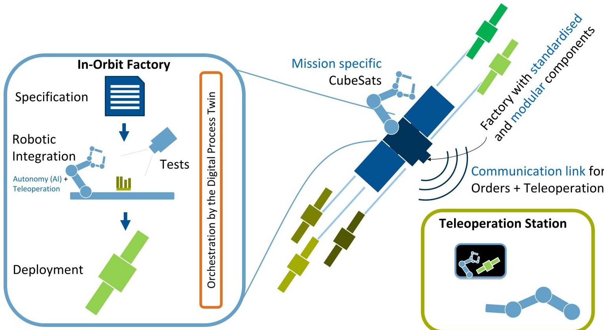

Fig. 1: The overall factory concept with a robust and failure-tolerant robotic integration in space and a haptic teleoperation station on ground.

In the scope of this project, it is applied mainly with focus on securing the production process, but it is also used to test the product, that is to ensure later functionality of the produced satellite. As such, Fault-Detection, -Isolation and -Recovery (FDIR) approaches were developed with focus on process level (shielding the production process from occuring errors), but also on component level (for example tests to detect defective components of subsystems). Approaches and examples for both will be presented in the following.

## 3.1 FDIR for robot-based autonomous satellite production

At the beginning of the ACOR project, a thorough analysis was performed with the goal of identifying common error sources for components, subsystems and the assembled satellites on the one hand, but also for possible faults to be encountered during the robot-based automated production process on the other hand. For the errors listed, then possible steps to detect and identify each error type were compiled. Finally, for each fault a possible recovery approach was devised where feasible. An excerpt of this analysis document can be seen in Fig. 2. Recovery options do not exist for all possible faults: as an extreme example, complete failure of the assembly robot is a defect the system will not be able to recover from. Recovery options

<table border="1"><tr><td>Component/Subsystem/Function</td><td>Possible defects/errors</td><td>Possible consequences</td><td>Detection method</td><td>Recovery options</td></tr><tr><td>EPS/integration</td><td>Broken connector pins/faulty connection to bus</td><td>No connection to subsystem/no power supplied</td><td>Check reachability/power supplied after integration</td><td>Extract and reinsert board;Replace if connector broken</td></tr><tr><td>EPS/power supply</td><td>Broken battery cells in redundant power lines</td><td>No or limited power supply</td><td>Check voltage of cells of each power line on board</td><td>Switch to redundant power line or replace EPS if both lines defective</td></tr><tr><td>EPS/power supply</td><td>Low power supply due to battery discharge</td><td>Limited remaining runtime</td><td>Check State-Of-Charge of EPS</td><td>Re-charge batteries in case of low charge</td></tr><tr><td>...</td><td></td><td></td><td></td><td></td></tr></table>

Fig. 2: Excerpt of possible errors encountered during integration of an EPS subsystem

thus were only implemented where autonomous recovery was deemed feasible with a realistic likelihood to correct the underlying error. In case those autonomous recovery options fail, human intervention by teleoperation is the last resort fallback option in the project (Section 4).

First step for each FDIR approach is the identification part - checking for and reliably detecting potential errors in the process, identifying what type of defect has been encountered and determining potential causes for the fault. For this specific goal, three essential options are available in the developed robotic AIT production environment:

<!-- PDF_PAGE: 5 -->

- Optical inspection with cameras integrated into the robot hands,

- Force sensitivity of the robot (joints and grippers) to provide force feedback during integration steps,

- Specialized testing hardware integrated in the production environment to run (satellite) specific tests.

Using these assets, different failure detection methods are being deployed before and during the assembly to detect potential errors and faulty components, for example taking images to verify placement of assembly components or using force sensitivity to detect when an insertion movement of the robot fails.

The FDIR solution for the robotic assembly was developed following the general outline:

1. First check the production environment itself, like the robot, tools and assembly mountings as well as testing equipment

2. Check availability and placement of components to assemble before starting the production process

3. Test each component during and after assembly to ensure proper functionality

4. Replace broken components during the AIT process when no other recovery option is available.

The FDIR supervision of the production process thus takes place as follows: First, the essential components of the production enviroment are checked for nominal status or potential defects. Most central part of production is the two-armed robot performing the actual assembly and testing. The control PC running the digital process twin and the AIT process first checks communication connection to the robot and status of the robot control, before continuously monitoring robot system data during the AIT process. Initially, correct robot mastering / axis alignment is checked by performing a hand-eye-calibration check with an optical marker on the robot base - potential misalignment of robot axes can be reliably detected then with the integrated camera in the robot hand, by comparing the optical measurement data with predetermined, nominal values. Robot grippers are then also checked utilizing optical inspection, followed by checking correct placement of the assembly mountings (again with optical markers fixed to each auxiliary mounting equipment). After correct positioning of robot and mountings in the production environment have been ensured, the system checks reachability and functionality of the specialized testing hardware. These are mainly a satellite development board integrated in the production enviroment enabling power supply to and software communication with any satellite subsystems handled during assembly, an optical vision station featuring high-resolution microscopes to allow for detailed, AI-based optical inspection of printed circuit board (PCB) surfaces [40]) and an infrared camera to allow for thermal measurements, external power supply and multimeter for electrical measurements and a magnetometer and compact solar lamp for satellite attitude control tests. Recovery options for defects encountered during this basic system functionality check are limited, since these components are essential for the actual assembly. A faulty mastering of the robot can for example be resolved by rerunning automated axes calibration functions, while mechanical defects of the grippers can not be solved without human (tele-)intervention. In case of defective testing equipment the checks utilizing them may be omitted from the following AIT / FDIR checks so production can continue, this however leads to limited functionality guarantees for the systems that otherwise would be tested with this testing equipment.

After conclusion of these initial system tests, component placement in the supplying mountings is checked. This can be done with optical checks and measurements, but also using the force sensitivity of the robot to measure PCB positions in the mounts or detecting failed gripping attempts, that then can be re-tried with slightly altered gripping / insertion coordinates [40]. If components are detected to have been shifted inside or even outside their mountings the system tries to automatically recover them. This is done by computing the new location of the workpiece (either using optical markers on them, or using computer vision algorithms to compute the shifted positions inside their mountings (Fig. 3)). The robot then tries to grab them with its suction gripper and placing them back into their original mount. This is done to use the mountings as a mechanical stop, so after recovery the component is once again placed with enough accuracy to allow the later assembly steps to succeed. After recovery has been attempted the system repeats the positioning check to verify the part has now been placed correctly (Fig. 3) bottom right). In case of failure to recover, the system will repeat the attempts a number of times, either succeeding and proceeding with the assembly as planned, or stopping autonomous recovery and consulting the Digital Twin for further options (for example to proceed with a different component or calling teleoperation aid).

During assembly, each component to be integrated is checked to ensure proper functionality. Depending on the type of component, these tests can consist of powering up a subsystem PCB by having the robot plug it into the satellite development board integrated into the production environment and running software tests, reading out sen-

<!-- PDF_PAGE: 6 -->

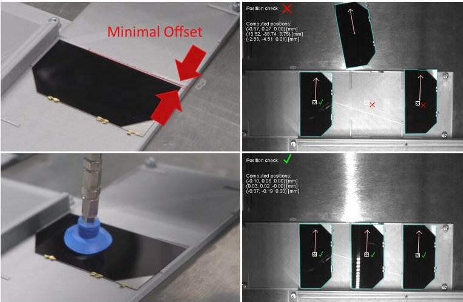

Fig. 3: Using the robot's camera, even slightly misplaced solar cells can be detected (top row) and corrected by picking them up and gently pushing them onto the mechanical stop (bottom row).

sor values and comparing them with nominal / expected values, or measuring the supplied voltage of a solar cell to be assembled. If a component fails these tests, once again depending on the type, different recovery options exist. Software updates can be performed for subsystems, or more specific recovery options applied (for example recharging an EPS (Electronic Power System) subsystem in case low charge is detected). Should more complex errors be encountered (for example broken sensors on a PCB) the part likely will be sorted out of the assembly process and replaced with another, working one, since automated repairing of complex electronic parts with a robot would be an unfeasible option for a broad spectrum of errors.

Finally, after subsystem groups or a complete satellite model have been assembled, higher system functions can be tested, for example checking the power supply abilities of a completed solar panel or verifying ADCS functions. Where the required hardware is available, the production system can also perform (or correct) basic system calibrations, for example calibration of the sun sensor using a robot guided compact sun lamp (Fig. 4) or external magnetometer to adjust the system's magnetic measurements.

This section provided a general overview of the implemented FDIR approach. More details are presented in the following Section 3.2 for the assembly of a solar panel subsystem.

## 3.2 FDIR approaches during solar panel assembly

To provide a more specific example with additional implementation details, this section explains some of the implemented FDIR approaches for a specific sub-assembly task - the assembly of solar cells on an outer satellite panel PCB. During this assembly step, the robot needs to place 7

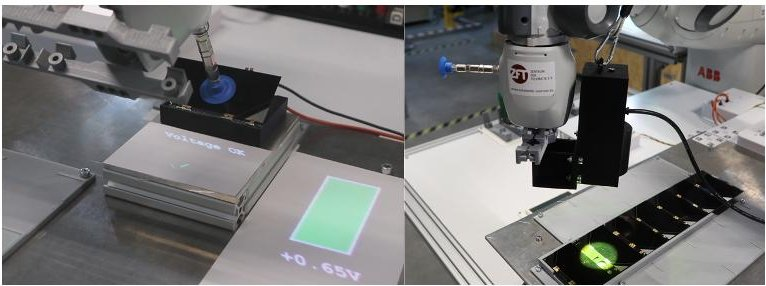

Fig. 4: Robotic automated checks of the fuctionality of each solar cell by measuring its voltage before placing them (left), and of the whole assembled panel using a solar lamp (right).

solar cells precisely aligned onto the PCB, such that their soldering tags touch the connector pads and they provide the voltage required to later charge the satellite batteries.

The FDIR supervision during this subtask follows the scheme outlined above: first test all individual components, then functionality of the assembled subsystem all the while monitoring the production process for errors. The robot begins by checking correct placement of the components (PCB and cells) in their mountings. Both need to be aligned with submillimeter accuracy for the production step to succeed. Using the cameras integrated in the robot's hands, images of the components' mountings can be evaluated with an AI driven segmentation to compute the precise positioning of each cell and the PCB, and comparing them with their expected nominal values. Using this approach, even small misalignments can be detected (Fig. 3 top left). In case such a misplacement is detected the robot uses its suction grippers to grab and/or push the components back into its mount, using the mechanical stops of the mountings to reach the desired placement accuracy. The successful correction of misalignments is then checked again, and the recovery approach is either repeated or all components are determined to be correctly placed. The robot then checks functionality of all components, using a multimeter and measuring line to first check conductivity of the PCB's conducting paths. The functionality of each solar cell is verified by the robot guiding them on a measuring station to determine if they provide the voltage expected (Fig. 4 left). Damaged components during this step need to be replaced.

The robot then places each cell on the panel PCB. The power providing functionality of the completely assembled PCB can afterwards be verified by either measuring the voltage supplied, this time using measuring lines directly integrated inside of the PCB mounting (touching the PCB output connectors). They can additionally be confirmed by reading out the system variable for 'voltage supplied' after a software connection to the panel subsystem

<!-- PDF_PAGE: 7 -->

has been established. Functionality of the whole subsystem and correct placement of each cell can then be verified by the robot guiding a solar lamp over each individual cell (Fig. 4 right), resulting in a spike in the voltage output of the panel. Should a cell not be correctly placed (indicated by a missing output spike when the lamp is ontop of the cell), the robot then can re-place this cell, or swap it with another until full functionality of the solar panel subsystem has been achieved.

This example demonstrated error checking and possible recovery options during production of solar panel power functionalities. The concrete FDIR approaches for each production step vary depending on the type of subsystem involved, production requirements and potential recovery options. However, this example showcases how reliability of the autonomous production process as well as guarantees for the functionality of the assembled satellites can be improved by using the FDIR supervision scheme.

## 4. Teleoperation Process

Shared-control teleoperation with a human operator controlling a remote robot with camera views through a haptic device (Section 4.1) allows to combine human problem solving competencies with modeled task knowledge, therefore allowing to perform dexterous manipulation in remote places [31]. In this setting, we use Virtual Fixtures [3] (Section 4.2) to give haptic feedback to a human operator and guide them during manipulation. Our VFs are based on a probabilistic model learned from demonstration which allows a fixture to have different uncertainty levels in different regions. This allows the fusion of different fixtures, always selecting the most certain fixture for the current manipulation phase. This probabilistic formulation is extended to allow for parametrization through the DPT (Section 4.3) while also feeding back manipulation data into the DPT (Section 4.3.3).

## 4.1 System Setup and Teleoperation Tasks

Fig. 5 shows the teleoperation system setup with haptic input device and remote robot implemented on the HUG robot [6]. The robot arms are torque controlled and can therefore be used to render forces in the interaction with a human user. The joint design of the lightweight robots used on HUG is also very similar to space-compatible robots [16], [22] leading to an implementation that can also be used on such robots. Cartesian wrenches can be transformed to joint torques $ \boldsymbol{\tau} $ using the robot Jacobian J [2]

$$
\boldsymbol {\tau} = J ^ {\top} w _ {\mathrm {e e}}
$$

which can then be sent to the joint torque controller.

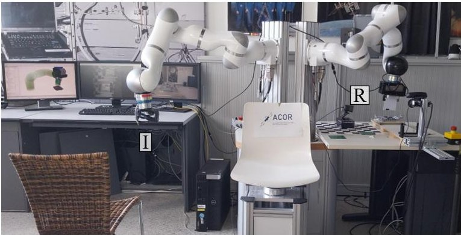

Fig. 5: Setup of the teleoperation station with haptic input device I on the left and remote robot on the right R.

The teleoperation station on the left side of Fig. 5 is comprised of a robot arm with which the human operator interacts with the system and receives force feedback. Footpedals allow the operator to enable the robot, change between operation modes and grasp and release parts. A head mounted display transmits a camera stream from the remote side and overlays this with information from the VFs [40].

The robotic workcell on the right side of Fig. 5 contains a subset of the in-orbit factory setup which should later be deployed to space. It consists of a robotic arm with gripper to grasp subsystem PCBs as well as structural elements of the CubeSat to be assembled. A holder locks the backplane in place into which individual subsystems as well as structural elements are assembled. Holder elements contain the subsystems and structural parts available for assembly.

The most challenging task of the teleoperation process is to perform subsystem assembly requiring a position tolerance of less than $ \pm0. 7 $ mm as well as an angular tolerance of less than $ 2^{\circ} $ around the long axis and less than $ 4^{\circ} $ around the short axis $ ^{\dagger\dagger} $ .

## 4.2 Probabilistic Virtual Fixtures

Virtual Fixtures (VFs) support a human operator in teleoperation by giving haptic feedback [3] through the computation of a Cartesian wrench $ w_{\mathrm{ee}} $ at the robot end effector which is then commanded to the robot through (1). They can for example keep the human out of forbidden regions or provide trajectory guidance [7].

Based on the insight that manipulation tasks can be split into different phases with different accuracy requirements [34], we employ VFs based on position and vision input. Our fixtures are based on the probabilistic formulation of [41] which is repeated here for completeness. This

<!-- PDF_PAGE: 8 -->

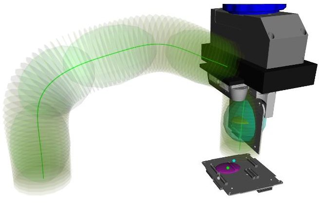

Fig. 6: Probabilistic Virtual Fixtures for the subsystem assembly task. The green line depicts the trajectory fixture which is based on Gaussians visualized by the green ellipsoids. The visual servoing fixture is shown in purple, the arbitration result can be seen as yellow ellipsoid inside the turquoise ellipsoid.

framework assumes that each VF $ j=1,\dots,P $ outputs a probabilistic wrench

$$
\boldsymbol {w} _ {\mathrm {V F}, j} \sim \mathcal {N} \left(\boldsymbol {\mu} _ {\mathrm {V F}, j}, \boldsymbol {\Sigma} _ {\mathrm {V F}, j}\right).
$$

Through the optimization

those individual wrenches are fused into a single wrench

$$
\hat {\boldsymbol {w}} _ {\mathrm {V F}} = \hat {\Sigma} _ {\mathrm {V F}} \sum_ {j = 1} ^ {P} \Sigma_ {\mathrm {V F}, j} ^ {- 1} \boldsymbol {w} _ {\mathrm {V F}, \mathrm {j}}, \quad \hat {\Sigma} _ {\mathrm {V F}} = \left(\sum_ {j = 1} ^ {P} \Sigma_ {\mathrm {V F}, j} ^ {- 1}\right) ^ {- 1}
$$

$$
\hat {\boldsymbol {w}} _ {\mathrm {V F}} = \arg \min _ {\boldsymbol {w} _ {\mathrm {V F}}} \sum_ {j = 1} ^ {P} \left(\boldsymbol {w} _ {\mathrm {V F}} - \boldsymbol {\mu} _ {\mathrm {V F}, j}\right) ^ {\top} \boldsymbol {\Sigma} _ {\mathrm {V F}, j} ^ {- 1} \left(\boldsymbol {w} _ {\mathrm {V F}} - \boldsymbol {\mu} _ {\mathrm {V F}, j}\right)
$$

to be applied to the robot's end effector. This probabilistic arbitration ensures that the most certain fixture has the most influence on the resulting wrench, thus discarding the contribution of uncertain VFs.

For all guiding tasks, we employ a position-based VF based on a Gaussian Mixture Model (GMM) trained from a dataset of pose trajectories $ \{t_{i},x_{i}\}_{i=1}^{N} $ yielding

$$
\left[ \begin{array}{c} t \\ \boldsymbol {x} ^ {\top} \end{array} \right] \sim \sum_ {m = 1} ^ {M _ {\mathrm {P B}}} \pi_ {m} \mathcal {N} \left(\left[ \begin{array}{c} t \\ \boldsymbol {x} ^ {\top} \end{array} \right] | \boldsymbol {\mu} _ {m}, \boldsymbol {\Sigma} _ {m}\right).
$$

Gaussian Mixture Regression (GMR) followed by a unimodal approximation allows to compute the conditional distribution of $ x_{\mathrm{P B}} $ given time

$$
p \left(\boldsymbol {x} _ {\mathrm {P B}} | t\right) = \mathcal {N} \left(\boldsymbol {x} _ {\mathrm {P B}} | \boldsymbol {\mu} _ {\mathrm {P B}}, \boldsymbol {\Sigma} _ {\mathrm {P B}}\right).
$$

To execute this position-based fixture, the current end effector pose of the robot is projected to the closest pose of

a linearly interpolated reference trajectory ranging from $ 0\leq t\leq 1 $ . The pose and covariance of this closest pose is then used as attractor pose $ x_{\mathrm{PB},i} $ of the fixture.

For the subsystem assembly task, a combination of such position-based trajectory fixture with a vision-based fixture is used (Fig. 6). Based on visual connector measurements, the attractor point $ x_{\mathrm{VS}} $ of the visual servoing fixture is calculated to

$$
p \left(\boldsymbol {x} _ {\mathrm {V S}} \mid \boldsymbol {x} _ {\mathrm {e e}}\right) = \sum_ {m = 1} ^ {M _ {\mathrm {V S}}} \hat {h} _ {m} \left(\boldsymbol {x} _ {\mathrm {e e}}, \boldsymbol {\mu} _ {m}\right) p _ {m} \left(\boldsymbol {x} _ {\mathrm {V S}} \mid \boldsymbol {x} _ {\mathrm {e e}}\right)
$$

where $ \hat{h}_{m} $ denotes a normalized influence function weighting the influence of each connector given the end effector pose. The reader is referred to [41] for details of this fixture formulation.

The target pose x of each fixture is then used in the impedance control law

$$
\boldsymbol {w} _ {\mathrm {V F}, j} = \boldsymbol {K} _ {\mathrm {V F}, j} \left(\boldsymbol {x} _ {\mathrm {V F}} - \boldsymbol {x} _ {\mathrm {e e}}\right).
$$

The final wrench, that is sent to the robot, is calculated through (4).

## 4.3 Virtual Fixture Adaptation

While the visual servoing fixture of [41] is based on visual detections and therefore automatically adapts based on visual input, the trajectory fixture (5) is learned once from data and is kept static afterwards. As task parameters such as grasping and plugging positions or obstacles in the workspace might change, such static behaviour may, however, be undesirable. We therefore propose to flexibilise the position-based fixture through 1) a task-parametrized approach [9] and 2) develop a method to adapt the fixture to go through user-selected via points which also allows to avoid obstacles through a two-step optimization process. Both methods are parametrized from the DPT (Section 5).

## 4.3.1 Task-parametrized Fixture

Task-parametrized models [9] encode motions in different coordinate systems. For the use case of our position-based trajectory fixture [41], we learn a GMM for both the PCB grasping pose as well as for the insertion pose by transforming demonstrations in the respective SE(3) coordinate frame. Through recording data for different combinations of those coordinate frames, one GMM encodes task properties for grasping the PCB while the other model encodes the insertion. For reproduction, these task coordinates can be adjusted to the actual grasping or insertion pose. After transforming the output of both models into a common coordinate frame, a Gaussian product, which formulates an optimization problem analogous to (3), allows to derive the solution minimizing

<!-- PDF_PAGE: 9 -->

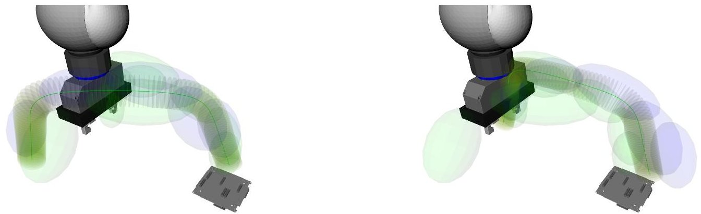

(1) Original task-parametrized trajectory not starting from the (2) Modified trajectory starting from the current end effector current end effector pose. pose.

Fig. 7: Trajectory adaptation using a task-parametrized model. Green ellipsoids depict the Gaussians for the insertion GMM while the grasping GMM is visualized with blue Gaussians. The resulting mean trajectory is shown in green with surrounding yellow ellipses visualizing the uncertainty perpendicular to the trajectory for every time step.

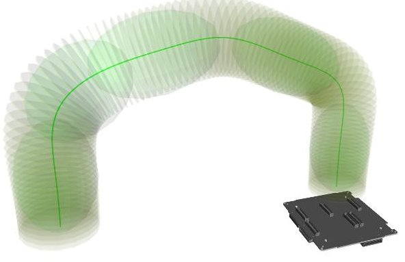

(1) Original trajectory.

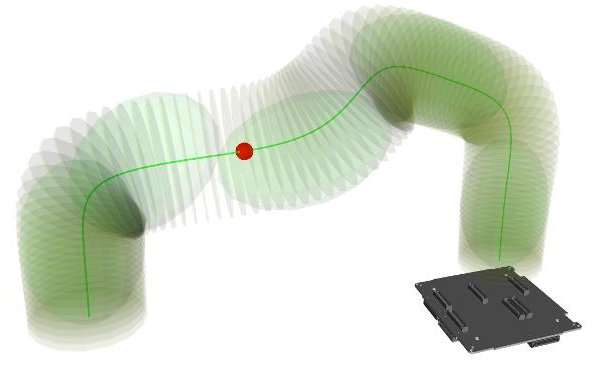

(2) Modified trajectory passing through the red via point.

Fig. 8: Trajectory adaptation for via points. Green ellipsoids depict the Gaussians for the underlying GMM, the resulting mean trajectory is shown in red with surrounding yellow ellipses visualizing the uncertainty perpendicular to the trajectory for every time step.

the covariance-weighted error terms taking both GMMs into consideration. Fig. 7 exemplarily shows how a taskparametrized model learned for the initial set of grasping and insertion poses can be modified and adapted to the actual grasping and insertion poses.

## 4.3.2 Fixture Manipulation

While task parametrization allows the modification of trajectories with respect to coordinate systems defined a priori, obstacles in task space might appear without previous explicit modeling. We design a two-step process to modify a trajectory to consider such obstacles: First, we create an inner optimization loop to make a trajectory pass through via points. Second, we create an outer optimization loop for finding the via points to modify a trajectory around obstacles while changing it as little as possible.

To make the trajectory pass through via points, we modify the means $ \mu_{m} $ in (5) using the Optuna black-box optimizer [19] with CMAES sampling [4], [5] and median pruning. This minimizes the cost function

$$
c = \alpha_ {\mu} \cdot d _ {\mu} + \alpha_ {\mathrm {t r a j}} \cdot d _ {\mathrm {t r a j}}
$$

that penalizes both the deviation $ d_{\mu} $ from the original means $ \mu_{m} $ as well as the distance of the optimized trajectory to the desired via points $ d_{\mathrm{traj}} $ . This enables the balance of routing through the via points while staying as close to the original trajectory as possible. Fig. 8 shows how an original trajectory can be modified with this method to pass through a desired via point. For external interfacing, we expose this functionality as links and nodes $ ^{+ + } $ service

<!-- PDF_PAGE: 10 -->

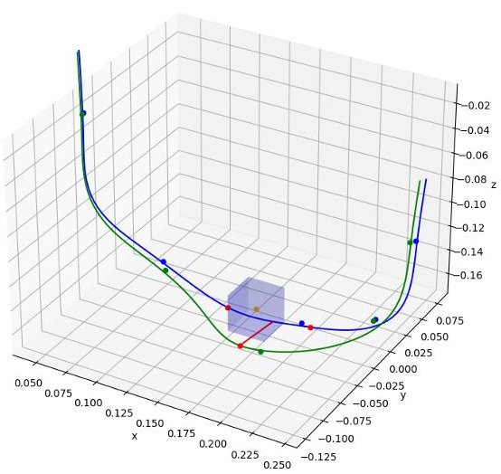

Fig. 9: Trajectory modification to pass around obstacles. The original trajectory (blue) is modified to pass around the obstacle (blue box), resulting in an optimized trajectory (green).

provider that can be called externally to modify the trajectory.

$$
c = \alpha_ {n} \cdot n + \alpha_ {\mathrm {l e n g t}} \cdot \frac {l _ {\mathrm {n e w}}}{l _ {\mathrm {o r g}}}
$$

For obstacle avoidance, we use an outer optimization loop generating possible via points. This outer optimization loop minimizes the cost function

which penalizes the number of trajectory points n that register a collision and the relative increase in trajectory length $ l_{\mathrm{new}}/l_{\mathrm{org}} $ . This, again, enables the balance of avoiding collisions while staying as close to the original trajectory as possible. New via points are sampled and then passed to the inner optimization loop. The result of such optimization can be seen in Fig. 9, where the trajectory is adapted to pass around a cube.

## 4.3.3 Integration with the DPT

The DPT is tasked to orchestrate the whole production process and as such also needs to be able to enable and modify fixtures. We have therefore exposed relevant functionality as Open Platform Communications Unified Architecture (OPC UA) services that can be called from the DPT.

## 5. Orchestration through the Digital Process Twin

The Digital Process Twin (DPT) is the high level decision-making authority of the In-Orbit Factory. It orchestrates the individual participants in the assembly process and maps the entire process virtually [32]. The application of the Digital Process Twin using AI methods has been analysed in [40]. Based on these findings, the DPT is now being further prepared for use in the in-orbit factory.

## 5.1 Modularisation and containerisation of the DPT

In order to make the use of the DPT more robust and to minimise potential overall system failures, the sub-areas of the developed structure of the DPT are modularised and containerised. This approach has been described by Plesker et al. [38]: The system structure of the DPT is broken down into the four core sub-areas, which have been identified as the most important in terms of their function and thematic affiliation. Container technology is used to isolate the modules from each other. This enables a more efficient distribution of computing resources, as the virtualisation allows computing resources to be distributed independently across different modules. Communication between the individual modules is implemented using a service-orientated architecture. Each module can act both as a server and as a client and can send and process requests. The individual requests are handled independently of the requesting client and each other. The container engine spans a network for communication in the DPT.

The standardisation of the modules and their abstraction from the hardware results in a more robust overall architecture, as the individual modules are independent of each other and can be selectively updated or replaced. The authors also propose the flexibilisation in the application-oriented modules and services. To achieve this, the rigid structure of the DPT in this area is dissolved and flexible service integration is proposed. Furthermore, services can be installed and uninstalled. This makes it possible to dynamically add mission-specific software that was developed at a later date to the in-orbit factory.

## 5.2 Standardised interaction between DPT and DTs

The DPT is also responsible for orchestrating the overall system and must therefore ensure a consistent connection to the system partners involved and their Digital Twins. Ensuring successful communication requires the provision of standardised interfaces and a bidirectional connection between the Physical and Digital Twin (DT) as well as the DPT. The approach utilised in this instance is the standard Open Platform Communications Unified Architecture (OPC UA), a key Industry 4.0 technology that enables the standardisation between the physical and dig-

<!-- PDF_PAGE: 11 -->

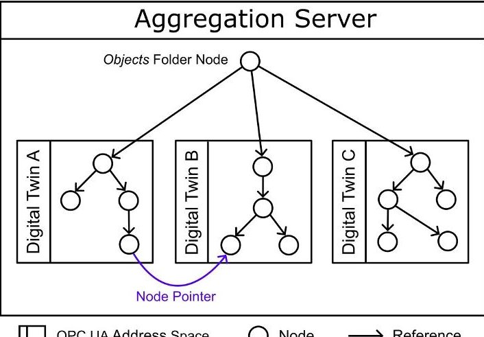

Fig. 10: OPC UA Aggregation Server

ital world [15]. OPC UA is a software standard that provides both a service-oriented architecture for communication and an information model for structuring and modelling the underlying data and capabilities. Each OPC UA server possesses an address space consisting of nodes that are interconnected by references [26].

This approach is now transferred to the orchestration of the DPT and the DTs as well as the Physical Twin. When the DTs operate their own OPC UA servers, these can be addressed in a standardised way by OPC UA clients and by extensions the DPT. Companion specifications exist for this purpose, they define the information model of the physical object which is represented and are known to all actors.

To facilitate the integration of the DTs into the DPT, it is advantageous to have the DTs be managed together in one unifying information model. In this case, objects in the different Digital Twins can be directly associated with the same types, allowing the semantics created by standardisation to unfold their full advantage. In order to achieve this integration, the OPC UA address spaces of the DTs are combined into a single address space using an OPC UA aggregation server [8], as can be seen in Fig. 10. This leads to a significant simplification of networking, as each service of the DPT only needs to know the address of the aggregation server and connect to it in order to access all Digital Twins, their data, functions and services. This also creates an overall information model of the DT network. This system integration proves to be indispensable at the latest when embedding the DPT in the wider context of the Industry 4.0 infrastructure.

In general, when accessing a DT using the aggregation server, the OPC UA request is read by the aggregation server and then relayed to the underlying DT OPC UA server. The response is returned by the aggregation server

to the requesting client. The aggregation server thus acts like a proxy. By connecting their clients to the aggregation server, the DTs themselves are able access each other.

In order to fully exploit the potential benefits of a unified address space, the DPT needs the ability to relate nodes from different DTs to each other during run time. This way, the DTs can use OPC UA services to interact with specific parts of other DTs or the DPT without prior knowledge of where these parts exist in the address space. A system is therefore developed where a DT can create "sockets" in their OPC UA address space that specify the type of the node they need access to. Other nodes can be "plugged into" these sockets. The node sockets provide the DT the ability to wait for a pointer to a valid external node that provides information or functionalities. This way, the DTs can be linked in various ways with each other and the DPT.

Since variable nodes can store NodeIds, which are unique in the unified address space, these nodes can act as pointers to other nodes. This is also illustrated in Fig. 10. OPC UA references are not suitable for this task, since the nodes referenced might not lie in the local OPC UA address space of the DT, preventing the creation of such references in the DT locally. In order to include type information of the target node, a new OPC UA object type defining the node socket is created, that includes a node pointer, the type and for variable nodes the datatype of the node to be connected.

The approach described here allows the data points and functions of the DT and its Physical Twin to be linked with the programs and functions of the DPT. Through suitable coordination, function chains and processes can be programmed in a simple and standardised way. The concept also contributes to the flexible development of services and models that can be used in the DPT, as described in more detail in Section 5.1.

## 5.3 FDIR via the Digital Process Twin

To make the in-orbit factory more robust, in addition to standardisation, recovery from fault conditions is also being considered. The recovery was divided into three subareas, which correspond to the FDIR principle (fault detection, fault isolation and recovery techniques). The initial stage of the recovery is the detection of faults. Once a fault has been identified, the system initiates the appropriate first responses and notifies the DPT. The details of the fault are then relayed to the second area the recovery it self, who utilise the stored troubleshooting logic to assess the problem and identify a solution. It is crucial to comprehend the nature of the fault in order to accurately diagnose it and implement the most effective corrective action. For this it is essential that the DPT has a comprehensive under-

<!-- PDF_PAGE: 12 -->

standing of the assembly process and the necessary access to the relevant information. This is done by the third area the fault isolation.

In the DPT the process is mapped virtually, which is done using the concept of feature-based working. A three-layer system is employed for the modelling of the assembly process in the in-orbit factory. The complete assembly of a CubeSat, from production to completion, is referred to as a "process" and represents the highest level of assembly. A process is self-contained and may be executed on an unlimited number of occasions in succession, provided that the requisite resources are available. The subprocesses, which are referred to as "tasks", are listed in the subsequent level of the hierarchy. A task is defined as the installation of a single component. The starting and end points of the tasks are identical and form a self-contained unit. This guarantees that any installation can be completed and that a consistent starting position is always maintained. The completion of tasks necessitates the presence of so-called "skills" at the lowest level. Skills are discrete, individual programs or instructions that represent the individual steps performed by the assembly robot. A skill is defined in the DT and can be accessed by the DPT. A sequence of skills then forms a task, which in turn can be summarized under the process shown in Fig. 11.

The individual elements are implemented as OPC UA programs in all three stages, thus ensuring the consistent and seamless adoption and continuation of the standardised communication of the DPT. An OPC UA program comprises a state machine with four states: 'Halted', 'Ready', 'Running' and 'Suspended'. Upon transitioning to the 'Running' state, the steps anchored in the program are initiated. This mapping enables the fault isolation to ascertain which process, task and skill is currently being executed at any given point during the production process. This is of paramount importance for the formulation of recovery strategies in the event of an error. The classification and rectification of errors can be achieved by the recovery system based on the information pertaining to the attempted assembly step of the satellite, the parties involved, and the error information itself. This process can be defined by the developers of the in-orbit factory using logic trees, thus enabling the error to be rectified autonomously. Alternatively, other AI tools, such as neural networks, can be utilised to respond in a dynamic manner to errors based on the information provided.

## 5.4 Optimisation of the assembly process

Digital Processtwin

The subsequent phase of the process is to identify and learn from any faults that may have occurred. To achieve an optimised assembly process, the robotic arm uses experience-based trajectories, where the experience

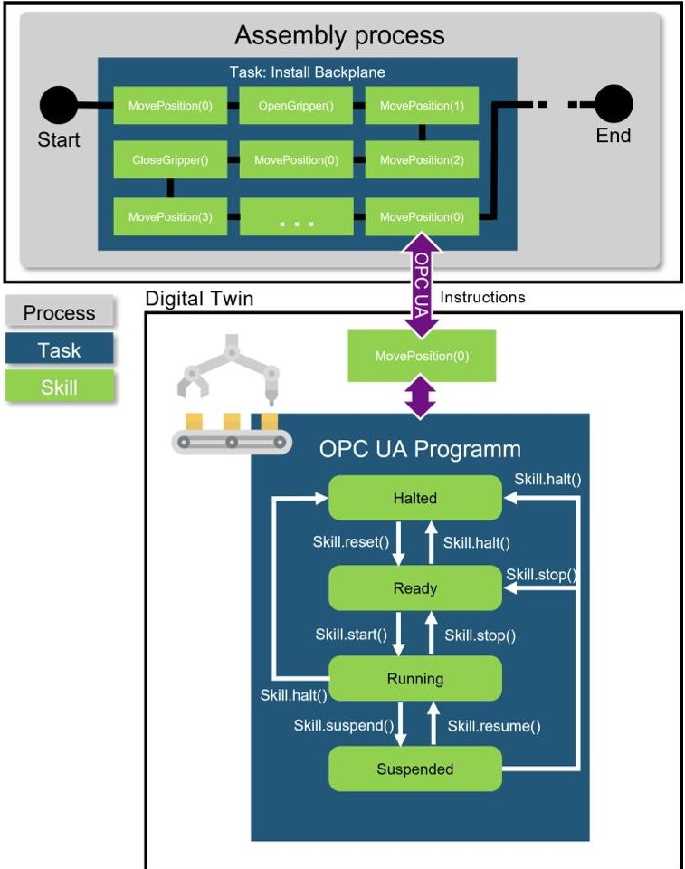

Fig. 11: Virtual mapping of the assembly process in the dpt

is stored in the discretised virtual representation of the workspace. Experience-based motion planning enables the robotic arm to reduce its susceptibility to errors like collisions, Inaccuracies due to bearing play and slipping gears. This framework further enhances the overall accuracy of the robotic arm's movements. Generally, motion planning can be divided into two categories. Those where the environment is unknown and must be explored, and those where the environment is known and already exists in a virtual representation. Motion planning, where the environment is known, comes down to a minimization problem with one or multiple parameters. Different methods have been developed to formulate and solve this optimization problem. Particularly noteworthy is the Potential Field Method by Khatib [1]. In this method, the map is replaced by a potential field where obstacles exert a repulsive force, and the target exerts an attractive force on the robot. The optimal trajectory is found by minimizing the total potential energy of the robotic arm. In the case of the Space Factory, the environment already exists in a virtual form. To implement experience-based trajectory planning, the map is enhanced with the experiences

<!-- PDF_PAGE: 13 -->

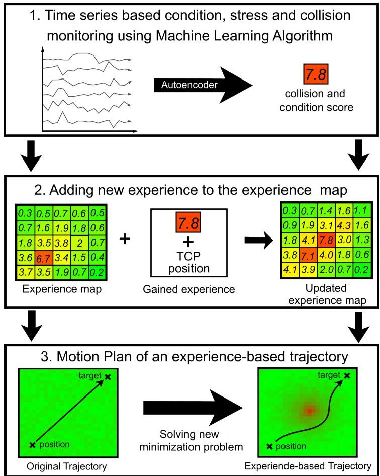

Fig. 12: Three-step approach for experience-based motion planning, visualized on a two-dimensional experience map

of the robotic arm. This guarantees that the minimisation principle of the motion planning remains straightforward and can be resolved through the utilisation of a variety of methods. For this purpose, each voxel in the workspace is assigned an experience-based value, whereby a high value represents a poor experience, and a low value represents a good experience. For the potential field method, this would mean that poor experience values are represented by a high repulsive force. The experience added to the map relies on time series data from the robotic arm, encompassing servomotor voltages, speed, and both the target and actual positions of the TCP. The time series data is analysed using Machine Learning to identify possible collisions and unfavourable load and operating conditions. Derived from the results, each voxel traversed by the TCP is assigned a score. Based on the experience values derived from time series data, it is possible to infer the experience values in the surrounding voxels through interpolation. The derived methodology can be summarized in three steps, as illustrated in Fig. 12. The enrichment of the map with experiences enables the formulation of the environment and the experience in one condition, which simplifies the minimization problem. It can be posited that the storage of experience-based information in a discretised workspace is an independent process, irrespective of the methodology employed for experience extraction and the trajectory planning. The analysis of time series data is based on the premise that distinct load conditions can be discerned from the data set. Identifying anomalies in time series data is critical task across different industries. As it is inherently difficult to predict all potential states in advance, unsupervised learning methodologies are particularly well suited to the detection of anomalies in time series data. In the field of unsupervised learning autoencoder have become a prevalent tool [39]. An Autoencoder (AE) is a feed-forward neural network where the output is nearly identical to the input. AEs are constituted by an encoder and a decoder, whereby the encoder dimensionally reduces the input data to a latent representation, and the decoder reconstructs the data based on the latent presentation. Since an AE is trained by the reconstruction error it learns the behavior of the training dataset. A deviation of input data form training dataset due to anomalies or other changes will result in a large reconstruction error [37]. As a result, autoencoders are well suited to the detection of anomalies in time series data [13]. In order to improve the detection of anomalies in sequential and high-frequency time series data, autoencoders based on recurrent layers were developed. An successful architecture is the LSTM-based Encoder-Decoder. It combines Long Short-Term Memory (LSTM) ([12]) Networks, which stores information from previous sequences, with an Autoencoder to better understand the behavior across sequences over time. [13]

## 6. Conclusion and Outlook

This paper has outlined the integration of failure tolerant and recovery methods into the in-orbit assembly, integration and testing process of small satellites. The AIT process was extended with FDIR supervision, making the autonomous procedure even more robust by not only detecting faults, but also providing direct robot-based recovery options for feasible errors. This will not only help securing the assembly process itself, but also increase reliability of the produced satellite by rigorously inspecting it already during production. Through probabilistic VFs, the teleoperation process reaches a new level of failure tolerance. Novel methods to modify the trajectory fixture allow to adapt to various task situations. This is complemented by the DPT. The structure of the DPT underwent a significant enhancement, becoming more robust and fault-tolerant. Furthermore, the interfaces with all system participants were optimised, enabling their seamless

<!-- PDF_PAGE: 14 -->

integration for in-orbit use. The assembly process was then mapped virtually to create a basis for FDIR. This now enables automated recovery of errors, which is essential for in-orbit production. Finally, anomalies are recognised in the DPT and stored spatially as experiences in voxels which enables the optimised operation of the robot arm in the long term. Next steps include both testing algorithms developed for this in-orbit factory in space conditions as well as a tight integration of the factory components on a single demonstrator using a space-grade robotic arm. This allows for the vision of a cost-effective in-orbit evaluation of the whole factory process.

## Author Contributions

MM wrote Sections 1,2,4 and 6 and contributed to the abstract. FL wrote Section 3 and contributed to the abstract, Sections 1,2 and 6 CP wrote Sections 5,5.1 and 5.3 and contributed to the abstract, Sections 1,2 and 6. LW, AG, JS, TH, FS contributed to Section 4. JV wrote Section 5.4. RK wrote Section 5.2. KS contributed to Section 3. BS contributed to Section 5. AAS contributed to Section 4.

## Acknowledgement

The results presented in this work were achieved within the framework of the ACOR project funded by the Federal Ministry for Economic Affairs and Climate Action (BMWK) under project numbers 50RP2240A-C.

## References

[1] O. Khatib, "Real-time obstacle avoidance for manipulators and mobile robots," in Proceedings. 1985 IEEE International Conference on Robotics and Automation, vol. 2, 1985, pp. 500-505. DOI: 10.1109/ROBOT.1985.1087247.

[2] ——, "A unified approach for motion and force control of robot manipulators: The operational space formulation," IEEE Journal on Robotics and Automation, vol. 3, no. 1, pp. 43-53, Feb. 1987, ISSN: 0882-4967. DOI: 10.1109/jra.1987.1087068.

[3] L. B. Rosenberg, "Virtual fixtures: Perceptual tools for telerobotic manipulation," in Proceedings of IEEE virtual reality annual international symposium, IEEE, 1993, pp. 76-82.

[4] N. Hansen, A. Ostermeier, and A. Gawelczyk, "On the adaptation of arbitrary normal mutation distributions in evolution strategies: The generating set adaptation.," in ICGA, 1995, pp. 57-64.

[5] N. Hansen and A. Ostermeier, "Adapting arbitrary normal mutation distributions in evolution strategies: The covariance matrix adaptation," in Proceedings of IEEE International Conference on Evolutionary Computation, ser. ICEC-96, IEEE, 1996. DOI: 10.1109/icec.1996.542381.

[6] T. Hulin, K. Hertkorn, P. Kremer, S. Schatzle, J. Artigas, M. Sagardia, F. Zacharias, and C. Preusche, "The DLR bimanual haptic device with optimized workspace," in 2011 IEEE International Conference on Robotics and Automation, IEEE, 2011, pp. 3441-3442.

[7] S. A. Bowyer, B. L. Davies, and F. R. y Baena, "Active constraints/virtual fixtures: A survey," IEEE Transactions on Robotics, vol. 30, no. 1, pp. 138157, 2013.

[8] D. Großmann, M. Bregulla, S. Banerjee, D. Schulz, and R. Braun, "OPC UA server aggregation the foundation for an internet of portals," in Proceedings of the 2014 IEEE Emerging Technology and Factory Automation (ETFA), ISSN: 1946-0759, Sep. 2014, pp. 1-6. DOI: 10.1109/ETFA.2014.7005354.

[9] S. Calinon, "A tutorial on task-parameterized movement learning and retrieval," Intelligent Service Robotics, vol. 9, no. 1, pp. 1-29, Sep. 2015. DOI: 10.1007/s11370-015-0187-9.

[10] A. R. Graham and J. Kingston, "Assessment of the commercial viability of selected options for on-orbit servicing (oos)," Acta Astronautica, vol. 117, pp. 38-48, 2015, ISSN: 0094-5765. DOI: 10. 1016/j.actaastro.2015.07.023.

[11] M. Kortmann, A. Dafnis, T. A. Schervan, H. G. Schmidt, S. Rühl, and J. Weise, "Building BlockBased "iBOSS" Approach: Fully Modular Systems with Standard Interface to Enhance Future Satellites," in [66rd International Astronautical Congress, IAC-15, 12.10.2015-16.10.2015, Jerusalem, Israel], 66. International Astronautical Congress, Jerusalem (Israel), 12 Oct 2015 - 16 Oct 2015, Oct. 12, 2015.

[12] P. Malhotra, L. Vig, G. Shroff, and P. Agarwal, "Long short term memory networks for anomaly detection in time series," Apr. 2015.

<!-- PDF_PAGE: 15 -->

[13] P. Malhotra, A. Ramakrishnan, G. Anand, L. Vig, P. Agarwal, and G. Shroff, "Lstm-based encoder-decoder for multi-sensor anomaly detection," CoRR, vol. abs/1607.00148, 2016. arXiv: 1607.00148.

[14] C. Nogales, A. Ewing, G. Johnson, B. Grim, M. Kamstra, et al., "Makersat: A cubesat designed for in-space assembly," 2017.

[15] F. Pethig, S. Schriegel, A. Maier, J. Otto, S. Windmann, B. Böttcher, O. Niggemann, and J. Jasperneite, "Industrie 4.0 communication guideline based on opc ua," VDMA Guideline, 2017.

[16] A. Beyer, G. Grunwald, M. Heumos, M. Schedl, R. Bayer, W. Bertleff, B. Brunner, R. Burger, J. Butterfaß, R. Gruber, T. Gumpert, F. Hacker, E. Krämer, M. Maier, S. Moser, J. Reill, M. A. Roa Garzon, H.-J. Sedlmayr, N. Seitz, M. Stelzer, A. Stemmer, G. Tubio Manteiga, T. Wimmer, M. Grebenstein, C. Ott, and A. O. Albu-Schäffer, "Caesar: Space robotics technology for assembly maintenance, and repair," in Proceedings of the International Astronautical Congress, IAC, Oct. 2018.

[17] M. N. Sweeting, "Modern small satellites-changing the economics of space," Proceedings of the IEEE, vol. 106, no. 3, pp. 343-361, 2018. DOI: 10.1109/JPROC.2018.2806218.

[18] T. Weber Martins, A. Pereira, T. Hulin, O. Ruf, S. Kugler, A. Giordano, R. Balachandrand, F. Benedikt, J. Lewis, R. Anderl, et al., "Space factory 4.0-new processes for the robotic assembly of modular satellites on an in-orbit platform based on "industrie 4.0" approach," in Proceedings of the International Astronautical Congress, IAC, 2018.

[19] T. Akiba, S. Sano, T. Yanase, T. Ohta, and M. Koyama, "Optuna: A next-generation hyperparameter optimization framework," in Proceedings of the 25th ACM SIGKDD International Conference on Knowledge Discovery and Data Mining, 2019.

[20] P. Letier, X. T. Yan, M. Deremetz, A. Bianco, G. Grunwald, M. Roa, R. Krenn, M. M. Arancón, P. Dissaux, J. S. G. Casarrubios, R. R. Lucini, L. D. Filippis, G. Porcelluzzi, M. Post, M. Walshe, and P. Perryman, "Mosar : Modular spacecraft assembly and reconfiguration demonstrator," in 15th Symposium on Advanced Space Technologies in Robotics and Automation, NLD, May 2019.

[21] E. Mack, Spacex looks to rule space with 30,000 more satellites, Accessed on June 18, 2024, 2019. [Online]. Available: https://www.cnet.com/science/spacex-looks-to-rule-space-with-30000-more-satellites/.

[22] M. Maier, M. Chalon, M. Pfanne, R. Bayer, M. M. Mascarenhas, H.-J. Sedlmayr, and A. L. Shu, "Tina: Small torque controlled robotic arm for exploration and small satellites," in Proceedings of the International Astronautical Congress, IAC, 2019.

[23] M. Rognant, C. Cumer, J.-M. Biannic, M. A. Roa, A. Verhaeghe, and V. Bissonnette, "Autonomous assembly of large structures in space: A technology review," EUCASS 2019, 2019.

[24] T. Villela, C. A. Costa, A. M. Brandao, F. T. Bueno, and R. Leonardi, "Towards the thousandth cubesat: A statistical overview," International Journal of Aerospace Engineering, vol. 2019, no. 1, p. 5063145, 2019. DOI: 10.1155/2019/5063145.

[25] B. Campbell, C. Nogales, B. Grim, M. Kamstra, J. Griffin, and S. Parke, "On-orbit polymer degradation results from makersat-1: First satellite designed to be additively manufactured in space," 2020.

[26] IEC TR 62541-1, OPC unified architecture - part 1: Overview and concepts, version 3.0, Nov. 18, 2020.

[27] M. McFall-Johnsen, About 1 in 40 of spacex's starlink satellites may have failed. that's not too bad, but across a 42,000-spacecraft constellation it could spark a crisis. Accessed on June 18, 2024, 2020. [Online]. Available: https://www. businessinsider .com/spacex-starlink internet-satellites-percent-failure rate-space-debris-risk-2020-10.

[28] N. T. Redd, "Bringing satellites back from the dead: Mission extension vehicles give defunct spacecraft a new lease on life-[news]," IEEE Spectrum, vol. 57, no. 8, pp. 6-7, 2020.

[29] E. Uzo-Okoro, D. Erkel, P. Manandhar, M. Dahl, E. Kiley, K. Cahoy, and O. L. De Weck, "Optimization of on-orbit robotic assembly of small satellites," in ASCEND 2020, 2020, p. 4195.

[30] E. Uzo-Okoro, C. Haughwout, E. Kiley, M. Dahl, and K. Cahoy, "Ground-based 1u cubesat robotic assembly demonstration," 2020.

<!-- PDF_PAGE: 16 -->

[31] T. Hulin, M. Panzirsch, H. Singh, R. Balachandran, A. Coelho, A. Pereira, B. M. Weber, N. Bechtel, C. Riecke, B. Brunner, et al., "Model-augmented haptic telemanipulation: Concept, retrospective overview and current use-cases," Frontiers in Robotics and AI, vol. 8, p. 76, 2021.

[32] F. Kempf, M. S. Mühlbauer, T. Dasbach, F. Leutert, T. Hulin, R. Radhakrishna Balachandran, M. Wende, R. Anderl, K. Schilling, and A. O. Albu-Schäffer, "AI-In-Orbit-Factory - AI approaches for adaptive robotic in-orbit manufacturing of modular satellites," in Proceedings of the International Astronautical Congress, IAC, 2021.

[33] Y. Liu, Y. Zhao, C. Tan, H. Liu, and Y. Liu, "Economic value analysis of on-orbit servicing for geosynchronous communication satellites," Acta Astronautica, vol. 180, pp. 176-188, 2021, ISSN: 0094-5765. DOI: 10.1016/j.actaastro.2020.11.040.

[34] M. Mühlbauer, F. Steinmetz, F. Stulp, T. Hulin, and A. Albu-Schäffer, "Multi-phase multi-modal haptic teleoperation," in 2022 IEEE/RSJ International Conference on Intelligent Robots and Systems (IROS), 2022, pp. 7734-7741. DOI: 10.1109/IROS47612.2022.9981525.

[35] M. A. Roa Garzon, C. Koch, M. Rognant, A. Ummel, P. Letier, A. Turetta, P. Lopez, S. Trinh, I. V. Rodriguez Brena, K. Nottensteiner, J. Rouvinet, V. Bissonnette, G. Grunwald, and T. Germa, "Pulsar: Testing the technologies for on-orbit assembly of a large telescope," in 16th Symposium on Advanced Space Technologies in Robotics and Automation, ASTRA 2022, ESA, Jun. 2022.

[36] E. E. Uzo-Okoro, "Robots making satellites: Advancing in-space manufacturing through onorbit robotic assembly," Ph.D. dissertation, Massachusetts Institute of Technology, 2022.

[37] S. Cancemi, R. Lo Frano, C. Santus, and T. Inoue, "Unsupervised anomaly detection in pressurized water reactor digital twins using autoencoder neural networks," Nuclear Engineering and Design, vol. 413, p. 112502, 2023, ISSN: 0029-5493. DOI: 10.1016/j.nucengdes.2023.112502.

[38] Christian Plesker, Vladimir Kutscher, Robert Knobloch, Benjamin Schleich, "Modularisation and containerisation of the digital process twin," 56th CIRP Conference on Manufacturing Systems, 2023.

[39] K. Berahmand, F. Daneshfar, E. Salehi, Y. Li, and Y. Xu, "Autoencoders and their applications in machine learning: A survey," Artificial Intelligence Review, vol. 57, Feb. 2024. DOI: 10.1007/s10462-023-10662-6.

[40] F. Leutert, D. Bohlig, F. Kempf, K. Schilling, M. Mühlbauer, B. Ayan, T. Hulin, F. Stulp, A. Albu-Schäffer, V. Kutscher, C. Plesker, T. Dasbach, S. Damm, R. Anderl, and B. Schleich, "Ai-enabled cyber-physical in-orbit factory - ai approaches based on digital twin technology for robotic small satellite production," Acta Astronautica, vol. 217, pp. 1- 17, 2024, ISSN: 0094-5765. DOI: 10.1016/j.actaastro.2024.01.019.

[41] M. Mühlbauer, T. Hulin, B. Weber, S. Calinon, F. Stulp, A. Albu-Schäffer, and J. Silvério, "A probabilistic approach to multi-modal adaptive virtual fixtures," IEEE Robotics and Automation Letters, vol. 9, no. 6, pp. 5298-5305, 2024. DOI: 10.1109/LRA.2024.3384759.

[42] M. A. Roa, A. Beyer, I. Rodríguez, M. Stelzer, M. de Stefano, J.-P. Lutze, H. Mishra, F. Elhardt, G. Grunwald, V. Dubanchet, H. Renault, F. Niemeijer, C. Jacopini, P. Atinsounon, S. Behar-Lafenetre, J. A. Béjar-Romero, S. Torralbo-Dezainde, M. Alonso-Alonso, A. Jakubiec, L. Kozłowski, A. Lukasiak, A. Merlo, M. Lapolla, and K. N. Gregertsen, "Eross: In-orbit demonstration of european robotic orbital support services," in 2024 IEEE Aerospace Conference, 2024, pp. 1-9. DOI: 10. 1109/AER058975.2024.10521010.

[43] J. Zhang, C. Wang, H. Xing, and J. Guo, "Cubesat standardized modular assembly method and design optimization," Acta Astronautica, vol. 216, pp. 370-380, 2024, ISSN: 0094-5765. DOI: 10.1016/j.actaastro.2024.01.011.