<!-- PDF_PAGE: 1 -->

75th International Astronautical Congress (IAC), Milan, Italy, 14-18 October 2024. Copyright 2024 by KISPE Space Systems Limited. Published by the IAF, with permission and released to the IAF to publish in all forms.

IAC-24-D1.5.10

Applying Model Based Systems Engineering (MBSE) to platform concept development: The Good, The Bad and The Ugly

Vicky Anderson $ ^{a \star} $ , John Paffett $ ^{a} $

$ ^{a} $ KISPE Space Systems Limited, Cody Technology Park, Farnborough, Hampshire, United Kingdom $ ^{*} $ Corresponding Author

## Abstract

All satellite developments start with a need and nominally this is quite specific, for example, a desire to obtain images of the Earth to allow fire detection, or to collect sensor data from remote geographical locations to pass onto users. But what do you do when you want to design a platform that will service many different needs, some of which have conflicting requirements and a whole host of different stakeholders? This was the problem that presented itself at the onset of the development of the Next Generation Microsatellite Platform (NGMP). The NGMP is intended to shift the paradigm and inject disruption into the small satellite market through the development of a performant platform at the price point of a CubeSat. The goal of this transformation is to open up new markets and opportunities and allow business cases to close, in an ever more competitive environment. This development was also framed by wanting to promote the responsible and sustainable use of space. This is an interesting case study for the use of Model Based Systems Engineering (MBSE) as there was a lot of information to process, stakeholders to consider and constraints to manage. This paper will reflect upon the systems thinking and MBSE approaches that were taken by the team to explore the problem space and the stakeholder concerns. It will also explore how the result of this was developed into a platform concept, with examples provided from across the different stages of the modelling. There are a number of positive outcomes from this approach which will be discussed in more detail, for example, how it helped in getting the team aligned and agreeing a shared ontology. There have also been challenges in orchestrating this approach, which will also be covered, for example, transitioning teams from 'traditional' approaches to MBSE approaches and tackling model-based reviews, rather than document-centric reviews. The paper concludes with a view on where perhaps the MBSE landscape needs to progress to, in order to provide greater and more accessible utility, as well as a glimpse into how MBSE techniques are to be employed through the NGMP lifecycle and generational development.

Keywords: MBSE, Open Source, SmallSats, Microsatellites, Systems Thinking

<table border="1"><tr><td colspan="2">Acronyms/Abbreviations</td></tr><tr><td>Critical Design Review</td><td>CDR</td></tr><tr><td>Concept of Operations</td><td>CONOPs</td></tr><tr><td>Commercial Off The Shelf</td><td>COTS</td></tr><tr><td>Design Justification File</td><td>DJF</td></tr><tr><td>Environment</td><td>E</td></tr><tr><td>Engineering Model</td><td>EM</td></tr><tr><td>European Space Agency</td><td>ESA</td></tr><tr><td>Flight Model</td><td>FM</td></tr><tr><td>Flight Readiness Review</td><td>FRR</td></tr><tr><td>Geostationary Earth Orbit</td><td>GEO</td></tr><tr><td>Internet of Things</td><td>IoT</td></tr><tr><td>Integrated Platform Avionics</td><td>IPA</td></tr><tr><td>Low Earth Orbit</td><td>LEO</td></tr><tr><td>Model Based Systems Engineering</td><td>MBSE</td></tr><tr><td>Model-Based for System Engineering</td><td>MB4SE</td></tr><tr><td>Next Generation Microsatellite Platform</td><td>NGMP</td></tr><tr><td>Non-Recurring Engineering</td><td>NRE</td></tr><tr><td>Open Source Satellite</td><td>OSSAT</td></tr><tr><td>Preliminary Design Review</td><td>PDR</td></tr><tr><td>Recurrent Engineering</td><td>RE</td></tr></table>

<table border="1"><tr><td>Return on Investment</td><td>ROI</td></tr><tr><td>System of Interest</td><td>SOI</td></tr><tr><td>System Requirements Review</td><td>SRR</td></tr><tr><td>Telemetry, Tracking and Command</td><td>TT&amp;C</td></tr><tr><td>Venture Capital</td><td>VC</td></tr><tr><td>Wider Environment</td><td>WE</td></tr><tr><td>Wider System of Interest</td><td>WSOI</td></tr></table>

## 1. Introduction

Space has been through a few major transformations over the last few decades, which have improved accessibility, reduced the price point for entry and resulted in a landscape that looks very different from the first tentative steps almost seventy years ago. Despite these transformations, space is still expensive. There are still numerous business cases that cannot be closed since cost is still a barrier to entry. This issue prompted KISPE to identify a gap in the market, the generation of a performant platform at the price point of a CubeSat, intended to act as the next transformation in the space industry.

<!-- PDF_PAGE: 2 -->

An exploration of the current space market and the need for change is provided, with an exploration of the solution that KISPE envisages is needed.

A summary of the why Model Based Systems Engineering (MBSE) and Systems Thinking techniques were employed to explore the problem space that KISPE had identified is discussed. Examples of outcomes from this work are provided along with a commentary on the various perceived strengths and weaknesses of the approaches.

A perspective on the challenges that the KISPE team faced as well as the wider issues around the implementation of MBSE within the space domain are proposed.

The next steps for the use of MBSE alongside the NGMP development work will be covered, with a focus on the generational / product line roadmap. This commentary is concluded by providing a summary of the MBSE state of play.

## 2. Current and Changing Space Market

Space is an integral part of our day to day life on Earth. Its vantage point is used to provide global communications, collate atmospheric information to inform our weather, track ships and aircraft, and much much more. Some of these applications wouldn't have been conceivable in the 1950s when the first forays into launching satellites into the Earth's orbit were undertaken.

Space started out as the preserve of the large, 'traditional' institutional players. The substantial barrier to the successful introduction of a more diverse range of stakeholders was cost. This barrier was significantly reduced, when in the 1980s, novel approaches for the time were applied - the use of Commercial Off The Shelf (COTS) parts and processes. Being able to use parts and processes that were inherently designed for manufacturing at scale, such as for the automotive industry, rather than those traditionally made in low volume just for the space industry, significantly reduced the relative cost. This opened up the SmallSat market.

A further disruption to the space market was driven by the advent of CubeSats in the early 2000s. The CubeSat was driven out of academia and are typically smaller and lighter than their SmallSat counterparts. One of the key design elements of a CubeSat is its form factor. There is a prescriptive standard which denotes the physical attributes of the CubeSat, which provides some positives such as the standardisation of equipment which has helped reduce the price point but also constrains the scope of what can be undertaken. For example, a CubeSat of a certain form factor has to provide a certain amount of internal volume to the platform elements - these are the aspects that power, control and orient the satellite. The remaining volume

and aperture is then available to the payload. The limitation on payload envelope means that certain applications and payloads cannot be accommodated. Nevertheless, CubeSats have created a market for small light satellites, at a cost that is unachievable for the SmallSat class satellites.

Despite these changes in the space market, money and financing still features as a barrier to closing business cases. A business venture needs to have sufficient funding to not only develop and procure the satellite, but operate said satellite until it can generate revenue which will then, hopefully, pay for the satellite upkeep whilst also generating profit. Figure 1 illustrates this cost / time profile.

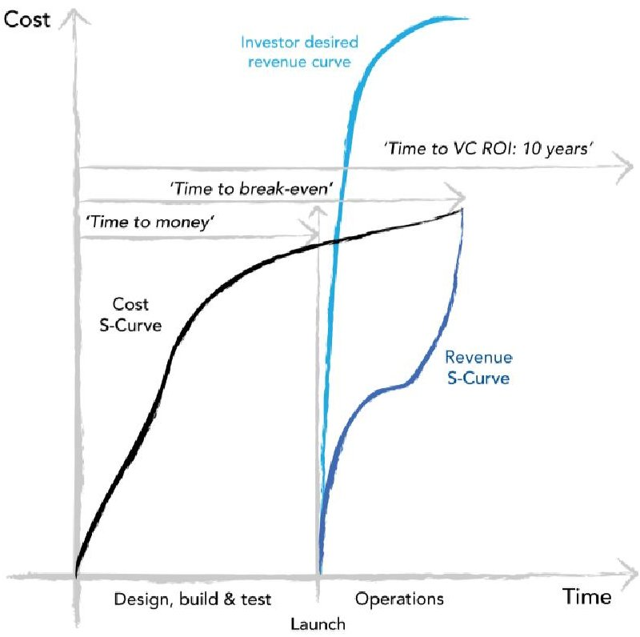

Figure 1: Satellite Cost / Time Profile

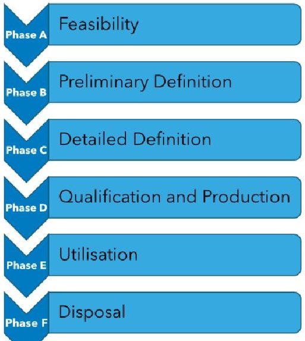

Figure 2: Example Lifecycle

<!-- PDF_PAGE: 3 -->

Within satellite development there is a lot of Non- Recurring Engineering (NRE) and Recurring Engineering (RE) costs across the lifecycle - an example standard lifecycle is shown in Figure 2. It shows the standard terms used by the European Space Agency (ESA) [1][2].

Different organisations, institutes and domains use slightly different terms to describe the lifecycle but inherently they all have a standard set of key activities. Throughout this paper, the terms identified in Figure 2 will be used; the following is a definition of what is covered by each stage:

- Phase A - Feasibility

- This phase identifies the needs that the mission is to satisfy.

It is also the point where a decision is made as to whether the mission is feasible, considering technical, commercial and programmatic aspects.

The close out of this phase is a System Requirements Review (SRR). This review is to determine whether the top level system requirements have been developed and are understood and agreed by all parties.

o It is important that this phase involves all stakeholders associated with the system.

- Phase B - Preliminary Definition

- This phase takes the output from Phase A and refines the concept and further iterates the requirement sets.

O It ends with a Preliminary Design Review (PDR) which is a presentation of the top level design, specification, requirements and the associated programmatic aspects.

- Phase C - Detailed Definition

Within this phase, the design work on each of the systems and subsystems is conducted Associated testing is also carried out.

o The gate for this phase is the Critical Design Review (CDR) which is the formal check that the design will meet the requirements and provides the green light to enter production.

- Phase D - Qualification and Production

- This phase is where the manufacturing of units takes place. There might be incremental builds, where Engineering Models (EMs) are built and qualified before progressing to the Flight Model (FM) builds.

Environmental testing is also undertaken in this phase, including vibration testing thermal vacuum testing, electromagnetic testing, acoustics and mass properties.

System level testing of the entire set up is carried out and this concludes in a Flight Readiness Review (FRR) Board. This is the

gate for approval for shipment to the launch site.

- Phase E - Utilisation

- This phase, as the name suggests, is the actual use of the system that has been developed. In the case of a satellite mission, this involves the commissioning and operation of the satellite.

- Phase F - Disposal

o At the end of the mission life, the satellite should be passivated and transferred to a safe disposal orbit.

The revenue stream that is generated is limited by the mission lifetime of the satellite. Once the satellite is no longer operating, it is no longer able to perform the function that allows the gathering of data or similar. This all drives high up front costs with a significant period before revenue generation begins, potentially high operational costs with an upper bound of revenue generation due to the mission lifetime. Therefore to reduce the costs associated with satellites there are a couple of key areas that can be explored:

- Reduction in non-recurrent engineering (NRE) effort

- Design effort is inherently expensive as it is typically very 'people' intensive.

Even if an existing unit is used as a baseline, it can be a significant amount of effort to establish whether it is the correct starting point, what modifications need to be made, the impact of the modifications and the resultant requalification of the modified design.

Therefore to reduce the NRE, the product needs to be fit for multiple applications without change and requiring the minimum effort to confirm that it is fit for purpose.

- Reduction in recurrent engineering (RE) effort

- Some costs cannot be completely eliminated. There will always be a cost associated with the build, integration and test of a unit or system.

o To minimise these costs, they need to be considered at the conception of the design and solutions built in.

O One example is to minimise the number of parts that need to be integrated - the fewer the parts, the less touch time required, and the lower the RE.

- Reduction in operational costs

Every time contact with a satellite is required, ground station infrastructure needs to be utilised as well as operator personnel. Both of these assets have an associated cost.

There are methods that can be used to reduce the reliance on ground - space connections,

<!-- PDF_PAGE: 4 -->

including the introduction of more autonomous operations of the satellite.

O One example for the use of autonomous operations is during the commissioning phase. Satellites when released from the launch vehicle tend to end up in a tumbling attitude. Nominally they need to be in a specific directed attitude to be able to perform their nominal operations. These detumble operations can be performed autonomously by the satellite to prevent the need for ground and operator contacts.

## Maximising mission lifetime

There are multiple approaches that can be taken to improve mission lifetime. The use of parts and processes that have space flight heritage is one route. Another is looking at how to improve the robustness of the satellite.

One way to improve robustness is to implement redundancy, so if one unit or subsystem fails, another can be switched in, to allow the mission to continue.

o Redundancy doesn't mean that all units have to be duplicated, functional redundancy rather than physical redundancy could be implemented. This might mean, rather than implementing a full second suite of equipment, another unit is implemented that takes up multiple different functions.

The difficulty when considering robustness and redundancy is where to draw the line. This is an area where it is easy to introduce bloat and end up with a more complex system, with the inherent risks that this poses, introducing more cost than is potentially saved.

Looking at the current market offerings, KISPE feels that the limit has been reached in terms of significant improvements to the price point of SmallSats and the performance of CubeSats. SmallSats are typically more performant than CubeSats, with their larger size providing additional real estate for payloads, redundant units to promote robustness and improved lifetime. The wholesale reductions in the price point of SmallSats through the introduction of COTS parts and processes have been achieved. Achieving the reduction in engineering effort that has been proposed as a key area in reducing the costs of satellites is tricky in the current ecosystems in which these developments occur. One technique would be to employ the economies of scale, as per the approach taken by Starlink. Due to the large number of satellites being produced for the Starlink constellations, mass production and testing techniques can be employed that can bring down the unit price of a satellite. Typically, setting up these kind of mass

production and testing techniques has a high initial outlay, and unless there is a sufficient number of production items that can pass through the line, the resultant impact on the price of each unit makes it not viable. In addition, satellites like Starlink, that are mass produced in this way have been designed for a specific purpose or application and thus all of the supporting infrastructure is honed to match. This means that it can be difficult to take one of these designs and reengineer it to satisfy a different purpose or application.

CubeSats are inherently limited by physics. Their limited form factor limits the available real estate, and despite going up in size, they are still constrained by the CubeSat standard. This creates a number of artificial constraints which then limit the types of payloads that can be accommodated or the degree of redundancy that can be implemented.

When considering satellites generally, the actual revenue generating element is the payload. The platform portion is there to service the payload but currently a lot of engineering effort and cost goes into the development, build and test of these items.

## 3. Next Generation Microsatellite Platform (NGMP)

Considering what has been discussed, KISPE has identified a gap in the market, illustrated in Figure 3.

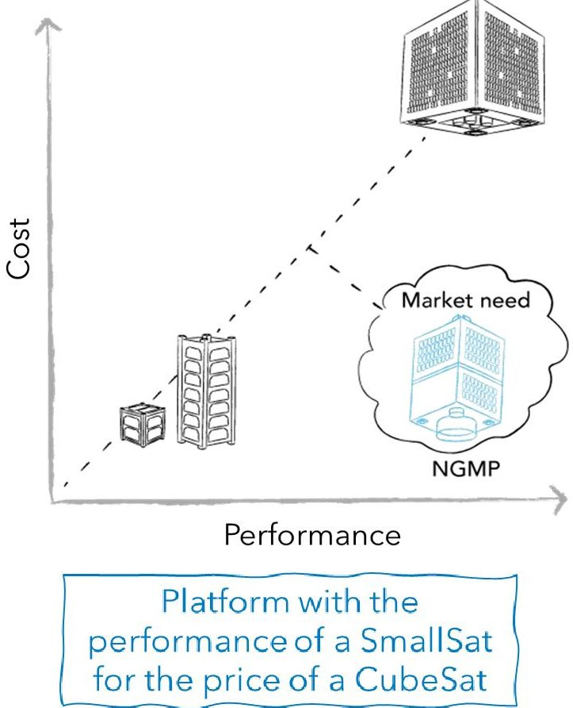

Figure 3: Market Gap

This market gap is intended to be filled with the Next Generation Microsatellite Platform (NGMP) and it is to create the next disruption in the space market.

<!-- PDF_PAGE: 5 -->

Achieving the SmallSat performance for the CubeSat price should open up new business opportunities and markets.

The summary given in Figure 4 shows where the NGMP is envisaged to fit within the current space market ecosystem.

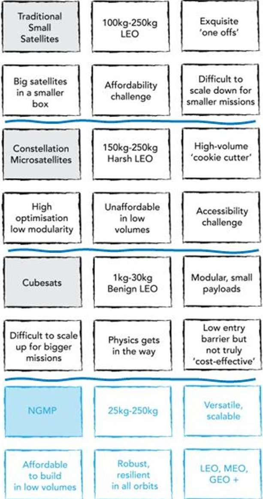

Figure 4: Satellite Classes Summary

To achieve a significant reduction in the price point, to meet the CubeSat target, the NGMP needs to implement approaches in the reduction of NRE, RE, operational costs and maximisation of mission lifetime. These are key needs that are to be considered as an input to the NGMP development.

However, KISPE are firm believers in making space more accessible but in a sustainable and responsible way. This means that, alongside having a cost effective solution, with a high level of performance, it also needs to include the appropriate features to ensure that:

- It doesn't contribute to space debris & can perform collision avoidance manoeuvrers.

- It can deorbit at the end of the mission lifetime.

## 4. Why MBSE and Systems Thinking?

- It is robust.

Typically at the start of a programme of work or development, there is a clear objective that is set, or a set of requirements provided by the customer. However, at the start of the NGMP work there weren't any customer requirements...or a specific customer...or knowledge of what context they would want to operate the system in. This means that the traditional document-centric approach that is typically applied issued requirements and a Concept of Operations (CONOPs) didn't apply. Therefore an alternative approach was required. In order to facilitate this, Systems Thinking and MBSE approaches were introduced to facilitate the exploration of the problem space and the stakeholder needs.

The breadth of the combination of applications, stakeholders and context required an approach that would lend itself to being able to explore multiple relationships, understand these relationships and present the information in a way that was easy to digest. Taking a traditional document-centric approach would have resulted in several volumes of information, which would have been indigestible.

There was one other important factor that drove the choice of Systems Thinking and MBSE approaches. The resultant baseline NGMP platform is intended to be released open source under the Open Source Satellite (OSSAT) Programme [3]. Working in an open source way allows the bringing together of a more diverse set of people, it is not limited by those within specific space circles. This helps stimulate new ideas and processes and by taking others along on the journey of its design, will help promote its use to make it the de facto standard for microsatellite platforms. Using MSBE approaches for tackling the problem helps facilitate taking inputs from others across different points of the programme and the construction of the related data, in the model, in a logical, accessible and easy to engage with way.

## 5. How has MBSE and Systems Thinking been used in the development of the NGMP?

MBSE and Systems Thinking have predominately been used in Phase A - Feasibility, Phase B Preliminary Definition and Phase C - Detailed Definition for the NGMP. The outputs from these phases will support the latter phases by providing use cases that will form the basis of the testing in Phase D Qualification and Production. Although the NGMP has not yet reached the latter phases, their needs have been considered during the early phases to ensure that the resultant solution is suitable. How the NGMP is used (Phase E) and how it will ultimately be disposed of (Phase F) have been baked into the requirements and analysis conducted in Phases A to C.

<!-- PDF_PAGE: 6 -->

The NGMP development started at the beginning, in the Phase A - Feasibility stage. The key was to identify the needs that it had to satisfy and determine the top level requirements.

The start of the NGMP development was exciting for a number of the engineers involved. For many it was the first time that a design was truly starting with a clean sheet of paper. The edict was to develop a satellite that satisfied the aims, as discussed in section 3 and to actively challenge the mind set of "but it has always been done this way".

It should not be underestimated just how truly tricky it is to attempt a 'clean sheet' design without letting past prejudice and experience constrain the problem exploration. Due to the technical nature and bias of the team, the natural tendency was to get right down into the detail rather than taking a step back and exploring the problem holistically. It identified clearly the need for a structured approach to ensure that all areas were covered and it was clear what the intent of each phase was. Figure 5 shows the approach that was developed and adopted.

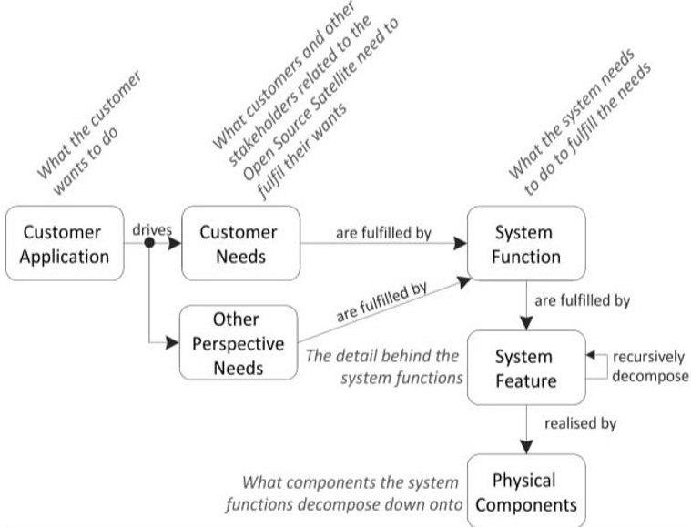

Figure 5: Structured flow for developing the NGMP

This approach clearly identified that it is the needs of the various stakeholders that drives what the system needs to do, and a top down approach to its development is appropriate. This might seem an obvious first step but, as will be revisited elsewhere in the paper, it paid dividends in helping to align the team and contribute to the shared mental model.

Developing this approach collectively helped some of the team, whose previous experience was more in the traditional document-centric approach, transition to a more MBSE approach. It clearly shows the concept of viewpoints and that they need to be considered to achieve a complete solution. For example, it shows it is more than just the customer needs that need to be

considered which signposts that context modelling is required.

The structured flow, shown in Figure 5, can be related to the phases identified in Figure 2 and discussed in section 2. This is shown in Figure 6.

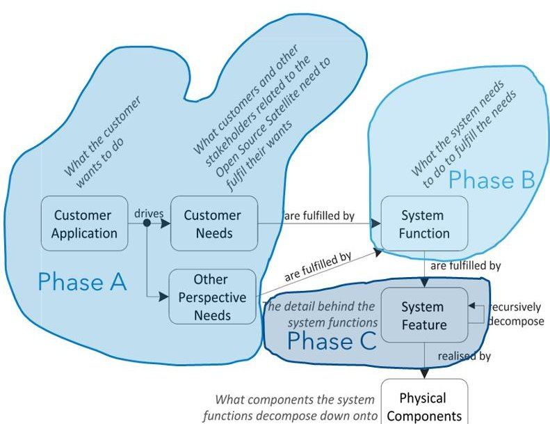

Figure 6: Structured flow for developing the NGMP relating to the project phases

A large proportion of the team who started this development had significant experience in the space industry, particularly in the SmallSat / microsatellite domain. Despite this, due to different experiences, perhaps due to the types of companies they had worked in or due to the types of roles they had held previously, there were differences in how terms were used, and problems were tackled. This meant that there was a real risk of ambiguity creeping in, that, if it was not identified until much later in the programme would be far more difficult and costly to resolve. It also highlighted that it would be tricky to achieve the aim of being able to have people join the programme at later points, if they hadn't lived the derivation of the shared mental model.

These considerations led to the development of an ontology, the definition of which aligns with that given by Studer et al [4], "...a formal, explicit specification of a shared conceptualisation". It allows terms and the relationship between them, to be defined. A brief extract of the developed ontology is shown in Figure 7. The ontology has been maintained as a living artefact. At the point of its conception at the start of the programme of work, the full breadth of the terms, concepts and relationships that were present were not fully known. Some have only come to the fore as the programme has moved forward through different lifecycle stages. Others have been developed in response to other contributors and stakeholders, where it

<!-- PDF_PAGE: 7 -->

has been clear, for clarity, additional definition would add value.

The ontology has been, and it is envisaged, will continue to be a useful artefact. What has been of great value, and this again is another common theme that will be referenced again within the paper, the collective discussion that underpinned its creation. These discussions did a great deal to align the team, allow the sharing of concepts and the development of a more cohesive shared mental model. Uncovering the potential for assumptions and miscommunications in the early stages, helps mitigate the risk of problems revealing themselves down the line, later in the programme when it is more expensive to rectify.

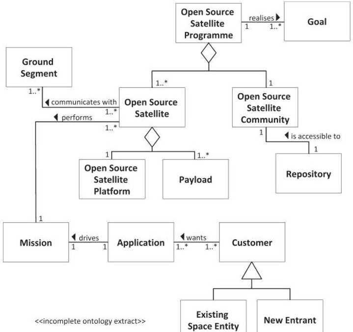

Figure 7: NGMP Ontology (snapshot - incomplete)

The ontology also acts as a sanity check to determine whether new concepts that are introduced already fit within the context, if they are something new or whether they are something that is masquerading under a different name. It has also helped to form the basis of the viewpoints, and these viewpoints were used to help examine the different points of view of the stakeholders for different concerns, as per the description of viewpoints given within the OMG SysML standard [5].

Nominally at this phase in the lifecycle, a set of customer requirements or needs would be provided as the starting point for the ongoing development work and assessment. As previously discussed in section 4, there weren't any, other than the identification of a perceived market need. Therefore, there needed to be some definition of the problem space and identification of the stakeholders that need to be considered.

Context modelling was used to explore the problem space, to identify stakeholders and what other systems that the NGMP would need to interact with. Figure 8

shows an extract of the context diagram created. The context diagram provides a mechanism for examining and recording the context within which the system under analysis sits. In this case, the aspect for which the context is being explored is the 'Platform' which represents the NGMP, which is within the area of the context diagram labelled SOI within Figure 8.

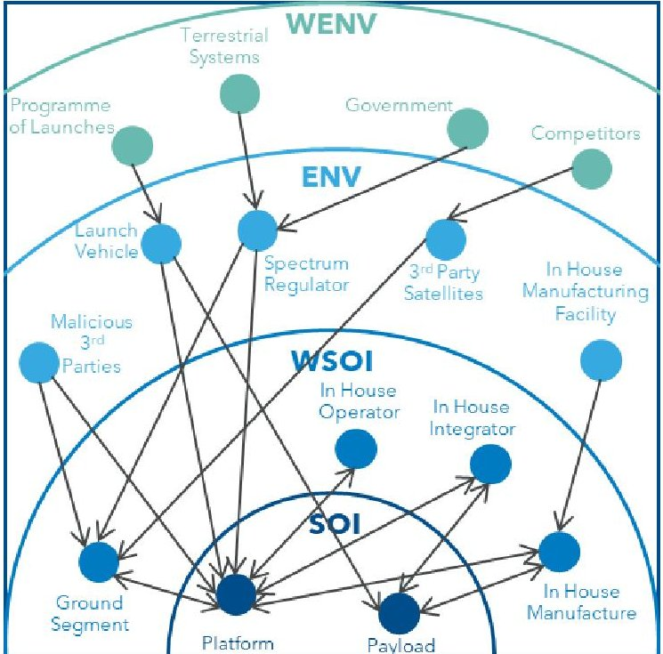

Figure 8: NGMP Context Diagram (snapshot incomplete)

The SOI is the System of Interest, and this is always placed at the centre of a context diagram. Elements within the SOI are those which the systems engineer has direct control and influence over. The next layer out from the SOI is the Wider System of Interest (WSOI). This provides some of the context surrounding the SOI, which might be elements that interface with the system such as the 'Ground Station' as shown in Figure 8, which is used to relay signals from/to the operators and the satellite. The differentiator between the SOI and the WSOI is the degree of control and influence the systems engineer has. In the WSOI, it is considered that the systems engineer has no direct control but can exert some influence. This is denoted by the bidirectional arrow connecting the elements. The environment (E) shows the elements that have an influence on the SOI and the WSOI. The key thing to note here is that the systems engineer has no control or influence over these elements, hence the unidirectional arrow. An example is the impact of the 'Spectrum Regulator'. The systems engineer is very unlikely able to influence the way that the radio frequency spectrum is allocated and used, but the way in which this regulation takes place, impacts what the systems engineer can implement as part of the platform solution. The wider environment (WE) explores the context beyond the local environment. These are aspects that might impact the local

<!-- PDF_PAGE: 8 -->

environmental factors. For example, considering the spectrum regulation, there are a number of external influences that will change what the spectrum regulation looks like. These include the needs of terrestrial systems that also utilise the radio frequency spectrum as well as governmental edicts. The systems engineer is certainly not going to have any influence over these elements.

Exploring the context was a really useful way to get the team collectively thinking along the same lines. It should be noted that the snapshot of the end product shown in Figure 8 was not the mechanism by which the data was gathered. For a large proportion of the team, although experienced systems engineers, the level of MBSE capability was low. This presented an interesting challenge, how to introduce and utilise useful MBSE techniques without stifling the teams creativity through the introduction of notations and techniques that were unfamiliar. Therefore, to start, more familiar approaches of whiteboarding sessions and brainstorms were used, being facilitated by a team member who knew what the end artefact was due to be. This meant that terminology could be introduced as the working sessions went on. This meant the team could identify the concepts and ideas that had been raised in previous sessions and it made adjusting to the different way of recording the information clearer.

In order to close out Phase A, all of the stakeholders need to have been identified and their needs understood, as well as an understanding of the top level requirements. Using the output from the context diagram, a pig in the middle diagram and stakeholder mapping were constructed. The pig in the middle diagram is a technique for exploring and recording the perspective of different stakeholders with respect to a specific system, in this case the NGMP. Figure 9 shows an extract of the NGMP pig in the middle diagram, with the NGMP at the centre, as that is the system for which the illustrated perspectives apply. The stakeholders are located around the edge of the 'pig' and the line that connects the 'pig' and the stakeholder is annotated with the relevant perspective.

It should be noted that not all of the stakeholders that have been identified are considered desirable. Figure 8 and Figure 9 both show the 'Malicious 3rd Parties' stakeholder. This is not a stakeholder that is going to deliver a set of requirements at the start of a programme of work, but one that could look to exploit any vulnerabilities or weaknesses in the system. This drives a need to consider the sensitivities of the system, for example the data it is processing or the service it is providing and identifying the appropriate mitigations. One simple example, when considering satellites, is the data that the payloads generate. It is the payload data that is typically provided to users to generate revenue or provides a specific service. If that data was to be

intercepted, then this could undermine the service. A mitigation for this is to encrypt the payload data so that only authorised parties can access and utilise it. Considering these additional stakeholders, drives additional needs that would not be determined if only the customer perspective was considered.

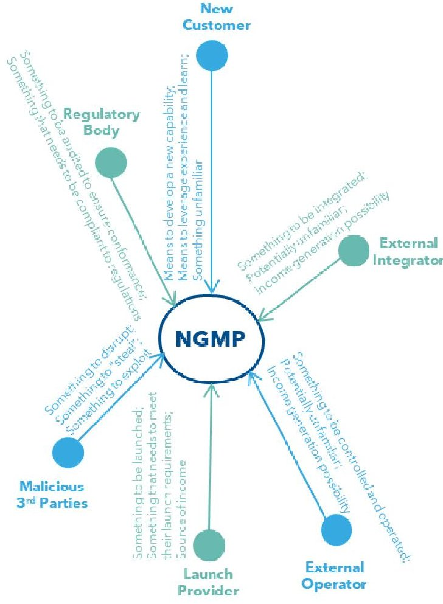

Figure 9: NGMP Pig In The Middle Diagram (snapshot - incomplete)

The output of Phase A, was a complete stakeholder mapping, an understanding of their needs, where the conflicts arose and what the top level requirements for the NGMP were.

Phase B was focused on looking at functions that were required of the NGMP, as highlighted in Figure 6. As previously discussed, there was not a single application driving the development of the NGMP. The intent is to have a platform that can service a number of different applications, minimising engineering effort with respect to platform modifications between applications. Therefore, it was felt that it was key to understand where similarities and differences between different types of applications existed, so that it could be determined where additional engineering effort and scrutiny was needed to implement a viable solution. The starting point was to agree a generic satellite lifecycle that each satellite would go through to give a

<!-- PDF_PAGE: 9 -->

consistent baseline to assess the different application impacts against. This is shown in Figure 10 and illustrates that there are a number of key stages:

- Integration

The components that comprise the various subsystems (platform) need to be put together manufactured.

The subsystems then need to be integrated to form the satellite.

- Testing

The satellite is to be tested to demonstrate that it has been built correctly.

- This includes ambient and environmental testing.

## Launch Activities

The satellite needs to be transported to the launch site.

Integration of the satellite to the launch vehicle needs to occur.

The launch vehicle is then launched with the satellite before being separated.

## Operations

There needs to be some form of detection that the satellite has separated from the launch vehicle so that operations can commence.

The first phase of operations is commissioning, where the various subsystems of the satellite are checked and brought into use.

o If there are 'abnormal' conditions the way in which this commissioning is conducted might alter - for example in the case of a failed component.

Assuming commissioning is successful, normal operations commence which could switch to alternative operational mechanism should there be an abnormal set of conditions for example the software crashes.

Once the mission ends, either at the nominal designated end of mission or due to unrecoverable abnormal conditions, end of life activities (as far as possible) are performed.

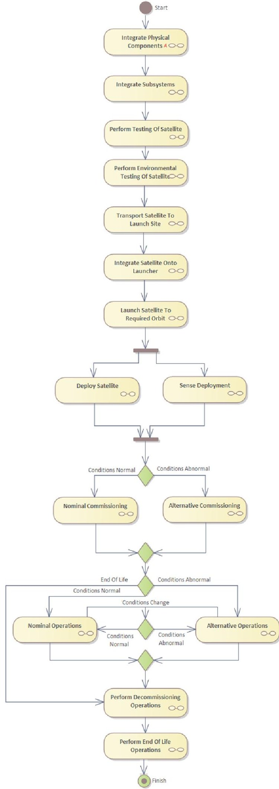

Figure 10: NGMP Generic Satellite Lifecycle Activity Diagram

<!-- PDF_PAGE: 10 -->

An example of the exploration of the further interactions that occurs within each activity is shown in Figure 11 for the testing that occurs on the satellite (at ambient, not environmental). This shows the interest of the stakeholders for a specific activity, as well as the additional elements that are required.

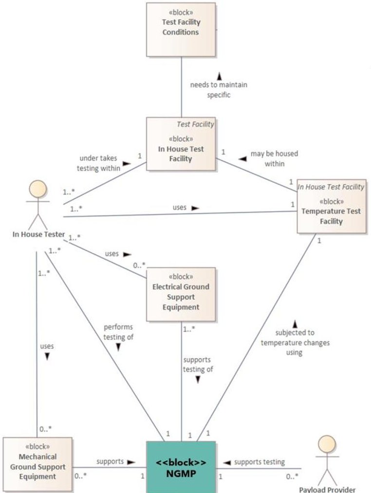

Figure 11: NGMP Generic Satellite Lifecycle Activity - Perform Testing Of Satellite Block Diagram

Taking the example shown in Figure 11, it shows two stakeholder roles: 'In House Tester' and 'Payload Provider', as well as a number of elements in addition to the NGMP that are needed to support the testing, such as the mechanical and electrical support equipment and the test facility. One of the areas that drives up the cost of satellites is human interaction. The more time that people have to spend performing integration activities, or testing activities, adds to the expenditure that has to be recouped before profit is made. Therefore, just exploring this single lifecycle activity, even in a generic way, has identified two human - satellite interactions that should be further explored to minimise as much as possible. For example, considerations should be made to the 'hands on' aspects of the testing - can it be automated or minimised without compromising on quality?

This exercise demonstrated to the team some of the real strengths of taking a MBSE approach in a number of ways. In 1956, Miller proposed that humans had a limit to the number of elements of information that can be effectively processed as a time; this limit was specified as $ 7\pm2 $ [6]. The views that were developed in exploring the context and needs for NGMP considered the 'human' element and that the intent was to make the material as straightforward to engage with as possible. Therefore, where practical, the viewpoints were constructed so that the views had a minimal set of elements whilst still being useful.

Breaking down the artefacts that were generated from the modelling in this way made them easy to share and review. Specific reviews could be undertaken for specific views, meaning that each aspect got the same level of rigour, review and checking as every other aspect. It was also quicker, once the team were familiar with the notation, to review the diagrammatic artefacts than it would have been to review a written document containing the same information in prose form. It also opened the door to bringing in additional reviewers and personnel to undertake the reviewing / provide their input as they could look at the specific views that were of interest to them.

Another strength in using MBSE techniques and tools has been consistency. As the concepts have been developed and agreed, a library set of elements have been developed. These elements can then be reused across the model and thus a complete set of traceability, dependencies and any conflicts can be identified. It helps remove the issue that arises in written documentation, especially if it is constructed by multiple parties, of terms being used inconsistently or to mean different things. It also promotes the idea of reuse patterns or approaches that are developed can be reused across views.

The biggest challenge that has had to be overcome in order to make use of MBSE is the notation and also use of the toolsets. Every individual has a different mental model and way of approaching a problem. Applying a formal modelling approach and notation to capture the information can act as a distraction, as the focus becomes trying to think about a problem in a specific way to suit the capture method, rather than considering it holistically. Therefore, the approach taken, to help mitigate this impact, was to start with a very light touch approach. This meant using more conventional approaches of gathering information on whiteboards, via discussions and review of existing material. This material was then separately formalised using the formal notation and view, and then brought back to the team. A collective discussion and review of the revised material was undertaken, allowing the team to see the concepts and ideas that they had, captured in a formal way. This made it more straightforward to explain the

<!-- PDF_PAGE: 11 -->

notation and approach as there were concepts that were familiar to the team as they had been developed by the team. Once familiarity had been reached, the further development of the views continued using the formal approaches.

Using the output of the exploration of the satellite lifecycle and the needs that this generates, a set of functions that the NGMP needs to perform were generated. A top level iteration of these functions, grouped by function type, are shown in Figure 12.

Specific use cases were considered against the generic satellite needs exploration that was conducted, to identify where there were gaps or conflicts. In some instances, the elements at a generic level were the same, but the performance of these elements needed to be different - for example, the degree of accuracy in the pointing of the satellite at the ground. For an Internet of Things (IoT) mission, the degree of ground pointing accuracy is not as high as that is required for a high resolution Earth Observation (EO) mission. This shaped some of the performance characteristics that are attributed to the functions.

Within the model, these functions are linked back to their source. This means that the impact of change can be easily traced and the impacted elements identified. The traceability of the source and destination of the different design decisions, the needs and the decisions made is a benefit of utilising MBSE and the associated tools. The alternative would be documentation which would be reliant upon someone updating every time a change was made or explored. Using a documentcentric approach can make it more challenging to assess whether what is being looked at it the single source of truth as typically there isn't a single document that covers all of the elements. With a MBSE approach, the model acts as the single source of truth.

Closing out Phase B involved the allocation of these functions to a top level physical architecture. A snapshot of the physical architecture with some of the functions from Figure 12 are given in Figure 13. This work leads into Phase C, the detailed design. The derived functions have been further iterated, along with the physical architecture. The detailed design of the required units and components are being undertaken. The same modelling techniques as described thus far within the paper are being used to support this continued iteration and design work.

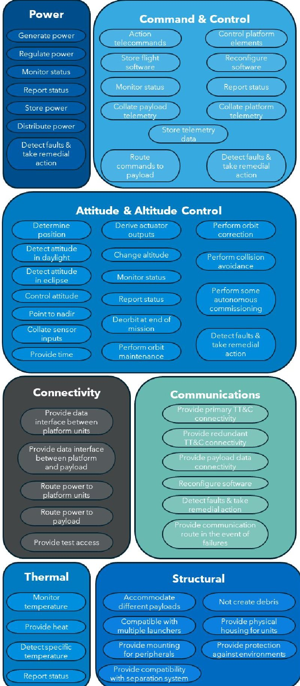

Figure 12: NGMP Top Level Functions

<!-- PDF_PAGE: 12 -->

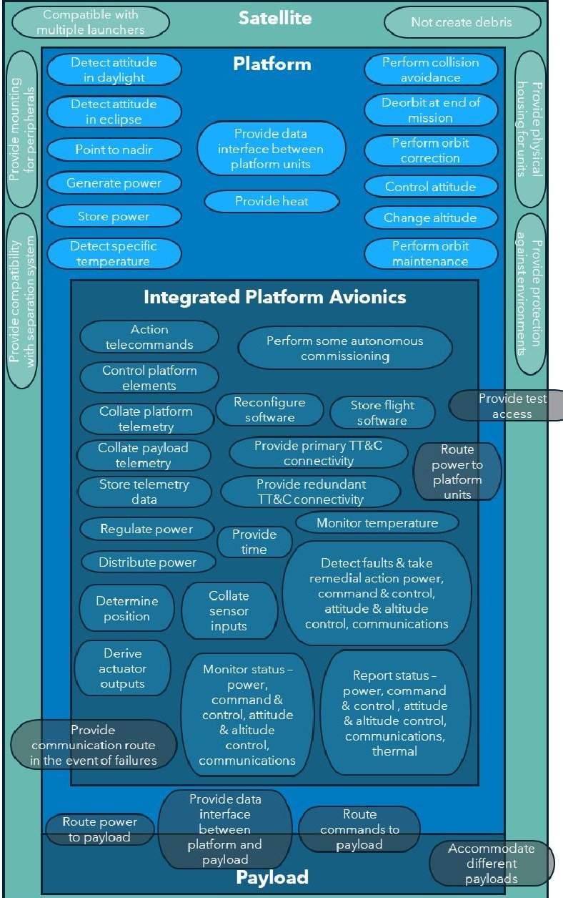

Figure 13: NGMP Top Level Architecture (snapshot - incomplete)

## 6. Challenges Experienced

Considering the implementation of MBSE to the NGMP has raised some interesting challenges, not all of which were anticipated.

The first challenge, that was a risk that was flagged before the implementation commenced was the impact of significantly changing the approach that the team were used to - from document-centric to model-centric. As stated previous in section 5, the team involved were highly experienced systems engineers in the space domain but had limited or no experience in the formal utilisation of MBSE. It was acknowledged that there would be an overhead (time and training) in bringing the team up to speed on the alternative methodology but also a technical risk that by trying these new methods, it would cause disruption to the thinking and work that would nominally be undertaken, leading to certain technical aspects being missed.

This drove a lot of up front work on exploring how to put a methodology in place that complemented the

experience and approach of the team, allowed the technical bases to be covered but also generating the material and output required to implement a MBSE approach. Without this initial work, the success of implementing MBSE would have been limited.

Considering this risk also helped shape the phased approach that was undertaken with the 'slow' introduction of some of the formal notation and concepts. This helped with the training and education that needed to be implemented for those unfamiliar with MBSE.

Finding the sweet spot to allow innovation and free thought without stifling innovation was definitely one of the biggest challenges. Whiteboarding sessions, away from the MBSE toolset helped, but the issue arose of a mixture of terminology and concepts being used, since the formal links and traces that the MBSE tools provide were not present for the whiteboard sessions. Therefore, it was important to instigate time for the formal capturing to 'catch up', so that any issues could be ironed out, discussed or resolved in a timely fashion before they propagated too far. This also helped to make sure that the mental model that was being developed was consistent.

As stated previously in section 5, a lot of value was derived from the collective discussions that supported the derivation of the solutions. It has been challenging to document and link the relevant discussions / decision making points within the model, in a way that provides that same value to someone who was not involved in the process of the model creation. The use of attributes and notes within the model have been implemented but a Design Justification File (DJF) document has been created to capture some of the design decisions more completely. A more model-centric solution is still being identified.

## 7. Wider MBSE Implementation Challenges

The challenges that KISPE faced in the implementation of MBSE are not unique to KISPE. Any organisation which has favoured a documentcentric approach will have more familiarity and comfort in that arena and is likely to not have a team who are trained in using more model based approaches.

There is not a consistent uptake of MBSE across engineering domains, and the space domain is no exception. Where MBSE is employed, there are a wide range of frameworks, notations and tools used. This means that being proficient in one particular approach does not mean that this transfers directly to another. ESA have acknowledged that there are challenges in implementing a consistent approach across the space domain in the use of MBSE [7]. Work has been undertaken to construct reference architecture models, such as that performed by Thales Alenia Space [8]. This uses a tool called Capella and the Arcadia

<!-- PDF_PAGE: 13 -->

approach. Two companies performed an exercise to reverse engineer the OPS-SAT mission:

- Samares Engineering with support from Airbus Defence & Space [9] choosing to use tool Cameo Systems Modeller (SysML) and the Systems Engineering Common Architecture Model (SECAM) approach

- OHB [10] choosing to use Enterprise Architect (SysML) with the Software Platform for Embedded Systems (SPES) methodology.

Within these three examples there are three different tools, and three different methodologies. The range and combination of the tools and approaches that can be utilised makes interoperability between models difficult. When MBSE is undertaken within a single organisation this doesn't cause such issues as internal processes can be defined to ensure that what is generated can be reused and aligned. Where multiple organisations are partaking in the generation of a space based solution, this can pose more of a problem, each organisation might have its own ontology, approach, notation, tool...this can make maintaining a single source of truth, or being able to validate that the same truth is shared by all, difficult.

This is not going to be a straightforward challenge to resolve. It is highly unlikely that a single toolset or approach is going to be unifiable across the entire space domain. The cost and complexity of implementing such an approach would make it unpalatable. Therefore, the emphasis should be on looking at ways on how to allow these different approaches to co-exist and allow information interchange.

This work is underway with ESA leading a technology roadmap [11] which looks at how MSBE can be implemented across the space domain. ESA have also set up an advisory group Model-Based for System Engineering (MB4SE) [12] which acts as a coordinating entity for MBSE activities for ESA related programmes.

Barriers to the uptake of these initiatives are going to be cost, time and perceived complexity. Companies that don't already use MBSE approaches might have an 'if it is not broken, don't fix it' view, meaning, if they have successfully undertaken their work without MBSE, they might question what the benefit is to changing. Other companies that use MBSE might not want to incur the inconvenience of changing their established approaches.

## 8. MBSE NGMP Next Steps

Considering the NGMP, the project is currently in Phase C - Detailed Definition. The model is being used to refine, capture and iterate the implementation. With the top level entities, such as platform and Integrated Platform Avionics (IPA) being broken down into more

distinct parts, such that a feature, as shown in Figure 5 can be realised by a single physical entity.

There has been some traversing of the levels of architecture during this development. As the design has matured and solutions explored, it has caused elements to be revisited and re-explored. Part of this is driven by the desire, as covered in section 3, to remove and reduce as much NRE and RE as possible. This means that special attention is being given to having aspects within the solution which don't require much, if any, modifications when a different payload or application is used. It has acknowledged that there are certain elements, such as the structure, where it is difficult to implement a one size fits all approach without ending up with an over engineered solution. This has meant that functions have been reconsidered and reallocated in some instances, and the benefit of the model based approach taken is that the ripple of these changes are easier to identify.

Once the Phase C activities are complete, the NGMP development will transition into Phase D- Qualification and Production. The use of MBSE techniques in this phase, and beyond, are likely to be lighter than those used in Phases A to C. Due to the complexity and volume of data to be explored during the early phases, a model based approach paid dividends. It is perceived that the main model based inputs to the latter phases will be the use of the use cases determined in the earlier phases to inform the testing that is conducted and to see where there are deviations from what was expected.

The NGMP is a generational product, with the intent for subsequent generations to become more compact (i.e. the platform shrinks whilst maintaining or providing more function) and the same core platform can be used to support missions beyond Low Earth Orbit (LEO), so Geostationary Earth Orbit (GEO), lunar and interplanetary! Since the same core product is desired to be reused, again to help with keeping down the cost of space utilisation, the models that have been developed so far will be reused and developed to look at how this road mapping can be performed in an efficient way.

## 9. Discussion & Conclusions

As identified within this paper, and by others [7], there is not a consistent uptake of MBSE across the space domain.

In the support of the NGMP development, the implementation of Systems Thinking and MBSE approaches has helped deal with the fuzziness of the problem space, the volume of data to assess and the potential number of permutations of a solution. It has provided a structured and ordered methodology which has opened the door to allowing those without a formal MBSE background to participate in a useful and meaningful way. Ensuring that problems are explored

<!-- PDF_PAGE: 14 -->

holistically and not just down in the engineering weeds is an important, beneficial aspect and helps ensure a more complete solution.

It shouldn't be taken for granted, just because the personnel that are working on a particular problem have similar experience or domain knowledge that they will all apply it in the same way. Developing and maintaining an ontology, which is briefed and made accessible to all team members, current and future, helps with this. Other activities such as group discussions and group development of artefacts is another way to help align the team and contribute to a consistent shared mental model. Challenges arise in how to share this, beyond just the artefacts generated, with those who did not participate in the discussions at the time. Currently KISPE has employed a DJF approach to capture some of this content but are looking for a method to bring it more into the modelling domain whilst keeping it accessible.

MBSE is a tool and not a prescription. It is important to allow the System Engineers to do their job considering problems and finding solutions. It is important to find a balance between using the rigour and formality that using MBSE approaches and its associated toolsets provide, and allowing engineers to think creatively about a problem. If the solutions to problems were formulaic in their nature, there would not be a need for systems engineers. It is the experience, perspectives and imaginations of these individuals that provide utility and quality solutions.

Consistency is key when considering engineering problems and solutions. One example of where individuals thought they were talking the same language but weren't is the failure of the Mars Climate Orbiter [13]. One entity involved used metric units, whereas the other used imperial units; therefore when some values were shared between companies the incorrect unit was attributed by the receiving party. It is important, to prevent costly issues later, that there is sufficient understanding of the concepts and elements that are being realised and that all parties see them in the same way. Providing views from the model provides a neat, easy to share and review set of artefacts that can be given to the relevant parties. Implementing traceability between elements within the model also allows the impact of changes to be seen and also where reuse can happen.

Models are cited as being a single source of truth. It should be acknowledged that this single source of truth is only as truthful as the data that it holds. If changes to the needs, context or design are made without being reflected in the model, then this is no longer accurate to the new conditions. Therefore, even if MBSE is only used during the early phases of a project, if it is to be used for generational or product lines, it should be maintained through life.

The adoption of MBSE across the space domain is not without its challenges but there are benefits, as highlighted, that can be achieved if a suitable route can be taken. One of the biggest challenges in a highly commercialised arena is being able to share success stories in a meaningful way, where the good, the bad and the ugly can be learnt from. The initiatives instigated by ESA are a good starting point but the release of models that others can look at and use, would assist in overcoming the barriers and challenges to the adoption of MBSE in the space domain.

## References

[1] ESA, How a mission is chosen https://www.esa.int/Science Exploration/Space_Science/How a mission is chosen (accessed 05.09.24).

[2] ESA, How a mission is chosen https://www.esa.int/Science_Exploration/Space_Science/Building_and_testing_spacecraft, (accessed 05.09.24).

[3] Open Source Satellite, The Open Source Satellite Programme, https://www.opensourcesatellite.org/ (accessed 18.09.24).

[4] Studer, R., Benjamins, V.R. & Fensel, D., Knowledge Engineering: Principles and Methods, Data Knowledge Engineering 25(1-2), 161 - 197 (1998). Available at: doi: 10.1016/S0169023X(97)00056-6 (accessed 21.08.19)

[5] OMG, Systems Modelling Language, Version 1.4, 2015, https://www.omg.org/spec/SysML/1.4/PDF (accessed 21.08.19).

[6] Britannica, The Magical Number Seven, Plus or Minus Two: Some Limits on Our Capacity for Processing Information https://www.britannica.com/topic/The-Magical Number-Seven-Plus-or-Minus-Two-Some-Limits on-Our-Capacity-for-Processing-Information (accessed 18.09.24).

[7] ESA, Model-Based System Engineering https://www.esa.int/Enabling_Support/Preparing_for the_Future/Discovery_and_Preparation/Modelbased_system_engineering (accessed 18.09.24).

[8] Thales Alenia Space, SAVOIR Model-Based Avionics, https://nebula.esa.int/sites/default/files/neb_study/26 26/4000133373 ES.pdf (accessed 18.09.24).

[9] Samares Engineering, Application of MBSE to reverse-engineer OPS-SAT and prepare future IOD missions (including OPS-SAT2), 28th April 2022 https://nebula.esa.int/sites/default/files/neb_study/26 14/C4000134652FP.pdf (accessed 18.09.24).

[10] OHB, Application of MBSE to reverse-engineer OPS-SAT and improve OPS-SAT2, 4th April 2022 https://nebula.esa.int/sites/default/files/neb_study/25 99/C4000134685ExS.pdf (accessed 18.09.24).

<!-- PDF_PAGE: 15 -->

$$
1 ^ {\mathrm {s t}}
$$

[12] ESA, Model Based For System Engineering https://mb4se.esa.int/MB4SE_Home.html (accessed 18.09.24).

[13] Jet Propulsion Laboratory, California Institute of Technology, Mars Climate Orbiter https://www.jpl.nasa.gov/missions/mars-climate orbiter/ (accessed 18.09.24).