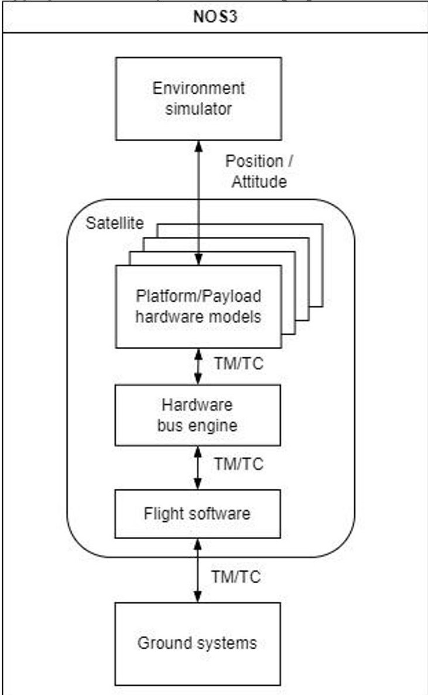
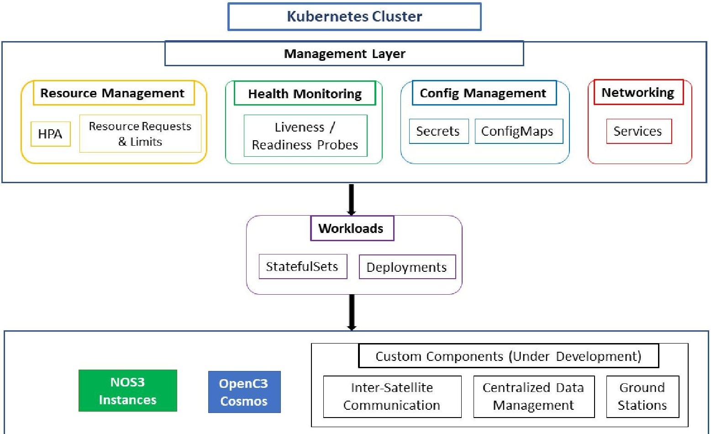
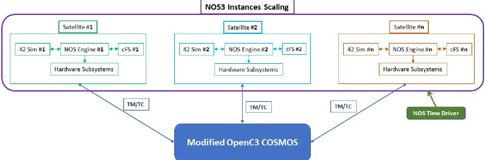

<!-- PDF_PAGE: 1 -->

75th International Astronautical Congress (IAC), Milan, Italy, 14-18 October 2024. Copyright $ \textcircled{2} $ 2024 by German Aerospace Center (DLR). Published by the International Astronautical Federation (IAF), with permission and released to the IAF to publish in all forms.

IAC-24-B6.5.3

ARCHITECTURE OF A SIMULATION TEST BENCH FOR OPERATING LARGE SATELLITE CONSTELLATIONS

Michele Campanelli $ ^{a*} $

$ ^{a} $Space and Ground Segment Technology, Galileo Competence Center, German Aerospace Center (DLR) Muenchener Str. 20, 82234 Oberpfaffenhofen, Germany $ ^{*} $Corresponding Author: Michele.Campanelli@dlr.de

## Abstract

The approach of using FlatSats to aid the development and testing of a mission has been adopted effectively for CubeSats and small satellites. However, when considering a satellite constellation, the FlatSat approach can become limited, which is where simulating the interaction between the space and ground segments of large constellations offers a powerful enhancement. Moreover, such a simulation can be employed to evaluate new technologies and quantify their potential impact in the operation of a constellation. This paper presents an innovative architecture for a simulator designed to precisely meet these challenges. The simulator deploys the NASA Operational Simulator for Small Satellites (NOS3), building on its heritage, open source components, active development and support. The use of NOS3 as the underlying simulation engine ensures compatibility with a wide range of hardware and software systems, which facilitates the testing and validation of satellite designs. It also allows for the incorporation of additional data sources and the emulation of hardware components, thereby contributing to the realism of the simulation. Our proposed architecture addresses the challenges of simulating large satellite constellations, including scaling, computational efficiency and fidelity of the system modeling. A key feature of the simulator is its modularity, which allows for the integration of different flight software frameworks, subsystem models and ground segment software. These, in combination, permit different types of constellations to be simulated. The simulator uses a fully containerized and microservice architecture, which ensures its portability and ease of deployment across different computing environments. This also facilitates the management of dependencies, isolation and rapid scaling of the simulation environment. Furthermore, the simulator can be run on a self-hosted infrastructure, providing users with full control over their simulation environment and data. This is particularly beneficial for organizations with strict data security requirements or those wishing to integrate the simulator into their existing infrastructure. Alternatively, the architecture can be easily deployed in a cloud-based infrastructure. We also present how this architecture can be deployed as an operational simulator or as a test bench for new technologies, such as exploring the use of a Digital Twin in the operation of a satellite constellation.

Keywords: Satellite Constellations, Simulation, Microservices, Container Orchestration

Acronyms/Abbreviations

AI Artificial Intelligence

AWS Amazon Web Services

cFS NASA Goddard's core Flight System

DT Digital Twin

ECSS European Cooperation for Space Standardization

ESA European Space Agency

F Prime NASA JPL's F' Flight Software

FSW Flight Software

GSW Ground Software

HIL Hardware-in-the-Loop

KPI Key performance indicators

LEO Low Earth Orbit

ML Machine Learning

NGSO Non-geostationary Orbits

NOS3 NASA Operational Simulation for Small Satellites

PNT Positioning, Navigation, and Timing

SMP Simulation modelling platform

## VM Virtual Machine

## 1. Introduction

Large-scale satellite constellations in nongeostationary Orbits (NGSO) have become integral to the modern space era, enabling unprecedented global connectivity, offering high-resolution, near-real-time Earth imagery and, in the near future, they will be providing resilient and precise positioning, navigation, and timing (PNT) services. As these constellations grow in size and complexity to meet the increasing demands for space-based services, the need for advanced simulation tools to aid in their development, testing, and operation has become crucial. Traditional approaches, such as using FlatSats for individual satellite testing, face limitations when applied to large constellations. This paper presents an innovative architecture for a simulation test bench designed to address these challenges and enhance the development and operation of large satellite constellations.

<!-- PDF_PAGE: 2 -->

The proposed simulator builds upon the NASA Operational Simulator for Small Satellites (NOS3), leveraging its open-source components and their active development community [1]. By extending NOS3's capabilities, our architecture offers a scalable, modular, and high-fidelity solution for simulating the intricate interactions between space and ground segments in large satellite constellations, as well as retaining high fidelity at sub-system simulation level, while being able to simulate multiple satellites simultaneously.

This architectural blueprint explores the strategies and technologies required to scale NOS3 for large constellation simulations. Our approach aims to provide a foundation for comprehensive pre-deployment testing, operational scenario development, and performance optimization of satellite constellations, by addressing key challenges in scalability, performance, and deployment flexibility.

## 2. Background and Related Work

The landscape of satellite simulation has evolved significantly with the advent of large satellite constellations. Traditionally, hardware-in-the-loop (HIL) testing using FlatSats has been a cornerstone of satellite development and testing. However, as constellations grow in size and complexity, this approach becomes increasingly impractical and cost-prohibitive. The shift towards software-only simulation represents a critical advancement in addressing the challenges of modern satellite constellation development. NOS3 exemplifies this transition, offering a flexible, software-based simulation environment [2].

Modular systems like KubOS, core Flight System (cFS) from NASA Goddard, and F'Prime from NASA JPL offer foundational flight software (FSW) frameworks and tools, enabling developers to implement or develop subsystem functionalities for missions [3].

These advancements collectively point to a future where large-scale, software-driven simulations will play an even larger role in the development and operation of satellite constellations.

Indeed, several frameworks and even open-source tools exist for simulating aspects of satellite constellations. OMNeT++ and INET [4] are used to develop models for LEO constellations, focusing on latency and network performance. MathWorks' MATLAB Constellation Toolbox [5] provides tools to model GNSS constellations using ephemeris data, allowing for detailed access analysis and visualization. More recently, xeoverse [6], a scalable and realistic network simulator, has been designed to support comprehensive LEO satellite network research and experimentation. Another open-source tool is SAVI (Satellite Constellation Visualization) [7], which provides a graphical user interface for visualizing

satellite constellations and their coverage areas. Additionally, tools like SimORBIT [8] and SimXona [9] from SpacePNT and Spirent respectively, enhance the simulation landscape by providing high-accuracy orbital modelling and GNSS signal simulation.

However, most of this research and the available tools are focused on network performance analysis, orbit propagation and visualization techniques. Instead, our aim is to incorporate dynamics and environmental simulations, along with software-based models of spacecraft hardware, not just at the single satellite level, but for entire constellations. This comprehensive approach enables a deeper understanding of the complex interactions within satellite constellations, facilitating more realistic mission planning and execution.

The European Space Agency (ESA) SIMULUS Next Generation [10] is a forward-looking project that aims to improve the efficiency of simulator development and deployment using modern tools and practices. While representing a major advancement when compared to previous simulators (such as the Galileo Constellation Operational Simulator), it is aimed at the operational part of the spectrum for large classes of satellites being based on the European Cooperation for Space Standardization (ECSS) and Simulation Modelling Platform (SMP) standard. While this approach is well suited for traditional space missions, our current research focuses on developing concepts, rapid prototypes and approaches for SmallSats and CubeSats, which require less sophisticated simulation tools and can be swiftly adapted to their specific needs.

In addition to software-centric simulation, the concept of a Digital Twin (DT) has also gained traction in the space industry. Since Glaessgen and Stargel [11] introduced the idea of using DTs for spacecraft health management and prognostics, recent research has explored their application in satellite constellation management, highlighting potential benefits in anomaly detection, predictive maintenance, and satellite network design. [12,13,14,15]

Our work builds upon these advancements, integrating the strengths of NOS3, containerization technologies, and Digital Twin concepts to create a comprehensive simulation test bench for large satellite constellations. In the following sections we present our architecture.

## 3. Architecture Overview

The proposed simulation test bench architecture is based on the foundation laid by NASA with NOS3 [16] and its core components, as depicted in Fig. 1:

- NOS Engine: Simulates hardware busses as software only busses

- Simulated hardware components

<!-- PDF_PAGE: 3 -->

- 42 Simulator: Handles attitude and orbit dynamics for individual satellites

- cFS: Emulates the flight software for each satellite

- OpenC3 COSMOS: Serves as the ground control software and monitoring interface

While NOS3 was primarily designed for individual satellite missions, careful adaptation and modification are required to effectively support multiple satellites in the context of constellation simulations [17, 2].

At the heart of our scaling strategy lies the creation of multiple instances of these components, one for each simulated satellite, while maintaining a centralized control and visualization interface via OpenC3 COMSOS, instead of having a dedicate ground software GSW) for each satellite. This enhanced interface allows for dynamic satellite selection and grouping, constellation-wide command distribution, and aggregated telemetry visualization. [18]

Fig.1 High-level Architecture of NOS3

The architecture employs a modular design, where each satellite in the constellation is represented by a self-contained set of the core components. This modularity offers several advantages:

1. Flexible Scaling: The system can easily accommodate constellations of varying sizes by adding or removing satellite modules as needed.

2. Heterogeneous Configurations: Different satellites within the constellation can have unique configurations, allowing for the simulation of diverse and complex constellation designs.

3. Isolated Testing: Individual satellites or subsets of the constellation can be tested in isolation, facilitating targeted debugging and performance optimization.

4. Centralized Control and Monitoring: To manage the complexity of multiple satellite simulations, we have extended OpenC3 COSMOS to provide a unified interface for controlling and monitoring the entire constellation. This involves:

- Dynamic satellite selection and grouping

- Constellation-wide command distribution

- Aggregated telemetry visualization.

## 4. Implementation Strategies

In developing our implementation strategy, we conducted a thorough evaluation of three primary approaches: traditional VM-based scaling, Docker Swarm orchestration, and Kubernetes deployment. Each approach presents its own set of advantages and challenges in terms of scalability, performance, and ease of deployment.

The VM-based approach, which was our initial consideration, offers strong isolation between satellite simulations and simplicity in setup. In this model, each VM would host a complete NOS3 setup for a single satellite. This is how NOS3 is delivered by default and is sufficient for developing and testing new hardware subsystems models for a single satellite. However, as we projected scaling to larger constellations, several limitations became apparent. The resource overhead is significant, with each VM requiring a full operating system, leading to inefficient use of hardware resources. Scalability is limited by the complexity of provisioning and managing numerous VMs, and ensuring consistent environments across VMs can be challenging, potentially leading to discrepancies in simulation results.

Docker Swarm, as a native clustering and scheduling tool for Docker containers, presented an intermediate option. It offers easier orchestration and better resource utilization compared to VMs, with the added benefit of simple setup and management for smaller-scale deployments. Docker Swarm's strength lies in its tight integration with Docker and its relatively ease of use. However, as we considered our long-term scaling needs and the complexity of constellation simulations, we found that Swarm lacks some of the advanced features necessary for large-scale, complex deployments.

<!-- PDF_PAGE: 4 -->

Ultimately, we chose Kubernetes for our orchestration needs, despite its higher complexity and more demanding setup compared to Docker Swarm, due to its robust feature set and scalability. Kubernetes offers advanced scheduling, self-healing capabilities, automated load balancing, and fine-grained resource management. These features become invaluable as we scale our simulation to encompass dozens or even hundreds of satellites.

A significant advantage in our Kubernetes implementation is due to the fact that both NOS3 and OpenC3 COSMOS are already distributed as Docker containers by their respective development teams. This existing containerization significantly streamlines our orchestration process.

This existing containerization significantly streamlines our orchestration process, as we're working with pre-configured, tested, and optimized environments.

Our Kubernetes implementation builds upon these existing containers, adding the necessary configurations for networking, persistent storage, and inter-component communication within the constellation simulation environment. This approach allows us to focus our efforts on the orchestration layer - defining how these containers interact, scale, and share resources and later focusing on creating new containerized applications to eventually replace some of the NOS3 core components.

Preliminary performance testing revealed significant improvements with the containerization approach compared to the VM-based solution. We observed a 40% reduction in CPU resource utilization per simulated satellite compared to VMs, allowing us to increase the number of simultaneously simulated satellites by 65% on the same physical host.

## 4.1 Kubernetes-based architecture

Our constellation architecture utilizes several built-in Kubernetes features, configuring them to support scalability and improve resource management for our specific multi-satellite simulation needs. These include:

- Deployments and StatefulSets: Built-in Kubernetes objects for managing containerized applications.

- Services: Kubernetes abstraction for exposing applications running on a set of Pods.

- ConfigMaps and Secrets: Native Kubernetes objects for managing configuration data and sensitive information.

- Ingress: An object that manages external access to services in a cluster.

- Resource Requests and Limits: Built-in mechanisms for specifying the compute resources needed by containers.

At the core, we use Deployments to manage the main

components of each simulated satellite, such as the NOS Engine, 42 simulator, and cFS instances. These Deployments allow us to easily scale the number of simulated satellites and manage updates seamlessly.

For components requiring stable network identities and persistent storage, particularly the OpenC3 COSMOS instance, we employ StatefulSets. This ensures that each simulated satellite maintains its unique identity and state across restarts or rescheduling events.

To facilitate communication between components and expose necessary endpoints, we utilize Kubernetes Services. We create a Service for each major component (NOS Engine, 42, cFS, and COSMOS) of every simulated satellite, allowing for standardized internal networking. For external access, we implemented an Ingress controller, which routes external requests to the appropriate Services based on path rules. This setup enables us to access each satellite's COSMOS interface through a single-entry point with distinct URL paths.

Configuration management is handled through ConfigMaps, allowing us to store and update satellite specific parameters, such as orbital elements or hardware specifications, without rebuilding containers.

This approach provides flexibility in adjusting simulation parameters on the fly. For sensitive data like access credentials or encryption keys, we use Kubernetes Secrets, ensuring that this information is handled securely within the cluster.

To manage the increased complexity of multiple satellite simulations, we extended our use of ConfigMaps to include a central configuration that defines the overall constellation structure. This constellation ConfigMap is mounted to a custom control plane pod that we developed, which manages the creation and coordination of satellite-specific resources based on the defined constellation configuration.

Resource allocation is managed through careful specification of resource requests and limits in our pod definitions, ensuring that each component of our simulation has the resources it needs without overcommitting our cluster. While we have not implemented advanced autoscaling, we have laid the groundwork for future implementation of Horizontal Pod Autoscalers by defining resource metrics in our Deployments.

Lastly, we implemented basic liveness and readiness probes for our key components, ensuring that Kubernetes can accurately determine the health of our simulation pods and respond appropriately to any issues that arise.

This Kubernetes setup provides us with a robust and flexible foundation for our constellation simulation allowing us to efficiently manage and scale multiple satellite simulations within a single cluster. It offers improved resource utilization, easier management of

<!-- PDF_PAGE: 5 -->

complex configurations, and a pathway for future enhancements as our simulation needs grow.

Fig. 2 and Fig. 3 respectively illustrate a schematic representation of the described Kubernetes architecture and the scaling of NOS3 Instances.

Our modular approach represents each satellite in the constellation as a self-contained set of core components. This design not only allows for flexible scaling but also enables independent operation of each simulated satellite. Such modularity proves crucial when simulating constellations with heterogeneous satellite configurations or when focusing on specific subsets of the constellation for detailed analysis.

The choice of Kubernetes positions us well for future expansion: the core components of our system are already optimized for container-based deployment, allowing us to concentrate on optimizing the orchestration and resource allocation aspects of our architecture.

Furthermore, our Kubernetes-based architecture provides us with significant flexibility for future expansions and modifications. By adopting a containerized, microservices-oriented approach, we create a modular system that allows for easy substitution or addition of components. This modularity is particularly valuable as it opens up opportunities to integrate different software solutions for various aspects of our simulation environment.

For instance, while we currently use NASA cFS for our FSW simulation, our architecture would allow us to relatively easily incorporate alternative FSW frameworks, such as NASA JPL's F' (F Prime), should the need or opportunity arise. F Prime, with its component-driven architecture, could potentially offer advantages for certain types of missions or satellite configurations.

Similarly, our modular approach extends to the GSW and environmental simulation components. Our architecture allows us to integrate other GSW solutions if required, for specific mission types or to align with particular industry standards or practices.

The environmental simulation component could also be replaced or augmented with specialized environmental modeling software, should we require more advanced or specific environmental simulations in the future.

This flexibility is a key strength of our architecture. It ensures that our simulation platform can evolve alongside advancements in satellite technology, mission requirements, and simulation techniques. Whether we need to integrate new software to model cutting-edge satellite systems, adopt industry-specific ground control solutions, or incorporate more sophisticated environmental models, our Kubernetes-based architecture provides a solid foundation for these future enhancements

Fig. 2: Schematic representation of Kubernetes cluster setup

<!-- PDF_PAGE: 6 -->

Fig. 3: Modular representation of scaled NOS3 components for multiple satellites

## 4.2 Deployment Environments

During our architectural design activity, we conducted an in-depth analysis of three primary deployment options: in-house private servers, private cloud, and public cloud services like Amazon's AWS. Each option presents unique trade-offs in terms of control, scalability, cost, and ease of deployment.

In-house private servers offer maximum control over the infrastructure and potentially lower long-term costs especially for organizations with existing hardware resources. This option also provides the highest level of data security, a critical factor for sensitive satellite operations. However, it comes with limitations in scalability and requires significant upfront investment and ongoing maintenance.

Private cloud solutions present a balance between control and scalability, making them suitable for organizations with existing cloud infrastructure. They offer more flexibility in scaling resources compared to in-house servers while still maintaining a high degree of control over the environment. The main challenges with this approach lie in the required in-house expertise for management and the potential for resource underutilization.

Public cloud services, such as Amazon's AWS, offer the highest potential for scalability and the advantage of on-demand resources. They can significantly reduce the maintenance overhead associated with infrastructure management. However, our analysis suggests that they may incur higher ongoing costs, especially for large-scale, continuous operations. Additionally, they offer less direct control over the underlying infrastructure.

While our Kubernetes-based architecture is designed to be cloud-agnostic, allowing for potential deployment across all these environments, our current implementation utilizes in-house private servers. This decision was driven by our specific requirements for long-term cost-effectiveness and data control. However,

we have maintained flexibility in our design to allow for potential future migration to cloud-based solutions as our needs evolve and as we gather more concrete data on the performance and cost implications of cloud deployment for our specific workload.

## 5. Performance Considerations

Scaling NOS3 to simulate multiple satellites introduces significant computational demands that require careful consideration. Our current architecture addresses these challenges through a focused approach to performance optimization, tailored to our single-server environment.

Data handling presents a critical challenge in our constellation-scale simulations. The volume of data generated by multiple simulated satellites can quickly become overwhelming for storage and processing. To address this, we are actively evaluating various data management strategies. While we have not yet implemented real-time data compression techniques, our research is focused on identifying methods that could significantly reduce storage and transmission overheads without introducing unacceptable latency to the simulation.

Our approach to simulation fidelity is adaptive, allowing us to dynamically adjust the level of detail based on areas of interest and available computational resources. This adaptive fidelity system enables us to focus computational power on critical aspects of the simulation while using lower-fidelity models for less critical elements. The end goal is an optimal balance between simulation accuracy and performance, crucial in resource-constrained environments.

The relationship between simulation fidelity, compute time, and hardware costs forms a critical triad in our system design. To manage resources effectively within our environment, we leverage built-in Kubernetes tools for optimal resource allocation and utilization. We use

<!-- PDF_PAGE: 7 -->

resource requests and limits in our pod specifications to ensure each component of our simulation has the resources it needs without overcommitting. This approach allows Kubernetes to make informed decisions about pod scheduling and resource allocation, even within hardware constraints.

By focusing on these built-in Kubernetes features, we can achieve efficient resource utilization and maintain simulation performance, even as we push the limits of our capacity. This approach not only optimizes our current setup but also provides a scalable foundation for future expansion to a multi-node environment. As we look to the future, our performance optimization strategies and ongoing evaluations of data compression and management techniques are laying the groundwork for potential expansion to a multi-node environment. This approach ensures that our current optimizations will remain valuable as we scale, while also preparing us for the challenges of distributed computing in future iterations of our constellation simulation architecture.

An important consideration in our performance optimization strategy is the trade-off between normal (real-time) and accelerated simulation time. This balance is crucial in constellation simulations, as it directly impacts both the fidelity of results and the efficiency of the simulation process.

In normal simulation time our system operates on a 1:1 timescale, mimicking real-world satellite operations precisely. This mode offers the highest fidelity accurately representing time-dependent phenomena such as orbital dynamics, communication delays, and system responses. It is particularly valuable for operator training, real-time system testing, and scenarios where precise temporal behavior is critical. However, running simulations in real-time can be resource-intensive and time-consuming, especially for long-duration mission scenarios or when rapid iteration is required.

Conversely, accelerated simulation time allows us to run scenarios faster than real-time, compressing hours or days of mission time into much shorter periods. This mode is invaluable for long-term mission planning, rapid prototyping of constellation configurations, and iterative testing of control algorithms. Accelerated simulations can significantly reduce development cycles and allow for more comprehensive exploration of potential mission scenarios. However, this comes at the cost of potentially reduced fidelity, especially in modeling real-time interactions and time-sensitive processes. Our system envisions dynamic switching between these modes, leveraging Kubernetes' resource management capabilities to allocate computational power accordingly. In normal simulation mode, we prioritize accuracy and real-time responsiveness, while in accelerated mode, we focus on computational efficiency and speed.

For long-term constellation behavior studies, mission planning, and iterative design processes, we will utilize accelerated time to efficiently explore a wide range of scenarios.

## 6. Future Developments

While our current architecture provides a robust foundation for constellation-scale simulations, we have identified several areas for future development that promise to further enhance its capabilities and applicability.

## 6.1. Validation and Verification

Ensuring the accuracy and reliability of constellationscale simulations presents unique challenges that our architecture addresses through a comprehensive validation and verification strategy. At the component level, we can follow rigorous testing protocols to verify the behavior of individual satellite simulations against real-world data or established models. This includes validating the performance of key subsystems such as attitude determination and control, power management, and communication systems.

For constellation-level validation, we will have to develop novel methodologies to assess emergent behaviors and system-wide performance metrics. This involves creating complex scenarios that test intersatellite interactions, constellation-wide resource management, and global coverage capabilities.

Our architecture will also support scenario-based testing, allowing for the creation and execution of a wide range of operational scenarios. These scenarios are designed to exercise various aspects of constellation operations, including nominal conditions, edge cases, and failure modes. This approach enables thorough testing of constellation management strategies, fault detection and recovery mechanisms, and overall system resilience.

## 6.2 Digital Twin Integration for Constellation Performance Evaluation

A key area of future development is the integration of the Digital Twin concept into our simulation architecture, with a specific focus on constellation-level performance evaluation metrics. In parallel with our approach that creates a digital replica of a single satellite, we can develop a Digital Twin that would model the entire constellation as a unified system, emphasizing collective behavior and overall performance metrics.

This constellation-level Digital Twin would simulate and predict key performance indicators (KPIs) that are critical for assessing the effectiveness and efficiency of the entire satellite network. These KPIs might include:

- Global Coverage: Real-time assessment and prediction of the constellation's ability to provide

<!-- PDF_PAGE: 8 -->

continuous coverage over specific geographic areas.

- Network Throughput: Modeling of data transmission capabilities across the entire constellation, including inter-satellite links and ground station communications.

- Latency Profiles: Analysis of end-to-end communication delays across various paths within the constellation.

- Constellation Resilience: Evaluation of the network's ability to maintain performance in the face of individual satellite failures or environmental challenges.

- Resource Utilization: Tracking of system-wide resource usage, including power, bandwidth, and onboard computing capacity.

- Orbital Stability: Long-term prediction of the constellation's orbital configuration and potential need for station-keeping maneuvers.

- Collision avoidance maneuvers: We aim to model complex scenarios where multiple satellites within the constellation may require simultaneous collision avoidance maneuvers.

- The implementation of this constellation-focused Digital Twin would enable several advanced capabilities:

- Predictive Performance Optimization: By analyzing patterns and trends in simulated constellation-level data, the system could predict potential performance bottlenecks or inefficiencies before they impact service quality.

- What-If Scenario Analysis: Operators could test the impact of different constellation configurations, orbital adjustments, or communication protocols on overall system performance.

- Capacity Planning: The Digital Twin could assist in planning for constellation expansion or modification by simulating the impact of additional satellites or changes in orbital parameters on overall performance metrics.

- Anomaly Detection: By continuously comparing actual constellation performance with the Digital Twin's predictions, the system could quickly identify and localize anomalies that might not be apparent when monitoring individual satellites.

- Enhanced Operator Training: The constellationlevel Digital Twin could provide a holistic training environment for operators, focusing on managing the network as a whole rather than individual satellites.

This approach to Digital Twin technology represents a shift from component-level to system-level simulation

and analysis. It aligns with the growing complexity of satellite constellations and the need for tools that can manage and optimize these systems at scale. By focusing on constellation-level metrics, this Digital Twin implementation would provide valuable insights for strategic decision-making, long-term planning, and real-time optimization of satellite network operations.

The development of such a system presents several technical challenges, including the need for advanced data aggregation techniques, complex system modeling, and high-performance computing to handle the scale of constellation-wide simulations. However, the potential benefits in terms of improved constellation management, optimized performance, and enhanced reliability make this a promising avenue for future research and development.

## 6.3 Other Areas for Future Investigation

Several other areas warrant further research and development:

- Inter-satellite Communication: a critical aspect of constellation simulation is modeling inter-satellite communication. We are currently developing a virtual network layer that aims to emulate the communication links between satellites, including factors such as latency, bandwidth limitations, and potential interference, allowing for realistic simulation of communication links between satellites. This capability is crucial for testing complex scenarios such as mesh network topologies or disruption-tolerant networking protocols often employed in satellite constellations.

- Integration with Higher-Fidelity Environmental Models: Incorporating more detailed models of the space environment, including factors like solar activity, atmospheric drag, and space debris, could enhance the accuracy of long-term constellation simulations.

- Enhanced Support for Heterogeneous Satellite Constellations: As constellation designs become more complex, often incorporating satellites with different capabilities and orbits, our architecture will need to evolve to better support these heterogeneous systems.

- AI/ML-Driven Scenario Generation and Analysis: Leveraging artificial intelligence and machine learning techniques could automate the generation of test scenarios and the analysis of simulation results, potentially uncovering patterns or issues that might be missed by human operators.

- Advanced Visualization Techniques: developing new ways to visualize the vast amount of data generated by constellation simulations could improve operators' ability to understand and manage these complex systems.

<!-- PDF_PAGE: 9 -->

- Cloud-Native Optimizations: As cloud technologies evolve, there may be opportunities to optimize our architecture for cloud-native deployments, potentially unlocking new levels of scalability and cost-effectiveness.

## 7. Conclusions

We present a Kubernetes-based architecture that offers a powerful platform for simulating and analyzing satellite constellations. Our architecture leverages containerization and Kubernetes orchestration to transform NOS3 from a single-satellite simulator into a flexible, scalable platform capable of modeling complex multi-satellite systems. This work contributes to more comprehensive pre-deployment testing, operational scenario development, and performance optimization of satellite constellations.

The architecture provides seamless scalability from a single satellite to potentially hundreds, limited only by available computational resources. This scalability is crucial for simulating large, complex constellations and understanding their collective behavior. The modular, microservices-oriented approach ensures flexibility, easily accommodating various satellite configurations, orbital parameters, and mission scenarios. This design also allows for potential future integration of alternative flight software frameworks or environmental simulation tools.

Our implementation optimizes resource utilization through careful management and Kubernetes' orchestration capabilities, offering improved efficiency compared to traditional VM-based approaches. We have also enhanced fault tolerance by leveraging Kubernetes' built-in features, significantly improving the reliability and robustness of the simulation environment. The integration of performance monitoring tools provides real-time insights into simulation behavior, enabling better optimization and debugging capabilities. Furthermore, by extending OpenC3 COSMOS, we have created a centralized interface for managing and monitoring entire constellations, streamlining the operational aspects of complex simulations.

The system facilitates performance optimization of constellation-wide operations, leading to more efficient use of space assets. Additionally, it offers a platform for training operators in realistic, constellation-scale scenarios and supports rapid prototyping and iteration of constellation designs, accelerating the development cycle of new space systems.

Moreover, the scalability and flexibility of our architecture open up possibilities for integrating advanced features such as AI/ML-driven scenario generation and data analysis, as well as advanced visualization techniques for the large amount of produced data.

It is worth emphasizing that our choice of Kubernetes as the underlying orchestration platform positions this architecture for seamless transition to cloud-based deployments, enabling future scalability beyond local computing resources and facilitating collaborative, distributed simulation environments.

A key area of future development is the integration of the Digital Twin concept into our simulation architecture, with a specific focus on constellation-level performance evaluation metrics. Building upon our approach that creates a digital replica of a single satellite, we envision developing a Digital Twin that models the entire constellation as a unified system, emphasizing collective behavior and overall performance metrics.

Our work contributes to the ongoing efforts in the space domain to develop more effective tools for designing, testing, and managing increasingly complex satellite constellations.

## Acknowledgements

We would like to acknowledge and express our gratitude to the teams behind NASA's NOS3, OpenC3 COSMOS, NASA cFS, and NASA 42. Their dedication to providing invaluable, ever-improving open-source tools to the scientific community has been instrumental in our work. These teams have not only developed robust platforms but have also actively cooperated in solving issues, exemplifying the collaborative spirit that can drive progress in science and technology. Their ongoing efforts to maintain and enhance these tools create a strong foundation upon which researchers and engineers can build innovative solutions for the challenges of modern space missions.

## References

[1] NASA Operational Simulation for Small Satellites https://www.nasa.gov/nasa-operational-simulation for-small-satellites/ (accessed 01.09.2024).

[2] J.P. Lucas, M.D. Grubb, J.R. Morris, M.D. Suder, S.A. Zemerik, "NASA Operational Simulator for SmallSats (NOS3) - Design Reference Mission," SSC23-XIII-06, 37th Annual Small Satellite Conference, Utah State University, Logan, UT, USA, 2023.

[3] Halvorson et al "Model-Based Systems Engineering and F': Proof of Concept Via the Creation of an On-Orbit Textual Command Parsing Component for the ABEX Mission", SSC21-WKV-02, 35th Annual Small Satellite Conference, Utah State University, Logan, UT, USA,2021.

[4] A. Valentine, G. Parisis "Developing and experimenting with LEO satellite constellations in OMNeT++", Proceedings of the 8th OMNeT++ Community Summit, Virtual Summit, September 8- 10, 2021

<!-- PDF_PAGE: 10 -->

75th International Astronautical Congress (IAC), Milan, Italy, 14-18 October 2024. Copyright $ \textcircled{2} $ 2024 by German Aerospace Center (DLR). Published by the International Astronautical Federation (IAF), with permission and released to the IAF to publish in all forms.

[5] Mathworks MATLAB Constellation Toolbox https://www.mathworks.com/products/connections/p produc_detail/constellation-toolbox.html (accessed 01.09.2024)

[6] M.M. Kassem, N. Sastry "xeoverse: A Real-time Simulation Platform for Large LEO Satellite MegaConstellations", Accepted in IFIP/IEEE Networking 2024

[7] SaVi - satellite constellation visualization https://savi.sourceforge.io/ (accessed 01.09.2024)

[8] SpacePNT SimORBIT https://spacepnt.com/simorbit/ (accessed 01.09.2024)

[9] Spirent Federal SimXona https://spirentfederal.com/news/first-signal simulator-for-first-dedicated-leo-pnt-satellite constellation-will-be-demonstrated-at-2023-joint navigation-conference/ (accessed 01.09.2024)

[10] ESA ESOC - SIMULUS-NG: a new era for satellite simulation https://esoc.esa.int/content/simulus-ng-new-era satellite-simulation / (accessed 01.09.2024)

[11] E. Glaessgen and D. Stargel, "The Digital Twin Paradigm for Future NASA and U.S. Air Force Vehicles," in 53rd AIAA/ASME/ASCE/AHS/ASC Structures, Structural Dynamics and Materials Conference. doi: 10.2514/6.2012-1818.

[12] B. Mao, X. Zhou, J. Liu and N. Kato, "Digital Twin Satellite Networks Toward 6G: Motivations, Challenges, and Future Perspectives," in IEEE

Network, vol. 38, no. 1, pp. 54-60, Jan. 2024, doi: 10.1109/MNET.2023.3332895

[13] He C, Zhang Y, Ke J, Yao M, Chen C. Digital Twin Technology-Based Networking Solution in Low Earth Orbit Satellite Constellations. Electronics. 2024; 13(7):1260. https://doi.org/10.3390/electronics13071260

[14] Liu W, Wu M, Wan G, Xu M. Digital Twin of Space Environment: Development, Challenges, Applications, and Future Outlook. Remote Sensing. 2024; 16(16):3023. https://doi.org/10.3390/rs16163023

[15] Zohdi, T.I. A machine-learning enabled digital-twin framework for the rapid design of satellite constellations for "Planet-X". Comput Mech (2024). https://doi.org/10.1007/s00466-024-02467-3

[16] NASA Operational Simulator for Small Satellites (NOS3) User's Manual and Developer's Guide. https://github.com/nasa/nos3/wiki (accessed 01.09.2024)

[17] J.P. Lucas, "Distributed Systems Missions (DSM) and NOS3" https://www.nasa.gov/wp content/uploads/2023/09/5.lucas-ssc23-nos3-drm shorttalk.pdf (accessed 13.08.2024).

[18] R. Melton, J. Thomas, OpenC3, Inc. "Horizontally Scaling a C2 System to Hundreds of Satellites in the Cloud" Technical Poster Session 2, 37th Annual Small Satellite Conference, Utah State University, Logan, UT, USA, 2023.