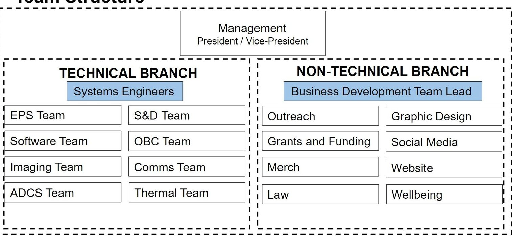
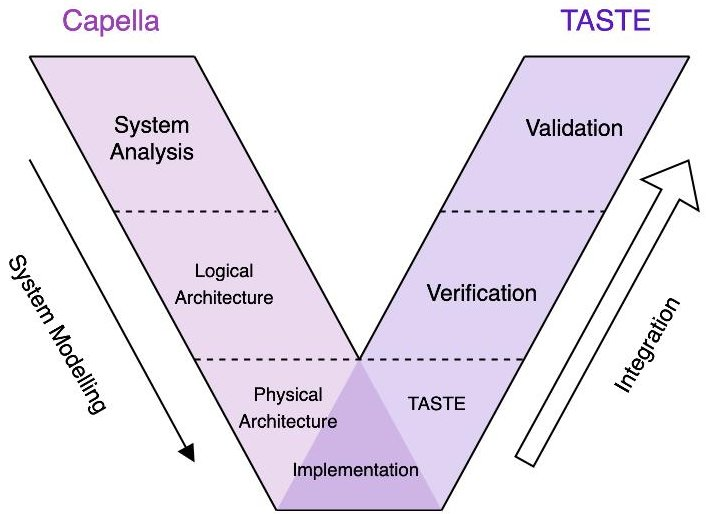
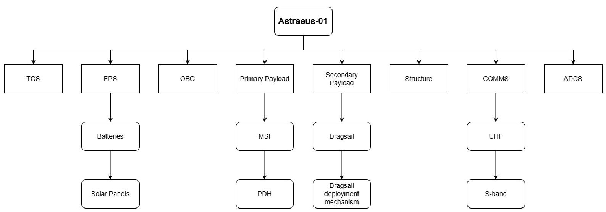
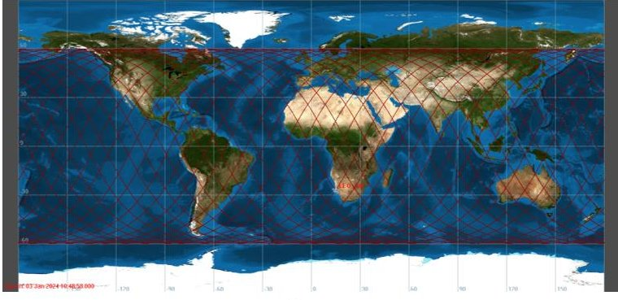
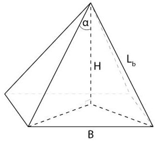
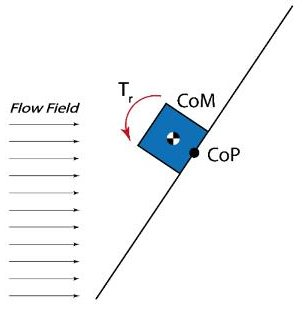
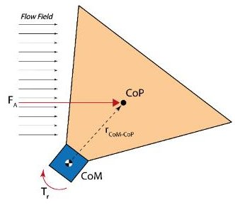
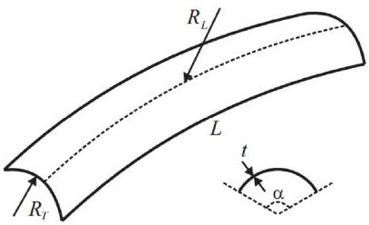
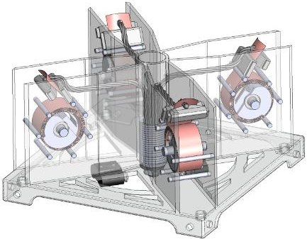

<!-- PDF_PAGE: 1 -->

IAC-24-A.1.2.3

# Astraeus-01 Mission Proposal: a Student CubeSat for Autonomous Wildfire Risk Assessment Enhanced by Technology Demonstration

Juan Pablo Puente $ ^{a *} $ , Theo Fitch $ ^{b} $ , Giorgio Ciacchella $ ^{c} $ , Neil Goldring $ ^{d} $ , Alzahraa Mohammad $ ^{e} $ Andras Bodragai $ ^{f} $

$ ^{a} $GU Orbit, University of Glasgow, G12 8QQ, Scotland, United Kingdom, juanpapuente@icloud.com

b GU Orbit, University of Glasgow, G12 8QQ, Scotland, United Kingdom, 2622450f@student.gla.ac.uk

$ ^{c} $ GU Orbit, University of Glasgow, G12 8QQ, Scotland, United Kingdom, giorgio.ciacchella@protonmail.com

$ ^{d} $ GU Orbit, University of Glasgow, G12 8QQ, Scotland, United Kingdom, neilgoldring8@gmail.com

$ ^{e} $ GU Orbit, University of Glasgow, G12 8QQ, Scotland, United Kingdom, alzahraa.naief@gmail.com

$ ^{f} $ GU Orbit, University of Glasgow, G12 8QQ, Scotland, United Kingdom, abodrogai@gmail.com

* Corresponding author

## Abstract

With the recent spread of wildfires at alarming rates, protection agencies worldwide require appropriate risk metrics to make data-driven decisions. To increase accessibility to predictive data, the GU Orbit student team at the University of Glasgow proposes Astraeus-01: a 3U CubeSat mission to assess both the likelihood of wildfire occurrence and the severity of wildfire impact in a target area.

This mission aims to provide realistic data at low cost and high rates, to allow for the timely application of preventive and/or mitigating measures. The proposed final data products are hazard maps of the area of interest, visualising estimates for the likelihood of a wildfire event and its severity. A risk index is calculated as their product, and high-risk hotspots are highlighted for priority action [1].

To improve the data offer within a limited link budget, cutting-edge machine learning technologies are adopted to automate processing steps both on-board and on-ground. Images are captured in visible and near-infrared bands to measure the type, density, and health of vegetation in the target area. The short-wave infrared channel is extrapolated to specifically estimate plant moisture content; conversely, non-vegetation segments are discarded, and the remaining images are compressed before downlink.

Geospatial analysis then fuses remote-sensed, synthetic, and third-party data such as weather and population into the final product, and triggers notifications.

To comply with operational requirements and de-orbiting regulations within limited mass and volume budgets, we also propose the deployment of a quasi-rhombic drag-sail through a novel hold-down and release mechanism at the end of the mission lifetime [2].

This paper details the user data requirements, Low Earth Orbit mission design, and preliminary system models of the proposed CubeSat. We identify gaps between demand and offer of similar data, and present operational, orbital, and launch constraints motivating our mission selection.

We also propose preliminary, high-level architectural and numeric models of a system to accomplish the mission, and outline our progress in their development. [3]

<!-- PDF_PAGE: 2 -->

## 1. Background

GU Orbit is a student society at the University of Glasgow with over 60 members; which was founded in 2019. The main goal of the society is to give hands-on experience to students by engaging in the design, building, and launch processes of several aerospace projects. During summer 2022, some of our senior members separated to create OirthirSAT, which went on to win the LaunchUK Nanosat Design Competition. The OirthirSAT project is a 3-U CubeSAT which uses efficient in-orbit processing to provide reliable data on UK coastlines, which can afterwards be used by professionals to monitor erosion.

Similarly to other university teams, GU Orbit underwent an intense restructuring process caused by the knowledge transfer challenges originated by the rapid departure of senior members within the society. In light of this circumstance, we embarked on CloudView, a stratospheric balloon flight used as an early agile process and product validation of several components for a student-built CubeSat Precursor as a comprehensive effort to gather more knowledge and expertise, while rejuvenating GU Orbit. By doing this, we were able to ensure that the society would have a seamless transmission between the incoming members and the former members. Cloudview was a successfull mission reaching over 35km in altitude and was tracked after a four hour journey.

Astraeus-01 is the project that GU Orbit is the next more ambitious project that GU Orbit is working towards, due to the remarkable success and great experience gathered during the Cloudview launch. In order to identify the ideal mission that we could tackle we found out several niche missions with great global importance. Using a inhouse-made standardisation approach, all of these ideas were ranked in several categories, such as, cost, technological barriers to entry, ability to produce data without additional ground infrastructure, required revisit time (in order to reduce costs), cost to reach required orbit etc.

After a rigorous research, Astraeus-01, was concluded to be a 3-U CubeSat capable of monitoring likelihood of wildfire occurance as well as its severity on a targeted area. This descision was caused by several factors such as the problem's increasing global threat, low technological barriers to entry and its advantages in terms of predictive accuracy and velocity in data delivery compared to similar alternatives commonly used.

Although there are currently some satellites capable of monitoring a higher area of wildfires, most of them fall short in providing consistent, high-re solution data necessary for proactive risk management, without the need of post-human processing. Astraeus-01 mission aims to generate realistic hazard maps that predict the likelihood

and severity of wildfires in specific areas, enabling protection agencies to implement preventive and mitigating measures promptly. By incorporating advanced onboard and ground-based machine learning algorithms, Astraeus01 will automate data processing, optimize data transmission within a limited link budget, and deliver actionable insights with minimal delay. We believe that this mission is a crucial step towards bridging the gap between the growing demand for accurate wildfire data and the current limitations in supply, while aligning with global trends in onboard data processing and space sustainability by using a in-house dragsail deployment mechanism.

## 1.1 Project Management

As a student-lead project, Astaeus-01 requires a thorough management plan for the mission to ensure its continuity. This subsection summarises the processes that GU Orbit uses for project management for Astraeus-01. This is a top-level approach to the plan, showcasing several subcomponents.

## 1.1.1 Team Structure

GU Orbit is comprised of 8 technical and 8 nontechnical sub-teams each with a board member representative and several team members. The board members are elected at the end of every academic year and are responsible for managing their respective team.

The structure of GU Orbit's board was customised to align with the goals of Astraeus-01, therefore certain teams, such as Structures and Deployments require additional members on the board to ensure the appropriate distribution of management roles among the relatively large team. Figure shows the roles on the board as well as the distribution of management power.

## 1.1.2 Team Mentor

GU Orbit has an academic mentor from the University of Glasgow, who has acted as the main technical advisor for Astraeus-01. Dr Matteo Ceriotti aids with questions relating to the orbital parameters as well as several of the systems budgets, such as the power budget. Dr. Ceriotti has also helped with involving GU Orbit with the space scene, introducing congresses and conferences which we can participate in and his mentorship is greatly appreciated.

## 1.1.3 Personnel Availability

GU Orbit is comprised of students from various academic disciplines at different points of their academic career, therefore, each student has distinct responsibilities and schedules. It was considered to be crucial for effective project management to monitor the time periods where

<!-- PDF_PAGE: 3 -->

Fig. 1. GU Orbit's team structure.

team members may have other responsibilities, such as exams, or course work. In order to address this problem, availability trackers were developed to record each member's availability, this was done at a sub-team level and a separate one was used for the board members. This tracker was used to ensure that appropriate measures were taken in order to ensure progress continued even during times when some individuals were unavailable to work. Additionally, this tracker was used to ensure the team did not have a single point of failure for any necessary requirements. This table was also useful to monitor the required turnover period caused by certain students graduating; ensuring appropriate handover.

## 1.1.4 Project Matrix

In order to track the documentation required as well as the next steps needed to achieve a goal, a project matrix was created. This spreadsheet had a brief description of the work, and the team member responsible for producing the research and/or documentation. This was constantly updated by the different board members, and it was used to help out during the task's assignment and monitoring. Figure shows a screenshot of the project matrix spreadsheet.

## 1.1.5 Project Planning

At the start of every academic year the President and the Vice-president create a top-view Gantt chart which outlines the tasks that each team is required to achieve. The different board members create separate Gantt charts, organized into specific goals and milestones that their team members should achieve. These charts were utilized to ensure timely completion of key milestones and to establish clear objectives for assigned tasks, facilitating the identification of critical actions. Figure provides a snapshot of the Gantt chart used for this project. It should be noted that this version did not account for component lead times. However, future iterations will incorporate these considerations once the manufacturing process begins.

<!-- PDF_PAGE: 4 -->

## 2. Data uses and Stakeholders

Astraeus-01 will create a data set of maps with their respective hazard areas, a visualization with the estimate for the likelihood of a wildfire event and its severity. This data set is a faster and cheaper alternative, therefore, making it accessible to organisations worldwide will help with wildfire prediction and recovery. The novel on-board processing feature is extremely helpful for organizations that do not have the expertise or standard techniques for extracting the required data from EO imagery. The data set gathered by Astraeus-01 can have several applications such as:

Wildfire monitoring and risk assessment: By analyzing the type, density, and health of vegetation in target areas, Astraeus-01 can help predict the likelihood and potential severity of wildfire events. This information allows for the creation of hazard maps that highlight high-risk zones, supporting both preventive measures and rapid response strategies. Additionally, monitoring vegetation moisture content using near-infrared and short-wave infrared imaging enables more accurate assessments of fire susceptibility. These parameters are critical for decision-makers to manage resources effectively, prioritize areas for fire prevention efforts, and model potential fire spread scenarios. Regular monitoring can also detect changes in vegetation health, identifying areas where early intervention may be necessary to prevent larger fires.

Calibration and validation of numerical models: Planning for climate change-related risks, such as wildfires, relies on predicting how landscapes may change under different conditions or management strategies. These predictions are often generated using numerical models that simulate fire behavior, spread, and intensity across various spatial and temporal scales (e.g., Finney et al., 2011; Sullivan, 2009). Astraeus-01 data can provide critical inputs for these models, such as vegetation type, density, health, and moisture content, which are essential for accurate simulation and risk assessment. By supplying time-series data on vegetation and environmental conditions, Astraeus-01 can help calibrate and validate these models, improving their accuracy and reliability. This data can also be used to train machine learning models that predict wildfire occurrence and severity, enhancing the ability to forecast and respond to potential wildfire threats effectively.

Agricultural Land Management: NIR imaging can monitor vegetation health and soil moisture, providing early warnings of crop stress or drought. These images enable farmers to optimize irrigation and reduce wildfire risks in agricultural areas by identifying moisture-stressed zones prone to fire (Vincent and Dardenne, 2021). Land managers can also use the data to guide controlled burns,

land clearing, and crop rotation, helping prevent fire outbreaks. In fire-prone regions, Astraeus-01 enhances land use planning, promoting sustainable agricultural practices while minimizing fire hazards.

Post disaster analysis: NIR data can be used to map burn scars and assess fire severity, providing crucial information for recovery planning. Local authorities, disaster response teams, and forestry commissions can use this data to prioritize recovery efforts and track vegetation regrowth over time. NIR has shown useful in tracking persistence of post wildfire ash, which is harmful to regrowth (Lewis et al., 2021). In addition, conservation organizations benefit from this data to restore wildlife habitats, monitor ecosystem recovery, and protect endangered species affected by wildfires (Grabska et al., 2022), making it a valuable tool for both immediate damage assessment and long-term conservation efforts.

Some of the stakeholders that could make a great impact with the data gathered by Astraeus-01 are listed below with suggestions for how they might utilize Astraeus-01's gathered data.

The data gathered by Astraeus-01 would provide great assistance to many local governments and authorities overseeing planning permissions for land development and creating wildfire management strategies. These departments often face limited resources to collect data themselves to fully inform these decision, leading to inconsistent approaches and progress in the standardization of wildfire management plans. Access to publicly available wildfire risk data, provided by Astaeus-01, would alleviate some of this burden of data collection, enabling local governments and authorities to improve wildfire management plans.

We are aiming to collaborate with data distribution organisations to support the valuable research already underway. The Global Wildfire Information System (GWIS) aims to bring together existing information sources at regional and national levels to provide a comprehensive view and evaluation of fire regimes and fire effects at global level [4]. The European Forest Fire Information System (EFFIS) operates similarly in the EU. Working with organisations like GWIS and EFFIS would provide an opportunity to have the data collected by Astraeus-01 be readily available in global registries, to as many people as possible.

A 2014 study by the UK Forestry Commission mapped wildfire risk in the UK using the McArthur Forest Fire Danger Index (FFDI). It suggests regular review and analysis of data used to inform wildfire prevention policy, by providing data we obtain we can assist in the development of a well informed review process. The findings of this study informed the fire and rescue service operational

<!-- PDF_PAGE: 5 -->

guidance publication by the Scottish government, showing its influence and requirement for up to date information [5].

The Earth Fire Alliance (EFA), a newly formed nonprofit organization dedicated to addressing the growing threat of wildfires through advanced technology and global collaboration, represents a key potential stakeholder for the Astraeus-01 mission. Focused on wildfire prevention, response, and ecological recovery, the EFA seeks to leverage satellite data to enhance their monitoring and risk assessment capabilities [6]. Astraeus-01's near-infrared imaging aids the Alliance's goals of using EO to inform global firefighting efforts and disaster preparedness strategies. Additionally, Astraeus-01's ability to assess post-fire damage and support long-term conservation initiatives would help the EFA in its mission to restore ecosystems and protect communities from future wildfire threats. By utilizing Astraeus-01's accessible and timely data, the Earth Fire Alliance could strengthen its fire mitigation strategies and drive more effective wildfire management worldwide.

<!-- PDF_PAGE: 6 -->

## 3. Requirements Management

As an increasingly complex system, the design approach for this mission was thoroughly evaluated. A method that takes into account the team structure of: Systems Engineers, Team Leaders, and Team members is crucial for the project workflow.

Model-Based Systems Engineering (MBSE) simplifies the integration between different subsystems, defining the requirements based on the desired end goal of the mission. We can start with a relatively high level definition of the system and get more granular as the system develops. This is particularly useful for a student-led team as the research and the development processes can run hand in hand. This method also aids the team structure of GU Orbit as higher system level development can be done by the systems engineers, to ensure that all the subsystems work cohesively, and the more technical implementation can be done by more specifically experienced team members.

## 3.1 Tools

The tool used to create the model-based system is Thales' Capella which utilises the ARCADIA method to define four main system levels:

2. System Analysis

1. Operational Analysis

3. Logical Architecture

## 4. Physical Architecture

Capella is an open-source tool with a lot available guides and support making it a great tool for student projects. Our team has benefited from an intensive Capella training course from representatives at Thales as part of our collaboration with University of Birmingham's Master's students.

The Operational Analysis level defines the operations of a system. This is especially useful for systems that have multiple actors that influence the system. In the case of a CubeSat, where we try to define the interactions between the subsystems within, this level was discarded as it had little value representing the system.

The System Analysis level is where the basic capabilities of the system are defined. This level represents the CubeSat as a black box, merging all the different subsystems into one entity, allowing us to define high-level functions of the system as a whole [3].

Moving one level of abstraction down, the Logical Architecture level removes the initial black box, revealing the different subsystems that make up the CubeSat.

Capella allows us to migrate all the capabilities and functions that were defined in the System Analysis and assign them to their respective subsystems. Sometimes a function can be assigned to different subsystems.

Much like the transition from the System Analysis to Logical Architecture, The Physical Architecture inherits the capabilities from the higher levens and breaks down the different subsystems to their components.

## 3.2 The design approach (The V-Model)

Much like MBSE, the V-Model breaks the system down into levels of abstraction, including the verification and validation [7]. Figure 2 shows a simplified version of the workflow to specify the requirements. First, The three main levels are modelled in Capella. Then, after the Physical Architecture is fully defined, the implementation, verification, and validation stages follow. The nature of the subsystem determines the way the validations and verifications are done.

Fig. 2. The V-model method used by GU Orbit.

This workflow was modelled for the embedded systems of the satellite, more specifically the On-Board Computer, which is where most interactions between subsystems occur. For the integration stages, a model-driven software development toolchain (TASTE) is used. The parallels between the two tools were intensively studied and the workflow to integrate them was described in detail in [3].

<!-- PDF_PAGE: 7 -->

## 4. Mission Overview

Astraeus-01 is 3U, Earth Observation (EO) CubeSat carrying two payloads to; predict wildfire occurrence and severity, and advance space sustainability goals. These payloads will comprise of a Multi Spectral Imager (MSI) with its own Payload Data Handling (PDH) unit, and a dragsail to aid with the de-orbitprocess of the satellite at the aftermission phase.

The estimated operating period of the CubeSat is 2 years, during this, the MSI shall take images that will be processed by the PDH and delivered to the ground periodically via the S-band transmitter. Once the mission is completed, after two years in orbit, the dragsail will be deployed to demonstrate its ability to minimize space debris specified in section 7.

## 4.1 Subsystem Breakdown

As seen in Figure 3, Astraeus-01 will be comprised of a total of 8 main subsystems. The subsystems are: the primary payload; comprised of an MSI and a PDH, the secondary payload; comprised of the dragsail and its deployment mechanism; the structure; capable of holding all the subsystems in place,the On-board Computer (OBC), the Electric Power Supply (EPS), Attitude Determination and Control Subsystem (ADCS), Communication Subsystem (COMMS) and the Thermal Control subsystem (TCS).

The COMMS subsystem, will consist of multiple components such as a Ultra High Frequencie (UHF) transceiver, used for TT&C, and an S-band transmitter, used for the downlink of data packets, each equipped with a respective antenna. According to the link budget calculations, a single ground station, capable of communicating in both UHF and S-band, can be used to achieve mission success.

Astraeus-01 uses an EPS module that has solar panels to recharge the spacecraft and Lithium Ion batteries to store the energy.

The OBC monitors the rest of the subsystems and send commands to the appropriate subsystems.

The MSI will use near-infrared and visible bands to capture enough information to monitor the type, density and the health of the vegetation in the targeted area. For the data to be more accurate, a higher ground resolution is ideal, hence the MSI is proposed to have a field of view of 18 degrees to achieve a ground resolution of around 30m/pixel depending on the altitude.

As previously mentioned, the camera payload selected will use visible and NIR bands. These band where selected as generally the emissivity rate of most plants drops as their moisture content decreases [8] [9]. The exact value will vary depending on a wide variety of factors including pollution, weather and plant species however the

use of these band for this purpose has been widely studied [10] and can therefore be accounted for. UV bands could also be used for additional data, however UV cameras are often much more expensive the visible and NIR cameras which makes the much less accessible to us.

In order to point the spacecraft in the correct orientation during different parts of a life cycle, an ADCS composed of several components such as reaction wheels, sun sensors, magnetorquers and star trackers will be used.

After creating a mass and volume budget for the mission, it was concluded that the configuration required for the Astraeus-01 mission can fit into a 3U CubeSat with a maximum estimated mass of 6kg. A basic power budget was created for the initial calculations of Astraeus-01, during this analysis, a maximum power consumption of the spacecraft was calculated to be 24W; this would require a 30 Watt hour battery pack as well as $ 6 0 0 \mathrm{c m}^{2} $ of solar panels.

<!-- PDF_PAGE: 8 -->

Fig. 3. Subsystem breakdown for the Astraeus-01 spacecraft.

<!-- PDF_PAGE: 9 -->

## 5. Mission Profile

For simplicity purposes, the Astraeus-01 mission was divided into four different operational phases. These were separated due to their notable differences in terms of subsystems utilized, operational parameters, and required inground infrastructure. By separating the mission into four phases, the risk and requirement management can be performed by different members of the team without the help from previous team members, hence facilitating smoother transitions between separate stages of the mission. The four modes are:

1- Launch and Early Operations Phase (LEOP): This stage starts with the integration of the CubeSat to the launch vehicle provider; involving the transport and integration with the deployer. This mission ends when the spacecraft is located in orbit.

2- Commissioning Phase: This phase is short as it only requires all subsystems to be checked for operation. Once all the subsystems are commissioned, the routine operation phase can initiate.

3- Routine Operation Phase (ROP): The period over which the spacecraft will collect, process and deliver scientific data in accordance with the mission objectives. This phase shall take two years and it is the phase in which the spacecraft collects data.

4- After mission Phase: The period after the end of the science acquisition during which the satellite de-orbits. In the case of Astraeus-01, this phase is an active phase due to the demonstration of the dragsail as a deorbit device. During this period, the spacecraft loses altitude due to the drag created by the dragsail until it re-entrys and evaporates in the earth's atmosphere.

This paper mainly talks about the Routine Operations and aftermission phases.

## 5.1 Orbital Parameters

The Astreus-01 CubeSat shall be in a sun synchronous orbit (SSO) at an altitude of 465 km. This was selected as it is optimal for an EO mission as it is low enough to capture the images clearly whilst maintaining an almost constant revisit time of almost 3 days without risking a quicker than expected reentry time.

Due to the new advancements in rocket technology, a lot of up and coming companies are able to offer orbital inclinations in LEO which are ideal for this mission. As a consequence, due to the low revisit time needed for the mission and the high target area, a proposed 60o inclination orbit is proposed. As seeb in the map below, the spacecraft will be able to take images of almost everywhere around the world in only 10 orbits.

A partenrship with gilmour space would be ideal for the mission as they are able to launch our satellite to such an orbit at a relatively low cost.

With the aim of delivering data weekly, the 3-day revisit cycle allows for two chances of observing each location and thus, two chances of obtaining a cloudless image. This maximizes the effectiveness of the mission by maximising the amount of useful imagery (i.e. cloudless imagery that can be processed for fire prediction).

The resulting vector map is expected to have a size of 3.5 MB which marks a reduction of 99% approximately compared to the raw data of 1.6-2GB which corresponds to four bands of imagery of the target area that are needed to create the vector map. This is a driving force to the reduction of data provision time, and effectiveness/ efficiency of the data. The data acquisition, processing and delivery is expected to last for a maximum of 2 days and thus data can be provided to the user no later than 3 or 4 days as seen in Figure... This speeds up the process of obtaining processed data for the clients by 76% compared to the 14 days that scientists currently need to get access to open-source satellite imagery such as Sentinel. At the current altitude and MSI size, the ground resolution is at 30 m/pixel which is equally competitive with the open-source satellite imagery of Sentinel and Landsat making the provision of these data directly applicable to the current users.

Fig. 4. Ground track created via Gmat

<!-- PDF_PAGE: 10 -->

## 6. Routine Operation Phase

## 6.1 On-Board Processing

The data-driven nature of Astraeus-01 CubeSat mission plays a central role in its wildfire risk assessment capabilities, where efficient handling and processing of vast amounts of image data are key. The onboard processing pipeline is designed to streamline the collection, filtering, and transmission of data, ensuring only the most relevant information is downlinked. By employing deep learning techniques, the pipeline focuses on detecting and isolating vegetation areas from NIR, R, G images, which are crucial for the mission's objectives.

Vegetation segmentation forms the core of the data reduction process. Using semantic segmentation based on SegFormer [11], the pipeline identifies critical vegetation data while discarding non-essential information, aligning with the mission's data minimization strategy. The subsequent compression stage takes this a step further, applying algorithms like JPEG XL to shrink the dataset without sacrificing the vital data required for ground-based analysis. By compressing images based on segmentation masks, the pipeline ensures maximum efficiency in data handling, crucial for power-constrained CubeSat platforms.

Even with lower-resolution data, effective and highquality processing is made possible by the on-board Semantic Segmentation model, which was trained using the OpenSentinelMap [12] dataset obtained from Sentinel-2 images. By weighing the necessity for precise vegetation recognition against limited onboard resources, the CubeSat is able to achieve this trade-off. The pipeline guarantees the segmentation model's efficient operation in limited computing conditions, which are common in CubeSat flights, by utilising TensorRT acceleration. In order for the CubeSat to interpret data in real time and decide what needs to be relayed to the ground station, its efficiency is crucial.

Furthermore, the pipeline is made to function within the strict power and bandwidth constraints of the CubeSat. Advanced compression techniques combined with lightweight deep learning models guarantee timely and minimal data transfer. The pipeline minimises operating expenses and improves mission effectiveness by sending less data to ground stations. Due to these optimisations, Astraeus-01 is now an outstanding example of a data-driven, economical satellite mission that can accomplish important environmental discoveries while working under strict resource limitations.

By reducing the amount of data transmitted and optimizing processing onboard, the pipeline enhances the CubeSat's cost-effectiveness, ensuring it can perform environmental monitoring tasks efficiently on a low-cost platform. The careful design of the pipeline supports both the

power and bandwidth limitations inherent in CubeSat missions, contributing to the overall success of the project.

## 6.2 Ground Processing

In the ground processing phase, the focus shifts from the resource-efficient on-board processing to maximizing the accuracy and quality of predictions using powerful neural networks and the integration of various data sources. The first major component of this stage is data extrapolation, where the short-wave infrared (SWIR) band is synthesized from near-infrared (NIR), red (R), and green (G) channels. This approach is crucial for obtaining additional information on ground moisture, which plays a significant role in predicting wildfire risks. By synthesizing SWIR data from more readily available spectral bands, we can derive the Normalized Difference Moisture Index (NDMI), a key indicator of plant water content.

For this task, we employed a Masked Auto-Encoder (MAE) [13] architecture, adapted to generate SWIR data from the NIR, red, and green channels. While the MAE model was not pre-trained on the Sentinel-2 dataset due to resource constraints, it effectively synthesized the required SWIR data from these channels. The model's encoder-decoder structure was modified to output a singlechannel SWIR band, which allowed for accurate NDMI calculations. This process, combined with the Normalized Difference Vegetation Index (NDVI) derived from the available NIR, red, and green data, provided comprehensive insights into vegetation health and moisture-critical factors for wildfire risk assessment.

The final stage of ground processing involves integrating this vegetation data with other key environmental and meteorological variables, such as wind speed and temperature, to create a detailed wildfire hazard map. This map is generated using a Geographic Information System (GIS) tool, where the data is analyzed and layered with other variables like land use, population density, and climate zone information. By regularly importing data on weather and vegetation conditions, the system can update the hazard map to reflect the changing risk factors, allowing for accurate, real-time wildfire risk assessment.

<!-- PDF_PAGE: 11 -->

## 7. After Mission Phase

This section of the paper outlines the after-mission phase of the Astraeus-01 mission, detailing the technical procedure of de-orbiting once the mission's primary objectives have been achieved.

Orbital debris is quickly emerging into a more prevalent and alarming issue that poses a significant challenge to successful human activity within the space sector. As a result, GU Orbit's Astraeus-01 will be equipped with and deploy a quasi-rhombic drag sail as a de-orbiting device [2]. This payload represents a simple but effective solution for the mitigation of space debris caused by our 3U CubeSat. The after-mission phase is designed to operate during the entirety of the de-orbiting period in order to provide real-time data of the satellite's attitude and position. This allows for tracking the spacecraft and assessing the drag sail's performance.

## 7.1 The Drag Sail

Within this paper, the structure, material and deployment mechanisms of the drag sail will be examined. Different aspects of the geometry and folding technique required to integrate the drag sail onto the main CubeSat overall structure are discussed. The design incorporates considerations for material degradation phenomena, such as thermal and oxygen degradation, to minimise their impact throughout the mission's duration.

The quasi-rhombic drag sail itself consists of a thinfilm deployable membrane with the purpose of increasing the CubeSat's drag. This allows the satellite to re-enter the atmosphere and more importantly, decay within a shorter time frame in order to mitigate the space debris, adhering to sustainability requirements. This occurs due to the presence of atomic oxygen (AO) at LEO, which interacts with the satellite to gradually reduce its speed and altitude, in a steadily increasing manner, ultimately leading to its deorbit. The drag sail would accelerate this process due to its additional surface area and subsequent increased number of AO molecules interacting with the larger surface area. Several studies have demonstrated that for a 3U CubeSat, a drag area of $ 4 \mathrm{m}^{2} $ is adequate to meet the requirement given by The Inter-Agency Space Debris Coordination Committee in 2007 [14]. This states that satellites in LEO should be de-orbited no more than 25 years after the end of their operational lives. Nevertheless, the Structures and Deployments subteam estimates that for Astraeus-01 a deorbit time of less than two years can be achieved with this drag area but this is heavily dependent on solar activity.

Fig. 5. Geometry of the QRP drag sail with critical dimensions included

As seen in Figure 5, the dragsail's geometry was selected to be a quasi-rhombic pyramid (QRP) design, as proposed by [15], featuring a base of 2m to provide a frontal drag area of $ 4 \mathrm{m}^{2} $ . An apex half-angle of $ 3 0^{\circ} $ was selected to provide the CubeSat with an aerodynamically stable profile. Consequently, the booms will each be 1.87m in length, creating a projected area of $ 7 \mathrm{m}^{2} $ when viewed on a flat plane. The quasi-rhombic pyramid sail (QRP) is more aerodynamically stable than a flat sail, as it has a higher restoring torque due to the offset in the centre of mass (CoM) and centre of pressure (CoP).

(a) Flat sail configuration.

(b) Pyramid sail configuration.

Fig. 6. The aero-stability characteristics comparison between a flat sail and a pyramid sail.

The material selection for the drag sail is governed by two primary requirements. The first is that the material must withstand the effects of the space environment, specifically degradation from atomic oxygen (AO) and thermal radiation in the form of ultraviolet (UV) radiation. The second requirement is related to the material's interaction with solar radiation pressure, leading to the selection of a transparent film to minimise this effect. While Kapton film was deemed ideal for meeting the second requirement, its susceptibility to degradation under space conditions made it unsuitable for the first. As a result a protective aluminium coating is necessary. To meet mass and volume constraints, Astraeus-01 will utilise a 12.7 $ \mu \mathrm{m} $ Kapton film with a 300 $ \mathrm{\AA} $ aluminum coating, folded using Z-folds and Miura-Ori packaging.

<!-- PDF_PAGE: 12 -->

## 7.2 Deployment mechanisms

## 7.2.1 Spool and Boom Mechanism

For the successful deployment of the drag sail, a deployable structure is required for attachment. A commonly used, cost-effective, and relatively simple solution is the use of tape spring booms coiled around a spool. The radius of the spool around which the boom is coiled determines the kinetic energy and therefore velocity during the deployment. A smaller radius will give a more violent deployment and vice versa. A balance must be reached in order for the deployment to have sufficient energy to overcome frictional forces without risk of the sail tearing or detaching. Another very importance consideration is that the spool Radius, $ R_{S} $ should be approximately equal to the boom's transverse radius, $ R_{T} $ . This prevents unwarranted tape spring expansion or buckling upon deployment. To estimate the size of both the boom and spool, a rudimentary model has been produced involving the potential energy of the boom, $ E_{p} $ , the kinetic energy of the boom, $ K_{E} $ the frictional losses due to deployment and the potential energy of the boom in its coiled state, $ E_{P0} $ . As a result a rough estimate of 16-17mm for the spool radius, $ R_{S} $ has been obtained.

Fig. 7. Geometric parameters of the tape spring as adapted from [16]

## 7.2.2 Hold-Down Release Mechanism

Hold-Down and Release Mechanisms (HDRMs) are electromechanical devices frequently used onboard satellites to release various deployable structures.Several pyrotechnic and non-pyrotechnic hold down and release mechanisms were evaluated for deployment of the drag sail. Some of these HDRMs would include nichrome burn-wire Mechanisms, CYPRES $ ^{\mathrm{TM}} $ cutters [17], separation nuts and TiNi $ ^{\mathrm{TM}} $ ejector/pin pullers. These tried and tested HDRM technologies were evaluated through the use of a selection matrix. The parameters compared were volume, mass, peak power consumption, cost, complexity, reliability, sustainability and pyrotechnic risks. Using the scoring matrix, the highest-scoring HDRM was the nichrome burn-wire [18]. One of the main requirements of the drag sail is such that the mechanism must be synchronated so that it can activate at the same time in different locations. Therefore, to adhere to this requirement whilst making sure peak power consumption remains relatively low on deployment, the wire must have a constant current of 1.60 $ \pm $ 0.05 A to have a clean cut without overheating.

## 7.3 The Primary Drag Sail Structure

The primary structure of the drag sail housing will be a machined component made from Aluminium 6082. This material was selected to match that of the overall nanosatellite structure, ensuring both have the same thermal expansion coefficient and reduce the risk of fracture during the thermal cycles in space. The base of the structure features cut-outs designed to reduce mass without significantly compromising structural integrity. These openings also serve as pathways for the harnesses of HDRMs and deployment feedback sensors, which are connected to the deployment mechanisms. The structure has been designed to be compatible with the PC104 CubeSat standard.

Fig. 8. Isometric view of the HDRMs integrated within the primary drag sail structure

## 7.4 Deployment Doors

The primary function of the drag sail doors is to shield the sail membrane from the harsh conditions of the space environment until deployment. The cover and cover wall of each door shall be manufactured from the same Aluminium 6082 as the rest of the structure. This material cannot be easily penetrated by atomic oxygen, so the door will be able to protect the sail from bombardment and eventual degradation until deployment.

The design of the overall drag sail deployment mechanism mounted on Astraeus-01 will incorporate four HDRM nichrome burn-wires. To ensure that the door deployment operates independently from the drag sail deployment, two HDRM burn-wires will be dedicated to opening the doors. The remaining two will be used for drag sail deployment, providing redundancy in the design. The HDRMs will be triggered in a predetermined sequence to prevent jamming during the deployment process.

<!-- PDF_PAGE: 13 -->

## 8. Conclusion

This paper showcases the mission of Astraeus-01; a low-cost, data-driven solution to assess wildfire risks and predict their severity. This mission was designed due to the increasing threat of wildfires and the global need for effective risk management tools. Using a 3U CubeSat structure, Astraeus-01 will be able to employ advanced machine learning algorithms, visible and near-infrared imaging, two different communication modules and a in-house made dragsail deployment mechanism. This mission aims to deliver a consistent and accurate source of hazard maps, providing essential insights for preventive and mitigating measures. By integrating various data sources, including vegetation health and weather conditions, Astraeus-01 highlights areas with high risk for priority intervention.

Astraeus-01 is able to maximize the data delivery within the limited mass, volume, and power budgets of the mission. It also incorporates a novel quasi-rhombic drag-sail in order to ensure rapid and controlled de-orbit of the spacecraft. This paper has provided a comprehensive overview of GU Orbit's management process, the routine operations phase and the aftermission phase, while identifying key gaps in the current data offerings for wildfire management. Astraeus-01 stands as a promising step forward in providing accessible, actionable data for wildfire prevention and mitigation efforts globally.

GU Orbit aims to keep on working with Astraeus-01 for the upcoming years. Ideally, by the end of the academic year, a preliminary design document will be finalized, and the orbital parameters as well as the power budget shall be finalized,

<!-- PDF_PAGE: 14 -->

## References

Marialina, Tsinidi (2023). "Calculation of the Death Index of the Most Catastrophic Wildfires". In: 74th International Astronautical Congress. URL: https://iafastro .directory /iac/paper /id/77010/ abstract - pdf / IAC-23, B1, IP, 25, x77010 brief.pdf?2023-04-06.13:35:11.

MacAskill, Gregor, Stefano Messina, and Ignacio Serrano Martín-Sacristán (Apr. 2022). "Mechanical Design and Deployment of a Quasi-Rhombic Pyramid Drag Sail for Safe De-orbit of a 3U CubeSat". In: 4th Symposium on Space Educational Activities. Universitat Politècnica de Catalunya. ISBN: 9788419184405. DOI: 10.5821/conference-9788419184405.134. URL: http:// hdl.handle.net/2117/370476.

Giorgio, Ciaccella, Mohammad Alzahraa, and Zurawski Szymon (2023). "An Open-Source Method for ModelBased Development for Embedded Systems: Experience Report from a CubeSat Student Project". In: 74th International Astronautical Congress. URL: https:// iafastro .directory /iac/paper /id/77646/ abstract-pdf/IAC-23,D1,IP,6,x77646.brief. pdf?2023-04-12.18:52:15.

European Commission, Joint Research Centre (JRC) (2024). Global Wildfire Information System (GWIS) Data License. Accessed: 2024-09-16. URL: https:// gwis.jrc.ec.europa.eu/about-gwis/data- license.

Commission, Foresty (2014). Building wildfire resilience into forest management planning. Foresty Commission Edinburgh. URL: https://cdn.forestresearch.gov.uk/2014/03/fcpg022.pdf.

Alliance, Earth Fire (2024). FireSat, built from the ground up with and for the wildfire community. Accessed: 2024- 09-16. URL: https://www.earthfirealliance org/#our-solution.

Weilkiens, Tim, Jesko G Lamm, Stephan Roth, et al. (2016). "The V-model". In: Model-Based Syst Archit, pp. 343-352. URL: https://onlinelibrary.wiley. com/doi/pdfdirect/10.1002/9781119051930. app2.

Xue, Jinru, Jinru Xue, Baofeng Su, et al. (2017). "Significant remote sensing vegetation indices: A review of developments and applications". In: Journal of Sensors. DOI: 10.1155/2017/1353691.

NASA (2018). Reflected Near-Infrared Waves. URL: https : / / science . nasa . gov / ems / 08 nearinfraredwaves/.

LIU Chang SUN Peng-Sen, LIU Shi-Rong (2016). "A review of plant spectral reflectance response to water physiological changes". In: Chinese Journal of Plant Ecology. DOI: 10.17521/2016.

Xie, Enze, Wenhai Wang, Zhiding Yu, et al. (2021). "SegFormer: Simple and Efficient Design for Semantic Segmentation with Transformers". In: CoRR abs/2105.15203. arXiv: 2105.15203. URL: https:// arxiv.org/abs/2105.15203.

Johnson, Noah, Wayne Treible, and Daniel Crispell (June 2022). "OpenSentinelMap: A Large-Scale Land Use Dataset Using OpenStreetMap and Sentinel-2 Imagery". In: Proceedings of the IEEE/CVF Conference on Computer Vision and Pattern Recognition (CVPR) Workshops, pp. 1333-1341.

He, Kaiming, Xinlei Chen, Saining Xie, et al. (2021). Masked Autoencoders Are Scalable Vision Learners. arXiv: 2111.06377 [cs.CV]. URL: https://arxiv.org/abs/2111.06377.

Comittee, Inter-Agency Space Debris Coordination (2020). IADC Space Debris Mitigation Guidelines. URL: https://orbitaldebris.jsc.nasa.gov/library/iadc-space-debris-guidelines-revision-2.pdf.

Matteo Ceriotti, Patrick Harkness and Malcolm McRobb (2013). "Variable-Geometry Solar Sailing: The Possibilities of the Quasi-Rhombic Pyramid". In: null. DOI: 10.1007/978-3-642-34907-2_54.

Florence Dewalque, Pierre Rochus and Olivier Bruls (2015). "Importance of structural damping in the dynamic analysis of compliant deployable structures". In: Acta Astronautica. DOI: 10.1016/j.actaastro.2015.03.003.

al., Jennifer Kingston et (2014). "Use of CYPRES $ ^{\mathrm{TM}} $ cutters with a Kevlar clamp band for hold-down and release of the Icarus De-Orbit Sail payload on TechDemoSat1". In: Acta Astronautica. DOI: 10.1016/j.actaastro.2014.03.014.

NASA Edward A. Boesiger, Robin Phillips et al. (2012). Development of Brushed and Brushless DC Motors for use in the ExoMars Drilling and Sampling Mechanism. URL: https://ntrs.nasa.gov/api/citations/ 20130008824/downloads/20130008824.pdf.