<!-- PDF_PAGE: 1 -->

2024-05-01

# Development Of A Digital Engineering Testing Framework For Cubesat Applications

Javier Alberto Martell University of Texas at El Paso

Follow this and additional works at: https://scholarworks.utep.edu/open_etd Part of the Aerospace Engineering Commons

<!-- PDF_PAGE: 2 -->

DEVELOPMENT OF A DIGITAL ENGINEERING TESTING FRAMEWORK FOR

## CUBESAT APPLICATIONS

## JAVIER ALBERTO MARTELL

## Master's Program in Mechanical Engineering

APPROVED:

Joel Quintana, Ph.D., Chair

Angel Flores-Abad, Ph.D.

Roberto Osegueda, Ph.D.

Stephen L. Crites, Jr., Ph.D.

Dean of the Graduate School

<!-- PDF_PAGE: 3 -->

<!-- PDF_PAGE: 4 -->

Dedication

For my mother, who has always taught me the importance of hard work, dedication, and to always pursue my goals no matter how small or big they are.

<!-- PDF_PAGE: 5 -->

DEVELOPMENT OF A DIGITAL ENGINEERING TESTING FRAMEWORK FOR

CUBESAT APPLICATIONS

by

## JAVIER ALBERTO MARTELL B.S.

# THESIS

# Presented to the Faculty of the Graduate School of The University of Texas at El Paso in Partial Fulfillment of the Requirements for the Degree of

MASTER OF SCIENCE

Department of Aerospace and Mechanical Engineering

THE UNIVERSITY OF TEXAS AT EL PASO

May 2024

<!-- PDF_PAGE: 6 -->

## Acknowledgements

First and foremost, I would like to thank my mother whose hard work, dedication and unconditional support gave me the opportunity to be writing this today. If not for her, I wouldn't be where I am. Dr. Quintana, Dr. Flores, and Dr. Osegueda. With your help and guidance, I was able to learn and overcome the challenges that I faced during my graduate studies. You all pushed me to become the best engineer that I could, and for that I will always be grateful. My wife Evelin, whose care, love, and support helped me managed hard and stressful times during my studies. You all helped me develop the skills that I have today, and to enjoy every step of the journey.

<!-- PDF_PAGE: 7 -->

## Abstract

Digital Engineering (DE) is playing an important and expanded role in today's industry. As engineering systems become more and more complex with each new iteration, the need for a more efficient and agile methodology for project management and development is needed. The SleeperSat-1 (SPST-1) is a Modular Open System Architecture (MOSA) type of small satellite being developed by the UTEP Aerospace Center. The SPST-1 will mostly use digital engineering tools for its lifecycle research and development. CubeSats require rigorous environmental testing not only to ensure the success of the mission, but also to ensure the safety of the crew, space vehicle and other CubeSats stowed in the same deployer. The workflow and implementation of DE tools to develop a high-fidelity Digital Twin (DT) to test and validate results for CubeSats environmental testing are presented, as well as the design of a modular CubeSat chassis.

Keywords: Digital Engineering (DE), Digital Twin (DT), Workflows, CubeSats environmental testing, SPST-1.

<!-- PDF_PAGE: 8 -->

## Table of Contents

Dedication...iii

Acknowledgements...v

Abstract...vi

Table of Contents...vii

List of Tables...viii

List of Figures...ix

Chapter 1: Introduction...1

1.1 Digital Engineering...1

1.2 CubeSats...2

Chapter 2: Digital Twin Modeling...4

2.1 SPST-1 CAD Models...4

2.1.1 SPST-1 Modular Chassis Design...5

2.2 SPST-1 FEM Models...8

2.2.1 Mesh Study...15

2.3 Simulations...18

2.3.1 Integrated Loads Environment...18

2.3.2 Random Vibration Environment...20

Chapter 3: Verification of Analyses...25

3.1 Integrated Loads Verification...25

3.2 Random Vibration Verification...27

Chapter 4: Conclusions and Future Work...30

References...31

Vita 33

<!-- PDF_PAGE: 9 -->

## List of Tables

Table 2.1.1.1: Material properties of Aluminum 6061 at 20 $ ^{\circ} \mathrm{C} $ ... 8

Table 2.2.1: Steel material properties at 20 $ ^{\circ} \mathrm{C} $ ... 14

Table 2.2.1.1 Deformation comparisons at different elements sizes ... 17

Table 2.3.2.1: Hard Mount Random Vibration Test Profiles ... 20

<!-- PDF_PAGE: 10 -->

Figure 1.1.1: Aerospace Center DE Framework...2

Figure 1.2.1: 4U SPST-1 Configuration. Robotic Arm (left), AIML and Core (right). ...3

Figure 2.1.1.1: Isometric View of Assembled Chassis with Coordinate System. ...5

Figure 2.1.1.2: Isometric view of rail. ...6

Figure 2.1.1.3: Connection between rail, y-face, and x-face. ...6

Figure 2.1.1.4: Isometric view of x-face (right) and y-face (left). ...7

Figure 2.1.1.5: Isometric view of z-face. ...7

Figure 2.1.1.6: Connection between x-face and z-face. ...8

Figure 2.2.1: CTETRA element connection (left) and coordinate system (right). ...10

Figure 2.2.2: CHEXA elements (left) and coordinate system (right). ...10

Figure 2.2.3: Isometric view of x-face (left) and y-face (right) idealized part. ...11

Figure 2.2.4: x-face and y-face idealized part cuts. ...11

Figure 2.2.5: z-face idealized part cuts. ...12

Figure 2.2.6: Rail idealized part cuts. ...12

Figure 2.2.7: y-face no mesh mating condition (left) vs mesh mating condition (right). ...13

Figure 2.2.8: Chassis assembly FEM. ...13

Figure 2.2.9: CBAR and RBE3 elements modeling screw connection between chassis parts. ...14

Figure 2.2.10: Chassis assembly FEM with screw connections. ...15

Figure 2.2.1.1: Mesh element size at 1mm (upper left), 3mm (upper right), 5mm (lower left), and 8 mm (lower right ). ...16

Figure 2.2.1.2: Deformation contour at 1mm (upper left), 3mm (upper right), 5mm (lower left ), and 8mm (lower right) element size. ...16

Figure 2.3.1.1: Isometric view of model with forces (red), surface to surface contact (yellow) and fixed constrains (blue). ...18

Figure 2.3.1.2: Deformation contour of chassis. ...19

Figure 2.3.1.3: Stress contour with inverted spectrum of chassis. ...19

Figure 2.3.2.1: Random Vibration Test Profiles. ...20

Figure 2.3.2.2:FEM with remote point connected to chassis. ...21

Figure 2.3.2.3: Normal modes response at 49.15 (upper left), 183.74 (upper right), 191.92 (lower left), and 198 (lower right) Hz. ...22

Figure 2.3.2.4: Locations of acceleration sensors. ...23

Figure 2.3.2.5: Frequency vs acceleration evaluation for sensor with applied random profile. ...23

Figure 2.3.2.6: Von Misses stresses at top face. ...24

Figure 3.1: Assembled chassis prototype. ...25

Figure 3.1.1: Experimental compression setup. ...26

Figure 3.1.2: Load vs position graph. ...27

Figure 3.2.1: Vibration test setup. ...28

Figure 3.2.2: Sine profile (left) and random profile (right) test results in z-axis. ...29

Figure 3.2.3: Comparison between simulation and test data. ...29

<!-- PDF_PAGE: 11 -->

## Chapter 1: Introduction

## 1.1 DIGITAL ENGINEERING

The origins of the term DE are found back in 1975, where DE was discussed in the context of electronics and logic circuit design. The term digital referred to the move from analogue to digital. Future applications were predicted to be "developing digital concepts and systems" and product lifecycle management (PLM) in the manufacturing context. The aim of DE is creating a seamless line data through interoperability across heterogenous systems, integrated information management, facilitating information utilization and data exchange, during product lifecycle [1]. Although the DE term has been around for nearly fifty years, it is still widely interpretated across different industries. For some, DE may be having a Digital Twin (DT) of the system, for others, implementing a Model-Based Systems Engineering (MBSE) model, etc. While these are DE tools that work great for many project applications, many of them are missing the key component of having a heterogeneous and harmonious interface. The UTEP Aerospace Center is creating a modal DE environment where all these pieces fit into one. The use of DT, MBSE models, clouds, PLM, etc. will create a more efficient and standardized approach to fully integrate every aspect of a project digitally. The SPST-1 will serve as a case study to prove this concept. This thesis will focus on the development of a DT for CubeSats environmental testing requirement with verification of analysis.

<!-- PDF_PAGE: 12 -->

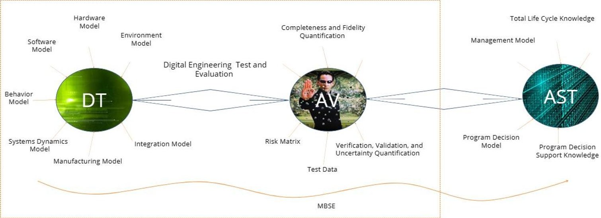

Figure 1.1.1: Aerospace Center DE Framework.

## 1.2 CUBESATS

Space activities are very expensive and include a high degree of risk. Building and launching a full-scale satellite platform with instruments for experimental science can cost $200 million and up. A general industry estimate for building and fully testing space instruments is about $1 million/kg. CubeSats are a relative bargain, with total costs ranging from $200,000 to $2 million each, with much of its cost coming from development and testing [2]. The term CubeSat is used to describe a small satellite whose base unit form is a 10cm edge cube, namely 1U. CubeSats units can be put together to form bigger artifacts, like 2U, 3U, 6U, and so forth. CubeSats must follow the standards defined by the CubeSat Design Specification, which includes compliance with flight safety guidelines. CubeSats are considered as a competitive solution for space applications as they allow equilibrium among crucial variables of a space project, such as development time, cost, reliability, mission lifetime, and replacement [3]. The UTEP Aerospace Center is currently developing the SPST-1, a 4U MOSA type of small satellite capable of executing several missions in the same envelope. The SPST-1 will consist of three modules: Core, AIML, and Robotic Arm. The core module will serve as the satellites communication and control system.

<!-- PDF_PAGE: 13 -->

The AIML and Robotic Arm modules are the satellites secondary missions. Each module will have its own power supply, and its functionalities are independent from each other. Having this much modularity requires a flexible chassis design that will be able to accommodate any type of payload desired. The development of the chassis will also be discussed in this thesis. The SPST-1 will mostly utilize DE tools for its research, development, testing, and operation lifecycle with the objective of developing and standardizing a digital workflow to minimize time and cost even further.

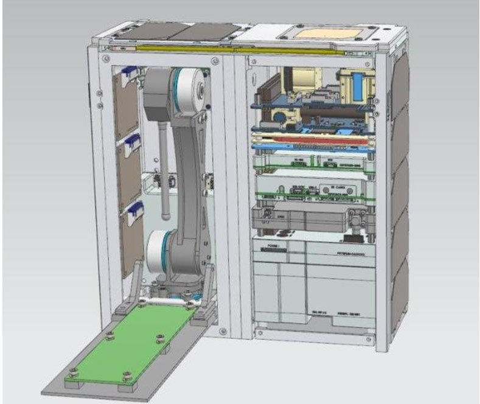

Figure 1.2.1: 4U SPST-1 Configuration. Robotic Arm (left), AIML and Core (right).

<!-- PDF_PAGE: 14 -->

## Chapter 2: Digital Twin Modeling

A DT is a set of virtual information constructs that fully describes a potential or actual physical manufactured product from the micro atomic level to the macro geometrical level. At its optimum, any information that could be obtained from inspecting a physical manufactured product can be obtained from its DT. DT aims to combine the best of all worlds, namely, twinning, simulation, real-time monitoring, analytics, and optimization. DT has been recognized as the next breakthrough in digitization, and also as the next wave in simulation. It can save cost, time, and resources for prototyping, as one does not need to develop the physical prototype(s) but can instead effectively and accurately perform the same tests on a virtual prototype, without affecting the real operation [4]. DTs can be divided into three subcategories: Computer Aided Design (CAD) models, Finite Element Method (FEM) models, and Simulation (Sim) models. Each of these models is crucial for the development of a high-fidelity digital twin. The Siemens PLM software is used for the design, analysis, and optimization of the SPST-1 DT. It is a comprehensive portfolio of software used to design products, realize their potential, and optimize their performance. It utilizes NX for mechanical design, and Simcenter for simulation and test solutions.

## 2.1 SPST-1 CAD MODELS

CAD is the use of computers or workstations to aid in the creation, modification, analysis, or optimization of a design. CAD models are the first step in the development of a DT. The CAD models provide the software with the model geometry and physical properties such as material density, Youngs and Elastic modulus. center of mass, moment of inertia, etc. It is important to have accurate physical properties to have an accurate model behavior. Most of the components used for the SPST-1 are flight ready components acquired from vendors. The 3D-CAD models,

<!-- PDF_PAGE: 15 -->

as well as the necessary physical properties for these components were provided by the vendor. These components include solar panels, S-Band Antenna, Ultra High Frequency (UHF) Antenna, Electrical Power System (EPS), etc. The SPST-1 chassis, Robotic Arm, and AIML module were developed in-house by the Aerospace Center. The SPST-1 chassis development will be discussed further in this thesis.

## 2.1.1 SPST-1 Modular Chassis Design

The nature of the SPST-1 required a chassis design able to provide flexibility to the desired number of modules in each mission. With this idea in mind, a modular design approach was taken for the development of the SPST-1 chassis. The chassis consists of four separate parts (z-face, yface, x-face, and rails) that are mechanically connected with the use of screws. The isometric view with the coordinate system used is shown in Figure 2.1.1.1. With NanoRacks being our chosen launch provider, all design specifications and requirements were made by referring to the NanoRacks CubeSat Deployer (NRCSD) Interface Definition Document (IDD) [5].

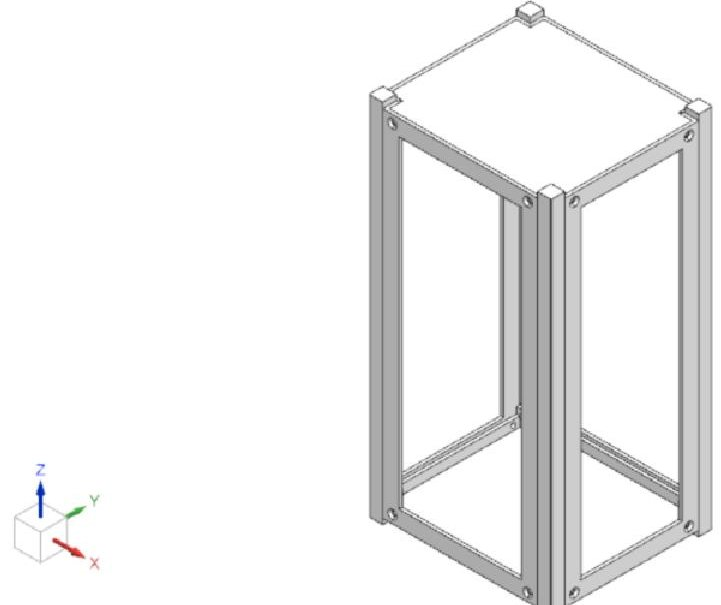

Figure 2.1.1.1: Isometric View of Assembled Chassis with Coordinate System.

<!-- PDF_PAGE: 16 -->

The rail dimensions are 8.5x8.5x227mm. with a radius of 0.5 mm at the corner. They extend 3.5mm from the z-face and have a cutout in the middle to allow for more space inside the SPST-1. The rails connect the x-face and y-face together with four screws, two at the top and two at the bottom, as shown in Figure 2.1.1.3.

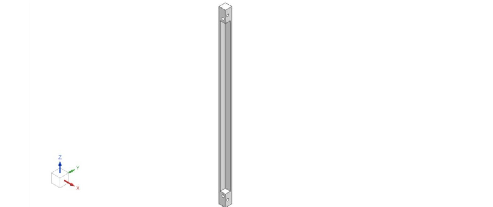

Figure 2.1.1.2: Isometric view of rail.

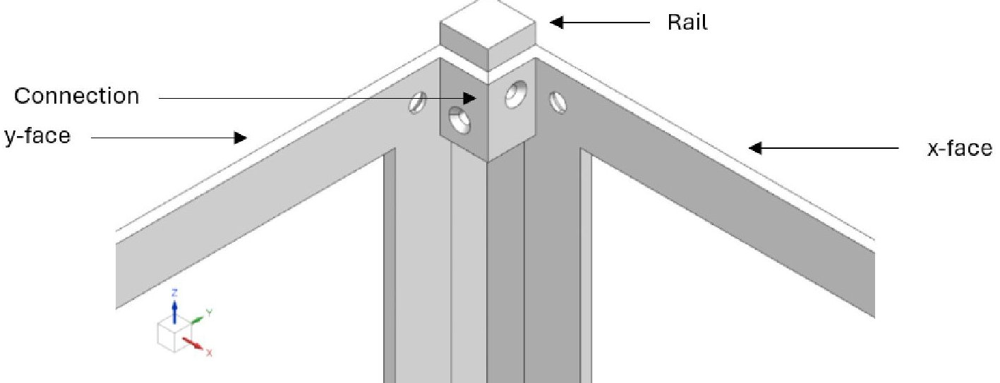

Figure 2.1.1.3: Connection between rail, y-face, and x-face.

The x and y faces have the same design. The only difference lies in their respective dimensions. The x-face dimensions are 220x96x2 mm, and the y-face dimensions are 220x83x2 mm. Each of them have a 12x8.5 mm. extension at the top and bottom corners to connect to the rails. The faces also have four corner holes to connect to the z-face. A rectangular cutout was made in the middle of the faces to remove material, but these faces can be design differently to

<!-- PDF_PAGE: 17 -->

accommodate for specific modules requirements and missions. As long as the connection areas are not changed. Additional holes can be added to connect any number of desired components.

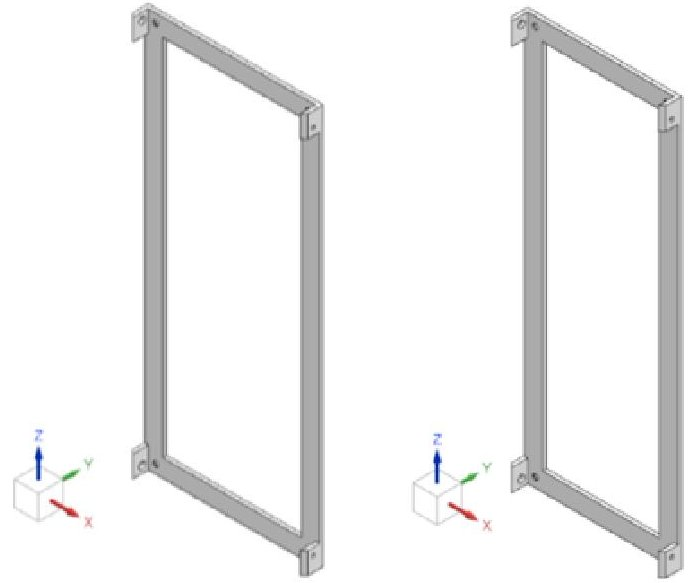

Figure 2.1.1.4: Isometric view of x-face (right) and y-face (left).

The z-face dimensions are 109x96x2 mm. It has 8.5x8.5 mm. cutouts in each corner to fit the rails, and a 6mm extension with two holes at the sides to connect the z-face with the x and y face as shown in Figure 2.1.1.6. Similar to the x and y face, the z-face can also be designed to fit any requirement and specific utility for any given module. The only things that need to remain the same are the connection points.

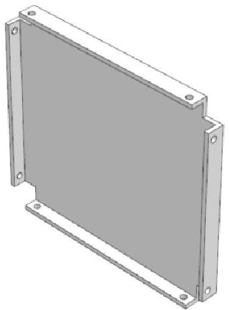

Figure 2.1.1.5: Isometric view of z-face.

<!-- PDF_PAGE: 18 -->

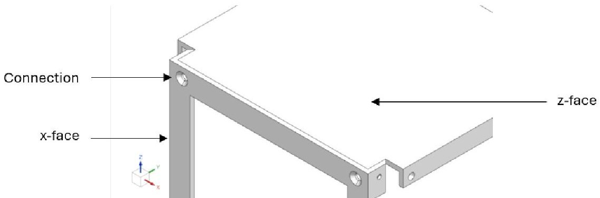

Figure 2.1.1.6: Connection between x-face and z-face.

Different size payloads can also be manufactured by increasing or decreasing the size of the rails, x-face, and y-face to the desired U size. Having this much design flexibility, allows for users to utilize a single chassis design for any desired application, and shortens the development and manufacturing part of this component. The assigned material for the chassis is Aluminum 6061. The material properties are shown in Table 2.1.1.1. The values are given at room temperature of $ 2 0 \, \mathrm{^\circ C} $ , but the software includes temperature dependent variables.

Table 2.1.1.1: Material properties of Aluminum 6061 at $ 20^{\circ} \mathrm{C}. $

<table border="1"><tr><td>Density</td><td>2711kg/m3</td></tr><tr><td>Youngs Modulus(E)</td><td>6.898GPa</td></tr><tr><td>Poisson Ratio(Nu)</td><td>0.33</td></tr><tr><td>Yield Strength</td><td>241.7MPa</td></tr><tr><td>Ultimate Tensile Strength</td><td>275.95MPa</td></tr></table>

## 2.2 SPST-1 FEM MODELS

The FEM is an approximation method that subdivides a complex problem space, or domain, into numerous small, simpler pieces (the finite elements) whose behavior can be described

<!-- PDF_PAGE: 19 -->

with comparatively simple equations. An important aspect of FEM is how the domain is subdivided. CAD software is useful in this regard because it defines the three-dimensional shape of an object and can easily subdivide the object into appropriately sized elements according to the desired mesh, or three-dimensional grid that defines the elements. Depending on the problem to be solved, the mesh can define elements of uniform size and shape (such as cubes or pyramids) or can have elements of different shapes and sizes in different parts of the domain [6]. Because of the complexity of the full SPST-1 model, a step-by-step approach will be taken in order to minimize computational solution time and validate a simple model. The chassis will be the first part to be analyzed and validated given its simple design, strength, and ease of manufacturability. Most of the other components of the SPST-1 are very sensitive and expensive. Exposing them repeatedly to harsh environmental testing will increase the probability of the components to fail.

Two types of elements will be used to mesh the four chassis parts. The CTETRA and CHEXA elements. The CTETRA element is an isoparametric tetrahedron element with four vertex nodes and up to six additional midside nodes. The CTETRA solid element is used widely to model complicated systems (i.e. extrusions with many sharp turns and fillets, turbine blades). The element has a distinct advantage over the CHEXA when the geometry has sharp corners as you can have CTETRAs that are much better shaped than CHEXAs [7]. The CTETRA element will be used to mesh the locations of the screws, as well as the radius of the corner rail. The CHEXA has eight corner grid points and up to twenty grid points if you include the twelve optional midside grid points. The CHEXA element is recommended for general use, but its accuracy degrades when the element is skewed [7]. The CHEXA element will be used to mesh the rest of the parts. The elements connections and coordinate system are shown in Figures 2.2.1 and 2.2.2.

<!-- PDF_PAGE: 20 -->

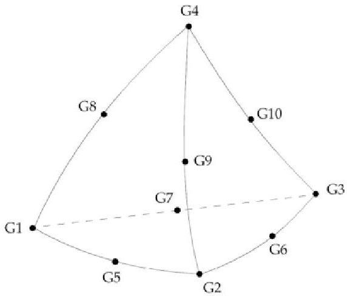

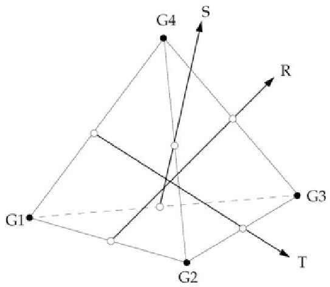

Figure 2.2.1: CTETRA element connection (left) and coordinate system (right).

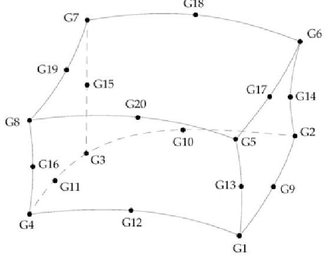

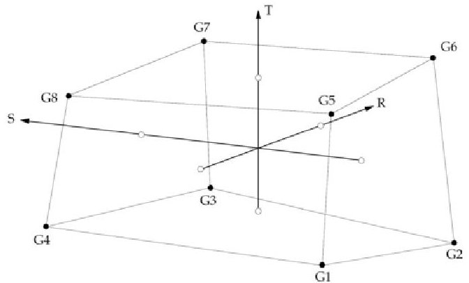

Figure 2.2.2: CHEXA elements (left) and coordinate system (right).

Each part will be meshed separately first, and then combined to create the assembly FEM. An idealized part will also be created for each part to make any changes needed for the creation of the mesh. The idealize part is a copy of the original part file that can be edited without changing the original part. The idealized part has to be first promoted in order for the software to reference the changes made to the fem file. The idealized part of both the x and y face were modified similarly. The extensions at the corners, as wells as the four screw holes were cut to be meshed separate from the body. Also, material was added to the middle of the faces, and two screw holes where made. The adding of the material, and extra screw holes in the chassis body is to be able to connect the chassis to the vibration table for testing.

<!-- PDF_PAGE: 21 -->

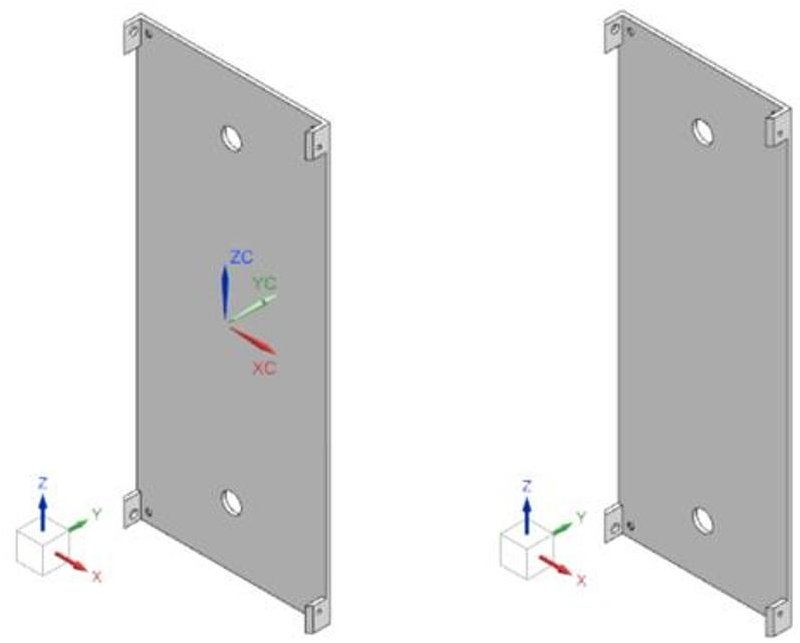

Figure 2.2.3: Isometric view of x-face (left) and y-face (right) idealized part.

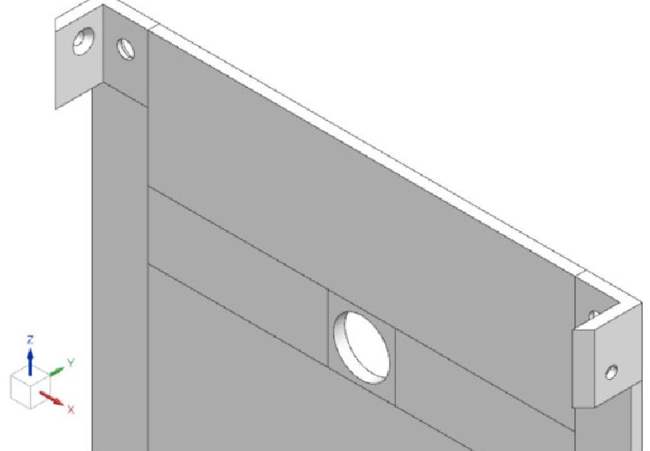

Figure 2.2.4: x-face and y-face idealized part cuts.

The z-face four extensions and the location of the screw holes were cut and separated from the main body. The radius in the corner was cut and separated, as well as the upper and bottom screw locations. The changes can be seen in Figures 2.2.5 and 2.2.6.

<!-- PDF_PAGE: 22 -->

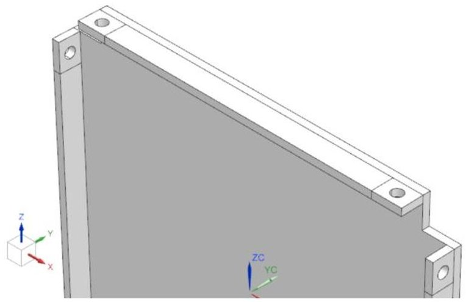

Figure 2.2.5: z-face idealized part cuts.

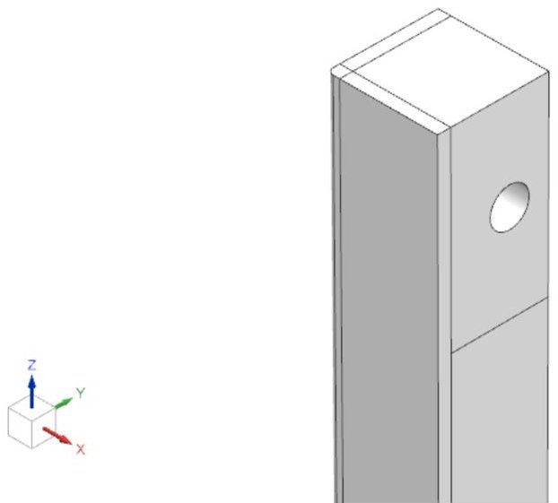

Figure 2.2.6: Rail idealized part cuts.

The CTETRA element was added to the location of the screws in all the parts. The CTERTA element size used was 1mm. The CHEXA element was used to the reminder of the bodies. The CHEXA element size was chosen based on a mesh study discussed in section 2.2.1. A mesh matting condition was added to all the parts to make sure that the nodes between the different meshes were connected to each other. An example of a mesh mating condition is shown in Figure 2.2.7. If the mesh mating condition is not added, the solver will not be able to smoothly calculate the deformation and stresses between the parts.

<!-- PDF_PAGE: 23 -->

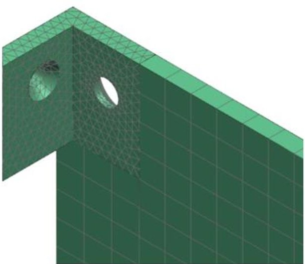

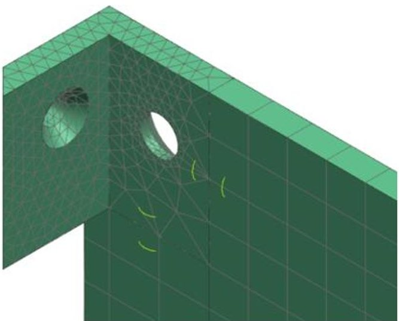

Figure 2.2.7: y-face no mesh mating condition (left) vs mesh mating condition (right).

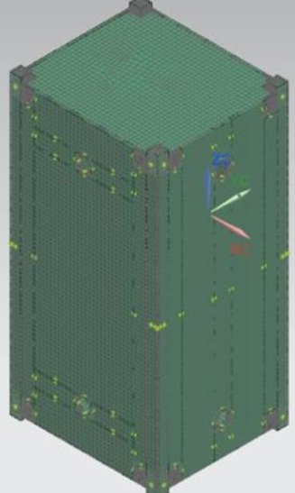

Figure 2.2.8: Chassis assembly FEM.

Although the parts are now together to create the assembly, there is still no connections between the parts. To create the connections, The use of a CBAR element and spider connected to RBE3 elements will be used at each screw location to simulate the screw connection between the parts. The material applied to the CBAR element is steel. Steel properties can be found in Table 2.2.1. Properties are given at temperatures of $ 2 0 \, \mathrm{^\circ C} $ , but software uses temperature dependent values. The CBAR element is a general-purpose beam that supports tension and compression, torsion, bending in two perpendicular planes, and shear in two perpendicular planes. The CBAR uses two grid points and can provide stiffness to all six DOFs of each grid point. With the CBAR, its elastic axis, gravity axis, and shear center all coincide. The displacement components of the

<!-- PDF_PAGE: 24 -->

grid points are three translations and three rotations. The RBE3 element is a powerful tool for distributing applied loads and mass in a model. The RBE3 doesn't add additional stiffness to the structure. Forces and moments applied to reference points are distributed to a set of independent degrees of freedom based on the RBE3 geometry and local weight factors [7].

Table 2.2.1: Steel material properties at $ 2 0 \, \mathrm{^ \circ C} $

<table border="1"><tr><td>Density</td><td>7829kg/m3</td></tr><tr><td>Youngs Modulus(E)</td><td>20.694GPa</td></tr><tr><td>Poisson&#x27;s Ratio(Nu)</td><td>0.28</td></tr><tr><td>Yield Strength</td><td>137.895MPa</td></tr><tr><td>Ultimate Tensile Strength</td><td>276MPa</td></tr></table>

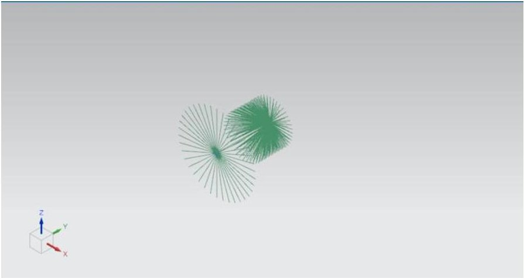

Figure 2.2.9: CBAR and RBE3 elements modeling screw connection between chassis parts.

<!-- PDF_PAGE: 25 -->

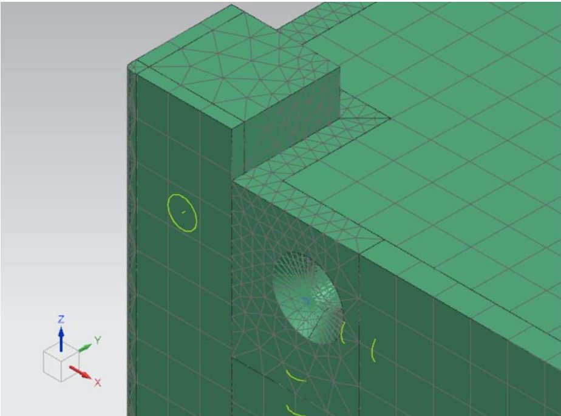

Figure 2.2.10: Chassis assembly FEM with screw connections.

## 2.2.1 MESH STUDY

To determine the best size for the CHEXA element, a mesh study was done using the integrated loads environment requirement simulation. The simulation will be discussed in section 3.1. This section will only discuss the mesh study performed. Four element sizes were studied: 1, 3, 5, and 8 mm. The deformation at the maximum value, an element at the top of the z-face, the time taken for each simulation to finish, and the element count were compared between each other. Figure 2.2.1.1 and Figure 2.2.1.2 show the mesh element size and the deformation at the different element sizes respectively. Table 2.2.1.1 the values of the deformation for each element size.

<!-- PDF_PAGE: 26 -->

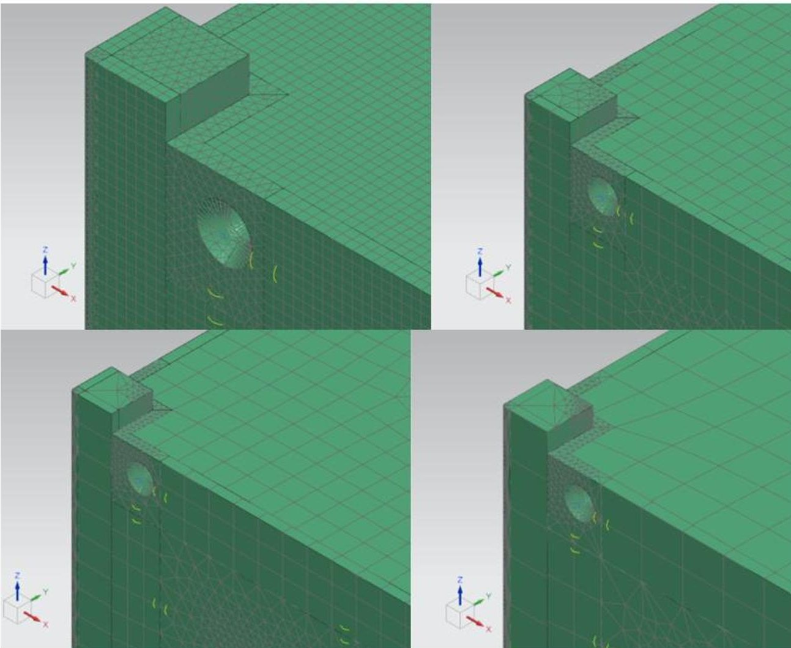

Figure 2.2.1.1: Mesh element size at 1mm (upper left), 3mm (upper right), 5mm (lower left), and 8 mm (lower right ).

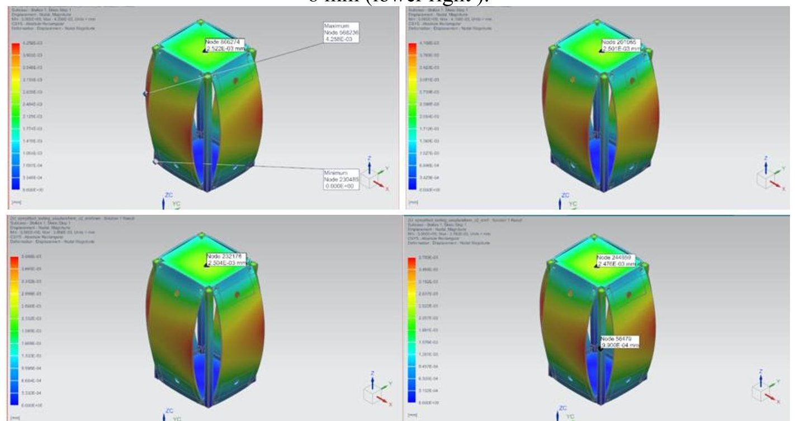

Figure 2.2.1.2: Deformation contour at 1mm (upper left), 3mm (upper right), 5mm (lower left ), and 8mm (lower right) element size.

<!-- PDF_PAGE: 27 -->

Table 2.2.1.1 Deformation comparisons at different elements sizes.

<table border="1"><tr><td>Element size(mm)</td><td>Element count</td><td>Max. deformation(mm)</td><td>Node deformation(mm)</td><td>Time(hr.)</td></tr><tr><td>1</td><td>251418</td><td>4.258e-03</td><td>2.522e-03</td><td>2</td></tr><tr><td>3</td><td>66820</td><td>4.108e-03</td><td>2.501e-03</td><td>0.67</td></tr><tr><td>5</td><td>55057</td><td>3.988e-03</td><td>2.504e-03</td><td>1.5</td></tr><tr><td>8</td><td>53823</td><td>3.783e-03</td><td>2.476e-03</td><td>1.2</td></tr></table>

Overall, there was not much different between the deformations. As expected, the coarser the mesh the higher the difference from the defined mesh. The interesting thing is observed when looking at the time it took to run each simulation. The 1mm mesh size took the longer as expected, followed by the 5 and 8 mm. The 3 mm mesh size took the less time with only 0.67 hr. (40 minutes). This can be explained by looking at the mesh element count and sizes in Table 2.2.1.1 and Figure 2.2.1.1. The 1mm mesh count is 251,418. The number of elements makes it have a higher solution time. The 3-, 5-, and 8-mm. size meshes a have a similar count, but if we look at the elements in Figure 2.2.1.1, the 5 and 8 mm CHEXA elements start to deform a lot causing potential issues in the solver and thus takes more iterations to converge the solution. The 3 mm size does not deform the CHEXA elements and because of its low element count the solution converges much faster. The results difference between the 1- and 3-mm. mesh size is only 3.65%. The small result difference, and the lower solution time makes the 3mm size mesh ideal for this study.

<!-- PDF_PAGE: 28 -->

## 2.3 SIMULATIONS

## 2.3.1 Integrated Loads Environment

NanoRacks IDD states that "The CubeSat shall be capable of withstanding a force of 1200N across all rails ends in the Z axis." Solution 101 Liner Statics was the chose solver for this study. The linear static solution type is used to solve small strain/small displacement structural problems, where the loads do not vary with time and the material behavior is linear elastic. Linear static problems can include gaps and contact. The results of a linear static analysis are typically displacements, stresses, strains, forces, and so on [8]. The 1200N force can be divided by the 4 rails for a total force of 300N applied across the top face of each rail. The bottom faces of the rails had a fix constrain applied to avoid any movement. A surface-to-surface contact was also added to the entire model. The surface-to-surface contact is used when parts are meshed independently but should act as one. Furthermore, it allows the parts to have sliding and motion between each other. Figure 2.3.1.1 shows the model with the forces and boundary conditions applied.

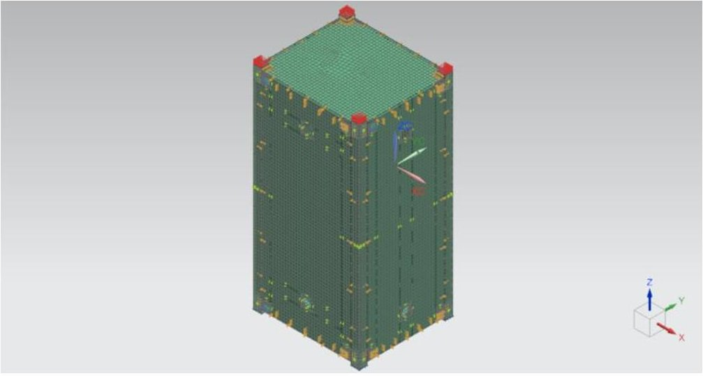

Figure 2.3.1.1: Isometric view of model with forces (red), surface to surface contact (yellow) and fixed constrains (blue).

Figure 2.3.1.2 shows the deformation contour of the chassis. The maximum deformation is located at the walls, 4.1413-03 mm. An annotation was added to the top of the rail to see the

<!-- PDF_PAGE: 29 -->

amount of deformation at that point for validation purposes discusses in chapter 3. The deformation at the top of the rail is 2.327e-03 mm. Figure 2.3.1.3 shows the stress contour of the chassis. In this case, because of the little stresses in the chassis, the spectrum had to be inverted to better see results. Red is low stress and blue is high stress. The maximum stress was 15.1 MPa and located at the connection between the rails and faces. The factor of safety was calculated using equation (1). The factor of safety for the chassis is 16.

$$
F a c t o r o f S a f e t y = \frac {Y i e l d S t r e s s}{W o r k i n g S t r e s s}
$$

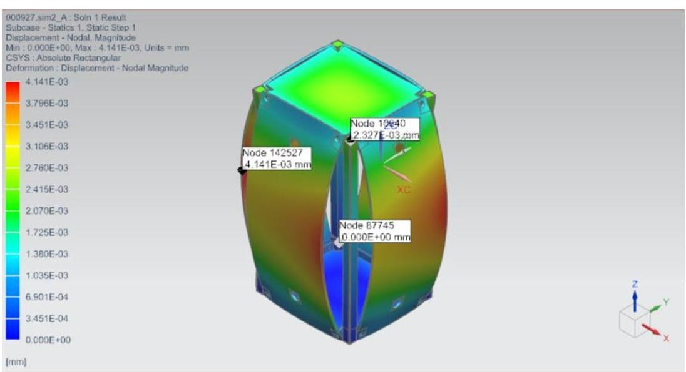

Figure 2.3.1.2: Deformation contour of chassis.

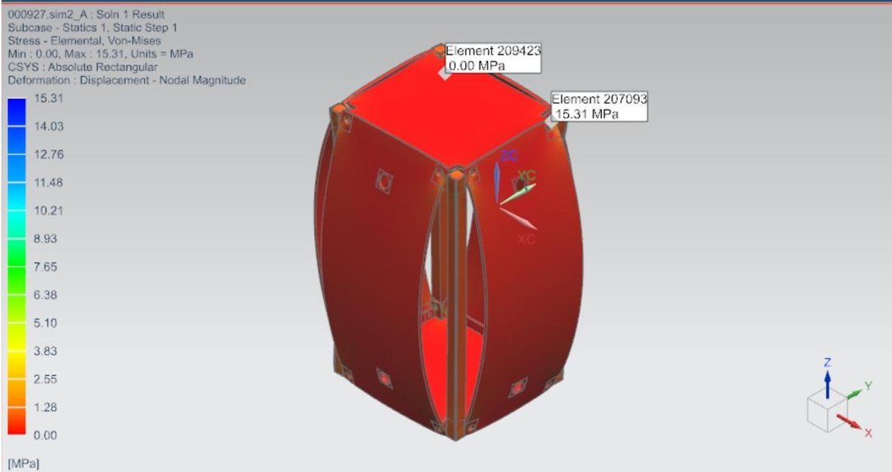

Figure 2.3.1.3: Stress contour with inverted spectrum of chassis.

<!-- PDF_PAGE: 30 -->

## 2.3.2 Random Vibration Environment

NanoRacks IDD states that " The CubeSat shall be capable of withstanding the random vibration environment for flight with appropriate safety margin. Random vibration test the flight article in the soft-stow flight configuration to the Maximum Expected Flight Level (MEFL) +3dB, for a duration of 60 seconds in each axis, or Random vibration test the flight article in the hardmount configuration to a combined test profile that envelopes the MEFL+3dB and a minimum workmanship level (MWL) vibe, for a duration of 60 seconds in each axis." The hard mount test profile can be seen in Figure 2.3.2.1 and Table 2.3.2.1.

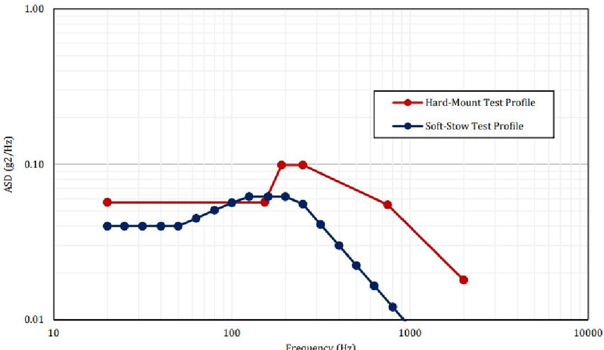

Figure 2.3.2.1: Random Vibration Test Profiles.

Table 2.3.2.1: Hard Mount Random Vibration Test Profiles.

<table border="1"><tr><td>Frequency(Hz)</td><td>ASD(g2/Hz)</td></tr><tr><td>20</td><td>5.7e-02</td></tr><tr><td>153</td><td>5.7e-02</td></tr><tr><td>190</td><td>9.9e-02</td></tr><tr><td>250</td><td>9.9e-02</td></tr></table>

<!-- PDF_PAGE: 31 -->

<table border="1"><tr><td>750</td><td>5.5e-02</td></tr><tr><td>2000</td><td>1.8e-02</td></tr><tr><td>grms</td><td>9.47</td></tr><tr><td>Duration(sec)</td><td>60</td></tr></table>

Solution 103 Response Dynamics was the chosen solver for this study. SOL 103 Response Dynamics (Simcenter Nastran) Lets you evaluate the responses of a structure subjected to various static and dynamic excitations. Response Dynamics is a full-featured add-on for defining complex solution processes with the user interface [8]. For this simulation, a remote point connected to the chassis by an RBE2 element has to be added to apply the excitations. Only the z-axis will be excited, and the results used for validation purposes. Figure 2.3.2.2 shows the remote point added to the FEM.

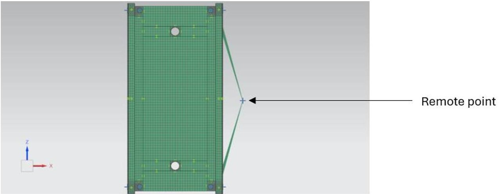

Figure 2.3.2.2:FEM with remote point connected to chassis.

A user defined constrain is added to the remote point to fix all Degrees of Freedom (DOF) except the one we want the excitation to occur at. In this case, the DOF 3 (z-direction) was the only free DOF. An enforced motion location was also added to DOF 3 to apply the excitation only in that location. Surface to surface contact was again added to the model. Fist a modal analysis has

<!-- PDF_PAGE: 32 -->

to be performed to find the natural frequencies of the structure. The natural frequencies are the frequencies at which a structure tends to oscillate without any driving force. The range will be between 20 and 2000 Hz. with an evaluation duration of 60 seconds. The first four normal modes of the structure are shown Figure 2.3.2.3.

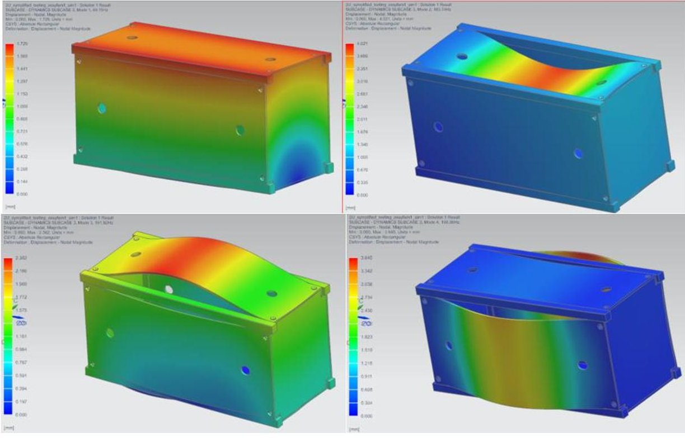

Figure 2.3.2.3: Normal modes response at 49.15 (upper left), 183.74 (upper right), 191.92 (lower left), and 198 (lower right) Hz.

Now, a Response Dynamic solution will be created. The total modal effective mass of the direction at which the forces were applied needs to be greater than 80%. Any lower than this and not enough normal modes would have been calculated for an accurate solution. The modal effective mass for the z direction is 80.47%. A 6% damping factor will be added to the modes. Sensors will be added around the structure of the chassis. There are three types of sensors available: displacement, velocity, and acceleration. In this case, acceleration sensors were chosen to compare the data from the simulation to the data from an accelerometer in physical testing. The black lines in Figure 2.3.2.4 shows the locations of the acceleration sensors.

<!-- PDF_PAGE: 33 -->

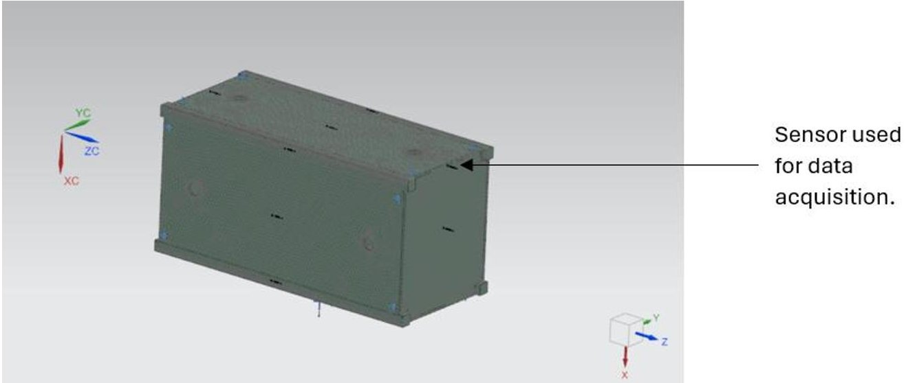

Figure 2.3.2.4: Locations of acceleration sensors.

A random event will be now defined using the profile from Table 2.3.2.1. The sensor will be evaluated and a frequency vs acceleration graph results extracted. Also, the RMS Von Misses stresses at the top face will be evaluated. Figures 2.3.2.5 and 2.3.2.5 show the frequency vs acceleration graph and Von Misses stresses at the top face respectively.

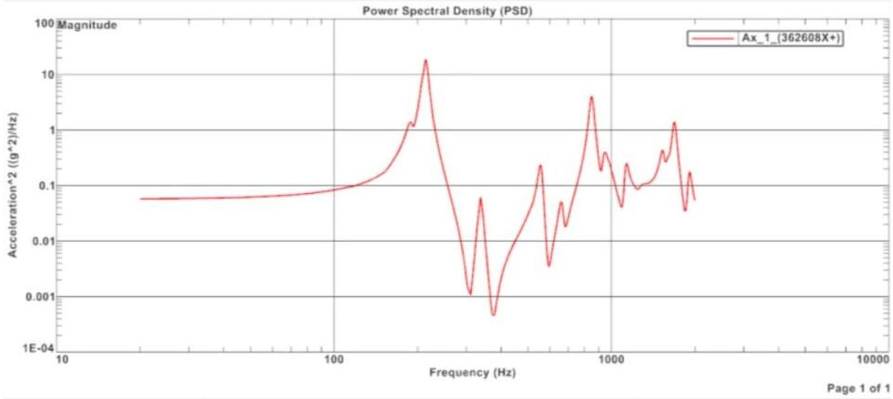

Figure 2.3.2.5: Frequency vs acceleration evaluation for sensor with applied random profile.

<!-- PDF_PAGE: 34 -->

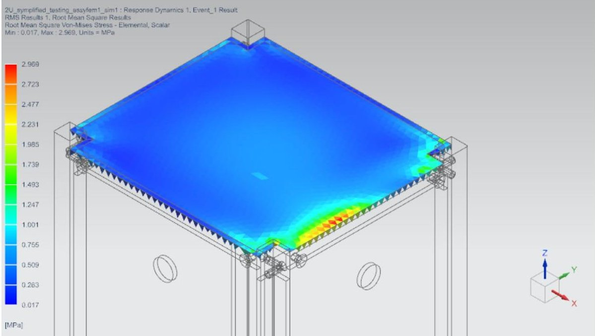

Figure 2.3.2.6: Von Misses stresses at top face.

<!-- PDF_PAGE: 35 -->

## Chapter 3: Verification of Analyses

The chassis geometry used for simulation was manufactured for physical testing. This physical testing campaign will be for the purpose of verifying the results of the simulated chassis, and to measure the confidence level of the model to advance further as more components are added to the model. The assembled manufactured chassis can be seen in Figure 3.1.

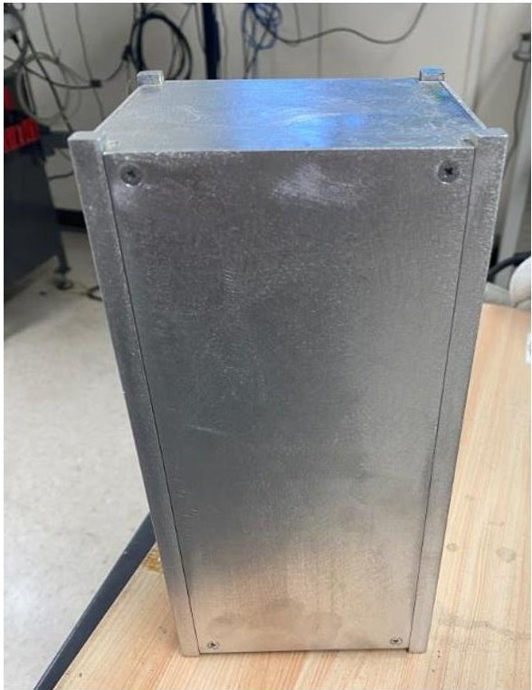

Figure 3.1: Assembled chassis prototype.

## 3.1 INTEGRATED LOADS VERIFICATION

Two methods were used to verify the results from the linear static simulation. The first, a compression machine was used to load the SPST-1 chassis to the 1200 N. force. Two circular plates were attached to the compression machine to apply the load. These plates were not big enough to fit the chassis, so two rectangular plates with extensions had to be manufactured to make sure that the loads were being applied directly to the rails. The experimental setup can be seen in Figure 3.1.1.

<!-- PDF_PAGE: 36 -->

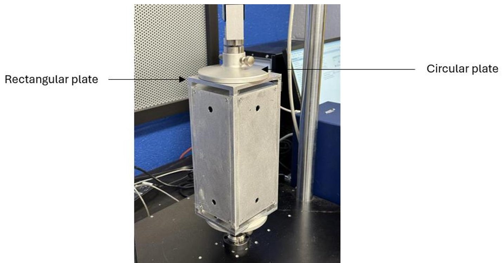

Figure 3.1.1: Experimental compression test setup.

The machine started to compress the chassis at a rate of 5mm/min. The force applied was being measured during the experiment, and once the force reached 1200 N. the experiment was stopped. The load vs position graph can be seen in Figure 3.1.2. The deformation measured at 1200 N. was 0.6mm. The deformation at the rails in the model was 2.327e-03 mm. The big difference between the deformations can be explained by two things: 1) the machine measured the deformation relative to the position of the rod that was moving down. No deformation data was acquired directly from the chassis. 2) The stiffness of the machine is less than the stiffness of the chassis. This can cause the measurements to lose accuracy. To better capture the deformation of the chassis, two options are available. 1) Adding strain gauges to the chassis will measure the deformation at that exact location which can be directly compared with the model. 2) Adding a dial gauge to the experiment to measure the displacement of the rails before and after the force is applied.

<!-- PDF_PAGE: 37 -->

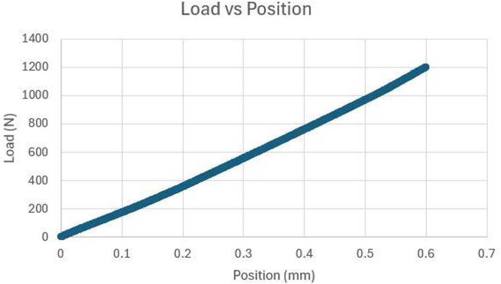

Figure 3.1.2: Load vs position graph.

The second approach is to do a mathematical calculation to approximate the results. Since the rails are the main load point in the structure, a simple displacement calculation can be made to approximate the deformation of the rails. A simple 0.0085x0.0085x0.227 m. rail was assumed. The force applied to the rail is 300 N, the E of aluminum is 6.898e+09 Pa, and the cross-sectional area is 0.00007225 $ m^{2} $ . By using equation (2), the displacement of the rail was calculated to be 5.4657e-5 m. (5.4657e-3 mm.). The displacement at the rail calculated by the model was 2.327e-3 mm. Although the displacements does not exactly match, the magnitude of both are the same. This simple approximation shows that the displacements calculated by the model are in line with what we should expect.

$$
\Delta = \frac {F L}{E A}
$$

## 3.2 RANDOM VIBRATION VERIFICATION

A vibration table was used to physically excite the chassis with the NanoRacks profile, and an accelerometer was mounted to the chassis at the same location as the sensor in the model. Both a sine and random vibration profiles were tested. The sine profile was tested to obtain a smooth

<!-- PDF_PAGE: 38 -->

Power Spectral Density (PSD) vs acceleration response, and the random to document the pass or fail criteria. The setup of the experiment can be seen in Figure 3.2.1.

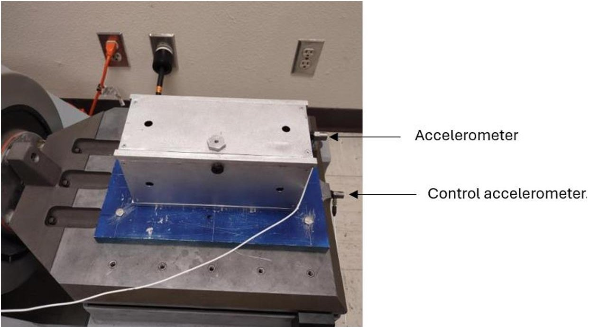

Figure 3.2.1: Vibration test setup.

The sine test allowed us to see the frequencies at which the chassis was being exited and compare them with the results from the simulation. Figure 3.2.3 shows the comparison between the test and simulation data. The simulation data does not match the physical data. Two main reasons can be deducted for this. 1) the accelerometers used are not modeled in the simulation, and thus can cause a change in the response of the chassis. This can be solved with the use of a laser vibrometer and a 3D data acquisition system. The laser vibration allows for measurements to be taken without having physical contact with the structure, and the 3D acquisition system allows for a more in-depth testing analysis of the structure. 2) The vibration table used for the study was not used since 2019 and may not be calibrated properly. For a more accurate and in-depth validation, a newer and better system is recommended for future analyses.

<!-- PDF_PAGE: 39 -->

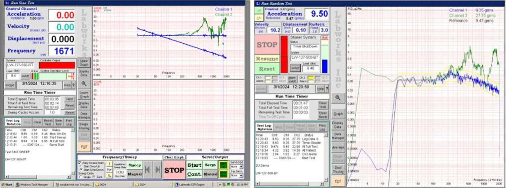

Figure 3.2.2: Sine profile (left) and random profile (right) test results in z-axis.

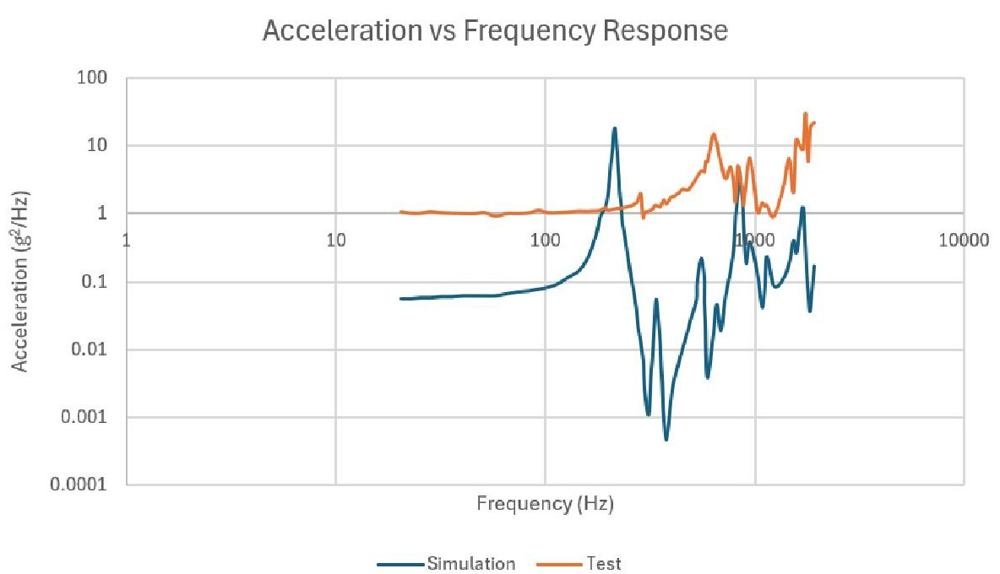

Figure 3.2.3: Comparison between simulation and test data.

<!-- PDF_PAGE: 40 -->

## Chapter 4: Conclusions and Future Work

This thesis presented the development of a modular CubeSat chassis design, as well as the creation of a digital twin for CubeSats environmental testing requirements. The modular chassis designed allowed for user friendly flexibility to accommodate any payload requirement and necessity. The integrated loads and random vibration environments were modeled, and physical testing of the requirements were made for model verification. The integrated loads environment model was verified using a simple mathematical approach with both model and physical results being in the same magnitude of deformation. The random vibration environment model was not able to fully be validated since testing and model data did not match entirely. In both cases, better equipment and data acquisition systems are needed to have a more in depth understanding of the behavior of the system under the desired conditions. Future work for this project include the modeling of the rest of the components and the implementation of them in the simulation, as well as better equipment to validate the simulation results to have a high-fidelity DT model.

<!-- PDF_PAGE: 41 -->

[1] Papadonikolaki, E. "Digital Engineering" Digital Engineering - Designing Buildings Available://www.designingbuildings.co.uk/wiki/Digital_engineering#:~:text=on%20Designing%20Buildings-,Origins,move%20from%20analogue%20to%20digital

[2] Woellert, K., Ehrenfreund, P., Ricco, A. J., and Hertzfeld, H., "CubeSats: Cost-effective science and technology platforms for emerging and developing nations," Advances in Space Research, vol. 47, Feb. 2011, pp. 663-684.

[3] Villela, T., Costa, C. A., Brandao, A. M., Bueno, F. T., and Leonardi, R., "Towards the thousandth Cubesat: A statistical overview," International Journal of Aerospace Engineering, vol. 2019, Jan. 2019, pp. 1-13.

[4] Sharma, A., Kosasih, E., Zhang, J., Brintrup, A., & Calinescu, A. (2022). Digital Twins: State of the art theory and practice, challenges, and open research questions. Journal of Industrial Information Integration, 30, 100383. https://doi.org/10.1016/j.jii.2022.100383

[5] Prejean, T. (2018, May 29). Nanoracks-CubeSat-Deployer-NRCSD-Idd. ... NanoRacks CubeSat Deployer (NRCSD) Interface Definition Document (IDD). https://nanoracks.com/wp-content/uploads/Nanoracks-CubeSat-Deployer-NRCSD- IDD.pdf

[6] Team, Spatial. "An Introduction to Finite Element Modeling." Spatial, February 5, 2020. https://blog.spatial.com/finite-element-modeling.

[7] "Element Library Reference." Siemens. Accessed April 13, 2024. https://docs.plm.automation.siemens.com/data_services/resources/nxnastran/10/help/en_US/tdocExt/pdf/element.pdf.

<!-- PDF_PAGE: 42 -->

[8] “Linear Static Analysis.” Siemens documentation, 2019. https://docs.plm.automation.siemens.com/tdoc/nx/1899/nx_help#uid:xid1128419:index_a dvanced:xid389649:id634496:id632351.

[9] Furger, Steve M. Analysis and mitigation of the CubeSat Dynamic Environment, n.d. https://doi.org/10.15368/theses.2013.27.

<!-- PDF_PAGE: 43 -->

## Vita

At the moment of this writing, Javier Alberto Martell is a graduate mechanical engineer student at the University of Texas at El Paso (UTEP). He graduated cum laude with a B.S. in Mechanical Engineering in May 2022. During his studies, he held the position of undergraduate and graduate research assistant at UTEP under Dr. Joel Quintana at the UTEP Aerospace Center. He focused his university research on CubeSats architectures as well as digital engineering. Parallel to this, he also worked as a year-round R&D intern for the National Solar Thermal Test Facility at Sandia National Laboratories. At Sandia, he applied his digital engineering knowledge to model different types of high thermal systems for decarbonization projects.