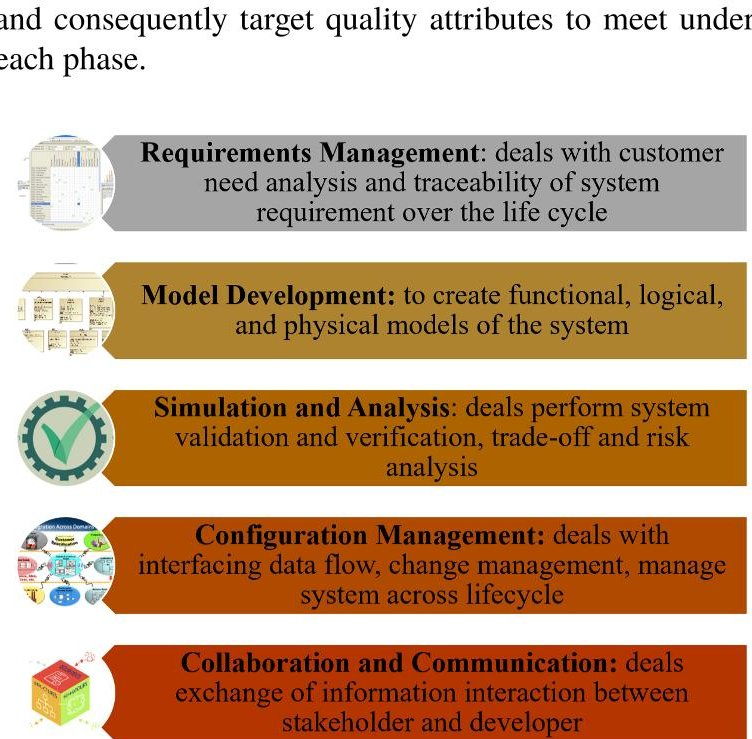
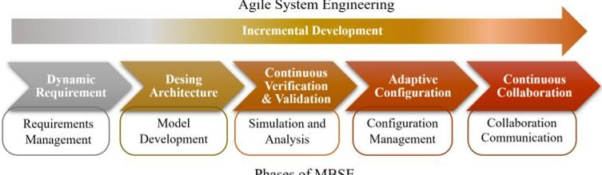
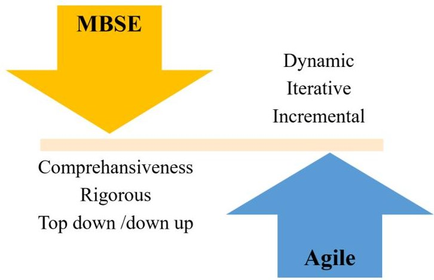

<!-- PDF_PAGE: 1 -->

IAC-24-D1.IP,2,x82549

# Agility Evaluation of Methodologies Used in MBSE Applications for Small Satellite Development Lifecycle

# Rehobot Bekele $ ^{a *} $ , Sara Himmiche $ ^{b} $ , Taiwo Tejumola $ ^{c} $ , Yeshurun Alemayehu $ ^{d} $ , Bertrand Rose $ ^{e} $

$ ^{a} $ University of Strasbourg, ICube, Strasbourg, France, bekeleburuso@etu.unistra.fr

$ ^{b} $ Univ. Savoie Mont Blanc, SYMME, Annecy, France, <u>sara.himmiche@univ-smb.fr</u>

$ ^{c} $ International Space University (ISU), Illkirch-Graffenstaden, France, taiwo.tejumola@isunet.edu

$ ^{d} $ Ethiopian Space Science and Technology Institute (ESSTi), Addis Ababa, Ethiopia, yeshuruna@essti.gov.et

$ ^{e} $ University of Strasbourg, ICube, Strasbourg, France, <u>bertrand.rose@unistra.fr</u>

* Corresponding author

## Abstract

Model-Based Systems Engineering (MBSE) has proven essential in understanding systems, supporting system design, and ensuring reliability. Large space agencies, defense, and aerospace have realized MBSE benefits through long-term practices. However, applying MBSE requires disproportionate effort, particularly for small and medium enterprises (SMEs), and needs more flexibility to support the NewSpace features. This challenge has led to a demand for a more agile-tailored MBSE version that is better suited for small teams and has faster time-to-market. Integrating Agile principles with MBSE can address this need by focusing on essential systems of interest such as spacecraft subsystems, CubeSats, and small satellite development. The proposed method presents the core alignment value between MBSE phases (Requirements Management, Model Development, Simulation and Analysis, Configuration Management, Collaboration, and Communication) with agile principles. Then, evaluation questions focused on assessing the capabilities of MBSE methodology to leverage agile characteristics throughout the product life cycle, explicitly targeting the commonly used approaches for CubeSat and small satellite development. The agility criteria are established by factors such as alignment of quality attributes, boundaries of adopted methods, and process iterative friendly. The analysis highlights that the MBSE method used in the early lifecycle can accommodate agility with rapid changes and iterative processes, while in later lifecycle phases, where requirements are more solidified, the method might possess potential conflicts in quality attributes and limitations in agile capabilities. This conflict must be managed carefully according to the system of interest needs and targeted SE activities. In conclusion, for MBSE to be an enabler of agility, developers must find a balance between MBSE's comprehensiveness and Agile's flexibility. This alignment paves the way for future studies on developing metrics-based Agile MBSE applications.

Keywords: Agility Evaluation, MBSE, Small Satellite Development, Methodology, Lifecycle Phases

## 1. Introduction

Small Satellite development demand has grown exponentially; the development and manufacturing market is driven by an accelerated timeline and low cost with a fair amount of reliability and system safety. The practice of system engineering in the small and medium startup space industry remains either a discipline-focused engineering approach or Project Management (PM). Therefore, the System Engineering (SE) approaches are yet to be utilized in less complex environments and small teams based in SME enterprises, universities, and academia. Traditional document-centric SE approaches, Work Breakdown Structure (WBS), Agile, and Lean principles are practiced for strategizing tasks, costs, and system development schedules. In [1], a comparative analysis of two groups of CubeSat developers using project management and system engineering (PMSE) concluded that as the complexity and number of collaborators grew, the essential of system engineering was demonstrated in the design and review phases. Conversely, a few organizations use the legacy SE approach through well-defined requirements and planning. Once a proven method is established, the culture change, the risk of uncertainties in applying new practices, and resource limitations hinder the fast maturation of the SE method. Consequently, several incomplete CubeSat missions and failures are due to low dependability, risk, and quality management[2]. Besides, the challenge of adopting model-based system engineering has proven successful in supporting risk mitigation and maximizing dependability.

On the other hand, Agile development strives for the flexibility of changing one function at a time, and system engineering minimizes risk in defined requirements. A recently evolving NewSpace industry is driven by rapid development and a market-driven approach. To accommodate the needs of NewSpace trends, selected SE ap-

<!-- PDF_PAGE: 2 -->

proaches ought to inherit the inevitable agile characteristics. In the early concept phase, requirement-based analysis and selection of customer off-the-shelf(COTS) components or subsystem options place heavy decision-making in the initial development stage. Agile has been proven to expose constraints, manage complexity, and design failures using an iterative approach.

## 1.1 Agile System Engineering in CubeSat

A milestone adopting the agile-driven practice for developing a CubeSat space mission to Mars began early in 2013 [3]. Since then, agile has been integrated into system engineering approaches for small and complex missions for various reasons and benefits. In 2015, Los Alamos National Laboratory (LANL) developed the Agile Space Program (ASP) to achieve low cost, development time, and process. The agile space paradigm considers requirements definition, tailoring risk, controlling reproduction and manufacturability, and testability essential to adopting agility in the space system [4]. In [5], the authors study the benefit of the agile system engineering process applied by the Agile Decision Guidance method for CubeSat developer academia. These studies realize that the agile process aids stakeholder management, knowledge, information management, and solution environment.

In [6], authors present a CubeSat development that abstains from the classic waterfall-like approach in favor of agile practices. It focuses on available capabilities as delivery of features and designs "sprints" adapted to the V model into a triangle model. Where paths exist for going back to the conceptual stage at every point during the design. In [7], five important agile principles are selected to speed up design research development approaches: simplicity, frequent delivery, effective communication, compatibility, and frequent reflection. Generally, agile SE facilitates resource use efficiency and automates tasks through model exchange and synchronization, which are well-established advantages in CubeSat development.

## 1.2 Agile Model-Based System Engineering

The tangible advantages discussed in Agile SE are also utilized in MBSE by selecting principles that MBSE methods enhance, complementing the rigorous process with agility over the project lifecycle(LC). Honoré-Livermore [8] studied the integrated approach of agile system engineering and project management for university CubeSat developers. The study showcases the integration and improvement of MBSE methods in traceability, dependability, reuse, and system design support aimed at minimizing resource needs. Also [9], the proposed Agile MBSE approach combining Scrum and Model-Based System Architecture Process (sMBSAP) to validate pilot study develop a health technology aligned regulation and standard.

Furthermore, various studies have explored integrating agile methodologies with MBSE for complex systems and small satellite missions. Salehi [10] proposed a method named Munich Agile MBSE Concept (MAGIC) derived from the DevOps infinity loop model and consists of 6 levels: requirement level, functional level, verification and validation, system production and manufacturing, usage, and service level. It provides a continuous management lifecycle, iterative feedback, and holistic integration in a broad spectrum of complexity. Also, a hybrid development agile and waterfall model substantiates the architecture of onboard software based on microservices and containerization to break down complex systems into manageable software architecture[11]. Hence, Agile MBSE demonstrated the capability to reduce the rework, manage complexity, and include stakeholders' feedback throughout development.

Agile-Lean process [12] proposed the techniques of applying the Scaled Agile Framework (SAFe) framework with MBSE to reduce delivery time, early integration, and continuous validation for weapon prototypes. Nakhost et al., [13] presented core value alignment as a combination of SAFe and MBSE. This study identified challenges such as high initial cost and a need for stopping criteria to the model. It's suggested that focusing on solution-intent modeling and providing model templates for implementation and guidelines ease the difficulty. To integrate an agile mechanism into the application of MBSE, modeling objectives or usage should be directed toward a particular tool and method.

The literature above indicated that CubeSat and smallsat missions adopt agile MBSE through various techniques: assimilating different principles, enhancing legacy framework, and adopting industrial values in the existing approach. Therefore, in the realization of Agile MBSE, the capability of methods plays a significant role in easing the application process and bringing the intended benefit. Since it has been established that MBSE is an agile enabler[14], the methodology's essential principles will determine the method's capability and limit system representation for required modeling objectives. This paper proposes an assessment study that identifies the ability of MBSE methods to adopt agility, whereas quality attributes and complexity are uninfected over the development life cycle. The global view of MBSE activities is generalized under five phases: Requirements Management, Model Development, Simulation and Analysis, Configuration Management, Collaboration and Communication (see Fig 1). The phases of MBSE are proposed to specify the purpose of modeling objectives, define activities,

<!-- PDF_PAGE: 3 -->

Fig. 1. Artefact of MBSE phase

## 2. Methodology

The main research question is: "Are the MBSE methodologies capable of adopting agile principles by characteristics over the Smallsat development lifecycle?" To answer this research question, the 12 Agile Manifestos are considered for the basis of agile principles containing project management and system engineering perspectives. The overlapping scope of System Engineering and Project Management is known to harmonize management and engineering disciplines, as shown in the NASA process and requirement handbook[15]. Particularly within dynamic small-scale teams such as CubeSat or SmallSat developers, cross-functional domains like risk configuration, data, and task management are interdependent[16]. This study aims to support identifying SE approaches or tools that easily comply with agile principles so that integration can be practiced independently in the specific SE process or synchronized with project management.

## 2.1 Agile Manifesto: Project Management and System Engineering Perspective

Agile SE "refers to the adaptability and sustainment of adaptability" [17] and is concerned with agility in processes and systems development. Since the agile approach originated in software engineering, the principles applicable to SE need to be analyzed separately. Thus, the manifesto lists 1,3,5,4,10,12 concerning cost, review, and resource management considered under the Project Management perspective and lists 2,6,7,8,9,11 that are relevant to system process and development principles System En-

engineering Perspective (as shown in Table 1). Similarly, Douglass presented agile principles relevant to SE in Harmony Agile MBSE(Harmony-aMBSE) as incremental engineering, dynamic planning, continuous verification of engineering data, and continuous integration[18]. Now, the evaluation of agile criteria can be prepared to determine a method capability that concerns SE activities. Separation perspectives are essential for the assessment of MBSE application; however, in agile MBSE, the PM perspectives are critical for managing process, rate of change, and the metrics of a model artifact or vice versa[19].

Table 1. Agile Manifesto: Project Management and System Engineering Perspective

<table border="1"><tr><td>PM principles</td><td>SE principles</td><td>Agile SE</td></tr><tr><td>(1)Setting priority</td><td>(2)Changing requirements</td><td>Dynamic requirements</td></tr><tr><td>(3)Frequent delivery</td><td>(8)Development constant pace</td><td>Incremental Development</td></tr><tr><td>(10)Simplicity is essential</td><td>(11)Best architectures</td><td>Design Architect</td></tr><tr><td>(5)Motivated team</td><td>(7)Measure of progress</td><td>Verify and Validate</td></tr><tr><td>(12)Regular intervals delivery</td><td>(9)Technical Excellence</td><td>Adaptive Configuration</td></tr><tr><td>(4)Business and developers&#x27; collaboration</td><td>(6)Effective conveying information</td><td>Frequent Collaboration</td></tr></table>

## 2.2 Core Alignment of Agile SE and MBSE

According to the discussion on Harmony-aMBSE and Table 1, the phase of MBSE and the agile SE principle possess alignment values. Figure 2 revealed where alignment enables ease of transformation and integration of MBSE methods and agile SE principles independent of agile environment. Also, without introducing an external framework adopting agility in the application viewpoint of MBSE. Moreover, this alignment could help mitigate conflicting attributes by identifying, in support of decisionmaking, whether the technique can be integrated otherwise subject to the methodological process's complexity. In [5], the agile factors such as dynamics, variety, and visibility are applied to determine the environment of the University CubeSat mission unpredictability and uncertainty. However, alignment introduces these agility factors in each phase: dynamics requirement, design flexibility, continuous v & v, active communication, and risk tailoring are values that determine the extent of agility.

<!-- PDF_PAGE: 4 -->

Fig. 2. Correlation MBSE phase and Agile SE principles

## 2.3 Framing Evaluation Criteria

The primary step of defining criteria is to assess each technique independently of its integration with agile practices. This evaluation conducted on previous MBSE implementations to determine whether the methodologies have demonstrated specific performance scopes within SE activities and objectives defined for application, as described in Fig.1. The identified phases of MBSE for each method were performed as marked "x" in Appendix A. The evaluation of agility is carried out by comparing quality characteristics, and process flows the method possesses in phases. In [20] presented iterative system modeling, where SysML blocks are defined to model informational artifacts and to answer specific questions each agile sprint. Since the boundaries of methods are defined, agility can be determined through criteria for each phase corresponding evaluation question in Table 2.

Table 2. Agility Evaluation Question

<table border="1"><tr><td>Aligned Phases</td><td>Question</td></tr><tr><td>Requirement Management</td><td>Does the MBSE method allow for dynamic changes to requirements and traceable project needs?</td></tr><tr><td>Model Development</td><td>Can the method possess incremental development mechanisms and adopt flexible architectures to accommodate iterative processes?</td></tr><tr><td>Simulation and Analysis</td><td>Does the method ensure continuous validation and verification(V&amp;V) and mitigate risk reflected due to change to ensure reliability?</td></tr><tr><td>Configuration Management</td><td>Does the method configure changes and manage progress to account for the dynamic environment?</td></tr><tr><td>Collaboration and Communication</td><td>Does the method facilitate frequent exchange feedback loops and stakeholder involvement?</td></tr></table>

## 2.4 Ranking Capability of Agile

Various criteria are considered to ensure a comprehensive evaluation, including the method's capability, alignment with attributes, and process flow. Lyells et al.[21]

present guidance for applying agile SE; some considerations were where agile should be used, method inquiry, and the extent of agility necessary. The extent of methods employment during this process impacts the methodology's overall agility. The ranking per phase allows us to choose an MBSE method aligned with its attributes within the characteristics of agility to facilitate decision-making and planning. That strengthens when multiple strategies are deployed within the development lifecycle. These levels demonstrate the integration capability as boundaries rather than a spectrum of ability.

To summarise the ranking levels:

Level 1: This level indicates where the methods have a conflict of attributes with agile principles with either inprocess or phase-stated characteristics against agile need

Level 2: In this level, the method's capability remains undefined because it does not deal with the specific phase, leaving alignment or capability undetermined.

Level 3: This level indicates that the method can adopt agility within specified phases, but application environments are rigorous processes.

Level 4: Here, the method is capable and possesses proven characteristics of agile SE, shown in its phases in previous studies as indicated as "x" in (Appendix A).

This rank demonstrated the agility of existing MBSE application studies, the employment of methods, and the corresponding phases extracted from the literature. It is important to note that the methodologies are not necessarily limited to only the phases of SE activities marked in this paper. The assessment only focuses on small-scale development methods to identify a possibility of integration without introducing complexity to the MBSE deployment process.

## 3. Analysis of Methodologies

This section highlights twelve studies used for the evaluation and alignment of methods with agile SE principles and mainly discusses phases that exhibit agile capability.

Reliability, Availability, and Maintainability(RAM)- SE framework [22], used for the existing CubeSat model to perform qualitative and quantitative SE analysis. RAM- SE application could be helpful for limited resources and small teams to identify Failure Mode and Effect Critical Analysis (FMECA) and to select and explore multiple options for COTS products. In this case, development can support risk management and test strategies. It also possesses an iterative relationship that helps ensure sufficient interfaces between the design analysis powered by use cases and separate contributions of design teams. On the contrary, RAM analysis focuses on the "dynamic" changes within the defined system structure so that contractual requirements are integrated into system-level re-

<!-- PDF_PAGE: 5 -->

quirements [23].

Disaggregated Integral System Concept Optimization (DISCO) is a powerful method of breaking complex systems into discrete subsystems via model-based concept design(MBCD) to assess vast solutions such as system architecture constellation and orbital parameters based on estimated system cost and performance trades. DISCO's conceptual design methodology fulfills agility across various phases, flexible architecture, dynamic models, multiobjective optimization, and quality assessment [24]. The strength of this method is that it accommodates flexibility, provides decision-making artifacts, and integrates accounting risk while optimization and modification are included in the iteration process. However, stakeholders need to establish a solid Measure of effectiveness, as the principles remain in the conceptual stage, and intensive time and resources are required.

SysML Executable Modeling Methodology (SEMM) [25] integration model ecosystem, environment, and organization. SEMM aims to improve the SysML informative model into an actionable model. It integrates the executable SysML model, Cameo Systems Modeler (CSM), and simulation and analysis tools (STK, MATLAB) through scripting languages. This method incorporates iterative process and behavioral simulation in the system modeling tools later communicated into multiple discipline system design, technical design, multiple trade studies, and generating systems engineering artifacts such as system architecture, ConOps, use case, and requirement. The framework allows computation of flexible architecture and dynamic behavior adopted in the SysML model, then transforms to support continuous V&V.

CubeSat System Reference Model (CSRM) [26-29] provides a reference to define the CubeSat library of elements such as stakeholders, requirements, architecture hierarchies, technical measurement, behaviors subsystem, trade studies, verification, and validation activities. It is a reusable graphical model that supports representing space segments and ground stations. CSRM can generically support multiple phases of MBSE but needs to establish competence in dynamic requirements and changes introduced in architecture. The reference model is agile capable, since it is a SysML-based and CSM tool-based template. Yet, it requires deliberate upfront planning to effectively embody an agile overall project.

ABEX Mission Architecture Framework (AMAF)[30]was created to define view product taxonomy, enhanced from CSRM specifically to the CubeSat program. It utilizes the different missions or systems using the same architecture framework to standardize the description of system elements. The method can automatically extract satellite model architecture as internal block diagrams. This approach might not be adoptable for dynamic requirements. Still, it is well-suited to facilitate flexible development using auto-generation MBSE artifacts in later LC stages, such as integration and development.

ARCADIA is adaptable to the processes associated with different types of life cycles, such as bottom-up approaches, application reuse, incremental, iterative, and partial development. Lassalle et al. [31] used the ARCADIA method with the Capella tool to define system architecture and system validation process and improve communication. This method allows agility using incremental packages and user stories, exploiting the capabilities of function chains and scenarios. Furthermore, iteration is prepared in the subsystem composition, tested, and delivered within fixed milestones. This integration has proven to characterize attributes such as synchronized development and validation, task automation, frequent model exchange, and faster impact analysis [14].

Model-based Tradespace Analysis(MBTA)[32] mathematical models, simulations, and optimization techniques. MBTA evaluates the performance, cost, and other relevant metrics of different design options across various criteria and consistent traits. This approach suits iterative development decision-makers to make informed tradeoffs, identify optimal design configurations, and prioritize design decisions in early LC. Yet it's based on a solid set of requirements, so applying change and finding optimal solutions during iteration require significant rework.

Model-Based Concurrent Design and Concurrent Design Engineering(CDE) [33,34] are based on simultaneous and collaborative operation principles across teams. These capabilities support rapid iteration and promote incremental solutions through consistent data exchange and real-time collaboration with a single system model. Model-based CDE can leverage agile attributes to provide a faster, more flexible process with correct path indicators to avoid iteration costs and detect errors early in small increments. Some studies argued CDE considered agile[35, 36], but contrasts in the fixed design phase, early design decisions, and upfront compressive planning are contradictory. A balanced iterative feedback-loop-driven approach or selective agility could address this conflict.

GAFE methodology is a linear process-based design that performs step-by-step design and validation processes via FMECA and RAMS analyses. In the early LC, It supported critical activities in developing a set of products by assessing definition and development FDIR performance, simulator configuration, executing test cases, and associating metrics[37]. It is intended to increase reliability in small satellite missions with high levels of autonomy and complexity. Although the GAFE methodology's rigorous

<!-- PDF_PAGE: 6 -->

step-by-step approach against the agile culture of continuous iteration V&V, It can still achieve robust architecture.

SAPPhIRE (change of State, Action, Part, Phenomenon, Inputs, organs, and Physical Effects) Model [38] studied to provide causality as a potential framework for structuring nano-satellites conceptual design. This model represents complex system design knowledge focusing on its function that leads to the development. SAPPhIRE utilizes various ways to break down the system layers of abstraction by capturing the complex architecture's behavior and functionality. This ability facilitates iterative design with high-quality completeness due to changes in state and phenomenon. It could be adoptable in the feasibility studies and preliminary design stages with rapid agility factors.

Design Reuse Methodology [39] is a decision support tool that helps mission architects rigorously and consistently assess design reuse scenarios. It leverages MBSE, primarily centralizing system information in a digital environment, to improve re-usability and efficiency. This method actively enables incremental development in flexible architecture while continuously exchanging information on exportability and compatibility. Repeatable processes and reuse profiles are suggested to facilitate platform integration in a perfectly aligned agile environment with DE tools to implement change and export.

Multi-Orbit Disaggregated System Architecture Framework(MODA-AF)[40] is a framework that breaks down complex system architecture into flexible small systems to guide robust and rigorous well-defined architecture. MODA-AF is agile-friendly in the early lifecycle to capture architectural decisions while maximizing coherency, consistency, and interoperability, for instance, in multi-parameter problems like inter-satellite communications. The framework can adopt flexibility of requirements and architecture to support the best architecture, but risk analysis isn't considered within this development.

## 4. Result

This section discusses the evaluation table provided in Appendix A, emphasizing the crucial aspect of the ranked level of agility indicator. The MBSE methods, particularly those ranked at level 4, demonstrate flexibility, dynamism, and iteration within incremental processes. These quality attributes are deeply ingrained into their procedure's principles, process, and agility attributes. For instance, RAMSE and SAPPhIRE methods, based on incremental and iterative properties, exhibit intended outcomes. Level 3 methods, capable of adopting agile and obtaining generic alignment in used tools such as ARCADIA and CRSM applications. However, this level requires pre-planned agile implementation that incorporates the effect on dynamic requirements and change management phases. The methods ranked at 4 and 3 embed flexibility in the dynamic environment, provided a straightforward integration of iterative development with the system engineering process, and met the minimum deliverable milestones of agile development.

Level 2 represents a phase that is out of the method's scope. Therefore, the method doesn't concern phase, so that capability is omitted. In this scenario, additional methods or tools can resolve the gap without adding complexity. However, extra effort might be needed to orchestrate that phase or tool with seamless interoperability. Level 1 can be labeled conflicted attributes since its rigid comprehensive process contradicts agility. For instance, while CDE aligns well with an agile environment, a constant reconciliation between rigors to flexible, sequential iterative, and so on. Also, DISCO estimates reliable cost and risk on solid requirements, but in the highly evolving agile environment, it requires continual reassessment to remain relevant to the project.

From the perspective of lifecycle phases, DISCO (MBCD), and MODAF for CONOPS, small satellites allow agility with a maximum change rate in dynamic requirements and flexible architecture in the development's early phases 0 to B. On the other hand, SEMM and RAMSE can be reiterated until the operation and end of life.

## 5. Discussion

This evaluation can determine the agility capacity of any engineering method or systems engineering approach. It enables practitioners to effectively integrate any approach into development, focusing on resource utilization and disciplined effort. Considering the essential needs of the system of interest, particularly CubeSats and small satellite development, this approach supports a streamlined integration of Agile and MBSE practices. Therefore, this evaluation illuminates a few critical issues for Smallsat and Cubesat developers to take into consideration:

1. Agility in Lifecycle: It's crucial to note that the demand for agility evolves across the LC phases. In the early LC, the possibility of fluid requirements and a range of design options facilitates a seamless agile MBSE application. However, as the mission progresses to the later LC phases, the focus shifts from dynamic process agility to a more structured procedure of test and integration.

2. Agility by Phases: MBSE methods show advanced agile capabilities in certain phases, which might not be throughout LC. MBSE's agility depends on the scope and capabilities of the method address

<!-- PDF_PAGE: 7 -->

3. Management and Decision(MBSE governance): For a generic MBSE method and languages, agility in incremental development requires organized decisionmaking, priority of tasks, and stopping criteria.

4. The methods (Levels 4 and 3) embed flexibility in the dynamic environment, provide a straightforward integration of iterative development with the system engineering process, and satisfy the minimum deliverable milestones of agile development.

5. Counterbalancing Agile MBSE: At levels 2 and 1, the capability of agility is undefined or contradicting which presents a challenge in achieving a balanced approach. It depends on issue numbers (1) and (3), which might facilitate a better decision, as shown in Figure 3

Fig. 3. Conflict of Attribute Agile MBSE

## 6. Conclusions

In conclusion, systems engineering approaches should ensure that quality attributes and capacity are matched in LC and avoid conflict when integrating agile development into small satellite applications. The evaluation substantiates that the advantage of bringing agile into MBSE application depends on the degree of alignment and balanced quality attributes, Such as dynamic requirements with traceability, incremental development that maintains completeness and accuracy, and so on. This ensures that the progress of LC development is continuously verified and validated, guaranteeing the minimum reliability of the end product. In addition, Agile MBSE's value alignment can provide the foundation for using metrics-based MBSE/DE to evaluate and assess change management throughout the project lifecycle. This milestone helps the developer adjust agility for specific SE activities to meet the targeted objective of the project or enterprise. The

agile approach's incremental property and the MBSE artifacts' digital thread will be analyzed and studied to establish positive progress indicators. Further studies are planned to develop a framework for Agile MBSE tailored to NewSpace trends, aiming to provide quality metrics, potential return on investment, and decision-making criteria.

## Acknowledgements

The authors of this study would like to express their sincere gratitude to the research funding sources, namely the Ministry for Europe and Foreign Affairs of France and the Schlumberger Foundation Faculty for the Future. Their invaluable support in financing and facilitating the research has been key to the success of this study.

Appendix A - Evaluation of Methodologies

<table border="1"><tr><td>MBSE Method</td><td>RM</td><td>MD</td><td>SA</td><td>CM</td><td>CC</td></tr><tr><td rowspan="2">RAM-SE Framework</td><td></td><td></td><td>x</td><td>x</td><td>x</td></tr><tr><td>3</td><td>4</td><td>4</td><td>4</td><td>4</td></tr><tr><td rowspan="2">Arcadia/Capella</td><td>x</td><td>x</td><td>x</td><td>x</td><td>x</td></tr><tr><td>3</td><td>3</td><td>4</td><td>4</td><td>4</td></tr><tr><td rowspan="2">SysML Executable Modelling(SEMM)</td><td>x</td><td>x</td><td>x</td><td></td><td>x</td></tr><tr><td>3</td><td>3</td><td>4</td><td>3</td><td>3</td></tr><tr><td rowspan="2">CubeSat System Reference Model</td><td>x</td><td>x</td><td>x</td><td>x</td><td>x</td></tr><tr><td>3</td><td>3</td><td>4</td><td>3</td><td>3</td></tr><tr><td rowspan="2">ABEX Mission Architecture</td><td>x</td><td>x</td><td>x</td><td>x</td><td>x</td></tr><tr><td>1</td><td>3</td><td>4</td><td>4</td><td>3</td></tr><tr><td rowspan="2">Model-Based Concurrent Design/CDE</td><td>x</td><td></td><td>x</td><td>x</td><td>x</td></tr><tr><td>1</td><td>1</td><td>4</td><td>4</td><td>3</td></tr><tr><td rowspan="2">Design Reuse Methodology</td><td>x</td><td>x</td><td>x</td><td></td><td>x</td></tr><tr><td>3</td><td>4</td><td>4</td><td>3</td><td>3</td></tr><tr><td rowspan="2">Model-based Tradespace Analysis</td><td></td><td></td><td>x</td><td>x</td><td>x</td></tr><tr><td>1</td><td>3</td><td>4</td><td>4</td><td>2</td></tr><tr><td rowspan="2">GAFE Methodology</td><td></td><td></td><td>x</td><td>x</td><td></td></tr><tr><td>1</td><td>1</td><td>4</td><td>4</td><td>2</td></tr><tr><td rowspan="2">SAPPHIRE Model</td><td></td><td>x</td><td>x</td><td>x</td><td></td></tr><tr><td>1</td><td>4</td><td>4</td><td>4</td><td>2</td></tr><tr><td rowspan="2">DISCO-Model-Based Concept Design</td><td></td><td></td><td>x</td><td>x</td><td>x</td></tr><tr><td>1</td><td>3</td><td>4</td><td>4</td><td>1</td></tr><tr><td rowspan="2">Multi Orbit Disaggregated System Architecture</td><td></td><td>x</td><td>x</td><td>x</td><td></td></tr><tr><td>1</td><td>3</td><td>4</td><td>4</td><td>1</td></tr></table>

## References

[1] J. Elstak, R. Amini, and R. Hamann, "3.4. 3 a comparative analysis of project management and systems engineering techniques in cubesat projects," in INCOSE International Symposium, Wiley Online Library, vol. 19, 2009, pp. 545-559.

[2] A. Alanazi and J. Straub, "Statistical analysis of cubesat mission failure," 2018.

[3] B. Segret et al., "The paving stones: Initial feedback on an attempt to apply the agile principles for the development of a cubesat space mission to mars," in Modeling, Systems Engineering, and Project Management for Astronomy VI, SPIE, vol. 9150, 2014, pp. 322-331.

<!-- PDF_PAGE: 8 -->

[4] N. A. Dallmann et al., "An agile space paradigm and the prometheus cubesat system," 2015.

[5] E. Honoré-Livermore, R. Lyells, J. L. Garrett, R. Angier, and B. Epps, "An agile systems engineering analysis of a university cubesat project organization," in INCOSE International Symposium, Wiley Online Library, vol. 31, 2021, pp. 1334-1348.

[6] K. Kanavouras, A. M. Hein, and M. Sachidanand, "Agile systems engineering for sub-cubesat scale spacecraft," arXiv preprint arXiv:2210.10653, 2022.

[7] M. Panarotto, O. Isaksson, and R. Söderberg, "Working agile to speed up research with industry: Five independence principles," Proceedings of the Design Society, vol. 3, pp. 3919-3928, 2023.

[8] E. Honoré-Livermore, "Integrating agile systems engineering and project management in small satellites development," 2022.

[9] M. Huss, D. R. Herber, and J. M. Borky, "An agile model-based software engineering approach illustrated through the development of a health technology system," Software, vol. 2, no. 2, pp. 234-257, 2023.

[10] V. Salehi, "Development of an agile concept for mbse for future digital products through the entire life cycle management called munich agile mbse concept (magic)," Computer-Aided Design and Applications, vol. 17, no. 1, pp. 147-166, 2020.

[11] O. Liubimov, I. Turkin, V. Pavlikov, and L. Volobuyeva, "Agile software development lifecycle and containerization technology for cubesat command and data handling module implementation," Computation, vol. 11, no. 9, p. 182, 2023.

[12] O. Dominguez and G. M. Chavez, "Agile processes applied to los alamos national laboratory se approach: The agile processes and technology (apt) team," in INCOSE International Symposium, Wiley Online Library, vol. 33, 2023, pp. 838-850.

[13] D. Nakhost and J. Jafari, "Model-based systems engineering in scaled agile framework settings: Challenges and opportunities," 2023.

[14] S. Plazanet and J. Navas, "Model-based systems engineering as an enabler of agility," INSIGHT, vol. 26, no. 2, pp. 26-30, 2023.

[15] S. J. Kapurch, NASA systems engineering handbook. Diane Publishing, 2010.

[16] J. Campos and P. Ferguson, "Manitobasat-1: Space systems engineering for student training," in 2020 IEEE Canadian Conference on Electrical and Computer Engineering (CCECE), IEEE, 2020, pp. 1-4.

[17] R. Dove and R. LaBarge, "8.4.1 fundamentals of agile systems engineering-part 1," in INCOSE international symposium, Wiley Online Library, vol. 24, 2014, pp. 859-875.

[18] B. Douglass, "What are agile methods and why should i care," Agile Systems Engineering, pp. 41- 84, 2016.

[19] M. Komatsu, H. Aburatani, and S. Teawhim, "Approach to the engineering education applying nasa systems engineering," in 2022 7th International Conference on Business and Industrial Research (ICBIR), IEEE, 2022, pp. 149-154.

[20] M. Riesener et al., "A model for dependency-oriented prototyping in the agile development of complex technical systems," Procedia CIRP, vol. 84, pp. 1023-1028, 2019.

[21] R. Lyells, R. Angier, and B. Epps, "Creating decision guidance for applying agile system engineering," in INCOSE International Symposium, Wiley Online Library, vol. 28, 2018, pp. 655-670.

[22] E. Honoré-Livermore and C. Haskins, "Modelbased systems engineering for cubesat fmeca," in Recent Trends and Advances in Model Based Systems Engineering, Springer, 2022, pp. 529-540.

[23] J. Zhang, C. Haskins, Y. Liu, and M. A. Lundteigen, "A systems engineering-based approach for framing reliability, availability, and maintainability: A case study for subsea design," Systems Engineering vol. 21, no. 6, pp. 576-592, 2018.

[24] R. E. Thompson, J. M. Colombi, J. Black, and B. J. Ayres, "Disaggregated space system concept optimization: Model-based conceptual design methods," Systems Engineering, vol. 18, no. 6, pp. 549- 567, 2015.

[25] M. Lutfi and R. Valerdi, "Executable modeling of a cubesat-based space situational awareness system," in Recent Trends and Advances in Model Based Systems Engineering, Springer, 2022, pp. 475-484.

[26] D. Kaslow, G. Soremekun, H. Kim, and S. Spangelo, "Integrated model-based systems engineering (mbse) applied to the simulation of a cubesat mission," in 2014 IEEE Aerospace Conference, IEEE, 2014, pp. 1-14.

<!-- PDF_PAGE: 9 -->

[27] D. Kaslow et al., "Cubesat model-based systems engineering (mbse) reference model-development and distribution-interim status," in AIAA SPACE 2016, 2016, p. 5551.

[28] D. Kaslow, B. Ayres, P. T. Cahill, L. Hart, A. G. Levi, and C. Croney, "Developing an mbse cubesat reference model-interim status# 4," in 2018 AIAA SPACE and Astronautics Forum and Exposition, 2018, p. 5328.

[29] D. Kaslow, P. T. Cahill, and B. Ayres, "Development and application of the cubesat system reference model," in 2020 IEEE Aerospace Conference, IEEE, 2020, pp. 1-15.

[30] M. Halvorson and L. D. Thomas, "Architecture framework standardization for satellite software generation using mbse and f prime," in 2022 IEEE Aerospace Conference (AERO), IEEE, 2022, pp. 1- 20.

[31] J. LASALLE, I. HERNANDEZ, N. CORCORAL, and J. REY, "Optimization of kinéis (nanosatellites constellation) system tests using mbse approach,"

[32] S. Nag, S. P. Hughes, and J. Le Moigne, "Streamlining the design tradespace for earth imaging constellations," in AIAA SPACE 2016, 2016, p. 5561.

[33] T. Gateau, L. Senaneuch, S. S. Cordero, and R. Vingerhoeds, "Open-source framework for the concurrent design of cubesats," in 2021 IEEE International Symposium on Systems Engineering (ISSE), IEEE, 2021, pp. 1-8.

[34] C. Iwata et al., "Model-based systems engineering in concurrent engineering centers," in AIAA SPACE 2015 Conference and Exposition, 2015, p. 4437.

[35] J. Alvarez and E. Roibás-Millán, "Agile methodologies applied to integrated concurrent engineering for spacecraft design," Research in Engineering Design, vol. 32, no. 4, pp. 431-450, 2021.

[36] T. Žužek, J. Kušar, L. Rihar, and T. Berlec, "Agile-concurrent hybrid: A framework for concurrent product development using scrum," Concurrent Engineering, vol. 28, no. 4, pp. 255-264, 2020.

[37] A. Cervone et al., "The path towards increasing rams for novel complex missions based on cubesat technology," CEAS Space Journal, vol. 16, no. 2, pp. 203-224, 2024.

[38] S. E. Peters, "Investigating the effectiveness of a causal mbse software tool in modelling conceptual cubesat data," 2020.

[39] A. E. Trujillo and A. M. Madni, "Exploration of mbse methods for inheritance and design reuse in space missions," in Recent Trends and Advances in Model Based Systems Engineering, Springer, 2022, pp. 553-564.

[40] S. S. Cordero, T. Gateau, and R. Vingerhoeds, "Mbse challenges in the concurrent preliminary design of cubesats: Nanospace study," in 2022 IEEE International Systems Conference (SysCon), IEEE, 2022, pp. 1-8.