<!-- PDF_PAGE: 1 -->

IAC-24-B4-IP-111

F-Series: A Generic Development Kit for Intelligent Mini and Small Satellites

Prof. Dr. Jens Eickhoff $ ^{a *} $ , Bharadwaj Chintalapati $ ^{a,b} $ , Arthur de Freitas e Precht $ ^{c} $ , Magnus Schindele $ ^{d} $ $ ^{a} $ Airbus Defence and Space, Germany, jens.eickhoff@airbus.com,

$ ^{b} $ Lulea University of Technology, Sweden, bharadwaj.chintalapati@airbus.com

$ ^{c} $ Ferchau GmbH, Germany, arthur.de_freitas_precht.external@airbus.com

$ ^{d} $ Protec GmbH, Germany, m.schindele@protec-semi.com

* Corresponding Author

## Abstract

The ideology promoted about building New Space small satellites includes short development times and "off-the-shelf" parts for cost effectiveness. Already based on these criteria, a 120kg satellite named "Flying Laptop" was developed at the Stuttgart University in cooperation and guidance from Airbus. It was launched in 2017 and is still reliably operational, has three axis stabilization and uses off-the-shelf units. The development while fulfilling some main criteria also showed deficiencies. Until launch it took more than 7 years and scalability was achieved only for the software. From this baseline Airbus initiated a consortium with diverse SMEs in a continuous effort to optimize the ideology and technology about building satellites. Tenets of this "F-Series" approach include automotive-like Scrum development and continuous verification, scalable avionics, again employing "off-the-shelf" parts, a consistent path from early digital twin to full flight hardware/software/operations featuring flexible payload connectivity.

Considering the main takeaways from diverse modelled satellites and studies, the F-Series development kit for building SmallSats emerged. This paper discusses each of its key elements are:

- hardware - the modular on-board computer and power units, sensors, actuators/propulsion;

- flight software - highly configurable w.r.t. satellite modes, orbits, single/multiple payload control;

- the digital twin (satellite simulator);

- intelligent payload subsystem;

- an operations suite featuring full encryption.

In order to refine the development time, the kit comes with an agile plan helping users eliminate any uncontrolled processes and reworks. It is based on development benches also being part of the kit. These benches - digital twins are starting from a fully simulated satellite including the flight software source and provides connectivity to various mission control suites. After the Small Sat design having reached a certain development readiness, the hardware core avionics are available for seamless connection to the existing simulator replacing formerly simulated units. The process evolves up to the final satellite flight model.

The development kit is usable both for larger CubeSats and SmallSats. By applying the same software and similar avionics and operations concept, the scaling of satellites becomes straightforward, permitting to keep all the supporting infrastructure and trained personnel. This paper cites CubeSat example missions like "EIVE" and the Swedish/German AI mission "ICE-Brain-1" and explains how such a development kit overcomes scalability challenges, and operational flexibility limits. Finally, the paper lists different SME Keywords: small satellite development kit digital-twin satellite simulation flight software operations suite

Keywords: small satellite, development kit, digital-twin, satellite simulation, flight software, operations suite

## Acronyms/Abbreviations

Acronyms/Abbreviations

ACS Attitude Control System

AOCS Attitude & Orbit Control System

CCSDS Consultative Committee for Space Data Systems

CCS5 Central Checkout System

CLCW Command Link Control Word

EGSE Electrical Ground Support Equipment

EIVE Exploratory In-Orbit Verification of an E/W-Band Satellite

EFM Engineering Flight Model

EQM Engineering Qualified Model

ESA European Space Agency

LEO Low Earth Orbit

MIB Mission Information Base

OBC On-Board Computer

OBDH On-Board Data Handling

PCDU Power Control and Distribution Unit

PF Platform

PL Payload

SLE Space Link Extension

SME Small and Medium Enterprise

XTCE XML Telemetric and Command Exchange

## 1. F-Series Platform

The F-Series generic development kit comprises of avionics "LEGO $ ^{\circledast} $"-like bricks kit, where the user first selects PCDU and OBC and network modules according to the payload(s) interfaces and resource needs, then selects the data handling, communications equipment and then the AOCS IF equipment. Finally, in the last step

<!-- PDF_PAGE: 2 -->

the structure is "designed around". That is why F-Series SmallSats can be realized in diverse shapes and can be built in a large scalability from 80 to 500 kg, with payload power from 50W average to 500W. F-Series can be used from equatorial to sun synchronous orbits.

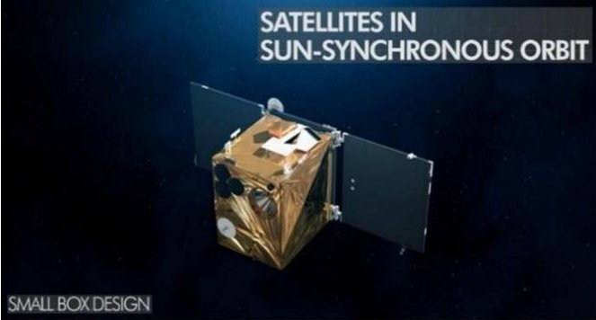

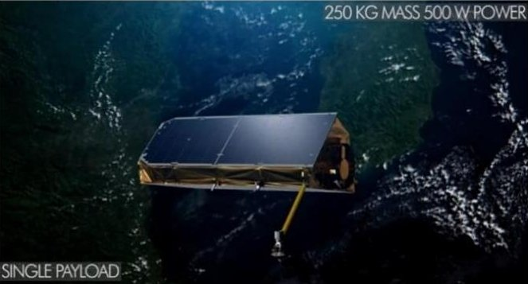

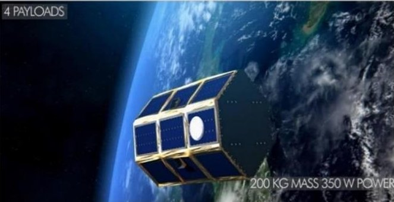

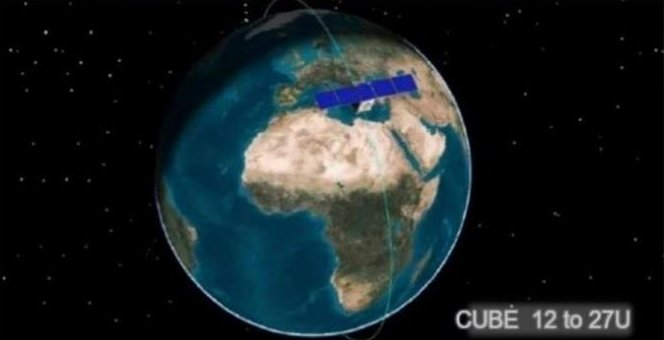

Fig.1. F-Series example mission designs

F-Series platform can be adapted for missions with more demanding payloads and AOCS units. It comes in customizable options like box, hut, multi-box and other designs. It is designed for a lifetime > 5 years in 800km LEO orbit.

## 1.1 Missions & Orbits

F-Series is also a fully three-axis stabilized platform. It is suited for a variety of mission scenarios performing either nadir-pointing Earth observation with e.g., scanner instruments, or target pointing Earth observation e.g.,

with camera instruments or inertial pointing e.g., for astronomical missions and telescope payloads and obviously for combinations thereof.

Table 1. Platform Details (Small Sat variant)

<table border="1"><tr><td>Platform Budgets</td><td>Details</td></tr><tr><td>Wet Mass(PF+PL)</td><td>90-500kgincl.20%Margin</td></tr><tr><td>Dry Mass(PF+PL)</td><td>80-450kgincl.20%Margin</td></tr><tr><td>Propellant Massincl.20%Margin</td><td>Typical8kg(Xenon,EP)Monoprop typical25kg</td></tr><tr><td>Payload Mass</td><td>Up to250kgdepending on satellite layoutincl.20%Margin</td></tr></table>

The satellite platform meets international agency and industry standards, such as the CCSDS and ESA Packet Utilization Standard based communication protocols. A baseline Mission Information Base is available for the Mission Control System CCS5 (Terma B.V.) and in XTCE.

F-Series is designed for LEO with altitudes between 400 and 850 km, in sun-synchronous orbits as well as with inclinations in the broad range between 0 and $ 1 1 0^{\circ} $ This allows F-Series to fly payloads above planet poles on each revolution or to fly lower inclined or even equatorial orbits.

## 1.2 Operational Modes

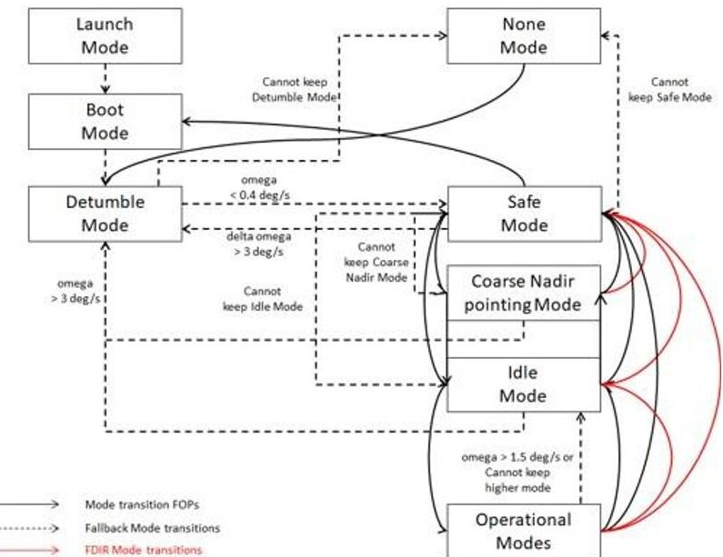

Fig. 2. Existing Operational Modes (heritage); mode operational transitions (solid lines); FDIR-modes (red); fallback mode transitions (dotted)

As the development kit is derived from a heritage small satellite mission, the flight modes are already available in functional control algorithms as code. The

<!-- PDF_PAGE: 3 -->

supported modes are illustrated in the Fig. 2. It is also important to note that not all the modes that are illustrated are mandatory for every LEO mission. The start-up and commissioning modes are Launch mode, Boot mode and Detumble mode. Once the commissioning modes are achieved, the satellite can transition into a safe spinstabilized mode - Safe mode. In this mode, the satellite can be controlled by only using sun sensors, magnetometers, and magneto-torquers.

The Safe mode is considered as a main fall-back mode in case there is any failure detected. The nominal operational modes like Idle mode, Inertial pointing mode, Nadir pointing mode, and Target pointing mode are generally differing w.r.t the satellite orientation and these modes are easily adaptable for different mission scenarios. Currently, the Idle mode is considered as an additional fall-back mode and the main nominal mode where the satellite is 3-axis controlled with necessary sensors and actuators being operational and satellite-oriented sun-pointing with its solar arrays in order to recharge the batteries.

The other aspect of the satellite operations are the mode transitions. Most of these operational mode transitions (solid black lines) in Fig. 2 are automated in the on-board software using Mode Table. The higher nominal modes are generally to be commanded from ground.

## 1.3 Design Lifetime

The design lifetime of the F-Series platform is 5 years in 800 km LEO orbit with its default equipment. The LEO variant uses combination of automotive, MIL grade parts and Rad. hard parts in the OBC. The CPU for SmallSats is available as Rad. hard and for larger CubeSats, the automotive variant is also available.

## 2. The F-Series Hardware

One of the key ideologies of the consortium is to employ "off-the-shelf" hardware in order to promote scalable & reliable small satellite. The reflections therefore are visible in the avionics hardware selection.

The primary goal of the avionics hardware is to tackle flexibility and to also accomplish the scalability in this process. Some of the key hardware elements are briefly explained in this section.

## 2.1 The Modular Core Avionics Concept

The key to the F-Series system flexibility concerning payload hosting is its strictly modular Core Data Handling and Power subsystem modularity. Right most OBC in the Fig. 3 provides an impression, however does not depict all redundancies nor cross couplings.

The primary connection of the CPU-Board to the S/C network is via Spacewire (SpW). For each CPU board 2 cross-strapped SpW lines connect to 2 SpW routing switches (typically 8 port switches).

From there the further (also cross coupled) connections follow too the

- hot redundant CCSDS Decoder/Encoder boards (incl. CLCW cross connection and HPC feed out to PCDU)

- the I/O-Boards (digital RIU for connection of all non-SpW AOCS equipment)

- and to the payloads.

The CPU-board connects command/control to the PCDU directly via serial link in F-Series. The analog RIU functions (e.g., reading of thermistors or sun sensors) are provided by the PCDU in this architecture. The architecture features a single reconfiguration unit for both power failures as well as OBC board failures which is embedded in the internally redundant PCDU.

CubeSat Platform

Common Flight Software Framework

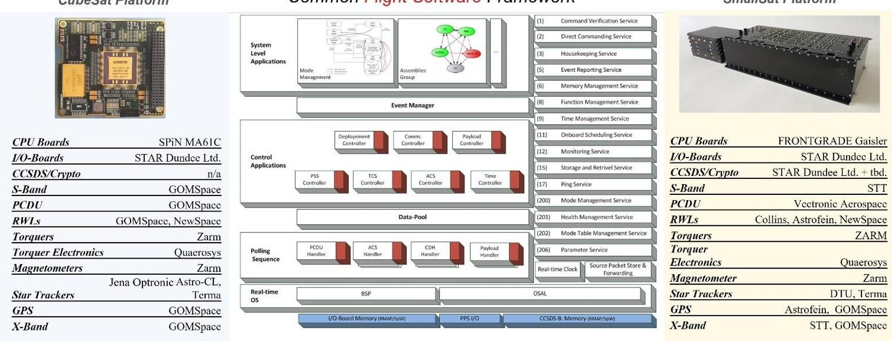

SmallSat Platform

FRONTGRADE

Gaistar

Fig. 3. Scalable Platform with common On-board Software

<!-- PDF_PAGE: 4 -->

This "Combined Data and Power Management Infrastructure" (CDPI) is patented by Airbus and is described in [2].

## 2.2 CPU Boards

The baseline is a GR712RC dual-core LEON3FT CPU-board, with minimum 8 MiB MRAM or 64Mbit of FLASH and 2 to 3Gbit of SDRAM, [3] [4]. The CPU provides SpW, RS422, GPIO and, CAN interfaces. For larger CubeSat variant, the RS485 is also available. The CPU clock can vary from 50Mhz to 60Mhz based on the design configuration and uses JTAG for debugging.

The CPU-board is designed to be fully radiation tolerant through the choice of components, as well as additional system-level mitigation strategies. The SDRAM is protected through a Reed-Solomon EDAC, and the boot MRAM by BCH EDAC, both handled appropriately by the on-board software in case of upset events.

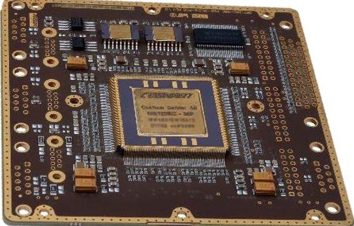

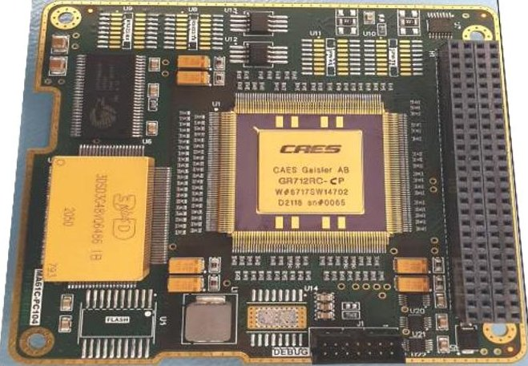

Fig. 4. GR712RC CPU Board - Rad. hard (top), CubeSat (bottom)

The MRAM is additionally protected against latch-up events by a protector circuit combined with full I/O isolation. Four banks of non-volatile memory are available: Two banks are reserved for an invariable, ground-installed "golden image", one bank of software associated per each CPU core. The two remaining banks are available for in-flight updates of the boot software. In case of a boot failure of the uploaded patch, a reset will cause an automatic fallback to the golden image.

Fig. 4 (top) is the Small Sat Rad. hard CPU board with a 240 pin Ceramic Quad flat package. This variant is ideal for SmallSats and the same processor design is available in PC104 configuration for CubeSat missions as shown in the Fig. 4 (bottom). For the synchronization of external equipment with Pulse per Second (PPS), specific GPIO lines are provided on the CPU.

## 2.3 Combined Data and Power Management

The SpaceWire (SpW) network on F-Series is based on the configurable FPGA/MPSoC board architecture. All boards i.e., SpW routers, I/O-boards and CCSDS-boards are of the same design with just differing connector setup and differing FPGA firmware.

The SpW routers will normally operate in a cold-redundant configuration. Each CPU-Board is connected to both routers using SpW links, and the two routers are joined to each other by a cross-link.

These routers are FPGA-based, and run the SpW router IP. This IP implements a standard ECSS-E-ST 50-12C-compliant SpW router. In addition, it implements a packet header-modification scheme that allows instruments that do not support SpW network addressing headers to operate within the F-Series. The SpW routers support link speeds at up to 200 Mbit/s and also provide direct connections to the native SpW instruments. These SpW Routers also provide Ethernet interfaces to enable Ethernet-connected instruments to be attached to the F-Series. This allows CPU-Boards to interface with Ethernet payloads via TCP and UDP packets.

The F-Series interface also supports nominal and redundant I/O-Boards that are based upon the same board technology. Each I/O board is connected to each of the routers via a SpW link, and implements a Remote Memory Access Protocol (RMAP). The I/O Boards interface to all of the serial-connected instruments on the spacecraft. Apart from that, there are also GPIO, RS422 and RS485 interfaces with configurable speed, buffer sizes etc.

Finally, the CCSDS decoder/encoder boards are connected to each router using a separate SpW link, for redundancy. The CCSDS boards also host the authentication function and from end 2024 F-Series will offer a SDLS compatible up- and downlink encryption and key management.

## 2.4 Power Subsystem

The power subsystem is based on an unregulated $ \approx 2 8 $ V bus. For the box designs one solar panel is body mounted, two are deployed once the satellite is launched and separated from the launcher. Deployment can be initiated automatically via time by PCDU and in addition via TC to OBSW.

<!-- PDF_PAGE: 5 -->

Table 2. Power Subsystem (Small Sat variant)

<table border="1"><tr><td>Criterion</td><td>Values</td></tr><tr><td>Bus Voltage</td><td>28V unregulated(operational)</td></tr><tr><td>Power(EOL)Orbit Average</td><td>120W-500W average depending on selected Vectronic Aerospace PCDU model</td></tr><tr><td>PCDU peak power</td><td>210W-880W depending on selected Vectronic PCDU model</td></tr><tr><td>Platform bus</td><td>&lt;60W</td></tr><tr><td>Leaving payload power</td><td>60W-400W average</td></tr><tr><td>Solar Panels</td><td>Depending on satellite design.For Box design two flexible and one body mounted array.For hexagon or roof design body mounted SA</td></tr><tr><td>Battery</td><td>Custom Li-Ion or LiFeP3</td></tr><tr><td>Batt. Capacity</td><td>&gt;=30Ah To be tailored to mission power budget</td></tr></table>

The Power Control and Distribution Unit (PCDU) detects the launcher separation, controls the power distribution to the components and adjusts the charging of the battery. And the PCDU monitors currents and voltages and reports corresponding onboard TM to the OBC.

Beyond these default operations in this "Combined Data and Power Management Infrastructure" (CDPI) [1] the PCDU executes further tasks. The PCDU hosts the analog RIU functionality for all AD/DA converters to e.g., read out thermistors or analog sensors.

The SmallSat variant of the PCDU unit is internal redundant and features a time synchronization mechanism between the current operating controller and the internal redundant one. Considering the reliability of the SmallSat system, the PCDU hosts a common Reconfiguration controller for the entire CDPI [1], [2]. This reconfiguration control handling is configured according to the common failure types observed in satellites (for e.g., crash of FSW and reconfiguration from ground, etc.). The PCDU also host the processing of for High Priority Commands (HPCs). The HPCs are decoded and sent to the PCDU without involving the OBC Processor Board. In this CPDI architecture they are directly processed in PUS TC format coming from the Core DHS TTR board. This patented architecture therefore does not require any Command Pulse Decoding Unit (CPDU).

## 2.5ACS

The set of standard ACS sensors and actuators of F-Series are listed below.

Table 3. ACS Actuators

<table border="1"><tr><td>Actuator</td><td>Quantity</td><td>Manufacturer</td></tr><tr><td>Reaction Wheels</td><td>4</td><td>Collins,Astrofein,NewSpace Systems or GOM</td></tr><tr><td>Magnetotorquers</td><td>3 int. red.</td><td>Zarm or GOM</td></tr></table>

Table 4. ACS Sensors

<table border="1"><tr><td>Sensor</td><td>Quantity</td><td>Manufacturer</td></tr><tr><td>GPS</td><td>2</td><td>Astrofein or GOM</td></tr><tr><td>Star Tracker</td><td>2 Heads</td><td>TU Denmark or Terma or Jena Optronik</td></tr><tr><td>Gyroscopes</td><td>3+1</td><td>NG-LITEF</td></tr><tr><td>Sun/Earth Sensors</td><td>8+8</td><td>CESS or GOM</td></tr><tr><td>Magnetometers</td><td>1+1</td><td>Zarm or GOM</td></tr></table>

The total pointing error during one pass is less than 150 arcsec and the pointing knowledge is better than 7 arcsec. Not all missions may need all of the ACS equipment. For e.g., some simple missions may waive reaction wheels and only base their ACS on magnetotorquers as actuators. Similarly, not all missions may need Gyroscopes.

## 2.6 Propulsion

In order to achieve orbit control, F-Series can be equipped with various propulsion subsystems like coldgas, chemical and electric - HEMPT or Resistojet.

Table 5. Propulsion Options

<table border="1"><tr><td>Actuator</td><td>Quantity</td><td>Manufacturer</td></tr><tr><td>Cold Gas Propulsion</td><td>4+4</td><td>Airbus/STI</td></tr><tr><td>HEMPT or Hall Effect electric Propulsion</td><td>2x3</td><td>Airbus/One Web</td></tr><tr><td>Field Emission Electric Propulsion</td><td>4+4</td><td>Enpulsion</td></tr><tr><td>Chemical Propulsion</td><td>4+4</td><td>Airbus</td></tr></table>

## 2.7 Platform Communication

The TT&C subsystem consists of two receivers and two transmitters, in combination referred to as the transceiver, one nominal and one redundant each.

<!-- PDF_PAGE: 6 -->

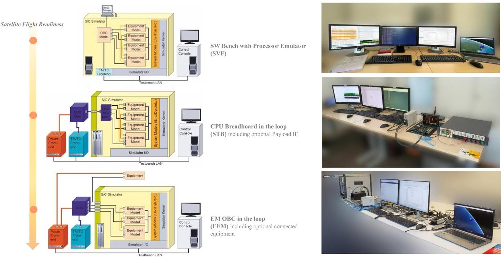

Fig. 5. Testbench Variants

Table 6. Platform Communication Characteristics

<table border="1"><tr><td>TT&amp;C</td><td>Details</td></tr><tr><td>Transceiver&amp;Antenna</td><td>S-Band</td></tr><tr><td>Uplink</td><td>2025-2110MHz(up to5MBps)</td></tr><tr><td>Downlink</td><td>2200-2290MHz(up to5MBps)</td></tr></table>

## 3. The On-Board Software

The second reason for F-Series flexibility is the object-oriented implementation of its Onboard Software (OBSW). The F-Series OBSW is implemented in C++ hosted on the RTEMS operating system. The OBSW includes a PUS stack with standard and private modes see [5].

Device handlers for the individual controlled equipment units are realized as plug-in classes. Thus, in brief the software architecture reflects the satellite sensor/actuator/payload/RF-equipment tree. Similarly, the subsystem controller algorithms (AOCS controller) are integrated in dedicated mode specific mode control handlers. This allows for an efficient tailoring of the SW to new AOCS control modes for new missions.

As already mentioned, the OBSW was adapted to support the dual-core processor with fixed task allocation, with platform control on Core 0 and Payload control on Core 1. From End of 2025 a variant for the GR740 quadcore processor will be implemented.

Instead of On-board control procedures, Mode transfers for subsystem and the entire satellite are realized via sequential mode tables defining equipment mode switching, transition times and fallback modes. The mode transfer table and sequence are also linked to the mission database with ground visibility. The mode change can be initiated from mission control software on device handler, assembly, controller, and higher system levels. More details are mentioned here [5].

## 4. Satellite Simulator

During the development of the satellite towards readiness, there are different phases where the on-board software has to be validated. Usage of hardware units for achieving the on-board software maturity is capital intensive process for any small satellite mission. Currently, several large satellite missions already use an SMP2 based satellite simulator tool in its development. F-Series development kit follows up on this approach and provides a fully simulated satellite as part of the kit.

The satellite simulator comes installed with some of the off-the-shelf equipment which are simulated one-to-one. This includes the command/control, interfaces, power characteristics, etc. Such a simulator can act as a complete digital-twin of the satellite also called Software Verification Facility (SVF). This facility can be used for operations training of the satellite. The same tool can be used as an environment simulator in case a full hardware equipment is foreseen to be connected to the OBC for a hybrid setup. These different phases, starting from SVF to a full-fledged EQM testbench are illustrated in the Fig. 5.

The top most variant (as seen in the Fig. 5) of the testbench is the full digital twin version of the satellite (SVF). In this variant, the on-board software can be

<!-- PDF_PAGE: 7 -->

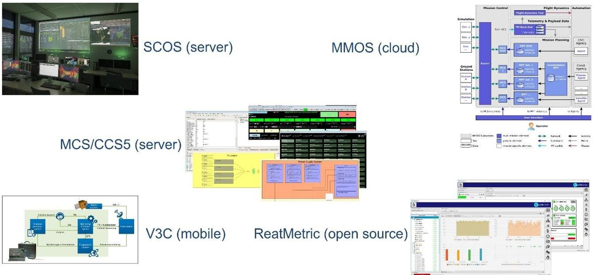

Fig. 6. Compatible Operations Suite

developed, compiled and loaded into the emulated CPU board. The emulation functions like a hardware CPU which implies that there should not be any major delta development when the hardware CPU is introduced later.

This particular variant is light-weight and can be easily deployed into several PC's for training the operational personnel as mentioned earlier by connecting a Mission Control Software (MCS)-in-loop. The primary use-case for this variant is during the initial phase of the satellite development where the satellite equipment is defined or under consideration. The equipment can be simulated first, using the Interface Control Document (ICD) and the on-board software code can also be developed in parallel and later validated with the simulated model.

Once all the features & functions of the on-board software are validated, the same digital twin variant can be updated to the next variant called System Test-Bed (STB). In this variant, the hardware OBC is introduced and can be still connected to the simulated satellite just by excluding the emulator-in-loop. The same on-board software is loaded into the CPU which commands & controls the simulated satellite. The same existing MCS tool can be used by connecting it to either a simulator where the CCSDS board is simulated or a hardware CCSDS board with the help of EGSE equipment like TM/TC Front-end (as seen in the Fig. 5). This variant can be further updated into a full-fledged EQM/FM testbench with qualified hardware in the loop.

board connected to the fully simulated satellite. Based on the available budget, the development plan can be seamlessly designed. This enhances the scalability aspect significantly.

It is important to notice that this simulator-based satellite development is entirely flexible and there is no fixed start point for the development. For instance, if the CPU board is pre-defined as GR712RC board, the user can directly start with STB variant with a development

## 5. Operations Suite

In order to successfully verify the satellite system for flight readiness, the satellite FM flat-sat or fully assembled satellite has to comply with all the operational features associated with the satellite mission. Mission Control Software (MCS) plays a vital role, which is the essential part of Ground Stations like ESOC, GSOC, etc. Currently, several MCS tools are utilized to command and operate Cube and SmallSats. The nonstandardization of such an MCS tools is one of the problems that several space agencies are struggling with and the F-Series operations suite tries to address such an issue by providing compatibility with several MCS tools. The different MCS tools that are supported are shown in the Fig. 6. In order to stay compatible with agency and industry operations standards, the development kit comes installed with either SCOS-2K or CCS5 (Central Checkout System) which could be ideal for some of the standard small satellite missions. For CubeSat missions and other New Space missions, the development kit is also compatible with the open source ReatMetric MCS tool. Apart from these, the development kit can be configured to be compatible with cloud based MCS tool like MMOS and a complete mobile MCS tool like V3C system (see Fig. 6.).

The satellite simulator tool using the simulated CCSDS board can be directly connected to any of the MCS tools that is mentioned in Fig. 6. During the EQM/EFM stage the EGSE equipment, like TM/TC Front-end, can be configured with SLE to match any

<!-- PDF_PAGE: 8 -->

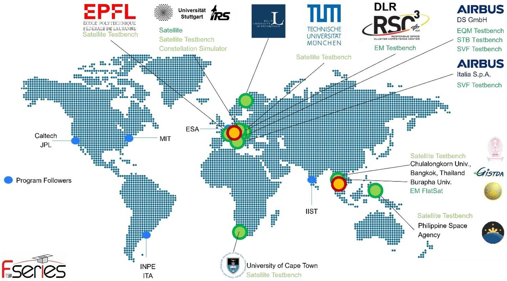

Fig. 7. Institutions using & following F-Series Kit

selected MCS tool. The operations suite does not only contain the MCS tool, within this tool there is always a provision for Mission Information Base (MIB). An example MIB with a list of telecommand tables and telemetry monitoring tables which are in compliance with PUS standards is also included. Apart from this, a stack of telecommands and scenario-based sequence codes are added within the MIB.

The operations suite includes example Python based scripts in order to perform integration, regression, operational tests. These scripts can further process the AOCS parameters and can plot them for evaluations. In cases where Python integration is not possible, for e.g., in CCS5, a provision for different type of scripting (i.e., based on tcl/tk) is considered. In summary, based on the overall cost and export constraints, the operation suite with a suitable MCS tool can be decided. As the journey from initial development phase until launch phase is quite long, any of the mentioned MCS tools can be used during the development stage and can be swapped (if needed) with a more standard tool later for flight operations.

## 6. Payload Accommodation & Interfaces

F-Series is a flexible architecture concerning the integration of one or more customer payloads to take advantage of their R&D and/or commercial targets.

Due to its flexibility w.r.t the payload management payloads with diverse interfaces can be connected, such as with serial connections, SpaceWire interfaces, CAN-

bus and - for the first time - payload units with Ethernet interface.

The F-Series transceiver system provides a large payload data downlink capability that benefits of an antenna with hemispherical coverage that has been designed for use on board of small satellites. The pattern shape has been optimized particularly for LEO missions with nadir/target orientation and reaches rates up to 60Mbps over an X-band link.

Table 7. Payload command/control interfaces

<table border="1"><tr><td>Data Interfaces</td><td>Details</td></tr><tr><td>Serial</td><td>RS422, RS485, all standardized baud rates</td></tr><tr><td>SpaceWire</td><td>Up to 200 MBit/s</td></tr><tr><td>Ethernet</td><td>Standard 10/100 MBit/s LAN. Gigabit Ethernet optional</td></tr><tr><td>CAN Bus</td><td>According to CAN standards, no traffic shaping, no packet collision avoidance in case of multiple PLs</td></tr></table>

Science data storage options vary from SpaceWire, CAN or Ethernet routing solutions depend on the payloads network. The OBDH architecture provides high performance coupled with optionally redundant modules for improved reliability with a storage capability up to 256GB for science data.

<!-- PDF_PAGE: 9 -->

Table 8. F-Series Payload Subsystem Budgets

<table border="1"><tr><td></td><td>Details</td></tr><tr><td>Onboard MMU</td><td>Options:16GBSpaceWireMMU,256GBor1TBEthernetMMU</td></tr><tr><td>PLCommunications</td><td>60-235MbpsXbanddownlink,8PSKmodulation,CCSDSfrom500kmLEOAlternatively,EthernetpacketsencapsulationDVB-R2/S2protocols[5]</td></tr></table>

Table 9. Payload Hosting Options

<table border="1"><tr><td>Payload Hosting</td><td>Details</td></tr><tr><td>Nadir Bay</td><td>Default</td></tr><tr><td>Stellar Bay</td><td>Optional</td></tr><tr><td>Bow-side Bay</td><td>Optional</td></tr></table>

## 7. Example Applications

F-Series can serve as multi payload carrier, purely limited by the payload's mass and power requirements. The classic applications cover the areas of

- Earth Observation & Science (EOS) also for small constellations or formations.

- In-Orbit-Demonstration/Validation (IOD/IOV) missions

The high-performance FPGA boards also are a step forward for the use of AI in upcoming satellite generation. These boards are well suited for running Neural Network code in space [6]. Feasible AI based applications/functions are

- onboard image processing;

- ground scene interpretation on board;

- AOCS sensor fusion;

- autonomy for deep-space exploration;

- on-board fault diagnosis or automatic anomaly detection.

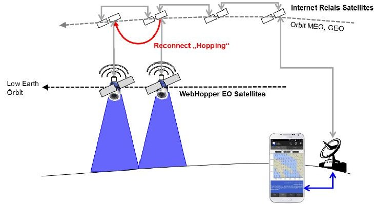

Payload accessible/controllable via re

Fig. 8. Payload access from Gnd via Relay link (X-band)

The Ethernet for payload applications opens up the use of F-Series kit for (as shown in Fig. 8):

- Relay access of Ground to payload

- In Space AI applications

Due to the pointing knowledge and precision the F-Series offers, it is also suited for constellation missions that involve the combination of both CubeSats and SmallSats. In situations where higher pointing and precision is needed, the small satellite bus is useful (for e.g., to downlink data via an OSIRIS laser terminal of TESAT Spacecom). The relay link can be useful between these different satellites in order to communicate necessary information as illustrated in the Fig. 9.

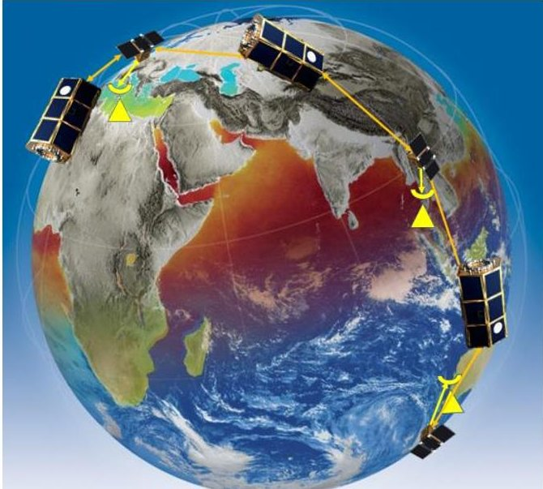

Fig. 9. Constellation with Observers and Relay's connected via ISLs

Running an AI algorithm on-board the satellite to observe and recognise any natural disaster directly from its orbit is turning out to be an important opportunity.

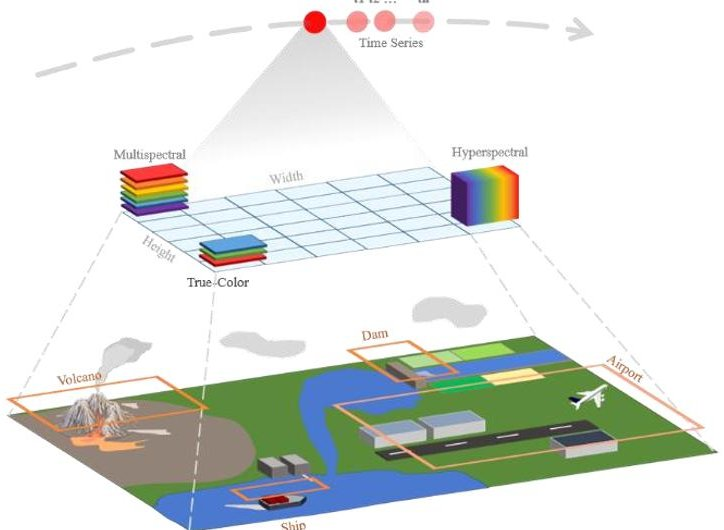

Fig. 10. In-Space AI applications and Data [7]

Due to severe constraints in a small satellite, it is important to make sure that there is some amount of

<!-- PDF_PAGE: 10 -->

flexibility when it comes to the satellite Core Data Handling (CDH) subsystem.

The flexibility provided by F-Series kit is especially needed when several challenges w.r.t interfaces, computation necessity, etc, are involved. Especially, with the deployment of AI algorithms on-board the small satellite.

## 8. Establishments Utilizing F-Series kit

On one side, there is a well-established F-Series consortium which is evolving with the small satellite market and technology updates. This consortium consists of quite a few like-minded SME's adding to both the scalability & flexibility aspects. On the other hand, there are reputed institutions and establishments which are directly using the kits and others following the development. Fig. 7 provides a world-view of the current institutions that are using the F-Series development kit.

## 9. Conclusion

In conclusion, the exploration of the "F-Series" development kit aims at enhancing efficiency, scalability and operational flexibility. By utilizing modular components off-the-shelf parts, this approach promotes streamlined development process that can significantly reduce the time and costs associated with satellite production. Despite the initial challenges such as excessive development timelines and limited scalability, the incorporation of agile methodologies, continuous verification, and a comprehensive digital-twin framework addresses these shortcomings.

The collaborative efforts among diverse small and medium-sized enterprises (SMEs) under this initiative underscore the importance of interdisciplinary cooperation in advancing satellite technology. As the demand for responsive and cost-effective satellite solution grows, the continued evolution of the F-Series development kit will likely play a pivotal role in shaping the next generation small satellite ideas, enabling more open, agile and connected global space sector.

## References

[1]. Eickhoff, Jens (Ed.): A Combined Data and Power Management Infrastructure, $ 2^{n d} $ Edition, Springer, 2021.

## [2]. Patents:

EP2665205A3 US9751642B2

[3]. Frontgrade Gaisler: GR712RC-SBC Single Board Computer, Design Description, GR712RC-SBC, 2017, V 1.1.

[4]. MA61C CubeSat, Hardware ICD Document, 2023, V 1.0

[5]. Eickhoff, Jens (Ed.): The FLP Microsatellite

Platform - Flight Operations Manual, Springer, 2016.

[6]. Eickhoff, J. et al.: Payload for Onboard AI-based Image Recognition, Winter Satellite Workshop Helsinki, s.n. 2024.

[7]. Bharadwaj, Chintalapati. et al.: Acquisition and Generation of Image Recognition Dataset for Onboard Earth Observation Missions: Towards Enhancing the Performance of On-board Image Recognition Algorithms, Winter Satellite Workshop Helsinki, s.n. 2024 https://doi.org/10.13140/RG.2.2.10625.02406