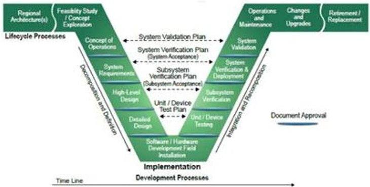
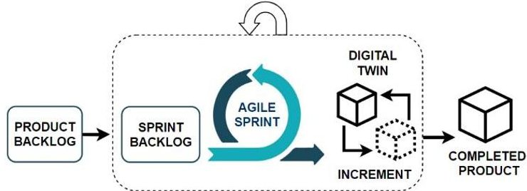

<!-- PDF_PAGE: 1 -->

# $ 7 5^{\mathrm{th}} $ International Astronautical Congress (IAC), Milan, Italy, 14-18 October 2024. Copyright ©2024 by the International Astronautical Federation (IAF). All rights reserved.

IAC-24-D1,6,2

Lean System Engineering tools for the New Space Economy

Carmine Di Lauro $ ^{a \star} $ , Carola Alessio $ ^{a} $ , Ancona Vittorio $ ^{a} $ , Maggiore Paolo $ ^{b} $

$ ^{a} $ Thales Alenia Space Italia,, Via Saccomuro, 24, Rome Italy,, 00131

$ ^{d} $ Department of Mechanical and Aerospace Engineering, Politecnico di Torino, Corso Duca degli Abruzzi 24, Torino, Italy, 10129,

* Corresponding Author

## Abstract

In recent years the space has become more accessible, thanks to the entry into the sector of private companies significantly increasing competitiveness. Consequently, the need to adapt to the rapid changes in the industry is leading private companies to implement changes in the design process by making it more streamlined. As a support to the current use of the V-model, the Agile methodology is seen as a viable solution to simplify the process. Agile Scrum is an iterative development process created to arrive at product delivery faster by directly involving customers in the design.

The application of Agile, or more in general of what is called iterative and incremental methods, in commercial space programs has been very successful, especially in Cubesat design, and in the private sector. The growing demand for large spacecraft brings, however, the challenge of streamlining the process to a greater level. As additional instrument for lean approach to the system engineering, the Digital Twin seems one of the best candidate.

The digital twin has been applied for aircraft engines in real time performance monitoring as well as for the possibility of testing operation on the virtual product before applying it on the physical product. In addition to being used as a diagnostic tool, the digital twin can be seen in a future implementation as a working tool in the design phase, useful for coordinating the team, synthesize documentation and making project progress clearer to all the figures involved.

Considering the complexity, duration and size of programmers faced by large companies, the application of Agile combined with Digital Twin can offer room for an improved strategy. In the following work, this synergy will be explored, identifying possible solutions within a case study of a space program focusing on the benefits to risk management, product release and document synthesis.

Keywords: Lean System Engineering, AGILE, Digital Twin

Acronyms/Abbreviations

ATCS Active Thermal Control System

DT Digital Twin

ESA European Space Agency

INCOSE International Council on Systems engineering

PDR Preliminary Design Review

SRR System Requirement Review

TCS Thermal Control System

TRL Technology Readiness Level

Fig 1. V-Model [2]

## 1. Introduction

The V-Model described in INCOSE [1] is a sequential approach applied to the development of systems that describes every single phase of the life cycle, from the concept of operations to disposal. The transition from one phase to another is characterized by a decision gate subject to the approval of documentation for the green light to proceed to the next phase. Once you enter the next phase there is no going back (Fig 1).

The V-model does not involve frequently evolving or changing requirements, modifying the architecture, or conducting subsystem tests to demonstrate and consolidate the design requirements. Instead, it involves an extensive campaign of qualification tests on the integrated system only after all the components of the subsystems have in turn been qualified separately.

According to ESA's Agenda 2025 "The Agency is preparing to develop its technological strategy to accelerate the development and adoption of innovative technologies by 30%” [3], Due to the following

<!-- PDF_PAGE: 2 -->

disadvantages, the V-model is not suitable for achieving the objectives contained in the agenda:

- It is not suitable for projects where the requirements are not clear and detailed especially in the early stages, therefore modifying or adding a requirement in advanced stages carries a high risk.

- It does not support the iteration of the phases, also for this reason the inclusion of changes late in the project increases the risk of errors.

- The customer's needs are defined only at the beginning of the project, there is no space dedicated to continuous discussion with the customer, consequently in the case of commercial programs misunderstandings can be generated which undermine the quality of the product or do not satisfy the customer requests. [4,5]

Iterative methods are considered in this study as a supplement to the V-model. They are composed of iterative cycles focused on adding value to the product being designed with particular attention to reactivity in the face of problems and changes that characterize the project. The Iterative approach was developed for projects where requirements are unclear in the early design stages and where stakeholders wish to introduce new technologies late in the design. Furthermore, the role of stakeholders in providing feedback to developers is central; this approach was used for the development of the fourth-generation EFA aircraft [6,7].

Iterative methodologies focus on the development of a product at each cycle, as it is difficult to realise in a short time the use of the digital twin is considered as a replacement for the product concept at the end of each iteration. "The Digital Twin is a set of virtual information constructs that completely describe a potential or actual physical product from the micro to the macro level. At best, any information that could be obtained from an inspection or functional or performance test on the product can be obtained from its Digital Twin." [8] A digital twin can therefore be developed by perfectly replicating a physical product or it can represent the physical product that will then be built, depending on the needs foreseen by the company. In the second case the Digital Twin is developed during the design and testing process to have a virtual representation of the final product which is updated with the progress and design choices. The Digital Twin, therefore, can be used as a useful tool throughout the product life cycle, from the feasibility study to operation and decommissioning, bringing benefits to the design teams, management and stakeholders.

A case study will be presented that integrates the Agile methodology combined with the Digital Twin within the v-model, highlighting its conclusions and advantages [8].

- The work is organised as follows:

- Section II describes the methodology applied

- Section III highlights the Strengths and weaknesses of the methodology

- Section IV describes the methodology applied to the case study

- Section V conclusions

## 2. Methodology

The Agile methodology, include an interaction with the customer at each cycle in which to discuss the progress achieved in the creation of the product, in order to update it so that it can give feedback that can lead to the delivery of a high quality product and consequently have the certainty of continuing the design on the right path or possibly changing it. At the end of each cycle, to reduce the customer's ambiguities and to speed up the design, a partial or complete version of the final product will be delivered, so that the customer can try it and provide feedback to the designers. If the customer does not exist, at the end of each cycle the release of a product can be replaced by a test as in the case of SpaceX [9]. The test on a prototype takes the place of the customer and the test results take the place of the feedback, in this way the same result is obtained while remaining within the company. Following the current approach with the use of the V-model and the qualification of each individual component, it is complicated for European companies to radically change the way of approaching the project by favouring the construction of prototypes and providing for more tests like American private companies. Likewise, it is complicated to create a partial version of the final product to show and try for the customer. The approach described above would currently only be possible for new critical equipment, mainly dealing with a single stakeholder, which could be internal management or the contractor requesting the equipment.

Rather than releasing a physical product or prototype at the end of each sprint, one solution could be to release an updated version of the digital twin of the future final product, obtaining a good part of the benefits by using an abstract virtual product without having a tangible product. The client won't be able to try it but will be able to get a much clearer idea of how the design is going and what they are paying for. Furthermore, it would also be useful for increasing the efficiency of the team as by acquiring a complete understanding of the functioning and behavior of the system, it would be possible to anticipate and resolve

<!-- PDF_PAGE: 3 -->

potential problems. Furthermore, it would be useful for streamlining documentation.

The combination of Agile and digital twin takes place in the following way: the various sub-system teams perform an iterative cycle of work to achieve a result, in this phase, collaboration and the speed and quality of the information flow between the teams are essential for the understanding and progress of the project. The Digital Twin lends itself to this use as a working tool.

Each team, at the end of the sprint, generates a Digital Twin of the subsystem, such as the structure or the thermal system (Errore. L'origine riferimento non è stata trovata.).

The Digital Twins of all subsystems are then integrated, generating the Digital Twin of the current state of the final product. Once integrated, the digital twin is shown to customers informing them of the product's progress and receiving essential feedback to set up subsequent iterative cycles [9].

Fig 2. Methodology sprint

## 3. Strenghts and weaknesses

By promoting meetings with the Digital Twin of the product at the centre, it is possible to align the various teams, so that all the figures involved can have information on the progress of the project in a clear and unambiguous way, facilitating the configuration and integration phase, especially the second represents a great source of risk. The combination of Agile and Digital Twin therefore allows each subsystem to independently develop its own by-product, and then integrate it into the overall Digital Twin [10], allowing each team to have a complete view of the design progress, and to be able "virtually" touch what he is designing almost in real time. Furthermore, with the use of Digital Twin at the end of the sprint, stakeholders are facilitated and encouraged to actively engage in the development process by providing feedback.

In the future, the Digital Twin could be used by teams to carry out tests to validate functionality and analysis without first going through the mathematical model. It would therefore lend itself as a tool to carry out verification by analysis of the subsystem and once integrated into the overall Digital Twin it could be used

to carry out verification by analysis of the integrated product. This way it would also give a complete picture of the situation to the other teams. Such a step would enable rapid iterations and simulations allowing teams to mitigate risks and save time and avoid delays [11, 12]. It would also be possible to simulate scenarios in order to evaluate the effects on project timing, in order to identify and address potential delays and optimize resources effectively.

However, at the end of the sprint, when the results are presented to the customers, having the Digital Twin as a tool, compared to documentation or slides, is much more effective for understanding the project even if in a low fidelity version. As a result, the customer will be more satisfied and more open to a friendly discussion with less ambiguity [9].

## 4. Hypothetic case study

The study cases were developed to simulate the progression of the same issues, comparing a traditional full V-Cycle approach with an iterative methodology designed to meet the demands of commercial projects. For instance, the following sections elaborate on the aspects related to a hypothetical active thermal control system that encountered significant deviations in requirements during the early design phase. The comparison between the V-model and the Agile methodology combined with Digital Twin aims to underscore the advantages of employing iterative methodologies in space programs, emphasizing their benefits in adapting to changing requirements and improving overall project outcomes.

## 4.1 CLASSIC FULL V-MODEL APPROACH

This particular deviation pertains to the dissipation capacity of the ATCS system, originally specifying a dissipation of 4 kW regardless of flight attitude. However, during the PDR of the thermal control subsystem, a request from an institutional stakeholder led to a modification of this requirement, resulting in a 20% increase in the required dissipation of the thermal system. Consequently, the architecture of the thermal system had to be reworked; initially designed with body-mounted radiators, the heightened dissipation requirement necessitated the adoption of deployable radiators. Typically, milestones align with the maturity of the design process; however, in this instance, a new milestone was introduced, signalling a substantial departure from the current design maturity level. This significant alteration resulted in escalated costs related to modifications and components, amplified risks associated with the TRL of the mechanism and radiators, and contributed to schedule delays.

## 4.2 AGILE/DT ITERATIVE APPROACH

<!-- PDF_PAGE: 4 -->

Iterative methodologies involve incremental work within each cycle, as defined by Agile. At the conclusion of each cycle, there is an opportunity for discussion with the customer regarding the project's progress, allowing for early-stage feedback. During one of the iterative cycles, a dialogue was initiated with the customer concerning the relevant requirement. The advantages and drawbacks of the thermal system architecture necessary to meet the requirement were outlined to the client. Specifically, to achieve the required heat dissipation, incorporating radiator deployment mechanisms would have altered the ATCS architecture and the configuration of other subsystems. However, this modification would have resulted in a significantly higher dissipation capacity than requested by the customer, substantially enhancing the system's capability to withstand thermal loads. Consequently, this would have opened up new commercial opportunities, bolstering the product's competitiveness in the market.

Nevertheless, this course of action would have resulted in augmented costs associated with the incorporation of mechanisms and additional components. Furthermore, it would have heightened risks, given that the TRL of the entire deployable radiator system would have been in low range, necessitating the development of a new design. Additionally, involvement of a sub-contractor would have expanded the roster of parties engaged in the project. Consequently, significant schedule delays would have been inevitable, stemming from the rework of the architecture, component procurement, and the engagement of a sub-contractor. It's important to note that, given the commercial nature of the program, customers are inclined to minimize costs, thus, the customer's aim is to offload as much of the cost as possible onto the company that designs the product.

After outlining these pros and cons to the customer, the team proceeded to propose the solution involving body-mounted radiators. Although this configuration would not have achieved the dissipation required by the customer, it presented several noteworthy advantages. These included the simplicity of its design, minimal alteration to the ATCS architecture, lower costs, and reduced risks associated with the absence of mechanisms and the lower TRL of these radiators, as well as a simpler design. From a product competitiveness perspective, the slight reduction in dissipation would have had a lesser impact than a decrease in mass or transportable volume. Additionally, the reduced mass stemming from the absence of mechanisms would have further favoured this choice.

Instead of formal documentation, the customer was provided with visual simulations using a physically representative Digital Twin, accompanied by technical

data, which facilitated a clear presentation of the results. By virtually representing the two solutions in their operational environment, it was easier to demonstrate to the customer the advantages and disadvantages of both options. The decision was made in favor of bodymounted radiators, and the requirement was adjusted by requesting the ATCS to dissipate 15% less heat. This allowed for the selection of a less expensive and less risky architecture, satisfying both parties.

## 5. Conclusions

In general, changes in requirements during the advanced stages of a project can result in substantial cost escalations, heightened risks, and schedule disruptions, particularly if these changes were not accounted for during the preliminary design phase. When utilizing the V-model, a change of this magnitude in the advanced stage can pose major challenges, as this sequential methodology does not accommodate iterative adjustments, rendering it difficult to backtrack and rework the design. Moreover, the absence of a dedicated space for dialogue with stakeholders constrained the company's capacity to effectively contract and manage requirements.

Generally, high-level customer-defined requirements may clash with subsystem-specific requirements, necessitating intricate decisions regarding system design and architecture.

Thanks to the iterative approach involving continuous customer engagement, it became possible to identify this change during the early phase. Consequently, the team was able to present the advantages and disadvantages of various solutions to the customer, detailing the technical, risk, and cost implications. The iterative cycles facilitated a thorough examination of the two solutions that would define the TCS design. Moreover, the dedicated space for customer engagement at the end of each cycle enabled immediate discussions to determine which solution would satisfy both parties.

Furthermore, the high level of interaction with the customer through presentations and simulations using a digital twin can be more satisficing for the project team, as opposed to formal documentation. This facilitated faster and more effective communication, enabling the customer to promptly grasp the constraints and opportunities associated with the two solutions. This new form of communication, enabled by the digital twin, holds significant value in aiding the customer's decision-making process. It presents the results of different options clearly and tangibly, while also highlighting the usefulness of the digital twin in areas where other methodologies are still predominant.

<!-- PDF_PAGE: 5 -->

References List of references

Reference to a book: [1] INCOSE "Systems engineering handbook", fourth edition, 2015

Reference to a journal publication:

[2] S. Mohammad Bagher Malaek, Ali Mollajan, Amirhassan Ghorbani and Amir Sharahi, A New Systems Engineering Model Based on The Principles of Axiomatic Design, 2014

Reference to a conference/congress paper: [3] ESA Agenda 2025, 2021

Reference to a journal publication: [4] Roger S. Pressman, published by McGraw-Hill Education, Software Engineering: A Practitioner's Approach, 2017.

[5] V-model software engineering https://www.geeksforgeeks.org/software- engineering-sdlc-v model/?ref=header_search (accessed 25.03.24).

[6] Carlton Northern Dr. Kathleen Mayfield Robert Benito Michelle Casagni, Mitre, Handbook for Implementing Agile in Department of Defense Information Technology Acquisition, 2010

Reference to a journal publication: [7] CANADIAN FORCES COLLEGE, LCol C.R.J. Desgagné, Evolutionary Acquisition - A Complementary Approach to Capability Based Planning for the Delivering of Aerospace Power, 2009

Reference to a journal publication:

[8] LUNING LI, SOHAIB ASLAM, ANDREW WILEMAN, AND SURESH PERINPANAYAGAM, Digital Twin in Aerospace Industry: A Gentle Introduction, 2017

Reference to a website: [9] Applying SAFe to hardware development https://scaledagileframework.com/applying-

safe-to-hardware-development/ (accessed 25.03.24).

Reference to a journal publication: [10]Alencar Bravo and Darli Vieira, Perspective Chapter, Digital Twin Technology as a Tool to Enhance the Performance of Agile Project Management, 2023

Reference to a journal publication: [11]Madni AM, Madni CC, Lucero S., Leveraging digital twin Technology in Model-Based Systems Engineering. Systems, 2019

Reference to a journal publication: [12]Athavale VA. Digital twin, a key technology driver in industry 4.0. Engineering Technology Open Access Journal, 2021

Reference to a journal publication: [13] MIRRORING REALITY, Capgemini Research Institute, Digital twins in aerospace and defense, 2023

[14]Paola BREDA, Frank GALLAGHER, Yuri HACHIYA, KangSan (Antonio) KIM (STARK), Raphaelle LEGLISE, Pavithra MAGHAIPATHY, Andrea RAMPA, Ruvimbo SAMANGA, International Aeronautical Federation (IAF) International Project/Programme Management Committee (IPMC) 2021 Young Professionals Workshop, STARTA Short-term Rapid Turnaround Activities Project Management for the Aerospace, 2021

Reference to a Master Thesis: [15]Alessio Carola, Carmine Di Lauro, Vittorio Ancona, Paolo Maggiore, Politecnico di Torino Master Thesis, Thales Alenia Space Italia, Lean system engineering for the new space economy, 2024