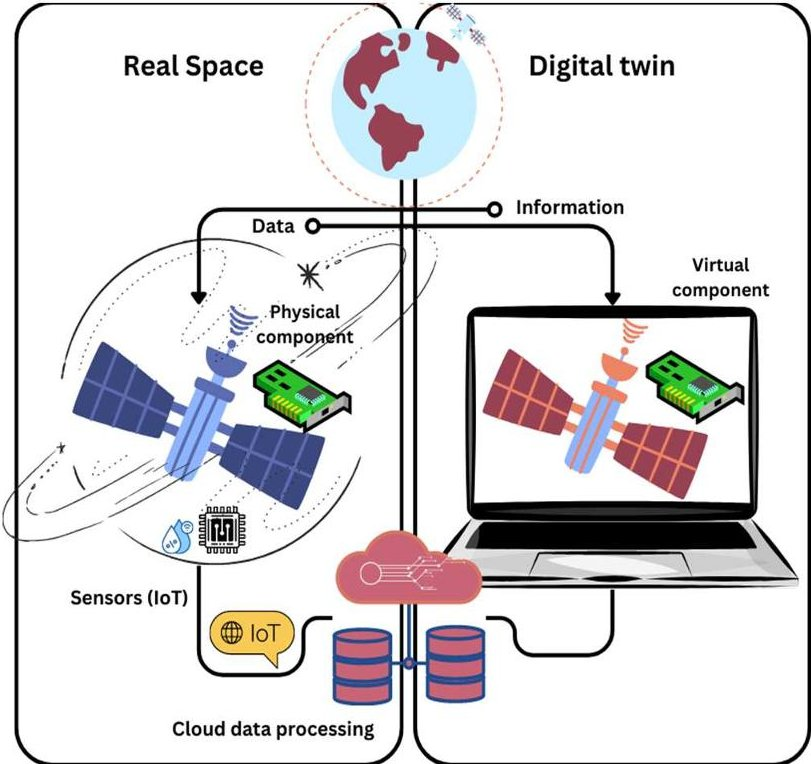
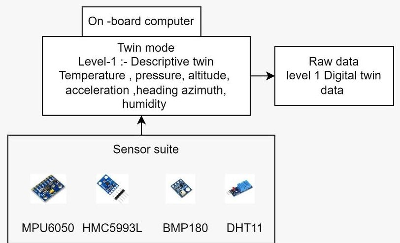
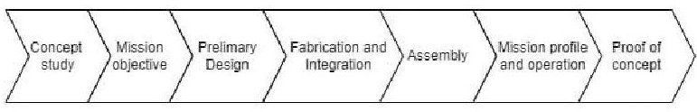
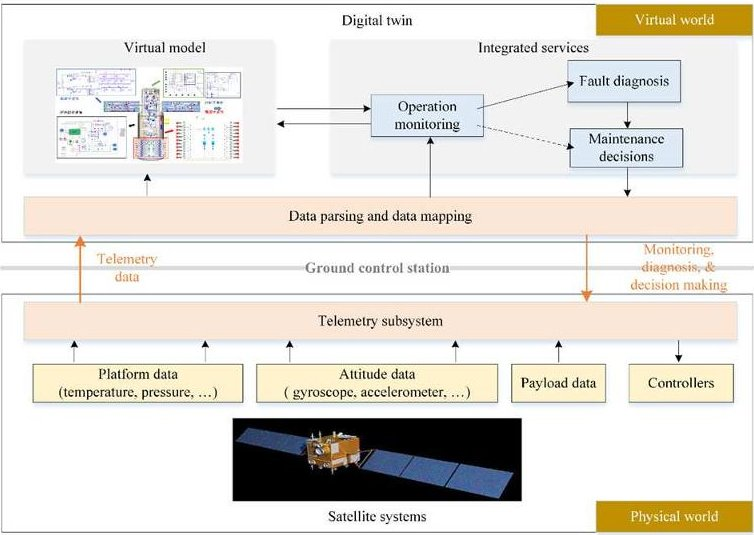
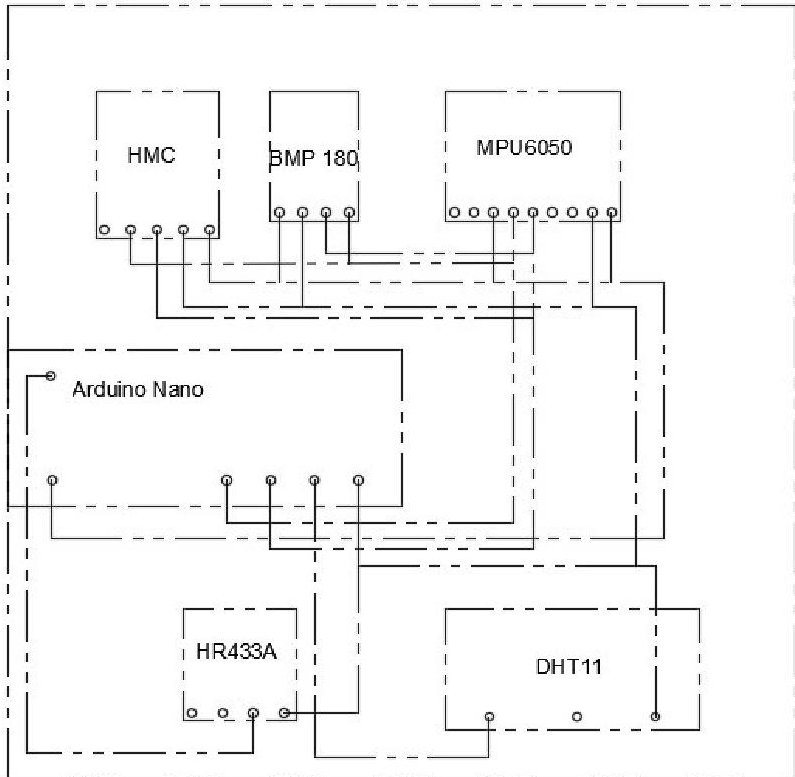
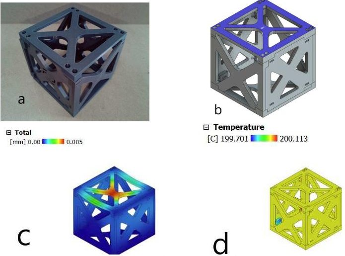
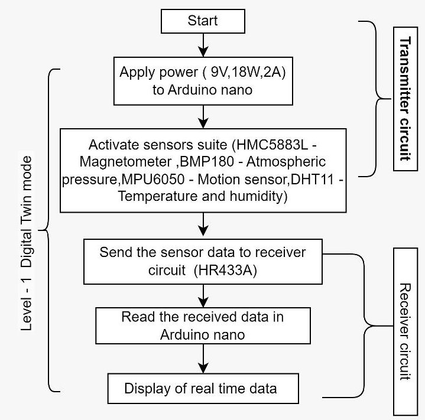
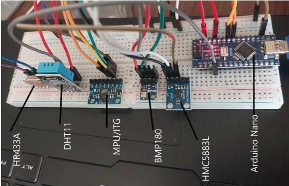
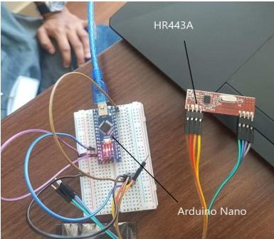
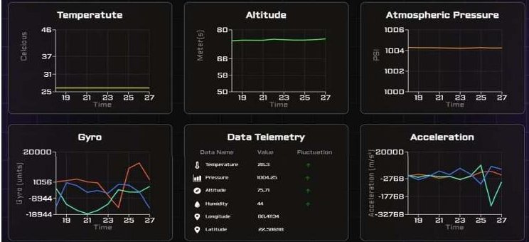

<!-- PDF_PAGE: 1 -->

# Level-1 Digitally Twinned 1U CubeSat (DT1UC)-concept to reality

Prashantha kumar H G Department of Aerospace Engineering Dayananda Sagar University Bangalore, INDIA prashanthakumar.hg@gmail.com

Krish Agrawal Department of Aerospace Engineering Dayananda Sagar University Bangalore, INDIA krishagrawalskj@gmail.com

Shripad Kulkarni Department of Aerospace Engineering Dayananda Sagar University Bangalore, INDIA sripad-ae@dsu.edu.in

Ashvani Chaudhary Department of Aerospace Engineering Dayananda Sagar University Bangalore, INDIA ashvanic446@gmail.com

Vatsal Vipul Amrania Department of Aerospace Engineering Dayananda Sagar University Bangalore, INDIA vatsal.amrania2@gmail.com

Department of Aerospace Engineering Dayananda Sagar University Bangalore, INDIA Jaimankhandelwal@gmail.com

Abstract This paper presents the design and development of a digitally twinned 1U CubeSat, representing a significant advancement in satellite technology. The CubeSat is equipped with digital twinning capabilities at level-1, allowing for realtime monitoring and analysis of its behavior in space. The integration of digital twin technology enables proactive sensor data generation, motion detection which lead to enhanced mission planning. The design process encompasses various aspects, including the selection of components, system architecture, and integration of sensors for data capture. The development phase involves rigorous testing and validation to ensure the reliability and performance of the digitally twinned CubeSat.

Keywords CubeSat, Digitally Twinned, Satellite Technology, Real-time Monitoring, Space-based Operations, Mission Planning, Innovation

## I. INTRODUCTION

Space exploration has long been a frontier of human endeavor, driving technological innovation and expanding our understanding of the universe. Payloads play a crucial role in modern space exploration, facilitating communication, navigation, Earth observation, scientific research, and national security. Traditional satellite payloads are designed to collect data from space and transmit it back to Earth for analysis. However, these payloads often lack real-time monitoring and simulation capabilities, limiting their effectiveness in responding to dynamic space environments and unexpected events. In recent years, digital twinning technology has emerged as a powerful tool for simulating and monitoring physical systems in real-time. A digital twin is a digital model of an intended or actual real-world physical product, system, or process (a physical twin) that serves as the effectively

indistinguishable digital counterpart of it for practical purposes, such as simulation, integration, testing, monitoring, and maintenance [1]. The digital twin concept encompasses various levels, each offering distinct functionalities and capabilities. Level 1 & Level 2, known as the Descriptive twin & Informative twin providesa live and sensory data. Level 3 introduces the Predictive twin, leveraging operational data to gain insights and anticipate future events. At Level 4, the Comprehensive twin takes simulation to the next level by exploring various future scenarios and hypothetical situations.

Fig. 1 Digital twin outline for a satellite

Lastly, Level 5 marks the Autonomous twin, endowed with the ability to learn and act autonomously on behalf of users.

<!-- PDF_PAGE: 2 -->

This advanced level signifies the pinnacle of digital twin technology, enabling adaptive and self-regulating systems [2][3], Levels 3, 4, and 5, enriched with real-time data from embedded sensors and IoT technologies, represent the future trajectory. However, the widespread adoption of digital twins may not be warranted for every manufacturer or product. Industries achieving significant success with digital twins typically involve large-scale products or projects within the Aerospace and Space industry, including engineering systems, satellite manufacturing, and space mission planning [4][5]. In this paper we would like to discuss the assessment towards developing of digital twin satellites in L-1 condition

## II. DT1UC MISSION ARCHITECT

The mission architecture of the DT1UC (Digitally Twinned 1U CubeSat) is depicted in Figure 2, illustrating the integration of various sensors and their respective data outputs. The mission is structured around three primary modules: the On-board Computer Module, Sensor Suite Module, and Digital Twin Module. The On-board Computer Module serves as the central processing unit,responsible for managing and coordinating the functions of the satellite. It interfaces with the Sensor Suite Module to receive real-time data from onboard sensors and performs initial processing tasks.

Fig. 2 The mission architect of level - 1 Digitally Twinned 1U CubeSat (DT1UC)

III. MISSION DEVELOPMENT LIFE CYCLE

Fig.3 Shows the mission development life cycle of level-1 Digitally Twinned 1U CubeSat (DT1UC)

designing and refining the satellite's subsystems, such as structure, power, and communication. Once the design is finalized, manufacturing and assembly of the satellite components take place, ensuring rigorous quality control. Subsequently, integration and testing phases validate the satellite's functionality and performance in simulated space environments. Finally, the satellite is prepared for its operational phase, collecting data to validate its digital twin model.

The mission development life cycle for a digital twin 1U satellite begins with conceptualizing mission objectives and analyzing system requirements (fig.3). This is followed by

## IV. DIGITAL TWIN FRAME WORK

Framework is defined as a system of rules, ideas, or beliefs that is used to plan or decide something. The following figure.4 shows typical Digital twin frame work for a satellite, which shows the process involved. The complete CubeSat system consists of several sensors and components which are listed as follows. The Arduino Nano is a small, complete, and breadboard-friendly board based on the ATmega328P. It offers the same connectivity and specs of the Arduino Uno board in a smaller form factor. The BMP180 was designed to accurately measure atmospheric pressure. Atmospheric pressure varies with both weather and altitude; can measure both of these using this sensor. The DHT11 is a basic, ultra-low-cost digital temperature and humidity sensor. It uses a capacitive humidity sensor and a thermistor to measure the surrounding air, and spits out a digital signal on the data pin (no analog input pins needed).

Fig.4 The digital twin frame work of DT1UC

## V. MISSION DEVELOPMENT LIFE CYCLE

The Fig.5 Shows the layout of various sensors of DT1UC. The Honeywell HMC5883L is a surface- mount, multi-chip module designed for low-field magnetic sensing with a digital Interface for applications such as low-cost

<!-- PDF_PAGE: 3 -->

compassing and magnetometry. The MPU-6050 ports are the world's first Motion Tracking devices designed for the low power, low cost, and high-performance requirements of smartphones, tablets and wearable sensors. The NEO-6M GPS module is a well-performing complete GPS receiver with a built-in 25 x 25 x 4mm ceramic antenna, which provides a strong satellite search capability. With the power and signal indicators, you can monitor the status of the module. The ESP32-CAM is a small size, low power consumption camera module based on ESP32 It comes with an OV2640 camera and provides an onboard TF card slot. RF 433MHz is a pair of electronic RF transmitters and receiver modules used to send and receive radio signals between any two devices. The data is sent by the transmitter module from the transmitter end, and it is received by the receiver module at the receiver end. Power source will be a 9 volt battery and a pair of lithium for CubeSat 2.0 with ESP32 cam module

Fig.5 Shows the layout of placement various sensor of DT1UC

## VI. STRUCTURAL DESIGN & SIMULATION

The cube-sat can carry small science instruments to conduct an experiment or take measurements from space. In the current research, the cube-sat is made up of 3D printed material using PLA (polylactic acid) shown in fig.6a. The cube-sat is made using 3 different types of plates which will be of dimension 10*10,10*8 and 9*9 respectively, that form the six faces of the cube. The bases are attached to one another using screws as fasteners. The structural analysis simulates the response of a CubeSat to a 100 kN load

applied to its top surface. Using finite element analysis (FEA), the model evaluates stress distribution as shown in fig.6.b. Insights gained from this analysis aid in understanding how the CubeSat withstands mechanical loads

Fig. 6 (a) 3D-printed version of structure, (b) 3D model (c) Strain Simulation (d) Thermal Simulation of DT1UC

## VII. SYSTEM ARCHITECT

In the above flow chart shown(fig.7) observe the working of the satellite. It begins from application of power to the Arduino nano and then subsequently to all the sensors. The collected data is thensent to the receiver circuit, where it is processed and displayed. Fig. 8 illustrates the output dashboard, displaying graphical representations of temperature, altitude, atmospheric pressure and gyro received in real time during mission operation. It is essential to acknowledge that these parameters are captured at an altitude of 75 meters. This shows the integration and demonstration of level 1 digital twin technology for 1u CubeSat. During deployment or in-orbit operations, informing design improvements and ensuring mission success.

<!-- PDF_PAGE: 4 -->

Fig.7 System architect of level - 1 Digitally Twinned 1U CubeSat (DT1UC)

The thermal analysis assesses the CubeSat's response to a uniform thermal load of $ 2 0 0^{\circ} \mathrm{C} $ applied to all six sides. Employing thermal analysis techniques such as finite difference or finite element methods, the model predicts temperature distribution, heat fluxes, and thermal stresses within the structure. By analyzing thermal management strategies and potential hotspots, this analysis guides the design process to ensure the CubeSat's onboard components operate within acceptable temperature ranges, enhancing reliability and mission performance in the harsh environment of space.

## VIII. DIGITAL TWIN OPERATION MODE

The figures 8 & 9 show a simplified version of both the transmitter and receiver circuit. The satellite is a paragon of level 1 digital twinning as it employs one way communication. The transmitter circuit sends data to the receiver circuit making it an example of digital twinning. Fig. 10 illustrates the output dashboard, displaying graphical representations of temperature, altitude, atmospheric pressure and gyro received in real time during mission operation. It is

essential to acknowledge that theseparameters are captured at an altitude of 75 meters. This shows the integration and demonstration of level 1 digital twin technology for 1u CubeSat. The complete integrated model withinthe CubeSat structure is shown in fig.11

Fig. 8 Shows the transmitter circuit

Fig. 9 Shows the receiver circuit

Fig. 10 Shows the output dashboard

## CONCLUSION AND FUT URE SCOPE

In the current research, successfully demonstrated the design and development of the Level-1 Digitally Twinned 1U CubeSat (DT1UC) which is a significant step forward in satellite technology. With real-time monitoring of the DT1UC opens doors to enhanced space-based operations. Future scope includes advancing to higher levels of digital twinning for more sophisticated analysis and predictive capabilities.

## ACKNOWLEDGEMENT

We would like to acknowledge the Centre for Space Science and Technology (CSST), School of Engineering (SoE) Dayananda Sagar University for their constant guidance and Dassault Systems Foundation (DSF) for their funding for the execution of the project

## REFERENCES

[1] Tao, F., Zhang, H., Liu, A., & Nee, A. Y. (2018). Digital twin in industry: State-of-the-art. IEEE Transactions on Industrial Informatics, 15(4), 2405-2415.

[2] Deiva, Ganesh A., and P. Kalpana. "Digital Twins A State of the Art from Industry 4.0 Perspective." Intelligent Analytics for Industry

[3] 4.0 Applications (2023): 23-35.

<!-- PDF_PAGE: 5 -->

[4] Tapia, Endika, et al. "Towards real time monitoring of an aeronautical machining process using scalable technologies." 2022 7th International Conference on Smart and Sustainable Technologies (SpliTech). IEEE, 2022.

[5] van Erp, J. B. (2023, October). Cyber-Physical Humans at the Intersection of Digital Twins, Immersive Internet and Telepresence. In 2023 IEEE International Conference on Systems, Man, and Cybernetics (SMC) (pp. 1382-1386). IEEE.

[6] Fjeld, T. M. B. (2020). Digital Twin-Towards a joint understanding within the AEC/FM sector (Master's thesis, NTNU).

[7] Sharma, A., Kosasih, E., Zhang, J., Brintrup, A., & Calinescu,

[8] A. (2022). Digital twins: State of the art theory and practice, challenges, and open research questions. Journal of Industrial Information Integration, 30, 100383