<!-- PDF_PAGE: 1 -->

IAC-24-B4.91235

# PERCEPTION DATA SYSTEM FOR SATELLITE MONITORING OF STRATEGIC ASSETS

Renato A. Borges $ ^{a*} $ , Fernando A. A. Agelet $ ^{b} $ , William R. Silva $ ^{c} $ , Geovany A. Borges $ ^{d} $ , Marcelo M. Karam $ ^{e} $ , Rogério Sousa $ ^{f} $ , Emília O. Faria $ ^{g} $ , Alexandre C. A. Oliveira $ ^{h} $ , Yasmin C. F. Avelino $ ^{i} $ , Vinícius F. Modesto $ ^{j} $ , Filipe T. Cardoso $ ^{k} $ , João V. Moreira $ ^{l} $ , Chantal Cappelletti $ ^{m} $ , Jair M. F. Maia $ ^{n} $ , Paulo R. T. Silva $ ^{o} $ , Leonardo R. Oliveira $ ^{p} $ , Alessandro C. Araújo. $ ^{q} $

a University of Brasilia, FT, Brasilia, DF, Brazil, raborges@ene.unb.br

b University of Vigo, Vigo, Spain, faguado@uvigo.gal

c University of Brasilia, FGA, Brasilia, DF, Brazil, reis.william@unb.br

d University of Brasilia, FT, Brasilia, DF, Brazil, gaborges@unb.br

e University of Brasilia, STI, Brasilia, DF, Brazil, karam@unb.br

f University of Brasilia, STI, Brasilia, DF, Brazil, rogeriosousa@unb.br

g University of Brasilia, FACE, Brasilia, DF, Brazil, emiliafaria@unb.br

h University of Brasilia, FT, DF, Brazil, alex.crepory@gmail.com

i University of Brasilia, FT, Brasilia, DF, Brazil, yasmin.frrcosta@gmail.com

j University of Brasilia, FT, Brasilia, DF, Brazil, vinifragam@gmail.com

k University of Brasilia, FT, Brasilia, DF, Brazil, filipetc.bsb@gmail.com

l University of Brasilia, FGA, Brasilia, DF, Brazil, jkn0tengineering@outlook.com

m University of Nottingham, NGI, United Kingdom, chantal.cappelletti@nottingham.ac.uk

n Amazonas State University, CB, AM, Brazil, jmaia@uea.edu.br

o National Institute of Amazonian Research, LBA, AM, Brazil, paulo.ricardo.teixeira@gmail.c

p National Institute of Amazonian Research, LBA, AM, Brazil, lrdo87@gmail.com

q Brazilian Agricultural Research Corporation, PA, Brazil, lrdo87@gmail.com

* Corresponding author

## Abstract

The development of the Perception system for data collection via satellite is proposed considering the different ways of applying nanosatellites, their inherent cost advantages, and the fact that this field represents a strategic area. The Perception is a satellite-based system for monitoring the health of strategic assets. Specifically in its first stage, we aim to create a concept of operation, bringing the digital twin approach to deliver, among others, a new satellite-based system for monitoring critical and emergency situations integrating a complete nanosatellite simulation environment based on the hardware-in-the-loop technique. The expected outcomes include a structured engineering model to define and validate the architecture of complex systems based on the CubeSat standard. The pilot project aims to collect data via satellite from the K34 Tower of the Large-Scale Biosphere-Atmosphere Program in the Amazon (LBA), whose data are used to monitor carbon flow, among other applications. The K34 Tower is located in the Amazon rainforest, approximately 64 km from Manaus city, Brazil. Moreover, the restructuring of the entire Laboratory of Simulation and Control of Aerospace Systems (LODESTAR) at the University of Brasilia is being guided by the concepts and methods of the Perception system, seeking to innovatively integrate the digital twin concept into its new physical and logical architecture. This work presents an overview of the Perception data system, its main architectures and systems, and future contributions.

## 1. Introduction

The Perception System is a satellite data collection system that, through new system engineering approaches, new operational concepts, and proposed services based on CubeSats missions, aims to develop new satellite-based technologies and services for tracking and monitoring strategic assets, starting with the Brazilian biomes and our critical infrastructure for environmental monitoring. Satellite technologies and geospatial data have the potential to support the sustainable transition of the Brazilian

productive sector playing a vital role in the implementation of the Sustainable Development Goals.

The first step of the Perception project is the concept of operation for the space segment and a new ground segment for collecting and processing data from the K34 Tower of the Large-Scale Amazon Biosphere-Atmosphere Program (LBA), as well as from unmanned aerial vehicles (UAVs) that support environmental monitoring activities. A first use of these data is to measure and monitor carbon flux. The K34 tower is located in the Amazon rainforest, ap-

<!-- PDF_PAGE: 2 -->

proximately 64 km from Manaus, for which a new operating concept is proposed for the installation of satellite communication terminals compatible with the characteristics of the AlfaCrux satellite, as well as satellites from our partners and future missions [1].

The AlfaCrux space mission marks the beginning of this journey, which has allowed the demonstration of space technologies and training of our team [2]. As a second delivery of the Perception project, the reactivation of the environmental data collection tower for the Brazilian Cerrado located at the Agua Limpa Farm of the University of Brasilia is planned. The Agua Limpa Farm has an area of approximately 4,500 hectares dedicated to scientific and technological development in favor of the environment. As a long-term vision, the project will provide a new digital information and communication technology system addressing the current challenges and bottlenecks in the use and management of data from space technologies, namely lack of accessibility, standardization, quality, and user needs.

## 1.1 Sustainable development and space technologies

In general, proposals and methods for sustainable development are intrinsically linked to the influence of technology on shaping the future. Information and communication technologies, in particular, play a crucial role in our understanding of the environment and human impacts, as well as in our search for future solutions that ensure the conservation and preservation of biodiversity, the sustainable use of natural resources, and the mitigation of climate change. Our current capacity to perceive the environment in which we live, and which we have modified in the course of our evolution, is centered on monitoring and observing our planet. This is basically done by generating data, structuring it and analyzing it as information, identifying trends, and extrapolating them to future scenarios [3,4].

Expanding this perception is crucial to improving and increasing the reliability of our models and methods. Considering specifically the role of space technologies in this context, there are numerous examples of strategic applications that make use of satellite data, such as satellite-based remote sensing of land that contributes to the exploration of mineral resources, monitoring of floods and droughts, soil moisture, vegetation, deforestation, forest fires, agricultural monitoring, urban planning, among others [5-9]. Similarly, remote sensing of ocean surfaces allows monitoring of coastal dynamics, sea surface temperature and salinity, ocean ecosystems and carbon biomass, sea level change, maritime traffic and fishing, mapping of water currents, and underlying topography in the waters, among others [10]. The constant development of the state of the

art technology for remote sensing of the Earth also contributes to the advancement of space missions for sensing and exploring deep space in search of natural resources outside our planet, one of the major trends today in the new space market.

The new space era, characterized by the leading participation of the private sector and the extensive use of small satellites, represents a great opportunity for sustainable and continuous terrestrial and space development [11]. In Brazil, the first CubeSat was launched in 2014, the NanosatC-Br1, and since then there have been 9 Brazilian nanosatellite missions carried out [12], one of the last being the AlfaCrux space mission, which remained operational in orbit for 2 years, reentering the Earth's atmosphere in April 2024. A CubeSat is classified as a nanosatellite, with a standardization unit defined in the shape of a cube with a dimension of 10 cm on each side and a mass of 1.33 kg (1U), and can be grouped in different configurations ranging from 1U to 12U [13]. Given the various application methods for nanosatellites, their inherent cost advantages, and the fact that this field represents a strategic area for the country, the development of the Perception satellite data collection system is proposed. This is a system for monitoring and producing strategic environmental assets that uses the CubeSat standard as an instrument for the transition from scientific research to technological innovation for sustainable Brazilian development.

Specifically, we aim to create new technologies, models, and methods that optimize the operations, growth, and positive social impact of: (1) satellite data collection systems for monitoring Brazilian biomes and tracking strategic assets, and (2) digital management of information from space systems with guaranteed quality, accessibility, and standardization. Each of these two areas corresponds to a development line of the Perception project. They collectively examine how classical application areas of machine learning (algorithms for regression, classification, clustering, association rule mining, and feature selection), and the combination of Model-Based Systems Engineering (MBSE) techniques (model-centered systems design, systems thinking, and digital modeling environments) and traditional Document-Based System Engineering techniques (generation of textual specifications and design documents) can support and promote the development of new satellite-based information and communication technologies essential in the Brazilian sustainability transition process.

In this context, this paper provides an overview of the Perception project, its main systems, current development status, and general concept of operation.

<!-- PDF_PAGE: 3 -->

## 2. The LBA Program

In its 25 years of research, the program has played an important role in training human resources and developing cutting-edge science. Additionally, over time, it has been establishing partnerships with approximately 280 national and international institutions, carried out by 1400 Brazilian scientists and another 900 researchers from Amazonian countries, 8 European nations and American institutions, with the aim of studying and understanding climate and environmental changes in progress, in order to promote a sustainable development process in the region (for comprehensive details, visit: https://programalba. cloud/index.php/apresentacao).

## 2.1 The K34 micrometeorological tower

The K34, part LBA Network, micrometeorological tower became operational in July 1999. It is a 1.5 m $ \times $ 2.5 m-section aluminum tower, 53 m tall, on a medium sized plateau （2 $ ^{\circ} 3 6 $ '32.67" S, 60 $ ^{\circ} 1 2 $ '33.48" W, 130 m asl). The tower is also part of the AmeriFlux and FLUXNET networks of sites and contributes data regularly. The K34 tower is located on a medium-sized plateau in the Cuieiras Biological Reserve, an area of primary forest, approximately 60 km north of Manaus, 34 km from the road leading to the Tropical Silviculture Experimental Station (EEST, also known as ZF2) research station, in an area of undisturbed tropical forest of the INPA. As explained by several authors, the K34 Tower has an footprint, typically, over daytime fluxes representative of a 2-3 $ km^{2} $ that encompass plateau-valley mosaic [14][15].

The Cuieiras Biological Reserve contains 22735 ha, its embedded in a vast area of pristine rainforest, of dense tropical forest on dry land, adjacent to much larger areas of forest typical of the central Amazon region [16]. Despite this general classification, the region has forest areas with differentiated environments, with the types of vegetation that can be defined according to the stratification of the topography. The reserve area is formed by a topographical feature with moderately complex terrain including a landscape with mosaics of plateau (31%) , slopes (26%) , and valley (43%) , with elevation differences and with distinct vegetation cover [17][15].

The climate is characterized by an average annual temperature varies around 26.0 $ ^{\circ} \mathrm{C} $ , with average values of 23.5 $ ^{\circ} \mathrm{C} $ and 31.0 $ ^{\circ} \mathrm{C} $ for the daily minimum and maximum temperatures, respectively, while the average annual relative humidity is 84%. The monthly rainfall distribution forms two distinct periods of the year: the dry season, which occurs between July and September, when precipitation is less than 100 mm per month, and a wet season, which occurs between January to April, with the months of March and April having the highest rainfall, the average

annual precipitation is approximately 2300 mm [18].

## 2.2 Current K34 tower data collection infrastructure

The environmental monitoring structure using on K34 tower is based on large array of analog and digital sensors connected to a datalogger, model CR1000, from Campbell Scientific. In the first instance measures are stored through this device, which can be programmed according to the desired scientific needs (eg., wide sampling frequency, descriptive statistical, and others). The datalogger can connect to an external network through various internet and communication protocols (eg., Modbus, Ethernet, radio frequency, GPRS, satellite link internet and transmitters), for more details, visit: www.campbellsci.com/cr1000 In this scenario, the monitoring structure used becomes a versatile and suitable for the integration with the Perception system. Currently, the K34 tower has a radio, made through a high-gain, long-range point-to-point (K34-LBA/Manaus) configuration, which allows data to be collected directly and stored on LBA on-premise and cloud servers, with the datalogger acting as a passive agent in this operation (Fig. 1)

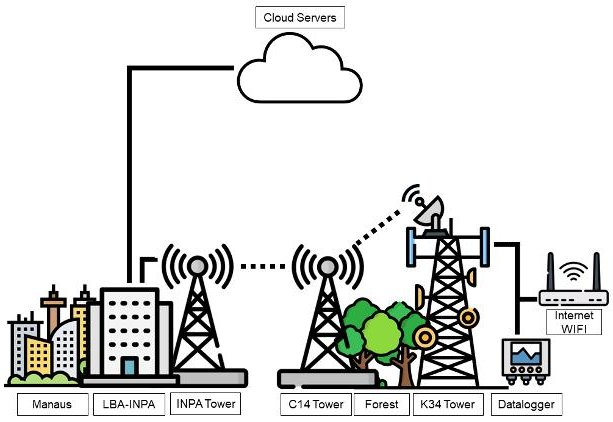

Fig. 1. Current K34 tower data collection infrastructure.

## 3. The Perception system

The first phase of the Perception system began on February 5,2024,with the formalization of financing through the transfer of resources from the Federal District Research Support Foundation (FAPDF), and is scheduled to end on February 5,2026, involving a team of researchers, analysts and other collaborators with different skills to create satellite products and services for monitoring the Brazilian biomes of the Amazon Rainforest and Cerrado. For the management of the Perception development, we opted for the Project Management Body of Knowledge (PMBOK) methodology, developed by the Project Management Institute (PMI). Project management is accomplished through the appropriate application and integration of 42 processes, divided into five

<!-- PDF_PAGE: 4 -->

groups throughout the project life cycle: initiating, planning, executing, monitoring and controlling, and closing. The project constraints include scope, quality, schedule budget, resources, and risk [19].

From its conception, planning and search for funding, the project development process involved the continuity of activities within the context of the AlfaCrux space mission. To provide a common understanding of the project scope among the project team and stakeholders, we created a first work breakdown structure (WBS), important to subdivide the project deliverables into smaller and more manageable components until the work is defined to the work package level. In this line, the first level of decomposition of the Project is i) Infrastructure, ii) Modeling, iii) Computer Simulation, iv) Hardware-in-the-loop Simulation, v) Space Satellite Design and vi) Project Management (see Fig. 2). The WBS serves as a logical basis to define detailed components at lower levels, assign responsibilities and plan the project risk [19].

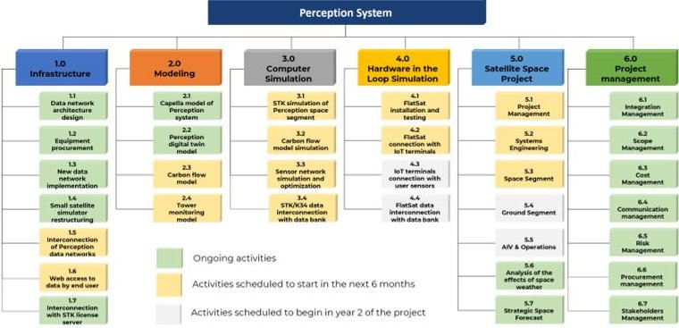

Fig. 2. Perception work breakdown structure.

It is essential to highlight that the project management plan is iterative and goes through progressive elaboration throughout the project's life cycle. The actions carried out so far comprise activities such as i) the definition of the project scope management through the creation of the project WBS, as shown in Fig. 2, ii) the creation of a repository on the Microsoft TEAMS platform based on the processes of the PMBOK, iii) the articulation with internal and external stakeholders, iv) the hiring of specialized personnel, v) the acquisition of equipment and implementation of new data network architecture based on the digital twin modeling, vi) the realization of a local conference to present the current status of the project to the academic community and conduct on-site training with the researchers of the project. In this process, effective management has been fundamental to ensure the success of the research developed.

## 3.1 Network data system

From a broader point of view, the main objective of the information technology architecture applied in this work is to house a high-tech information network that enables the real-time transmission of sensor data, e.g. rain gauges, thermometers, motion sensors, among others, separated into 4 layers as shown in Fig. 3.

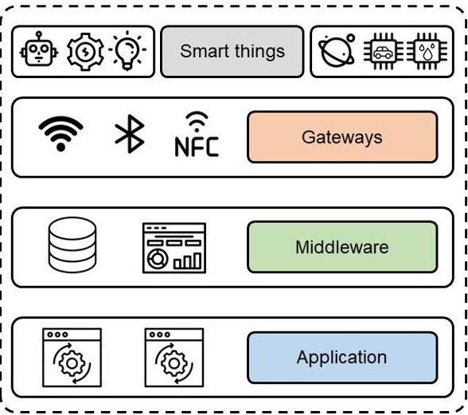

Fig. 3. Network architecture overview.

Thus, it was necessary to create an infrastructure of information and communication technology assets that supports the transfer, processing, protection and publication of information collected in real time by sensors. In addition, this infrastructure must also meet the demand for organizing and classifying information in order to provide the processed information for application in machine learning models for the implementation of digital twins, filling the lack of information, when there is one, and for application in simulations.

The design starts with the sensors, which must be configured in the Edge Server's firewall in order to access the Edge Server and send the logs. The Edge Server is configured to send a signal to the Perception project laboratory once it has completed building a data block from the collected logs. In the Perception environment, a firewall is set up to accept connections only from configured Edge Servers.

The first processing layer is an interface developed in Python that allows information to be identified, categorized, and organized. Simultaneously, it sends the data to both the second layer, Websockets, and the third layer, which is responsible for the general organization of information.

In this second layer, each websocket is configured according to the objective you want to achieve. e.g. dashboard, simulation. In this case, the data are sent to the dashboard. In the third layer, the computer system re-

<!-- PDF_PAGE: 5 -->

ceives and organizes the data into 5 levels: i. Data Storage and Infrastructure; ii. Data Access and Query; iii. High Performance Analysis and Modeling; iv. Visualization; v. Application Acquisition.

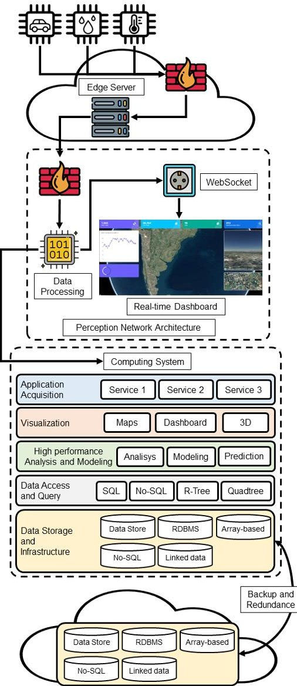

Fig. 4. Perception network infrastructure architecture.

To store the information, the Perception project has two servers with 40TB of NvmE storage and 96-core processors for high-performance data processing. The entire infrastructure presented in layer 3 is implemented using virtualization through containerization within these servers.

It is important to note that the computer system is prepared to meet the demands of Visualization, and High performance Analysis and Modeling as the project has three robust workstations all containing 14th generation i9 processors, two of them with 16GB RAM and a more advanced one containing 64GB RAM and an RTX 4090 GPU.

of the information, this work opted to replicate the Data Storage and Infrastructure in the cloud. Fig. 4 shows the general architecture of the Perception project.

In order to guarantee the contingency and redundancy

## 4. A digital-twin based infrastructure

One of the significant innovations of the Perception project is related to restructuring the entire infrastructure to ensure compatibility with the digital twin (DT) concept. The DT is a virtual representation of its physical counterpart capable of reproducing its characteristics and behaviors [20]. This concept is relatively new, being proposed by Grieves in 2003 and formally defined by Glaessgen and Stargel in 2012 [20, 21]. Therefore, there is no agreement on the universally accepted concept of a digital twin [22].

The definition adopted in this work is the one proposed by [23], an expanded version of Grieves' three-dimensional DT model. Their five-dimensional model, illustrated in Fig. 5, includes the physical entity (PE), the virtual entity (VE), the digital twin data (DD), the service system (SS), and the connections between the parts. The VE is a high-fidelity digital representation of the PE, mirroring its geometry, physical properties, behaviors, and rules. The SS encompasses the functionalities provided by both the PE and VE. At the core of the architecture lies the digital twin data, which are crucial for knowledge generation within a DT, as noted by [24]. These data are gathered from the PE, VE, and SS via the connections. The selection of this model was driven by its ability to clearly distinguish between the virtual entity's models and simulations and the services provided by the components, in addition to its transparent representation of the databases.

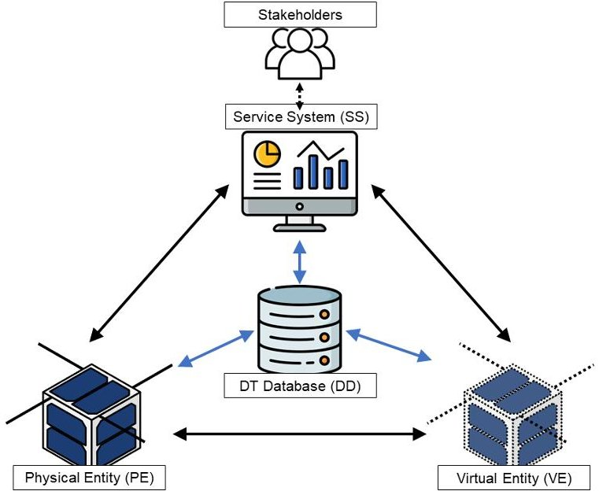

Fig. 5. 5-Dimensional digital twin architecture based on [23].

<!-- PDF_PAGE: 6 -->

## 4.1 Model based system engineering

The Perception system is being designed using ModelBased System Engineering, an approach to system engineering defined by the International Council on Systems Engineering (INCOSE) [25]. This approach offers advantages such as improved requirement management, decreased ambiguity, and the ability to conduct formal verification and validation processes [26]. In addition, it enables various stakeholders to work together on system development by facilitating the sharing of a mutual understanding of the system [27]. Contrary to traditional document-based approaches, as the MBSE designed the system using models, it creates a digital representation of the system.

The MBSE can be specified by its method, language and tool. In this research, we opted for the combination of Arcadia (method and language) and Capella software (tool), both developed by the Thales company [28]. The Arcadia method is divided into four engineering levels, that can be followed as design steps [28]:

- Operational Analysis: what the users of the system need to achieve.

- System Needs Analysis: what the system has to achieve for the users.

- Logical Architecture: how the system will work to meet expectations.

- Physical Architecture: how the system will be developed and built.

At the current stage of development, the Perception system is being defined at the Logical Architecture level, where it is performed the internal functional system analysis that describes the subfunctions needed to implement the system functions and services. In addition, the Logical Architecture defines the operational components related to these internal functions.

Considering the 5-dimensional DT depicted in Fig. 5 a model for the logical architecture is proposed, as illustrated in Fig. 6. This model presents four out of the five dimensions: physical entity, digital entity, DT services, and DT database. The communication dimension is depicted exclusively through the interactions among the designated functions of the system. The physical entity consists of the tower equipped with micrometeorological instruments, the space segment, and the ground segment. The digital entity encompasses the DTs of the space segment and the micrometeorological tower (MT).

The high-level view of the logical architecture of the Perception pilot project and its relationship with the external actors, INPA and the University of Brasília (UnB), is presented in Fig. 7

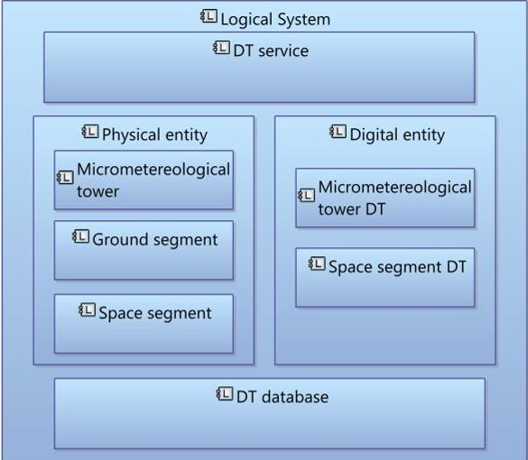

Fig. 6. Logical architecture template for modeling the system and its DT in a five-dimension DT architecture.

## 4.2 Hardware-in-the-loop emulation

New Space 4.0 stakeholders have been primarily interested in commercially established CubeSats, along with commercial off-the-shelf technologies, for their advantages over larger satellites in terms of size, standardization, modularity, risk tolerance, ride-sharing capability, and other distributed systems-related considerations (for instance, scalability, redundancy, and cost) [29], [30]. These advantages come with some recent paradigm shifts in an effort to alleviate some areas of stress related, among others, to commissioning, nominal operations, and orbit management [29].

In this context, data-driven approaches have been built-up to be promising strategies for said automation on Earth observation applications as a consequence of not only a larger volume of data (from the increase of large constellations deployments) but also due to better data quality and variety (in response to the rise in quantity and quality of satellite sensors) [29-31].

Having in mind these trends relevant to nanosatellites and aiming to build a testing environment, a computer simulated and hardware emulated setup more suitable for the development and validation of solutions was proposed. These solutions would follow new trends, such as fault detector models fed by telemetries/artifical/experimental data, detumbling algorithms and attitude control techniques based on fields generated by interactive magnetic actuators and on the Earth's own magnetic field, among others. An update (Fig. 8) of the current hardware-in-the-loop system available in the laboratory was proposed, involving the following:

- Updating the existing hardware and software used for emulating Low Earth Orbit (LEO) kinematics and ge-

<!-- PDF_PAGE: 7 -->

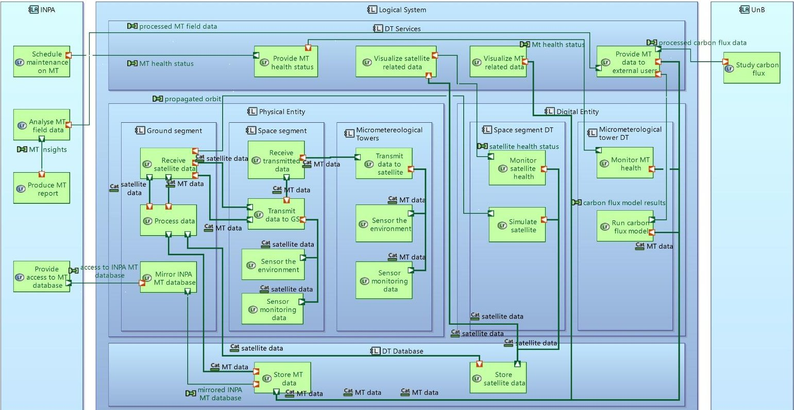

Fig. 7. Perception system architecture.

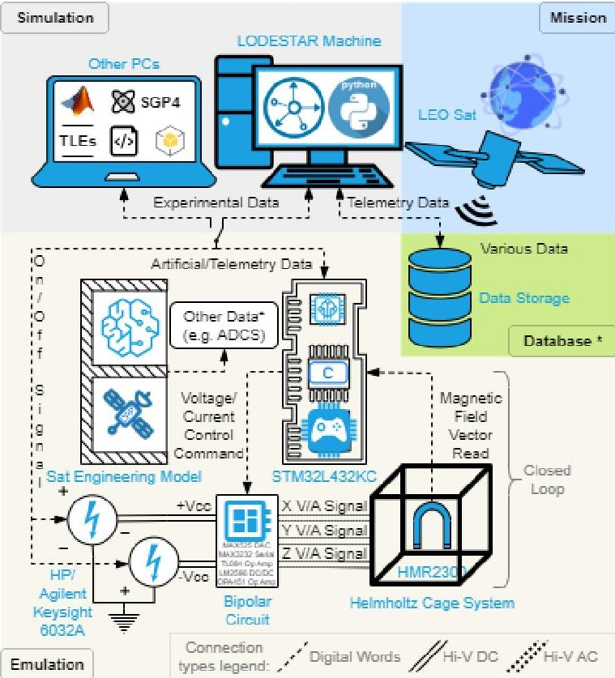

Fig. 8. Proposed hardware-in-the-loop link.

omagnetic conditions in laboratory experiments, see Fig. 9, starting from previous works [32], [33];

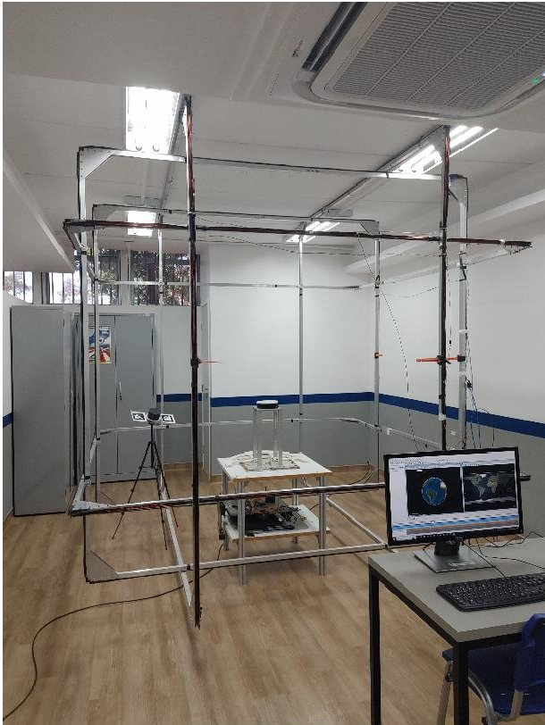

Fig. 9. Smallsat hardware-in-the-loop emulator.

- Integrating the updated embedded system for uniform magnetic field vector generation with better orbit propagation and visualization software as well as

<!-- PDF_PAGE: 8 -->

with real time telemetry data from other missions mainly from LODESTAR related sources in a shared data interface for use and storage of real life, computer simulated and experimental (from any related sensors available to use on site) datasets.

## 4.3 Physics-based space modeling

The System Tool Kit (STK) from Analytical Graphics, Inc. was chosen for physics-based space modeling to perform complex analyses of the spatial segment of the Perception system and share the results in our integrated digital twin environment. Considering the different application scenarios, in some cases with real-time or near-realtime demands, the Perception system will make use of a constellation of small satellites in low Earth orbit.

From an initial number of 12 satellites, preliminary studies were carried out to determine the best distribution of satellites for a revisit time of approximately 15 minutes. The standard orbit configuration applied was Walker-Delta. The satellites were placed at an altitude of 600 km for greater access time to the ground segments, and were divided into 2 inclinations for studies: polar orbit $ (90^{\circ}) $ and orbit with mid inclination $ (45^{\circ}) $ . The choice of the $ 45^{\circ} $ orbit was justified by a preliminary study that found a satisfactory inclination for the initial applications considering the location of the ground stations in Brazilian territory, and also by the availability of low-cost launch services.

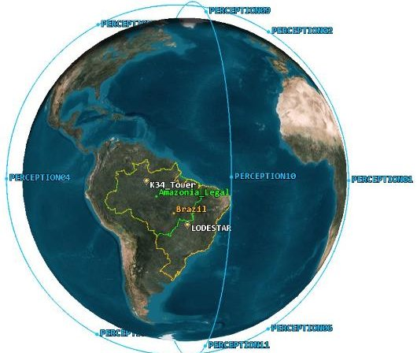

Fig. 10. Overview of orbital planes for polar inclination.

For the polar orbit, we had an average revisit time of 19 minutes, with gaps of 1 hour, with their accesses well distributed. Each satellite link with the station lasts on average 10.5 minutes, see Fig. 10 and 11.

For the mid inclination orbit we had an average of 17 minutes of revisit time, with their accesses having little uniformity among themselves, which could hinder ground operations and impact the concept of operation under development. Each satellite link with the station lasts on average 10.5 minutes, see Fig. 12 and 13.

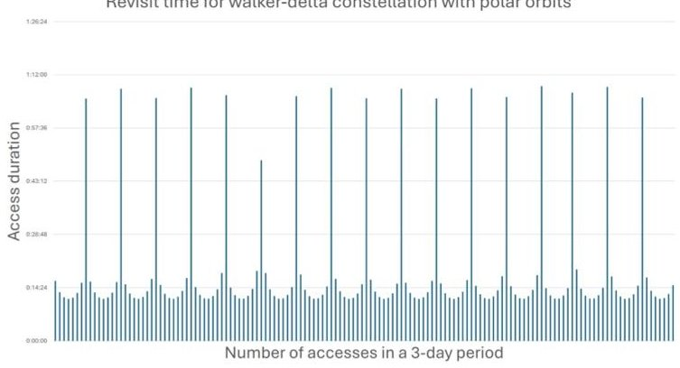

Fig. 11. Revisit time for walker-delta constellation with polar orbits.

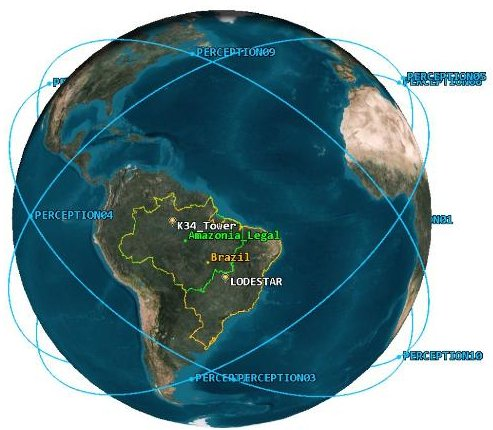

Fig. 12. Overview of orbital planes for mid inclination.

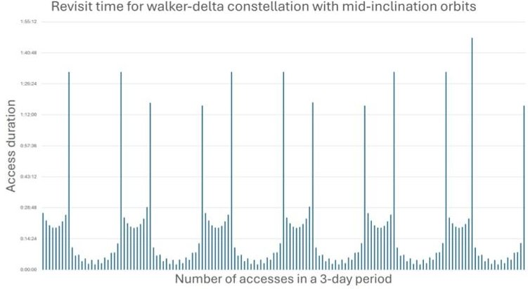

Fig. 13. Revisit time for walker-delta constellation with mid inclination orbits.

## 5. Final remarks and conclusion

This paper presents an overview of the Perception satellite-based system for monitoring critical and emergency information from strategic assets. The system is structured along two main lines, the space segment and the data processing, its validation and provision to the end user.

The pilot project foresees the implementation of a sec-

<!-- PDF_PAGE: 9 -->

ondary network for collecting critical data via satellite for the K34 tower located in the Brazilian Amazon Rainforest, see Fig. 14. For environmental measurement towers or other strategic assets that do not have terrestrial data network, the Perception system foresees using two satellite collection networks, one with a higher data transmission rate to handle general data and a secondary one with a low data rate for critical and restricted data.

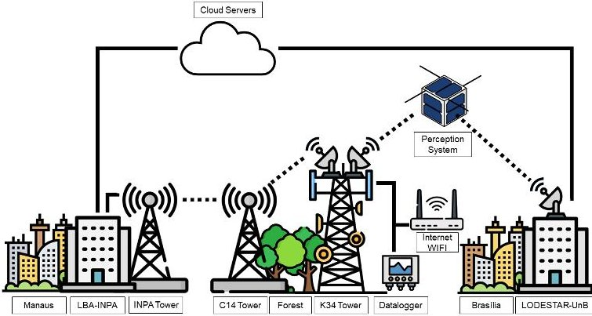

Fig. 14. Proposed solution to connect the K34 tower data collection with the Perception system.

Finally, for general data collection, the Perception system considers using commercial satellites and partner satellites in addition to its satellite network. However, for critical and restricted data collection, the system only considers using satellites from the Perception network.

## Acknowledgements

This work was supported in part by the Brazilian agencies Federal District Research Support Foundation (FAPDF), National Council for Scientific and Technological Development (CNPq), the Higher Education Personnel Improvement Coordination (CAPES), and the Large Scale Biosphere Atmosphere Program in the Amazon (LBA).

## References

[1] R. A. Borges, Lodestar UnB lodestar.aerospace.unb.br, https://lodestar aerospace.unb.br/projects/alfacrux [Accessed 08-09-2024], 2021.

[2] R. A. Borges et al., "The AlfaCrux cubesat mission description and early results," Applied Sciences, vol. 12, no. 19, 2022, ISSN: 2076-3417. [Online]. Available: https://www.mdpi.com/2076- 3417/12/19/9764.

[3] G. Adamo and M. Willis, "Technologically mediated practices in sustainability transitions: Environmental monitoring and the ocean data buoy," Technological Forecasting and Social Change, vol. 182, p. 121841, 2022, ISSN: 0040-1625.

[4] S. N. Sirimanne, D. Wu, B. Bell, K. Bokor, and N. M. Hakizimana, "Exploring space technologies for sustainable development," United Nations Conference on Trade and Development, pp. 1-34, 2021, ISSN: 978-92-1-604075-8. [Online]. Available: https: / / unctad org / publication / exploring - space technologies-sustainable-development.

[5] V. Lakshmi, "Remote sensing of soil moisture," ISRN Soil Science, vol. 2013, pp. 1-33, 2013, ISSN: 2356-7872.

[6] N. Kadhim, M. Mourshed, and M. Bray, "Advances in remote sensing applications for urban sustainability," Euro-Mediterranean Journal for Environmental Integration, vol. 1, no. 7, 2016, ISSN: 2365-7448.

[7] C. Zhang, H. Ren, Y. Liang, S. Liu, Q. Qin, and O. K. Ersoy, "Advancing the prospect-5 model to simulate the spectral reflectance of copper-stressed leaves," Remote Sensing, vol. 9, no. 11, 2017, ISSN: 2072-4292.

[8] E. Babaeian, M. Sadeghi, S. B. Jones, C. Montzka, H. Vereecken, and M. Tuller, "Ground, proximal, and satellite remote sensing of soil moisture," Reviews of Geophysics, vol. 57, no. 2, pp. 530-616, 2019.

[9] Y. Gao, M. Skutsch, D. L. J. Rodriguez, and J. V. Solórzano, "Identifying variables to discriminate between conserved and degraded forest and to quantify the differences in biomass," Forests, vol. 11, no. 9, 2020, ISSN: 1999-4907.

[10] L.-L. Fu, T. Lee, W. T. Liu, and R. Kwok, "50 years of satellite remote sensing of the ocean," Meteorological Monographs, vol. 59, no. 1, pp. 5.1-5.46, 2019.

[11] V. T. R. Baptista, L. J.-C. Souza, R. P. Lôbo, R. A. Borges, and W. R. Silva, "Creation of space hubs: The case of brasilia," in Proceedings of the 72nd International Astronautical Congress, Oct. 2021, pp. 1-9.

[12] A. E. Brasileira, Objetos Espaciais Brasileiros https://www.gov.br/aeb/pt-br/programa espacial-brasileiro/objetos-espaciais brasileiros, [Accessed 08-09-2024], 2020.

[13] A. Poghosyan and A. Golkar, "CubeSat evolution: Analyzing CubeSat capabilities for conducting science missions," en, Progress in Aerospace Sciences, vol. 88, pp. 59-83, Jan. 2017, ISSN:

<!-- PDF_PAGE: 10 -->

03760421. DOI: 10.1016/j.paerosci.2016. 11.002.

[14] A. C. Araújo et al., "Comparative measurements of carbon dioxide fluxes from two nearby towers in a central amazonian rainforest: The manaus LBA site," en, Journal of Geophysical Research: Atmospheres, vol. 107, no. D20, Oct. 2002, ISSN: 0148-0227. DOI: 10.1029/2001JD000676. [Online]. Available: https://agupubs.onlinelibrary. wiley.com/doi/10.1029/2001JD000676.

[15] J. Tóta, D. R. Fitzjarrald, and M. A. F. da Silva Dias, "Amazon rainforest exchange of carbon and subcanopy air flow: Manaus LBA site-a complex terrain condition," en, ScientificWorldJournal, vol. 2012, p. 165067, Apr. 2012.

[16] M. O. Andreae et al., "Biogeochemical cycling of carbon, water, energy, trace gases, and aerosols in amazonia: The lba-eustach experim ents," Journal of Geophysical Research: Atmospheres, vol. 107, no. D20, LBA 33-1-LBA 33-25, 2002. doi: https://doi.org/10.1029/2001JD000524.eprint: https://agupubs.onlinelibrary.wiley.com/doi/pdf/10.1029/2001JD000524. [Online]. Available: https://agupubs.onlinelibrary.wiley.com/doi/abs/10.1029/2001JD000524.

[17] C. D. Renno et al., "Hand, a new terrain descriptor using srtm-dem: Mapping terra-firme rainforest environments in amazonia," Remote Sensing of Environment, vol. 112, no. 9, pp. 3469-3481, 2008 ISSN: 0034-4257. DOI: https://doi.org/10. 1016/j.rse.2008.03.018. [Online]. Available: https://www.sciencedirect.com/science/article/pii/S003442570800120X.

[18] G. G. Cirino, R. A. F. Souza, D. K. Adams, and P. Artaxo, "The effect of atmospheric aerosol particles and clouds on net ecosystem exchange in the amazon," Atmospheric Chemistry and Physics, vol. 14, no. 13, pp. 6523-6543, 2014. DOI: 10.5194/acp 14-6523-2014. [Online]. Available: https:// acp.copernicus.org/articles/14/6523/ 2014/.

[19] PMI, A Guide to the Project Management Body of Knowledge (PMBOK Guide), 4th Edition. Project Management Institute, 2008.

[20] M. Grieves, "Digital twin : Manufacturing excellence through virtual factory replication - a whitepaper by Dr . Michael Grieves," White Paper, pp. 1-7, March 2014.

[21] E. Glaessgen and D. Stargel, "The digital twin paradigm for future NASA and U.S. Air Force vehicles," en, in 53rd AIAA/ASME/ASCE/AHS/ASC Structures, Structural Dynamics and Materials Conference;20th AIAA/ASME/AHS Adaptive Structures Conference;14th AIAA, Honolulu, Hawaii: American Institute of Aeronautics and Astronautics, Apr. 2012, ISBN: 978-1-60086-937-2. DOI: 10. 2514/6.2012-1818. [Online]. Available: http://arc.aiaa.org/doi/abs/10.2514/6.2012- 1818.

[22] M. Liu, S. Fang, H. Dong, and C. Xu, "Review of digital twin about concepts, technologies, and industrial applications," en, Journal of Manufacturing Systems, vol. 58, pp. 346-361, Jan. 2021, ISSN: 02786125. DOI: 10.1016/j.jmsy.2020.06.017.

[23] F. Tao, M. Zhang, Y. Liu, and A. Y. Nee, "Digital twin driven prognostics and health management for complex equipment," CIRP Annals, vol. 67, no. 1, pp. 169-172, 2018, ISSN: 17260604.

[24] F. Tao, H. Zhang, A. Liu, and A. Y. Nee, "Digital Twin in Industry: State-of-the-Art," IEEE Transactions on Industrial Informatics, vol. 15, no. 4, pp. 2405-2415, 2019, ISSN: 15513203. DOI: 10.1109/TII.2018.2873186.

[25] S. Friedenthal, R. Griego, and M. Sampson, "Incose model based systems engineering (mbse) initiative," in INCOSE 2007 symposium, sn, vol. 11, 2007.

[26] P. De Saqui-Sannes, R. A. Vingerhoeds, C. Garion, and X. Thirioux, "A taxonomy of MBSE approaches by languages, tools and methods," en, IEEE Access, vol. 10, pp. 120936-120950, 2022 ISSN: 2169-3536. DOI: 10.1109/ACCESS.2022. 3222387.

[27] R. Rasor, D. Gollner, R. Bernijazov, L. Kaiser, and R. Dumitrescu, "Towards collaborative life cycle specification of digital twins in manufacturing value chains," en, Procedia CIRP, vol. 98, pp. 229234, 2021, ISSN: 22128271. DOI: 10.1016/j.procir.2021.01.035.

[28] P. Roques, Systems architecture modeling with the Arcadia method: a practical guide to Capella (Implementation of model based system engineering set), en. London: ISTE Press, 2018, ISBN: 978-1-78548-168-0.

<!-- PDF_PAGE: 11 -->

[29] M. Ben-Larbi et al., "Towards the automated operations of large distributed satellite systems. part 1: Review and paradigm shifts," Advances in Space Research, vol. 67, no. 11, pp. 3598-3619, Aug. 2021, note Satellite Constellations and Formation Flying, ISSN: 0273-1177.

[30] S. S. S. V. I. (S3VI), "State-of-the-art small spacecraft technology," National Aeronautics and Space Administration (NASA), Tech. Rep., Feb. 2024. [Online]. Available: http://www.nasa.gov/smallsat-institute/sst-soa.

[31] M. K. Ben-Larbi et al., "Towards the automated operations of large distributed satellite systems. part 2: Classifications and tools," Advances in Space Research, vol. 67, no. 11, pp. 3620-3637, Sep. 2021 note Satellite Constellations and Formation Flying ISSN: 0273-1177.

[32] R. C. da Silva, I. S. Ishioka, C. Cappelletti, S. Battistini, and R. A. Borges, "Helmholtz cage design and validation for nanosatellites hwil testing," IEEE Transactions on Aerospace and Electronic Systems, vol. 55, no. 6, pp. 3050-3061, 2019.

[33] R. C. da Silva, F. C. Guimarães, J. V. L. de Loiola, R. A. Borges, S. Battistini, and C. Cappelletti, "Tabletop testbed for attitude determination and control of nanosatellites," Journal of Aerospace Engineering, vol. 32, no. 1, p. 04018122, 2019.