<!-- PDF_PAGE: 1 -->

IAC-23-B4.3.2

# Prototype of a Workflow for a Digital Twin in Small Satellite Operations

# Ulrich Kling $ ^{a} $ $ ^{*} $ , David Hiebl $ ^{a} $ , Matthias Kura $ ^{a} $ , Luca Pizzuto $ ^{a} $ Michele Campanelli $ ^{a} $ , Spencer Ziegler $ ^{a} $

$ ^{a} $Space and Ground Segment Technology Galileo Competence Center - German Aerospace Center (DLR) Muenchener Str. 20, 82234 Oberpfaffenhofen, Germany $ ^{*} $Corresponding Author: Ulrich.Kling@dlr.de

## Abstract

The Digital Twin (DT) is a concept where a physical object is linked to a digital representation of itself. This digital representation consists of the data generated by the real object. This paper presents how a DT could be defined for satellite operations starting from a characterisation from literature. The developed prototype workflow shows exemplarily how a DT can be introduced into satellite operations to achieve a high level of automation and autonomy. This includes to be able to analyse the received telemetry data of a satellite automatically.

To demonstrate the proposed architecture and workflow, the NASA Operational Simulator for Small Satellites (NOS3) is used. With NOS3 a satellite can be simulated orbiting the earth. Commands can be sent to the satellite and telemetry is received from it. A simulation model for the Electrical Power System (EPS) including solar panels and battery was implemented into NOS3. The resulting telemetry of the EPS is analysed automatically by a machine learning algorithm, which was trained with data for nominal operation of the EPS. In a first step, a failure of a solar panel is introduced to simulate incorrect behaviour of the satellite. Using the implemented architecture of the DT, the satellite telemetry is analysed and the abnormal behaviour of the satellite is detected. A prepared command is sent to the satellite. In comparison to an onboard fault detection, isolation, and recovery mechanism, the anomaly detection can identify the anomaly without a limit of a parameter is violated.

This first prototype shows how the automation workflow with a DT can be implemented and tested for small satellite operations.

Keywords: Satellite Operations, Digital Twin, Automation, Autonomy, Operational Simulation, Machine Learning

## Nomenclature

## Latin symbols

A Area

C Capacity

E Energy

f In sun factor

P Power

Q Solar panel quality factor

q Solar flux

svb Sun vector in body frame

t Time

Greek symbols

$ \varDelta $ Delta

$ \eta $ Efficiency

Subscripts

bat Battery

gen Generated

i Index

max Maximum

sat Satellite

subsystem Subsystem

sun Sun

tot Total

## Acronyms/Abbreviations

ADCS Attitude Determination and Control System

ATHMoS Automated Telemetry Health Monitoring System

cFS Core Flight System

CSS Coarse Sun Sensor

DT Digital Twin

EPS Electrical Power System

FDIR Fault Detection, Isolation and Recovery

FSS Fine Sun Sensor

GPS Global Positioning System

GSOC German Space Operation Center

IMU Inertial Measurement Unit

LEO Low Earth Orbit

LoOP Local Outlier Probability

MCS Mission Control System

<!-- PDF_PAGE: 2 -->

NOS3 NASA Operational Simulator for Small Satellites

STF-1 Simulation-to-Flight 1 Mission

TC Telecommand

## 1 Introduction

Satellite constellations are increasingly launched into space. Examples of this are Europe's plans to establish two Low Earth Orbit (LEO) constellations with IRIS $ ^{2} $ and LEO-PNT. It is key to have a high level of automation and/or autonomy to operate such large constellations cost effectively. One way to achieve this is the so-called "Digital Twin" (DT) concept.

There is no standardized definition what a DT is. It is rather a collection of ideas for various use cases in the different product lifecycle phases [1]. In general, for a DT a physical object is replicated as digital object, which means all available data about the real object is stored, constantly updated and used for analysis and decision making.

A more specific definition of a DT in this context is how the data flow between the real-world object and its digital representation is done. It can be distinguished between a digital model, a digital shadow and a DT, see Fig. 1 [2].

For a digital model the flow between the real object and its digital representation is done manually, which corresponds to a high workload for a human operator. For a digital shadow at least, the data generated by the realworld object is automatically transferred to the mirrored digital object. Finally, in this definition, a DT is reached when the exchange between the real object and the digital object is performed automatically.

This implies that the data generated in and gathered from the real object is automatically analysed in the digital object and decisions are derived, including which data, e.g. commands, is sent back to the real-world object.

In the context of satellite operations, this means that the planning of the telemetry (TM) to be downloaded has to be performed automatically. Subsequently, the received telemetry has to be analysed autonomously. If an abnormal behaviour of the satellite or one of its subsystems respectively is detected, an assessment needs to be performed on the severity of the problem and which commands have to be sent to enable the satellite to fulfil its intended mission objectives.

Of course, in a first step, a human operator can assess the anomaly and prepare the corresponding commands, since the assessment requires a high specific knowledge about the satellite, its functioning and the relations of its subsystems and payloads. However, for a "full" DT this step has to be automated as well. Decision trees are one possible implementation of such an automation [3].

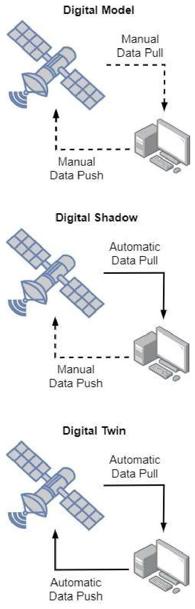

Fig. 1: Definition of a Digital Twin used in this paper

The introduced relations lead to an architecture of the system that includes machine learning algorithms to analyse satellite data and could contain one or more satellite simulators, which are used to perform what-if scenario analyses to support decision making in case of deviating behaviour of the satellite. A similar set-up was presented in [4]. Furthermore, machine learning algorithms can be used to plan the activities onboard the satellite, such as planning of power resources for intersatellite links in a constellation [5].

<!-- PDF_PAGE: 3 -->

In this paper we present an architecture for a first DT workflow. It features the main building blocks as described above. To simulate a real satellite in orbit, the NASA Operational Simulator for Small Satellites (NOS3) is used. Analysing the telemetry is done by using a machine learning algorithm developed by the German Space Operations Center (GSOC). Furthermore, the introduced system contains a second instance of NOS3 which serves as on-ground simulator to execute what-if scenarios. As use case for the DT work flow the monitoring of the electrical power system, consisting of the onboard battery and three solar panels, including a scenario of a failure of a solar panel, is presented.

## 2 NASA's Operational Simulator for Small Satellites

To simulate a satellite in space and to be able to send commands to and receive telemetry from it, NASA's Operational Simulator for Small Satellites (NOS3) was used [6], which was developed in response to the Simulation-to-Flight 1 (STF-1) mission [7[8]. STF-1 was a 3U CubeSat with dimensions 0.34x0.1x0.1 meter and a weight of less than 4kg. It flew in LEO with 500km altitude from December 2018 to February 2024. Fig. 2 displays the basic architecture of NOS3 and Fig. 3 shows a visualization of a small satellite in NOS3.

NOS3 consists of different software elements to simulate a satellite in space. The satellite itself is represented by the onboard flight software and (simulated) hardware models of the platform and payloads. For the onboard software the core Flight System (cFS) is used

[9]. To simulate the data transfer between the onboard software and the hardware models, the so-called NOS engine is used, which simulates the hardware buses as software only buses. An environmental simulator provides external inputs to the simulations such as orbit mechanics and attitude dynamics. Furthermore, the satellite is connected to the ground systems from which telecommands can be sent and telemetry can be received and processed. For this COSMOS is used [10], which is included in the NOS3 set-up.

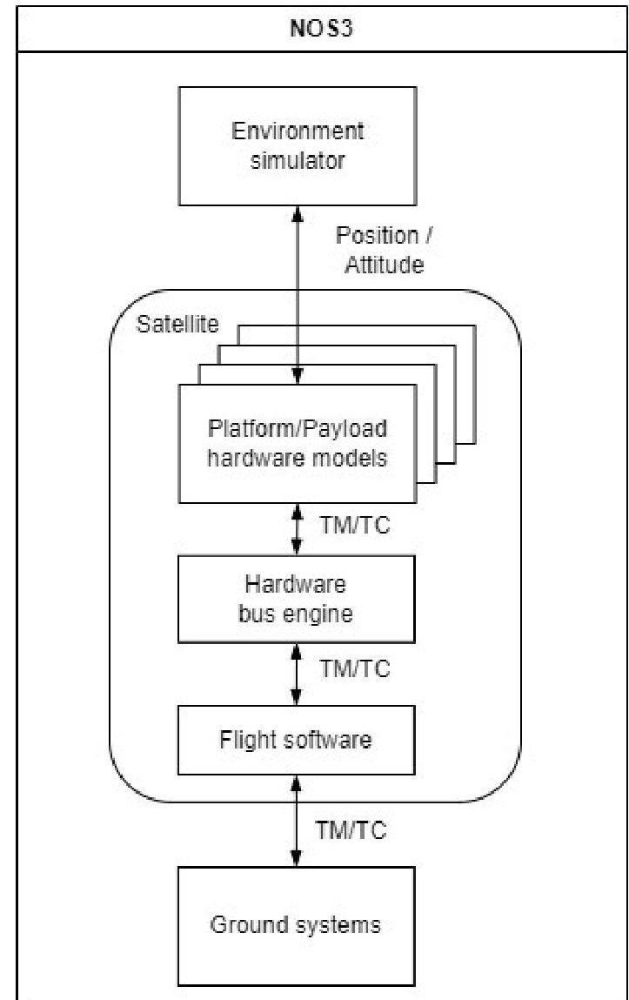

Fig. 2: General architecture of NOS3

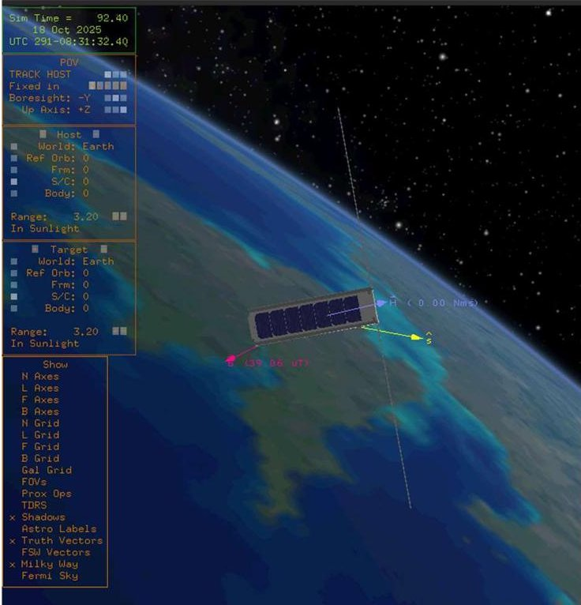

Fig. 3: Screenshot of a small satellite from NOS3 visualisation

<!-- PDF_PAGE: 4 -->

NOS3 comes with a basic set of platform subsystems such as:

- Attitude Determination and Control System (ADCS)

- Fine Sun Sensors (FSS)

- Coarse Sun Sensors (CSS)

- Inertial Measurement Unit (IMU)

- GPS receiver

- Star tracker

- Reaction wheels

- Magneto-meter

- Magneto torquer

The Electrical Power System used in this paper was developed inhouse and is explained in detail in the next section.

## 3 Electrical Power System

To simulate the power consumption and generation of the satellite an Electrical Power System (EPS) was implemented. Fig. 4 displays a simplified representation of the satellite. It shows the configuration of the satellite with its three solar panels.

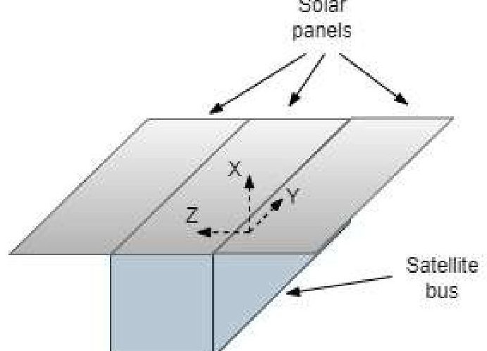

Fig. 4: Configuration of the small satellite

The three solar panels generate power when exposed to the sun. The generated power per solar panel $ P_{gen,i} $ with $ i=1..3 $ is calculated with

$$
\mathrm {P} _ {\mathrm {g e n}, \mathrm {i}} = \mathrm {f} _ {\mathrm {s u n}, \mathrm {i}} \mathrm {q} _ {\mathrm {s u n}, \mathrm {i}} \mathrm {A} _ {\mathrm {i}} \eta_ {\mathrm {i}} \mathrm {Q} _ {\mathrm {i}} \mathrm {s v b} _ {\mathrm {i}}
$$

where $ f_{sun,i} $ denotes if a solar panel is exposed to the sun, then $ f_{sun,i}=1 $ , otherwise $ f_{sun,i}=0 $ $ q_{sun,i}=1370 $ W/m $ ^{2} $ is the solar flux, $ A_{i} $ is the solar panel area, $ \eta_{i} $ is the efficiency, $ Q_{i} $ is the quality factor, and $ svb_{i} $ is the part of the sun vector perpendicular to the solar panel. The total generated power $ P_{gen,tot} $ is obtained by adding up the individual values of the solar panels:

$$
\mathrm {P} _ {\mathrm {g e n}, \mathrm {t o t}} = \sum_ {\mathrm {i} = 1} ^ {3} \mathrm {P} _ {\mathrm {g e n}, \mathrm {i}}
$$

On the other hand, the different subsystems of the satellite require power to work. Therefore, the power request of the entire satellite is the sum of the power requests of the individual subsystems

$$
\mathrm {P} _ {\mathrm {s a t}} = \sum_ {\mathrm {i} = 1} ^ {\mathrm {n}} \mathrm {P} _ {\mathrm {s u b s y s t e m}, \mathrm {i}}
$$

Hence, the generated power by the solar panels and the requested power of the subsystems can be totaled and depending if the sum of these values is positive or negative, the battery is charged or discharged in the corresponding time step $ \varDelta t $ of the simulation by a resulting energy delta $ \varDelta E $ and depending on the battery efficiency $ \eta_{bat} $

$$
\Delta \mathrm {E} = \eta_ {\mathrm {b a t}} \left(\mathrm {P} _ {\mathrm {g e n , t o t}} - \mathrm {P} _ {\mathrm {s a t}}\right) \Delta t
$$

From this the current available capacity of the battery $ C_{bat,t} $ can be calculated by adding $ \varDelta E $ to the last value the battery capacity $ C_{bat,t-\varDelta t} $

$$
C _ {\mathrm {b a t}, \mathrm {t}} = C _ {\mathrm {b a t}, \mathrm {t} - \Delta \mathrm {t}} + \Delta \mathrm {E}
$$

Of course, the value of the current battery capacity has to be between zero and the maximum battery capacity $ C_{bat,max} $

$$
0 \leq C _ {\mathrm {b a t}, \mathrm {t}} \leq C _ {\mathrm {b a t}, \max }
$$

The state of charge of the battery can be calculated using the current available capacity and the maximum capacity of the battery

$$
\text {s t a t e o f c h a r g e} = \frac {C _ {\mathrm {b a t , t}}}{C _ {\mathrm {b a t , m a x}}}
$$

The power generation of the solar panels, the power storage in the battery and the power consumption of the subsystems is integrated into the simulation with NOS3, Fig. 5 displays the implementation. cFS as the onboard flight software is divided into different apps, short for applications, for different tasks, which can be added as required. One of these cFS apps is the scheduler app. This app can be utilized, for example, to send periodically specific commands to a certain subsystem. In this paper the scheduler app is used as impulse generator. A periodic request is sent to calculate the power demand every second. Through the software bus of cFS the battery app is triggered to ask the individual subsystems for their current power consumption. Each subsystem

<!-- PDF_PAGE: 5 -->

also has a cFS app, which transmits the request for power consumption to the corresponding hardware model of the subsystem. In the hardware model, the power consumption is calculated and passed to the subsystem's corresponding app again. Via the software bus, the power request is sent to the battery app and from there to the battery hardware model. In the battery hardware model, the current generated power using the solar panels and the power request of the subsystems are summed up to calculate if the battery is charging or discharging.

The power demand of the individual subsystems is shown in Table 1. The data is taken from literature, as indicated. Most of the subsystems are modelled with a static power demand, except the reaction wheels. These are modelled with a power demand based on the required torque to control the attitude of the satellite. In Table 1 the two values are given for the reaction wheels, where the power demand is scaled linearly depending on the required torque.

The payload is assumed to have a power demand of 2W. Its purpose is not specified in detail, since the idea of the paper is the monitoring of the EPS, but it is assumed that the payload must be switched on all the time

and could be a scientific device, which is tested in continuous operation in space.

Table 1: Used power demands of subsystems

<table border="1"><tr><td>Subsystem</td><td>Power demand[W]</td><td>Number of units[-]</td><td>Source</td></tr><tr><td>GPS receiver</td><td>1.0</td><td>1</td><td>[11]</td></tr><tr><td>Star tracker</td><td>0.65</td><td>1</td><td>[12]</td></tr><tr><td>Fine sun sensor</td><td>0.0066</td><td>6</td><td>[13]</td></tr><tr><td>Coarse sun sensor</td><td>0.0003</td><td>6</td><td>[14]</td></tr><tr><td>Reaction wheels</td><td>0.075(idle),1.9(peak)</td><td>3</td><td>[15]</td></tr><tr><td>Inertia Measurement Unit</td><td>1.5</td><td>1</td><td>[16]</td></tr><tr><td>Payload</td><td>2</td><td>1</td><td></td></tr></table>

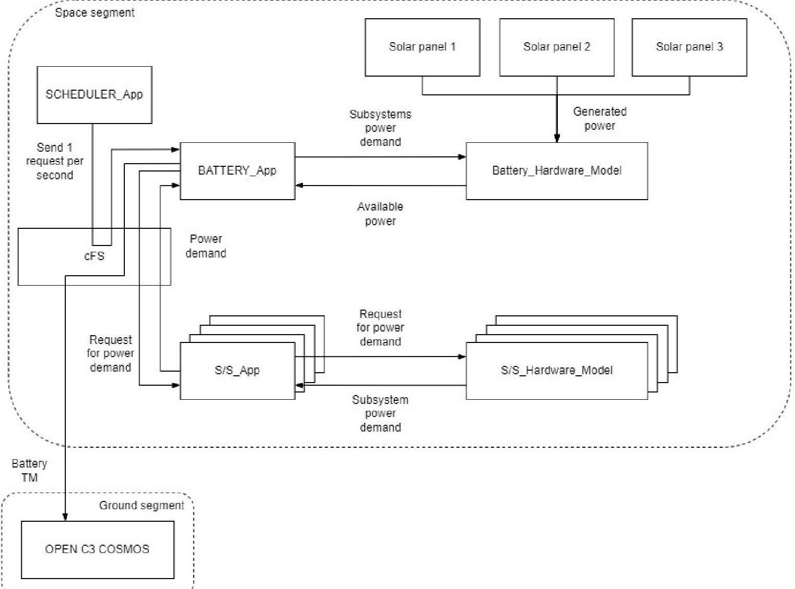

Fig. 5: Implementation of the EPS subsystem into NOS3

<!-- PDF_PAGE: 6 -->

## 4 Anomaly and Outlier Detection

The Automated Telemetry Health Monitoring System (ATHMoS), developed by GSOC [17], is used for outlier detection in the telemetry. It uses several supervised machine learning algorithms to detect anomalies that might be missed by traditional out-of-limit checks.

ATHMoS introduces a novel algorithm called Outlier Probability Via Intrinsic Dimension (OPVID) for anomaly detection. This algorithm builds upon existing techniques such as Local Outlier Probability (LoOP) and Intrinsic Dimension Outlier Score (IDOS), offering improved accuracy in identifying anomalies.

For the pre-processing, the data is segmented into fixed time intervals (e.g. 90-minute periods for LEO satellites). Then a Fourier transformation is applied to separate the signal from the noise followed by the computation of various statistical summaries. Those form high-dimensional feature vectors for each time interval, which are then used in the anomaly detection process.

Three classification databases are obtained; Historic Nominal, Recent Nominal and the Anomaly database. The creation of these databases is done by applying Density-Based Spacial Clustering of Applications with Noise (DBSCAN) and allows the system to distinguish between nominal behaviour and potential anomalies based on historic pattern.

To detect anomalies, ATHMoS compares new data points against these classification databases using a combination of OPVID, LoOP, and DBSCAN algorithms. This multi-faceted approach allows for the detection of already minor anomalies enhancing the overall health monitoring capabilities of our DT system.

## 5 Digital Twin Prototype Set-up

The flow chart of the prototype workflow of the DT is displayed in

Fig. 6. The figure is divided into the space and ground segment. The space segment is the "real" satellite to be operated. The ground segment consists of the ground station, the Mission Control System (MCS), an operator and the digital twin infrastructure, which comprises a tool for the automated data analysis, a satellite simulator for what-if scenarios and several data archives. The DT infrastructure mimics the real satellite as a digital object, as shown in

Fig. 6. The grey area defines the parts of NOS3, with cFS and subsystem hardware models including the introduced EPS, representing the "real" satellite to be operated, and COSMOS as ground station and MCS.

Periodically the satellite is requested to send TM which is then stored in a data archive upon receipt. Also the TM is passed to a docker container where the TM is automatically analysed using ATHMoS. ATHMoS is trained with data for the nominal operation. It analyses one parameter at the time. If no anomaly is detected, the received TM is added to the training data for the machine learning model, and subsequently, the model is retrained with the new data. On the other hand, if an anomaly is detected in the new set of TM by the automated data analysis, a predefined command is sent from COSMOS to the satellite. Furthermore, a simulation of the satellite can be initialised with the latest set of data of the satellite regarding the status of the subsystems and their latest configuration, as well as orbit parameters and satellite attitude. The purpose of the simulator is to evaluate how critical the anomaly is and also to perform what-if-scenarios. Therefore, the simulation speed can be increased to a multiple of real time. Here, the simulator is realised using a separate instance of NOS3. Although the goal is to have a very high level of automation and hence autonomy, an operator is still in the loop, if required, to evaluate the various results from the automated data analysis and the simulation.

<!-- PDF_PAGE: 7 -->

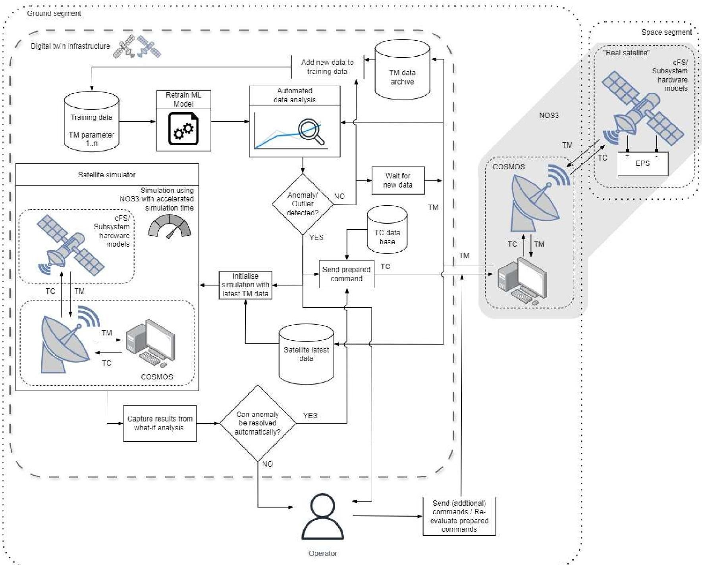

Fig. 6: Architecture of the developed Digital Twin workflow

## 6 Use Case for the Digital Twin Workflow

To demonstrate the functionality of the DT workflow, the monitoring of the EPS subsystem, as presented in Section 3, is used as a use case.

## 6.1 Failure Scenario

The failure scenario is described in Fig. 7. In routine operations the satellite sends TM to the ground station. The data is automatically analysed by the DT. If no anomalies are detected, no action is taken. At some point a failure of one of the three solar panels occurs. At the next ground station pass, the latest TM is again sent to ground and the data is analysed. In this scenario, the

anomaly should be detected in the battery TM data by the DT and a command is prepared to take corrective action. At the next suitable ground station pass, the TC is uploaded to the satellite. For this given scenario, the uploaded command is to switch off some of the subsystems during eclipse to save power.

## 6.2Nominal EPS Data

During nominal operation, the solar panels generate power when exposed to the sun and charge the battery. When in eclipse no power is generated, as depicted in Fig. 8. According to the generated power and the power demand of the subsystems, the battery is charging or discharging. Hence, the available power and state of

<!-- PDF_PAGE: 8 -->

charge of the battery are changed as shown in Fig. 9 for the capacity of the battery, and Fig. 10 displaying the state of charge. The maximum capacity of the battery is 40Wh.

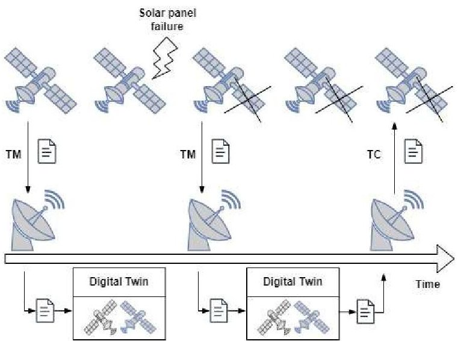

Fig. 7: Scenario of the solar panel failure

When no power is generated, the subsystems request power from the battery and it begins to discharge. The capacity of the battery is decreased to a minimum of 35.5Wh, which means a state of charge of 89%. The power generated during the in-sun-phase is enough to recharge the battery again to 40Wh. As the diagrams demonstrate, some noise has been injected into the telemetry to avoid smooth modelled data and to somewhat replicate real TM. The noise was introduced into the calculation of the power demands in the subsystem hardware models by adding small random values to the calculated ones. This nominal data serves also as training data for the machine learning algorithm.

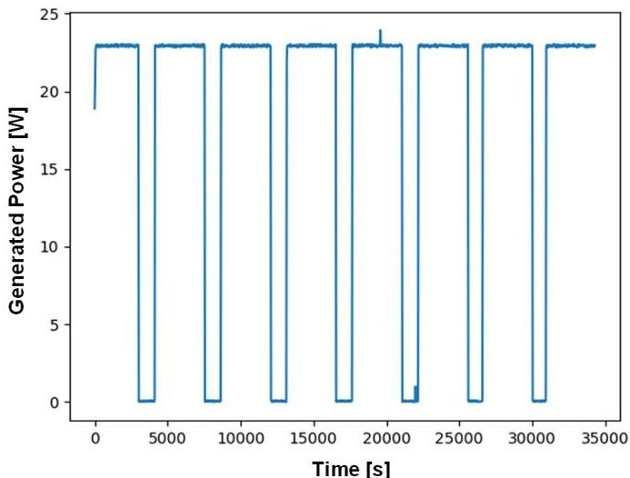

Fig. 8: Power generated by the solar panels

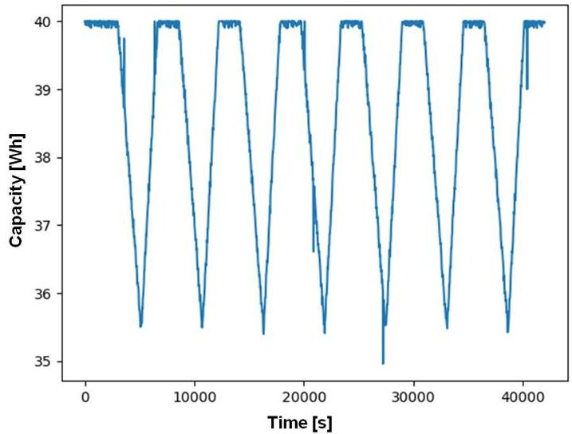

Fig. 9: Capacity of the onboard battery

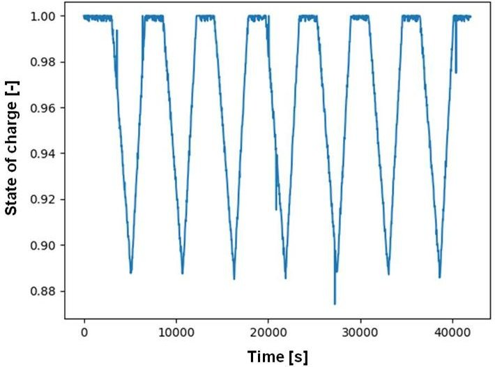

Fig. 10: State of charge of the onboard battery

## 6.3 Solar Panel Failure

At a given point in time a complete failure of one of the three solar panels is introduced. It is assumed that it does not produce any power. Fig. 11 shows the decrease of total power generation, which is highlighted with a red circle. The generated power drops from $ \sim 2 2 \mathrm {W} $ to $ \sim 1 5 \mathrm {W}. $

<!-- PDF_PAGE: 9 -->

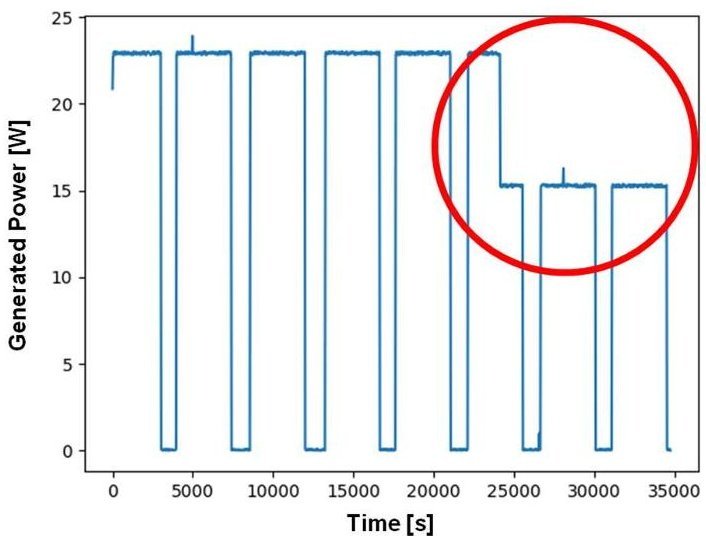

Fig. 11: Change in the power generation after to the solar panel failure

Due to the decrease in generated power, the charging behaviour of the battery changes, see Fig. 12 and Fig. 13 for the state of charge. The battery is not charged as fast as before the failure.

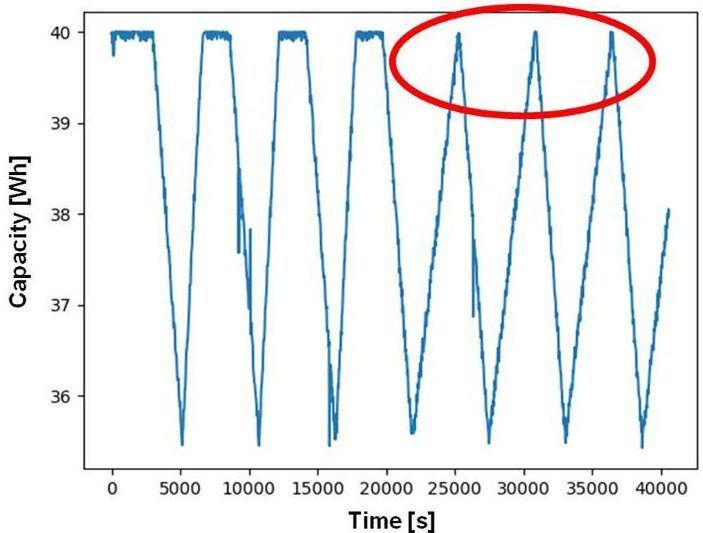

Fig. 12: Change in the charging behaviour of the battery after the solar panel failure

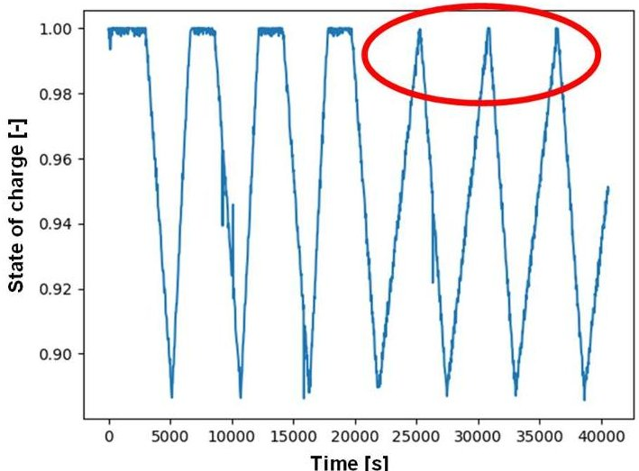

Fig. 13: Change in the state of charge of the battery after the solar panel failure

## 6.4 Anomaly detection and command sending

When the TM including the decrease in power generation due to the solar panel failure is downloaded from the satellite to the ground, it is automatically analysed using ATHMoS. The deviation in the data is recognised by the DT as an anomaly. As a consequence, a command is prepared for transmission to the satellite. This command deactivates the subsystems except the payload when the satellite is in eclipse to reduce power consumption, since the mission objective is to keep the payload switched on all the time, as described above in Section 3.

Fig. 14 and Fig. 15 show the battery capacity and the state of charge after the satellite has received command to switch off the subsystems in eclipse. As indicated by the black arrows, the power consumption is decreased.

The satellite simulator within the DT, as per

Fig. 6, can be used to perform simulations, assess the impact of the solar panel failure, check if the mission is endangered and if and what additional measures have to be taken. In this specific use case, the outcome would be that a failure of one solar panel is not critical as can be seen also from the diagrams of Fig. 12 and Fig. 13.

<!-- PDF_PAGE: 10 -->

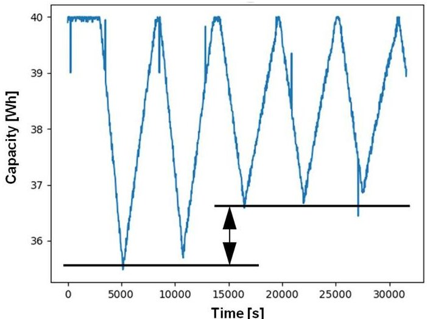

Fig. 14: Capacity of the battery after automatic commanding

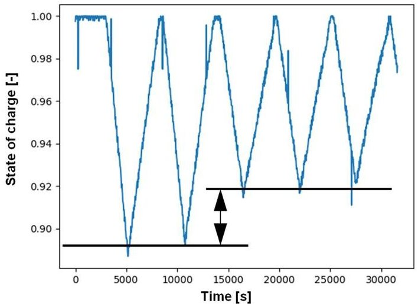

Fig. 15: State of charge of the battery after automatic commanding

## 7 Discussion

The presented workflow and use case show the principal mode of operation of a DT in satellite operations. A relatively simple example is demonstrated with the monitoring of the status of the onboard battery and the failure of a solar panel. The received TM of the battery is analysed automatically. In this context, the advantage of the approach using machine learning is that an anomaly does not have to violate a specified limit. As shown in Section 6.3, the failure of the solar panel is not critical in the sense that the battery is capable to provide enough power to the subsystems. However, the change in in the battery charging behaviour triggers the machine learning algorithm and it is detected as an anomaly. In this case a command is sent to the satellite. The command shuts down some of the subsystems when the satellite

enters eclipse. Of course, the sent command is similar to an onboard fault detection, isolation, and recovery (FDIR) mechanism, but demonstrates how the workflow can be implemented with a DT. Furthermore, if the mission objective is to keep the payload running at all times, the sent command ensures that there is always enough power for the payload.

In the context of this first example, several open points and questions arise if more failure cases are considered and how a fully autonomous system, especially regarding decision making within the DT set-up can be reached:

Anomaly detection:

- When an anomaly is detected, how does one verify that a real anomaly has been encountered?

- How can different failure cases be distinguished?

- What happens if there are two or more failures at the same time?

- How can the root cause be identified?

- What happens when a new failure appears that has not been considered?

Command sending in case of abnormal behaviour:

- What is the goal and/or the consequence of the commands to be sent?

- Which command needs to be sent?

- If a command is sent in case of a failure and the satellite/subsystem is set to an alternative mode, how can the new TM be treated as not being an anomaly but expected?

## Simulator:

- How does one initialise the simulator within the DT with the identified failures of the real satellite?

- How can the simulations results be checked automatically?

## 8 Conclusions and Outlook

- How does one decide autonomously what to do from the simulation results?

A first prototype workflow of a DT twin for satellite operations is presented in this paper together with a corresponding architecture. The architecture highlights an automatic check for anomalies based on machine learning and a satellite simulator to simulate certain scenarios based on the latest TM data of the real satellite.

To demonstrate the workflow NOS3 was used. In NOS3 a model for an Electrical Power System was implemented. A satellite was simulated within NOS3 and the telemetry received from the EPS was automatically analysed for anomalies. A failure of a solar panel was investigated as a use case for the workflow. In this case the lower amount of generated power in the EPS was

<!-- PDF_PAGE: 11 -->

detected as an anomaly and a corresponding command was sent. This demonstrated the principle of a DT for satellite operations.

In the next steps, more failure cases can be introduced including more TM parameters. Obviously, the challenge is how the individual failure cases can be distinguished automatically and how a correct corresponding decision is taken autonomously.

The leverage of a high level of automation and autonomy through the use of a DT for operations comes into full force when used in the management of large satellite constellations. In constellations the probability that one or several satellites develop an onboard malfunction increases. More satellites produce more data, which has to be analysed. Therefore, further development of the presented DT workflow for satellite operations and scaling it for the use in constellations will provide significant insight into how a large number of satellites can be operated efficiently and safely.

## Acknowledgements

The authors would like to thank the NASA NOS3 Team for making the NOS3 software available and for their support with our issues.

## References

[1] M. Liu, S. Fang, H. Dong, C. Xu, "Review of digital twin about concepts, technologies, and industrial applications", Journal of Manufacturing Systems, Volume 58, Part B, 2021

[2] W. Kritzinger, M. Karner, G. Traar, J. Henjes, W. Sihn, "Digital Twin in manufacturing: A categorical literature review and classification", IFAC-PapersOnLine, Volume 51, Issue 11, 2018

[3] D. Shangguan, L. Chen and J. Ding, "A Digital TwinBased Approach for the Fault Diagnosis and Health Monitoring of a Complex Satellite System", Symmetry, Vol. 12, No. 8, 2020

[4] P. Haschemia, J. Bernardes Guerreiroa, H. Faiza, C. S. Arnot, "A Concept to convert Operational Simulators to a Digital Twin by using AI Techniques", 17th International Conference on Space Operations, Dubai, United Arab Emirates, 2023

[5] G. Stock, J. Fraire, H. Hermanns, E. Cruz, A. Isaacs, Z. Imbrosh, "On the Automation, Optimization, and In-Orbit Validation of Intelligent Satellite Constellation Operations", 10.48550/arXiv.2210.11171, 2022

[6] National Aeronautics and Space Administration, NASA Operational Simulation for Small Satellites, https://www.nasa.gov/nasa-operational-simulationfor-small-satellites/, (accessed 06.08.2024)

[7] J. Morris, S. Zemerick, M. Grubb, J. Lucas, M. Jaridi,

J. Gross, J. Christian, D. Vassiliadis, A. Kadiyala, J. Dawson, D. Korakakis, R. Bishop, Simulation-to-Flight 1 (STF-1): A Mission to Enable CubeSat Software-based Verification and Validation. 54th AIAA Aerospace Sciences Meeting, San Diego, USA. 2016, 4-8 January

[8] National Aeronautics and Space Administration, "STF"-1 Simulation-to-Flight 1, http://www.stf1.com/, (accessed 06.08.2024)

[9] National Aeronautics and Space Administration, Core Flight System, https://cfs.gsfc.nasa.gov/, (accessed 06.08.2024)

[10] Open C3, "OpenC3 COSMOS",

https://docs.openc3.com/docs, (accessed 10.09.2024)

[11] Hexagon, Novatel OEM 615, https://portal.hexagon.com/public/Novatel/assets/ Documents/Papers/OEM615, (accessed 06.08.2024)

[12] AAC Clyde Space, ST200, https://www.aacclyde.space/what-we-do/space-products-components/adcs/st200, (accessed 06.08.2024)

[13] Satcatalog, FSS100 - Nano Fine Sun Sensor, https://www.satcatalog.com/component/fss100-387/, (accessed 06.08.2024)

[14] Satcatalog, CSS100 - Nano Coarse Sun Sensor https://www.satcatalog.com/component/fss100/ (accessed 06.08.2024)

[15] AAC Clyde Space, RW400, https://www.aacclyde.space/what-we-do/space-products-components/adcs/rw400, (accessed 06.08.2024)

[16] Satcatalog, STIM377H, https://www.satcatalog.com/component/stim377h/ (accessed 06.08.24)

[17] C. O'Meara, L. Schlag, L. Faltenbacher, M. Wickler, ATHMoS: Automated Telemetry Health Monitoring System at GSOC using Outlier Detection and Supervised Machine Learning, American Institute of Aeronautics and Astronautics, 2016