<!-- PDF_PAGE: 1 -->

# Using Full-Lifecycle MBSE for Transforming On-orbit Servicing: The Tetra-5 Bus Experience

Jeremiah Crane Booz Allen Hamilton 2250 E Imperial Hwy. El Segundo, CA 90245 crane_jeremiah@bah.com

Melinda Ong Booz Allen Hamilton 2250 E Imperial Hwy. El Segundo, CA 90245 ong_melinda@bah.com

Julia Collins Booz Allen Hamilton 2250 E Imperial Hwy. El Segundo, CA 90245 collins_julia@bah.com

Paul Day Booz Allen Hamilton 745 Space Center Dr Colorado Springs, CO 80915 day_paul2@bah.com

Paul Cronk Booz Allen Hamilton 2250 E Imperial Hwy. El Segundo, CA 90245 cronk_paul@bah.com

Abstract—The Tetra-5 Program is a prototype program sponsored by Space Systems Command (SSC) and Air Force Research Lab (AFRL). It represents an advanced capability in refueling, Rendezvous, Proximity Operations, and Docking (RPOD), and technologies necessary for future on-orbit servicing missions, designed and built on a low-cost, rapid development timeline (three years from award to launch) at a small satellite scale (<150kg). AFRL and SSC made this a Model-Based System Engineering (MBSE) pilot project requiring model-based deliverables from the solutions team at each milestone. To meet this requirement, Booz Allen, as part of Team Orion Space Solutions (OSS), built and developed a Descriptive System Model (DSM) of the three Tetra-5 buses. The DSM serves as a cohesive digital thread that connects all facets of system design. This paper explores how the DSM, enriched with system behavior, interfaces, and requirements, streamlines communication among diverse stakeholders, reducing risk and increasing rigor toward the project's ambitious objectives.

1. Introduction...1

2. Functional Decomposition...2

3. Requirements and Architecture Management...2

4. Digital Thread...4

5. Agile Practices and Biweekly deliveries Cadence...4

6. Homepages and Milestone deliveries...5

7. Automations and Bill of Materials...6

8. Test Plan Development...7

9. Flight Software Architecture...8

10. Software Based Simulator...8

11. Impact and Forward Work...9

12. Conclusion...10

## 1. INTRODUCTION

Since the introduction of Model Based Systems Engineering (MBSE) [1] [2] approaches to Systems Engineering (SE) [3] challenges, the U.S. Department of Defense (DoD) has encouraged the use of MBSE across system life cycles as the authoritative source of truth to maximize communication across projects and between teams and for design artifacts [4]. One of the many industries to which MBSE has been applied is the space industry, where it is used, among other things, for the engineering of small satellites [5] and satellite systems [6].

Tetra-5 is a Space Force project, part of the larger Tetra family of projects, to provide training platform spacecraft with which the Space Force will "develop and demonstrate TTPs [Tactics, Techniques, and Procedures]” [7]. Tetra-5 will specifically demonstrate Rendezvous, Proximity, and Docking (RPOD) operations and on-orbit refueling in geostationary orbit [8].

The Tetra-5 program's ambitious on-orbit refueling objective signals a coming sea-change in the orbital environment. When depletion of onboard fuel no longer portends the end of a satellite's useful life, several significant follow-on effects will emerge. Most prominent among these is the increase in the magnitude and type of maneuvers that can be undertaken. Lt. Gen. John Shaw, the deputy commander of the U.S. Space Force, calls this the ability to "maneuver without regret,"[9] and its advent will require new TTPs for military and civilian spacecraft.

A MBSE Descriptive Systems Model (DSM) was used in the design phase of Tetra-5. The model was used to manage requirements, interface definitions, and the digital thread encompassing all model elements. Model development followed an agile approach for design work and delivery

<!-- PDF_PAGE: 2 -->

cadence for specific design artifacts contained in the model, such as the bill of materials, test plans, flight software architecture, and mission simulation software.

## 2. FUNCTIONAL DECOMPOSITION

Design Reference Mission (DRM) decomposition into bus The customer-provided DRMs were functionally decomposed into bus and payload functions, with a focus on the bus, as the system under design for the DSM. [10] The DRMs were decomposed into bus system functions, ground control software (GSW), system functions, government-provided ground communications equipment system functions, and payload system functions. The bus and ground control software system functions were of primary interest as these were the system under design, but high-level modeling of the systems not under design was necessary for the purpose of interface definition.

Deep, narrow slices of the system functional design were addressed using an agile approach [11]. When a new deep narrow slice of functional analysis shed light on a given function or component, it drove iterative rework Anticipation of this iterative rework by the team and the requisite adaptable mindset allowed this rework to be communicated between several parallel slices of work being performed by different engineers to quickly adapt to the functional design decisions as they were made.

DRM decomposition was performed using Systems Modeling Language (SysML) Activity diagrams with swim lanes for the GSW, Bus, Payload, and government communications equipment. The system functions (or SysML Call Behavior Actions) which are contained in the bus swim lane were typed by behaviors defined in their own SysML activity diagrams, allowing the DSM to address the bus functions in more detail.

## DRM decomposition into subsystem behaviors

To support requirement decomposition and validation, as well as software architecture development, this approach for DRM decomposition continued beyond the DRMs and the system functions to the lower-level subsystem functions and software functions. The detailed bus functions each contained their own SysML activity diagram, which depicted a bus behavior and how that behavior was accomplished through collaboration of several subsystems and software components, each of which had their own swim lane, as illustrated in Figure 1. This description of the subsystems and the software allows the DSM to explore system data flows, interfaces, and subsystem requirements as while demonstrating the fitness of these lower-level requirements and behaviors to the overall Tetra-5 Mission.

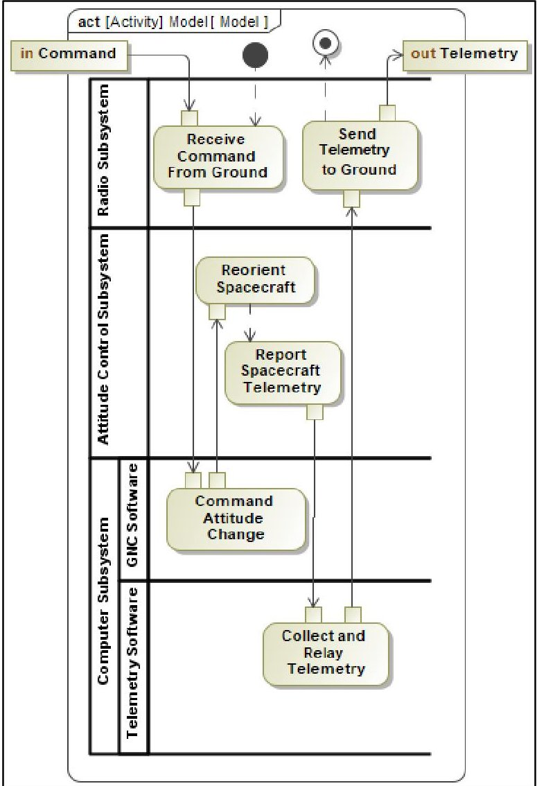

Figure 1. Generic Subsystem Functional Architecture

## 3. REQUIREMENTS AND ARCHITECTURE MANAGEMENT

## The Variance Process

Since the Tetra-5 Program is a prototype development program, there is expectation for a quick timeline for design milestone from selection to deployment. That accelerated timeline including holding the System Requirements Review (SRR) within two months of project start and getting to Critical Design Review (CDR) within a year. With that timeline small but agile team still needed a way to track requirement changes and reasoning for every change. These changes were frequent enough due to the prototype nature of the program. So to scale down a robust (but sometimes cumbersome) configuration control of requirements, the team developed a variance tracking process within the DSM.

<!-- PDF_PAGE: 3 -->

Building a profile to capture from-to language along with rationale and other meta-data about the changes, the team streamlined the change request process while maintaining a human-readable change history and ability to show deltas between milestones. As these changes and their reasoning needed to be referenced quickly, using internal MagicDraw $ ^{\mathrm{TM}} $ features would not track all the data needed or provide as a quick resource to view changes. The process involves a change element traced to each requirement, and in turn, traceability of the requirements to parent requirements, functions, logical architecture, and test plans produced a compressive but light weight change report that was reviewed and approved at change board.

Post SRR, the requirement set contained 74 requirements with TBRs or TBDs. Using this variance process allowed those TBX's to be burned to just two remaining at the time of Preliminary Design Review (PDR). This variance process allowed all from-to statements to be tracked with historical data so changes could be accounted for in the DSM for the requirement set.

Given the value generated for the team by model-based requirement variances, post-Preliminary Design Review (PDR), the team extended the scope of change management to include select viewpoints and elements, establishing an architecture baseline. The architecture baseline contains a set of system elements outside the scope of requirements that the team decided were crucial to system development and needed to be tracked at a high level.

This baseline includes subsystem configurations and block diagrams, technical performance measures, system documents, system budgets., functional hierarchy, and test plans. Architecture variances to the baseline are tracked by elements that define changes and are traced to those viewpoints. Architecture variances differ from requirement variances in that they may encompass a more diverse set of model changes. To fully capture those changes, there is a from-to diagram made for each change to show physical system changes and track them in the DSM. Figure 2, shows the custom stereotype created to track variances with each attribute that is tracked per variance. Each variance is tracked by allocating the element to the requirement or attribute being changed. Overall, the variance process adopted fared better than using the native differencing tools within MagicDraw $ ^{\mathrm{TM}} $ as it provided a clean and easy way to capture the history in a human readable way, did not require generating the bulky report, and was targeted directly for specific changes, avoiding the verbose nature of the difference reports that captures every minute change.

## Generating Architecture Artifacts

The Tetra-5 program's use of Velocity Template Language (VTL) templates promotes efficiency and accuracy in

generating Interface Control Documents (ICD) and test procedures as part of a comprehensive full lifecycle MBSE approach. VTL is a versatile scripting language that facilitates document generation from the DSM. The templates use element attributes and relationships between model elements to generate a Microsoft Word .docx file deliverable using a consistent template. Using a VTL template versus a manually developed document is advantageous in its ability to access the most current data and pull different revisions with an automated approach.

For the test procedures deliverable, the customer provided a custom Word document to use as source formatting for each individual test plan. Rather than manually creating a Word document with existing information for each test procedure, the VTL template utilizes the DSM data to automatically generate each Word document necessary to pass to the testing personnel to execute the procedure. Ultimately, the consistency of test plan generation from the model streamlines the import of test results to track requirement verification.

The team delivered ICDs using a similar VTL process to the Test Plan delivery. The DSM was built out to show specific subsystem interfaces and the layers within each subsystem. A VTL template was built out for each ICD being produced. The template was defined to grab the most recent, relevant data for each ICD. As the interfaces were

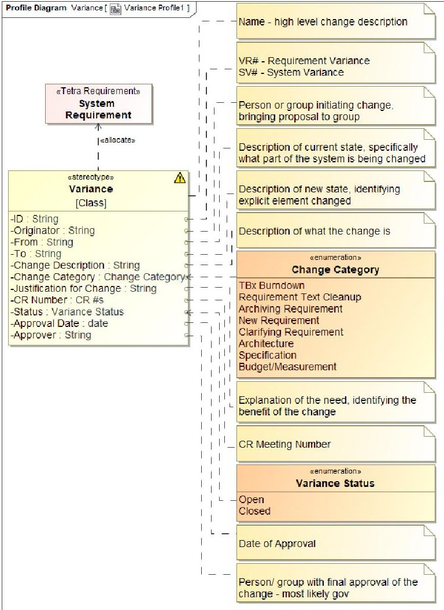

Figure 2. Variance Element Profile

<!-- PDF_PAGE: 4 -->

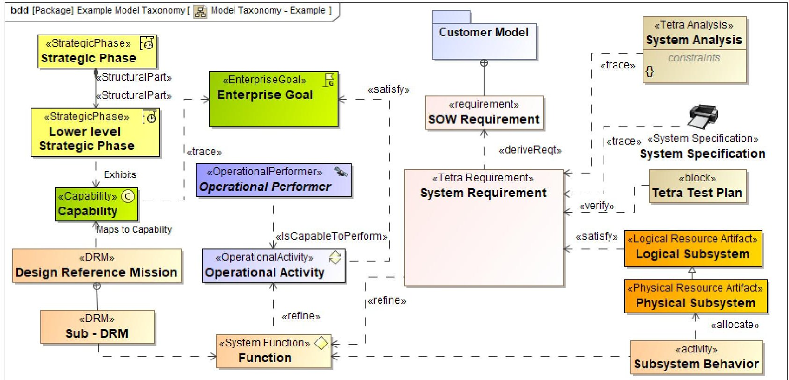

Figure 3. In-model Representative Digital Thread Diagram

further developed within the DSM, new versions of the ICDs were produced to show updates using the same VTL script. The VTL templates generate consistent documentation resulting in improved efficiency, lower risk, and expedited mission success.

## 4. DIGITAL THREAD

As the system was developed within the DSM, in-model digital threads for the system were created. "Digital threads" have a somewhat nebulous definition in the current state of the art, but we define them here as the sum effect of intra-model connectors and relationships in the DSM that enable traceability among disparate artifacts spread across the entire "systems engineering V." For example, a test output which verifies a requirement driven by a function which was in turn decomposed from a client-specified Design Reference Mission (DRM) represents a single "digital thread" woven into the larger DSM. The modeling framework used for this system development is customized, combining SysML 1.7, Unified Architecture Framework (UAF) 1.2, and custom stereotypes. With a large team of modelers, defining the digital thread for this custom framework was vital to creating a cohesive system model. The in-model representative digital thread diagram, shown Figure 3, shows the connectivity of every system element type, providing archetypes for the digital threads mapped throughout the DSM. On the diagram the model elements were created to follow the system engineering process. These in-model digital threads show the actual system elements and relationships used to follow the system from concept to deployment. The main system development thread starts on the diagram's left side with

the capabilities the system must perform; for this system, those are mapped from DRMs, which are broken out into functions that are refined by requirements. Requirements are derived from higher-level system requirements, then these lower-level requirements are allocated to subsystems which then have behaviors. Creating these threads allows users unfamiliar with the DSM development to understand the major aspects within the DSM and how they are connected. Having cohesive digital threads in the DSM enabled easier report generation, as the team can derive and directly link to information through different elements. Creating these threads provided a detailed look at DSM structure so the team could easily identify gaps in the technical baseline.

## 5. AGILE PRACTICES AND BIWEEKLY DELIVERIES CADENCE

The team used a combination of Agile scrum framework for system development. Implementing on this framework created a structure for each team member's role, meeting schedule, and scope of work. A two-week sprint cadence was developed from project start. This fast cadence helped scope tasks down to aspects of development that could be completed within those two weeks. There were different goals for each sprint, and high-level actions that had to be completed.

Tasks flowed from contract-specified sets of deliverables associated with review milestones throughout the project's lifecycle. A Jira epic was created for each contract-specified deliverable, and those epics were decomposed

<!-- PDF_PAGE: 5 -->

into executable tasks. The set of tasks for each epic was reviewed in a weekly backlog grooming meeting attended by a subset of the team's most senior personnel and led by the Project Manager. The tasks brought into the sprint were directly correlated to the goals of the sprint. For this project, most tasks directly related to progress in the DSM. This two-week cadence allowed adaptability as the project progressed. Depending on needs from the prime or the client, adjustments could be quickly made to meet their goals. During each sprint, there were daily scrums: a 15-minute check-in with the whole team where each person highlights progress that they made on their tasks and their plans for the next day. These scrums provided each team member insight into the work being done by the whole team. This meeting was a time where "blocked" work is brought to light, and the team could work together to figure out next steps. These meetings and this process encouraged team collaboration, as everyone had insight in what was happening within the larger development effort. This meeting cadence and structure is shown in Figure 4. The team tailored the Agile development methodology to meet the team's needs, including adding a weekly 30-minute meeting to demonstrate progress made in the DSM, fostering collaboration, and getting feedback from a variety of team members.

Between design reviews, the system model was logged and delivered at a biweekly cadence corresponding to the end of each sprint. With each delivery, the model versioned and major changes to the DSM are logged as well as the date of the version and where the version is being delivered. The modeling team delivered a mdzip file, a html file, and posted to Cameo Collaborator. Allowing the client and prime to view the DSM frequently ensures the entire team is aware of the system's status and its components. Versioning the model this way provides a historical log of all major changes, allowing the model to be frozen at a certain time. If errors occur in the model and it needs to be reverted, we have the history of all changes.

## 6. HOMEPAGES AND MILESTONE DELIVERIES

Due to the DSM being viewed as the system engineering source of truth repository, it was a deliverable at each design review. This model was delivered to a diverse set of

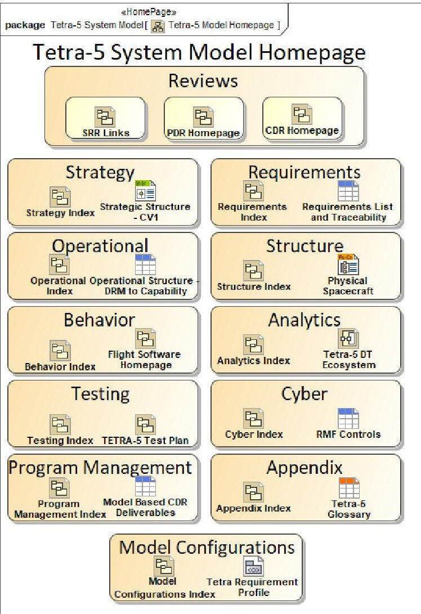

Figure 5. Example DSM Homepage

MBSE. To make the model easily understood by those less familiar with the methodology, homepages were widely used to assist stakeholders in absorbing MBSE information. An overall model homepage was the first thing users saw when they opened the DSM. This homepage, seen in Figure 5, shows every high-level package within the DSM and provides link to each package's index pages, as well as easy access to important diagram and review pages. Index pages exist for each of the 11 high-level packages; these index pages show the structure and viewpoints held within each package. The model was often viewed by stakeholders through Cameo Collaborator; adding these homepages and indices allowed stakeholders to easily navigate through the DSM. For each

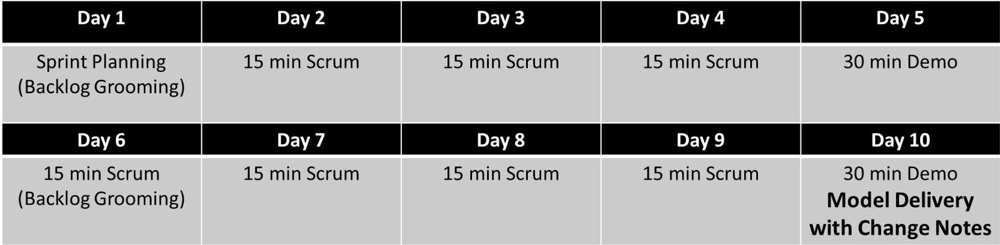

Figure 4. Tetra-5 Agile Meeting Cadence

<!-- PDF_PAGE: 6 -->

highlight specific model-based deliverables and where they lived within the DSM. In addition to deliverable homepages, key system aspects were given homepages. This allowed stakeholders without intimate knowledge of the DSM to easily understand both the model's and the system's structure.

At every milestone, the model is delivered as an artifact. At CDR, the delivery format was updated to a flat file. A script was developed to automatically create hyperlinks between model elements and their associated deliverable documents via the document ID. This allows stakeholders to view deliverable documents without opening the DSM. For each milestone, several deliverables are generated directly from the DSM.

The Bill of Materials (BoM) was ingested into the DSM from the Computer Aided Design (CAD) tool using a custom Jython script, and individual BoM items were traced directly to logical architecture artifacts and requirements. The resultant "threaded" BoM enabled tracking of as-designed versus as-built outcomes and connectivity among requirements, test plans, and verification, reducing risk to the program after CDR. The project's statement of work (SOW) defined what

deliverables were intended to be model based. These deliverable statements were captured in the DSM along with metadata; a realization relationship for each deliverable was created to show what in the model specifically contained that deliverable. Often, these realization relationships connected to homepages that allowed stakeholders to navigate through the different aspects of the deliverable.

## 7. AUTOMATIONS AND BILL OF MATERIALS

Using automations throughout a program's lifecycle reduces costly overhead man-hours devoured by manual processes. The Tetra-5 program used macros to automate DSM element generation, traceability, and metric calculations. The macros are written in Jython, an implementation of the Python language capable to run with Java applications (for this use case, MagicDraw $ ^{\mathrm{TM}} $ ). It allows rapid development of functionality, given that Python programs are typically 2-10 times shorter than the equivalent Java program. Macros developed include a script for the BoM, test result imports (See Section 10. Test Plan Development), traveler form imports, and metric calculations.

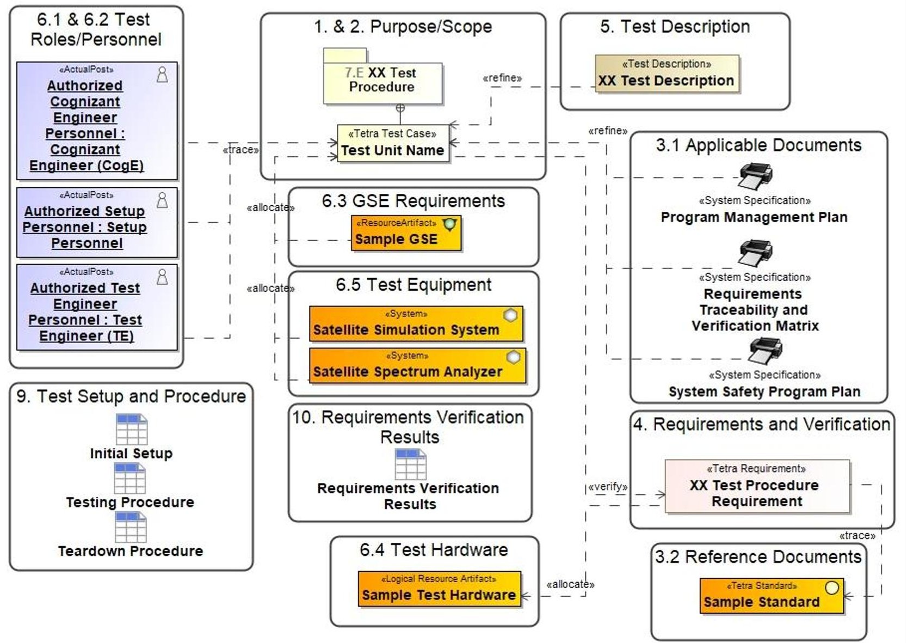

Figure 6. Test Plan Digital Thread

<!-- PDF_PAGE: 7 -->

The BoM integration in the DSM allows traceability of physical hardware components to requirements, physical architecture, and associated tests, which completes the digital threads. The BoM script automatically generates composition connectivity between assemblies and subassemblies based on the CAD export. After the contractor's CAD file is imported into the DSM using the Excel import profile, the BoM macro generates a Python dictionary of each component entry and creates directed composition relationships between the parent and child assemblies. The macro then adds multiplicity based on the hierarchy and quantity obtained from the CAD import. The imported artifacts and drawn relations add fidelity to the digital thread by rolling up the BoM assemblies to the existing physical architecture. This novel capability allows MBSE developers to have impactful influence on the pace of the engineering process due to the depth of the digital thread proliferation.

The Metric Calculations macro calculates metrics based off DSM table completeness for progress on test plans, ICD development, and Flight Software (FSW), while updating custom stereotypes for percent complete for each element. This was beneficial to track deliverable progress with each review cycle.

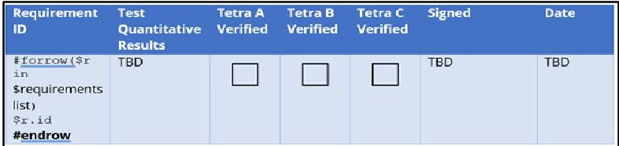

Figure 7. Digitized Verification Results Table

## 8. TEST PLAN DEVELOPMENT

The Tetra-5 program follows a model-based approach in test plan development, enabling the customer to develop test plans in the DSM for the mission. The MBSE testing approach is modelled with a test plan digital threads in Figure 6, with relationships captured from the test case and traced to sections of the VTL template following the customer's source formatting.

After generating a word document using the MagicDraw $ ^{\mathrm{TM}} $ Report Wizard, the document-based test plan is passed to testing personnel to perform the test and enter results in the requirement verification table at the bottom of the test document, shown in Figure 7.

Results are then imported by a systems engineer with a GUI developed using MagicDraw $ ^{\mathrm{TM}} $ OpenAPI, shown in Figure 8. The imported results automatically create verification relationships to update the status, and a test instance block is created to track updates. The MBSE

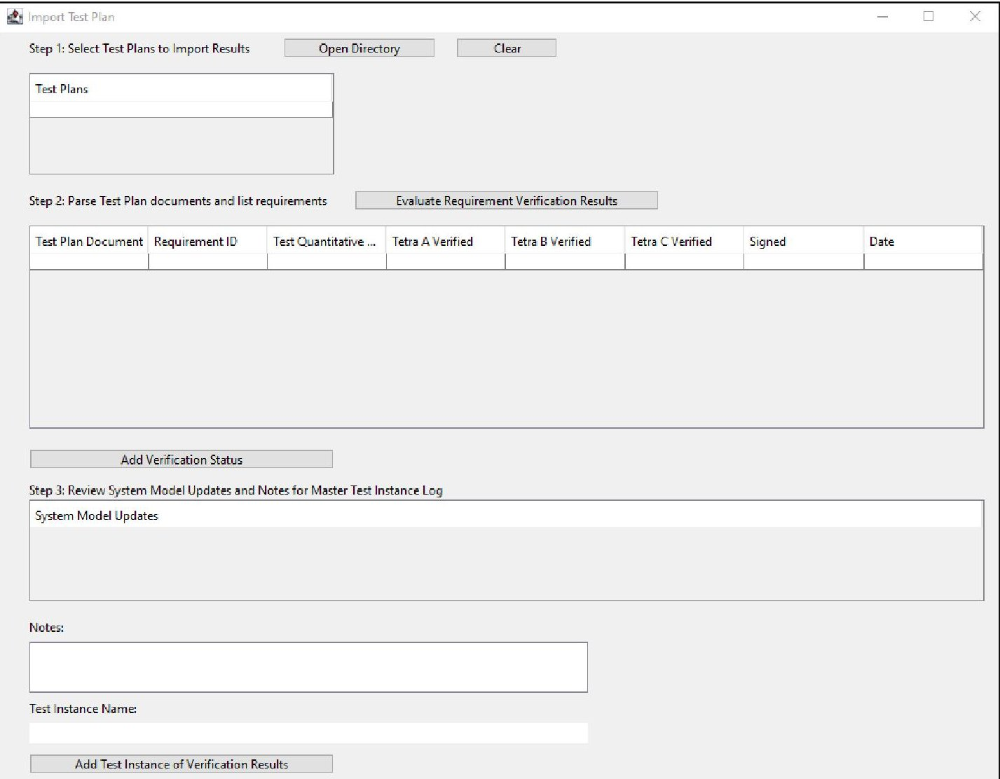

Figure 8. Import Test Plan Results GUI

<!-- PDF_PAGE: 8 -->

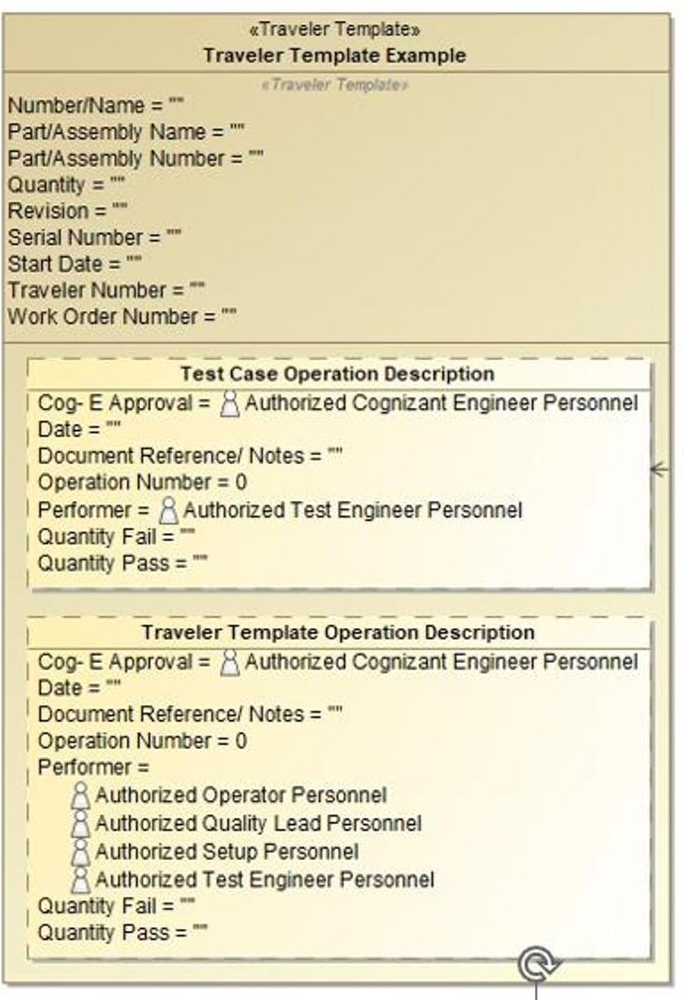

Figure 9. Model-Based Traveler

approach to test plan development transitions traditional SE practices of creating word document test plans and tracking results by pen and paper to a gamified process that streamlines requirement verification.

During the AI&T stage of the Tetra-5 program, each piece of custom hardware will be tracked by a unique traveler from inspection and reception to the installation into the final assembly. The Tetra-5 document-based traveler passed between test facilities with each hardware component to track each individual component's operation steps and status shown in Figure 9.

The Tetra-5 Model-Based Travelers approach enables the import of document-based travelers performed by the authorized test personnel. With this macro, relationships are auto generated to connect the Tetra Traveler to the Tetra Test Cases performed and the Testing Personnel executing the procedure.

The Traveler header is captured in a custom <<Traveler Template>> stereotyped block seen in Figure 9. Each operation procedural step is captured as a custom <<Traveler Template Property>> stereotyped property. These elements capture the connectivity between the document-based traveler and the digital thread in addition to tracking gaps in test execution and facility operations.

## 9. FLIGHT SOFTWARE ARCHITECTURE

Initially, the legacy-code for Tetra-5's FSW had little existing documentation. To enable new FSW use cases, the team interviewed the programmers to build out the functional architecture capturing software's functionality and message exchanges. The FSW architecture deliverable evolved to include the DSM and enables development of a software-based simulator (digital twin), which serves as a tool for operator training and command execution simulation for mission risk reduction.

The logical decomposition activity described for subsystems earlier in this paper was also performed for the software microservices which constitute the on-orbit flight software. This involved analyzing the functions required by the on-board computer system and, in discussions with the software engineering team, decomposing them into the functions of individual software microservices. [12]

The DSM contains the high-level software structure and behavior, but lower-level design elements (e.g., classes of which a component is constructed, or public methods and method parameters of a given class) are not included, primarily due to proprietary information concerns among the wider Tetra-5 team. For this reason, the DSM's functional analysis takes the form of activity diagrams of specific series of events prominent in the life of the spacecraft, rather than generic activity diagrams depicting all behavior of a given component. Instead, a component's behavior consists of the behavior elements (SysML Activities) contained within it, which appear in its swim lanes in for the activities in which it participates.

The data exchanges between software elements are contained in the DSM as object flows on the activity diagrams, typed by signal elements, which allows the DSM to capture the types of information entering and exiting a given software component and the activities it must perform.

## 10. SOFTWARE BASED SIMULATOR

The customer required a version of the flight and ground software suitable for operational training and planning in preparation for performance of the DRMs. This required an instance of the flight and ground software to be coupled to a simulator with sufficient fidelity to provide flight-like responses to operator commands.

<!-- PDF_PAGE: 9 -->

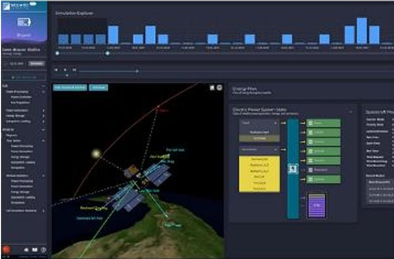

Figure 10. Sedaro $ ^{\mathrm{TM}} $ Environment Appearance [16].

The requirement to train spacecraft operators on the actual ground software, and to observe responses as they would be provided by the actual flight software drove a softwarein-the-loop approach to the architecture for this portion of the system. Software-in-the-Loop is not an uncommon approach for testing, particularly of control algorithms [13], and is also used in simulation [14], including of spacecraft [15].

In this instance, the required solution would allow for the instantiation of a copy of the actual software to be used on orbit, in communication with the actual software to be used to control the on-orbit spacecraft, as well as a simulator tailored to accept commands from and provide responses to the flight software in the format of the on-orbit subsystems.

A trade space analysis was performed on possible physics simulation tools, and the Sedaro Digital Twin $ ^{\mathrm{TM}} $ product, shown in Figure 10 was selected [16] for its adaptability and capability to allow real-time command and telemetry exchange with a flight software virtual machine.

For the SBS, a modular architecture, shown in Figure 11, was selected with Python-based middleware component interacting with the flight software (which is hosted on a Virtual Machine) and the Sedaro $ ^{\mathrm{TM}} $ simulation. This allowed future expansion of the simulation capabilities (since the middleware component allows integration of other simulation tools) or custom calculations, provided they can be called by a Python program and are able to calculate results faster than real time.

This modular architecture allows tailoring the simulation fidelity to a level necessary to satisfy the operations use case. Fidelity is costly in a digital twin or simulator and was therefore narrowly targeted at aspects of the simulation that were necessary for the use cases [17], in this case operations planning, operator training, and operational risk reduction. The architecture allows standard subsystem telemetry to be stored as tables representing nominal responses, then selectively updated before being sent to the

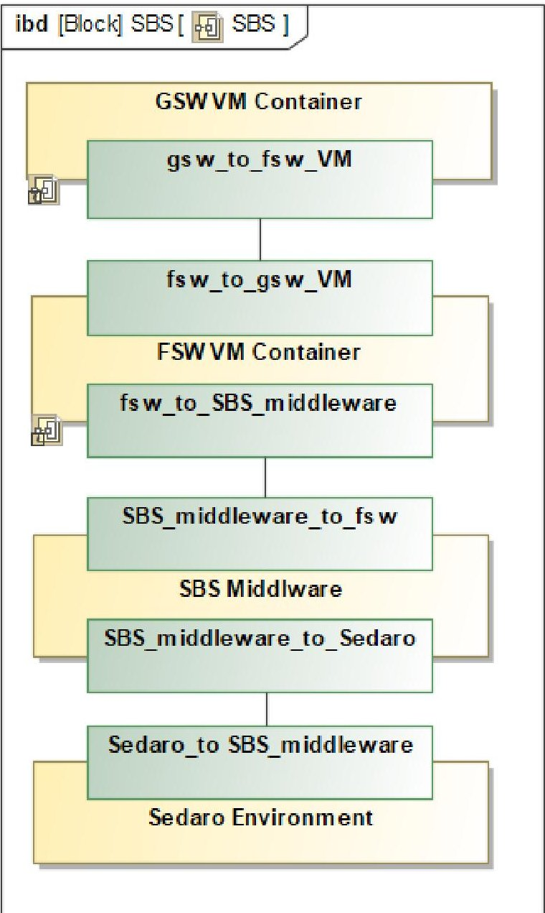

Figure 11. SBS Architecture

flight software, based on the current state of the physics simulation. Functional analysis of the use cases, considering the detailed telemetry of the selected spacecraft subsystems and the flight software design, allows specific variables or entries to be updated while others are left at their default values. While the simulation fidelity (as experienced by the operator [18]) is very high, since the operator is simply using an instance of the onorbit ground control software, the physics simulation is tailored, similar to the approach taken by [19], to spacecraft subsystems and behaviors which are most relevant to the critical missions or most likely to impact operational decisions.

## 11. IMPACT AND FORWARD WORK

Using MBSE on this pilot project led to numerous benefits in support of system development and completion of design milestones despite the demands of accelerated acquisition, while still maintaining a rigorous record of architecture baseline, requirements, and the many other SE artifacts needed at milestones.

Benefits seen from using MBSE include:

<!-- PDF_PAGE: 10 -->

a) The DSM improved communications with the government and other reviews. With bi-weekly deliveries, government reviewers can keep up with changes and progression outside of the formal milestones.

b) A consolidated set of all contract deliverables and additional SE artifacts is produced at milestones.

c) For non-MBSE-based deliverables, the DSM provides context and traceability to other program concepts and deliverables.

d) The DSM provides provided appropriately scaled configuration management of requirements and architecture.

e) The DSM provided detailed traceability from high-level Concept of Operations (CONOPs) to architecture and design.

f) The DSM provided an in-depth narrative explaining the history of changes to the system design and their justifications.

As the Tetra-5 project moves towards Test Readiness Review (TRR), the DSM will provide consistency in capturing test procedures, travelers, and requirement verification per satellite. The model-based approach to test procedures and travelers will streamline the handoff between the testing personnel and systems engineers. While the systems engineers design the test procedures to verify each requirement, testing personnel will execute the procedures and pass results back. Automating the test procedures and results documentation will avoid manual errors in recording requirement verification, as well as highlight failures in test performance. Tracking each traveler in the DSM will ensure the hardware completes all necessary test operations before being passed to the next facility. The Tetra-5 project is expected to deliver multiple spacecraft buses. With this expectation comes the necessity of tracking all hardware components three times over. The DSM can track the execution of the complete test flow while mitigating the risk of manual entry errors.

A prominent lesson learned from this process was the challenge in adopting MBSE processes for teams unfamiliar with this method of SE. Training and communication about the purpose and approach of MBSE, including its benefits and limitations, are key to successful adoption and engagement with the wider team.

Teams which span multiple corporate entities present unique challenges for SE in general due to the limitations of proprietary information. This limitation is starkly relieved by the increased connectivity and improved communication allowed by using MBSE. Such limitations should be discussed openly and plainly to ensure the whole team understands the details of this challenge and its impacts to allow the various teams to adapt early in the program.

Another expertise-bridging strategy that proved effective with MBSE-inexperienced sub-teams was frequently publishing the model and communicating about the latest changes often. The team established a bi-weekly delivery cadence and included change notes with every iterative publication of the DSM. This spurred conversation with technical sub-teams building the solution and with the government client, who started following the changes closely and asking clarifying questions. The frequent delivery cadence and change notes provided educational opportunities in and of themselves to facilitate MBSE education, while continually demonstrating MBSE's value to the program in parallel.

Additionally, the team discovered that close coordination with the government client regarding minimum viable products (MVPs) for contract-specified deliverables considerably increased the prime's and the team's own confidence that they were on-track to execute successful design review milestones. By reaching out early to client representatives to clear up ambiguity, the team built strong definitions of done for each deliverable and documented client priorities beyond MVPs to guide the utilization of work capacity in later sprints.

## 12. CONCLUSION

The use of MBSE must be scaled to appropriate size and speed of the program. On the Tetra-5 program, the team employed Agile MBSE to perform a balancing act which produced a DSM that was used to keep the program on the rapid development needed for today's warfighter while maintaining the necessary SE rigor to keep mission success high. To date, the DSM has been successfully used for requirements management, capture of the FSW, test plans interfaces, software-based simulator development, and references to all contract deliverables for three milestones. This effort will continue into the future production of the small satellites and eventually mission support, not just because of program requirements, but because teammates and government reviewers have experienced the value of the MBSE approach.

## ACKNOWLEDGEMENTS

The authors would like to acknowledge AFRL, SSC and prime contractor Orion Space Solutions, Inc. for their support of this work.

## REFERENCES

<!-- PDF_PAGE: 11 -->

[2] M. C. Berschik, T. Schumacher, F. N. Laukotka, D. Krause and D. Inkermann, "MBSE Within the Engineering Design Community - An Exploratory Study," in International Conference on Engineering Design, ICED23, Bordeaux, France, 2023.

[3] D. D. Walden, G. J. Roedler, K. J. Forsberg, R. D. Hamelin and T. M. Shortell, Systems Engineering Handbook, San Diego, CA: Wiley, 2015.

[4] Office of the Deputy Assistant Secretary of Defense for Systems Engineering, "Department of Defense Digital Engineering Strategy," U.S. Department of Defense, Washington, DC, 2018.

[5] S. C. Spangelo, D. Kaslow, C. Delp, B. Cole, L. Anderson, E. Fosse, B. S. Gilbert, L. Hartman, T. Kahn and J. Cutler, "Applying Model Based Systems Engineering (MBSE) to a Standard CubeSat," in 2012 IEEE Aerospace Conference, Big Sky, MT, 2012.

[6] S. Gao, W. Cao, L. Fan and J. Liu, "MBSE for Satellite Communication System Architecting," IEEE Access, vol. 7, pp. 164051-164067, 2019.

[7] Air Force, "Department of Defense Fiscal Year (FY) 2024 Budget Estimates: Research, Development, Test & Evaluation, Space Force," Air Force, 2023.

[8] Space Systems Command Office of Public Affairs (SSC/PA), "Space Systems Command selects Orion Space Solutions for Tetra-5 Other Transaction," 26 July 2022. [Online]. Available: https://www.ssc.spaceforce.mil/Portals/3/Documents/PRESS%20RELEASES/Tetra-5.pdf. [Accessed 5 September 2023].

[9] S. Erwin, "Space Command: U.S. satellites 'constrained' by lack of mobility," Space News, 24 January 2023. [Online]. Available: https://spacenews.com/space-command-u-s satellites-constrained-by-lack-of-mobility/. [Accessed 7 September 2023].

[10] DoD, "Systems Engineering Guide for Systems of Systems," Department of Defense, Washington, D.C., 2008.

[11] B. P. Douglass, "Agile Systems Engineering," Morgan Kaufmann, Burlington, MA, 2015.

[12] S. R. Hirshorn, L. D. Voss and L. K. Bromley, "NASA Systems Engineering Handbook," NASA, 2017.

[13] S. Wegner, E. Majd, L. Taylor, R. Thomas and D. G. Egziabher, "Methodology for Software-in-the-Loop Testing of Low-Cost Attitude Determination Systems," in 31st Annual AIAA/USU Conference on Small Satellites, 2017.

[14] A. Bittar, H. V. Figuereido, P. A. Guimaraes and A. C. Mendes, "Guidance software-in-the-loop simulation using x-plane and simulink for uavs," in International Conference on Unmanned Aircraft Systems (ICUAS), 2014.

[15] J. Kiesbye, D. Messmann, M. Preisinger, G. Reina, D. Nagy, F. Schummer, M. Mostad, T. Kale and M. Langer, "Hardware-in-the-loop and software-in-the-loop testing of the move-ii cubesat," Aerospace, vol. 6, no. 12, p. 130, 2019.

[16] "SEDARO," Sedaro, 2023. [Online]. Available: www.sedaro.com. [Accessed 1782023].

[17] D. Jones, C. Snider, A. Nassehi, J. Yon and B. Hicks, "Characterising the Digital Twin: A Systematic literature review," CIRP Journal of Manufacturing Science and Technology, vol. 29, no. A, pp. 36-52, 2020.

[18] D. Liu, N. D. Macchiarella and D. A. Vincenzi, "Simulation Fidelity," in Human Factors in Simulation and Training, CRC Press, 2008, pp. 61- 73.

[19] E. W. Ferguson, S. S. Wissler, B. K. Bradley, P. Maldague, J. Ludwinski and C. R. Lawler, "Improving spacecraft design and operability for Europa Clipper through high-fidelity, missionlevel modeling and simulation.," in 2018 SpaceOps Conference, 2018.

[20] B. Lightsey, "Systems Engineering Fundamentals," Defense Acquisition University, Fort Belvoir, VA, 2001.

[21] "ANSYS Products," ANSYS, 2023. [Online]. Available: https://www.ansys.com/products. [Accessed 17 8 2023].

<!-- PDF_PAGE: 12 -->

## BIOGRAPHIES

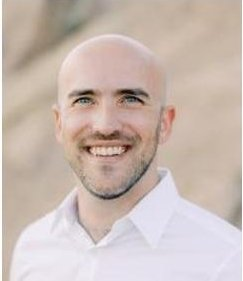

Jeremiah Crane is a Chief System Engineer at Booz Allen Hamilton. He is the system model lead for the Tetra-5 program. He has been at Booz Allen for 10 years, working various projects including NASA Lunar Gateway program as a Digital

Architecture Lead, the Air Force Launch, Test Range System as a system architect and as lead of Booz Allen's Digital Engineering Labs. He holds a M.S. in Systems Architecture and Engineering from University of Southern California and a B.S. in Mechanical Engineering from Georgia Institute of Technology.

Julia Collins is a Lead Systems Engineer at Booz Allen Hamilton. She is an engineer for the Tetra-5 program, focusing on model and requirements management. Julia has been at Booz Allen for 3 years. Previously, Julia worked in systems integration and test at Northrop Grumman. She holds a M.S. in

Systems Engineering from Johns Hopkins University and B.S. in Electrical Engineering from Catholic University.

Paul Day is a Senior Lead Systems Engineer at Booz Allen Hamilton. He is the deputy system model lead for the Tetra-5 program. He has been at Booz Allen for 5 years, working various projects including U.S. Air Force's Space C2

program, and the Space Rapid Capabilities Office's Ground Command, Control, and Communication (GC3) program. He holds a B.S. in Political Science from the United States Air Force Academy and served in the U.S. Air Force on active duty for 10 years as a Space Operations Officer.

Melinda Ong is a Lead Systems Engineer at Booz Allen Hamilton. She is an engineer for the Tetra-5 program, responsible for the delivery of advanced space solutions. Melinda has been at Booz Allen for 2 years. Previously, Melinda worked in electronic warfare at L3Harris,

integrating RF countermeasures systems to protect the warfighter. Melinda holds a BS in Electrical Engineering from California Polytechnic State University, San Luis Obispo.

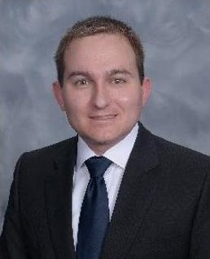

Paul Cronk is a Lead System Engineer at Booz Allen Hamilton. He is an engineer the Tetra-5 program focusing on the functional modeling. He has been at Booz Allen Hamilton for 2 years, having previously worked at General Dynamics Mission Systems, Medtronic, and as an officer in the U.S. Navy. He holds

a M.S. in Mechanical Engineering from the University of Minnesota. and a B.S. in Mechanical Engineering from the United States Naval Academy.