<!-- PDF_PAGE: 1 -->

IAC-23-E2.3-GTS.4

# 6S CubeSat: a Student-made IOD Mission for Characterization of Perovskite Solar Cells and Structural Battery

Suhailah Alkhawashke $ ^{b,*} $ , Juan Bedoya $ ^{b} $ , Giorgia Biagetti $ ^{b} $ , Fausto Biondi $ ^{b} $ , Pietro Califano $ ^{b} $ , Roberto Capasso $ ^{b} $ , Alessandro Crispiels $ ^{b} $ , Carlos Garcia Jimenez $ ^{b} $ , Irene Lujan Fernandez $ ^{b} $ , Davide Martire $ ^{b} $ , Luca Mazzotti $ ^{a} $ , Maurice Pepellin $ ^{b} $ , Alessio Prosperi $ ^{b} $ , Davide Scalettari $ ^{a} $ , Andrea Zanetti $ ^{b} $ , Massimiliano Bussolino $ ^{b} $ , Davide Perico $ ^{c} $

$ ^{a} $ BSc Student, Politecnico di Milano, Aerospace Science and Technology Department, via La Masa, 34, Milano, Italy $ ^{b} $ MSc Student, Politecnico di Milano, Aerospace Science and Technology Department, via La Masa, 34, Milano, Italy $ ^{c} $ PhD Student, Politecnico di Milano, Aerospace Science and Technology Department, via La Masa, 34, Milano, Italy $ ^{*} $ Corresponding author, suhailah.alkhawashke@mail.polimi.it

## Abstract

manufacture, and operate the first student-made 1U CubeSat of Politecnico di Milano. Moreover, since January 2023, the project has been part of the pilot edition of ESA's "Fly Your Satellite! Design Booster" program aiming to support selected teams through the consolidation of the design by arranging regular reviews with ESA experts. Looking at potential improvements in space technology and its transfer, 6S CubeSat was developed as a technological demonstrator of two payloads focused on in-orbit power production and storage; Volta structural battery and PErovskite Solar Cells Analyzer (PESCA). The former is a game-changing concept that combines both form and function, aiming to significantly reduce weight and complexity in satellite design. The latter, instead, will manage the testing of Perovskite solar cells, which promise high efficiency, high power-to-mass ratio, low production cost, and excellent resistance to radiation, making them a good alternative to Silicon-based Solar Cells, both for terrestrial and in-space applications. Furthermore, a derived goal from PESCA is to develop and validate an open-source, affordable, and highly effective solar cells testing platform built in-house. Along with 6S' second in-house component, the CubeSat structure, these two present the main challenges of the CubeSat construction and qualification. Students from BSc, MSc, and PhD careers are organized in teams that include Attitude and Orbit Control System, Electrical Power System, Mission Analysis, Payload, On-Board Data Handling and Flight Software, Thermal Control System, Telemetry and Telecommand, System Engineers, and Structural teams that translate the theoretical background provided by the university courses of diverse backgrounds to the application of standard practices in space mission design. This also involves the adoption of ECSS and SAVOIR standards and practices of Model Based System Engineering, targeting a high academic return for the students involved. The paper aims to present the technological and educational mission objectives. Additionally, it will provide a complete overview of the mission baseline by detailing the technical design choices and relevant results achieved by the teams cooperating in the project.

Keywords: IOD, student CubeSat, Perovskite solar cells, structural battery, space mission design.

## 1. Introduction

Future space missions would greatly benefit from the development of higher energy-density technologies for onboard power generation and storage. Given the substantial role these systems play in terms of mass and volume within a satellite, reducing these parameters and improving technological efficiency can yield significant advantages. As the use of nano-satellites (such as CubeSats) for various mission types continues to rise, advancing power systems could potentially open doors to interplanetary missions [1] and the use of energy-intensive payloads like radar systems [2]. Moreover, enhancing these technologies aligns with the European Space Agency (ESA) Technology Strategy report, which recognizes them as essential for cost reduction in missions. Since satellite mass significantly influences launch costs, reducing mass through improved power technologies would lead to substantial mission cost reductions.

6S is a CubeSat mission designed to perform an In-Orbit Demonstration (IOD) of novel technologies that show

<!-- PDF_PAGE: 2 -->

promise for the future improvement of spacecraft power production and storage systems. The payloads mounted onboard include a set of Perovskite Solar Cells (PSCs) and a structural-thermal model of a structural battery. The interest in PSCs has been on the rise in recent years due to their power conversion efficiency and high specific power [3]. Additionally, PSCs have been shown to possess self-healing properties [4], recovering from environmental degradation when removed from the degrading source. This behavior is of particular interest for space applications, where the degradation of solar panels is a limiting factor for mission durations and necessitates an oversizing of the solar cell surface at the beginning of life (BOL). In-space testing of these technologies has been limited to short-term experiments [5-7]). The 6S mission aims to conduct a long-term investigation of various types of PSCs provided by the ROSI research group from the University of Potsdam, in order to characterize their performance and assess their self-healing properties in space. For collecting the payload's data, 6S employs the in-house-developed Perovskite Solar Cells Analyzer (PESCA). This instrument is designed for a form factor compatible with 1U platforms, granting a promising reutilization for the development of CubeSats for in-space solar cell testing.

The secondary payload of the 6S CubeSat is the structural-thermal model of the structural battery being developed by Volta Structural Energy. Multifunctional structures, which combine structural and power systems, are among the most promising technologies for achieving mass and volume savings in space missions [8]. Because batteries are susceptible to the risk of leakage of corrosive substances and, in extreme conditions, explosions, the 6S CubeSat will study the structural and thermal behavior of a mockup of a structural battery. The mission's findings will enable the design and production of a multifunctional structure capable of operating safely in the space environment.

The CubeSat platform was chosen for the mission due to its frequent use as an In-Orbit Demonstration (IOD) platform and its potential for educational purposes. Indeed, the mission is being developed by a team of students from Politecnico di Milano. In addition to its significant technological goals, the 6S mission aims to provide students with the opportunity to gain practical experience in spacecraft design, manufacturing, testing, and operation. The mission design initiated in the first quarter of 2021 with Phase 0, led by 20 students. The current team, composed of 90 active members, successfully concluded Phase B in June 2023. The launch date is foreseen to be in the third quarter of 2025.

The 6S CubeSat mission was selected for the pilot edition of ESA's "Fly Your Satellite! Design Booster" program which provides students with the support of ESA experts from the baseline design review up to the final design review.

The purpose of this paper is to offer a technical overview of 6S, emphasizing the foreseen technological return of the payloads, as well as the planned operations and technical solutions employed to achieve the mission's objectives. Additionally, this paper aims to provide valuable insights into the design process of a student CubeSat, a process often impacted by factors such as limited experience, funding constraints, and rapid personnel turnover.

The remainder of the paper is organized as follows: section 2 will further detail the two payloads of the mission and introduce the planned in-orbit tests; section 3 describes the design of the mission, including 6S' orbit and its operation from launch to disposal. The spacecraft's subsystems, namely the Attitude Determination and Control System (ADCS), Electrical Power System (EPS), Telemetry and Telecommand (TMTC), On-Board Data Handling (OBDH), Thermal Control System (TCS), and the structural system, are described in section 4. Finally, section 5 will present the current status and the future of the manufacturing, assembly, and testing of 6S, while section 6 will present the major challenges and solutions adopted during the design of the CubeSat from Phase 0 to Phase B. The conclusions are summarized in section 7.

## 2. Payloads

## 2.1. Perovskite Solar Cells Analyzer

Solar cells, to be competitive in the space industry, must satisfy specific requirements, especially: high performance, high specific power, and long-term stability [3].PSCs technology is a new and promising technology for the future of electric power production in space. In terms of Power Efficiency Conversion (PCE), they already reach the same level as commercially available older technology, such as Si-based solar cells [9]. Given the promising future improvements in terms of PCE of this new technology, as well as its lightweight nature, their specific power is set to be extremely competitive for future applications.

However, perovskite solar cells (PSCs) strongly underperform in terms of durability when compared to commercially available cells [10], which offer a lifetime of more than 20 years. When exposed to the space environment, characterized by strong radiation, high vacuum, harsh temperature fluctuations, and atomic oxygen, the cells' performance degrades rapidly. Although advances

<!-- PDF_PAGE: 3 -->

have been made to counteract degradation through testing cells with encapsulation [10] and radiation-tolerant technologies [11], further investigation must be carried out to develop PSCs further and make it competitive in the photovoltaic cell market.

To this day, in-space testing has been conducted primarily on balloons [7] and sounding rockets [6]. However, they are short-time span tests and, for this reason, there is a need to test PSCs on long-lasting missions to understand their long-term degradation. The first long-lasting in-space Perovskite test was done on board the International Space Station and lasted 10 months [5].

Since long-term in-space testing of perovskite solar cells (PSCs) is one of the main steps to overcome the current limitations to their utilization [3], the 6S mission mounts 7 different PSCs of varying compositions, with the aim of characterizing their performances and monitoring their degradation in the space environment. The PSCs being analyzed, provided by the ROSI research group, are categorized into Triple Cation-based PSCs (TC-PSC), Unstable Triple Cation-based PSCs (U-PSC), and Organic PSCs (O-PSC). The cells are mounted on the lateral faces of the CubeSat $ (\pm X $ and $ \pm Y $ according to the convention of Fig. 6). All the PSCs are connected to the Perovskite Solar Cells Analyzer (PESCA) circuit to collect the relevant data.

During the PESCA base testing, the cells are periodically exposed to the Sun exploiting the spacecraft spin. PESCA will collect the data to obtain the Open circuit Voltage $ ( V_{OC} ) $ , Short Circuit Current $ ( I_{SC} ) $ , Maximum Power Point and the whole I-V curve. Additionally, the environmental data concerning the measurements are collected, including the cells' temperature and Sun Aspect Angle (SAA). The same data will also be recorded for the cell stored inside the CubeSat to test the effects of the space environment without suffering the consequences of solar irradiation. This experiment will provide important insights into the causes of PSC degradation, which are still uncertain [9].

During the Self-healing test aims at understanding the degradation process that the PSCs are subjected to when illuminated during a consistent period of time and understanding how they are able to recover their original properties during eclipse. PSCs have been observed to possess both molecular and mechanical self-healing capabilities, which could potentially significantly increase their lifetime [4]. However, this phenomenon requires further investigation [3]. To collect experimental data regarding this aspect of the cells, once every 1.5 orbits, they will be first oriented toward the Sun. Then, during the eclipse phase of the orbit, they will be turned toward deep space. Removing the cells from the degradation source (sunlight) should trigger the self-healing process, which should produce an improvement in long-term per-

## formances.

The PSC's analyzer circuit, PESCA, is entirely developed in-house and customized for testing photovoltaic cells on a 1U CubeSat platform. An image of PESCA and its casing is presented in Fig. 1.

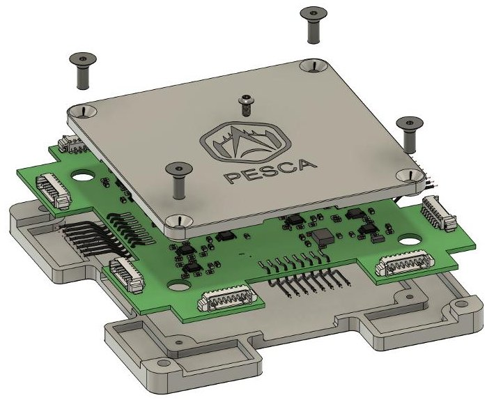

Figure 1: PESCA board.

The form factor compatible with 1U platforms makes this instrument a promising, ready-to-use technology for in-space testing of solar cells. If successfully tested on board the 6S mission, PESCA will become a flightproven component that could facilitate the easier and faster development of CubeSats for IOD of photovoltaic technologies.

## 2.2. Structural battery

Structural batteries represent a new solution to combine electrical energy storage and a structural unit in a single device. They can be used to replace otherwise inert structural mass, which makes them particularly appealing for the aerospace and automotive sectors [1214]. Batteries and structural components generally have a significant impact on a spacecraft's mass breakdowns, and although it is a simple concept, embedding the function of the prior in the latter could allow for a noticeable reduction in the overall mass. Given that launch costs constitute a significant portion of a space mission's expenses and are directly proportional to the spacecraft's mass, a reduction in mass also translates into a substantial cost-saving for the mission. Additionally, the implementation of such technology means the reduction of the bulk of EPS units, which can be reduced to Power Distribution Units alone, thus implying an increase in available volume [15].

During a space mission, structural elements endure a challenging thermo-structural environment, from the high static loads and vibrations at launch to the vacuum of space. They also face degradation caused by outgassing and atomic oxygen exposure. Furthermore, the absence

<!-- PDF_PAGE: 4 -->

of a conductive medium creates a dynamic thermal environment. Structural components must withstand these conditions throughout the mission's entire lifespan. This is especially crucial when dealing with structural batteries to prevent the release of corrosive substances.

6S CubeSat will mount a testing model of a structural battery provided by Volta Structural Energy with the scope of investigating the structural and thermal properties of the battery case. In fact, due to the early state of the technology, the electrolyte on the unit that will be launched is substituted with a gel that mimics the thermal properties of the electrolyte itself. This measure was taken to mitigate the risk of spilling electrolyte fluid in case of the failure of the battery.

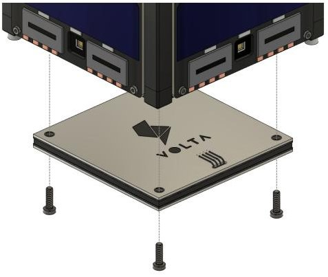

Figure 2: Volta Structural Battery Integration.

The unit is placed on the -Z face of the CubeSat (Fig. 2). The reference frame is shown in Fig. 6. During testing, the payload will experience a high thermal gradient through the procedure of rapidly passing from one pointing mode to the other. Temperature and strain sensors are conveniently embedded in key points of the battery and will collect data aimed at the study and validation of thermal and structural behavior. Eventual structural failures, like rupture or delamination of the layers, will also be monitored during the life of the mission. Such information, although not directly involving the power storage performance of the unit, holds a key relevance in enabling the development of Volta Structural Battery, but can likewise bring benefit to research in the field of structural batteries as a whole.

## 3. Mission Design

The mission objectives drove the characterization of the mission phases and the selection of the operative orbit.

## 3.1. Mission Phases

The 6S CubeSat mission is composed of the three following phases:

- Launch and early orbit: This phase is devoted to the deployment of the system into its orbit followed by its commissioning. It is supposed to last approximately 7

days. The antenna deployment will allow the first contact with the Ground Station (GS) after the discrimination period. If successful, it triggers the system commissioning that will anticipate the nominal phase.

- Nominal testing phase: This is the mission's primary operational phase, expected to last for around a year. The main activity performed is the payloads testing which is decomposed into three Testing Modes. Specifically, Volta Testing with a 14-day recurrence, PESCA Base Testing with a daily frequency, and PESCA SelfHealing Testing happening twice per month.

- Disposal: Close to the mission's End of Life (EOL), the spacecraft will be decommissioned in a maximum time of 5 years. During this phase, all remaining memory data will be dumped to ground and passivation of the system will be performed to prepare the CubeSat for its atmospheric entry.

## 3.2. Mission Analysis

The orbit design for 6S has been guided by a few relevant requirements stemming from technical and regulative sources. Moreover, the date of launch and deployment region are still under analysis with launch providers as the system will likely be part of a Rideshare launch. Therefore, the design process focused on providing a range of orbit parameters that will satisfy the mission objectives. Firstly, the total lifetime of the 6S mission has a lower bound of 200 days above 300 km to satisfy mission objectives and an upper bound of 5 years of total mission due to space debris regulation ECSS guidelines. Low Earth Orbit (LEO) family orbits in the 450-550 km altitude range are usually compliant with these requests but attention was paid to Sun activity as affects the effective mission lifetime. Its forecasts are provided in terms of likelihood values because they are still rare and affected by high uncertainty. To estimate the 6S mission duration, in accordance with ESA suggestions, it has been performed a double worst-case scenario decay simulation with data from [16], such that regardless of the forecast reliability of the Sun activity predictions, the satellite will still be capable of satisfying the lifetime constraints, with a decay happening within around 360 days:

- Nominal testing phase: High intensity and less probable Solar activity forecast to ensure the satisfaction of the requirements on the nominal mission phase;

- Disposal phase: Low intensity and more probable solar activity forecast to ensure the ECSS requirements on debris regulation.

Secondly, GS visibility time windows represented a fundamental design driver. Four different GS are available listed in Table 1, ensuring a total communication window of 16 minutes per day.

The high latitude of the GS together with the data acquired from simulations lead to a choice of the inclination in a range between 40 deg and 140 deg for an altitude

<!-- PDF_PAGE: 5 -->

between 450 km and 550 km. The position of the GS and the Earth coverage that 6S would have at 450 km altitude and 65 deg inclination are shown in Fig. 3.

<table border="1"><tr><td>Name</td><td>Latitude</td><td>Longitude</td><td>Min. Elev.</td></tr><tr><td>Lomazzo</td><td>45.69°N</td><td>9.03°E</td><td>10°</td></tr><tr><td>Puertollano</td><td>38.67°N</td><td>4.16°W</td><td>10°</td></tr><tr><td>Saxavord</td><td>60.80°N</td><td>0.82°E</td><td>15°</td></tr><tr><td>Vimercate</td><td>45.59°N</td><td>9.36°E</td><td>10°</td></tr></table>

Table 1: GS location data.

The position of the GS and the Earth coverage that 6S would have at 450 km altitude and 65 deg inclination are shown in Fig. 3.

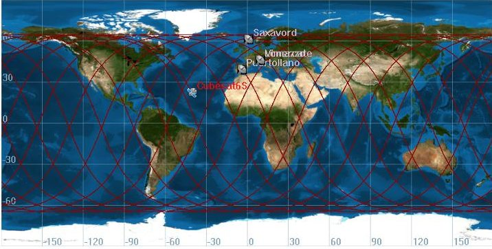

Figure 3: Ground track for an orbit at h = 450 km i = 65 deg e = 0 with the available GS.

Finally, time in Sun visibility is a main concern for missions alike 6S that operate in LEO region where the eclipse period affects both thermal regulation and power availability. In 6S mission, the reduction of the amount of time in eclipse is particularly relevant in the early phases of the mission since it is fundamental to allow full battery recharge as soon as possible and early eclipses may delay this from happening.

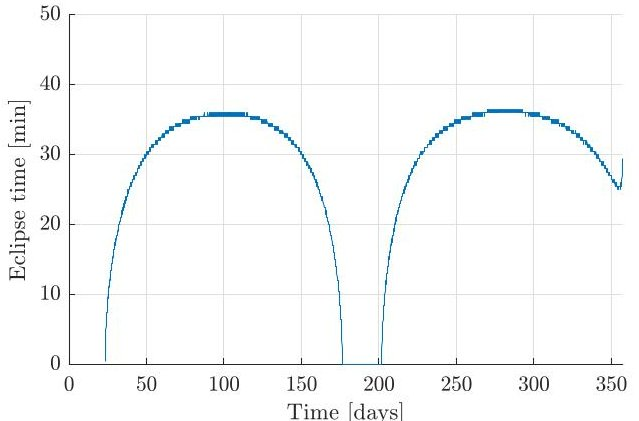

Figure 4: Mission eclipse time for h = 500 km, e = 0.00107, i = 90 deg that avoids eclipses at the beginning of the mission.

Even though frozen orbits are very unlikely to be conserved at low altitudes due to drag, an initial frozen orbit has been selected to increase the stability of eccentricity and pericenter position. In addition to the eccentricity, also inclination, date of launch, and RAAN $ \Omega $ at the time of deployment are crucial to ensure adequate Sun visibility. However, both GS visibility and Sun visibility require high inclinations. The date of launch is however still in the process of being agreed and once set, adequate values of $ \Omega $ will be derived. A suitable combination of date of launch and $ \Omega $ will generate an eclipse cycle as shown in Fig. 4.

From the presented considerations on the simulations, the suitable orbital parameter ranges collected in Table 2 were obtained.

<table border="1"><tr><td>h[km]</td><td>e[-]</td><td>i[deg]</td><td>Ω[deg]</td><td>ω[deg]</td></tr><tr><td>450-550</td><td>0-0.005</td><td>40-140</td><td>0-360</td><td>0-360</td></tr></table>

Table 2: Orbit allowed ranges.

## 3.3. Operational plan

This section presents the operations planned for the 6S CubeSat, governed by the state machine in Fig. 5. The plan comprises six operational modes: Activation, Deployment, Detumbling, Idle, Nominal and Safe. These are classified into 3 groups: nominal modes (in green), standby modes (in yellow) and survival modes (in red) and follow the ECSS definitions from [17].

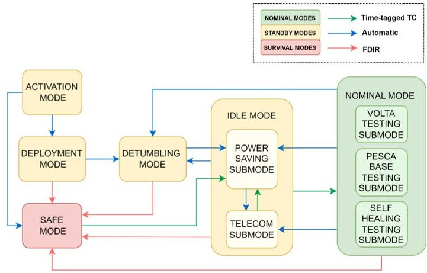

Figure 5: 6S state machine.

In detail, after the separation from the launcher and the subsequent triggering of the kill switches, the CubeSat will directly enter the Activation Mode. Booting and health checks are performed to enable the transition to the Deployment Mode. The end of this last mode depends on the antenna deployment status, which is determined by the deployment feedback switches.

Moreover, the Detumbling Mode is a recurrent mode triggered when the angular velocity is higher than the defined value (this parameter changes in each of the modes) and

<!-- PDF_PAGE: 6 -->

after the deployment of the antenna. This mode is exited once the angular rate is below the desired value, and the system automatically moves to the Idle Mode. The reasoning behind the introduction of this mode is a robust but simple management of anomalous control conditions.

The Idle Mode consists of two sequential sub-modes: the power-saving sub-mode that maintains the battery charge and the telecom sub-mode that is triggered close to the ground stations visibility windows. Furthermore, during Idle, time-tagged commands trigger the transition to the Nominal Mode, dedicated to the payload tests that are divided into three submodes.

Volta testing submode concerns the acquisition of temperature and strain information across the structure of the Volta battery. Moreover, during PESCA base testing submode, periodic acquisition of the measurements of all the PSCs take place. Finally, the goal of the PESCA selfhealing submode is to observe the self-healing process of an unstable cell, in eclipse.

Lastly, the Safe Mode is triggered by the Fault Detection Isolation and Recovery routines. Its design drivers are energy-positivity and ground communication and therefore all non-essential operations are interrupted in favour of an alternation between battery recharge and communication periods.

## 4. Subsystems

The following section details the different subsystems that compose the system, highlighting the design drivers and the technical solutions adopted.

The body reference frame used in the discussion is the one defined in Fig. 6

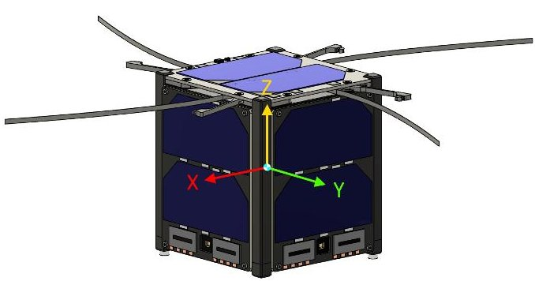

Figure 6: 6S body reference frame.

## 4.1. Attitude Determination and Control System

The 6S ADCS design entirely revolves around the attitude requirements derived from the testing operations, as it is essential to guarantee specific conditions for their correct execution. Fig. 6 shows the adopted conventions for the body reference frame. Specifically, all phases require the

CubeSat to attain Sun pointing of a specified body axis. The main distinction between PESCA Base testing and both Volta and PESCA Self-Healing (SH) consists of the spinning motion around +Z axis, necessary for the sequential illumination of the PSC at varying angles of incidence of the Sun rays. Inversely, the latter operations require a coarse three-axis control to point the specified face normal toward the Sun while ideally maintaining the angular velocity as low as possible. All the side faces $ (\pm X, $ $ \pm Y) $ and the $ -Z $ axis are of interest in this scope, with Absolute Performance Error (Pointing) requirements of less than 22 deg and 45 deg respectively for PESCA SH and Volta testing.

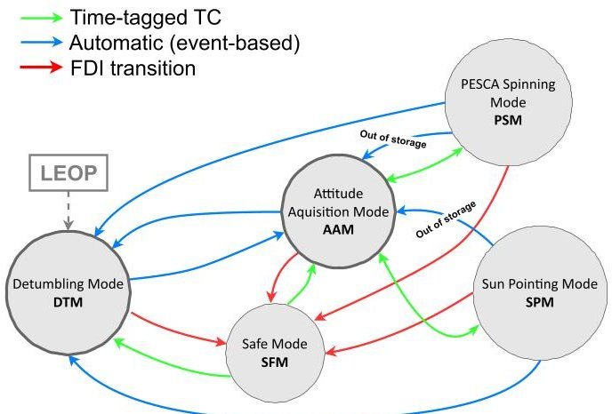

Figure 8: ADCS states diagram and transitions.

Remarkably, the pointing should be maintained within these bounds for the entire duration of the tests, including large re-pointing slews from Sun to deep space foreseen at the beginning of eclipses (see section 2 for rationale). These two ADCS modes are in fact referred to as Spinpointing and Sun-pointing. Thanks to the omnidirectional antenna (section 4.3 for details), no pointing requirement derives from the communication windows, during which the ADCS will only operate to ensure angular rates lower than 3 deg/s.

Fig. 8 shows the control modes of the subsystem, which will be managed by the same system state machine presented in Fig. 5. The ADCS hardware comprises four analog Sun sensors (nanoSSOC-A60 by SunMems Technologies $ ^{1} $ ), a 3-axis magnetometer (HMC5843 by Honeywell), a 3-axis gyroscope (MPU-3300 by InvenSense) integrated in the OBC, and a magnetic control system (magnetic air-core coil for Z axis, two magnetic rods for X-Y axes). This suite was selected to ensure a coarse, but sufficiently accurate 3-axis pointing along the complete orbit, thanks to the high variability of the magnetic field for the selected orbit.

The selected suite led to the necessity of an algorithm capable of correcting the attitude estimation even in the

<!-- PDF_PAGE: 7 -->

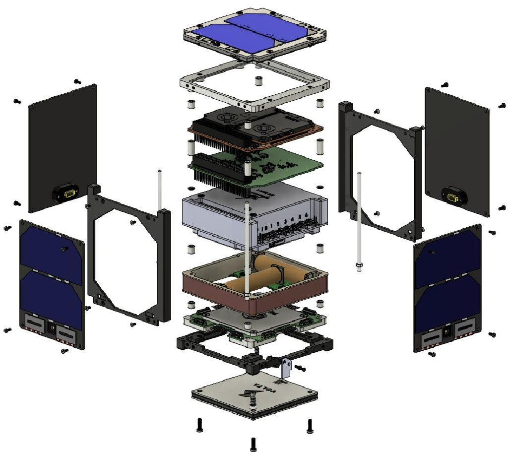

Figure 7: 6S CubeSat exploded view.

presence of single sensor measurements, as blind spots are present in the Sun sensors' FoV and the magnetometer is available only when no magnetic control is applied. To meet this requirement the Sequential Multiplicative Extended Kalman Filter (SMEKF) algorithm [18] has been selected.

The computationally less expensive ESOQ-2 algorithm [19] has been introduced for usage during safe mode and as a backup static attitude estimator.

Considering the aforementioned modes, two attitude guidance configurations are defined: SpinSun and FaceSun. In the SpinSun, the +Z Body axis is pointed toward an inertial target direction $ \nu_{N} $ , belonging to the plane orthogonal to the Sun direction, and a desired angular speed $ \omega_{d} $ is commanded around this axis; in FaceSun, one of the satellite's body axes targets the Sun direction, with a reference angular velocity equal to zero.

The guidance output drives two different control laws plus the detumbling algorithm, designed to operate in the different ADCS modes. The Bdot algorithm is the wellknown proportional control designed to damp any angular rate without controlling the target attitude, where the rate of change $ \vec{B} $ of the magnetic field is estimated from the filter output or from the magnetometers measurements. SpinSun and FaceSun guidance are both paired

with Lyapunov-based control laws, respectively derived and adapted from [20, 21]. The tuning process is aided by a genetic-algorithm based tuner, designed to optimize the specified performance index using a simplified simulation model.

A complete ADCS simulator was developed in Simulink for simulation purposes and requirements verification. The ADCS SW is directly generated from its Simulink model, developed in compliance with Mathworks and ESA guidelines for automatic code generation of AOCS/GNC SW [22]. MATLAB Coder is in fact the tool employed for the generation of the C source code, to be integrated with the On-board Software (OBSW) code.

## 4.2. Electrical Power Subsystem

6S is powered by 5 body-mounted solar panels and an off-the-shelf power distribution and control unit. The four lateral solar panels, placed on +X, -X, +Y, -Y, as in Fig. 6, are assembled in-house using AzurSpace solar cell assemblies, while the fifth (Z+) panel is an Endurosat component off-the-shelf, like the EPS1+ power distribution and control unit.

From a functional point of view, the electrical system of the Cubesat is divided into three parts: power production power storage and power distribution. In the case of 6S storage and distribution are taken care of by the EPS1+

<!-- PDF_PAGE: 8 -->

unit. The solar panels will be mounted on in-house designed PCBs also hosting 2 Perovskite solar cells and a Sun sensor.

The power and energy budget has been computed by using a MATLAB/Simulink model interfacing with a Microsoft Excel database. The selection of this approach was justified by the ability to run long-lasting Simulink simulations for higher fidelity and model-based computations and to rapidly provide easily accessible power/energy budget estimates through Excel. The tool's flexibility allows its adaptation to different power distribution and control units and power production systems, as well as temperature changes and conversion losses, also improving the quality of the trade-offs performed.

For a long period of time, the CubeSat is supposed to be in a bounded free-tumbling motion. Therefore, simulations were performed assuming a random attitude profile and then an average power production was assumed as close to the real profile.

Simulations performed proved that the solar panels configuration presented combined with the technical characteristics of the EPS1+ unit satisfies the appropriately margined estimate of power and energy budget.

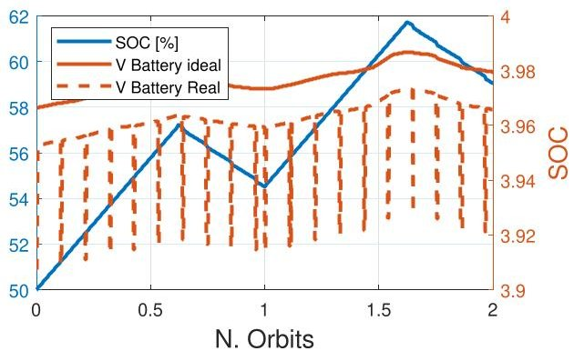

Figure 9: SOC in Safe Mode.

Particular attention has been given to Safe Mode as a critical aspect of the mission. The 4-orbits Simulation of the State Of Charge of the batteries is displayed in Fig. 9, taking into account the beacon transmission foreseen by the Mode. The satisfaction of the power-positive configuration objective (so to recharge the batteries) is achieved by selecting a 30 s transmission every 10 minutes. This also ensures that at least one transmission will happen inside the visibility window.

## 4.3. Telemetry and Telecommand

The TMTC subsystem provides vital communication to and from the spacecraft and allows the direct observation and control of its functions and conditions from ground. The 6S CubeSat exploits UHF commercial frequencies for uplink and downlink communication with LeafSpace Ground Stations. The total time required to establish

the communication link between the spacecraft and the ground segment has been estimated to be about 16 minutes per day, with 20% margin applied in accordance with ECSS standards. The value is the result of the ratio between the overall data volume daily generated by the satellite required to be downlinked, and the data rate at which the radio module operates. The details of the analysis performed are reported in Table 3. The former is mainly influenced by the payload data collected, which has been assessed in terms of content and frequency to have a reliable estimate on top of which margins are applied.

<table border="1"><tr><td>TDownlink</td><td>TUplink</td><td>TTotal</td></tr><tr><td>6.70min/day</td><td>2min/day</td><td>10.44min/day</td></tr></table>

Table 3: Data transmission time (20% margin applied).

The TMTC high-level architecture is composed of a UHF omnidirectional quad-dipole antenna from EnduroSat, the GOMspace radio module and the OBC mounted on the same platform NanoDock DCM-3. This selection of components satisfies the technical requirements defined. The link budget analysis has been performed for different scenarios, nominal and off-nominal, with the first reported in Table 4. In addition to the technological data, also telemetry of the other on-board systems has been estimated and added to the total data volume.

During the early phases of the mission and in the case of Safe Mode, only the beacon signal is used to transmit vital information such that the CubeSat is able to establish contact with ground as soon as possible with the minimum resource use. Two transmissions are provided for each visibility window of 4 minutes in total. The transmission time is computed as the ratio between the amount of data to transmit and the available data rate. So each transmission lasts 34.57 seconds. Hence, it translates into a transmission rate of the beacon data of 3 minutes.

## 4.4. On-board Data handling

The On-Board Data Handling subsystem takes care of the On-Board Computer (OBC) that aligns with low power consumption requirements and is compatible with interfaces employed by on-board sensors and actuators, notably I2C, SPI, and CANbus. A pivotal criterion for selecting the OBC was the availability of a Software Development Kit, a feature crucial for expediting Flight Software's development phase for students with limited experience. Performance attributes, such as clock speed, storage, and RAM, also played a decisive role in the OBC's selection process.

The OBDH configuration fundamentally centers around the GomSpace NanoMind A3200 OBC $ ^{1} $ , chosen for its

<!-- PDF_PAGE: 9 -->

<table border="1"><tr><td></td><td>Uplink</td><td>Downlink</td><td>Unit</td></tr><tr><td>Transmitted Power</td><td>47.9</td><td>3</td><td>[W]</td></tr><tr><td>f_TX SC</td><td>401</td><td>401</td><td>[MHz]</td></tr><tr><td>TX Antenna Gain</td><td>14.8</td><td>-4.24</td><td>[dBi]</td></tr><tr><td>RX Antenna Gain</td><td>-4.24</td><td>14.8</td><td>[dBi]</td></tr><tr><td>Data Rate</td><td>400</td><td>9600</td><td>[bps]</td></tr><tr><td>Bandwidth</td><td>800</td><td>19200</td><td>[Hz]</td></tr><tr><td>EIRP</td><td>7</td><td>0.240</td><td>[dBW]</td></tr><tr><td>Power received</td><td>-154</td><td>-142</td><td>[dBW]</td></tr><tr><td>Noise Power</td><td>-168</td><td>-157</td><td>[dBW]</td></tr><tr><td>SNR</td><td>14.1</td><td>15.4</td><td>[dB]</td></tr><tr><td>Eb/No_min</td><td>21</td><td>21</td><td>[dB]</td></tr><tr><td>SNR_min</td><td>10.5</td><td>10.5</td><td>[dB]</td></tr><tr><td>Margin</td><td>3.57</td><td>4.90</td><td>[dB]</td></tr></table>

Table 4: Link equation parameters for uplink and downlink in nominal conditions (Altitude: 450 km, Elevation: 10 deg).

alignment with the aforementioned design drivers. Detailed key specifications can be found in Table 5.

<table border="1"><tr><td>Hardware</td><td>Characteristics</td></tr><tr><td>Processor</td><td>AVR32 MCU 32-bit RISC up to 64MHz</td></tr><tr><td>External RAM</td><td>32MB SDRAM</td></tr><tr><td>Built-in flash memory</td><td>512KB</td></tr><tr><td>External memory for persistent configuration storage</td><td>32KB FRAM</td></tr><tr><td>External storage memory</td><td>128MB NOR Flash</td></tr><tr><td>Interfaces</td><td>8x ADC1x SPI with 3 chip selects1x I2C1x UART console interface1x CAN-bus</td></tr></table>

Table 5: NanoMind A3200 OBC specifications.

The On-Board Software (OBSW) design primarily adheres to the On-board Software Reference Architecture (OSRA) and Space AVionics Open Interface aRchitecture (SAVOIR) guidelines established by ESA because of the effective model-based integration enabled. The structure is divided into a component layer and an execution layer. The integral components of the framework, pertaining to the mission-specific OBSW segments are found in the former.

The ADCS, Thermal, Power, TMTC, Modes Manager (overseeing the transition amongst different modes based on distinct triggers), PESCA Manager, and Volta Manager core modules shall be integrated.

On the other hand, the Execution Platform provides the foundational services essential for the smooth functioning of components. This includes:

- services for tasking, protection, and synchronization;

- I/O functionalities, inclusive of messaging mechanisms for distributed systems;

- core platform management services such as system restarts, error notifications, and managing persistent contexts;

- specialized Monitoring and Control (M&C) services, orchestrating all the on-board data processing operations indispensable for a space software ecosystem.

The Data Budget emerges from the combined data volumes generated by housekeeping, Sun sensors, Thermal sensors, and the two payloads, PESCA and Volta. Housekeeping stands out as the predominant data generator per day, with an output of 3.238 kbit/s and operative each second of the day. Since it would not be feasible to send this amount of data in one day, only a small percentage of the housekeeping data is downlinked, that strictly necessary for attitude and orbit reconstruction on ground and OBC status check ( $ \sim 0.30\% $ of the housekeeping data generated on-board). For the Volta thermal sensors, data downlink occurs at 14-day intervals, yielding a total of 1800 kbit in this timeframe. Conversely, PESCA's self-healing data observes a downlink every 30 days, accumulating 944 kbit in that duration. Moreover, due to packet overhead, an inherent 15% increase in data volume happens. Additionally, a margin of 50% has been added to the concluding figures of the data volume onboard and downlink data. Compression techniques use zlib, a popular C library for compression, which, in its operations, ensures about 20% reduction in data volume.

<!-- PDF_PAGE: 10 -->

To attain a refined perspective on the Data Budget, three distinct scenarios have been discerned, each reflecting the types and frequencies of payload tests conducted over a day within a month's span.

- Case 1: Signifies a day marked for solely undertaking PESCA's base testing. This presents the scenario with the least data generation.

- Case 2: Represents a day allocated for both PESCA base testing and PESCA self-healing tests.

- Case 3: Denotes a day reserved for PESCA base testing coupled with Volta testing, marking it as the scenario with the peak data generation.

Table 6 reports the data volume figures referring to each Case Scenario, including the aforementioned margin compression and protocol overhead.

<table border="1"><tr><td>Case1</td><td>Case2</td><td>Case3</td></tr><tr><td>1919.1kbit/s</td><td>3417.2kbit/s</td><td>4775.7kbit/s</td></tr></table>

Table 6: Data Volume for each scenario.

## 4.5. Thermal Control System

The Thermal Control Subsystem is primarily driven by the need to maintain safe temperature ranges for the entirety of the mission and achieve reliable temperature acquisition for the payloads. The chosen design is quasipassive, with no active thermal control, except for the elements already included inside the COTS. The TCS architecture comprises 14 temperature sensors and one surface treatment on the Sun-facing face. The sensors are mainly positioned inside the payloads, with the remaining ones distributed in relevant positions to capture the temperatures of most components. This is done because the collection of such data is intended to offer an effective means of validating the simulations performed prior to the mission using flight data, enhancing the reliability of on-ground simulations for future missions. The most sensitive components have protective active control logics, such as turning off overheating components or powering heaters if the temperature drops. TCS's goal is to ensure that their activation is reduced to a minimum for energy-saving reasons. For the on-ground simulation of the TCS two different models are being developed in parallel, to be able to compare them as a sanity check during development. The two software chosen are Simulink and ESATAN-TMS, with a reduced lambda model approach. The ESATAN model is shown in Fig. 10. It comprises more than 200 nodes, to capture fine details of the geometry. Thermal and optical properties are obtained from components' datasheets, while heat dissipations are derived from EPS power consumptions. Two analysis cases (hot and cold) are derived for each mission mode, and simulations are performed with worst-case assumptions, such as longest/shortest eclipse, highest/lowest sun radiation flux absorbing attitude, most/least power dissipations.

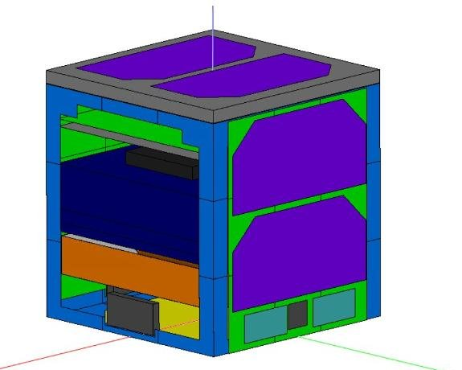

Figure 10: ESATAN model.

## 4.6. Structure and Configuration

The structure of the CubeSat is entirely developed inhouse to accommodate the mission's requirements with first prioritizing the simplification of the assembly process. Moreover, manual optimization was necessary to reduce the mass while keeping the structure manufacturing compatible with standard machining equipment.

Furthermore, internal configuration flexibility is ensured by securing the circuit boards through the PC104 stacking system, while the antenna, solar panels, and Volta Structural battery are directly attached to the primary structure. The CubeSat structure is divided into primary and secondary. The former has the main structural relevance whereas the latter manages the loads distribution and the correct positioning of the internal components, as shown in Fig. 11.

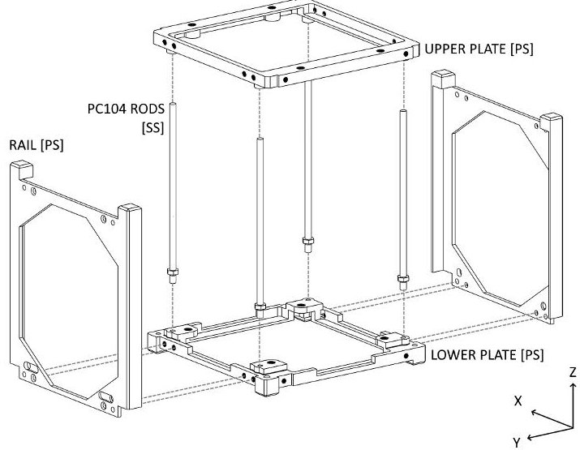

Figure 11: Exploded view of Primary and Secondary structure.

<!-- PDF_PAGE: 11 -->

Aluminium 7075 has been selected as the material for both structure parts because compliant with [23] standard and easily available in the university laboratories. Moreover, sulfo-boric anodization is used on the Rails and Lower Panel, due to its contained costs and valid wear performance. Finally, the fastening hardware is stainless steel and Helicoils are implemented to reduce possible wear during integration.

The internal configuration, shown in Fig. 12, is dictated by the constraints given by the COTS choice and other subsystems' high-level requirements:

- Due to EPS mass, the position of EPS1+ CoM shall be located not far from the geometric centre of the assembly.

- The Radio Module, and consequently the OBC, shall be located in close proximity to the antenna to reduce the length of the required gauge.

- The PESCA board shall be Z-aligned with the four Sun Sensors due to the fact that the board contains the four sensors' slots.

- The IC board must have access to the PC104 stack connector.

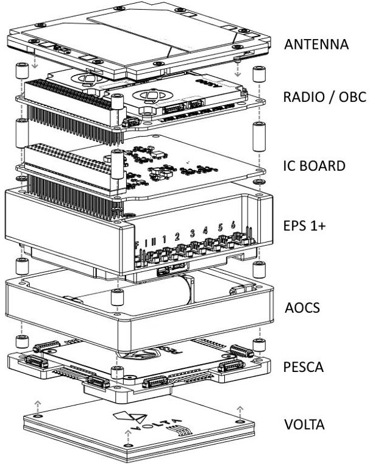

Figure 12: 6S internal configuration.

Additionally, the lateral boards are located outside of the primary structure volume. Specifically, for the X-axis faces, screws are fastened to the upper and lower panels and have a pass-through connection with the rails, while screws are directly fastened to the upper and lower panels for Y-axis faces. The antenna, placed on +Z face, is secured to the primary structure by apposite four bolts that pass through the antenna assembly.

The structure meets the requirements of the mission and, with a mass of 1798.4 kg, successfully falls within the mass limit of 2kg set by [23] with development margins applied accordingly to [24].

Regarding the Kill-Switch (KS) mechanism, activating when the CubeSat is released, it was decided to combine it with the separation spring mechanisms. This is motivated by their similar functioning, allowing for a combined sizing and therefore an overall system complexity reduction. For this reason, two of these assemblies were located in proximity to the +X/-Y and -X/+Y standoffs of the lower plate. This critical mechanism is based on a spring-loaded slider that engages a physical switch, and the Omron D2F-01L-D switch model was selected due to its successful flight heritage [25]). Moreover, in order to lower manufacturing costs the slider is obtained by modifying a M2 AMPG Socket Shoulder screw. The maximum ejection force and stroke of the separation mechanism is well regulated on CalPoly CDS Rev 14 [23] and the spring was selected accordingly.

Figure 13: Exploded view of custom-designed KS mechanism.

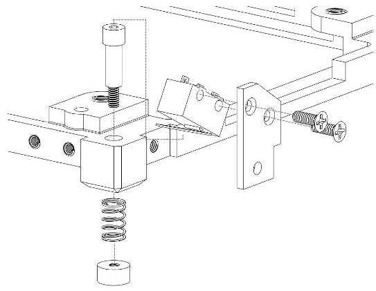

The mechanical stresses that the CubeSat is expected to undergo during the launch and deployment phases provide sizing conditions for the structure. Preliminary simplified analyses were followed by a detailed Finite Element Analysis, aiming to simulate the behavior of the satellite under a variety of loads such as acceleration and dynamic vibrations during the aforementioned critical mission stages.

The Finite Element Model used for the analysis is composed by high-fidelity CAD models of the assembly parts and simplified structural-representative models of the electronic boards. Furthermore, a structured mesh composed by 8-node Hexahedral Element (C3D8R) and 6node Tetrahedral C3D6 Element was applied. The me-

<!-- PDF_PAGE: 12 -->

chanical and inertial properties associated with the materials were also included. Finally, in order to identity the most representative and practical mesh model, a preliminary mesh convergence analysis was performed by developing four models and comparing the results accuracy and the computational cost required.

Subsequently, the characterization of the structural behavior was performed by means of three analyses. First, static analysis determined the equivalent von Misses stress state condition and the displacement field under the application of a constant load. Second, frequency modal analysis identified the most important natural frequencies of the complete structure, establishing the effective mass contribution and participation factor of the first five natural frequencies. Lastly, Quasi-Static analysis simulated the condition for a 20 G acceleration event in eight possible cases based on the orthogonal reference frame. In details, the first analysis successfully identified the regions affected by stress concentration and output the maximum displacements. These results can be then consequently used to check compliancy with the materials' limits and the launcher's requirements.

The modal analysis highlights a lowest natural frequency of 342 Hz, substantially above the 100 Hz lower limit indicated in [23], proving a safe modal behavior of the structure. Moreover, most of the participation factors are below 1% except for some components of rotation in the Z-axis which may require further future analyses.

The quasi-static analysis output a 45 MPa maximum Von Mises stresses and present maximum structure deformations. The results summarized in this section are compliant with the material properties and with the maximum possible displacement restrictions determined by the considered launchers.

## 5. Verification Validation and Testing plan

With the progression of the 6S CubeSat design into Phase C, concurrent with the detailed system design, significant resources are being allocated to the comprehensive planning of the Manufacturing, Assembly, Integration, Verification, and Testing (MAIVT) activities scheduled to occur in the near future. These activities are crucial for ensuring mission success by significantly reducing the likelihood of in-flight failures. The following section presents the upcoming activities and the model philosophy defined for the testing campaign.

Verification and test activities start at component level, gradually passing through assemblies, subsystems integration, cross-subsystems tests and system tests. An infrastructure of documentation has been set up in support of the MAIVT activities, complying with the ECSS standards [26]: for each assembly, integration and test phase, detailed specifications, procedures and reports are produced.

Early verification activities have been carried out in the design phase, especially with Analysis and Review of Design methods, whereas all the main testing and manufacturing activities are carried out in Phase C and D.

The first round of activities involves Development Models (DM), to account for the in-house components and to allow the 6S team to acquire the necessary experience to reliably handle test equipment.

The second round of activities includes two main models at the system level: the Flatsat and the Protoflight Model (PFM). The Flatsat will be made of the components subjected to stressful tests, like breadboards / DMs, Engineering Models (EM), or Qualification Models (QM). The Flatsat will be used for the first round of functional tests. During Phase E the Flatsat will be kept to simulate the on-board operations and support potential troubleshooting.

The PFM will be subjected to a full environmental test campaign, including Thermal Vacuum Chamber (TVAC) testing, a vibration campaign, and Electromagnetic Compatibility (EMC) related tests. Functional tests will be carried out before and after each environmental test activity to ensure the overall health of the system. In addition to the test campaign, it is foreseen to plan a Mission Simulation Test, where all the critical functions are simulated, with a particular attention to the automated ones (e.g. release from the launcher, switch to Safe Mode, FDIR).

As the structure will be developed in-house, along with the DMs, a QM is also foreseen for it. It will consist of dummy masses representing all the components on board the CubeSat (e.g., boards, magnetorquers, OBC), and it will enable to carry out the vibration campaign.

An STM (Structural Thermal Model) at system level will also be produced. The power consumed will be simulated through electric resistances and the internal thermal path of the Cubesat will be reproduced. This model is planned to be tested under vibration and TVAC conditions, where the purpose is to verify the validity of the structural and thermal models of the Cubesat prior to the PFM model. An ESATAN model of the STM will be created, and the analysis will be correlated with the results. An overview of the model philosophy is shown in Fig. 14.

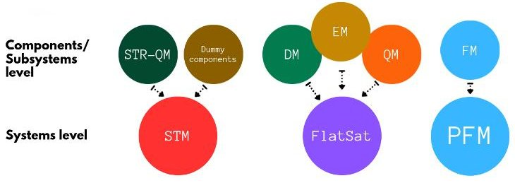

Figure 14: Model philosophy

<!-- PDF_PAGE: 13 -->

At subsystem level, the first milestone of the development and verification plan is to successfully test all the components, both COTS (basic functional and/or interface tests) and in-house developed (e.g., manufacture quality inspections, first qualifications). The second milestone is the successful outcome of the cross-subsystem interface and functional tests. Finally, the third milestone will be to successfully perform the full integrated system functional tests.

As the 6S CubeSat is developed as a technological demonstrator of two payloads, the development and verification activities of the payload subsystem are drivers within the overall MAIVT planning.

Regarding the External Boards (Solar Panels), different EMs are foreseen, having the purpose of testing the integration procedure, carrying out a series of functional tests, closing the related requirements, familiarising with EGSE (Electrical Ground Support Equipment), and verifying the external connectivity. Finally, a QM of the panels (to be defined better in the future) will undergo inspection, performance testing (in particular efficiency of the solar cells assembly), possibly a TVAC and vibration testing, as well as the verification and assessment of the Sun sensor misalignment pointing, which could be affected by the integration process of the sensors on the external panels.

Regarding PESCA, different test specifications and procedures have been already planned on the breadboard model. These tests will aim at checking the validity of parameters of merit such as $ V_{OC} $ and $ I_{SC} $ , and the I-V curve, at different temperature ranges, as well as the precision (intended as the continuity of the measurements during the acquisition), accuracy, and degradation of PESCA. The degradation will be verified by testing for the same number of acquisitions that are foreseen in orbit.

Regarding VOLTA, since it is relevant from a structural and thermal viewpoint, vibration and thermal tests during the STM verification are planned, under the monitoring of thermal and strain sensors. However, this strategy will be better assessed and possibly confirmed when the VOLTA structural and thermal models will be finalized.

## 6. Challenges and lessons learned

Student teams committed to designing educational CubeSats commonly face the following problems: fast turnover of people working on the project, lack of funds and lack of experience in the team. This section aims at providing valuable insights on how the 6S CubeSat team successfully tackled these issues.

- People turnover: because of the nature of student teams, the average duration of a project team member's involvement is much shorter than in a typical corporate environment. If not addressed, this phenomenon results in a consistent loss of knowledge about the work completed and makes it challenging to track design choices.

To counter this issue, the 6S team employed extensive documentation. In order to conserve the information about design choices and their rationale each subsystem is endeavoured with keeping a report. At each milestone of the mission, a documentation package is prepared according to the ECSS guidelines to set landmarks about the CubeSat design.

- Lack of funds: up to the present date, the design of 6S has had to contend with a limited and intermittent funding stream. Given that one of the primary sources of expenses in a student team is hardware procurement, it is advisable to proceed with the purchase of components (whether for testing or integration) after conducting a thorough investigation and simulation of all design aspects. This should involve dedicating more time to refine the simulation of subsystems like ADCS, EPS, and TMTC, conducting in-depth studies on component interfaces, and comprehending the compatibility of Components Off the Shelf (COTS) from different manufacturers to ensure the acquisition of components that can effectively meet the mission requirements.

Further consideration must be given to the planning of testing activities. If in-house facilities are unavailable, the rental of testing facilities represents a significant portion of the cost budget. A precise and comprehensive plan for testing activities aids in the efficient utilization of time within these facilities and helps prevent damage to the hardware during the procedures.

- Lack of expertise: from the initiation of the project through the completion of Phase B, the design of 6S was primarily conducted by students without direct technical supervision. While university courses offered a valuable foundation, spacecraft design necessitates supplementary knowledge and expertise that students had to seek externally. Throughout the CubeSat's design process, the team heavily depended on open-source resources accessible online, particularly drawing from the previous endeavors of other CubeSat teams. Furthermore, ECSS standards supplied valuable guidance and insights, encompassing both technical and managerial aspects.

To receive feedback on the work completed and gather recommendations regarding the open issues, the team occasionally sought advice from professors and researchers at Politecnico di Milano, as well as individuals employed in various industries. The insights from these experts are invaluable, as they offer the expertise gained from their involvement in numerous space missions.

A recent and highly beneficial initiative was conceived by former members of the CubeSat team who have since advanced their careers in various sectors of the space industry. These former team members maintain communication with the current team to share the

<!-- PDF_PAGE: 14 -->

knowledge they have acquired in their professional environments, establishing a valuable backstream expertise.

Finally, as of April 2023, the 6S CubeSat was chosen for the inaugural edition of the "ESA Fly Your Satellite! Design Booster" program, entailing mentorship from experts at the European Space Agency (ESA). Student teams should strive to seize such opportunities made available by ESA to augment their design.

## 7. Conclusions

The paper presented the 6S CubeSat project, a student-designed space IOD mission. The project's twofold objectives, educational and technological, have been presented, together with the team organisation. The development of the PESCA payload as a testing platform to characterize in space the novel and promising technology of Perovskite solar cells was described and accompanied by the second payload, a structural battery. The motivation behind the testing of these two systems highlighted the potential technological development outcome to which the 6S student team aim to contribute to with the mission. The mission analysis for the LEO targeted orbit and the description of operations anticipate the general overview of the current stage of each 1U platform's subsystems. Particular focus is given to the main technical choices made characterizing the system and the analyses carried out. Participation in the ESA "Fly Your Satellite! Design Booster" pilot program will help the Team to carry on and complete the next challenging design phases towards the manufacturing and testing of the CubeSat platform, providing students with new practical skills.

## Acknowledgements

The authors would like to acknowledge all the students that have taken part in the 6S CubeSat mission design since its birth contributing to its development.

Furthermore, the authors thank the ESA Educational team from "Fly Your Satellite! Design Booster" program for their continuous and insightful support.

Finally, thanks to Politecnico di Milano for the financial support received and the help provided by different departments and professors.

## References

[2] A. Edpuganti et al. "A Comprehensive Review on CubeSat Electrical Power System Architectures". In: IEEE Transactions on Power Electronics 37.3 (2022), pp. 3161-3177. DOI: 10.1109/TPEL. 2021.3110002.

[3] Y. Tu et al. "Perovskite Solar Cells for Space Applications: Progress and Challenges". In: Advanced Materials 33.21 (2021), p. 2006545. DOI: 10.1002/adma.202006545.

[4] B. P. Finkenauer et al. "Degradation and SelfHealing in Perovskite Solar Cells". In: ACS Applied Materials & Interfaces 14.21 (2022), pp. 24073-24088. DOI: 10.1021/acsami.2c01925.

[5] W. Delmas et al. "Evaluation of Hybrid Perovskite Prototypes After 10-Month Space Flight on the International Space Station". In: Advanced Energy Materials 13.19 (2023), p. 2203920. DOI: https://doi.org/10.1002/aenm.202203920.

[6] L. K. Reb et al. "Perovskite and Organic Solar Cells on a Rocket Flight". In: Joule 4.9 (2020), pp. 1880-1892. DOI: 10.1016/j.joule.2020.07.004.

[7] I. Cardinaletti et al. "Organic and perovskite solar cells for space applications". In: Solar Energy Materials and Solar Cells 182 (2018), pp. 121-127. DOI: 10.1016/j.solmat.2018.03.024.

[8] B. Grzesik et al. "Integration of energy storage functionalities into fiber reinforced spacecraft structures". In: Acta Astronautica 166 (2020), pp. 172-179. DOI: https://doi.org/10. 1016/j.actaastro.2019.10.009.

[9] V. Romano et al. "Advances in Perovskites for Photovoltaic Applications in Space". In: ACS Energy Letters 7.8 (2022), pp. 2490-2514. DOI: 10. 1021/acsenergylett.2c01099.

[10] L. Shi et al. "Gas chromatography-mass spectrometry analyses of encapsulated stable perovskite solar cells". In: Science 368.6497 (2020), eaba2412. DOI: 10.1126/science.aba2412.

[11] F. Lang et al. "Proton-Radiation Tolerant All- Perovskite Multijunction Solar Cells". In: Advanced Energy Materials 11.41 (2021), p. 2102246. DOI: https://doi.org/10.1002/aenm.202102246.

[12] P. Ladpli et al. "Multifunctional energy storage composite structures with embedded lithium-ion batteries". In: J. Power Sources 414.41 (2019), pp. 417-429. DOI: 10.1016/j.jpowsour. 2018.12.051.

<!-- PDF_PAGE: 15 -->

[13] A. E. Scholz, A. Hermanutz, and M. Hornung. "Feasibility Analysis and Comparative Assessment of Structural Power Technology in All-Electric Composite Aircraft". In: J. Power Sources 414.41 (2018), pp. 417-429. DOI: 0.25967/ 480065.

[14] W. Johannisson, D. Zenkert, and G. Lindbergh. "Model of a structural battery and its potential for system level mass saving". In: J. Power Sources 2.3 (2019), p. 035002. DOI: 10.1088/2399-7532/ab3bdd.

[15] S. Roberts and G. Aglietti. "Satellite multifunctional power structure: Feasibility and mass savings". In: Proc. Inst. Mech. Eng. Part G J. Aerosp. Eng. 222 (2018), pp. 41-45. DOI: 10 1243/09544100JAER0255.

[16] Marshall Space Flight Center. Solar Cycle Progression and Forecast. Tech. rep. Nasa, 2023. URL: https://www.nasa.gov/msfcsolar/.

[17] ESA ECSS Secretariat. ECSS-E-ST-70-11C Space segment operability. Standard. Noordwijk, The Netherlands: ESA-ESTEC Requirements & Standards Division, July 2008.

[18] F. Qin et al. "A sequential multiplicative extended Kalman filter for attitude estimation using vector observations". In: Sensors 18.5 (2018), p. 1414. DOI: 10.3390/s18051414.

[19] D. Mortari. "ESOQ-2 Single-Point Algorithm for Fast Optimal Spacecraft Attitude Determination". In: Advances in Astronautics Science and Technology 95 (1997), pp. 816-826.

[20] A. de Ruiter. "A fault-tolerant magnetic spin stabilizing controller for the JC2Sat-FF mission". In: Acta Astronautica 68.1-2 (2011), pp. 160-171. DOI: 10.1016/j.actaastro.2010.07.012.

[21] X. Xia, Y. Zhang, and J. Jiang. "Sun-Pointing Attitude Control Scheme for Magnetic-based Satellite". In: (2021). DOI: 10.21203/rs.3.rs- 762718/v1.

[22] ESA Autocoding Working Group. SAVOIR AUTOCODE Handbook.

[23] Cubesat Design Specifications Rev 14. Tech. rep. CP-CDS-R14. San Luis Obispo, CA: Polytechnic of California, 2018.

[24] Concurrent Design Facility Studies Standard Margin Philosophy Description. Tech. rep. ESA-TECSYE-RS-006510. Noordwijk, The Netherlands: European Space Research and Technology Centre, Aug. 2017.

[25] M. Hammer, R. Klotz, and A. Aydinlioglu. Compass-1 Picosatellite, Structure and Mecanism. Tech. rep. Germany: University of Applied Sciences Aachen, 2007.

[26] ESA ECSS Secretariat. ECSS-E-ST-10-02C Rev.1 Verification. Standard. Noordwijk, The Netherlands: ESA-ESTEC Requirements & Standards Division, Feb. 2018.