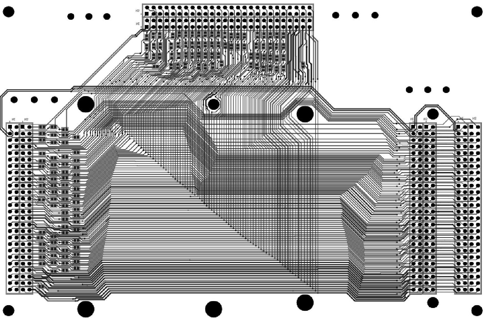
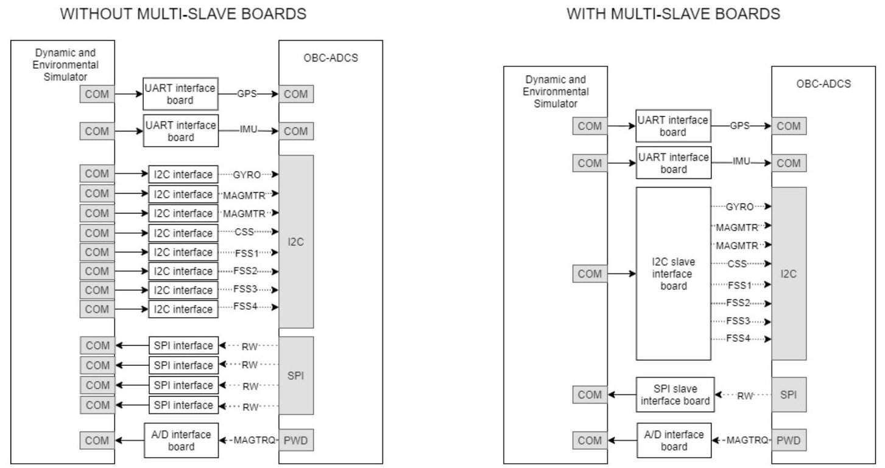
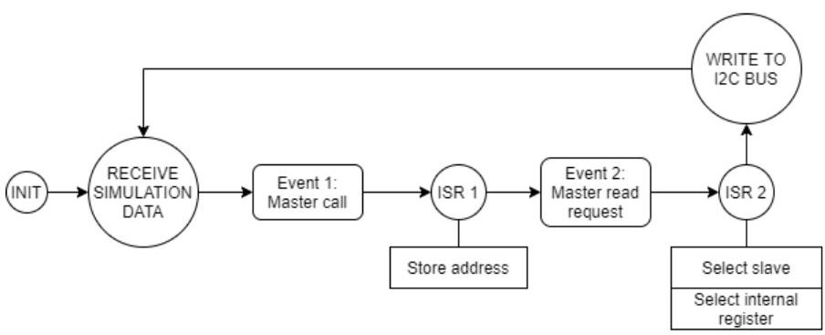
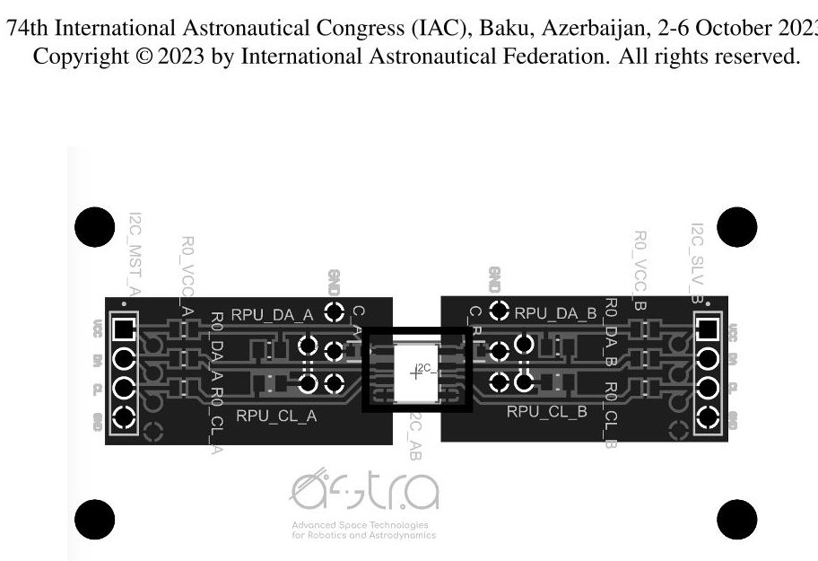
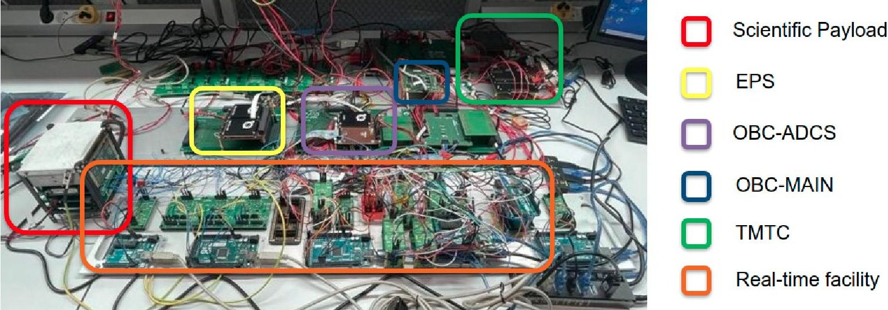

<!-- PDF_PAGE: 1 -->

74th International Astronautical Congress (IAC), Baku, Azerbaijan, 2-6 October 2023. Copyright © 2023 by International Astronautical Federation. All rights reserved.

IAC-23-B4.6B.8

# A FLAT-SAT PLATFORM FOR THE DEVELOPMENT AND TESTING OF THE 3U HERMES CONSTELLATION SATELLITES

Stefano Silvestrini $ ^{a^{*}}, $ Andrea Colagrossi $ ^{a}, $ Michèle Lavagna $ ^{a}, $

$ ^{a} $ Politecnico di Milano, Department of Aerospace Science and Technology, Via La Masa, 34, 20156, Milano - Italy $ ^{*} $ Corresponding Author

## Abstract

HERMES is a scientific mission project aiming at validating on orbit a new approach to Gamma Ray Bursts (GRBs) detection and localisation using a constellation of six nano-satellites. The novelty stays in both the data to recover, led by the multi-messenger astrophysics concept, and the new, miniaturized payload to be hosted on board. The program financing has two sources: an Italian Ministry of University and Research (MUR) funding, strongly supported by the Italian Space Agency (HERMES-TP), and the 2018 Space program H2020 from European Commission (HERMES-SP). The mission is currently in advanced phase D, where validation and testing activities are carried out to assess whether the satellite capabilities comply with the required functionalities. In order to properly test the system in all its functions, a dedicated flat-sat platform has been designed and integrated to enable testing and fast debugging of core functionalities. The flat-sat facilitates the electrical connections between HERMES components while leaving key interfaces accessible for test equipment and allowing for the hot swapping of components. This paper describes the design of the flat-sat, including electrical and mechanical components, and the associated ground support equipment (GSE). The flat-sat has proven to be an invaluable tool for spacecraft testing and has led to the discovery of issues and unexpected behaviour with flight hardware which would have contributed to schedule delays if undiscovered until after the satellite was assembled. Moreover, flat-sat facilitated early and incremental testing of both software and operations procedures. Overall, the flat-sat is a high fidelity electrical and functional representation of the HERMES spacecraft buses, being effectively used as a test bed for Integration and Test (I&T) and flight software development. The flat-sat is effectively used as a platform for flight software acceptance and system testing, including the spacecraft main processors, power supply electronics, attitude control electronics, the S-band and UHF communications links. In detail, the HERMES flat-sat entails a set of PC104 compatible, general purpose boards to unpack the PC104 connector to testpoints and individual debug lines; a set of safety critical power boards to redundantly control power supply lines that carries power to the components; a core board that unpacks the signals from the OBC, the S-band and UHF transceiver, exposing all the main buses and serial communication (e.g., CAN, I2C, LVDS, UART) with the possibility to terminate lines at different debug interfaces. Furthermore, the flat-sat is interfaced with a set of electrically isolated digital twins of HERMES sensors and actuators. These are driven by a real-time simulator to verify and test the attitude determination and control subsystem. Finally, the flat-sat will also support the flight operations team throughout the post-launch in-flight testing activities, allowing software code and parameters update development, verification and validation.

## 1. Introduction

Small spacecraft missions are experiencing an increasing interest from the space community, because of their capability to reduce the cost of space access and of their potential to accomplish operations, complementary or even similar to larger monolithic spacecraft. However, these miniaturized systems typically suffer from poor reliability and their infant mortality rate remains quite high [1]. This is primarily due to the limited cost budget not allowing extensive verification and testing activities, which are still the key elements to ensure a high-quality standard guaranteeing space mission success and survivability. On the other

hand, the verification and testing phase cannot reach the complexity and the level of classical spacecraft missions since in that case the mission cost would dramatically increase. For these reasons, advanced and tailored AIV/AIT processes are needed.

Verification and testing of small spacecraft missions are critical aspects to ensure their reliability and success. Bauer and Hallez [2] present a literature review on the verification and validation of guidance, navigation, and control systems for small satellites. The validation methods of nanosatellite attitude control systems are explored in the thesis work of Nolet [3], highlighting the challenges and

<!-- PDF_PAGE: 2 -->

prospects in this field. Finally, in their recent work, Pong et al. [4] discuss the possible adaptations of classical guidance, navigation, and control verification and validation philosophies for small spacecraft. In particular, an accurate validation and verification is very important whenever autonomy is sought on-board the nanosatellite and specific mission-critical software functions must be fully tested [5, 6, 7].

The ADCS and, more generally, the GNC subsystems are commonly absorbing a relevant fraction of the AIV/AIT budget because of their need of dedicated and very specific facilities. For example, full hardware-in-the-loop (HIL) testing of a basic ADCS subsystem requires, at the minimum, a 3DOF frictionless bearing, a Sun simulator, and a Helmholtz cage [8]. More complex sensor architectures may require additional environmental simulation devices, and each specific mission may impose a specific facility customization. Moreover, the calibration and the set-up of such hardware-in-the-loop test benches is difficult and time consuming. Thus, a flexible and efficient verification and testing facility is extremely beneficial for the verification and testing of nanosatellite GNC subsystems.

The main idea to realize this verification and testing equipment, described in this work, is based on the virtualization of all the components associated with a dynamical measurement. In this way, it is possible to recreate a digital twin of the moving platform with all the associated sensors and actuators, leaving the on-board processor as the flight component under test without the need for any movable element. However, not to reduce the coverage and the significance of the verification and testing activities, all the real electrical and data interfaces shall be maintained and the on-board data handling (OBDH) subsystem shall not experience significant timing and data communication differences with respect to the real scenario.

The facility designed and built by the ASTRA team at Politecnico di Milano, Department of Aerospace Science and Technology, is able to achieve these goals and implement an enhanced processor-in-the-loop facility for nanosatellites. The current development status allows to assess the functionalities of the facility, and to apply it for the real-time verification and testing of a specific nanosatellite ADCS subsystem. It is still in a breadboarding status for a fast and efficient implementation and integration, but it is ready for consolidation and upgrade to a definitive version. Specifically, the final status will exploit standard industrial connectors and micro-controllers in place of the jumper wires and the Arduino boards. Moreover, generic ADCS and GNC subsystem will be fully compatible with the facility.

The processor-in-the-loop (PIL) facility is based on

a software simulation section and a hardware interface section. The software part is based on a validated Functional Engineering Simulator (FES) running on MATLAB/Simulink and exploiting the Simulink Real-Time capabilities on a Windows PC. It contains a Dynamics-Kinematics-Environment (DKE) section developed according to the ECSS standards [9,10] and the simulators of sensors and actuators. These are high-fidelity functional models of the specific sensors and actuators on-board the spacecraft, whose output is numerically identical to the one of the real components. In particular, the output data are defined in terms of data-type, output format and frequency. These sensor and actuator models are calibrated with dedicated hardware-in-the-loop testing campaigns on the specific spacecraft components. The sensor data exits from the simulator environment through a real-time serial peripheral component. Then, they are received from the Arduino micro-controllers and formatted according to the data protocol and communication standards of the real component. The current development status implements I2C, Serial RS-232, RS-422, SPI data communication standards, and the data interface protocol is written according to the component specifications. The facility also includes the possibility to transduce PWM signals in order to be interfaced with analogic components requiring this modulation technique. The programming of the micro-controllers is made in C language allowing a great flexibility in reproducing different communication and data protocols for different sensor and actuator typologies with respect to the one currently in use.

After the data processing, all the data are made available to the on-board computers through the same hardware interfaces and connections that will be used on the spacecraft. However, to guarantee the safety of the components under test, the facility is electrically isolated from the spacecraft section. For this purpose, dedicated digital isolator boards have been designed. At the end of the process, the output commands of the ADCS for the actuators are sent back to the software section through the same digital isolator to micro controller to serial peripheral to MATLAB/Simulink path. In this way, a closed loop real-time simulation is performed on the developed ADCS algorithms running on the real hardware exploiting an equivalent digital twin of the on-board set-up. The paper presents the main features and characteristics of this flat-sat facility for PIL verification and testing of nanosatellite ADCS. It outlines the main design, implementation and verification steps. Furthermore, it discusses the future extension of the facility and its consolidation in a final development status for generic applications to any ADCS or GNC subsystem.

<!-- PDF_PAGE: 3 -->

## 2. Flat-Sat Facility Design

The Flat-Sat platform comprises two main distinct branches that address different functionalities:

Spacecraft bus connections and interfaces

## ADCS/GNC real-time PIL simulator

The spacecraft bus flat-sat entails a set of PC104 compatible, general purpose boards to unpack the PC104 connector to testpoints and individual debug lines; a set of safety critical power boards to redundantly control power supply lines that carries power to the components; a core board that unpacks the signals from the OBC, the S-band and UHF transceiver, exposing all the main buses and serial communication (e.g., CAN, I2C, LVDS, UART) with the possibility to terminate lines at different debug interfaces. In addition it replicates board to board connections that rely on interfaces different from the well established PC104 stack connection. A schematic of the PC104 multi-purpose board is shown in Fig.1.

On the other hand, to ensure a strong reliability of ADCS and GNC software in nanosatellite missions, a robust verification and testing facility that complies with the typical performance and functionality is crucial. The developed flat-sat facility is based on the assumptions described in the previous section of reproducing the dynamics, the external environment and the sensors/actuators interfaces by means of a digital twin of all the ADCS peripherals. In this way, a PIL verification and testing is possible without the usage of complex, costly and demanding calibrated moving platforms. The proposed facility must meet specific requirements to guarantee test reliability:

update rate ranging from 1 Hz to 10 Hz,

sensor/actuator sampling at frequencies higher than 10 Hz and identical to those available with real hardware components,

measurable real-time performance,

reliable data exchange with no corruption and losses,

support for single-ended or differential UART, SPI, I2C, CAN communication interfaces,

support for analog-to-digital conversion and analog signal sampling.

Moreover, it is essential for the PIL facility to be tailored specifically for small spacecraft applications. The development, procurement, and implementation of the test bench should be achievable within a limited budget and a short time frame, utilizing technologies that do not require extensive specialized knowledge beyond medium system

engineering skills. A cubesat-oriented approach serves as a fundamental principle in designing the test bench, striking a balance between functional and performance requirements, while considering the implementation time, budget, and overall effort involved. By adhering to these guidelines, the PIL facility can effectively contribute to enhancing the reliability and success of nanosatellite missions.

A preliminary study investigated different alternatives to achieve this goal [11], and the final design is based on utilizing hardware interface boards to exchange the data between the Simulation computer, responsible for running the dynamical and environmental simulator, and the OnBoard Computer (OBC) being tested. These data interface modules consist of single-board micro-controllers. In this architecture, a standard non-real time computer executes the dynamical and environmental simulation in soft realtime mode, leveraging the Simulink Desktop Real-Time (SDRT) framework. Both the interface boards and the simulation computer need to meet the facility requirements in terms of performance and functionalities.

Notably, the simulation computer equipped with the SDRT framework can achieve performance levels of up to 20 kHz. It also provides the capability to monitor and measure any potential loss of real-time performance during the simulation process. This is achieved by a standard workstation operating on Windows or Mac OS, with a compatible Matlab and Simulink release.

The micro-controller boards are dedicated to reproduce in detail the electrical and date interfaces of each ADCS/GNC peripheral, receiving the numeric measurements from the digital sensor model running with the dynamical and environmental models in Simulink with SDRT and making them available to the OBC processor according to the sensor's communication protocol. Specifically, the communication protocol performance are exactly recreated in terms of speed, available commands and answers, format and integrity checks (e.g. CRC, error counters). Each micro-controller can be programmed to recreate a single sensor (e.g. single-slave) or a group of sensors behaviour. In the latter case, the sensors are grouped according to the communication buses as in the ADCS/GNC architecture (e.g. multi-slave design). The difference between these two approaches is represented in Fig.2 The primary communication link between the simulation computer and the microcrontrollers is handled through serial ports between SDRT and the electronic board, wired through USB. The secondary communication link between the microcontrollers and the OBC under testing is handled with the same electrical interfaces that are present on the spacecraft. To guarantee the safety of the OBC, each electrical connection has a galvanic isolation step between the micro-

<!-- PDF_PAGE: 4 -->

Fig. 1: Schematics of the multi-purpose PC104 Flat-Sat board.

Fig. 2: Example comparison with and without multi-slave micro-controller boards for the I2C and SPI buses.

<!-- PDF_PAGE: 5 -->

controllers and the testing processor.

## 3. Simulation Computer

The simulation computer used for the PIL test is a Windows workstation equipped with MATLAB and Simulink When conducting simulations on a non-real-time machine, two main issues arise: uncertain machine performance and synchronization loss between the simulator and the hardware under test. To address these challenges, the Simulink Desktop Real-Time kernel is employed.

SDRT, integrated within the MATLAB/Simulink environment, provides a real-time kernel and library that enable real-time simulations on standard desktop machines. It ensures synchronization by assigning the highest execution priority to the simulation executable, allowing it to run without interference at the selected sample rate. The realtime kernel intervenes to prioritize the model's CPU usage and executes each model update at the prescribed sample times.

SDRT operates in two modes: normal mode, where the simulation runs faster than real-time in Simulink, and external mode, where the simulation is automatically coded into an executable running in kernel mode. In normal mode, performance up to 1 kHz can be achieved, while in external mode, the simulation can reach up to 20 kHz. The SDRT framework includes a missed ticks counter to identify instances where the simulation cannot catch up with the real-time clock, allowing validation or discarding of the test. In particular, a maximum percentage of missed ticks is defined according to the verification and testing requirements. Note that a recent and basic desktop workstation allows real-time testing performance far superior than classical ADCS/GNC performance of nanosatellites, motivating the choice. Moreover, exploiting this tool, the synchronization between the simulation and the hardware are guaranteed, since the simulation clock is synchronized with the real-time clock every time no missed ticks happens.

The simulation computer shall guarantee a seamless communication with an arbitrary number of virtual serial ports, wired to the data interface boards through USB cables.

The dynamical and environmental simulator, along with the sensor/actuator simulators, were developed using Matlab and Simulink by the ASTRA research group at Politecnico di Milano. The simulators follows the ECSS regulations and they accurately reproduce the output of the sensors based on the characteristics and performance specifications provided in the datasheets and/or acquired with the functional/performance testing of the physical hardware for sensors/actuators.

## 4. Data Interface Modules

To allow the data communication between the simulation computer and the OBC, the information shall be processed and handled in order to reproduce the data and the electrical interfaces between the OBC and the external peripherals. The specifications of the communication protocols, the available data exchange modes and the details of the interface need to be tuned with the specific peripheral under consideration. Thus, the facility requires to be calibrated and programmed at the beginning of the testing campaign, exploiting the informations available from the component's datasheet, user manuals and from the data obtained during the functional and performance testing campaigns.

The classical interfaces present in nanosatellites are single-ended or differential UART, SPI, I2C and CAN. But in principle, any digital communication interface can be reproduced. Considering the typical performance of a nanosatellite, and the modularity of the proposed facility, the current implementation exploits Arduino based micro-controllers. However, the software driving the Data Interface Modules is written in C code and does not exploit proprietary libraries. Thus, it is easily portable to most of the commercial micro-controllers.

In the following, some classical communication interface implementations are described.

## 4.1 UART

A UART (Universal Asynchronous Receiver- Transmitter) is a physical device for asynchronous, serial communication, in which the data format and transmission speeds are configurable. A few technical electrical standards are commonly used in nanosatellites: the single-ended RS-232 and the differential RS-422/RS-485. Since each data interface board must exchange serial data between the simulator and the OBC, two serial ports are required on the board. The first to exchange data with the simulation computer and its virtual serial port, the second to communicate with the OBC.

The UART interface typically exploits simple communication protocols, in which data to be transmitted are preceded by headers, followed by check-sums and contains start, stop and parity bytes. The serial data messages can be directly built in Simulink: the physical quantities handled by the peripheral (e.g. a sensor's measurement, an actuator's command) are generated by the dynamical and environmental simulator and converted into the peripheral signal by the peripheral detailed functional model. For instance, for a sensor, the measured quantity is first converted to the sensor data type (e.g. single precision floating point, unsigned integer), and then to a byte vector. Finally the message header and the checksum are included in the

<!-- PDF_PAGE: 6 -->

bytes to send, and the Simulink Desktop Real-Time I/O library functions are used to forward the data to a serial USB port on the simulation computer.

However, data messages are not the only information exchanged between the peripheral and the OBC. For instance, at the system startup, the OBC may send a series of initialization commands, to which the virtualized component shall immediately reply. Similarly, changes in the required data, or modification of the component's working mode may be needed, and the data interface board shall be capable to handle also these requests. Moreover, the data exchange can be on-request (e.g. polled logs), ontime (e.g. periodic logs), or on-event (e.g. triggered logs). The micro-controller programming, exploiting a real-time clock (RTC) component for the periodic messages, can replicate all these functional modes.

Another data interface characteristic the board shall manage is the format of the data message. For example, a specific component could receive data in binary format or in ASCII or in a custom format. In all these cases, the data interface module is capable to handle the communication.

It shall be noted that, even if the communication protocol is more complex, not all the commands and data are exploited on-board by the on-board software. This is particularly true for nanosatellites using commercial components for multi-purpose applications. Then, the data interface module shall be programmed to replicate only the commands and responses that are used by the flight software. In general, this is achieved by a finite state machine (FSM) handling the used peripheral working modes.

## 4.2 I2C

The I2C (Inter Integrated Circuit) is a synchronous, multi-master, multi-slave, single ended serial communication bus. The bus uses a single data line: each slave device is identified by a unique 7-bit slave address which is called by the master device to send or receive data from it. The I2C interface is used by many simple components on-board a nanosatellite, and it is tipically associated to very simple communication protocols. Moreover, being a serial bus, it is possible to avoid the use of one microcontroller unit for each sensor, and a single interface board can be set up to behave as a multi-slave device, as described in Fig. 2.

In this case, the board shall respond to master calls sent to multiple slave addresses, which allowed to simulate the I2C interface of all the instruments with a single microcontroller unit. For this purpose, the Two Wire Interface (TWI) registers on the micro-controller can be exploited: the TWI Address Register (TWAR), which stores the device address, and the TWI Address Mask Register (TWAMR), which can be loaded with a 7-bit Slave Address mask. Each of the bits in TWAMR can mask (i.e., disable) the corresponding address bit in the TWAR, and in this case the logic ignores the compare between the incoming address bit and the corresponding bit in TWAR. Exploiting the TWAMR register in the I2C library of the micro-controller, it can be programmed to mask the device address requested by the master call. This would cause the board to respond to master calls addressed to multiple I2C devices. The incoming address can then be recovered from the Two Wire Data Register on the chip, which, in receive mode, stores the last byte received.

The overall I2C software logic running on the data interface board is extremely simple, and it is shown in Fig. 3: the micro-controller continuously checks the primary serial port to receive and store the sensors data from the simulation computer as soon as they are sent. Once a I2C master call is detected on the bus, two Interrupt Service Routines (ISR) are called: when the master writes the slave address on the bus, the first ISR saves it. Then the master device sends the data request to the slave, where a second ISR checks which slave address was received, reads the internal register requested by the master and responds consistently, exposing the data on the bus.

Also in this case, the data registers and the functional modes to be implemented are only those used by the onboard software.

## 4.3 SPI

The SPI (Serial Peripheral Interface) is a synchronous serial communication protocol using a minimum of four wires, for data transmission, data reception, clock and slave addressing. The slave addressing implements a totally different approach with respect to the I2C protocol: a dedicated line, called Chip Select (CS) or Slave Select (SS) is triggered low any time the master starts the communication with the slave. Every slave needs its own SS line, therefore the master device must have a number of SS pins equal to the number of slave devices it wants to communicate with.

The data interface boards can be programmed to handle the communication between simulation data and the OBC. A ISR is triggered on the micro-controller every time a byte is received through the SPI bus and once the full actuator message is recognised, it is immediately processed by the peripheral FSM.

The multi-slave behaviour can be achieved exploiting the General Purpose Input/Output (GPIO) pins on the micro-controller boards as individual CS pins. In this case, the GPIO pins can be used to identify the selected slave. Then a hardware logic gate can be implemented to drive the overall CS pin low any time even a single SC pin is driven low by the master.

<!-- PDF_PAGE: 7 -->

Fig. 3: I2C interface software logic.

## 4.4 Analog and Digital Data

Analog communication interface can be also handled by the proposed flat-sat facility for PIL testing, as long as the system is equipped with a conditioning circuit capable to prepare the signal for analog-to-digital conversion. This is easily done in micro-controller boards. Moreover, modulated signals, as pulse-width modulation (PWM), can be easily quantified thanks to the usage of ISRs inside the micro-controller.

In general, any kind of digital communication interface can be implemented and virtualized on the micro-controller boards. The possibility to program the micro-controller, in order to replicate in total or in part the FSM supporting the operations of a nanosatellite peripheral, enables a modular and flexible testing facility for the ADCS/GNC of modern small spacecraft.

## 5. Galvanic Isolation

Electronic galvanic isolation boards play a crucial role in ensuring reliable and safe signal transmission between the interface data modules and the OBC. Indeed, the data interface modules are designed to be modular and flexible, without any embedded electrical protection circuit, while the OBC may be an engineering model or the real flight model of the on-board hardware. These galvanic isolation boards utilize digital isolators, particularly those produced by Texas Instruments, to achieve galvanic isolation between different electrical circuits. Digital isolators offer a high level of isolation, robustness, and noise immunity, making them ideal for applications where signal integrity and protection against voltage spikes or ground loops are paramount. The isolation voltage ranges in the order of kV, which guarantees a high safety level during the testing campaign.

One significant aspect of digital isolators is their ability to provide high-speed data transmission. The selected digital isolators with maximum data rates of at least 100 Mbps enable efficient communication between isolated circuits without compromising signal quality or introducing latency in the flat-sat facility. The actual data rate requirement depends on the specific application and the speed at which data needs to be transmitted.

The number of channels provided by these digital isolators depends on the electrical signals that require isolation. Texas Instruments offers a range of digital isolators with varying channel configurations, allowing an extreme flexibility in the design and in the configuration of the flat-sat facility for PIL testing. For instance, the I2C bus requires two bi-directional channels, UART RS-232 two uni-directional channels, SPI 3+n CS uni-direction channels and so on.

Each isolator board is equipped with multiple break-out and test-points to allow inspection and verification along the electrical lines of the signal exchanged between the OBC and the virtualized peripherals. This allow probing with oscilloscope or logic analyzer in order to debug and deeply test the ADCS/GNC subsystem also at data communication and interface level. Furthermore, being the actual communication line electrically interrupted by the digital isolator integrated circuit, the galvanic isolation boards contains also eventual pull-up/pull-down and termination resistances in order to electrically balance the data interface line. The PCB layout of an example galvanic isolation board is reported in Fig. 4, where it is possible to see the various testing points, the I2C pull-up resistors and the two separate ground planes associated to the electrically isolated sides of the isolation board.

## 6. Example Flat-Sat Facility Implementation for HERMES Mission Testing

The flat-sat facility for PIL testing in nanosatellite ADCS testing has been conceived and designed having in mind the flexibility and modularity for various applications: the usage of Simulink models, which are easily customized and configurable to any space missions, and already in the validation and verification processes for

<!-- PDF_PAGE: 8 -->

Fig. 4: I2C galvanic isolation board.

classical GNC software; the exploitation of multi-purpose micro-controller boards, with customized and flexible software layers; the application of galvanic isolation to standard electrical interface channels. However, the facility has been also integrated and applied to a practical mission scenario, which allowed to validate the proposed verification and testing approach. For this reason, this section presents an example layout of the flat-sat facility and it shows how it is applied to the ADCS testing for a nanosatellite mission: HERMES.

The HERMES mission is an astrophysics endeavor focused on sky monitoring for detecting and locating highenergy rapid transients through triangularization. It employs a constellation of 3U nanosatellites, distributed in a six-element configuration. The mission is a collaborative effort involving universities, research institutions, and enterprises, with significant contributions from the Italian Ministry of University and Research (MUR), the Italian Space Agency (ASI), and the European Commission. The Politecnico di Milano is responsible for the platform design, assembly, integration, and testing (AIV/AIT), while the National Institute of Astrophysics (INAF) and Cagliari University lead the science operations, payload design, and AIV/AIT. ASI serves as the project coordinator and launch service provider.

The HERMES flat-sat, shown in Fig 5, entails a set of PC104 compatible, general purpose boards to unpack the PC104 connector to testpoints and individual debug lines; a set of safety critical power boards to redundantly control power supply lines that carries power to the components; a core board that unpacks the signals from the OBC, the S-band and UHF transceiver, exposing all the main buses and serial communication (e.g., CAN, I2C, LVDS, UART) with the possibility to terminate lines at different debug interfaces. Moreover, the flat-sat includes a power distribution board and modular breakout elements to be connected

at convenient locations for debug.

In summary, the satellite interfaces have the following protocols:

2 $ \times $ CAN buses for two cluster of components from different provider

LVDS lanes for high datarate link with the S-band antenna

RS422 towards scientific payload

TX/RX Serial communication with IRIDIUM modem

$ \diamond $ 2 $ \times $ I2C interface towards UHF antenna and Solar Panels microcontrollers

The MAIN-OBC is tested in the Flat-Sat configuration both for functional component-wise testing and the subsystem and system integrated tests. The last step of the testing activities comprise utilization of the full OBSW of the integrated system.

The HERMES Attitude Determination and Control System (ADCS) is developed by the ASTRA research group at Politecnico di Milano [12][13]. It ensures full control over the spacecraft's attitude states (3 degrees of freedom) and provides complete determination of attitude and position states (6 degrees of freedom) in both sunlight and eclipse conditions.

The HERMES ADCS software comprises four main units: the Attitude Determination Subsystem (ADS), Orbital Determination Subsystem (ODS), Attitude Control Subsystem (ACS), and ADCS Mode Manager (ADCSMM) with its Finite State Machine (ADCS-FSM).

For actuation, the HERMES ADCS utilizes four Reaction Wheels (RW) as the primary source of attitude control torque, supplemented by three magnetorquers (MAGTRQ). The reaction wheels handle the main control, while the

<!-- PDF_PAGE: 9 -->

Fig. 5: Flat-sat facility overview

magnetorquers serve for redundancy, desaturation of the reaction wheels, and detumbling maneuvers.

The HERMES ADCS incorporates various sensors, including four Fine Sun Sensors (FSS), twelve Coarse Sun Sensors (CSS), three magnetometers (MAGMTR), two 3-axis gyroscopes, a GPS sensor, and an accelerometer. These sensors enable precise attitude determination and control, contributing to the overall success of the HERMES mission.

## 7. Conclusion

The flat-sat facility for processor-in-the-loop (PIL) verification and testing of nanosatellite ADCS/GNC, ideated, designed and integrated at Politecnico di Milano meets the design requirements to perform real-time simulation of the dynamics, the external environment and the hardware peripheral in order to test ADCS SW running on the on-board computer (OBC).

The facility recreates a digital twin of all the surrounding elements to the OBC, which can be thus tested at PIL level in real-time. This avoid the usage of more complex dynamical emulation facilities, where the ADCS/GNC is actually placed on a calibrated moving platform. The risk of performing lower fidelity PIL tests rather than HIL tests is mitigated by the fact that the PIL facility can be accurately calibrated exploiting the functional and performance tests of the real components. These can be executed using the same facility. Indeed, the modular design allows to connect the real peripheral to the OBC and perform the test with the real hardware to be immediately compared with its emulated counterpart. In these regards, the presence of a movable platform to host only a single or a few sensors, allows to use the same facility to perform hybrid PIL/HIL

tests. In general, the accurate and calibrated real time testing at PIL level is an efficient and strong verification step for nanosatellite missions.

The current development status of the facility allows complete PIL and hybrid PIL/HIL testing of nanosatellites' ADCS. It is currently used to verify and test the ADCS SW of the HERMES satellites, which are going to be launched in space in the 2024. For these reasons, the facility exploits validated simulation software and peripheral's models. Moreover, the facility underwent an extensive calibration campaign with the data retrieved from the flight hardware, and it is now accurately reproducing the HW behaviour to run the ADCS SW in the loop.

The configuration exploits Arduino boards and it is in breadboarding status for a fast and efficient implementation and integration. This status is determined by the fact that the wires are based on general purpose pin-to-pin connectors and the micro-controllers are based on cheap prototyping boards. The future development and consolidation will see the usage of space graded connectors, which minimize the risk of wrong wiring, and the routing of most intermediate signals on PCB traces instead of wires. Moreover, the Arduino micro-controllers will be substituted by dedicated state-of-the-art PIC micro-controllers integrated on specific and facility-dedicated motherboards.

## References

<!-- PDF_PAGE: 10 -->

[2] W. Bauer and D. Hallez, "Verification and validation of guidance, navigation, and control systems for small satellites: A literature review," in Proceedings of the International Astronautical Congress (IAC), Washington D.C., USA, 2019.

[3] S. Nolet, "Development of a guidance, navigation and control architecture and validation process enabling autonomous docking to a tumbling satellite," Ph.D. dissertation, Massachusetts Institute of Technology, 2007.

[4] C. M. Pong, D. C. Sternberg, and G. T. Chen, "Adaptations of guidance, navigation, and control verification and validation philosophies for small spacecraft," 2019.

[5] A. Colagrossi and M. Lavagna, "Fault tolerant attitude and orbit determination system for small satellite platforms," Aerospace, vol. 9, no. 2, 2022, ISSN: 2226-4310. DOI: 10.3390/aerospace9020046.

[6] A. Colagrossi, "Integrated magnetic management of stored angular momentum in autonomous attitude control systems," Aerospace, vol. 10, no. 2, 2023, ISSN: 2226-4310. DOI: 10.3390/aerospace10020103.

[7] Y. Liu, K.-P. Liu, Y.-L. Li, Q. Pan, and J. Zhang, "A ground testing system for magnetic-only adcs of nano-satellites," in 2016 IEEE Chinese Guidance, Navigation and Control Conference (CGNCC), IEEE, 2016, pp. 1644-1647.

[8] D. Modenini, A. Bahu, G. Curzi, and A. Togni, "A dynamic testbed for nanosatellites attitude verification," Aerospace, vol. 7, no. 3, p. 31, 2020. DOI: 10.3390/aerospace7030031. [Online]. Available: https://doi.org/10.3390% 2Faerospace7030031.

[9] European Cooperation for Space Standardization, "Space engineering: Space environment.," ECSS, Tech. Rep. ECSS-E-ST-10-04C, 2008.

[10] ——, "Space engineering: System modelling and simulation.," ECSS, Tech. Rep. ECSS-E-TM-1021A, 2010.

[11] L Colaninno, A. Colagrossi, P. Lunghi, and M. Lavagna, "Technologies and facilities for the aiv/ait phase of nanosatellites adcs subsystems: Hermes as an applicative case," in Proceedings of the International Astronautical Congress (IAC), Dubai, United Arab Emirates, 2021.

[12] A. Colagrossi, J. Prinetto, S. Silvestrini, and M. Lavagna, "Sky visibility analysis for astrophysical data return maximization in hermes constellation," Journal of Astronomical Telescopes, Instruments, and Systems, vol. 6, no. 4, pp. 048001-048001, 2020.

[13] A. Colagrossi, J. Prinetto, S. Silvestrini, M. Orfano, M Lavagna, F Fiore, L Burderi, R Bertacin, S Pirrotta, et al., "Semi-analytical approach to fasten complex and flexible pointing strategies definition for nanosatellite clusters: The hermes mission case from design to flight," in INTERNATIONAL ASTRONAUTICAL CONGRESS: IAC PROCEEDINGS, 2019, pp. 1-8.