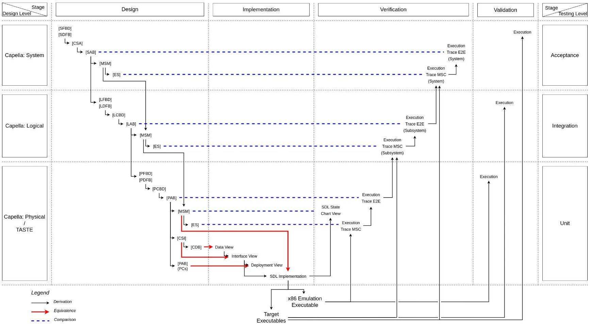
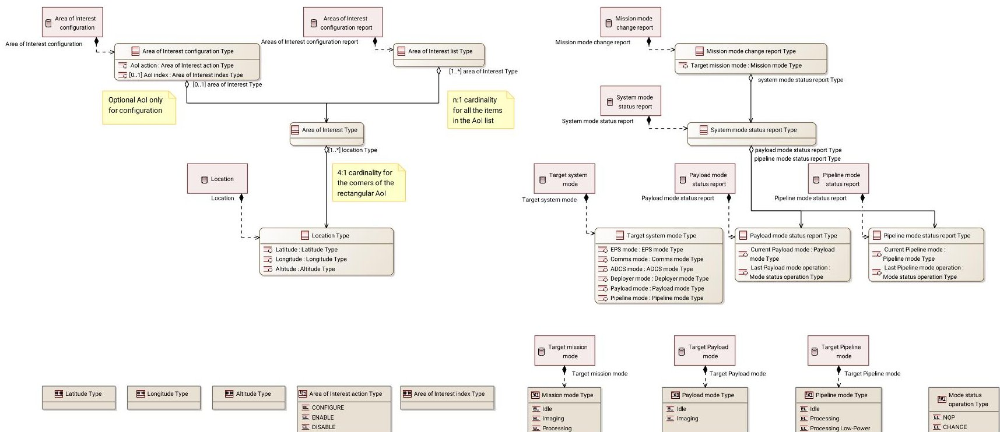
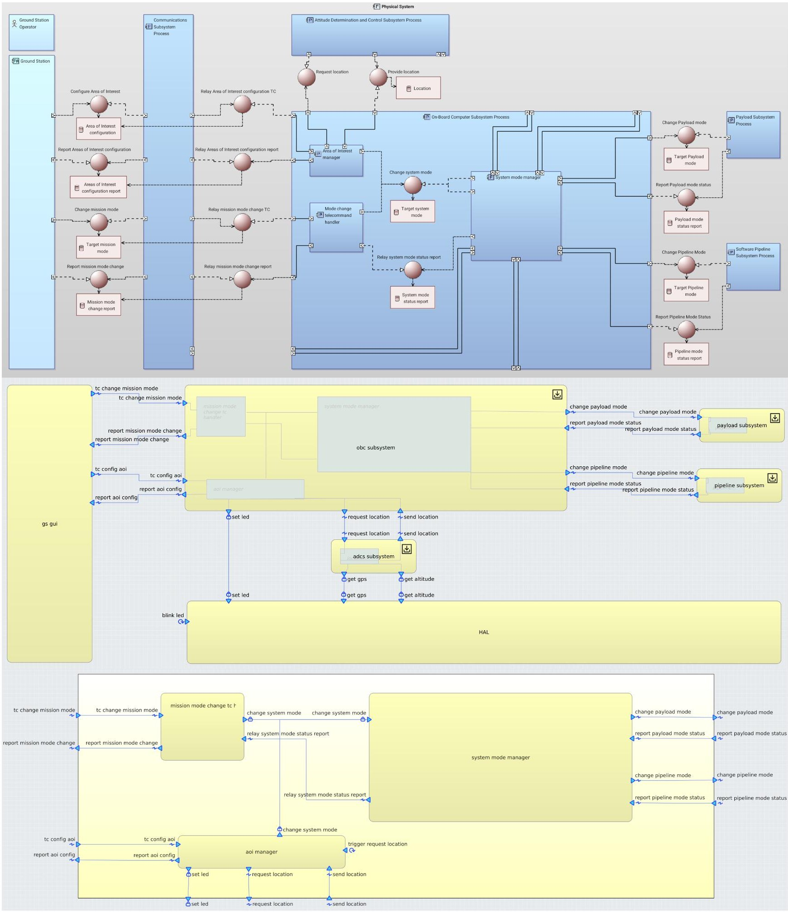
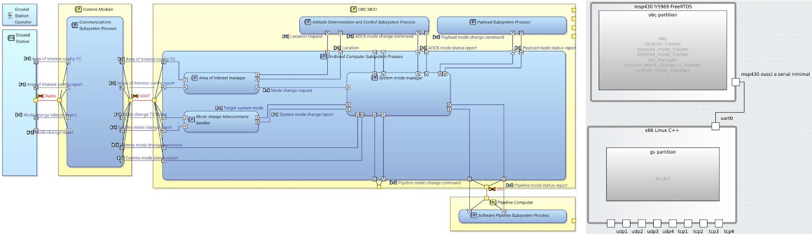

<!-- PDF_PAGE: 1 -->

IAC23,D1,IP,6,x77646

<div align="center">

# An Open-Source Method for Model-Based Development of Embedded Systems: Experience Report from a CubeSat Student Project

</div>

Giorgio Ciacchella $ ^{1^{*}} $ , Alzahraa Mohammad $ ^{1} $ , and Szymon Zurawski $ ^{1} $

$ ^{1} $GU Orbit, University of Glasgow, G12 8QQ Scotland, United Kingdom $ ^{*} $Corresponding author: giorgio.ciacchella@protonmail.com

## Abstract

As space engineering projects become more complex, MBSE (Model-Based Systems Engineering) practices have been gaining popularity to enforce consistency throughout the multiple facets of an integrated system. However, most such approaches are often confined to the top levels of systems engineering, leaving tooling gaps between the design and the implementation, integration, and testing phases, which can be the source of inconsistencies. Exceptions are few and typically proprietary, leaving limited freedom for customisation.

Building on previous work from N7 Space, this paper presents a comprehensive, V-shaped methodology integrating Capella and TASTE workflows into an end-to-end model-centric process for developing embedded software within complex systems. Capella is an opinionated MBSE tool, created by Thales to enforce the Arcadia framework, which structures the design process on multiple levels: Operational, System, Logical, and Physical; TASTE is a model-driven software development toolchain targeting heterogenous embedded systems, which centres its workflow around Data, Interface, and Deployment views. Both tools are Free and Open-Source Software.

This methodology exploits the parallels between entities in the two tools to rigorously link the design and implementation phases, enabling verification and validation activities based on simple diagram comparisons. Capella is first used to reason about the operational scenarios required to accomplish the chosen mission, then to consistently define the architectures of the system, its logical subsystems, and the physical components. The final products of the design stage are rigorously transitioned to TASTE, exploiting its SDL (Specification and Description Language) support to develop embedded software faithfully to the model. Finally, TASTE's integration with model-checking frameworks enables formal verification to be carried out on selected software requirements, whereas MSC (Message Sequence Chart) generation enables validation of its structure against the designs at multiple levels.

To illustrate the process, we report the resulting software architectures and their integration into the broader system of a student CubeSat project, where this method is currently being adopted to develop and test both flight and ground software, including TTMC, housekeeping, and mission functionalities. While we highlight its particular benefits to student projects, the method's exclusive reliance on open-source tools makes it easily adaptable to more complex use cases, and widely accessible regardless of financial and computational means.

Keywords MBSE, Capella, TASTE

Throughout this paper, terms referring to specific entities in Capella and TASTE are typographically marked, respectively Italicised and Underlined. Capella diagrams are referred to by their square-

## Notation

bracket identifiers:

[ES] Exchange Scenario

[MSM] Mode and State Machine

[SFBD] System Function Breakdown

[SDFB] System Function Data Flow

[CSA] Contextual System Actors

[SAB] System Architecture

<!-- PDF_PAGE: 2 -->

[LFBD] Logical Function Breakdown

[LDFB] Logical Function Data Flow

[LCBD] Logical Component Breakdown

[LAB] Logical Architecture

[PFBD] Physical Function Breakdown

[PDFB] Physical Function Data Flow

[PCBD] Physical Component Breakdown

[PAB] Physical Architecture

[CII] Contextual Internal Interfaces

[CDB] Class (Data Breakdown)

Additionally, the following acronyms are adopted:

FE Functional Exchange

FC Functional Chain

PC Physical Component

FSM Finite State Machine

MSC Message Sequence Chart

E2E End-to-End Data Flow

## 1 Introduction

INCOSE MBSE Initiative registered a nearly fivefold increase in responses between 2012 and 2018[1].

Integration between Capella and TASTE was first proposed in [2] as a bridge plugin automating the generation of TASTE model files from a Capella model. This seminal work adopts a mapping mostly equivalent to the one we propose; however, it only bridges physical-level modelling in Capella with implementation activities in TASTE.

The remainder of this paper is structured as follows: section 2 outlines the theory underpinning the mappings and workflow of the proposed method, section 3 details its steps throughout design, implementation, and testing, section 4 presents and discusses the results of applying it to case-study functionalities, section 5 highlights the limitations of the method itself and the tools it relies on, along with options for further work, and section 6 draws the conclusions.

## 2 Theory

## 2.1 Capella-TASTE Mappings

## 2.2 Capella and TASTE Workflows

## 3 Method Walk-Through

Figure 1 presents the main workflow schematic of the methodology, highlighting the V shape formed by its steps.

## 3.1 Design Phase

This phase is performed entirely in Capella through its three main levels: System Analysis, Logical Architecture, and Physical Architecture.

As illustrated in fig. 1, the workflows for all design levels mainly repeat the same core semantic pattern: breaking down higher-level Functions [ $ ^{*} $ FBD]/ $ ^{*} $ DFB]), breaking down higher-level Components [ $ ^{*} $ CBD]), allocating the former to the latter [ $ ^{*} $ AB]), defining component Modes and allocating Functions to either Modes or Transitions [MSM]), and finally representing all this information in a sequence-style diagram [ES]). These workflows should be driven by the realisation of higher-level FCs in the current level. Achieving this realisation is a core consistency principle of the Arcadia methodology enforced by Capella; however, in the process we propose, it is particularly important to adopt it as a design driver because of the implications in the verification and validation phases elaborated in section 3.3.

## 3.1.1 System Level

Function Breakdown/Data Flow At the System Analysis level, we begin by defining the highlevel Functions to be performed by the System as a black box. This is done in a [SFBD] diagram. We also specify the FEs between the different Functions involved in accomplishing any given System Capability, and collate them in FCs that embody the Capability realisations. This, along with optionally the breakdown, is done in a [SDFB] diagram. Also optionally, if this level was preceded by a Capella Operational Analysis, [SDFB] diagrams can highlight FC realisations by laying out the leaf Functions involved in a FC at the System level and grouping them under their parent Functions which realise the Functions involved in the realised FC at the Operational level.

Actor Breakdown Second, we define the Actors that exist outwith the System but participate in its activities - at this level, because the System is a black box, no other kind of Components is envisioned. This is done in a [CSA] diagram.

<!-- PDF_PAGE: 3 -->

<table border="1"><tr><td>Capella</td><td>TASTE</td></tr><tr><td>Node PC:Root/Fork/Leaf</td><td>(HW Board)/(HW Module)/Device</td></tr><tr><td>Behaviour PC:Root/Fork/Leaf</td><td>Partition/Function Group/Function</td></tr><tr><td>Function</td><td>Implementation step</td></tr><tr><td>State of Leaf Behaviour PC</td><td>SDL State</td></tr><tr><td>Transition of Leaf Behaviour PC</td><td>SDL Transition</td></tr><tr><td>Physical Port</td><td>Device Port</td></tr><tr><td>Physical Link</td><td>Device Link</td></tr><tr><td>Flow Port:In/Out</td><td>Interface endpoint:Provided/Required</td></tr><tr><td>Interface</td><td>Interface</td></tr><tr><td>Exchange Item</td><td>Interface Parametre</td></tr><tr><td>Class</td><td>ASN.1 SEQUENCE Type</td></tr><tr><td>Data Type</td><td>Primitive ASN.1 Type</td></tr></table>

<div align="center">

Table 1: Mapping of entities between Capella (Physical level) and TASTE.

</div>

<table border="1"><tr><td>Capella</td><td>TASTE</td></tr><tr><td>Root Behaviour PC to Node PC</td><td>Deployment of Partition to Device</td></tr><tr><td>Function Port to Flow Port</td><td>Deployment of Interface to Device Link</td></tr><tr><td>Child Behaviour PC to Parent Behaviour PC</td><td>Function nesting</td></tr><tr><td>Function to Leaf Behaviour PC</td><td>Implementation steps (informal)</td></tr><tr><td>Function to FSM Transition</td><td>SDL Implementation steps (formal)</td></tr><tr><td>Exchange Item to Interface</td><td>Assignment of Parametres to Interface</td></tr><tr><td>Class or Data Type to Exchange Item</td><td>Parametre Typing</td></tr><tr><td>Child Class to Parent Class</td><td>ASN.1 SEQUENCE nesting</td></tr><tr><td>Data Type to Class</td><td>ASN.1 SEQUENCE field membership</td></tr></table>

<div align="center">

Table 2: Mapping of relationships between Capella (Physical level) and TASTE.

</div>

<table border="1"><tr><td>Capella</td><td>TASTE</td></tr><tr><td>Physical[CDB]</td><td>Data View</td></tr><tr><td>Physical[CII]</td><td>Interface View</td></tr><tr><td>[PAB]PCs View</td><td>Deployment View</td></tr><tr><td>Physical[MSM]</td><td>SDL Implementation</td></tr></table>

<div align="center">

Table 3: Mapping of implementation diagrams between Capella and TASTE.

</div>

Architecture Third, we allocate the Functions to either the System or an Actor. This is done in a [SAB] diagram. We recommend starting from a complete view of all Functions and Actors, and cloning it into one view per Capability, only representing the subset of Functions and Actors involved in the FCs that realise it. This is generally helpful to improve readability, but particularly important in the proposed method: as illustrated in fig. 1 and detailed in section 3.3.3, these subset views will be involved in the acceptance-level verification activities at the

<table border="1"><tr><td>Capella</td><td>TASTE</td></tr><tr><td>Physical [MSM]</td><td>SDL State Chart View</td></tr><tr><td>Physical [ES]</td><td>Simulation MSC</td></tr><tr><td>[PAB] FC View</td><td>Simulation E2E</td></tr><tr><td>Logical [ES]</td><td>Execution Trace MSC</td></tr><tr><td>[LAB] FC View</td><td>Execution Trace E2E</td></tr><tr><td>System [ES]</td><td>Live Execution MSC</td></tr><tr><td>[SAB] FC View</td><td>Live Execution E2E</td></tr></table>

<div align="center">

Table 4: Mapping of verification and validation diagrams between Capella and TASTE.

</div>

end of the engineering lifecycle.

All three previous steps can be performed concurrently in [SAB] diagrams. Indeed, as with most MBSE activities, semantic advancements to the model can be performed as separate steps in separate diagrams only to a limited extent: as guidance for this level, the Functions specified should be elicited by being part of a single FE that crosses Component

<!-- PDF_PAGE: 4 -->





<div align="center">

Figure 1: V-shaped workflow of the proposed method.

</div>

boundaries, or by representing the System's action(s) between crossing said boundaries.

Finite State Machine Fourth, we model the behaviour of the System as an FSM by specifying the Modes the System can assume, and connecting them through appropriate Transitions. At this level, we have found that allocating the Functions performed by the System to Modes, rather than to Transitions, results in a more intuitive semantic model. As this approach leaves Transitions free to allocate FEs, it represents the System continuously executing highlevel tasks for the entirety of its permanence in a given Mode; whenever a task or set of tasks is exhausted, a Transition is triggered to bring the System to its next Mode. Thanks to the relatively informal status of FSMs within Capella, a Transition-based Function allocation scheme can be adopted in subsequent levels (and will, in section 3.1.3) without any glaring inconsistency, i.e. without introducing any error flagged by Capella's model validation routine. Both these actions are done in a [MSM] diagram. This approach offers many benefits which have been extensively detailed in literature, and it holds particular relevance in the proposed method: as elaborated in section 3.3.3, this representation can inform requirements for acceptance-level verification activities at the end of the engineering lifecycle.

Scenario Finally, we represent all elements developed so far in a sequence format, which can also convey additional information such as informal timing,

loops, branching, and notes. This is done in [ES] diagrams. Again, as with the Architectures, we recommend creating a separate [ES] diagram for each System Capability - especially since, unlike Architectures, [ES] diagrams are formally linked to System Capabilities. Each diagram should reproduce the FC(s) which realise the Capability, and state the Mode assumed by the System whenever it changes. Laying out the diagram this way creates a direct equivalence between Capella's [ES] and TASTE's MSC, enabling their comparison as a verification activity as detailed in section 3.3.3.

## 3.1.2 Logical Level

System to Logical Transition We begin the Logical Architecture level by realising the System Capabilities, System Functions, and System Actors into Logical Capabilities, Logical Functions, and Logical Actors, which can conveniently be done through Capella's automatic transition features.

Function Breakdown/Data Flow Next, similarly to the previous level, we break down the highlevel Functions (those "inherited" from the System level) into Functions appropriate for allocation to subsystems. Again, this is done in a [LFBD] diagram. Particular care should be paid to ensuring the new leaf Functions are suitable recipients of new FEs which shall realise the previously-specified FCs from the System to the Logical level. As this is a semantically complex problem, we suggest performing both the breakdown of Functions and the definition of FEs

<!-- PDF_PAGE: 5 -->

in a [LDFB] diagram, which is capable of representing both relationships at a glance. To do so, we populate the diagram with an existing FC "inherited" from the System level, and all the Functions and FEs it involves. We then break down the involved Functions by creating new Functions within them, which will create a semantic parenthood relationship, and define new FEs between them to result in the same overall path of the FC to realise. This new set of FEs constitutes the new Logical FC, which we create and configure to formally realise the original System FC through the appropriate Capella property.

Component Breakdown At the Logical level, the System turns from a black box to a grey box, where more granular entities can be discerned as Logical Components. Second, therefore, we break down the System into its constituting Logical Components representing subsystems. This is done in a [LCBD] diagram. Capella does support nesting Logical Components with multiple hierarchical tiers, e.g. considering "segments", "platforms", "modules", etc. and then subsystems; however, that is beyond the scope of this method. If relevant to a project, we recommend shifting that complexity above subsystem entities upstream in the modelling cascade, for instance by adopting a federated model (model-of-models) structure. On the other hand, all complexity below subsystem entities is elaborated at the Physical level, as detailed in section 3.1.3.

Architecture Third, we allocate the broken-down Functions to the broken-down Components. This is done in a [LAB] diagram. Again, we recommend starting from a complete view of all Functions and Components within the System, and cloning it into one view per Capability, only representing the subset of Functions and Components involved in the FCs that realise it. This is generally helpful to improve readability, but particularly important in the proposed method: as illustrated in fig. 1 and detailed in section 3.3.2, these subset views will be involved in the integration-level verification activities at one of the most common critical points of the engineering lifecycle.

As guidance for this level, the Functions specified should be elicited by being part of a single FE that crosses Component boundaries, or by representing the Component's action(s) between crossing said boundaries.

The two previous steps can be performed concurrently in [LAB] diagrams. Additionally, the function definition step can also be performed in [LAB] diagrams, but will lack the parenthood relationships

with the Functions realised from the System level. To adopt this approach, we can simply set those relationships in [LFBD] and/or [LDFB] diagrams as part of this third step.

Finite State Machine Fourth, we model the behaviour of each Logical Component as an FSM by specifying the Modes it can assume, and connecting them through appropriate Transitions. At this level, we recommend continuing to allocate Functions to Modes and FEs to Transitions for the same reasons as with the System level. Both these actions are done in a [MSM] diagram. Again, this approach holds particular relevance in the proposed method: as elaborated in section 3.3.2, this representation can inform requirements for integration-level verification activities at the crux of the engineering lifecycle.

Scenario Finally, we represent all elements developed so far in a sequence format, which can also convey additional information such as informal timing, loops, branching, and notes. This is done in [ES] diagrams. Again, as with the Architectures, we recommend creating a separate [ES] diagram for each Logical Capability, each reproducing the FC(s) which realise the target Capability, and state the Mode assumed by each Logical Component whenever it changes. Laying out the diagram this way creates a direct equivalence between Capella's [ES] and TASTE's MSC, enabling their comparison as a verification activity as detailed in section 3.3.2.

## 3.1.3 Physical Level

Logical to Physical Transition Just like previously, we begin the Physical Architecture level by realising the Logical Capabilities, Logical Functions, Logical Actors, and Logical Components into Physical Capabilities, Physical Functions, Physical Actors, and Behaviour PCs, which can conveniently be done through Capella's automatic transition features.

Function Breakdown/Data Flow Next, similarly to the previous level, we break down the medium-level Functions (those "inherited" from the Logical level) into Functions appropriate for allocation to components - where "component" is a generic name for a Physical-level leaf entity, similarly to "subsystem" at the Logical level. Once again, this is done in a [PFBD] diagram, but we recommend performing both Function breakdown and FEs definition in a [PDFB] diagram. This helps ensure the new leaf Functions are suitable recipients of new FEs which shall realise the previously-specified FCs from the

<!-- PDF_PAGE: 6 -->

Logical to the Physical level. To do so, we populate the diagram with an existing FC "inherited" from the Logical level, and all the Functions and FEs it involves. We then break down the involved Functions by creating new Functions within them, which will create a semantic parenthood relationship, and define new FEs between them to result in the same overall path of the FC to realise. This new set of FEs constitutes the new Physical FC, which we create and configure to formally realise the original Logical FC through the appropriate Capella property.

Component Breakdown At the Physical level, the System turns from a grey box to a white box, where all entities can be discerned as PCs. Second, therefore, we break down the System into its constituting PCs representing components and component groups. This is done in a [PCBD] diagram. However, unlike at the previous level, two types of PC are envisioned in Capella: Behaviour PCs and Node PCs; in the context of this method, we map the former to software, and the latter to hardware. As mentioned in section 3.1.3, Capella realises Logical Components as Behaviour PCs, which our Function-driven modelling conforms to. So, after breaking down the "inherited" Behaviour PCs to represent software components, we also define Node PCs to represent hardware components.

At this level, we also take full advantage of Capella's nesting capabilities by instituting multiple hierarchical tiers: for Behaviour PCs, the first level below the root Physical System should represent a subsystem (TASTE Partition), each leaf a logiccontaining software component (TASTE Function), and any number of forks in between can be used to convey software nesting (TASTE Function Groups); Node PCs are not mapped as formally, but we recommend the first level below the root Physical System represents a board, each leaf a microcontroller or other code-executing computing device (TASTE Node), and any number of forks in between can be used to convey hardware stacking. This mapping is further detailed in table 1.

Architecture Third, we allocate the broken-down Functions to the broken-down Behaviour PCs, and the broken-down Behaviour PCs to the broken-down Node PCs. Both these actions are done in a [PAB] diagram. Once again, we recommend starting from a complete view of all Functions and PCs within the System, and cloning it into one view per Capability, only representing the subset of Functions and PCs involved in the FCs that realise it. This is generally helpful to improve readability, but particularly

important in the proposed method: as illustrated in fig. 1 and detailed in section 3.3.1, these subset views will be involved in the most granular unit-level verification activities. We also create a view only including PCs, which will be referenced in section 3.2 to create the TASTE Deployment View.

As guidance for this level, the Functions specified should represent reasonably atomic implementation steps: decisions, interface calls, I/O operations, etc.

The two previous steps can be performed concurrently in [PAB] diagrams. Additionally, the function definition step can also be performed in [PAB] diagrams, but will lack the parenthood relationships with the Functions realised from the Logical level. To adopt this approach, we can simply set those relationships in [PFBD] and/or [PDFB] diagrams as part of this third step.

Finite State Machine Fourth, we model the behaviour of each PC as an FSM by specifying the Modes it can assume, and connecting them through appropriate Transitions. At this level, we switch the previously-adopted allocation scheme and allocate both Functions and FEs to Transitions: the former under the "Effects" property, the latter under "Triggers". Both these actions are done in a [MSM] diagram. This approach is a key element of the proposed method: as detailed in section 3.2 and section 3.3.1, the semantics and views specified in this step will be referenced to implement the software components and verify their correctness at the unit level.

Scenario Fifth, we represent all elements developed so far in a sequence format, which can also convey additional information such as informal timing, loops, branching, and notes. This is done in [ES] diagrams. Again, as with the Architectures, we recommend creating a separate [ES] diagram for each Logical Capability, each reproducing the FC(s) which realise the target Capability, and state the Mode assumed by each Logical Component whenever it changes. Laying out the diagram this way creates a direct equivalence between Capella's [ES] and TASTE's MSC, enabling their comparison as a verification activity as detailed in section 3.3.1.

Interfaces At this level, as it is the closest to the implementation, the [ES] representation is not the final step; after that is done, we formally define the Interfaces between components and the Data exchanged through them. This is done across [PAB] and [CII] diagrams.

<!-- PDF_PAGE: 7 -->

We start by identifying all FEs which cross the boundaries of leaf Behaviour PCs in a [PAB] diagram. For each pair of Behaviour PCs and each direction, we create a Component Exchange between the traversed Behaviour PCs, in the same direction as the FE, and allocate the newly-created Flow Ports to the respective Function Ports. Additional FEs crossing the same pair of Behaviour PCs in the same direction can be allocated to either the same or a new Component Exchange, depending on the specific interface architecture required.

We then switch to a [CII] diagram. There, we create an Interface for every synchronous call-return Component Exchange pair or asynchronous call Component Exchange, and appropriately connect the relevant Flow Ports to it: providing it for the In direction; requiring it for the Out direction. We also create Exchange Items representing the parametres passed through each interface, and allocate one to the other accordingly. Due to limitations of TASTE Interfaces, we recommend allocating at most one parametre to each interface, and "packing" all necessary data points into a suitable data structure as part of the next step.

Data Finally, we specify the types of said parameters in a [CDB] diagram. This is done by creating the required Types (and optionally Literals, as in the case of Enumerations), and connecting them to the previously-defined Exchange Items through Exchange Item Element relationships. We represent data structures as Classes: for simple ones, we allocate one Property per primitive field; for more complex ones, we can also Aggregate simpler Classes. For clarity, we recommend populating this diagram with "cards" of the existing Interfaces as well.

Alternatively, Interfaces can also be defined here, and then used for population and allocation in a [CII] diagram.

## 3.2 Implementation Phase

This phase is performed across the Capella diagrams and TASTE views outlined in table 3: as illustrated in fig.1, this crossing of tooling boundaries mainly consists of populating TASTE views with the content specified in the relevant Capella diagram - and, thanks to the work done in section 3.1.3, this is largely trivial.

Data View We begin by defining the Data Types specified in [CDB] as the corresponding primitive ASN.1 types, then move on to simple Classes as SEQUENCES of said types, and finish with Aggregated

Classes as SEQUENCEs of said SEQUENCEs. The only additional specification to be done at this step is the definition of ranges for primitive types, as mandated by ASN.1 standards.

Interface View We begin by instantiating the Behaviour PCs laid out in [CII] as TASTE Functions. Then, we connect them to each other through Interfaces tracing the Requires-Provides Interface links, in the direction of the Flow Ports. Finally, we assign and type the Parametres of each Interface according to the allocations of Exchange Items to Interfaces and their typing. For this final step, it may be helpful to refer to the Interface cards included in [CDB] earlier.

Deployment View We begin by instantiating the Node PCs laid out in [PAB] as TASTE Nodes which also spawns a Partition within each. Then, we bind the previously-created Functions to Partitions according to the allocations of leaf Behaviour PCs to root Behaviour PCs. Similarly, we bind the previously-created Interfaces to Device Links according to the allocations of FEs through Component Exchanges to Physical Links.

Function Implementations At this point, the architecture of the embedded system is fully specified, and the only missing piece is the functional code.

Generally, for each TASTE Function, this is implemented by following the individual steps specified in [PAB] as Capella Functions allocated to Behaviour PCs, in the order defined by their FEs. We recommend implementing as much logic as possible in SDL Functions, and only outsourcing thin hardware interfaces to a dedicated Hardware Abstraction Layer (HAL) Function implemented in C/C++. Taking advantage of one of TASTE's cornerstone features, implementing different Functions in different languages is possible and envisioned by this method. However, because most of TASTE's more advanced features rely on formal SDL Implementations, we recommend writing an alternative SDL Implementation for each non-SDL Function, which should mock the behaviour of the actual, non-SDL Implementation.

Specifically, SDL Functions are implemented by creating and connecting the States as laid out in the [MSM] of the matching Behaviour PC, and populating Transitions with the Functions allocated to them.

## 3.3 Testing Phase

This phase is performed across the TASTE views and Capella diagrams outlined in table 4.

<!-- PDF_PAGE: 8 -->

## 3.3.1 Unit Testing

FSM Comparison The first step of unitlevel verification takes place while writing SDL Implementations, and consists of comparing the SDL State Chart View of the implemented Function against the [MSM] of the matching Behaviour PC. While very basic, this is not trivial: the view used to write SDL Implementations focuses on Transitions, potentially allowing discrepancies in the state-based representations. This step is passed if States, Transitions between them, and Transition triggers are matching across Capella and TASTE.

MSC Comparison ...

E2E Comparison ...

3. 3.2 Integration Testing

MSC Comparison ...

E2E Comparison ...

3. 3.3 Acceptance Testing

MSC Comparison ...

E2E Comparison ...

## 4 Caste Study Results: System-Wide Mode Management

We have applied the proposed method to the development of a telecommand-based system-wide mode management feature for the On-Board Computer towards a 3U Earth Observation student CubeSat. We now present the main deliverables in this methodology as comparisons between equivalent diagrams in Capella and TASTE, highlighting their symmetry.

Data View Figure 2 and listing 1 show the specifications of the data types required for this feature, in Capella's [CDB] diagram and TASTE's ASN.1 Data View respectively.

Listing 1: Data View in ASN.1 (TASTE)

OBC-FIRMWARE-DATAVIEW DEFINITIONS ::=

BEGIN

Latitude-WGS84

::= REAL (-90.0 .. 90.0)

```cpp

Longitude-WGS84

::= REAL (-180.0 .. 180.0)

Altitude-m

::= REAL (0.0 .. 100000.0)

Location

                ::= SEQUENCE {

    lat                Latitude-WGS84,

    lon                Longitude-WGS84,

    alt                Altitude-m

}

Area-of-Interest          ::= SEQUENCE {

    loc-nw              Location,

    loc-ne              Location,

    loc-se              Location,

    loc-sw              Location,

    enabled             BOOLEAN

}

AoI-List

::= SEQUENCE (SIZE (4)) OF Area-of-Interest

AoI-List-Index          ::= INTEGER (0 .. 3)

AoI-Config-TC             ::= CHOICE {

    configure           SEQUENCE {

        index             AoI-List-Index,

        aoi                Area-of-Interest

    },

    enable             SEQUENCE {

        index             AoI-List-Index

    },

    disable             SEQUENCE {

        index             AoI-List-Index

    }

}

AoI-Config-Report         ::= SEQUENCE {

    aoi-list-upd         AoI-List

}

Payload-Mode-T            ::= ENUMERATED {

    payload-idle,

    payload-imaging

}

Pipeline-Mode-T            ::= ENUMERATED {

    pipeline-idle,

    pipeline-processing-fp,

    pipeline-processing-lp

}

System-Mode-T            ::= SEQUENCE {

    payload-mode        Payload-Mode-T,

    pipeline-mode       Pipeline-Mode-T

}

Mode-Status-Operation-T

::= ENUMERATED {

    mode-status-nop,

    mode-status-change

}

Payload-Mode-Status-Report-T    ::= SEQUENCE {

    payload-mode            Payload-Mode-T,

    payload-last-op

Mode-Status-Operation-T

}

Pipeline-Mode-Status-Report-T    ::= SEQUENCE {

    pipeline-mode

Pipeline-Mode-T,

    pipeline-last-op

Mode-Status-Operation-T

}

System-Mode-Status-Report-T    ::= SEQUENCE {

    payload-report

Payload-Mode-Status-Report-T,

```

<!-- PDF_PAGE: 9 -->





<div align="center">

Figure 2: Data View [CDB] in Capella

</div>

$$
\begin{array}{l} \mathrm {p i l e n e l - r e p o r t} \\ \mathrm {P i l e n e l - M o d e - S t a t u s - R e p o r t - T} \\ \end{array}
$$

$$
\begin{array}{l} \mathrm {M i s s i o n - M o d e - 1} \\ :: = \mathrm {E N U M E R A T E D} \left\{ \begin{array}{l} \mathrm {m i s s i o n - i d l e}, \\ \mathrm {m i s s i o n - i m a g i n g}, \\ \mathrm {m i s s i o n - p r o c e s s i n g} \end{array} \right. \\ \end{array}
$$

$$
\begin{array}{l} \mathrm {M i s s i o n - M o d e - C h a n g e - T C - T} \quad :: = \mathrm {S E Q U E N C E} \left\{ \begin{array}{l l} \mathrm {t a r g e t - m i s s i o n - m o d e} & \mathrm {M i s s i o n - M o d e - T} \\ \end{array} \right. \\ \end{array}
$$

$$
\begin{array}{l} \mathrm {M i s s i o n - M o d e - C h a n g e - R e p o r t - T} \quad :: = \mathrm {S E Q U E N C E} \left\{ \begin{array}{l l} \mathrm {t a r g e t - m i s s i o n - m o d e} & \mathrm {M i s s i o n - M o d e - T}, \\ \mathrm {s y s t e m - m o d e - s t a t u s - r e p o r t} \\ \mathrm {S y s t e m - M o d e - S t a t u s - R e p o r t - T} \end{array} \right. \\ \} \\ \end{array}
$$

Interface View Figure 3 and ?? show the specifications of the software components and interfaces between them as required for this feature, in Capella's [CII] diagram and TASTE's Interface View respectively.

Deployment View Figure 4 shows the specifications of the deployment of software components to hardware nodes, in Capella's [PAB] diagram and TASTE's Deployment View.

Function Implementations ...

Unit Testing ...

Integration Testing ...

Acceptance Testing ...

5 Limitations and Further Work

## 6 Conclusions

## Acknowledgements

The authors wish to particularly thank: Dr. Anna Lito Michala and Dr. Oana Andrei from the University of Glasgow for providing their expertise in reviewing embedded software and model-checking practices; Dr. Maxime Perrotin from the European Space Agency, Michael Kurowski and Rafaal Babski from N7Space, for giving up their free time to troubleshoot and overcome the limitations of TASTE.

## References

[1] Rob Cloutier and Ifezue Obiako. ModelBased Systems Engineering Adoption Trends 2009-2018. Accessed July 16, 2023. BKCASE is managed and maintained by the Stevens Institute of Technology Systems Engineering Research Center, the International Council on Systems Engineering, and the Institute of Electrical and Electronics Engineers Systems Council. URL: www.sebokwiki.org.

<!-- PDF_PAGE: 10 -->

[2] Michał Kurowski, Michał Mosdorf, and Michał Kocon. "Capella to TASTE MBSE bridge". In: Model Based Space Systems and Software Engineering Workshop. 2020.

<!-- PDF_PAGE: 11 -->





<div align="center">

Figure 3: Interface View in Capella ([CII]) and TASTE, including detail of the OBC subsystem.

</div>

<!-- PDF_PAGE: 12 -->





<div align="center">

Figure 4: Deployment Views in Capella ([PAB]) and TASTE.

</div>