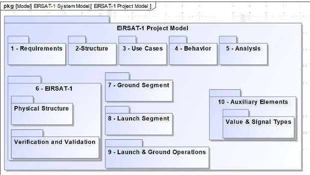
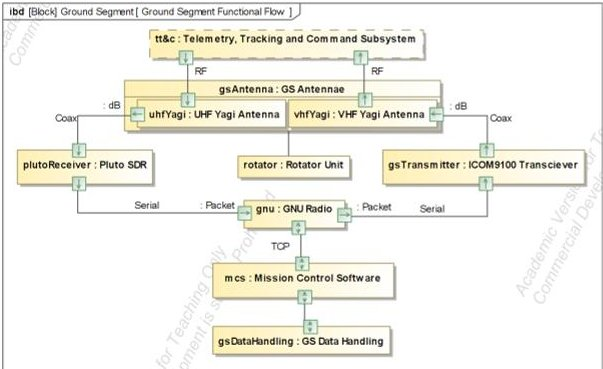
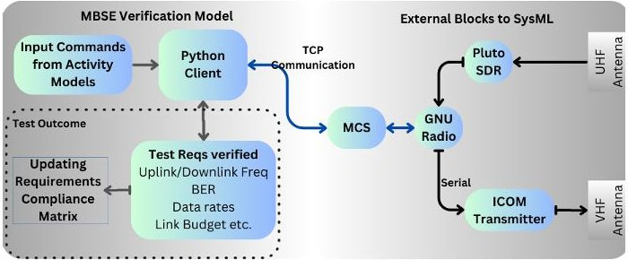

<!-- PDF_PAGE: 1 -->

# Development of a Nanosatellite System Modeling Architecture for EIRSAT-1

$ ^{1,*} $ Sai Krishna Reddy Akarapu, $ ^{2} $ Bas Stijnen, $ ^{1} $ Caimin McKenna, $ ^{2} $ David McKeown, $ ^{1} $ David Murphy, $ ^{1} $ Jack Reilly, $ ^{2} $ Joseph Thompson, $ ^{1} $ Maeve Doyle, $ ^{1} $ Ronan Wall, $ ^{1} $ Sheila McBreen and $ ^{1} $ Lorraine Hanlon $ ^{1} $ School of Physics, $ ^{2} $ School of Mechanical and Materials Engineering, University College Dublin $ ^{*} $ Correspondence: sai.akarapu@ucdconnect.ie

Index Terms—MBSE, CubeSats, Systems Engineering, Verification and Validation, Satellite Communications

## I. INTRODUCTION

Over the last two decades, CubeSats which are nanosatellites with form factors based on units (U) of 10 x 10 x 10 cm3, have become more common in academia, enabling students to gain hands-on experience with satellite design, testing and deployment [15]. The use of Commercial-Off-TheShelf (COTS) components reduces development cost and time, making CubeSats an accessible and cost effective route to space. CubeSats are increasingly important for in-orbit demonstrations of new technologies. Further, their flexibility allows them to be configured for a wide range of science mission profiles, either as a standalone platform, as a communications relay for lunar and inter-planetary missions, such as NASA's Mars Cube One (MarCO) satellites [14], or as a daughter spacecraft to study a near-Earth object such as LICIACube [2]. Several CubeSats for high energy astrophysics are currently in orbit and in development [9].

Apart from a limited number of case studies and academic research articles, few standards exist regarding Systems Engineering (SE) for designing and developing nanosatellites [10]. Towards this objective, the International Council on Systems Engineering (INCOSE) and Object Management Group (OMG) have been supporting the Space Systems Working Group (SSWG) over a decade in the development of MBSE approaches for CubeSat development [11]. Several articles have been published by SSWG over the years, but were not applied to actual CubeSat missions. In 2019, ESA introduced its Model Based 4(for) Systems Engineering initiative to deploy MBSE within the organization and in its upcoming science missions such as EnVision and Euclid [6].

## II. ADOPTING MBSE INTO THE ORGANIZATION

MBSE is becoming critical in today's multi domain systems; with it, engineers have the ability to see cross domain relationships early in the design process when decisions are made on system parts and functions. Nanosatellite System Modeling (NSM) project is an initiative from University College Dublin (UCD), which aims to implement an MBSE approach throughout the lifecycle development of CubeSat,

starting from Phase-A/B (Conceptualization) $ \rightarrow $ Phase-C/D (Testing & Verification) $ \rightarrow $ Phase-E (Launch & Operations). A single integrated environment ensures that system verification is planned and executed in the correct sequence with full traceability based on requirements. Beyond requirements verification, the future goal of NSM is to incorporate engineering, project management, supply chain and production into a single cohesive MBSE ecosystem.

## A. MBSE:Language, Tool and Method:

The three pillars of MBSE are Language, Method and Tool [7]. The language used here for modeling is SysML. [8] conducted a study for deciding the method and toolbox required for MBSE adoption. There are several tools available in the market that allow SysML modeling, such as IBM Rhapsody, VITECH Genesis, Cameo Systems Modeler (now CATIA Magic) etc. Most are commercially available and widespread in industry and academia. There are also open-source tools in the market like Capella and Papyrus. After an extensive review of the three popular tools: Valispace, CATIA Magic and Capella, it was evident that no single tool can fully meet all the requirements for complete realisation of MBSE. CATIA Magic System of Systems Architect tool from Dassault Systemes has been adopted based on its wide range of features for 3D modeling, simulation and visualization, seamless data exchange between design and Engineering domains.

Several MBSE methodologies are in use across industry and academia, but due to time constraints, only IBM's Harmony and OOSEM have been reviewed. IBM's Harmony and OOSEM both mimic the traditional systems engineering V-Model. It is important to note that OOSEM emphasizes that progression through the V-Model is not a terminating, linear set of processes, but rather should be applied recursively and iteratively [12]. As a starting point, we have adopted INCOSE OOSEM. It is important to note that there is no single methodology that fulfils all the requirements for modeling CubeSat systems. OOSEM is an integrated framework that combines a model-based design approach, traditional software engineering practices and object-oriented techniques. Although originally developed in UML, it was later realigned with SysML [4]. In the case of CubeSats, a System of Systems can be developed by performing OOSEM activities such as analysing needs, defining system requirements and logical architecture, verifying and validating systems iteratively and recursively [13]. As

<!-- PDF_PAGE: 2 -->

Fig.1. EIRSAT-1 Project Packages

the work advances, we foresee bringing other methodologies into the systems model.

## III. MBSE VERIFICATION MODEL

## A. System Of Interest:

EIRSAT-1, a 2U CubeSat that has been developed by students of UCD through the ESA 'Fly Your Satellite! programme [1], passed its flight acceptance review and is now ready for launch. As its requirements, design and test documents are readily available for reference; it has been a pilot project to demonstrate the viability of implementing an MBSE approach for the design, development and testing of a CubeSat. Fig. 1 shows a SysML Package diagram with a view of the model packages organised in the EIRSAT-1 project. The work described here is focused on the implementation of MBSE during Phase C-D of EIRSAT-1, using the testing and verification of the communications subsystem as the exemplar.

For a satellite communication system, link establishment between satellite and the ground segment is essential and EIRSAT-1 uses amateur packing to transmit/receive data packets [3]. Modeling this communication scenario, requires components associated with Telemetry, Tracking & Command Subsystem (TT&C) on the EIRSAT-1 side, and Radio and VHF/UHF Antennas on the Ground Segment side. Fig. 2 shows the communication protocol between the EIRSAT-1 and the ground segment. In a traditional SE approach, to confirm if the communication link is sufficiently robust, end-to-end testing of the link between ground segment and satellite is performed. Generally, this end-to-end test is associated with a set of test specification and test procedures (TSTP), and the recorded data from the test is then manually verified later to confirm the requirement compliance. With the MBSE approach, the system models are integrated with other programmatic tools to enable exchange of data and allow automated verification of requirements. Here the other programmatic tools can be, for example, a piece of Python or MATLAB program or PLC code or an excel sheet. The aim is to construct the verification models in MBSE similar to the verification plans in traditional SE and create interface plugins to exchange information between the MBSE environment and the external test scripts.

Fig. 2. An SysML diagram showing the functional flow of Ground Segment during end-to-end communications.

## B. MBSE Approach to Requirement Verification:

The verification models created in the Magic System of Systems Architect tool are based on the end-to-end test plan used in traditional testing phases. The models are then verified for their reliability using the Magic Model Analyst tool, which allows an assessment of whether the model flow is thorough. The verification model is integrated with the actual end-to-end test setup to command the input test parameters through the model diagram. Fig. 3 shows the communication between the SysML diagram and the external setup. The MBSE verification model allows the required technical parameters to flow from the system models to the Python client which in turn commands the ground station hardware like radio and antenna controller for signal transmission and reception. The parametric diagrams within, validate the data exchanged and confirm the requirements compliance. The requirements are verified simultaneously with the test runs and the models can be reused several times in similar verification scenarios.

Fig. 3. Logical interpretation of the end-to-end test model for requirements verification.

## IV. RESULTS AND DISCUSSION

This work is a first step in demonstrating the preliminary objectives of the NSM project to implement an MBSE approach for requirements verification using the communications subsystem of EIRSAT-1 as the demonstrator. The Requirements Table in CATIA Magic tool gets updated automatically based on the test outcomes from running the verification model each time. This reduced huge amount of time spent on documenting and reporting the test outcomes to confirm the requirements compliance. A similar approach will be applied to the remaining subsystems, creating a automated framework.

<!-- PDF_PAGE: 3 -->

## REFERENCES

[1] D. Murphy et al., "EIRSAT-1 - The Educational Irish Research Satellite," in Symposium on Space Educational Activities SSEA-2018-73, 2018.

[2] E. Dotto et al., "LICIACube - The Light Italian Cubesat for Imaging of Asteroids In support of the NASA DART mission towards asteroid (65803) Didymos," Planetary and Space Science, Volume 199, 2021.

[3] F. Marshall et al., "Development of the Ground Segment Communication System for the EIRSAT-1 CubeSat," International Conference on Space Operations, 2021.

[4] INCOSE, "Object-Oriented Systems Engineering Method (OOSEM) Tutorial, version 03.00," Lockheed Martin Corporation and INCOSE OOSEM Working Group, 2008, https://connect.incose.org/tb/tote/oosem/default.aspx

[5] J. Puig-Suari et al., "CubeSat developments at Cal Poly: the standard deployer and PolySat," Proceedings Volume 4136, Small Payloads in Space, 2000.

[6] J. Whitehouse, "MBSE at ESA: State of MBSE in ESA Missions and Activities," MBSE2021 Conference, 2021.

[7] L.Delligatti, "SysML Distilled: A Brief Guide to the Systems Modeling Language," Addison-Wesley.

[8] M. Chami et al. "Towards solving MBSE adoption challenges: the D3 MBSE adoption toolbox," INCOSE International Symposium, 28 (1), 1463-1477, 2018.

[9] P. F. Bloser et al. "CubeSats for Gamma-Ray Astronomy," arXiv: 2212.11413v1, 2022.

[10] S. A. Asundi, and N. G. Fitz-Coy, "CubeSat Mission Design Based on a Systems Engineering Approach," IEEE Aerospace Conference, pp. 1-9, 2013.

[11] S. C. Spangelo et al., "Applying Model Based Systems Engineering (MBSE) to a standard CubeSat," in IEEE Aerospace Conference, pp. 1-20, 2012.

[12] S. Friedenthal et al. "A Practical Guide to SysML: The Systems Modeling Language, 2nd ed.," Elsevier, 2012.

[13] S. Gao et al., "MBSE for satellite communication system architecting," IEEE access, vol. 7, pp. 164051-164067, 2019.

[14] S.W. Asmar, and S. Matousek, "Mars Cube One (MarCO) Shifting the Paradigm in Relay Deep Space Operation," SpaceOps Conference, American Institute of Aeronautics and Astronautics, 2016.

[15] The CubeSat Program, Cal Poly SLO. CubeSat Design Specification Rev.13, 2014. Url: https://static1.squarespace.com/static/5418c831e4b 0fa4ecac1bacd/t/56e9b62337013b6c063a655a/1458157095454/cds _rev13_final2.pdf