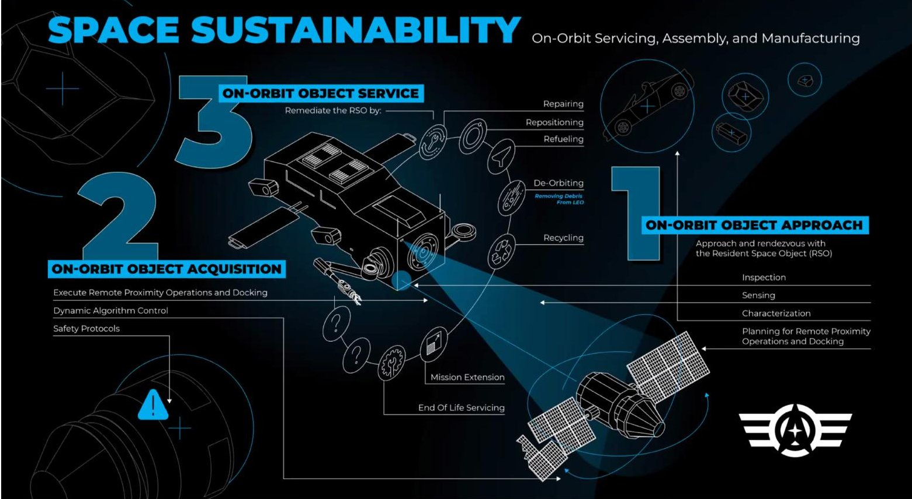
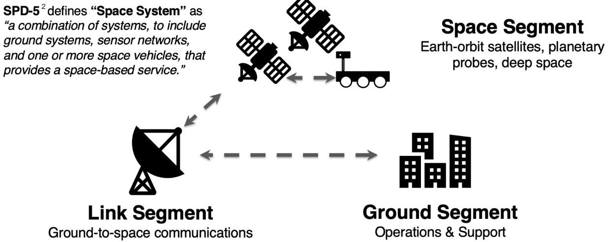
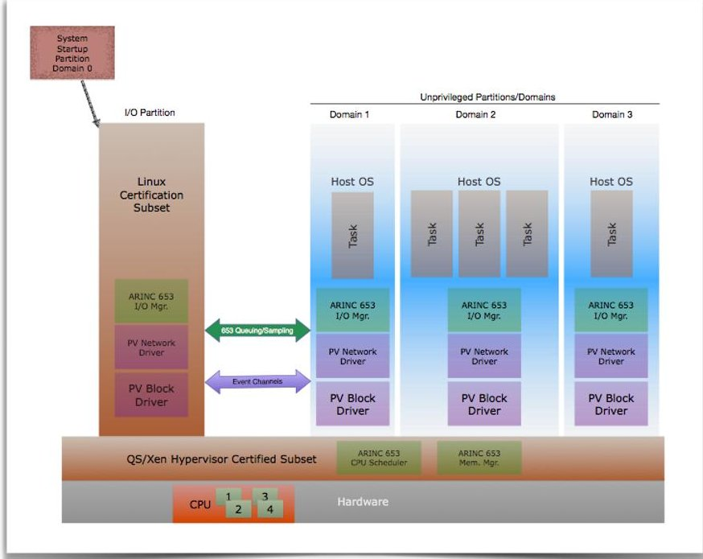
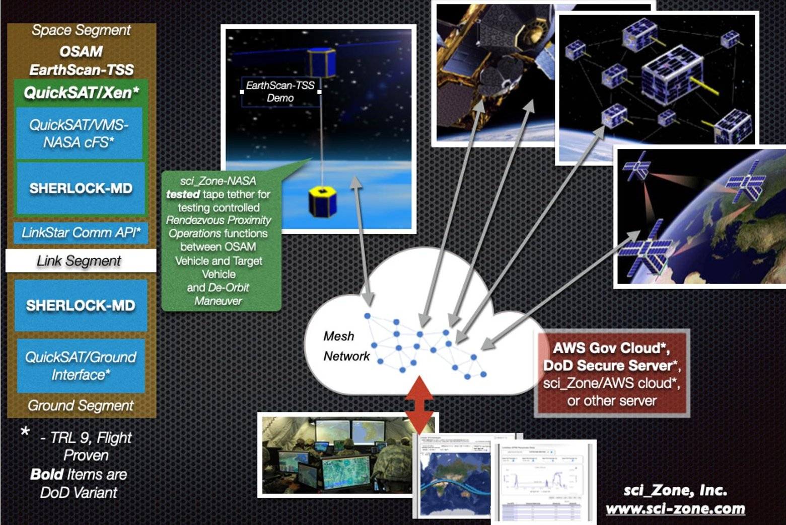
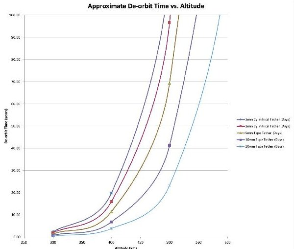
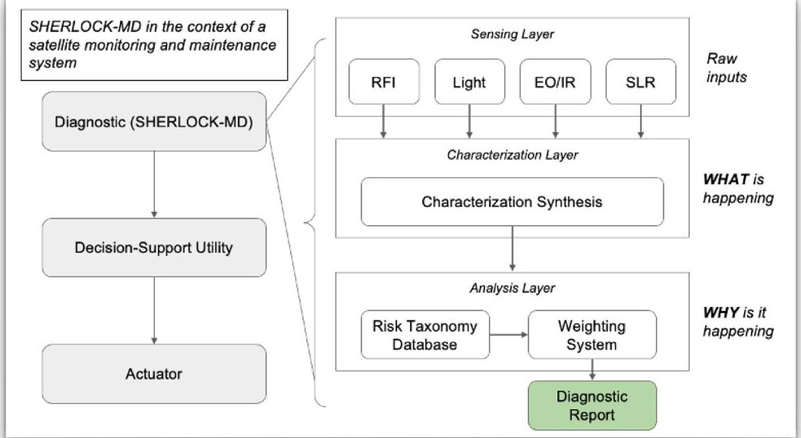
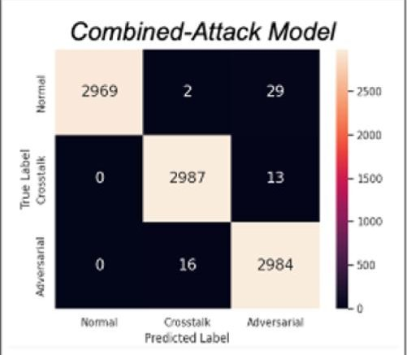
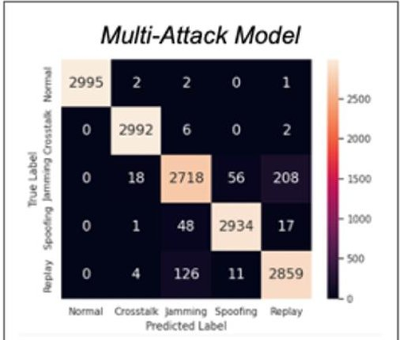
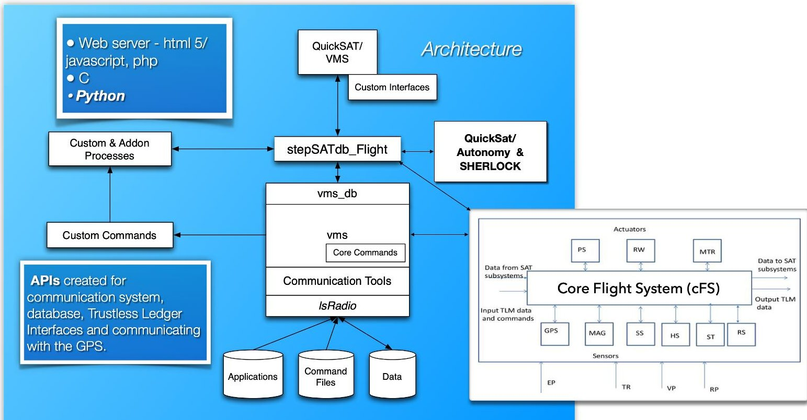

<!-- PDF_PAGE: 1 -->

# EarthScan-TSS, a Cubesat Based Tethered Satellite System And Platform To Test On Orbit Servicing And Space Sustainability

Andrew D. Santangelo $ ^{1} $

sci Zone

5108 Alberta Ave, Rio Rancho, New Mexico, 87144

andrew_santangelo@sci-zone.com

Gregory Falco

Department of Civil and Systems Engineering

Institute for Assured Autonomy

Johns Hopkins University Baltimore, USA falco@jhu.edu

In late 2026, sci Zone in partnership with John Hopkins University is planning to deploy in Low Earth Orbit the EarthScan-TSS satellite to test on orbit servicing and space sustainability for the DoD, NASA and a range of commercial applications. The focus of the mission is to flight qualify a range of sensors and supporting software, Artificial Intelligence, and Autonomy tools - QuickSAT/VMS and SHERLOCK MD - that supports vehicle servicing and fault management, extravehicular assessment, local and global situational awareness and secondary vehicle characterization. The architecture will track data in an on board data lake using a hybrid Trustless Ledger System. For ease of payload repurposing EarthScan-TSS will utilize the flight qualified QuickSAT/Xen Space Hypervisor, a bare metal hypervisor that provides for secure isolation and protection of virtual payloads installed on on-orbit vehicles. QuickSAT/Xen also allows for payload repurposing isolated from the rest of the flight management system. The first phase of the mission is for two years in LEO at an altitude of 600 km to exercise a range of mission goals including a broad range of servicing and autonomy functions. The second phase of the mission will be to deploy a 24U cubesat from the main satellite on a 2 km tether to test a range of secondary vehicle monitoring functions over the controlled deployment and tether operations phases. We will also conduct a de-orbit maneuver using sci Zone's proprietary tether design and tether deployer system. For this presentation the mission design will be presented along with the baseline satellite design including both the primary and secondary elements plus the tether system. We will also cover the architecture of the QuickSAT/VMS system, SHERLOCK MD, and QuickSAT/Xen.

## I. Introduction

The DoD and SpaceWERX is leading the Orbital Prime initiative that seeks to prime the pump and drive investment into a nascent space market sector. Orbital Prime is the first initiative under this program, focused on accelerating capabilities related On-orbit Servicing, Assembly, and Manufacturing (OSAM). Orbital Prime seeks to address space sustainability including supporting use of Active Debris Remediation (ADR) as one of the foundational technologies. As congestion and debris threaten the long-term sustainability of the space domain, Orbital Prime will transition agile, affordable, and accelerated OSAM space capabilities to build the foundation for space logistics while preserving the global commons. $ ^{1} $ Figure 1 highlights the key objectives of Orbital Prime as related to space sustainability.

A key to space sustainability is maintaining proper security of satellites. When considering the design and implementation of satellites one must consider these satellites as part of a bigger "Space System". Space Policy Directive-5 $ ^{2} $ or SPD-5, defines a "Space System" as "a combination of systems, to include ground systems, sensor networks, and one or more space vehicles, that provides a space-based service." (Figure 2) Like all satellites big and small, cubesats are vulnerable to range of cyberattacks on the ground segment, the link segment and the Space Segment. The industrial control systems (ICS) and critical infrastructure security communities have long employed the "security by obscurity" approach to securing their systems, which relies heavily on secrecy to protect assets from attackers $ ^{4} $ . While relatively successful as a strategy in the early years of ICS, it became significantly less effective as open, standard communication protocols came into use and the volume of connected devices increased. Space systems especially in civil space - have equally relied on security by obscurity in past decades $ ^{4} $ , but, similar to ICS, the

<!-- PDF_PAGE: 2 -->

proliferation of space systems and their increased connectivity has and will continue to reduce the efficacy of this strategy. $ ^{5} $

Like ICS, most satellites suffer from constrained memory and processing power. This restricts space systems from using traditional security solutions such as antivirus tools or memory-intensive intrusion detection and prevention systems. CubeSat space vehicles are even more memory and processing constrained than their typical satellite counterparts, making many security products and solutions infeasible. Instead, their security relies on the thoughtful design of their system architecture along with careful monitoring of the asset which typically does not happen with many of the university and test CubeSats deployed in orbit and programs that are financially constrained. Unlike currently deployed CubeSats, future P-LEO constellations will feature significant computing power as is the case for satellites deployed with the QuickSAT/Xen space hypervisor architecture, a secure bare metal hypervisor capable of supporting fault detection and recovery, providing support for symmetric and asymmetric multiprocessing, and support for plug-and-play modular systems including wireless systems. QuickSAT/Xen is a space qualified hypervisor environment that utilizes the open source Xen hypervisor which implements the ARINC653 partitioning standard, isolating applications running on the same processor (Figure 3). $ ^{6,7} $ Functions and systems are treated as secure virtual payloads. Security will be equally, if not more, important given the increased attack surface and the potential for attackers to move laterally across applications. With increased interest and investment in the militarization of space, senior U.S. military officials have explicitly described cyberattacks being the most likely space threat. $ ^{8} $

Fig 1. Key objectives of Orbital Prime as related to space sustainability

Based on key industry requirements and threats to satellites, there are several items related to space sustainability that needs to be addressed:

- The need to assess the condition of a satellite on approach: inspection-sensing-characterization

- The need to evaluate cyber threats.

- The need for Edge-based classification of radio frequency signals and hyper spectral images

- A Requirement to integrate inspection-sensing-characterization with planning functions, docking operations and on-orbit objective service functions seamlessly

- And the need for advanced fault detection

sci Zone in partnership with Johns Hopkins University and under funding from the SpaceWERX Orbital Prime Program is developing QuickSAT/SHERLOCK-MD and the satellite platform to address these requirements and issues.

<!-- PDF_PAGE: 3 -->

This research project is leading to the EarthScan-TSS (Tethered Satellite System) Mission, a flight test to qualify QuickSAT/SHERLOCK-MD, implement a range of technologies and to address the needs of the Orbital Prime Program.

The objectives of our Phase 1 Research program are to:

- Validation of Market Fit of SHERLOCK-MD with QuickSAT/VMS and its support of Inspection, Sensing, and Characterization, Rendezvous Proximity Operations (RPO) and support of End of Life Operations (EOLS) through a Feasibility Study.

- Identify prime potential USSF and AF End User and Customer

- Utilize QuickSAT/Designer and other tools to support a Model Based Systems Engineering approach to support the feasibility study

- Define measurable objectives and requirements for a potential trial.

- Describe how the solution would differ from the non-defense commercial offering

- Describe the cost and feasibility of integration with current mission-specific products

- Describe if and how the demonstration can be used by other DoD or governmental customers including

- Baseline using existing and flight proven technologies

Fig. 2 Components of a generic space system $ ^{2} $

Fig. 3 The QuickSAT-Xen hypervisor environment. Domain 0 drives and manages the other domains, or "virtual machines", on the flight computer.

<!-- PDF_PAGE: 4 -->

## II. EarthScan-TSS Mission

EarthScan-TSS is an on orbit testbed to demonstrate and flight qualify QuickSAT/SHERLOCK-MD and a range of OSAM functions: Inspection, Sensing, and Characterization functions; Rendezvous Proximity Operations (RPO) ; Support of End of Life Operations (EOLS); Flight qualify AI/ML Fault Management System. Figure 4 presents the basics of the EarthScan-TSS mission and the basic software architecture of the environment.

EarthScan-TSS is comprised of actually two satellites attached to one another - a 48U Primary Satellite and an 18U Secondary/deployable satellite. For the bulk of the targeted 2 year mission, the satellite will operate as one unit. Payloads will include a multispectral camera and a range of antennas/radios for signal monitoring, all located on the Primary satellite. During the two year mission QuickSAT/SHERLOCK-MD and supporting functions will be tested, evaluated an certified while monitoring a range of targets. Proximity operations may be conducted on other vehicles prior to tether deployment. Both the Primary and Secondary satellites will be able to communicate with the ground with their individual S-Band transceivers and via the LinkStar-TRK radio system.

EarthScan-TSS will operate tentatively at a working altitude of 600 km and an inclination of 20-60 degrees. After 2 years, the satellite system will be separated, with a 2 km x 15 mm x 0.125 mm Tape Tether connecting the two units. The tether deployer will be located on the secondary satellite. Both units will operate with the Primary Satellite conducting controlled proximity operations. After 2 weeks the tether will be severed from the Primary Satellite. This severing will result in a downward orbit transfer of the Secondary payload; the tether will provide additional drag further accelerating the deorbit of the Secondary Satellite with the Space Tether. Figure 5 presents a range of de-orbit times for a range altitudes and tether sizes. $ ^{9} $ Due to the severing of the tether, the Primary satellite will experience a gain in altitude extending its life in orbit for future missions.

Fig 4. EarthScan-TSS, Mission Overview & Software Architecture Highlights.

<!-- PDF_PAGE: 5 -->

<table border="1"><tr><td>Altitude(km)</td><td>3mmCylindricalTether(Days)</td><td>2mmCylindricalTether(Days)</td><td>5mmTapeTether(Days)</td><td>10mmTapeTether(Days)</td><td>20mmTapeTether(Days)</td></tr><tr><td>300</td><td>2.41</td><td>1.94</td><td>1.40</td><td>0.830</td><td>0.466</td></tr><tr><td>400</td><td>19.8</td><td>15.9</td><td>11.5</td><td>6.80</td><td>3.82</td></tr><tr><td>500</td><td>120</td><td>96.5</td><td>69.4</td><td>41.2</td><td>23.2</td></tr><tr><td>600</td><td>664</td><td>535</td><td>384</td><td>228</td><td>128</td></tr><tr><td>700</td><td>3669</td><td>2954</td><td>2123</td><td>1261</td><td>709</td></tr><tr><td>750</td><td>8480</td><td>6826</td><td>4906</td><td>2915</td><td>1638</td></tr><tr><td>800</td><td>18838</td><td>15165</td><td>10899</td><td>6476</td><td>3639</td></tr></table>

Fig 5. Tethered System Orbital Life for a range of tether configurations.

## III. QuickSAT/SHERLOCK-MD

QuickSAT/SHERLOCK-MD, a system for Vehicle Health Management and Fault Detection with Fault Classification Functions for a range of space vehicles. The QuickSAT/Vehicle Management System (VMS) is a flight proven flight management, Vehicle Health Management plus Fault Detection system flown on DoD flights, and scheduled for flights in 2022 and 2023. QuickSAT/VMS provides integration also with NASA's Core Flight System (cFS) and includes the QuickSAT/Xen Space Hypervisor which implements the ARINC 653 partitioning standard, isolating applications running on the same processor. QuickSAT/Xen provides a cybersecurity framework protecting the onboard virtual machines and wireless functions. New to QuickSAT is the integration of Johns Hopkins University's SHERLOCK-MD architecture which integrates an advanced sensing suite, edge-capable Artificial Intelligence (AI), and vehicle tracking tied with vehicle fault management functions to increase the reliability of orbital platforms, provide rapid fault determination, and perceive potential faults that might occur. Generating a useful diagnostic is predicated on having a wealth of insight-rich data to draw on. QuickSAT/SHERLOCK-MD can tie into an on-edge sensing suite including visible light, infra-red, UHF/wide-band radio, plus on-board fault monitoring systems and experiments, plus vehicle health data building an internal knowledge base for event and fault classification (Figure 6). This data is fed into a preliminary analysis system designed to extract key features from data. This takes the form of anomaly detection or binary/multi-class status checks (i.e. are the space vehicle's thermal management functions operational, experiment state). This process could be realized with a stochastic weighting structure such as a Hidden Markov Model, where the diagnostic determines the most likely state of the target vehicle given the observations at its disposal. Finally, the diagnostic can make the jump from observation to characterization--from the 'what' to the 'why' of the problem. By collecting a large number of these minor insights, a diagnostic can begin connecting anomalies to gain a clearer picture of any issues at play. SHERLOCK-MD relies on a system built on the Security Risk Taxonomy for Commercial Space Missions authored by Dr. Falco. By comparing symptoms evident in the data analysis with a historical database of security risks, the diagnostic can produce a set of likely candidates for mission failure and propose appropriate action. This component has the ability to feed directly into the decision support module of the incident-response architecture and QuickSAT/VMS.

Figure 7 shows application of QuickSAT/SHERLOCK-MD for a use case related to Space Cognitive Communications. A decommissioned or impaired satellites may emit errant or distress RF signal. The space vehicle doing the detection will need to disambiguate the RF. QuickSAT/SHERLOCK-MD offers preliminary RFI characterization models that can be used for diagnostic purposes. Figure 7 shows two preliminary RFI models: Combined- and Multi-attack. Combined-attack identifies adversarial activity (peak accuracy 99.3%) , while multi-attack characterizes the RF signal type (peak accuracy 96.6%). Across both models, zero instances of interference being missed (i.e. classified as normal activity). $ ^{10,11} $

<!-- PDF_PAGE: 6 -->

Fig. 6. The SHERLOCK-MD Environment

Fig. 7. Use Case - Space Cognitive Communications.

## IV. QuickSAT/VMS Architecture with Core Flight System (cFS) $ ^{12,13,14,15,16,17,18,19,20} $

QuickSAT/VMS was developed for the LinkStar-TRK radio beaconing and LinkStar-D duplex radio flight system with integrated GPS, including the APIs to integrate the NovAtel 700 series and other GPS. QuickSAT/VMS provides a core set of commands and an architecture to seamlessly add commands without modifying vms code itself. This provides a seamless framework to integrate with a range of missions and applications. NASA's Core Flight System (cFS), is an open source, flight proven, complete vehicle management system flight software for a range of space vehicles including human rated vehicles. For this effort, cFS and QuickSAT/VMS where merged together provide expanded functionality and support for SHERLOCK-MD.

Figure 8 presents architecturally the relationship between the key functions of the QuickSAT/VMS-cFS-SHERLOCK environment. All flight data is stored in the stepSATdb_Flight database and communicated to the ground via the QS/Communications Manager. Commands from the ground are communicated via QuickSAT/Communications Manager through the database to vms framework. In addition to the core commands, custom commands can be added by the customer using the QuickSAT/VMS command interface without modifying the code directly. QuickSAT/VMS also has a web based "window" into a payload's health, monitoring and control system, providing mechanisms to view data via tables and graphs, upload and download files, log data and manage historical data. This is done through the on board Server and the Session Manager the latter of which is part of the QuickSAT/VMS environment, both located on LinkStar-TRK and ground station. Web based pages are requested from the integrated web server by the client browser (Firefox, Chrome, Safari). Security, access and session management is maintained via the Session Manager. Due to the design of the QuickSAT/VMS and Session Manager, QuickSAT/VMS allows for multiple users to be logged into the LinkStar-TRK in a lab setting when testing on the ground.

<!-- PDF_PAGE: 7 -->

Fig. 8. The QuickSAT/VMS architecture with cFS and SHERLOCK-MD.

## V. Conclusion & Recognition

At the conclusion of the research project we will have validated the market fit of SHERLOCK-MD and QuickSAT/VMS with the baseline integrated sensors (RF and Hyper-spectral) and systems as a stand alone hosted payload and as part of a mission including EarthScan-TSS. The feasibility study, based on a Model Based Engineering approach, will present a clear and immediate actionable plan for demonstration on orbit. We will present Defense and non-Defense commercial solutions of our technology, and describe the cost and feasibility of integration with current mission specific products. The follow on research will lead to a expanded research and the flight of the EarthScan TSS flight.

The sci Zone and Johns Hopkins Team would like to thank Dr. Kristin Pratt, the Air Force Research Labs, SpaceWERX and the Orbital Prime Program for supporting our research program and the EarthSCAN-TSS Program.

## References

1. Orbital Prime FAQs PDF reference, SpaceWERX, 2021.

2. "Memorandum on Space Policy Directive-5, Cybersecurity Principles for Space Systems", September 2020.

3. W. Knowles, D. Prince, D. Hutchison, J. F. P. Disso, and K. Jones, "A survey of cyber security management in industrial control systems," International journal of critical infrastructure protection, vol. 9, pp. 52-80, 2015.

4. G. Falco, "The vacuum of space cyber security," in 2018 AIAA SPACE and Astronautics Forum and Exposition, 2018, p. 5275.

5. G. Falco, A. Viswanathan, A. Santangelo, "CubeSat Security Attack Tree Analysis", $ 8^{\mathrm{th}} $ IEEE International Conference On Space Mission Challenges for Information Technology, July 2021.

<!-- PDF_PAGE: 8 -->

6. Santangelo, Andrew, "An Open Source Space Hypervisor For Small Satellites", AIAA 2013-5512, Space 2013 Conference, September 10-12, 2013, San Diego, California, 2013

7. ARINC Characteristic 717-15, Flight Data Acquisition and Recording System, July 2011, https://www.arinc.com/cf/store/catalog_detail.cfm?item_id=1641.10. Cutler, J.W.; Fox, A.; Bhasin, K.; "Applying the lessons of Internet services to space systems," Aerospace Conference Proceedings, 2002. IEEE, vol. 7, pp. 7-3287-7-3295.

8. T. Hitchens, "Cyber attack most likely space threat: Maj. gen. whiting," Breaking Defense, 2020.

9. Santangelo A., Sturmfels R., Van Noord J., Baggett R. & Probst, K., "Optimal Tether Report", TMTC-SA-PB-OTRv1.0, The Michigan Technic Corporation, March 2001.

10. G. Falco, A. Viswanathan, A. Santangelo, CubeSAT Cybersecurity Challenge Workshop, https://www.sci-zone.com/cubesatcybersecurity-challenge , AIAA Ascend 2020, November 17, 2020.

11. G. Falco, A. Viswanathan, A. Santangelo, "The LinkStar Cybersecurity 'Sandbox' - a platform to test cubesat vulnerabilities within the Small Satellite Community", paper number 358885, AIAA Ascend 2021, November, 2021.

12. Santangelo, A. and Skentzos, P., "Utilizing the Globalstar Network for CubeSat and Small Satellite Communications", $ 33^{\mathrm{rd}} $ AIAA International Communications Satellite Systems Conference, Sept. 2015.

13. sci_Zone, Inc., QS/VMS Client User Manual, version 1.0, Rio Rancho, New Mexico, January 2014.

14. sci_Zone, Inc., QS/VMS ICD, version 1.0, Rio Rancho, New Mexico, January 2014.

15. Santangelo, A. and Skentzos, P., presentation "Utilizing the Globalstar Network for Small Satellite Communications", Communications Workshop, Small Satellite Conference, Logan, Utah, August 10, 2015.

16. Santangelo, A. and Crosby, K, "The CaNOP Cubesat Mission", $ 33^{\mathrm{rd}} $ Annual AIAA/USU Conference on Small Satellites, SSC20-V-06, August 1-6, 2020.

17. Santangelo, A., "LinkStar-TRK-A PC104 Based Integrated Computer Architecture, Communications and Global Tracking System for Cubesats", Ascend 2020, November 2020.

18. Santangelo, A., "Globalstar STX3 to STX4/SpotX: An Evolution From Global Simplex To Global Duplex Communications for 1U Cubesats And Larger Vehicles", $ 34^{\mathrm{th}} $ Annual AIAA/USU Conference on Small Satellites, SSC21_X_05, August, 2021.

19. G. Falco, A. Viswanathan, A. Santangelo, CubeSAT Cybersecurity Challenge Workshop, https://www.sci-zone.com/cubesatcybersecurity-challenge, AIAA Ascend 2020, November 17, 2020.

20. G. Falco, A. Viswanathan, A. Santangelo, "The LinkStar Cybersecurity 'Sandbox' - a platform to test cubesat vulnerabilities within the Small Satellite Community", paper number 358885, AIAA Ascend 2021, November, 2021.