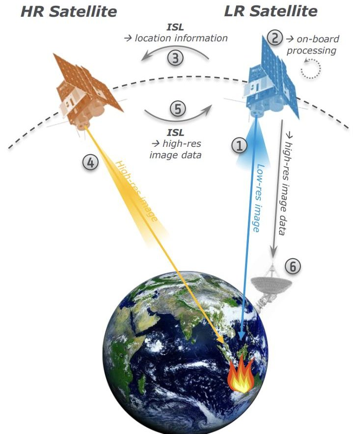
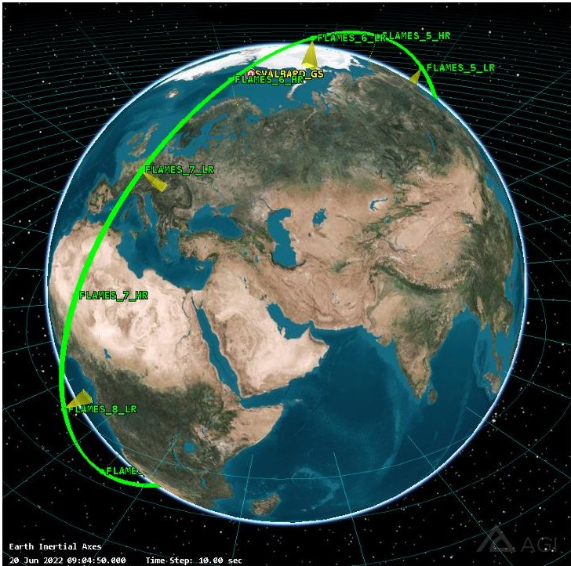
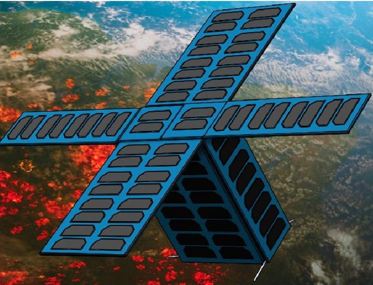
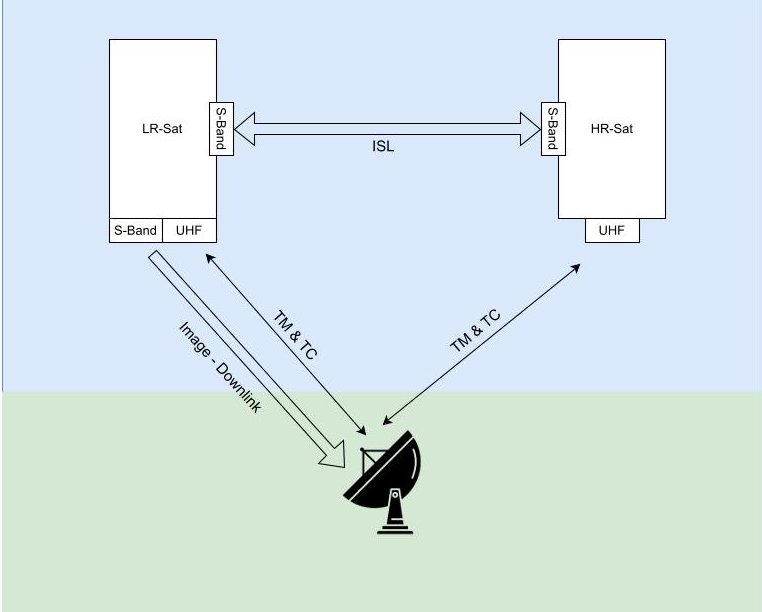
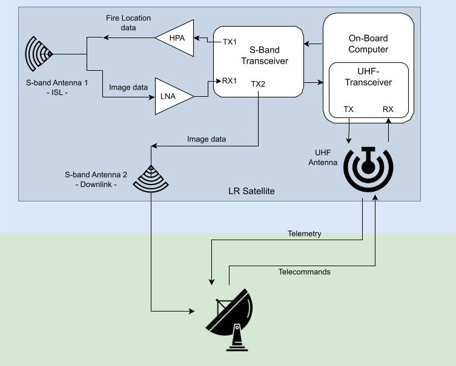
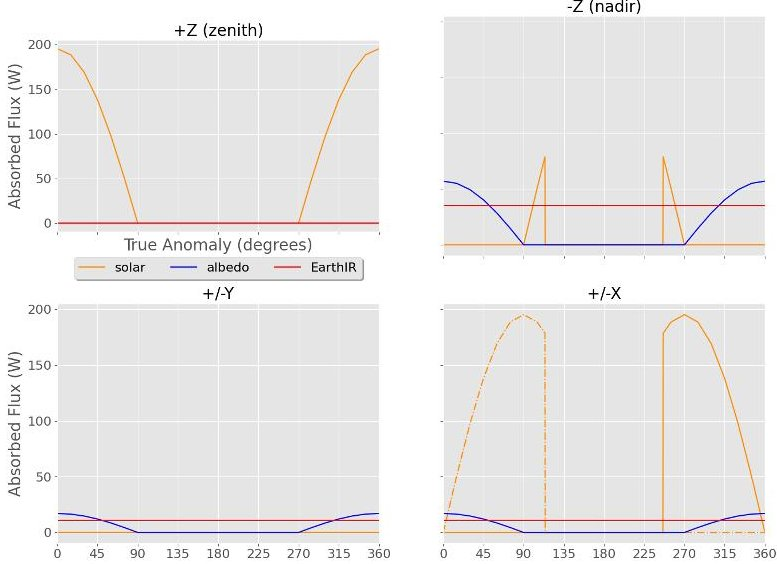
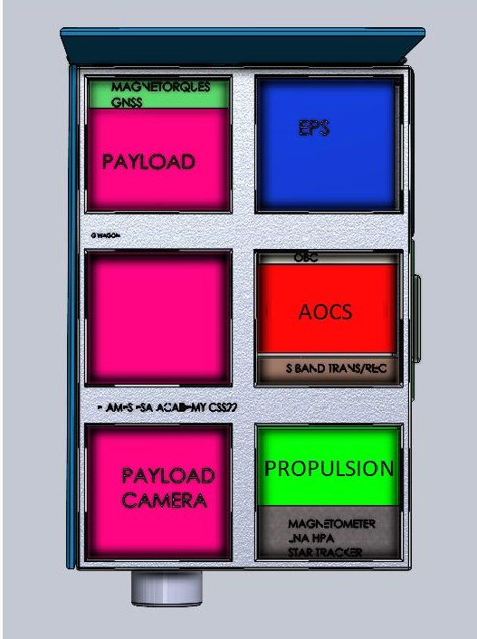
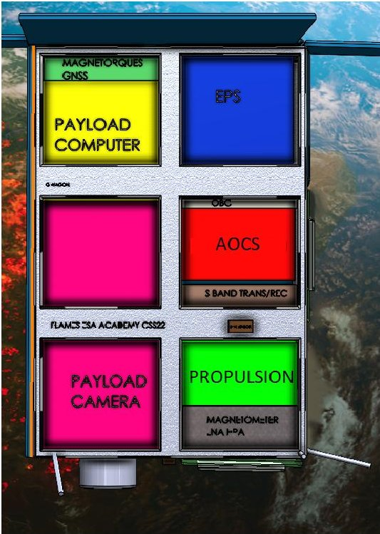

<!-- PDF_PAGE: 1 -->

# FIRE LOCALISATION AND MITIGATION EMERGENCIES SATELLITES: A CONSTELLATION OF CUBESATS IN LEO FOR MONITORING WILDFIRES IN NEAR REAL-TIME

Benjamin Verbeek $ ^{1} $ , Luis Alberto Cañizares $ ^{2,3} $ , Nicolas Oidtmann $ ^{4} $ , Susanne Miranda Aalestrup $ ^{5} $ , Hubert Gross $ ^{6} $ , Lucile Siegfried $ ^{7} $ , András Szilágyi-Sándor $ ^{8} $ , Ties Rozema $ ^{13} $ , Antonia Bieringer $ ^{9} $ , Hya Mohamed $ ^{10} $ , Andreea Lita $ ^{11} $ , Ashley Shaw $ ^{12} $ , Evelina Sakalauskaite $ ^{12} $ , Théo Huegens $ ^{13} $ , Ioanna Styliani Ellina $ ^{14} $ , Benedikt Schmidt $ ^{15} $ , Chiara Armandi $ ^{16} $ , Davide Scalettari $ ^{17} $ , Nikodem Bartnik $ ^{18} $ , Timo Pospišil $ ^{19} $ , Agnese Raia $ ^{20} $ , Andreu Mas-Viñolas $ ^{21} $ , Cristian-Mihai Buta $ ^{11} $ , Daniel Pavón Luque $ ^{22} $ , Erwan Raguideau $ ^{23} $ , Irene Saiz Briones $ ^{24} $ , Miriam Abreu Neves $ ^{25} $ , Daniel Wischert $ ^{26} $ , Johan Vennekens $ ^{26} $ , Patrick Lux $ ^{26} $

$ ^{1} $Uppsala University, Box 516, SE-75120 Uppsala, Sweden, $ ^{2} $Astronomy & Astrophysics Section, Dublin Institute for Advanced Studies, D02 XF86, Ireland, $ ^{3} $School of Physics, Trinity College Dublin, Dublin 2, Ireland, $ ^{4} $Hamburg University of Technology, Am Schwarzenberg-Campus 1, 21073 Hamburg, Germany, $ ^{5} $Department of Electronic Systems, Aalborg University, DK-9220, Aalborg, Denmark, $ ^{6} $Rzeszów University of Technology, al. Powstańców Warszawy 12 35-959 Rzeszów, Poland, $ ^{7} $EPFL, Rte Cantonale, 1015 Lausanne, Schweiz, $ ^{8} $Eötvös Loránd University, Budapest, Pazmány Péter sétány 1/A, 1117 Hungary, $ ^{9} $Technical University of Munich, Arcisstraße 21, 80333 München, Germany, $ ^{10} $York University, 4700 Keele St, Toronto, ON M3J 1P3, Canada, $ ^{11} $Politehnica University of Bucharest, Splaiul Independentei 313, Bucuresti 060042, Romania $ ^{12} $The University of Sheffield, Sheffield S10 2TN, Great Britain, $ ^{13} $Delft University of Technology, Mekelweg 5, 2628 CD Delft, the Netherlands, $ ^{14} $Aristotle University of Thessaloniki, Thessaloniki 541 24, Greece, $ ^{15} $Julius-Maximilians-University of Würzburg, Sanderring 2, 97070 Würzburg, Germany, $ ^{16} $University of Surrey, Stag Hill, University Campus, Guildford GU2 7XH, Great Britain, $ ^{17} $Politecnico di Milano, Piazza Leonardo da Vinci, 32 20133 Milano, Italy, $ ^{18} $Silesian University of Technology, 44-100 Gliwice, Poland, $ ^{19} $University of Applied Sciences Wiener Neustadt, Johannes-Gutenberg-Straße 3, 2700 Wiener Neustadt, Austria, $ ^{20} $Politecnico di Torino, Corso Duca Degli Abruzzi 24, 10129 Torino, Italy, $ ^{21} $Universitat Politecnica de Catalunya, Carrer de Jordi Girona, 31, 08034 Barcelona, Spain, $ ^{22} $Universidad Rey Juan Carlos, Av. del Alcalde de Móstoles, Madrid, Spain, $ ^{23} $Toulouse INP-ENSEEIHT, 2 Rue Charles Camichel, 31000 Toulouse, France, $ ^{24} $Imperial College London, Exhibition Rd, South Kensington, London SW7 2BX, Great Britain, $ ^{25} $Universidade de Coimbra, 3004-531 Coimbra, Portugal, $ ^{26} $Concurrent Design Facility (CDF), European Space Agency (ESA), ESTEC, the Netherlands

## Abstract

The effects of global warming are already taking a toll on our planet. According to the US congressional research service an average of >7 million acres are being burnt every year in the USA alone. The European Commission's "European Forest Fire report" has shown that the deforestation rates are increasing at an alarming rate and with hotter years and drier climates the amount of burnt land is only expected to increase. The paper outlines the Fire Localisation And Mitigation Emergencies Satellites (FLAMES), a constellation of 16 CubeSats (6U) in Low Earth Orbit (LEO) designed to monitor wildfires in near real-time with the ability of having worldwide coverage 24/7. The constellation consists of 8 High Field Of View (FOV)-Low Resolution satellites and 8 Low FOV- High Resolution satellites observing in the thermal infrared spectrum. The mission is designed to be launched by a single Vega-C rocket making use of the Small Spacecraft Mission Service (SSMS) platform and placed into a single plane Sun-synchronous orbit (SSO). FLAMES is a Phase 0 mission designed by university students during ESA Academy's CubeSat Summer School 2022 in the Training and Learning Facility at ESEC-Galaxia, Belgium. This mission study was a deliverable of the Concurrent Engineering Workshop guided by ESA System Engineers. The students were divided into several disciplines, each group dedicated to a different subsystem and worked together, making use of the Concurrent Model-based Engineering Tool (COMET) and supervised by ESA System Engineers. As a result, each different group showed a detailed analysis of their respective subsystem and reported on the lessons learnt during the Concurrent Engineering process. This paper provides an overview of the preliminary design of FLAMES and the Concurrent Engineering process applied during ESA Academy's CubeSat Summer School 2022 to develop this mission.

<!-- PDF_PAGE: 2 -->

## I. INTRODUCTION

Wildfires are uncontrolled and rapidly spreading fires that occur in wildland areas such as forests and savannas. They can be caused naturally (e.g. lightning strikes) or as a consequence of human activity (e.g. unattended campfires). The effects of climate change have promoted the conditions for rapid spread and magnitude of wildfires [1,2,3] and as a consequence there has been a reported increase of wildfires globally [4]. The Congressional Research Service of the United States (USACRS) [5] documented an annual average of over 7 million acres burned solely within the USA and [6] quantified the area of burned wildland to exceed 3 million km $ ^{2} $ as reported from the United Nations International Strategy for Disaster Reduction.

The coupling mechanisms between climate change effects and wildfires are still subject to investigation [7] and require an understanding of the relatively large scale of wildfires. Furthermore, the devastation of wildfires in countries such as Australia have increased the demand for a monitoring strategy [8]. Small satellites such as CubeSats, could be a potential low cost solution [9] to this problem. However, the small form factor of CubeSats result in low resolution images that need to be enhanced as shown by [10] where a convolutional neural network was used as a mitigation technique. A notable mission is described in [11] where a constellation of CubeSats was designed for the purpose of wildfire monitoring. The main trade off discussed in this design concept is between sensor quality and physical restrictions. With this in mind the mission was designed with a resolution of 200 m at an altitude of 600 km. An alternative solution to this trade off is proposed in this paper, where instead of designing a unique CubeSat, the workload is split between a Low Resolution CubeSat and a High Resolution CubeSat.

In this paper we present the Fire Localisation And Mitigation for Emergencies Satellites (FLAMES), a CubeSat constellation concept designed as a concurrent engineering exercise which was part of ESA's CubeSat Summer School 2022. In Section 2 we will discuss the System Engineering approach and system requirements, Section 3 will discuss each of the different subsystems of the mission and Section 4 will conclude with a summary of the mission.

## II. SYSTEM ENGINEERING AND REQUIREMENTS

FLAMES is a phase 0 study carried out during the Concurrent Engineering Workshop at the ESA CubeSat Summer School 2022. During five workdays a team of 30 students guided by ESA Concurrent Design Facility personnel worked in 7 different teams on one subsystem each. The premise of the mission together with mission requirements were set before beginning the study.

In a first implementation, the constellation shall serve as a technology demonstrator, with the possibility to be extended in the future. The mission shall ensure global coverage within 12 hours and provide at least one high-resolution image of an active fire every 10 minutes. The overall Mission Requirements, derived from the Mission Objectives can be found in Apendix Table 5.

Fig. 1: FLAMES mission concept. Pairs of Low Resolution (LR) and High Resolution (HR) satellites will orbit the Earth scanning for wildfires. (1) The LR satellite scans the earth for wildfires. (2) Once a wildfire is detected the coordinates are computed. (3) The coordinates are sent to the HR satellite which slews towards it. (4) The HR satellite will then gather data of the wildfire. (5) The HR data is sent to the LR satellite. (6) The LR satellite relays the HR data to the ground station.

<!-- PDF_PAGE: 3 -->

The concept of operations is sketched in Figure 1 and described in the following: The constellation will consist of multiple CubeSats each carrying either a highresolution (HR), narrow Field of View (FOV) or a low-resolution (LR), wide FOV infrared camera on board. Upon detection of a possible fire by the LR satellite, location of the area of interest is relayed via Inter-Satellite Link (ISL) to the HR satellite. The HR satellite proceeds to take a picture of the indicated area and relays this image back to the LR satellite, which ultimately downlinks the HR image to ground for downstream use. The characteristics of the infrared cameras can be found in Appendix Table 8.

For the sake of the feasibility study a minimal mission lifetime of 0.5 years for nominal operations is assumed, with the option for another 2.5 years mission extension. The thermal operating ranges for all instruments on board the satellites is assumed to be between $ 0^{\circ} \mathrm{C} $ and $ 30^{\circ} \mathrm{C} $ . Compared to the LR satellite, the HR satellite has an additional mode of operation for performing slew manoeuvres.

A full list of the system requirements for the HR and LR satellites can be found in Tables 6 and 7 respectively. All satellites shall comply to the CubeSat Design Specification, shall be compliant with the Space Debris Mitigation Guidelines [12] and enable the above mentioned nominal and extended mission lifetime.

During the study, the Systems Engineering Team was tasked with tracking the mass and power budget for the satellites, to make sure the study is converging towards a feasible solution and to make sure all student teams have access to the required input for their respective subsystem design.

This phase 0 was designed with the assumption of launching using the Small Spacecraft Mission Service (SSMS) or other ride-sharing launch opportunities. These launching platforms are standardized and as a consequence, the launch interface platform an launch procedure were not designed and should be subject of further study.

## III. SUBSYSTEMS

## III.i Mission Analysis

Here we determined a preliminary orbital specification that adheres to space debris mitigation guidelines. To do this we determined the necessary velocity difference (delta-v) to phase out spacecraft in the correct constellation from a Vega-C parking orbit. The number of satellites needed to meet the imaging frequency requirement was also studied. A preliminary design assumption was the use of a perfectly circular orbit.

Fig. 2: Simulation of the FLAMES constellation. LR satellites have wider FOV shown here as cones, HR satellites have narrower FOV.

To ensure the constellation can provide global coverage while keeping the number of satellites as low as possible, a maximum FOV is desired, i.e. as high an orbital altitude as possible while still adhering to space debris mitigation guidelines. The only way to ensure global coverage while maintaining the constellation in a single orbital plane, a design assumption, is using a polar orbit. At 600 km altitude, simulations in ESA's Debris Risk Assessment and Mitigation Analysis (DRAMA) tool indicated that the altitude deterioration due to drag is negligible at the mission timescales (0.5 years plus 2.5 years possible extended lifetime), and thus boosting maneuvers are not necessary. [13] Furthermore, it shows an atmospheric re-entry approximately 25 years after launch without further maneuvers, as is required by space debris mitigation guidelines. [12] The exact timing must be investigated further since small deviations in drag coefficient have a large impact on reentry time.

At 600 km altitude a minimum of eight LR satellites is required. This is determined by considering the fraction of the equator visible by the LR satellite camera divided by the distance Earth drifts under the orbital plane at the equator in one orbital period. The same number of HR-satellites is used for

<!-- PDF_PAGE: 4 -->

ease of communication and to ensure frequent images of an area-of-interest. Therefore, a total of 16 satellites are required. As a working assumption they are placed evenly spaced around the orbit, yielding an inter-satellite distance of 2700 km. All 16 satellites are launched into the same orbit with one Vega-C launch. Once in parking orbit, a double Hohmann transfer can be used for each satellite to distribute them evenly across the orbit. Using this technique the orbit phasing takes 2 months and requires a delta of at most 2.8 m/s (for the $ 1 8 0^{\circ} $ phasing). A 9:30 Sun-synchronous orbit (SSO) was proposed with $ i=9 7. 8 \pm0. 2 $ deg, $ e=0. 0 0 \pm0. 0 4 $ , $ a=6 0 0 \pm7 $ km. The low eccentricity ensures nearly constant resolution and its beta-angle is optimal: suitable for the observation purposes and for the power and communication constraints.

Figure 2 shows a visualization of the constellation. Similar system requirements apply for the LR and HR satellites. The differences indicate two similar CubeSats and oblige the different roles of them and to handle the different payloads. The Field of View of the LR-camera and the constraints for the orbit altitude imply the minimum number of the satellites.

## III.ii Power Subsystem

## Power Subsystem Overview

The Electrical Power Subsystem (EPS) supplies the other subsystems with power and must fulfill some key requirements. While most of these requirements hold for both satellites, some of them are specific to the LR and HR satellite due to the different payloads.

The EPS is in charge of supplying the satellites with a robust and affordable power source during their operational lives. The major goals of this subsystem are to not exceed the batteries' specified depth of discharge and to provide the required power during both daylight and eclipse conditions.

A more precise choice of components for the power subsystem was made as a result of ongoing and iterative conversations with the other subsystem teams about power requirements, structural considerations, and thermal limits. To ensure appropriate generation and storage of power during the day, the power requirements for HR and LR satellites have been taken into consideration (see Table 1).

The power requirements are based on the energy budget, which depends on each subsystem's energy needs. Each mission phase is considered separately in order to identify minimum and maximum power consumption. In order to increase the robustness of the EPS margins are added based on ESA's margin philosophy [14] ensuring the minimum requirements for the continuity of the mission.

The solar arrays and batteries are sized taking into account the percentage of the orbit duration where solar power can be generated. In order to maintain operations, the power output required from the solar panels was determined considering the most pessimistic scenario (i.e., the orbit with the longest eclipse duration). With a worst case eclipse time of $ t_{ecl}=0. 5 5 $ hrs/orbit and orbital period $ t_{orbit}=1. 61 $ hrs at 600 km altitude (see Section 3.1), the power generated $ P_{g} $ is equivalent to an energy of $ E_{g}=\left(t_{orbit}-t_{ecl}\right)P_{g} $ during one orbit $ \left(t_{orbit}=1. 6 \mathrm{~hrs}\right) $ The effects of the solar panels on the satellites' structure were also considered in order to maximize power generation and minimize shadowing impacts.

Table 1: Satellite Power Requirements

<table border="1"><tr><td>Satellite type</td><td>Eg[Wh/orbit]</td><td>Pg[W]</td></tr><tr><td>HR</td><td>29.5</td><td>28.1</td></tr><tr><td>LR</td><td>37.3</td><td>35.5</td></tr></table>

## Power Subsystem Trade-Offs

The first trade-off to be considered during the phase 0-design stage is the type of power generating system. The fleet of satellites is in Low Earth Orbit (LEO), offering high solar radiation. This, combined with the CubeSat's small size, make a solar EPS the most suitable solution. Additionally, many Commercial Off-The-Shelf (COTS) components are available on the market for a CubeSat solar EPS, with flight heritage and high reliability.

The Earth-observing cameras consume a large amount of power - several Watts - requiring an extended solar panel surface. Additionally, pointing restrictions do not allow efficient energy production. As the cameras are always pointing to Earth and the Inter-Satellite Link (ISL) is always pointing to other satellites for constant communication, no degree of freedom is left to rotate the solar panels to face the Sun perpendicularly, generating less power. Additionally, due to its narrower field of view, the HR camera has stricter pointing requirements, leading to a slightly higher power consumption.

As a result, several arrays had to be implemented to meet a net positive power production throughout one orbit. To simplify the design, the same solar

<!-- PDF_PAGE: 5 -->

array configuration was selected for both satellites considering the determining case of the HR satellite.

Endurosat solar panels were chosen due to their flight heritage with proven reliability and low degradation in LEO. The list of component selection is as follows: two 6U deployable solar arrays [15], two 3U deployable solar panels [16], and two 1U solar panels [17]. Referring to Figure 3, the fixed 2U (2x1U) solar panel is placed on top side of the satellite. The four deployable arrays are fixed on the adjacent sides during launch and are deployed during early operations. The IMEPS Modular Electrical Power System from ISISPACE [18] has been chosen due to its proven reliability in previous missions. Additionally, it is capable of communicating over both integrated-integrated circuit (I2C) and Universal Asynchronous Receiver/ Transmitter (UART) with the Onboard Computer (OBC), while being relatively lightweight. Additionally, it is already certified for thermal, passive load, and vibration tests.

Fig. 3: Solar panels configuration.

## Power Subsystem Conclusion

Pointing requirements on AOCS and high power consumption of the cameras present challenges for net positive energy production during an orbit. Components were selected to fulfill the requirements with a focus on reliability, and deployable solar arrays were used to optimise power generation within the pointing requirements. Preliminary analysis shows a net positive energy production but further analysis is needed to assess the effect of the satellite's attitude and possible shadowing of solar arrays on each other. Remaining open points on the design also include a detailed study of the panels' I-V characteristic curve,

the panels' degradation due to solar radiation, and the batteries' degradation in orbit.

## III.iii Communications & Data Handling

The purpose of this subsystem is to ensure that image and housekeeping data can be stored onboard the satellites. Furthermore, it has to provide up- and downlink capabilities to ground stations on Earth as well as the option of an Inter-Satellite Link (ISL) between the satellites.

## Communication Design Assumptions

The design of the complete telecommunications system is depicted in Figure 4, and the design for the LR is presented in Figure 5.

Both satellites communicate via ISL, using an S-band antenna. The LR satellite sends the information to the ground antenna (on the GS), via Downlink, by using another S-band antenna on the LR satellite. The GS also sends TC and receives TM, from both satellites, by using a UHF antenna (fig. 4).

Fig. 4: Global Scheme of the Communications & Data Handling Subsystem

Looking specifically at the LR Satellite, it was decided to implement two S-band antennas for downlink and ISL respectively. With this setup the slew required for ISL is minimized and downlink and ISL can potentially be performed simultaneously. Yet only one S-band transceiver is required since it offers two antenna ports. For TT&C a UHF antenna is used.

In the High-Resolution satellite, an almost identical setup is used, with the exception that no image down-

<!-- PDF_PAGE: 6 -->

Fig. 5: Low Resolution Satellite Scheme

link is required and thus no S-band antenna for downlink to the GS is present.

## Data Calculations

The amount of data being recorded has to be determined so that an appropriate communication system can be designed. Some assumptions are made as of this early development stage. According to mission analysis the High Resolution (HR) and Low Resolution (LR) satellites are 2700 km apart and the satellites are around 600 km altitude. It is assumed there is roughly 150 Bits of Telemetry (TM) data generated per second and there are 10 HR images of 12.58 MB each taken per orbit. This translates to 125.8 MB image data and 0.675 MB of TM data. With an average contact time of 8 minutes per Ground Station (GS) overpass an image downlink respectively S-Band of 2.1 Mbit/s and a TM downlink or Ultra High Frequency (UHF) of 1.7 kBit/s is required.

## Link Budget

As detailed above the system requires four wireless communication links. Thus, four link budgets were calculated. The results of the link budgets are summarized in Table 2. It can be seen that even with a 3 dB margin all links are closed. Yet the Eb/N0 for the S-band channels is quite low and may need to be increased with further amplifications in future iterations.

## III.iv Propulsion Subsystem

Propulsion is necessary for the FLAMES satellites to achieve the precise phasing of the constellation from a

Table 2: Link budget results

<table border="1"><tr><td>Link</td><td>Eb/N0[dB](3dBmargin)</td><td>Data rate[kBit/s]</td></tr><tr><td>S-Band downlink</td><td>2.88</td><td>7000</td></tr><tr><td>UHF downlink</td><td>8.3</td><td>2</td></tr><tr><td>UHF uplink</td><td>10.51</td><td>2</td></tr><tr><td>ISL</td><td>4.05</td><td>7000</td></tr></table>

single launch which requires $ \Delta v=2. 8 \mathrm{~ m / s} $ . Because of the short time frame imposed on the project and the costs of developing a thruster from the ground-up, the group decided early in the process to focus on COTS options.

## Requirements

The propulsion system must balance technical performance, regulations, and safety while staying within budgets to achieve mission objectives. Key design factors like delta-v requirements, mass, volume, and power availability were considered. Delta-v indicates the system's thrust capability.

## COTS Subsystem Options

A database of different options was built early-on. The subsystems considered were taken from CubeSat or SmallSat applications and their Technology Readiness Level [19] was evaluated with respect to the latest developments found and the first mission was indicated if the system had any flight history. Specifications relevant to the evaluation of the various options such as specific impulse (Isp), minimum impulse bit (MIB) or power required was tabulated.

To allow for a fair comparison, the performance of each system needed to be evaluated with respect to the FLAMES spacecraft: the propellant mass required $ M_{p} $ , time to maneuver $ t_{b} $ $ \Delta V $ and the maneuvering accuracy of the spacecraft $ d\Delta V $ given its MIB is derived using the maximum possible mass of 12 kg along with a 100% $ \Delta V $ margin to account for the station-keeping phase.

## Propulsion Type Trade-Off

A trade-off on propellant option was done to narrow the search for a viable system. The criterion used were chosen such that a high scoring option would be likely to include the best system for the mission. Each criteria was then quantified for the FLAMES satellite's current design state on a scale from 1-5 and weighed by estimated importance. The resulting final table is presented in Table 3. The final trade-off table pointed towards a cold-gas system.

<!-- PDF_PAGE: 7 -->

Table 3: Trade-off with weights, ranks (r), scores (s) and results

<table border="1"><tr><td></td><td></td><td colspan="2">Chemical</td><td colspan="2">Electrical</td><td colspan="2">Cold Gas</td></tr><tr><td>Parameters</td><td>weight</td><td>r</td><td>s</td><td>r</td><td>s</td><td>r</td><td>s</td></tr><tr><td>Wet mass</td><td>0.4</td><td>2</td><td>0.8</td><td>5</td><td>2</td><td>3</td><td>1.2</td></tr><tr><td>Volume</td><td>0.2</td><td>3</td><td>0.6</td><td>5</td><td>1</td><td>4</td><td>0.8</td></tr><tr><td>Energy</td><td>0.4</td><td>5</td><td>2</td><td>2</td><td>0.8</td><td>5</td><td>2</td></tr><tr><td>Complexity</td><td>0.1</td><td>4</td><td>0.4</td><td>3</td><td>0.3</td><td>5</td><td>0.5</td></tr><tr><td>Reliability</td><td>0.25</td><td>3</td><td>0.75</td><td>3</td><td>0.75</td><td>4</td><td>1</td></tr><tr><td>Keep Out Zone</td><td>0.05</td><td>3</td><td>0.15</td><td>3</td><td>0.15</td><td>3</td><td>0.15</td></tr><tr><td>Thrust duration</td><td>0.3</td><td>5</td><td>1.5</td><td>2</td><td>0.6</td><td>3</td><td>0.9</td></tr><tr><td>Results:</td><td>1.7</td><td></td><td>6.2</td><td></td><td>5.6</td><td></td><td>6.55</td></tr></table>

## Final Selection

The study evaluated additional cold-gas and electrical thruster options along with their criteria and requirements, favoring those offering higher margins and design flexibility. The cold/hot-gas "CHIPS 180" from CU Aerospace was chosen: with a volume of 0.54U and dry mass of 750 g, it offers up to 16 mN of thrust when used as a warm gas thruster, consuming 20 W. It performs the required orbital maneuvers in 8.8 to 12.7 minutes using 6 to 12 bursts.

## III.v Attitude and Orbit Control System

The cold/warm capability offers extra flexibility for later design changes on the mission profile or EPS side. Additionally, it can provides attitude control capabilities using RCS in 6 degrees of freedom which could lighten the load or act as a redundant system on ADCS. While the minimum thrust requirement was waived due to alternative solutions, the chosen thruster fulfilled mission needs.

The primary objective of the Attitude and Orbit Control System (AOCS) is to determine the attitude of the CubeSat and precisely point and stabilize it for imaging of wildfires and communication via ISL and towards ground.

## Requirements

Driving requirements for design of the AOCS are the compliance with the maximum absolute and relative pointing errors for the payloads specified in Appendix Table 8. Furthermore, the AOCS shall be able to detumble the CubeSat during one orbit. When entering safe mode, the AOCS shall initiate and maintain a controlled spin to manage spacecraft dynamics and thermal environment.

## Design Assumptions

In order to design the AOCS subsystem, two different sets of requirements were observed for the LR and

Table 4: Slew manoeuvre calculations

<table border="1"><tr><td>Phase</td><td>$\Delta T$ [s]</td><td>$\Delta \theta$ [deg]</td></tr><tr><td>Acceleration and deceleration</td><td>7.07</td><td>1.06</td></tr><tr><td>Pointing towards fire coasting</td><td>7.07</td><td>42.88</td></tr><tr><td>ISL coasting</td><td>44.60</td><td>13.38</td></tr></table>

HR satellites. Taking these into account, a series of design assumptions were made to simplify this subsystem design. Based off the book 'The New SMAD [20], internal torques are deemed negligible, and a series of relevant values as seen below (Cp: Center of pressure, Cm: Center of mass, Cpa: Center of aerodynamic pressure, $ I_{z} $ and $ I_{y} $ : Moments of inertia around z and y axis). Furthermore, one orbit was taken into account for detumbling after deployment. Magnetorquers were not deemed to provide sufficient pointing accuracy for the satellites and Earth-orientation of the satellite was needed.

- Turning speed of the satellite of 0.3 deg/s.

- Residual dipole (3U cubesat literature) = 0.01.

- $ \lambda \left(f\left(l a t\right)\right)=2 $ for polar orbit.

- Drag coefficient = 4 (Mission analysis).

- Cpa-Cm=0.0001 m.

- $ I_{z}=0.05101, I_{y}=0.1392 \mathrm{~kgm}^{2}. $

## Slew Manoeuvres

Two important slew manoeuvres during nominal operations are the pointing towards an area of interest on ground and pointing towards the LR Satellite for communication via ISL, both performed by the HR satellite. The manoeuvres can be divided into an acceleration phase, a coasting phase and a deceleration phase. Assuming the worst-case angles to be overcome for both manoeuvres, the maximum slew times are computed. The results are listed in Table 4.

## Analysis Result

Angular turning rates might be introduced to the satellite after deployment from the dispenser. Detumbling is a critical first step during the commissioning of the satellites. This is performed by the AOCS using the magnetorquers. Assuming the worst-case tumbling rate after deployment around the axis with the highest moment of inertia, the total time for detumbling is found to be within an acceptable margin.

<!-- PDF_PAGE: 8 -->

Time to detumble:

$$
\cdot T _ {m g t} = 0. 5 B D = 5. 2 3 \cdot 1 0 ^ {- 6} \mathrm {N m}
$$

$$
\cdot I _ {s a t} = 0. 1 3 9 \mathrm {k g m} ^ {2}
$$

- Tumbling Rate = 0.15 deg/s

$ \delta_{t}=6 6. 4 \mathrm{~ m i n}<9 6 \mathrm{~ m i n} $ (orbital period)

## Trade-Offs

In order to determine the type of hardware used in LR and HR satellites that meet the requirements, many iterations of trade-offs were made in terms of mass, volume and power consumption. For example, for the LR satellite, a low-cost sun sensor with a mass of 0.5 g and an accuracy of $ \pm 1 0^{\circ} $ was initially considered to reduce weight. Unfortunately, during subsequent iterations it became necessary to have higher accuracy. It was then decided to use a sun sensor with an accuracy of $ \pm 0.1^{\circ} $ , but at a higher cost and with the mass increased to 4 g apiece.

The HR satellite was more demanding in terms of requirements than the LR satellite. In this case, a star tracker was required in addition to initial spatial orientation using sun sensors. In order to reduce weight and power consumption, it was decided to remove the sun sensors, and their function of initial orientation (with less accuracy) is to be performed by voltage readings from photovoltaic panels. The role of determining position with high accuracy was taken over by the star tracker.

In both satellites, the aim was to keep the mass as low as possible while maintaining their functionality. Initially, the use of 2 reaction spheres per satellite was considered, with a combined mass of 500 g. However, in a later analysis, it was decided to use 4 reaction wheels with a higher combined mass of 665 g, but with a smaller volume.

## III.vi Thermal Subsystem

The thermal subsystem is responsible for regulating temperature across the CubeSat to ensure that all components are maintained in operating conditions. Factors such as heat generation from the power subsystem, heat transfer between subsystems and thermal cycling as the CubeSat transition between phases of the satellite mission will each have an impact on temperature of the satellite, and thereby how the thermal subsystem should be designed.

## Design Assumptions

In order to accurately calculate the on-orbit thermal loads of the CubeSat, each subsystem should have

been considered when conducting the thermal analysis. At the time of analysis, there was not enough data on power consumption by component, therefore the following design assumptions for the thermal subsystem were conjectured:

- Whole satellite except nadir-facing side (payload) is covered in solar panels

- The satellite is in a Sun Synchronous Orbit (SSO) with beta angle ranging between-22 and -32 degrees, calculations were ran using average beta angle of-27 degrees.

- Satellite is a 6U CubeSat with surface area equal to $ 0. 2 2 \mathrm{~ m}^{2}. $

- The deployment temperature is $ 2 0^{\circ} \mathrm{C} $

- The CubeSat has a Black Anodized Aluminum coating, using NASA Spacecraft Thermal Control Coatings References as a reference. (absorptivity equal to 0.65, emissivity equal to 0.82) 21

- The most critical subsystem is the payload subsystem, which operates between $ 0-3 0^{\circ} \mathrm{C} $

In the next step, the team created an algorithm that allows for automatic calculation of the on-orbit thermal loads, reducing calculation time when making adjustments. By providing the simulation parameters such as the orbital information, the CubeSat properties, the thermal environment it operates in, and the characteristics of the planet it orbits, the code solves the heat equation to determine the thermal load experienced by the satellite throughout its journey, taking solar flux, albedo, and Earth's IR into consideration.

Fig. 6: On-orbit thermal loads plot over calculations.

The four resulting graphs of the algorithm are shown

<!-- PDF_PAGE: 9 -->

at Figure 6, highlighting the thermal load on all sides of the satellite. It can clearly be seen that the $ \pm X $ and $ + Z $ sides experience the highest solar flux compared to the rest of the body. However, considering that this is a CubeSat with relatively small volume, it was determined that passive thermal control would be the best path for cost, volume and simplicity reasons. Therefore, covering the CubeSat with solar panels on all sides except nadir facing was determined to be the best option, as it will allow for heat dissipation while simultaneously providing the satellite with additional power.

## III.vii Structure and Configuration

The structure of FLAMES' CubeSats houses all the other systems in a 6U configuration. Each piece of equipment is positioned within the frame in a way that ensures the nominal operation of each subsystem. This ensures the mission objectives can be met. The structure of the CubeSat needs to withstand the expected loads and provide stiffness.

## Assumptions

Both the LR and HR satellites were to be 6U CubeSats with the possible addition of a "tuna can". To reduce complexity, it was decided to make both satellites as similar as possible despite the HR satellite having a larger camera. Similarly, all major components were modeled as cuboids as accurate dimensions were not available for all pieces of equipment. The center of mass was assumed to lie at the center of the CubeSat.

## Structure and Configuration Requirements

Before starting work on the design of the LR and HR satellites, the sub-team agreed on important requirements that the design must satisfy. Firstly it was important that the satellites complied with CubeSat standards [22] as well as fit the deployer specifications. This ensures the CubeSats can be released without any obstructions or damage caused. Other important requirements included positioning the camera along the Z-axis (earth facing side) of both the HR and LR satellites and positioning the antennas so that they had a clear line of site to ground and the other satellites. This helps the satellites reliably communicate between each other and relay image data to the ground station quickly.

## Design and Structure

To reduce the costs, a commercially available 6U CubeSat frame from ISISpace was selected for both the LR and HR satellites. This meant no new frame

needed to be developed and ensured the payload would withstand the vibrations and shock experienced during launch.

For both the LR and HR satellites the camera lens occupied the "tuna can" space (Figure 7), this allowed the magnetorquers and GNSS to use up the remaining space above. The other half of the CubeSat houses the EPS, OBC, Propulsion, S-band transceiver, AOCS, magnetometer, star tracker as well as the LNA and HPA for the S-band transceiver (ISL). The S-band antenna was positioned on one of the 3U faces to allow communication between satellites. Similarly on the same face as the camera lens was the UHF antenna for communication with the ground station. The configurations are rendered in Figures 7 and 8.

Fig. 7: Layout of an HR satellite

The LR satellites required an additional S-band antenna for transmitting image data to the ground station (Figure 8). This antenna is initially folded during launch but then deploys to give a good connection with the ground station.

<!-- PDF_PAGE: 10 -->

Fig. 8: Layout of an LR satellite

Future work will involve modeling the positions of each subsystem with more detail by using accurate dimensions instead of cuboids. This will allow for a more effective use of space. A series of simulations should also be carried out to investigate how well the satellite's structure withstands the conditions of launch. This will be accompanied by vibration testing. Additionally, the CubeSat frame will be compared to other commercially available options that could be cheaper or offer a better component mounting system.

## IV. CONCLUSION

The purpose of this Phase 0 study was to show the feasibility of FLAMES, a CubeSat mission composed of eight LR CubeSats (6U) and eight HR CubeSats (6U) (16 total) orbiting in a SSO with the purpose of monitoring wildfires. The mission was designed to have full global coverage within 12 hr using on-board IR cameras.

The mission was designed with the assumption that it was launched into LEO using a single SmallSatlaunch. The standardized form-factor of the CubeSat and the high degree of modularity of both the satellites and the constellation gives significant freedom in adjusting observation capacity by adding satellites to the constellation of a given type in an orbit of interest. The concept of using two different types of satellites: one housing a low-FOV high-resolution

camera payload and one housing a wide-FOV low-resolution camera payload simplifies some of the challenging trade-offs discussed in previous studies.

While the method of concurrent design and systems engineering resulted in a successful Phase 0 study, this work presents little more than an indication that the concept could be feasible for actual flight. Next steps would include a more careful study of thermal loads, as well as the power-producing capabilities of the solar cells given the limited degrees of freedom for the satellites. Also the structural configuration is a rough estimate, approximating every payload to be a cuboid. The mission analysis section finds a viable solution using 16 satellites. Whether this is enough to make the mission financially viable requires further study, but it appears feasible given the relatively low development cost of CubeSats. Furthermore, orbital decay time must be analyzed in greater detail before any satellites can be launched in order to assure compliance with applicable space debris mitigation guidelines. A benefit of the setup is its modularity the constellation can be readily modified or expanded if the demonstrator is successful.

In conclusion, FLAMES presents an alternative approach to Earth observation missions, in particular forest fire monitoring, by distributing workloads between different small satellite types each optimized for specific tasks and communicating between themselves. As the cost of launching standardized CubeSats into low Earth orbit (LEO) decreases and the satellite industry becomes more streamlined and technologically advanced, missions like FLAMES become increasingly feasible as a cost-effective and highly adaptable choice.

## ACKNOWLEDGEMENTS

The FLAMES project was part of a 4 week summer school known as ESA Academy's CubeSat Summer School 2022. The authors thank ESA Academy for funding this educational project in its entirety, and the ESA Systems and Concurrent Engineering Sector for their support. The participation of presenting author BV at IAC2023 is supported by The Anders Wall Foundation. LAC is supported by the Irish Research Council under grant number GOIPG/2019/2843.

<!-- PDF_PAGE: 11 -->

## REFERENCES

[1] Giovanni Di Virgilio et al. "Climate change increases the potential for extreme wildfires". In: Geophysical Research Letters 46.14 (2019), pp. 8517-8526.

[2] AZ Shvidenko and DG Schepaschenko. "Climate change and wildfires in Russia". In: Contemporary Problems of Ecology 6 (2013), pp. 683-692.

[3] Juli G Pausas and Jon E Keeley. "Wildfires and global change". In: Frontiers in Ecology and the Environment 19.7 (2021), pp. 387-395.

[4] Todd M Ellis et al. "Global increase in wildfire risk due to climate-driven declines in fuel moisture". In: Global change biology 28.4 (2022), pp. 1544-1559.

[5] Congressional Research Service CRS. Wildfire statistics - CRS reports. Accessed on 2023- 08-23. 2023. URL: https: // crsreports . congress.gov/product/pdf/IF/IF10244.

[6] Hassani Youssouf et al. "Quantifying wildfires exposure for investigating health-related effects". In: Atmospheric Environment 97 (2014), pp. 239-251.

[7] Marc Macias Fauria, Sean T Michaletz, and Edward A Johnson. "Predicting climate change effects on wildfires requires linking processes across scales". In: Wiley Interdisciplinary Reviews: Climate Change 2.1 (2011), pp. 99-112.

[8] David Bowman et al. "Wildfires: Australia needs national monitoring agency". In: Nature 584.7820 (2020), pp. 188-191.

[9] Muhammad Hasif Bin Azami et al. "Demonstration of Wildfire Detection Using Image Classification Onboard CubeSat". In: 2021 IEEE International Geoscience and Remote Sensing Symposium IGARSS. 2021, pp. 5413- 5416. DOI: 10.1109/IGARSS47720.2021. 9553108.

[10] Muhammad Hasif Bin Azami et al. "Wildfire detection CubeSat based on convolution neural network". In: SPIE Future Sensing Technologies 2021. Vol. 11914. SPIE. 2021, pp. 85-91.

[11] S. B. Shah et al. "Real-time Wildfire Detection from Space - A Trade-Off between Sensor Quality, Physical Limitations and Payload Size". In: The International Archives of the Photogrammetry, Remote Sensing and Spatial Information Sciences XLII-2/W16 (2019), pp. 209-213. DOI: 10.5194/isprs-archives-XLII-2-W16- 209-2019. URL: https://isprs-archives.

copernicus .org/articles/XLII-2-W16/ 209/2019/.

[12] United Nations Office for Outer Space Affairs. Space Debris Mitigation Guidelines of the Committee on the Peaceful Uses of Outer Space. ST/SPACE/49. 2018. URL: https://www. unoosa.org/pdf/publications/st_space_ 49E.pdf.

[13] D.G. King-Hele and Doreen M.C. Walker. "Predicting the orbital lifetimes of Earth satellites". In: Acta Astronautica 18 (1988), pp. 123-131. ISSN: 0094-5765. DOI: https://doi.org/10. 1016/0094-5765(88)90093-8. URL: https:// www.sciencedirect.com/science/article/ pii/0094576588900938.

[14] European Space Agency. "Margin philosophy for science assessment studies". In: (2012). Reference: SRE-PA/2011.097/, pp. 8-9. URL: https://sci.esa.int/documents/34375/ 36249/1567260131067-Margin_philosophy_ for_science_assessment_studies_1.3.pdf.

[15] Endurosat. 6U Deployable Solar Array. Accessed on 2023-09-11. URL: https://www. endurosat . com / cubesat - store / cubesat - solar - panels / 6u - deployable - solar array/.

[16] Endurosat. 3U Z Deployable Solar Array. Accessed on 2023-09-11. URL: https://www. endurosat . com / cubesat - store / cubesat - solar - panels / 3u - z - deployable - solar array/.

[17] Endurosat. 1U Solar Panel X/Y. Accessed on 2023-09-11. URL: https://www.endurosat. com / cubesat - store / cubesat - solar panels/1u-solar-panel-x-y/.

[18] ISISPACE. "Modular and highly configurable power system suitable for CubeSat missions from 3U upwards." In: (2016). Reference: ISIS.MEPS.DS. 001. URL: https://www. isispace.nl/wp-content/uploads/2019/ 12/ISIS-iMEPSv2-DS-00001-iEPS_ Datasheet v0.2- pdf

[19] European Space Agency. "Technology Readiness Level". In: 2023. URL: https://www. esa . int / Enabling _ Support / Space _ Engineering _ Technology / Shaping _ the _ Future/Technology_Readiness_Levels_TRL.

[20] James R. Wertz, David F. Everett, and Jeffery J. Puschell. "Space mission engineering : the new SMAD". In: 2011. URL: https://api semanticscholar.org/CorpusID:106695674.

<!-- PDF_PAGE: 12 -->

[21] Lonny R. Kauder (NASA Goddard Space Flight Center Greenbelt MD United States). "Spacecraft Thermal Control Coatings References". In: 2005. URL: https://api semanticscholar.org/CorpusID:138737852.

[22] Cal Poly The CubeSat Program. "CubeSat Design Specification". In: 2022. URL: https : / / static1 . squarespace . com / static / 5418c831e4b0fa4ecac1bacd / t / 62193b7fc9e72e0053f00910 / 1645820809779 / CDS + REV14 _ 1 + 2022 - 02 - 09.pdf.

<!-- PDF_PAGE: 13 -->

## V. APPENDIX

## V.i Mission Requirements

Table 5: Mission Requirements

<table border="1"><tr><td>Requirement</td><td>Description</td></tr><tr><td>MIS-M-01</td><td>The mission shall accommodate 2 different payloads on 2 different CubeSats:High FOV,Low-resolution(LR Satellite)Low FOV,High-resolution(HR Satellite)</td></tr><tr><td>MIS-M-02</td><td>The constellation shall be deployed from a single Vega-C launch using the SSMS(Small Spacecraft Mission Service)</td></tr><tr><td>MIS-M-03</td><td>The constellation shall maintain a single plane configuration</td></tr><tr><td>MIS-M-04</td><td>The mission shall ensure at least1 high resolution picture per10 minute of an area of interest can be taken(if in view)</td></tr><tr><td>MIS-M-05</td><td>The mission shall ensure a global coverage every12 hours</td></tr><tr><td>MIS-M-06</td><td>The mission shall ensure the high-resolution images will be downlinked within6 hours of capture</td></tr><tr><td>MIS-M-07</td><td>The satellites shall communicate with each other using an Inter Satellite Link(ISL)</td></tr><tr><td>MIS-M-08</td><td>The low-resolution satellite shall store at least1 low-resolution image per hour for calibration</td></tr><tr><td>MIS-M-09</td><td>The low-resolution satellite shall downlink all images containing fire and all stored calibration images within6 hours of capture</td></tr></table>

V.ii System requirements

Table 6: System Requirements of the LR Satellite

<table border="1"><tr><td>Req. ID</td><td>Requirement</td></tr><tr><td>SYS-LR-01</td><td>The LR Satellite shall comply to the CubeSat Design Specifications.</td></tr><tr><td>SYS-LR-02</td><td>The LR Satellite shall have a lifetime of 0.5 years.</td></tr><tr><td>SYS-LR-03</td><td>The LR Satellite should have an extended lifetime of 2.5 years.</td></tr><tr><td>SYS-LR-04</td><td>The LR Satellite shall be able to withstand the launch environment of Vega-C.</td></tr><tr><td>SYS-LR-05</td><td>The LR Satellite shall accommodate the LR payload.(See Table 8.)</td></tr><tr><td>SYS-LR-06</td><td>The LR Satellite shall provide capability to transmit location information to the HR Satellite via ISL.</td></tr><tr><td>SYS-LR-07</td><td>The LR Satellite shall provide capability to receive high-res image data from the HR Satellite via ISL.</td></tr><tr><td>SYS-LR-08</td><td>Redacted.</td></tr><tr><td>SYS-LR-09</td><td>The LR Satellite shall be compliant with the Space Debris Mitigation Guidelines.</td></tr></table>

<!-- PDF_PAGE: 14 -->

Table 7: System Requirements of the HR Satellite

<table border="1"><tr><td>Req. ID</td><td>Requirement</td></tr><tr><td>SYS-HR-01</td><td>The HR Satellite shall comply to the CubeSat Design Specifications.</td></tr><tr><td>SYS-HR-02</td><td>The HR Satellite shall have a lifetime of 0.5 years.</td></tr><tr><td>SYS-HR-03</td><td>The HR Satellite should have an extended lifetime of 2.5 years.</td></tr><tr><td>SYS-HR-04</td><td>The HR Satellite shall be able to withstand the launch environment of Vega-C.</td></tr><tr><td>SYS-HR-05</td><td>The HR Satellite shall accommodate the HR payload.(See Table 8.)</td></tr><tr><td>SYS-HR-06</td><td>The HR Satellite shall provide capability to receive location information from the LR Satellite via ISL.</td></tr><tr><td>SYS-HR-07</td><td>The HR Satellite shall provide capability to transmit high-res image data to the LR Satellite via ISL.</td></tr><tr><td>SYS-HR-08</td><td>Redacted.</td></tr><tr><td>SYS-HR-09</td><td>The HR Satellite shall be compliant with the Space Debris Mitigation Guidelines.</td></tr></table>

Table 8: Payloads: Thermal Infrared (IR) cameras.

<table border="1"><tr><td></td><td></td><td>Low-Res Payload</td><td>High-Res Payload</td></tr><tr><td>Absolute Pointing Error(APE)</td><td>deg</td><td>3</td><td>0.3</td></tr><tr><td>Absolute Knowledge Error(AKE)</td><td>deg</td><td>0.4</td><td>0.1</td></tr><tr><td>Relative Pointing Error(RPE)</td><td>deg</td><td>0.01/10ms</td><td>1.8/10ms</td></tr><tr><td>Field of View(FOV)</td><td>deg</td><td>31x16</td><td>1.5</td></tr><tr><td>Picture size</td><td>-</td><td>12Mpixels-8bit</td><td>4096x3072 pixels-8bit</td></tr><tr><td>Mass</td><td>kg</td><td>1.5+1.5</td><td>4</td></tr><tr><td>Power</td><td>W</td><td>10W(for10secbeforeandafterandimageacquisition)5W(instandby)</td><td>25W(for60secaroundimageacquisition)1W(instandby)</td></tr><tr><td>Volume</td><td>U</td><td>2+1</td><td>3</td></tr></table>