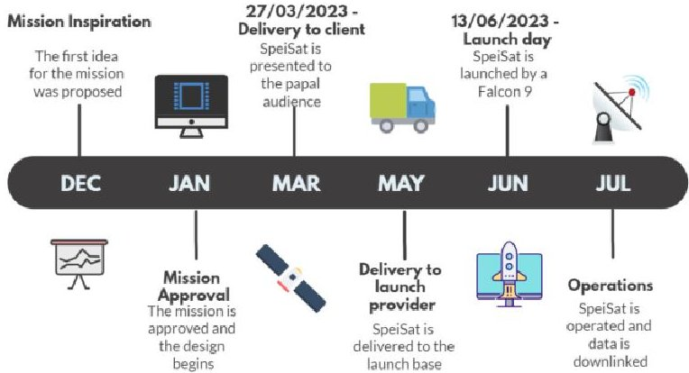
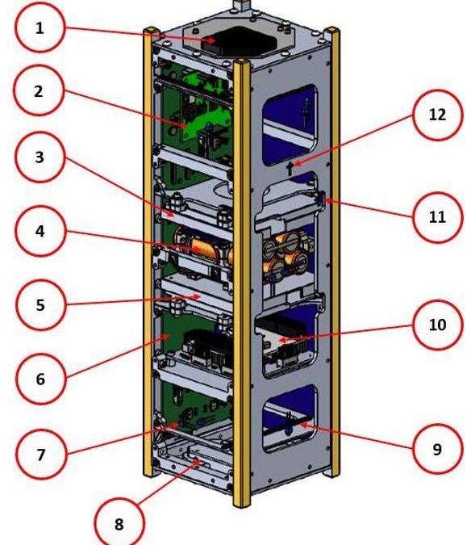
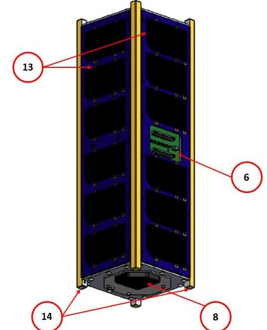
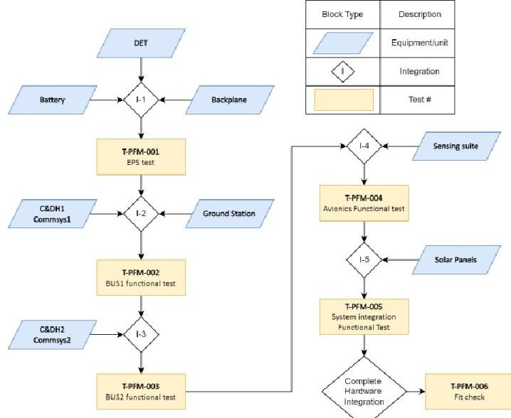
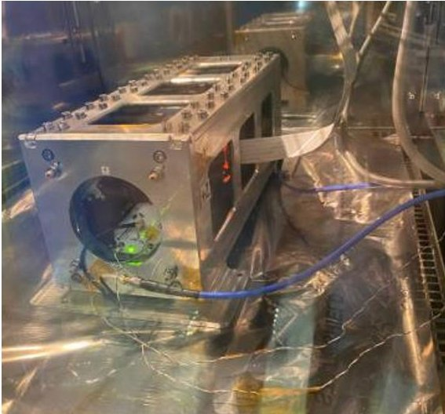
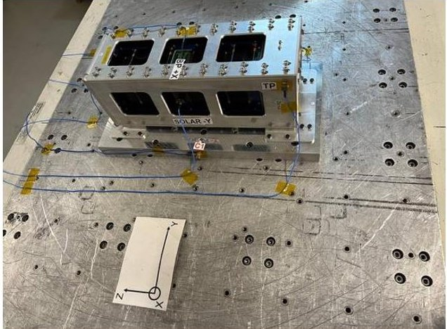
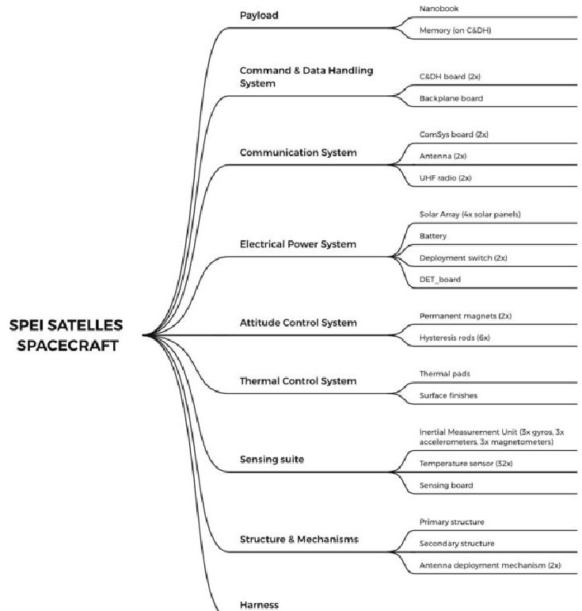
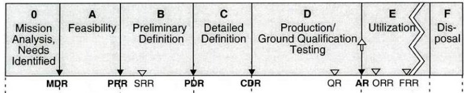

<!-- PDF_PAGE: 1 -->

74th International Astronautical Congress (IAC), Baku, Azerbaijan, 2-6 October 2023. Copyright ©2023 by the International Astronautical Federation (IAF). All rights reserved.

IAC-23,D1,4B,10,x79829

From design to delivery in three months: the fast development of a 3U CubeSat Luisa Iossa $ ^{a *} $ , Sabrina Corpino $ ^{a} $ , Fabrizio Stesina $ ^{a} $ , Giorgio Ammirante, Antonio D'Ortona $ ^{a} $ , Francesco Manconi $ ^{a} $ , Vincenzo Calabretta, Tommaso Giovara, Simone Calamia, Simone Bollattino, Attilio Pettinicchio, Nicola di Gruttola Giardino, Francesco Coppa, Vittorio Gatto, Edoardo Vacchetto

$ ^{a} $ Department of Mechanical and Aerospace Engineering, Polytechnic of Turin, Corso Duca degli Abruzzi 24, Turin, Italy, luisa.iossa@polito.it, sabrina.corpino@polito.it, fabrizio.stesina@polito.it, , giorgio.ammirante@polito.it antonio.dortona@polito.it, francesco.manconi@polito.it, vincenzo.calabretta@polito.it, tommaso.giovara@studenti.polito.it, simone.calamia@studenti.polito.it, simone.bollattino@studenti.polito.it, attilio.pettinicchio@studenti.polito.it, nicola@digruttolagiardino@studenti.polito.it, francesco.coppa@studenti.polito.it, vittorio.gatto@studenti.polito.it, edoardo.vacchetto@studenti.polito.it $ \ast $ Corresponding Author

## Abstract

The System and Technologies for Aerospace Research (STAR) group from Politecnico di Torino is about to reach Earth's orbit for the third time by launching a 3U CubeSat. The CubeSat, mostly developed by students, has the main purpose to complete a communication mission. In addition to that, the CubeSat is also equipped with several temperature sensors and an IMU to make measurements in the space environment. However, the real peculiarity of this CubeSat has been its very fast production cycle: only three months from the first contact with the customer to the delivery of the spacecraft. Multiple concurrent engineering work sessions, supported by a model-based system engineering approach, made it possible to develop an entire CubeSat in such a short time through a multi-V process pushed to the extreme.

The project management extensively implemented agile methodologies to organise the teamwork: tasks were assigned to small groups of students following a simple schedule and reviews of the expected results were performed frequently. At the end of each working day, the team was engaged in a quick recap meeting to address issues risen during the day and to prepare for the tasks that had a high priority for the next day. Most of the tasks were completed in concurrent engineering work sessions, where students assigned to different areas of product development could constantly exchange information and opinions with their colleagues. Furthermore, the concurrent engineering sessions served the purpose to keep the team always updated with product changes and evolution. Another key element was the reduction of documentation reports. Information was exchanged across the team through schematic presentations enriched with technical drawings and lists of specifications. Additionally, a Valispace model was created to keep track of the system's requirements. Since the hardware procurement had to start at the beginning of the project, different mission phases constantly overlapped during the product lifecycle. Quick and frequent iterations between design choices and verification by analysis, following a rapid multi-V approach, assured an organic spacecraft development and supported the hardware procurement.

The delivery process of this CubeSat has been quite extraordinary. The ambition of this paper is formalising the process and methodologies used in this project to propose an alternative way to address the development of a CubeSat, moving towards a low complexity, very fast delivery model.

Keywords: CubeSat - System Engineering - Agile Management - MBSE - V model - Concurrent Engineering

Acronyms/Abbreviations

AIV - Assembly, Integration, and Verification

APM - Agile Project Management

ASI - Italian Space Agency

C3 - CubeSat Control Center

C&DH - Command & Data Handling

CAD - Computer Aided Design

CDF - Concurrent Design Facility

CNR - Italian National Research Council

COTS - Commercial Off The Shelf

DET - Direct Energy Transfer

EPS - Electrical Power System

INCOSE International Council on System Engineering

IMU - Inertial Measurement Unit

MBSE - Model-Based System Engineering

PCB-Printed Circuit Board

PoliTo - Politecnico di Torino

RF - Radio Frequency

SE - System Engineering

SpeiSat - Spei Satelles spacecraft

STAR - System and Technologies for Aerospace Research

## 1. Introduction

Small satellites are increasing their importance in the new space economy thanks to the paradigm "low cost

<!-- PDF_PAGE: 2 -->

and fast delivery" that allows to delivery small satellites in few time and with a reduced cost. New industry, Small and Medium Enterprises (SME), space agencies have approached the small satellite world in the last years, improving the sets of missions and technologies; thus, enabling a large number of space operations made only by larger spacecraft in the past.

However, CubeSats were born in an academic context [1], as hands-on-practise projects of the major universities around the World [2][3][4][5][6][7][8][9]. Although the "fast delivery" can lead to image a very quick delivery, the real condition is to have a time-to delivery of at least one year or over, especially for universities where the main actors are students that should have time to learn both technical and managerial elements. The present paper deals with the activities carried out by students, researchers and teachers at Politecnico di Torino where a Cubesat was delivered three months after the starts of the conceptual design. The paper highlights the main elements, the criticalities, the solutions, and the lessons learnt in this lighting quick project.

## 1.1 Spei Satelles: the mission and project

Spei Satelles is a space mission, supported by ASI and inspired by the Dicaster of Communication in Vatican City. The Spei Satelles mission originates from the will to diffuse a message of hope from Pope Francis to all people in the world. This message of hope, shared for the first time the 27th of March 2020 during the COVID pandemic and known as Statio Orbis, has been transcribed into a miniaturized chip in binary language by the Italian National Council of Researches (Consiglio Nazionale delle Ricerche - CNR). The miniaturized chip is referred to as "Nanobook" and it is hosted onboard the SpeiSat spacecraft. Hence, the SpeiSat symbolically becomes "a guardian of hope", as the name Spei Satelles translates from Latin. The first mission objective is to bring the Nanobook into orbit, from where it can symbolically reach out and embrace all humankind.

Spei Satelles is also a scientific mission, as it aims at collecting relevant data from the orbit. Indeed, the 3U CubeSat carrying out the mission is equipped with a sensing suite, which includes an IMU and 32 temperature sensors. These sensors allow the team to perform a complete thermal characterization of the spacecraft, as well as to map the Earth's magnetic field and determine the SpeiSat attitude.

The spacecraft thermal characterization serves as an in-orbit validation of a thermal analysis tool developed in-house by the STAR team ([10][11]), while the data collected by the IMU are used to validate the attitude model and simulations developed during the project ([12]).

SpeiSat was entirely developed by a group of students in Politecnico di Torino, supervised by the researchers of the STAR group.

## 1.2 Spei Satelles timeline

The biggest constraint faced during the SpeiSat development was the deadlines enforced by the stakeholders. Figure 1 shows the mission timeline.

At the end of December, the first, informal, contact with a representative from Dicaster of Communication happened. The context and the objectives of the Spei Satelles mission were discussed for the first time.

In mid-January, the mission concept was approved by ASI, and the spacecraft design started. Since it was requested by the launch provider, SpaceX, to perform a vibrational test by mid-March, the spacecraft had to be fully assembled by that date. Therefore, the design was completed, the hardware procured and verified, and SpeiSat assembled in about 2 months. After that time, only functional and environmental tests were performed, and it was possible to continue the software development only.

On the 27th of March, due to the Statio Orbis anniversary, SpeiSat was officially presented to a papal audience in Vatican City. That is considered the delivery to the client.

After the final functional tests, at the beginning of May, SpeiSat was shipped to Vandenberg Space Force Base, the designated launch base.

SpeiSat was launched on June the 13th, onboard a Falcon IX, and the month of July was dedicated to the spacecraft operations.

Figure 1 Spei Satelles mission timeline

## 1.3 Spei Satelles: the satellite and the ground segment 1.3.1. Cubesat description

The Spei Satelles satellite is a 3U CubeSat designed upon the platform developed at Politecnico di Torino in the framework of its CubeSat programme. The spacecraft is designed to guarantee the full redundancy of the transmission function; therefore, the SPEISAT is equipped with two independent C&DHs and communication systems. The ensemble of one C&DH and one communication system constitutes a BUS. The

<!-- PDF_PAGE: 3 -->

two buses are interfaced and coordinated thanks to an interface and distribution system of onboard functions (Backplane). The two BUSES are independent for most of the functions; however, the BUS1 can turn off the BUS2 to save power during specific mission phases. Furthermore, the two BUSES alternate for the transmission and their arbitration is coordinated by the arbitration circuit located on the Backplane. The Backplane also performs the function to distribute power among all subsystems, interfacing the Electrical Power System with all other components. The EPS is constituted of four body-mounted solar panels and a lithium-ion battery pack. The spacecraft is equipped with a magnetic attitude stabilization system made of permanent magnets and hysteresis rods to stabilise the attitude and dump attitude oscillations. The internal thermal environment is regulated by a passive thermal control system, that relies mainly on thermal pads and specific surface finishings. A Sensing Suite, equipped with an IMU and 30 temperature sensors, is used to monitor the health of the platform and to collect the data required to fulfil the scientific goals of the mission. The platform hosts the nanobook provided by CNR. These systems are installed in an Al 7075 aluminium alloy structure suitably treated with Surtec plus hard anodizing where required (e.g., rails).

Figure 2 SpeiSat spacecraft configuration

Figure 3 SPEISAT spacecraft configuration

Table 1: SPEISAT internal configuration description

<table border="1"><tr><td>Element #</td><td>Component</td></tr><tr><td>1</td><td>ComSys 2</td></tr><tr><td>2</td><td>DET</td></tr><tr><td>3</td><td>Command &amp; Data Handling 2</td></tr><tr><td>4</td><td>Battery</td></tr><tr><td>5</td><td>Command &amp; Data Handling 1</td></tr><tr><td>6</td><td>Backplane</td></tr><tr><td>7</td><td>Temperature sensor</td></tr><tr><td>8</td><td>ComSys 1</td></tr><tr><td>9</td><td>Hysteresis rod</td></tr><tr><td>10</td><td>Sensing suite</td></tr><tr><td>11</td><td>Permanent Magnet</td></tr><tr><td>12</td><td>Nanobook</td></tr><tr><td>13</td><td>Solar Panel</td></tr><tr><td>14</td><td>Deployment Switch</td></tr></table>

## 1.3.2. Ground Station

The students also entirely managed the spacecraft operations from the ground station CubeSat Control Center (C3). C3 has been previously designed by the members of the CubeSat Team PoliTo [13], and its development and implementation have been carried out by the Spei Satelles team.

C3 aims at providing the telemetry management commands handling and satellite tracking. It is in charge to obtain and maintain the communication link with the satellite through the RF equipment (mainly transceiver and antenna). The system is based on custom software interacting with a Software Defined Radio via GNURadio. At the same time, the tracking operations are carried out by the orbital propagator GPredict which controls the antenna rotation device, evaluates the

<!-- PDF_PAGE: 4 -->

frequency deviation due to the Doppler effect and sends it to the RF Software Unit.

An in-depth description of the C3 ground station is out of the scope of this paper; however, it is important to report that the final implementation of the ground station has been a significant part of the mission development. At the beginning of the Spei Satelles mission, the C3 design was already completed and verified, its hardware was already procured and accepted, partially tested. That was a significant advantage in the mission development schedule.

## 1.3.3. Test plan and test campaign

The AIV plan matches with the need to quickly test the satellite maximising the confidence in the execution of the primary function of the mission. A part a large number of virtual models for simulation and verification by analysis in any phase of the product life cycle, a Dummy model is built for mechanical test, and Electric and Functional model supports the development of hardware and software, FlatSat favours the integration and functional verification in the development phases. Finally, the Proto-flight model is the flying model. All the main activities of AIV were carried out in the STAR lab of Politecnico di Torino, in particular the assembly and test of the proto-flight model was completed in the Clean Room [14].

Figure 4 highlights the main steps of the AIV plan of the Proto-Flight model. Figure 5 and Figure 6 shows two important moments of the environmental campaign, where vibration test were mandatory for the launch authority while thermal tests were done to improve the confidence in the good working of the satellite in orbit.

Figure 4 Proto-Flight Model Functional Test and Integration Plan

Figure 5 Satellite in thermal chamber

Figure 6 satellite inside the test-post during the vibration test

## 1.3.4. Operations

Mission operations started in June 22, after the release from the dispenser. After a month of commissioning, the satellite enters in an operative mode that enables to gather and collect data for the scientific mission. i.e. the characterization of the thermal environment, the characterization of the magnetic field, the validation of math models developed by the team about the attitude definition, and the communication with ground. At the same time, the ground station was constantly updated. The scientific objective are also pursuit during the rest of the mission that simply foresees the transmission of short ASCII messages every couple of minute.

Moreover, the satellite housekeeping data are daily monitored and proper changes of operative modes and onboard configuration can be done, according to nominal plan and, in case, to fix minor contingencies. Moreover, the satellite is seldom commanded off to favour a good recharge of the battery.

<!-- PDF_PAGE: 5 -->

## 2. Project drivers

To meet the strict time constraints imposed by the stakeholders' needs, SpeiSat was designed according to the following design drivers:

Programmatic:

- Fast delivery. The Spei Satelles mission has a strict schedule, required to be able to deliver the spacecraft to the client on the 27th of March and to launch on the 13th of June. This paper covers all the strategies and the methodologies implemented to ensure the team was able to successfully meet those deadlines.

- Low cost. The Spei Satelles spacecraft uses low-cost components and development procedures. Cost of the verification campaign, integration on launcher and operations execution should be anticipated in the design phase.

- Limited documentation.

## System level

- High reliability. SpeiSat was designed to include the full redundancy of the communication system and onboard computer to ensure that it can operate even if a failure affects one of these subsystems.

- Use of hardware Commercial Off The Shelf (COTS). The Spei Satelles spacecraft uses commercial components, to reduce both costs and procurement time.

- Preferred partitioning of onboard functions in software rather than in hardware.

- Use of available and reliable hardware. The Spei Satelles spacecraft uses hardware already qualified and verified, and some components have a significant flight heritage too. That facilitated the verification process of the spacecraft, and it also increases its reliability.

- Accessibility. The SpeiSat structure design was intended to facilitate the integration and verification process by assuring easy access to the main components until the very end of the integration phase. That allowed the team to start the assembly as soon as the hardware was progressively available, as it was possible to access and test the avionics even when it was inserted in the mostly assembled structure.

## Life cycle:

- Low complexity of the design. SpeiSat should implement low-complexity technical solutions, according to the CubeSat philosophy. Therefore, simpler design configurations, like passive attitude stabilization and passive thermal control, were preferred. The communication system implements digital

modulation and AX.25 protocols, very common in civil applications. The spacecraft was designed following the indications of the CubeSat Design Specification and the interfaces were kept as standard as possible. Most of the technology used on board was well-known by the team. These choices reduced the time devoted to design the spacecraft.

- As easy as possible procurement that requires flexible design, and versatility on the schedule and in the execution of the test campaign. The main issues refer to bureaucracy, the World crisis of semiconductors, and uncertainty on time-to-delivery.

- Short and smart test campaign. As every space product, there are mandatory tests to be hosted on board the launcher. Other environmental tests are necessary to improve the confidence level in the good accomplishment of the mission. Acceptance tests should be done only at sub-assembly or subsystem level. Functional test campaign should be executed trying to reduce the number of tests incorporating in the same test the major number of requirements to be verified. Moreover, on the flight module, a smart planning AIV sequence helps to gain time. [15]

- Simple operations. After the first mission phases up to the commissioning, the mission operations can be carried out automatically most of the time. Furthermore, the mission is operated by PoliTO C3 Ground Station and by radioamateurs ground stations, greatly reducing the operation costs.

## 2.1. Adopted Tools and Methods

This section aims at highlighting the main approaches, methods, and tools that were used or, actually, from which was taken inspiration to carry out the project.

## 2.1 System Engineering and Management Strategies

During the project, the most updated system engineering methods were implemented to ensure that the workflow was as efficient as possible. Those methods, such as MBSE, the V model, and concurrent engineering, are well-known in the space industry and have proved to increase efficiency and reduce the time-to-market of a product ([5][6]). The Agile Methodology is also a widespread project management approach, particularly suitable for fast-paced projects carried out by small teams ([7][8]). More specific to the Spei Satelles mission is the peculiar management of the mission phases, whose boundaries were often blurred.

## 2.2 Model-Based System Engineering

As defined in the INCOSE's System Engineering handbook [9],

<!-- PDF_PAGE: 6 -->

"Model-based systems engineering (MBSE) is the formalized application of modeling to support systems requirements, design, analysis, verification, and validation activities beginning in the conceptual design phase and continuing throughout development and later life cycle phases.

In a document-based SE approach, there is often considerable information generated about the system that is contained in documents and other artifacts such as specifications, interface control documents, system description documents, trade studies, analysis reports, verification plans, procedures, and reports. The information contained within these documents is often difficult to maintain and synchronize, and difficult to assess in terms of its quality (correctness, completeness, and consistency).

In a MBSE approach, much of this information is captured in a system model or set of models. The system model is a primary artifact of the SE process. MBSE formalizes the application of SE through the use of models."

The benefits of an MBSE approach are:

- Improved communications among team members, as information about the system is always updated and fast to access;

- Increased ability to manage the system complexity;

- Improved product quality;

- Increased efficiency in the SE workflow;

- Reduced design time of a product.

The tool selected was Valispace [10]. All the requirements were implemented in Valispace since the very beginning of the project. Each requirement was included in the project database, specifying its name, text, type, traceability, verification method, definition status (draft, final, review), and verification status (verified, pending).

The requirements implementation on Valispace allowed the team to define and review them significantly faster, as it was possible to monitor their status all the time and to check their traceability in an intuitive way.

Since the hardware procurement started in a very early phase of the project, a functional model of the spacecraft was not created in Valispace. Instead, a very detailed, high-fidelity, product tree was modeled. This product tree included all the components of the spacecraft, down to the screws and the harness used. Such a complete product tree was used to calculate automatically accurate system budgets, to check the advancement of the hardware procurement, and to ensure the laboratory inventory was always replenished.

modeled specifying the appropriate properties, such as name, mass, dimensions, volume, quantity, power consumption, and every property specific to the component that was useful to define it.

A high-level product tree of SpeiSat is shown in Figure 7. In the product tree implemented in Valispace, all the components were grouped and associated with the subsystem they belonged to. All components were

Figure 7 SpeiSat product tree

## 2.3 Mission phases management

The typical project life cycle, as per ESA's directions and definition in ECSS-E-ST-10C [11], is shown in Figure 8. Each phase has its own specific set of tasks to be performed and documents to be produced. At the end of the phase, a major review is held to confirm and approve the results of the completed tasks. The project moves into a new phase when the review of the previous one is successfully passed.

Figure 8 Mission phases as defined by ESA

Considering the time constraint of the Spei Satelles mission, it was not possible to follow the typical project life cycle. In particular, it was mandatory to start the procurement of critical hardware as soon as possible, especially considering that the time needed to procure electronic components has significantly increased after the COVID-19 pandemic. Therefore, it was chosen to go through the tasks related to the mission phases not in a sequential order, but according to priority.

The customer needs identification and the mission analysis, as well as the mission requirements definition,

<!-- PDF_PAGE: 7 -->

usually carried out during Phase 0 and A, were merged and executed at the same time.

The preliminary definition, usually completed in Phase B before proceeding with a detailed design in Phase C, was actually conducted in parallel with the detailed design of the components that needed to be produced by external suppliers. In particular, after a general system design was defined, the detailed design of the sensing suite, the DET, the solar panels' PCB, and the backplane (an interface board) had absolute priority over other system engineering activities, such as the development of risk analysis or a complete mission analysis. After the detailed design of the critical electronic components was completed, the focus moved to the detailed design of the structure and the spacecraft configuration. At this point, the production of the components and the structure started. Therefore, at this time of the project, three different phases were overlapping: Phase B, as the preliminary definition was still to be completed, Phase C, as the team was carrying out the detailed design of less critical subsystems of the satellite, and Phase D, as the production was already started. Regarding the verification process, it is usually executed by review of design and analysis in Phases A, B, and C, and by testing in Phase D. In the Spei Satelles mission, a first review of design was conducted very early in the project, and then the verification quickly moved towards analysis and testing. As soon as it was possible, the privileged verification method was testing, while the verification by analysis was used to verify functionalities difficult to test on Earth, such as attitude stabilization. The testing of many components was executed while the detailed design of other subsystems was still to be completed.

The Spei Satelles mission has undergone just two major reviews: the Qualification and Acceptance Review and the Flight Readiness Review. The former included the results of all the system and mission design and analysis activities; the latter, the results of main tests carried out during the test campaign (functional environmental - vibrational and thermal cycling - mission).

## 2.4 V model

The V model is a systematic systems engineering approach that exploits the parallel relationship between the development and the testing phases. Following this approach implies starting the verification process early in the project and verifying, by tests or simulations, the design choices as soon as they are taken. The main advantages of the V model approach are:

- High adaptability: The V model is particularly suitable for iterative and incremental development processes, and provides great flexibility to address the needs of an evolving project;

- Early issue detection: Performing testing in parallel with development allows the detection and resolution of issues before it is too late or too costly to address them;

- Time efficient: Thanks to early issue detection, project delays are less likely to happen;

- Increased quality assurance: The overall quality and reliability of the product are increased, as the system is generally more compliant with the requirements.

- Model & Simulation based approach allows to quicky verify and trade-off a large number of requirements with reduced number of resources [26]

During the Spei Satelles mission development, the implementation of the V model approach was the most natural choice. The development of some subsystem started before the design finalization; therefore, it was needed an iterative and flexible verification process that checked the development against the evolving design, ensuring that both were going in the direction of meeting the mission requirements. In several cases, this approach allowed the precocious identification of issues, and it was possible to fix them before proceeding with the development. Some relevant examples are:

- The software was continuously tested as it was developed and updated up to the final version flashed on bord the flight model. That let to spot several bugs, especially in the command execution and time synchronization.

- As soon as a new piece of hardware was available, it was accepted and integrated with the relevant, neighbour components to compliance of the interfaces and the mutual impact at functional level.

- The development of the C3 front-end software was carried out during the Spei Satelles project for that parts that supported the flight model testing while the refinement and the integration with the ground station were completed when the satellited was already delivered. Meant to be used during the in-orbit operations of the spacecraft, the C3 software was included in the SpeiSat test campaign. That allowed the operations team to take experience for the operations, to fix a large number of bugs before the actual operations.

- A specific simulator, including models of power, attitude and orbit elements, was very useful in many phases of the life cycle. For example, it highlighted that the spacecraft was not power-positive in the operative mode it was supposed to be for most of the mission. Since the components were being tested in parallel to the simulator development, it was possible to use very accurate and reliable data to evaluate

<!-- PDF_PAGE: 8 -->

the power consumption of the system during the orbit. Therefore, it was possible to tune the mission operational parameters to meet the power requirements. Similarly, it is valid for the evaluation of the capability for the passive attitude control. [12] and the assessment of the thermal condition inside and outside the satellite. For attitude, the simulations supported the sizing of the permanent magnets and the other magnetic elements and allowed to evaluate the time to damp the satellites energy due to the release and the orientation of the antennas. From the thermal analysis, it was possible to select the passive solutions to be adopted and, in the design phase, strongly supported and addressed the internal layout distribution.

## 2.5 Agile Project Management

Agile Project Management is a modern and flexible approach to project management, particularly suited for short and rapidly evolving projects. The APM's four main values are:

- To value individuals and interactions over processes and tools;

- To value working product over comprehensive documentation;

- To value customer collaboration over contract negotiation;

- To value responding to changes over following a plan.

Inspired by the principles established by the Agile Manifesto [12], the APM methodology has spread from the software development field where it originated to many non-related industries. In the satellite industry, APM is progressively being introduced in academic CubeSat projects.

Relevant advantages of implementing an APM approach include:

- Increased productivity and efficiency: The workflow is decomposed and organized in sets of short and simple activities called sprints. This approach helps breaking the development work packages into more manageable ones,. It is compliant to the paradigm "do few, simple and clear things any time"

- Increased flexibility and coping with changes: The APM foresees frequent reviews and feedback exchanges, providing many opportunities to pivot technical and management decisions.

- Increased collaboration and focus in the team: The privileged form of communication is face-to-face conversations, and the production of documentation is reduced to the minimum. There are several, quick meetings every day, and the team is involved in the decision-making

process. As a result, the team shares responsibility and has a clear and global view of the project.

The APM methodology was not implemented during the SpeiSat development in an organic and rigorous way. However, the management of the project benefited from many of the Agile principles and practices.

Firstly, the team produced very few documents, and only when it was strictly required by the clients or by the regulatory authorities. The exchange of information was conducted mainly by direct conversations among the team members, at times supported by essential presentations..

The activities were organized in work packages with short duration (generally a couple of days, at maximum one week). At least one quick meeting was held every day, generally in the middle of the working day. The purpose of this meeting was to monitor the state of the ongoing tasks and to reorganize the priorities of the workflow as needed. If a deadline was not met, the team members with relevant competencies reunited to understand the issue and find alternative strategies to get the expected results. This organization allowed the team to complete tasks quickly, and to immediately spot and report problems. The result was an increase in productivity and efficiency, as the team did not invest time in inconclusive activities.

On a similar note, an aptitude to accept changes was encouraged during the whole project. At the beginning of the project, that allowed the team to modify the design as needed, reducing the possibility of incurring problems later on. The most relevant example was the change of the onboard computer software after the completion of the power simulations. As already mentioned before, the simulations about the energy behaviour of the spacecraft during the orbit resulted in the conclusion that the spacecraft was not powerpositive during most of its operative life, a condition that poses significant threats to its survival. Therefore, it was decided to introduce more less power-hungry operative modes. According to the software architecture under development at that point, the number of interfaces grew like $ n^{3} $ ,where n is the number of operative modes. Increasing the number of operative modes would have had an enormous impact on the complexity of software development and testing. Since the introduction of new operative modes was considered critical to the mission, a new, more manageable, software architecture was designed. As a result, the introduction of new operative modes had a significantly less intrusive impact on the system, and the testing on the software was also easier and quicker.

Toward the end of the development, welcoming changes meant finding alternative strategies and solutions to address late issues, improving the overall quality of the spacecraft.

<!-- PDF_PAGE: 9 -->

## 2.6 Concurrent Engineering

Concurrent engineering is a systematic approach that integrates various engineering disciplines, such as mechanical, electrical, systems, and software engineering, alongside other relevant domains like materials science and mission planning, to collaborate throughout the entire product lifecycle of a space mission. It is a system engineering approach that aims to optimize the development process by involving multidisciplinary teams early in the project.

Since teams from different expertise areas collaborate to address technical issues together, organic and harmonious product development is encouraged, as every design decision is taken by general consensus. Furthermore, concurrent engineering promotes the parallel development of subsystems, components, and interfaces, allowing for synchronized progress across multiple fronts.

The advantages of concurrent engineering are so significant that many organizations have built specific facilities to host this kind of work sessions, like the ESA-ESTEC's CDF ([13]). The most relevant advantage is a significant reduction in the number of design iterations. Since experts from different disciplines work together from the beginning of the design, conflicts are immediately addressed, and truly interdisciplinary trade-offs are carried out. Therefore, the process ensures the convergence of the selected design after a few iterations, reducing significantly the time devoted to this phase. The overall quality of the system is also increased, as the process ensures that no aspect of the spacecraft is neglected.

During the Spei Satelles mission development, the concurrent engineering method was extensively implemented on a daily basis, especially, but not only, during the design phase. Since the team workplace does not have a concurrent engineering facility with specific softwares to support the sessions, the method was implemented in its principle by bringing all the interested team members around a table. A big screen was used to show presentations, CADs and other material to support the discussion, and files were exchanged real-time through a shared data repository. The entire design and configuration management of the spacecraft was elaborated during these sessions, and that helped to get a definitive design very fast. This approach was used also to discuss the verification results and to address major issues risen during the tests. In this way, it was ensured that the implemented solutions did not negatively impact other aspects of the spacecraft.

## 3 Conclusions

After describing the main features of the project management and system engineering approach

implemented during the SpeiSat development, it is possible to summarise some focal points. The purpose is to share some recommendations that proved to facilitate fast delivery of a CubeSat.

- Strong heritage. The team has a long tradition in the small satellites field, with two CubeSats already launched in the past. Many researchers gained experience and know-how that pose in service to the project. Moreover, the majority of the students worked for at least one year on CubeSats projects at different levels, as mission developers or as specialists in different disciplines of engineering. Moreover, many students already faced issues due to technical aspects (e.g. failures of the systems or unsuccessful tests) and management aspects (i.e. procurements delays) and they had the experience and the right attitude to solve problems.

- Fast and efficient design phase: By parallelizing the design activities and by involving multidisciplinary teams, according to the principles of concurrent engineering, it is possible to obtain a satisfactory design in short periods of time. To do that, a sharing mechanisms was built where the system engineering team monitors the activities of the specialists and checks the compliance of the requirements for any solution proposed, being guarantors of balancing any aspect of the problem. System engineering team should be constituted by the elements with more experience with a large view on the project.

- It is a good practice to start the hardware procurement process as soon as possible. That prevents catastrophic delays from the external suppliers and allows the team to start working on the hardware earlier. In this sense, the quick design helped to identify the elements at different levels (@component, @ subsystem, @ sub-assembly levels), and, through the product tree, the hardware was selected as soon as possible. At the same time, the design was addressed by the analysis of what was still available in-house and sufficiently known; then, a market analysis on which components were soon available was done before starting, in case, the design and development of new hardware.

- The verification process, mainly by analysis and testing, should start early in the project and proceed parallel to the spacecraft development. Every major design alteration should be verified as soon as possible. Results obtained by analysis, performed with a model and simulation-based approach with well-defined simulators, become very powerful when

<!-- PDF_PAGE: 10 -->

combined with concurrent engineering because feedback on the quality of the design is quickly available. Moreover, simulators are very versatile and easily implement changes in the design. In this regard, system engineers should have the ability to guarantee that changes are compliant but, even, that they are acknowledged by specialists. From the testing point of view, the AIV plan is vital and it should be flexible enough to be adapted to procurements issues. Where possible, activities should be put in parallel, especially @ component and @ subsystem level. That avoids that the testing remains stopped losing time and resources. A simple but suitable flow-chart is sufficient for the scope. Moreover, a team should be only dedicated to the test activities with the tasks to organise/plan the test sequence, setup, execute and evaluate results and anomalies. Clearly, testing team should work together with system engineers and specialists but they should become specialist of testing only to acquire know how and capability to execute the test campaigns. Finally, a reduced number of hardware models saves resources. For the development phase, a flatsat largely supports the activities and it is very useful also in the next phases, i.e. during the operations to check, for example, the effectiveness of a command.

- Essential documentation: Minimizing the amount of documentation produced reduces significantly the team workload. This decision works well when complemented with a MBSE approach, where the team has access to a spacecraft model, that is used as a single source of information about the system. As said, some documents are mandatory because required by customer, launch authority and so on. On the other hand, document seem the good way to pass know-how. But time for document misses in a three months project. The main solution is grouping the information in few, shared documents. In this case, one document for mission description, one for system design and justification, one for testing activities, In case of testing, only the tests @ system level are documented with few exceptions on critical components (e.g. solar panels).

- Short deadlines, and frequent update meetings: constant reviews allow the team to identify issues sooner and to reorganize priorities as needed in a rapidly evolving environment. Project manager and system engineering team daily speak together in a short (30 minutes) meeting in order to report/update the actual status of the activities and to face criticalities. In

case of blocking criticality, a unit of crisis is convened with the heads of systems and project manager.

- Do not resist the change: If a deviation from the plan resolves an issue or improves the quality of the spacecraft, be ready to change the plan Especially at the beginning of the projects, changes can prevent further waste of resources later on. All possible solutions should be assessed, and changes can be accepted. The decision is taken accordingly to the following priority list: 1) mission successful (especially of the primary mission objectives), 2) schedule, 3) cost, 4) unfortunately, human effort and increasing of workload.

Other developers might benefit from including these practices in their projects. However, there are some challenges to be aware of:

- Minimal documentation: Since the production of documents is very limited, extensive documentation about the system is not available. That means that a one-stop document explaining the spacecraft architecture and functionalities does not exist, as well as there are no user manuals. Considering that many engineers are still not familiar with MBSE workflow and tools, that could result in difficulty in getting information by some team members. The risk is that confused, incomplete, or out-of-date information about the system is taken for granted by the team. In this case, a well-structured MBSE strategy implemented with dedicated tools can help to reduce time and wasted resources.

- Too fast delivery: It is important to find the right balance between the rapid completion of the project and the time required to accurately complete tasks. In particular, it is important to extensively test the satellite, as well as to really explore the design phase with complete trade-offs. The focus still remains on the primary functions. These functions should be tested as long as possible, while secondary functions should be undertested but it is important to be fully aware of the associated risks and taking care that their failure does not impact the rest of the operations.

- Physical co-presence of the team: Face-to-face conversations are one of the APM pillars. They are the most effective way to exchange information and ideas among team members; however, they imply the physical presence of the team members in the same space. If one team member needs to take a leave or work remotely, it is very difficult to keep them in the loop of the information exchange. In a short

<!-- PDF_PAGE: 11 -->

schedule, team has to be split in sub-teams that work in different locations and, often, in different times (i.e. day shift and night shift). However, it is necessary to guarantee an overlap time between teams that, in presence, talk about notices, drawbacks, share experience, daily progresses and gained know-how. This aspect is always fundamental but becomes more relevant in the first days/weeks of activities when the know-how on satellite elements dramatically increases hour-by-hour.

- The team over processes and tools: In the proposed methodology, the team plays a critical role. All the team members need to be flexible, reactive, and have a wide range of competencies. It is important to encourage the establishment of a positive and supportive environment, where everyone has the space and time to face their issues and overcome their limits. Especially in projects where students are involved, it is crucial to provide the essential training and resources required to acquire new competencies. In substance, tools helps the work but humans make the difference!

## Acknowledgments

It would not have been possible to accomplish what is described in this paper without the incredible dedication shown by the Spei Satelles team. The students put a lot of hard work and effort into the mission development, working endlessly through several nights and weekends. Their motivation was an element as important as any of the strategies here discussed to reach the end of the project.

## References

[1] Heidth H, Puig-Suari J., Moore A., Nakasuka S., Twiggs R., CubeSat: A New Generation of Picosatellite for Education and Industry Low-Cost Space Experimentation, Small Satellite Conference, Utah US, 2000

[2] Corpino S., Chiesa S., Stesina F., Viola N., CubeSats development at Politecnico di Torino: The e-st@r program, $ 61^{\mathrm{st}} $ International Astronautical Congress 2010, IAC 2010, 27 September- 1 October 2010, ISBN: 978- 161782368-8

[3] Stesina F., Corpino S., In orbit operations of an educational cubesat: The e-st@r-ii experience, 2020) International Review of Aerospace Engineering, 13 (2), pp. 40-50. Doi: 10.15866/irease.v13i2.18317

[4] The communication module on-board EST@R-II cubesat, Busso, A., Mascarello, M., Corpino, S., Stesina, F., Mozzillo, R., TTC

2016 - 7th ESA International Workshop on Tracking, Telemetry and Command Systems for Space Applications, 2016

[5] J. Praks, A. Kestilä, T. Tikka, H. Leppinen, O. Khurshid and M. Hallikainen, "AALTO-1 earth observation cubesat mission Educational outcomes," 2015 IEEE International Geoscience and Remote Sensing Symposium (IGARSS), Milan, Italy, 2015, pp. 1340-1343, doi: 10.1109/IGARSS.2015.7326023.

[6] Pillai, S.V., Priyadarsini, R.S., Kumar, R.S. (2023). Student Small Satellite Design and Development in India: A Review. In: Priyadarsini, R., Sundararajan, T. (eds) Advances in Small Satellite Technologies. Lecture Notes in Mechanical Engineering. Springer, Singapore. https://doi.org/10.1007/978-981-19-7474-8 3

[7] J. Bouwmeester, A. Menicucci, E.K.A. Gill, Improving CubeSat reliability: Subsystem redundancy or improved testing?,Reliability Engineering & System Safety, Volume 220, 2022, https://doi.org/10.1016/j.ress.2021.108288.

[8] N. Saeed, A. Elzanaty, H. Almorad, H. Dahrouj, T. Y. Al-Naffouri and M. -S. Alouini, "CubeSat Communications: Recent Advances and Future Challenges," in IEEE Communications Surveys & Tutorials, vol. 22, no. 3, pp. 1839-1862, thirdquarter 2020, doi: 10.1109/COMST.2020.2990499.

[9] Villela T. et alii, Towards the Thousandth CubeSat: A Statistical Overview, Volume 2019 https://doi.org/10.1155/2019/5063145

[10] Davide Cosenza, Francesco Lucia, Sabrina Corpino, Fabrizio Stesina, In-orbit thermal characterization of a 3U CubeSat and validation of an in-house developed tool for thermal analysis, IAC-23,B4,6B,9,x79816, $ 74^{\mathrm{th}} $ International Astronautical Congress, Baku, Azerbaijan, 2-6 October 2023.

[11] Daniele Calvi, Thermal analysis and control of small space platforms, Doctoral Thesis, Politecnico di Torino, 2021 http://hdl.handle.net/11583/2957728

[12] Antonio D'Ortona, Francesco Manconi Fabrizio Stesina, Sabrina Corpino, Passive attitude stabilization strategy for a 3U student CubeSat, $ 74^{\mathrm{th}} $ International Astronautical Congress, Baku, Azerbaijan, 2-6 October 2023.

[13]Antonio Esposito, Sabrina Corpino, Fabrizio Stesina, Loris Franchi, Daniele Calvi, CubeSat Control Centre: A development of an educational control centre to support CubeSat space operations, $ 70^{\mathrm{th}} $ International

<!-- PDF_PAGE: 12 -->

Astronautical Congress, Washington DC, 21- 25 October 2019.

[14]F. Stesina, S. Corpino, STAR laboratory at Politecnico di Torino: A facility to develop educational space projects, IFAC-Papers Volume 54, Issue 12, Pages 80 - 872021 IFAC Workshop on Aerospace Control Education WACE 2021Milan, 9 September 2021through 10 September 2021, DOI: 10.1016/j.ifacol.2021.11.013

[15] Obiols-Rabasa, G., Corpino, S., Mozzillo, R., Stesina, F., Lessons learned of a systematic approach for the E-ST@R-II CUBESAT environmental test campaign, Proceedings of the International Astronautical Congress, IAC, 2015, 11, pp. 8474-8482

[16] Edward R. Carrol, Robert J. Malis, Systematic Literature Review: How is Model-Based System Engineering Justified?, Sandia National Laboratories Report, 2016.

[17] Dominik Knoll, Clement Fortin, Alessandro Golkar, Review of Concurrent Engineering Design practice in the space sector: state of the art and future perspectives, 2018 IEEE International Systems Engineering Symposium (ISSE), Rome, Italy, 2018, pp. 1-6, doi: 10.1109/SysEng.2018.8544387.

[18] Cresto Aleina S., Ferretto D., Stesina F., Viola N., A model-based approach to the preliminary design of a space tug aimed at early requirement's verification, $ 6 7^{th} $ International Astronautical Congress, Guadalajara (Mexico), 25-30 September 2016

[19] Thomas Bergmann, Waldemar Karwowski, (2019). Agile Project Management and Project Success: A Literature Review. In: Kantola, J.I., Nazir, S., Barath, T. (eds) Advances in Human

Factors, Business Management and Society. AHFE 2018. Advances in Intelligent Systems and Computing, vol 783. Springer, Cham https://doi.org/10.1007/978-3-319-94709-9_39.

[20] Gustavsson, Tomas, Benefits of Agile Project Management in a Non-Software Development Context: A Literature Review, In: Project Management Development - Practice and Perspectives: Fifth International Scientific Conference on Project Management in the Baltic Countries, 2016, CONFERENCE PROCEEDINGS (pp.114-124). Riga: Latvijas Universitate Project Management Development - Practice and Perspectives.

[21]INCOSE System Engineering Handbook: A guide for system life cycle processes and activities, fourth edition, Wiley editor, 2015.

[22] Valispace website: https://www.valispace.com/

[23]ECSS-E-ST-10C Rev.1 - System engineering general requirements (15 February 2017): https://ecss.nl/standard/ecss-e-st-10c-rev-1 system-engineering-general-requirements-15 february-2017/

[24]Manifesto for Agile Software Development, 2001, https://agilemanifesto.org/

[25]M. Bandecchi, B. Melton, B. Gardini, F. Ongaro, The ESA/ESTEC Concurrent Design Facility, update of: "Concurrent Engineering Applied to Space Mission Assessment and Design", published in ESA Bulletin Nr. 99, September 1999.

[26] Stesina, F., Corpino, S., Feruglio, L An in-the-loop simulator for the verification of small space platforms,. International Review of Aerospace Engineering, 2017, 10(2), pp. 5060, DOI: 10.1586/irease.v10i2.10593