<!-- PDF_PAGE: 1 -->

74th International Astronautical Congress (IAC), Baku, Azerbaijan, 2-6 October 2023. Copyright © 2023 by International Astronautical Federation. All rights reserved.

IAC-23-C1.2.4

HERMES ADCS: FROM SYSTEM DESIGN TO PRE-FLIGHT VERIFICATION AND TESTING

Andrea Colagrossi $ ^{a^{*}}, $ Andrea Brandonisio $ ^{a}, $ Lorenzo Capra $ ^{a}, $ Stefano Silvestrini $ ^{a}, $ Michèle Lavagna $ ^{a}, $

$ ^{a} $ Politecnico di Milano, Department of Aerospace Science and Technology, Via La Masa, 34, 20156, Milano - Italy $ ^{*} $ Corresponding Author

## Abstract

HERMES is a modular project composed by six nano-satellites: the first three Technology Pathfinder (TP) CubeSats are funded by the Italian Ministry of University and Research (MUR) and the Italian Space Agency (ASI), the second Scientific Pathfinder (SP) triplet is instead funded by the European Union (EU) with an H2020-SPACE grant. The spacecraft will be launched in the first quarter of 2024, and the project is currently in advanced phase D. The main goal of the HERMES program is the accurate and prompt localization of bright astrophysical transients by means of triangulation. Therefore, to correctly perform scientific observations and to download the data to ground, it is fundamental that each HERMES satellite is capable of accurately estimating and controlling the dynamical states of the spacecraft. This means that the HERMES attitude determination and control subsystem (ADCS) shall estimate the complete attitude and position states, both in sunlight and in eclipse, and it shall provide full control of the spacecraft attitude. In existing nano-satellite missions, the requirements for the ADCS may be loose and relaxed with respect to more complex and larger spacecraft. This is not happening for HERMES ADCS, which needs to be reliable and robust to always guarantee the stringent determination accuracy, as required by the high scientific precision. In nominal conditions, the ADCS algorithms are executed on the main on-board computer (OBC) according to the definition of a finite state machine (FSM), which instructs the ADCS software to follow the pre-defined mission operations. In parallel, on the same OBC, a dedicated fault detection logic runs to check all the status flags generated by the software algorithms, the actuators, and the sensors. If this logic detects an error, a specific error isolation and recovery procedure is then activated. This work describes the HERMES ADCS hardware and software architecture, highlighting its performance and presenting its advance with respect to the current state of the art. Moreover, the work presents the testing and verification results divided into three phases: a model-in-the-loop (MIL) phase, a software-in-the-loop (SIL) phase and, lastly, a processor-in-the-loop (PIL) phase. The latter exploits a closed loop real-time simulator with realistic digital twins of actuator and sensor data interfaces. This real-time PIL simulation facility, which has been developed at Politecnico di Milano, is also presented, highlighting its technical characteristics, its calibration procedures and its benefits in terms of verification and testing of nano-satellite ADCS.

## 1. Introduction

Multi-messenger astrophysics is an emerging scientific domain that harnesses information transmitted by a variety of cosmic messengers, including electromagnetic waves, neutrinos, and gravitational waves. Its goal is to observe and comprehend astrophysical phenomena. To effectively capture data from these diverse sources, distributed space systems have gained immense popularity and utility. These systems can serve as primary detectors or sentinel devices for localizing events and subsequently alerting other instruments and observatories. Miniaturized spacecraft play a pivotal role in these endeavors, offering several advantages. They provide easier and cost-effective access to space, reduce the time required from design to operational readiness, and enable the implementation of distributed space missions. Nano-satellites, in particular, have significantly mitigated the challenges and costs associated with creating orbital constellations or multi-component space observatories. Consequently, they have made astrophysical studies from space, which demand observation baselines such as interferometry or triangulation, more accessible.

The positive impact of miniaturized space platforms on multi-messenger astrophysics is exemplified by the High Energy Rapid Modular Ensemble of Satellites (HERMES) mission [1]. HERMES revolves around a constellation of nano-satellites in low-Earth orbit (LEO), comprising 3U CubeSats. This constellation is the result of two projects: the HERMES Technological Pathfinder (HERMES-TP), funded by the Italian Ministry for University and Research (MUR) and the Italian Space Agency (ASI); and the HERMES Scientific Pathfinder (HERMES-SP), supported by the European Union's Horizon 2020 Research and Innovation Programme. Both HERMES-TP and HERMES-SP

<!-- PDF_PAGE: 2 -->

contribute three complete satellites to the constellation, totaling six 3U CubeSats in the space segment. The mission's primary objective is the rapid detection and localization of energetic astrophysical events like gamma-ray bursts (GRBs), which are the electromagnetic counterparts of gravitational wave events. This is made possible through novel miniaturized detectors that are sensitive to X-rays and gamma-rays [2].

The precise localization of astrophysical events necessitates an accuracy level ranging from a few degrees to arcminutes, depending on the number of spacecraft forming the complete HERMES constellation. This precision is attained by employing the triangulation technique within a field of view spanning several steradians [3]. To achieve this, at least three spacecraft, separated by a minimum baseline of 1000 km, must simultaneously observe the same section of the sky by aligning their detectors' lines of sight [4]. This alignment is accomplished by maneuvering the individual elements of the constellation to orient their fields of view as needed, using an autonomous attitude determination and control subsystem (ADCS) [5, 6]. Furthermore, each HERMES spacecraft must independently estimate its full orbital and attitude states. The former is essential for verifying if the minimum baseline requirement is met and for providing input to environmental models used in attitude determination functions [7]. The latter is crucial to ensure the proper functioning of ADCS and the achievement of mission objectives. Specifically, the scientific requirements mandate:

$ \diamond $ A maximum attitude knowledge error of 1 deg at $ 1\sigma_{a} $;

A maximum orbital position knowledge error of 10 m at $ 1 \sigma_{o} $

## 2. ADCS Design Description

Attitude determination and control subsystem (ADCS) of HERMES mission is intended to provide full control authority on the attitude states (i.e. 3DOF) of the spacecraft, and to ensure complete attitude and position states (i.e. 6DOF) determination. These capabilities shall be preserved at any time of the mission, both in sunlight and in eclipse, while minimizing any possible risk of failure. In fact, the capability to determine and control the rotational states of the spacecraft is fundamental to perform scientific observations and to download the acquired data to the ground. Hence, because of its crucial relevance for the achievement of the mission goals, a full redundancy is considered during the design of the ADC subsystem. The entire topic of HERMES ADCS Design has been also addressed with more details in [7,8,9,10].

The declination of ADCS requirements into the subsystem architecture determines that the ADCS shall have

a redundant set of accurate sensors, to have continuous 6DOF determination within the prescribed accuracies:

4 fine Sun sensors;

12 coarse Sun sensors;

2 accurate magnetometers;

1 coarse magnetometer;

2 gyroscopes (3-axis);

1 accelerometer (3-axis);

1 GPS receiver.

The system is completed by two redundant set of actuators to have continuous 3DOF attitude control:

$ \diamond $ 4 reaction wheels in pyramidal configuration;

3 orthogonal magnetorquers.

A picture showing the HERMES spacecraft is reported in figure 1.

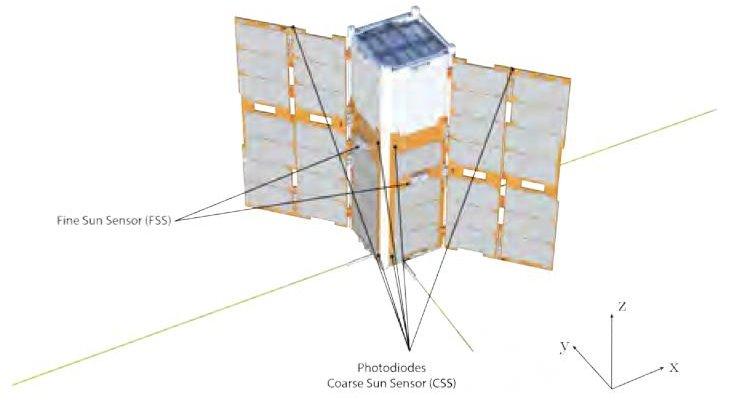

Fig. 1: Spacecraft configuration.

## 2.1 Attitude Determination and Sensor Architecture

The sensor architecture for achieving full-attitude determination in HERMES nano-satellites was developed based on mission requirements and system constraints. In addition to those mentioned in the preceding section, the system must determine its complete orbital and attitude states throughout the orbit, and it must be resilient to hardware component failures. Consequently, the chosen sensor architecture is designed to operate both in sunlight and eclipse conditions and incorporates a degree of redundancy to ensure reliability.

Initially, limitations in mass, power, and cost considerations led to the exclusion of star sensors as primary attitude determination sensors. The stringent attitude determination

<!-- PDF_PAGE: 3 -->

accuracy requirement did not necessitate the use of star sensors, especially given the challenges of implementing redundancy for this sensor type in a nano-satellite. As the attitude state estimation should not rely on Earth-relative attitude, the primary attitude sensors selected were Sun sensors and magnetometers.

Magnetometers also serve a dual purpose in actuating magnetic torquers, a common feature in nano-satellites. Fine Sun sensors with measurement errors of approximately $ \sim1 $ deg were chosen to meet the maximum attitude estimation error requirement. To avoid excessive fine sensors for redundancy, the sensor architecture combines fine Sun sensors along the primary axes of the Sun with distributed photodiodes to provide a coarse Sun direction. Importantly, these photodiodes must ensure full-sphere field of view coverage, leaving no blind spots for Sun detection.

The need to determine the full attitude state across the orbit necessitated the inclusion of gyroscopes for deadreckoning state propagation during eclipse phases. Gyroscope measurements require continuous on-board calibration to minimize attitude drifts arising from gyroscope bias. Similarly, magnetometers and Sun sensors are also calibrated using on-board techniques. Magnetic sensor measurements are corrected for bias and scale factor errors, while fine Sun sensor measurements are adjusted to account for Earth's albedo.

This sensor architecture also requires the estimation of orbital position state to support reference environment models for full-attitude determination and sensor calibration. Furthermore, it's essential for guidance functions to calculate reference attitude states relative to Earth and to meet mission accuracy requirements for orbit determination. In this architecture, the primary sensor is a GNSS receiver. For redundancy, GNSS measurements are combined using an Extended Kalman Filter (EKF) with an on-board SGP4 orbital propagator [11], as well as accelerometer measurements. The GNSS receiver can be updated with a two-line element (TLE) set received from the ground. Accelerometers were included as they are typically part of MEMS inertial measurement units (IMUs) containing gyroscopes and magnetometers. They also provide the capability to handle orbital control maneuvers. Despite the noisy nature of non-gravitational perturbation accelerations typically measured by tactical-grade MEMS accelerometers, they slightly improve GNSS-based orbit determination accuracy and enhance on-board orbital propagation reliability [7].

receiver, on the other hand, lacks redundant components and relies on support from the three-axis accelerometer and SGP4 orbital propagation in the event of a failure.

The overall sensor architecture, along with the attitude determination blocks and interfaces, is depicted in Figure 2, highlighting the presence of redundancy in the gyroscope magnetometer, and Sun sensor components. The GNSS

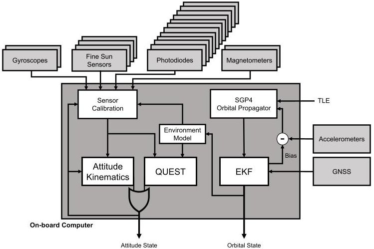

Fig. 2: Sensor architecture scheme.

The sensor measurements are calibrated, corrected and post-processed in a way to have the best measurements before the attitude determination blocks. In fact, sensor post processing blocks are required to gather the sensor signals, interpret them according to structured data formats and convert the signals into a value to be used for the following estimation operations. This paper does not enter the details behind the communication interfaces with the sensors and, thus, the input to the post processing blocks is assumed to be the raw, uncalibrated, unscaled numerical value, representing the sensor measurement according to the sensor's datasheet. The specific post processing operations depend from the sensor type, but they can be resumed by the following steps, also graphically represented in figure 3:

Low-pass filtering, if not performed by the sensor unit;

Reference frame rotation and unit dimension scaling;

Measurement correction and conversion;

Failure detection and isolation at component level;

Redundant sensor management.

Precisely, the filtered sensor signals are processed to obtain the desired measurements and they are used to detect the sensor faults. These two processes run in parallel as shown in figure 3, and their outputs are combined, together with those of the other redundant components, to be used by the redundant sensor manager. In fact, the measurements sent to the AODS section are eventually processed by the redundant sensor manager, which select, among the

<!-- PDF_PAGE: 4 -->

available sensor data, the best one to be used for attitude and orbit estimation.

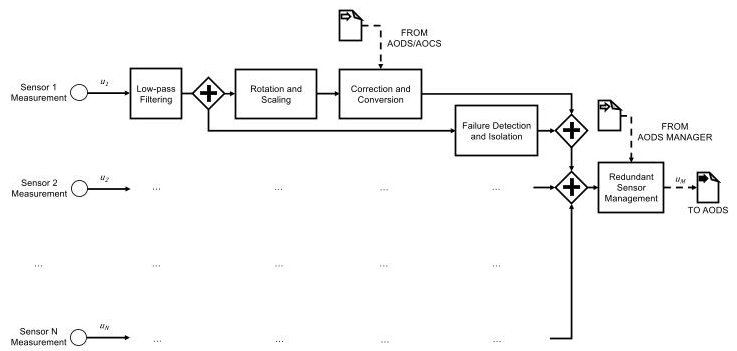

Fig. 3: Sensor post processing scheme.

## 2.2 Attitude Control

The attitude control system is designed to control the spacecraft attitude while maintaining the stored angular momentum in the reaction wheels within pre-defined level boundaries. The combined control action of 4 redundant reaction wheels and 3 orthogonal magnetic torquers allows achieving this goal by continuously dumping the angular momentum stored in the actuators. Specifically, the magnetic control is designed to desaturate the reaction wheels, being integrated with a PID three-axis attitude control law. The latter is then actuated by the reaction wheels. The control design and tuning are particularly aimed at maintaining the two controllers' bandwidths well separated, in order to avoid dangerous coupling between the two control loops, which could reduce the stability of the main three-axis attitude control [10].

The attitude control system is intended to receive as input the estimated attitude quaternion from the determination block, $ \tilde{\mathbf{q}} (t) $ , and the reference attitude quaternion to be chased, $ \bar{\mathbf{q}} (t) $ , computed by the guidance functions. The control action is then computed on the error quaternion which is defined as [12]:

$$
\delta \mathbf {q} (t) = \tilde {\mathbf {q}} (t) \times \bar {\mathbf {q}} ^ {- 1} (t).
$$

Note that the proposed architecture does not need any assumption on the time evolution of the reference attitude state, and the present discussion is valid for both pointing and tracking attitude control. The implementation of PID attitude control also requires the definition of the error angular velocity as:

$$
\delta \boldsymbol {\omega} (t) = \tilde {\boldsymbol {\omega}} (t) - \bar {\boldsymbol {\omega}} (t),
$$

where the estimated angular velocity, $ \tilde{\omega} (t) $ , is computed by the attitude determination functions or directly retrieved from a gyroscopic sensing unit; the reference angular velocity, $ \bar{\omega} (t) $ , is calculated in the attitude guidance block,

and it shall be coherent with the desired time variation in the reference quaternion. Finally, to correctly manage the stored angular momentum, the system shall also receive as input the angular speed of each reaction wheel, $ \omega_{R_{i}} $ , and the best estimate of the surrounding geomagnetic field, $ \tilde{\mathbf{B}} $ , expressed in the body frame. Thus, the system is equipped with rotary encoders on the reaction wheels and with magnetometers or alternative magnetic field estimation functions.

The integrated attitude control torque is a combination of two independent contributions:

$$
\mathbf {t} _ {C} = (1 - k) \mathbf {t} _ {R} ^ {P I D} + k \mathbf {t} _ {M} ^ {P I D} + \mathbf {t} _ {R} ^ {D E S},
$$

where $ \mathbf{t}_{R}^{PID} $ and $ \mathbf{t}_{M}^{PID} $ are the three-axis attitude control PID torques actuated by the reaction wheels and by the magnetic torquers, respectively; $ \mathbf{t}_{R}^{DES} $ is the integrated desaturation torque commanded to the reaction wheels, which is defined to be compatible with the instantaneous magnetic controllability, as will be discussed in the dedicated section. The gain parameter $ k \in ] 0,1[$ is used to tune the relative intensity of the two integrated control actions. This parameter is used to properly scale the torque levels sent to the reaction wheels and to the magnetic torquers to properly adjust them according to the torque performance of the actuators.

The control torques are finally converted in the actuation commands to be sent to the actuators. Thus, the desired torque is applied to each individual reaction wheel, and the magnetic dipole moment is generated by each magnetic torquer. The architecture of the proposed attitude control system is reported in Figure 4.

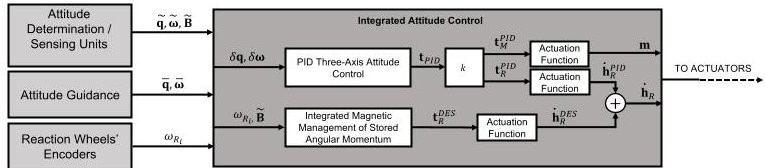

Fig. 4: Attitude control system architecture scheme.

The complete list of used hardware components can be found in [5,9].

## 3. ADCS Verification and Testing

HERMES ADCS is currently in advanced pre-flight testing phase, undergoing processor-in-the-loop (PIL) testing campaigns and hardware-in-the-loop (HIL) calibration and testing activities. Moreover, hardware dependent software tuning is performed to optimize the execution of the ADCS algorithms described before on the GOM Space A3200 (i.e., AVR32 micro-controller). The developed system and algorithms have been verified and tested following a

<!-- PDF_PAGE: 5 -->

complete process of consecutive testing activities, starting from the model-in-the-loop (MIL) phase, passing through a software-in-the-loop (SIL) phase and, lastly, performing PIL testing on a dedicated flat-sat facility [13, 14]. HIL activities have been dedicated to calibrate and tune the ADCS performances with regards to real hardware components.

## 3.1 MIL Verification Phase

Within the Matlab & Simulink environment a Functional Engineering Simulator (FES) is used for MIL testing. The model aims at representing as closely as possible the flight conditions the HERMES nano-satellites will encounter. The performance of the ADCS are evaluated for all the operating modes, including nominal and non-nominal conditions. A Montecarlo analysis is set up to check the determination and control algorithms performance on a sufficiently wide range of initial conditions and parametric uncertainty. Particular emphasis is dedicated on the peculiar science pointing mode, in which the scientific objectives of the mission are carried out. In this simulation scenario, regarding the attitude state of the spacecraft, the initial quaternion representation is randomized, while the angular velocity is sampled from a uniform distribution with the limits defined in Equation 4 on each axis.

$$
- 2 ^ {\circ / s} < w _ {0} < 2 ^ {\circ / s}
$$

The nano-satellite inertia and center of mass are instead affected by parametric uncertainty, with a 25% error at $ 3\sigma_{a} $ for the inertia components and a uniformly distributed error on the center of mass of 5mm. These errors then have a cascading effect on several other parameters of the simulation. The results of the Montecarlo analysis on the attitude determination in science pointing mode, for a time span of four orbits, are reported in Figure 5.

It can be noted that the determination algorithm is able to maintain the error below the prescribed threshold of $ 3^{\circ} $ . The simulation is initialized from unknown attitude states, with non-calibrated sensors. The correct attitude is estimated in a few minutes from lost-in-space condition and maintained also during eclipses, when dead-reckoning estimation is executed. The only estimation drift happens during the first eclipse, when sensors are still not fully calibrated and the gyroscope's bias makes the error increase. The sensors are completely calibrated after one orbit, and this condition is preserved throughout the mission thanks to the on-board calibration algorithms [7].

The total pointing error is instead reported in Figure 6, which also considers the control error due to the actuators while controlling the satellite orientation.

Overall the system can satisfy the imposed requirement for most of the simulated time. The peaks in the control error are due to the yaw rotation to align the solar panel

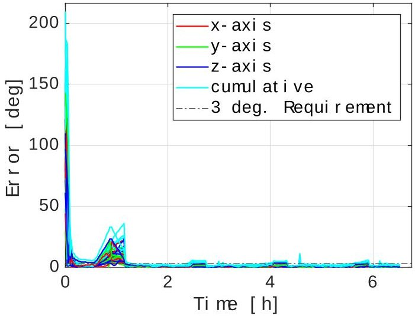

Fig. 5: Montecarlo analysis on attitude determination in science pointing mode.

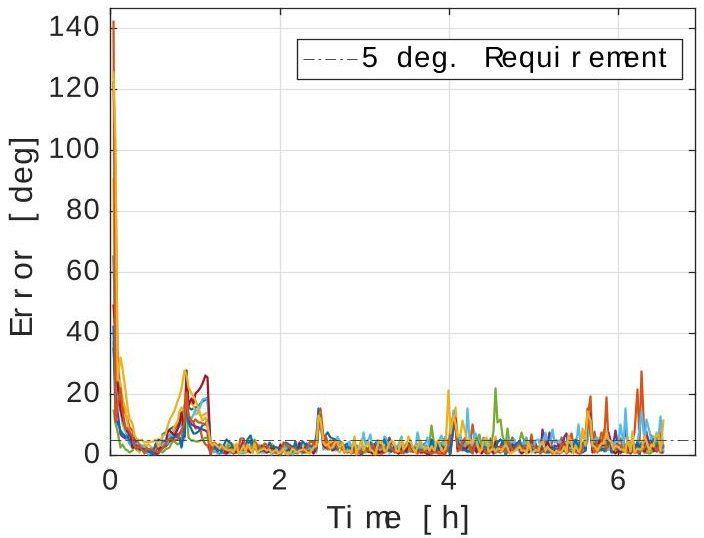

Fig. 6: Montecarlo analysis on total pointing performance in science pointing mode.

front face with the Sun every half-orbit. The 3-axis error has the peak while rotating the satellite, but the payload's line of sight remain aligned with the prescribed direction.

## 3.2 SIL Verification Phase

As already introduced, the second step of the HERMES ADCS verification process consists in the software-in-the-loop verification phase. SIL test is enormously useful to verify the software directly on the emulation of the system for which it is intended; in this way, it is possible to stress it as if it was in its nominal operating condition. Therefore, after the HERMES ADCS algorithm as passed the MIL verification in the Matlab & Simulink environment, the SIL test has been performed exploiting the Embedded

<!-- PDF_PAGE: 6 -->

Coder $ ^{ \circ} $ package $ ^{*} $ . This particular package is able to generate source codes for the different ADCS algorithm models, testing them in terms of numerical equivalence, code coverage, and code execution profiling. As mentioned before, the core of the ADCS system of HERMES satellite is the GOM Space A3200, which is provided with Atmel AVR32 micro-controller: in order to be coherent with the real hardware, the Atmel AVR (32-bit) model is the configuration selected for the test hardware implementation.

The verification process is divide into two main steps: the correct generation of the ADCS algorithm's components autocoding and the comparison of the results obtained by the autocodes and their Simulink's models parent. The SIL test process has been performed to different sub-models within the overall HERMES ADCS algorithm in the Matlab & Simulink environment. In particular, it has been divided into 4 main blocks: attitude control (ACS) and determination (ADS) systems, orbital determination (ODS) system, and sensors post-processing. For each of these blocks, the C codes, which will be later integrated as ADCS-SW into the GOM Space A3200 board, are generated. Afterwards, all the blocks have their Simulink Test-Harness, which can be used for the simulation and testing within the Simulink environment. Therefore, once the source codes have been generate without any errors, the SIL test finally compares the resulting signals obtained by the Simulink and the Harness models. Nominally, the SIL test is considered passed when the signals obtained by the two different models is exactly the same, except for numerical machine precision.

The autocoding configuration of the ADCS model has been performed following the guidelines of the European Space Agency (ESA) SAVOIR-HB-005-I1 - Vol1/2 Automatic Code Generation for AOCS & GNC Flight $ \mathrm{SW}^{\dagger}。 $

## 3.3 PIL Testing Phase

For the HERMES mission, ADCS processor-in-the Loop (PIL) testing is crucial for the development of the system. It involves integrating the actual ADCS software with a high-fidelity spacecraft simulator to assess the software's performance in a simulated space environment. PIL testing is needed to verify the accuracy and reliability of the software's control algorithms, ensuring that the spacecraft maintains its desired orientation and stability during its mission.

## 3.3.1 Flat-sat facility

The HERMES PIL test exploits the use of a flat-sat facility, that entails a set of PC104 compatible, general purpose boards. The facility is built specifically for the HERMES mission testing phase, but is created to be compatible with every CubeSat's components that mounts standard PC104 connectors. The flat-sat part useful for the ADCS PIL test is composed by a central boards, dedicated to the GOM Space A3200 (mounted on the GOM Space ADCS-6 board), that unpacks the PC104 connector to testpoints and individual debug lines; a safety critical power board to redundantly control power supply lines that carries power to the different components; a group of isolator boards to interface the real hardware with the digital twins of HERMES sensors and actuators, which are driven by a real-time simulator to verify and test the attitude determination and control subsystem. Furthermore, the entire flat-sat facility is also equipped with a core board that unpacks the signals from the CubeSat's OBC, the different telecommunication system's transceivers, and exposing all the main buses and serial communication (e.g., CAN, I2C, LVDS, UART) with the possibility to terminate lines at different debug interfaces.

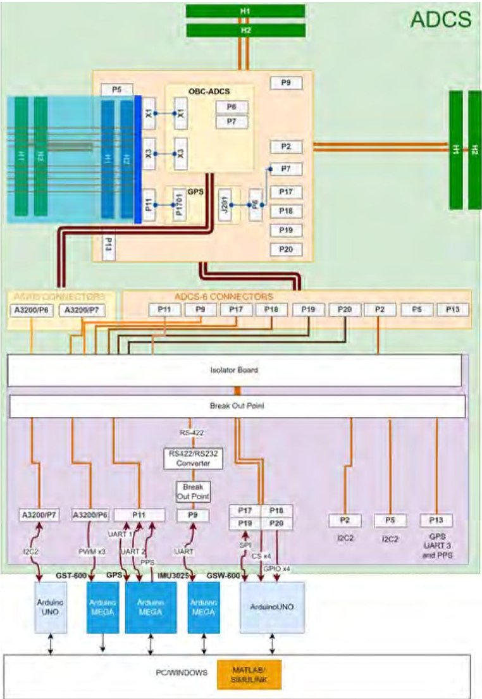

Fig. 7: ADCS flat-sat high level scheme (PIL test).

As mentioned all the HERMES ADCS sensors and

<!-- PDF_PAGE: 7 -->

actuators are substituted by their digital twins, which are practically composed by the communication interface units and the simulation models. The communication units are different Arduino boards, one for each communication protocol needed. In particular, we have one Arduino board for each the following protocol:

I2C for the 4 fine sun sensors, the 12 coarse sun sensors, one of the accurate magnetometers, the A3200 internal magnetometer and gyroscope.

PWM for the 3 orthogonal magnetorquers.

UART and PPS for the GPS.

UART for the IMU unit (magnetometer, gyroscope and accelerometer).

SPI for the 4 reaction wheels.

The Arduino boards, then, collect the information and data received by a real-time simulation running on a computer, and send it to the A3200, rearranging them in message with the correct format. The A3200 reads the messages and sends back to the Arduino the commands computed by the integrated algorithm. Afterwards, the Arduino boards associated to the ADCS actuators pass the commands to the Simulink real-time simulation on the PC. In Fig. 7, an high level scheme of the flat-sat facility used for the ADCS PIL test is shown, highlighting the signal pass-through from the GOM Space A3200 board towards the Matlab & Simulink environment on the PC. Instead, in Fig. 8, a picture of the flat-sat set-up is shown.

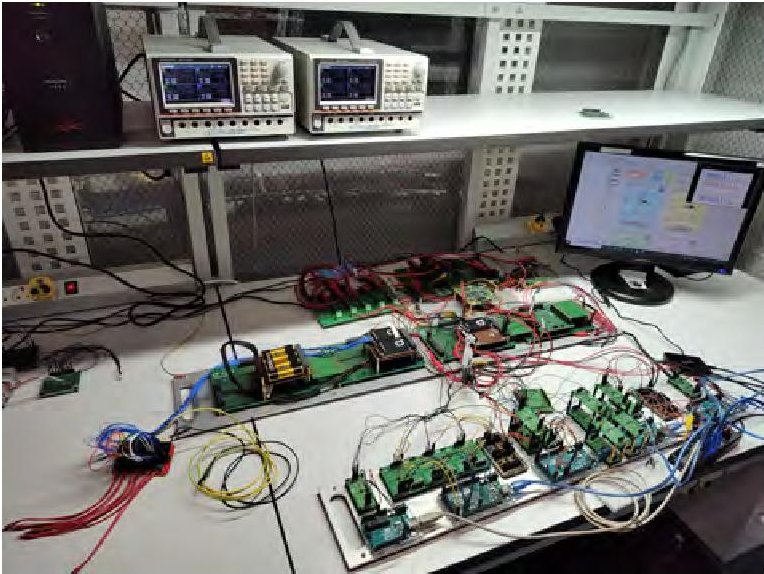

Fig. 8: HERMES flat-sat facility set-up.

way it is possible to understand if the algorithm running on the A3200 board is equally performing with respect to the Simulink models, from which the software codes have been generated.

Once all the PIL pipeline correctly works, the simulation results must be collected in order to be compared with the results obtained during the MIL testing phase. In this

## 3.4 HIL Calibration and Testing Activities

The last step of the HERMES ADCS verification and testing phase is the Hardware-in-the-Loop (HIL) phase, which involves integrating the actual hardware components, such as sensors and actuators, with the already tested simulation environment to evaluate and validate the functionality and performance of the ADCS system itself. As MIL and SIL, also HIL testing plays a central role in ensuring that the spacecraft's equipment interacts with the control software without any problems, verifying their responsiveness to various mission scenarios.

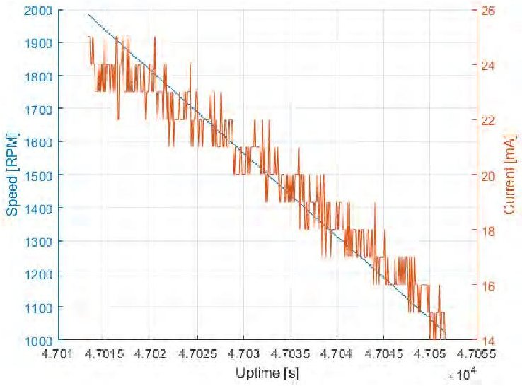

(a) 8 mNcm torque.

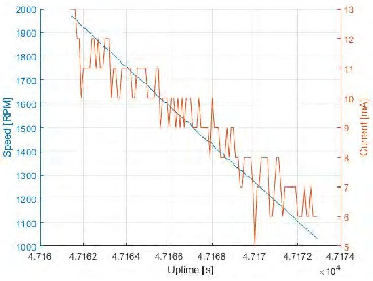

(b) 25 mNcm torque.

Fig. 9: Wheel deceleration with different torques.

The HIL phase concludes the verification circle, and

<!-- PDF_PAGE: 8 -->

also helps the validation of the digital twins models of each sensor and actuator used during the MIL and PIL analysis. If the behaviour of the hardware component and the simulated model is strongly different, it would be necessary to update the model and start again the verification process. The set-up is the same of the PIL analysis, thus, the flat-sat facility is exploited. The HIL test is performed for all the sensors and actuators listed in Sec. 2, systematically substituting the digital twin signal with the real sensor or actuators one. In Fig. 10 the flat-sat facility high scheme for the HIL test is shown. Differently from before, the A3200 can be connected not only to the digital twins but also to the real ADCS component, in order to exchange data and command directly to the flight hardware.

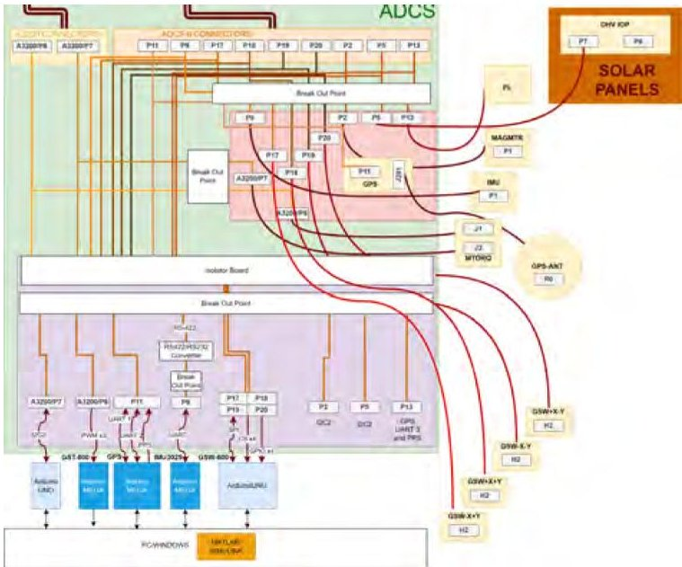

Fig. 10: ADCS flat-sat high level scheme (HIL test).

In Fig. 9 some of the results obtained during the HIL test of the reaction wheels are displayed. If compared in terms of time and current, it can be noticed how an higher torque corresponds to a faster, and less consuming deceleration: indeed the time to decelerate the wheel from 2000 rpm to 1000 rpm, with a torque of 25 mNcm, is around 1.5 ms, with respect to the 4.5 ms with a 8 mNcm torque. These kind of results are really important to verify the reaction wheel model used in the MIL and PIL analysis, and eventually correct it, if it behaves differently.

## 4. Final Remarks

This paper has provided a comprehensive overview of the HERMES ADCS hardware and software architecture, emphasizing its structure and performance. The description starts from the design phase towards the testing and verification phases, divided into four subsequent analysis - model-in-the-loop (MIL), software-in-the-loop

(SIL), processor-in-the-loop (PIL), and hardware-in-the- loop (HIL) - which have been here described. The exploitation of a real-time PIL simulation facility, featuring realistic digital twins of actuator and sensor data interfaces, has greatly helped the verification of the ADCS system

In conclusion, this work wants to stress that the overall development pipeline, even if conceived specifically for the HERMES mission, is highly flexible and, therefore, compatible with different CubeSat's missions, that share a similar ADCS design philosophy.

## References

[1] F. Fiore, L. Burderi, M. Lavagna, and et al., "The HERMES-technologic and scientific pathfinder," in Space Telescopes and Instrumentation 2020: Ultraviolet to Gamma Ray, Virtual, Online, 14-18 December 2020, vol. 11444, SPIE, 2020, pp. 214-228. DOI: 10.1117/12.2560680.

[2] Y. Evangelista, F. Fiore, F. Fuschino, and et al., "The scientific payload on-board the HERMES-TP and HERMES-SP cubesat missions," in Space Telescopes and Instrumentation 2020: Ultraviolet to Gamma Ray, Virtual, Online, 14-18 December 2020, vol. 11444, SPIE, 2020, pp. 241-256. DOI: 10. 1117/12.2561018.

[3] A. Sanna, L. Burderi, T. Di Salvo, and et al., "Timing techniques applied to distributed modular high-energy astronomy: The h.e.r.m.e.s. project," in Space Telescopes and Instrumentation 2020: Ultraviolet to Gamma Ray, Virtual, Online, 14-18 December 2020, J.-W. A. den Herder, K. Nakazawa, and S. Nikzad, Eds., SPIE, 2020. DOI: 10.1117/12. 2561758. [Online]. Available: https://doi. org/10.1117%2F12.2561758.

[4] A. Colagrossi, J. Prinetto, S. Silvestrini, and M. Lavagna, "Sky visibility analysis for astrophysical data return maximization in HERMES constellation," Journal of Astronomical Telescopes, Instruments, and Systems, vol. 6, no. 04, 2020. DOI: 10. 1117/1.jatis.6.4.048001.

[5] A. Colagrossi, J. Prinetto, S. Silvestrini, and et al., "Semi-analytical approach to fasten complex and flexible pointing strategies definition for nanosatellite clusters: The hermes mission case from design to flight," in Proceedings of the 70th International Astronautical Congress (IAC 2019), Washington D.C., 21-25 October 2019, 2019, pp. 1-8.

<!-- PDF_PAGE: 9 -->

[6] A Colagrossi, S Silvestrini, J Prinetto, and M Lavagna, "Hermes: A cubesat based constellation for the new generation of multi-messenger astrophysics," in Proceedings of 2020 AAS/AIAA Astrodynamics Specialist Conference, Virtual Lake Tahoe, 9-12 August 2020, 2020, pp. 1-20.

[7] A. Colagrossi and M. Lavagna, "Fault tolerant attitude and orbit determination system for small satellite platforms," Aerospace, vol. 9, no. 2, p. 46, 2022. DOI: 10.3390/aerospace9020046. [Online]. Available: https://doi.org/10.3390% 2Faerospace9020046.

[8] A. Colagrossi and M. Lavagna, "A spacecraft attitude determination and control algorithm for solar arrays pointing leveraging sun angle and angular rates measurements," Algorithms, vol. 15, no. 2, 2022. DOI: 10.3390/a15020029.

[9] A. Colagrossi, M. Lavagna, and R. Bertacin, "An effective sensor architecture for full-attitude determination in the hermes nano-satellites," Sensors, vol. 23, no. 5, 2023, ISSN: 1424-8220. DOI: 10 3390/s23052393.

[10] A. Colagrossi, "Integrated magnetic management of stored angular momentum in autonomous attitude control systems," Aerospace, vol. 10, no. 2, 2023, ISSN: 2226-4310. DOI: 10.3390/aerospace10020103.

[11] D. A. Vallado, Fundamentals of astrodynamics and applications. Springer Science & Business Media, 2001.

[12] V. Pesce, A. Colagrossi, and S. Silvestrini, Modern Spacecraft Guidance, Navigation, and Control: from System Modeling to AI and Innovative Applications, 1st. Elsevier, 2022, ISBN: 9780323909167.

[13] A. Colagrossi, S. Silvestrini, and M. Lavagna, "Flatsat facility for processor-in-the-loop verification and testing of nanosatellite adcs," in Proceedings of the 2023 ESA GNC Conference, Sopot, 12-16 June 2023, 2023.

[14] S. Silvestrini, A. Colagrossi, and M. Lavagna, "A flat-sat platform for the development and testing of the 3u hermes constellation satellites," in Proceedings of the 74th International Astronautical Congress (IAC 2023), Baku, 2-6 October 2023, 2023.