<!-- PDF_PAGE: 1 -->

74th International Astronautical Congress (IAC), Baku, Azerbaijan, 2-6 October 2023. Copyright $ \textcircled{c} $ IAC 2023 by Skolkovo Institute of Science & Technology. Published by the IAF, with permission and released to the IAF to publish in all forms.

IAC-23, B4, IP,22, x79393

In-Orbit Attitude Determination and System Modeling of Skoltech B1 and B2 CubeSats

Bisma Sajid $ ^{a *} $ , Dmitry Ris $ ^{b} $ , Tatiana Podladchikova $ ^{c} $ , Hoor Bano $ ^{d} $ , Melisa Basak $ ^{e} $

$ ^{a} $ Center for Digital Engineering, Skolkovo Institute of Science & Technology, Russian Federation, Bisma.Sajid@skoltech.ru

b Advanced Microsatellites Lab, Center for Digital Engineering, Skolkovo Institute of Science & Technology, Russian Federation, D.Ris@skoltech.ru

$ ^{c} $ Center for Digital Engineering, Skolkovo Institute of Science & Technology, Russian Federation, T.Podladchikova@skoltech.ru

$ ^{d} $ Center for Digital Engineering, Skolkovo Institute of Science & Technology, Russian Federation, Hoor.Bano@skoltech.ru

$ ^{e} $ Center for Digital Engineering, Skolkovo Institute of Science & Technology, Russian Federation, Melisa.Basak@skoltech.ru

* Corresponding Author

## Abstract

Attitude Determination of any satellite is necessary to understand its rotation and then pointing it in the desired direction to serve its purpose. In this study, we present the attitude determination system (ADS) of the Skoltech CubeSats B1 and B2 launched in August 2022. The data received form these satellites indicate un-calibrated sensors. As the sensors lack calibration, the information about the satellite attitude is not so accurate. Therefore, precise sensor models are defined prior to the ADS design. Using an extended Kalman filter (EKF), the satellite attitude, residual dipole moment and the gyroscope and magnetometer bias are estimated. The estimation of the residual dipole aids in determining the magnetic disturbances affecting the CubeSats, which are then rejected through the control algorithm. Similarly, the estimated sensor bias is used for the indirect calibration of the sensor models. With the magnetic proportional-derivative (PD) controller implemented, the results indicate an efficient attitude determination and control system (ADCS) with rotation angle errors no greater than $ 5^{\circ} $ . Further analysis is then done on the ADCS, to define the structural and control requirements for Skoltech's next CubeSat mission: Skoltech-F. Keywords: Extended Kalman Filter, residual dipole, bias estimation

## Acronyms

ADS Attitude Determination System

EKF Extended Kalman Filter

PD Proportional - Derivative

ADCS Attitude Determination & Control System

TRIAD Tri-Axial Attitude Determination

QUEST Quaternion Estimator

UKF Unscented Kalman Filter

LEO Low-Earth Orbit

SRP Solar Radiation Pressure

RMSE Root Mean Squared Error

ACS Attitude Control System

## 1. Introduction

The attitude determination of satellites has been a topic of great interest in the past years. The reason being the necessity of knowing the precise attitude of the satellite for adequate control, orbit maintenance and precise positioning to fulfill satellite mission objectives. In this research, an attitude determination system (ADS) for the Skoltech in-orbit satellites B1 and B2 is designed.

The satellites were launched in August 2022 with the purpose of testing inter-satellite communication and collecting data on gamma-ray flashes. Attitude determination methods like TRIAD, QUEST and Kalman Filter algorithms have been in practice for many years. Each method has its pros and cons but the one thing that could adversely affect the outcome of any of these methods is the errors in the attitude sensors. Each attitude sensor has some degree of uncertainty in its measurement which can either be due to its inherent design properties or degradation over time. These sensor error sources need to be recognized and catered for to get accurate attitude estimation. Both on-ground calibration of the instruments and in-orbit estimation and compensation of the errors can be done to mitigate these effects.

The major error sources for satellite magnetometers and gyroscopes include soft and hard-iron distortions, temperature variations, installation errors, magnetic interference (in case of magnetometer), scale factor errors and biases [1]. For this research, the focus will be on the estimation of only the biases and drifts influencing the sensor measurements. Several studies have shown the

<!-- PDF_PAGE: 2 -->

impact of the biases on the satellite attitude and various methods to estimate them can be seen in literature. The on-ground bias estimation using the least-squares method and real-time estimation using EKF and UKF has been done and implemented on real satellite missions [2], [3]. The results indicate an improved satellite attitude accuracy. Similarly, in [4], the attitude performance, for multiple combinations of sensors implemented in the EKF, was studied for a quasi-stationary satellite motion. As the attitude information ultimately affects the satellite control, it is reasonable to perform error estimation using EKF simultaneously with the attitude control application. Ivanov et. al [5] studied the effects of uncertainties on the ADCS of a magnetically controlled satellite with magnetometer as the sole sensor. The simulations performed one by one with accurate magnetometer readings, magnetometer errors, inertia tensor uncertainty and unknown disturbances revealed varying estimation and control accuracy with respect to each condition, therefore, emphasizing the incorporation of all the relevant errors and disturbances in ADCS modeling.

Generally, the magnetometer and gyroscope biases are assumed to be normally distributed constants [4] but to capture the essence of a real sensor the variations caused in the sensors due to environmental factors must also be considered. In case of gyroscopes, the studies show bias modeling as a ramp function, in addition to the constant bias, and in a few cases an exponential function is also considered [6]. For magnetometers, the linear temperature-dependent bias model has been developed [7] which is shown to be quite accurate for calibration. Another bias-inducing source for the magnetometer can be the residual magnetization which will be studied over the course of this research.

The residual magnetization influences both the magnetometer readings as well as the satellite rotation by inducing disturbances. In 2021, a method to improve the magnetic control of a CubeSat, by performing magnetic cleanliness while designing the ADCS, was proposed [8]. Since the parasitic torque due to residual magnetic dipole greatly influences the satellite control, so the magnetic field produced by each satellite component was calculated by the particle swarm and gradient decent algorithms. The residual dipole estimation by the EKF and its rejection in the controller showed a much-improved control accuracy, thus providing a method of incorporation of magnetic cleanliness routine in the system at a low cost.

In this work, the ADS is modeled using an Extended Kalman Filter. The main goal is to design an ADS that incorporates the effects of environmental disturbances as well as the sensor errors for precise attitude estimation leading to efficient control. Incorporation of sensor biases and their compensation can be considered as an unconventional method of calibrating the attitude sensors in real-time using just the EKF. The results of this study

are also to be implemented for the next Skoltech satellite (CubeSat-F) to be launched in December 2023. One of the objectives is to derive the ADCS requirements for the Skoltech-F after studying the filter convergence characteristics in the presence of sensor errors.

This paper is divided in the following sections: Section 2 gives the description of the models used for satellite rotation, sensors and the EKF. Section 3 details the sensor error models and the modifications to the EKF followed by simulation results and discussion in section 4 and finally leading to conclusion in section 5.

## 2. Methods

The design process of the ADS follows the following steps:

1. Defining satellite rotation & sensor models

2. Identifying & quantifying the disturbances

3. Designing EKF for attitude estimation

4. Identifying & modeling the sensor bias

5. Estimating sensor bias in the EKF

6. Deriving requirements for the future mission based on the obtained results.

To better analyse the influence of error sources and disturbances on the estimated attitude and ultimately the overall pointing accuracy of the CubeSat, a PD magnetic controller is also incorporated with the ADS. This aids in determining how the overall ADCS would behave under actual conditions.

## 2.1 Reference Frames

Three main reference frames are used for the design of the ADS, these include the Orbital Frame with x-axis in the direction of orbital velocity, z-axis towards the radius vector and y-axis completing the right-hand rule. The Satellite Body Frame with the xyz axes along the principal inertia axes of the satellite and the Sensor Frame in which each sensor displays it results.

All the frame conversions are applied, wherever necessary, using quaternion rotation.

## 2.2 Satellite Model

The satellite is taken to be a rigid body, with its dynamics derived from Newton's second law. This law when applied to a rotating body, results in a set of equations called the Euler's moment equations which completely describe the satellite dynamics [9].

$$
J \dot {\omega} = - \omega \times (J \omega) + M
$$

Here, $ \omega $ is the satellite's absolute angular velocity, J is the inertia tensor and T is the applied torque. The inertia tensor (J) describes the distribution of the satellite's mass with respect to its centre of mass, which ultimately defines the resistance to rotational

<!-- PDF_PAGE: 3 -->

motion. Large moment of inertia around a particular satellite axis, makes it difficult to rotate about that axis and vice versa. The applied torque (T) is a sum of all the external torques acting on the satellite which include the control and the disturbance torques.

To describe the satellite rotation without the possibility of encountering the singularity errors, the quaternion-based kinematic model is used [10]:

$$
\dot {\boldsymbol {q}} = \frac {1}{2} \boldsymbol {q} \odot (\Omega)
$$

The satellite velocity can be taken as either absolute $ (\omega) $ or relative $ (\Omega) $ . The kinematics equation is depicted in terms of the angular velocity relative to the orbital frame $ (\Omega) $ , so the quaternion (q) aids in transformation between orbital and body reference frames, in addition to supplementing the dynamics equation for complete attitude representation. The absolute $ (\omega) $ and relative angular velocities $ (\Omega) $ are related via quaternion as given in [5]:

$$
\Omega = \omega - R \left(q ^ {o \rightarrow b}\right) \omega_ {o}
$$

The satellite velocity relative to orbital frame $ \Omega $ is related to the absolute satellite velocity $ \omega $ via the satellite mean motion $ \left( \omega_{0}=\left[ 0;\omega_{0};0\right] \right) $ , which is calculated based on the orbital elements. Here, the mean motion $ \left( \omega_{0}\right) $ is taken to simplify the analysis. The mean motion is converted to body frame via the quaternion rotation $ \left( \mathrm{R}\left(q^{\mathrm{o}\rightarrow\mathrm{b}}\right)\right). $ $ \mathrm{R}\left(q^{\mathrm{o}\rightarrow\mathrm{b}}\right) $ depicts the quaternion representation of the attitude matrix that is used for frame transformations, and is given as [10]:

$$
\boldsymbol {R} (\boldsymbol {q}) = \left(q _ {o} ^ {2} - \left| \boldsymbol {q} _ {1: 3} \right| ^ {2}\right) \boldsymbol {I} _ {3} - 2 q _ {o} \left[ \boldsymbol {q} _ {1: 3} \times \right] + 2 \boldsymbol {q} _ {1: 3} \boldsymbol {q} _ {1: 3} ^ {T}
$$

The expression q $ \odot $ ( $ \Omega $ ) in eq. (2) represents the quaternion multiplication. The equation can be simplified and represented in matrix-vector form as [11]:

$$
\dot {q} = \frac {1}{2} \left[ \begin{array}{c c c c} q _ {o} & - q _ {1} & - q _ {2} & - q _ {3} \\ q _ {1} & q _ {o} & - q _ {3} & q _ {2} \\ q _ {2} & q _ {3} & q _ {o} & - q _ {1} \\ q _ {3} & - q _ {2} & q _ {1} & q _ {o} \end{array} \right] \left[ \begin{array}{c} 0 \\ \Omega_ {1} \\ \Omega_ {2} \\ \Omega_ {3} \end{array} \right]
$$

Here, $ q_{0} $ represents the scalar quaternion component while $ q_{1}-q_{3} $ represent the vector components of the quaternion. The quaternion always follows the normalization rule, with the magnitude being equal to 1.

## 2.3 Sensor Models

For the current study, only two of the attitude sensors are used: Gyroscope & Magnetometer. Initially both the

gyroscope and the magnetometer models are constructed with just random noise fluctuations, and later incorporate the bias models as well.

## Gyroscope

The gyroscope measurements are taken by adding the noise to the angular velocity obtained via the satellite rotation model.

$$
\omega_ {g y r o} = \omega_ {m o d e l} + \eta
$$

Here, $ \omega_{\mathrm{gyro}} $ is the gyroscope measurement of angular velocity and $ \eta $ is the sensor noise.

The noise component ( $ \eta $ ) is randomly distributed vector with mean and standard deviation set for the gyroscope.

## Magnetometer

For the magnetometer, 3 different models are used as in [12]. These include:

- The On-board Model for the calculation of the magnetic field of the satellite in orbit. It is defined using the direct-dipole method and varies with the orbit inclination (i) and argument of latitude (u) [12].

$$
\mathrm {b} _ {\mathrm {m o d e l}} ^ {\mathrm {o}} = \frac {\mu_ {\mathrm {O}} \mu_ {\mathrm {E}}}{4 \pi \mathrm {R} ^ {3}} \left[ \begin{array}{c} \cos (\mathrm {u}) \sin (\mathrm {i}) \\ \cos (\mathrm {i}) \\ - 2 \sin (\mathrm {u}) \sin (\mathrm {i}) \end{array} \right]
$$

- The Environmental Model that incorporates all the environmental disturbances which are added as normally distributed vector to the onboard model and is defined with respect to the satellite body frame.

$$
\boldsymbol {b} _ {e n v} ^ {b} = \boldsymbol {b} _ {m o d e l} ^ {b} + N (\boldsymbol {\mu}, \sigma)
$$

Here, N depicts a randomly distributed vector with mean $ \mu $ and standard deviation $ \sigma $

- The Sensor Model which includes all the sensor inherent noise characteristics along with the already present environmental disturbances.

$$
b _ {\mathrm {s e n s o r}} ^ {\mathrm {b}} = b _ {\mathrm {e n v}} ^ {\mathrm {b}} + \mathrm {N} \left(\mu_ {s}, \sigma_ {s}\right)
$$

## 2.4 Disturbance Models

All the 4 major disturbance torques influencing a LEO satellite are incorporated in the ADS design, which include:

1. Gravity-Gradient Torque which manifests due to the gravitational forces influencing the

<!-- PDF_PAGE: 4 -->

74th International Astronautical Congress (IAC), Baku, Azerbaijan, 2-6 October 2023. Copyright $ \textcircled{c} $ IAC 2023 by Skolkovo Institute of Science & Technology. Published by the IAF, with permission and released to the IAF to publish in all forms.

satellite. It is modelled using the equation below [5]:

$$
\boldsymbol {T} _ {g r a v} = 3 \omega_ {o} ^ {2} \left(\boldsymbol {e} ^ {b} \times J \boldsymbol {e} ^ {b}\right)
$$

Here, $ \omega_{0} $ is the orbital mean motion and $ e^{b} $ i the satellite unit radius vector in body frame.

2. Torque due to Residual Magnetization which could have the most deteriorating effect, among all the torques on a LEO satellite, because of the residual dipole generated by the satellite components.

$$
T _ {m _ {r e s}} = m _ {r e s} \times B
$$

Here, $ m_{\mathrm{res}} $ represents satellite's residual dipole moment and B depicts the Earth's magnetic field that has been converted to the body frame.

3. Aerodynamic Drag Torque which although smaller in magnitude, should be incorporated to closely replicate the real environment. It is modeled as [9]:

$$
\boldsymbol {T} _ {d r a g} = - \frac {1}{2} \rho V ^ {2} C _ {d} A d \frac {V}{V}
$$

Here, $ \rho $ is the atmospheric density, $ C_{d} $ is the drag coefficient of 2.2, A is the satellite area, d is the lever arm (distance b/w satellite centre of mass and centre of pressure) and V is the relative velocity with respect to the incoming airflow.

4. Solar Radiation Pressure Torque which has an effect whenever the satellite is exposed to the sun's radiations [9]:

$$
\boldsymbol {T} _ {S R P} = P C _ {r} A d
$$

Here, P is the solar radiation pressure, $ C_{r} $ is the satellite's surface reflectivity, A is the area and d is the lever arm.

The aerodynamic drag model and the SRP model are not explicitly introduced in the simulation, rather the influence of these torques are incorporated in the form of environmental disturbances modelled as normal distribution vectors.

## Process Model

The process model constitutes the disturbance-free satellite rotational dynamics and kinematics and is constructed using the eqns. (1) & (2). Eq. (1) describes the change of absolute angular velocity over time, while eq. (2) depicts the rotation in terms of quaternion. Since the complete attitude knowledge would be available with both angular velocity and the rotation angles, so the state vector to be estimated comprises of both these terms.

The state vector has a total of 7 states: 4 quaternion components and 3 angular velocity components.

$$
x = \left[ \begin{array}{c} q \\ \omega \end{array} \right]
$$

Since the quaternion follows the normalization constraint with the 3 vector components being the independent entities, so moving forward, only vector part of the quaternion will be taken for use in the EKF. At the end, the scalar part is re-constructed using the vector components.

The reduced state vector, with 6 states, now becomes:

$$
\widetilde {x} = \left[ \begin{array}{c} q _ {v} \\ \omega \end{array} \right]
$$

Here, $ \widetilde{x} $ represents the reduced state vector and $ q_{v} $ indicates the 3-dimensional quaternion vector. In the observation model defined next, this reduced version of the state vector is used for deriving the observation matrix.

## Observation Model

The observations are being obtained from the gyroscope and magnetometer. Therefore, the model constitutes these sensor measurements with their respective noise components. The observation (or measurement) equation for the non-linear EKF is given as:

$$
z = h \left(\widetilde {x} (t)\right) + v (t)
$$

$$
z = \left[ \begin{array}{l} b _ {s e n s o r} ^ {b} \\ \omega_ {s e n s o r} ^ {b} \end{array} \right]
$$

The corresponding observation vector $ \left( h(\widetilde{x}) \right) $ varies with the predicted states. It is defined using the modelled magnetic field (shown in eq. (7)) that is converted to satellite body frame using the predicted quaternions. It also includes the modelled angular velocity. As the model and measurements are related via prediction results, and the gyroscope gives angular velocity of the satellite, so $ \omega^{b}_{\mathrm{model}} $ is basically the same as $ \omega^{b}_{\mathrm{pred}} $ . The relation between predicted and measured angular velocity is identity. In eq. (18), $ R(q^{o\rightarrow b}) $ represents the

<!-- PDF_PAGE: 5 -->

74th International Astronautical Congress (IAC), Baku, Azerbaijan, 2-6 October 2023. Copyright $ \textcircled{c} $ IAC 2023 by Skolkovo Institute of Science & Technology. Published by the IAF, with permission and released to the IAF to publish in all forms.

transformation from orbital to body frame, that is achieved via quaternion rotation.

$$
\boldsymbol {h} (\widetilde {x}) = \left[ \begin{array}{c} R \left(q ^ {o \rightarrow b}\right) b _ {m o d e l} ^ {o} \\ I _ {3} \omega_ {m o d e l} ^ {b} \end{array} \right]
$$

The observation matrix (H) depends on the predicted states. The derivation of H requires frame transformation that is carried out via the full predicted quaternion (obtained by integration of the rotational dynamics equations). H is a 6 by 6 matrix that indicates the relation between the states and the measurements.

$$
\boldsymbol {H} = \left[ \begin{array}{c c} 2 W _ {b _ {m o d e l} ^ {b}} & \mathbf {0} _ {3} \\ \mathbf {0} _ {3} & I _ {3} \end{array} \right]
$$

Here, $ W_{b_{model}^{b}} $ represents the skew-symmetric function applied to the modelled magnetic field in body frame. The skew-symmetric matrix for a vector r is given as:

$$
W _ {r} = \left[ \begin{array}{c c c} 0 & - r _ {3} & r _ {2} \\ r _ {3} & 0 & - r _ {1} \\ - r _ {2} & r _ {1} & 0 \end{array} \right]
$$

The eqns. (17), (18) & (19) depict the relation between the states and measurements as:

$$
\left[ \begin{array}{l} b _ {s e n s o r} ^ {b} \\ \omega_ {s e n s o r} ^ {b} \end{array} \right] = \left[ \begin{array}{c c} 2 W _ {b _ {m o d e l} ^ {b}} & 0 _ {3} \\ 0 _ {3} & I _ {3} \end{array} \right] \left[ \begin{array}{l} q _ {v} \\ \omega \end{array} \right]
$$

From eq. (21) it is evident that the magnetometer measurements and the quaternion are related via the modeled magnetic field to which frame transformation is applied. The gyroscope measurements are related to the angular velocity via identity function, since the $ \omega $ obtained from the integration of dynamics rotational equation (eq.(1)) in body-frame, is same as $ \omega^{b}_{\mathrm{model}} $ as stated earlier.

## Covariance Matrices

The covariance matrices of state error (P), state noise (Q) and measurement noise (R) are vital to the proper working of the Kalman Filter. Their initialization and proper tuning aid in improving the filter performance.

- State Error Covariance Matrix (P): The state error is represented by two distinct terms in the EKF algorithm. These include prediction error $ ( P_{k}^{-} ) $ and the estimation error covariance matrix $ ( P_{k}^{+} ) $ . The correct initialization of P is essential for a better filter performance since it depicts the initial uncertainty in the states to be estimated and is updated with the filter.

- Process Noise Covariance (Q): Process noise is obtained via the process model and according to it, the major contributor to the process noise is the disturbance torques. So, Q is calculated as [13]:

$$
Q = G D G ^ {T} \times d t
$$

$$
G = \left[ \begin{array}{c} 0 _ {3} \\ J ^ {- 1} \end{array} \right]
$$

$$
D = \left[ \begin{array}{c c c} \sigma_ {\mathrm {T} _ {\mathrm {d i s t}}} ^ {2} & 0 & 0 \\ 0 & \sigma_ {\mathrm {T} _ {\mathrm {d i s t}}} ^ {2} & 0 \\ 0 & 0 & \sigma_ {\mathrm {T} _ {\mathrm {d i s t}}} ^ {2} \end{array} \right]
$$

Here, dt is the overall control and measurement loop duration and $ \sigma_{T_{dist}} $ is the standard deviation of environmental disturbances.

- Measurement Noise Covariance (R): The measurement noise covariance matrix comes from the sensor noise parameters. It includes the standard deviation of noise of all the sensors that provide measurements to the filter. In our case, the R matrix is composed of magnetometer and gyroscope noise deviation $ \left( \sigma_{mtm}\&\sigma_{gyro}\right). $

$$
R = \left[ \begin{array}{c c} I _ {3} \sigma_ {m t m} ^ {2} & 0 _ {3} \\ 0 _ {3} & I _ {3} \sigma_ {g y r o} ^ {2} \end{array} \right]
$$

## Algorithm Execution

Once the process and measurement models are defined, the designed algorithm proceeds in a recursive method, which includes initialization, prediction, and correction.

## Initialization:

In the first step, the states are initialized. For the current case, we take the initial quaternion as q = [1;0;0;0] while the initial angular velocity would be equal to the gyroscope measurements at the particular time interval.

## Prediction:

The q and $ \omega $ prediction is done by integrating the nonlinear rotational dynamics equations (1) & (2), without the presence of disturbances. This is because the filter has no explicit knowledge of the disturbances that are influencing the satellite. The integration gives the full 7 predicted states (4 q & 3 $ \omega $ components) that are used throughout the EKF for frame transformations.

<!-- PDF_PAGE: 6 -->

74th International Astronautical Congress (IAC), Baku, Azerbaijan, 2-6 October 2023. Copyright $ \textcircled{c} $ IAC 2023 by Skolkovo Institute of Science & Technology. Published by the IAF, with permission and released to the IAF to publish in all forms.

Since the correction of the states is done based on the previous estimates, so the state error matrix needs to be predicted and estimated as well. For this, the evolution matrix $ (\Phi) $ is established based on the linearization of the rotation equations in the vicinity of the current state $ \widetilde{x} $ which is the 6 by 1 reduced state vector, as indicated earlier. Thus, $ \Phi $ constructed according to [6] & [12] is:

$$
\emptyset = I + F (\widetilde {x}) d t
$$

The 6 by 6 transition matrix $ \mathrm{F}(\tilde{\mathrm{x}}) $ is given as [5]:

$$
F = \left[ \begin{array}{c c} - W _ {w} & \frac {1}{2} I _ {3 \times 3} \\ J ^ {- 1} \left(F _ {g r a v} + F _ {m a g n}\right) & J ^ {- 1} F _ {g y r} \end{array} \right]
$$

In eq. (27), the transition matrix varies with the current estimate of the states via the linearized rotational equations. The first row depicts the linearized kinematics equation while the second row of the matrix includes the linearized dynamics with all the accompanying torques. The complete details of the linearization applied for this particular case are provided in [5]. According to it, after linearization the gravitational, magnetic, and gyroscopic torques are given by [5]:

$$
F _ {g r a v} = 6 \omega_ {o} ^ {2} \left(W _ {e 3} J W _ {e 3} - W _ {J e 3} W _ {e 3}\right)
$$

$$
F _ {m a g n} = 2 W _ {m c t r l} W _ {b _ {m o d e l} ^ {b}}
$$

$$
F _ {g y r} = W _ {J \omega} - W _ {\omega} J
$$

In eqns. (28) - (30), $ \omega_{o} $ is the orbital mean motion, e3 is the unit radius-vector in orbital frame, W defines the skew- symmetric operation (see eq. (20)) $ m_{ctrl} $ is the control dipole moment which is initially taken as zero and later calculated based on difference between estimated and required actuation, and $ b_{model} $ is the modelled magnetic field at the current orientation. Using the parameters defined above, the prediction of the states is achieved as [11]:

$$
\widetilde {x} _ {k} ^ {-} = f \left(x _ {k}, u _ {k}\right)
$$

$$
P _ {k} ^ {-} = \varnothing P _ {k - 1} ^ {+} \varnothing^ {T} + Q
$$

The F appears as a function of $ \Phi $ for the prediction of state error covariance $ P_{k}^{-} $ , with dimensions 6 by 6.

## Correction:

For final state estimation, the filter gain (K) is calculated, and correction of the states is done utilizing the predicted states, state error covariance (P), observation model and the measurement noise covariance (R) according to [11]:

$$
K _ {k} = P _ {k} ^ {-} H _ {k} ^ {T} \left(H _ {k} P _ {k} ^ {-} H _ {k} ^ {T} + R _ {k}\right) ^ {- 1}
$$

$$
\widetilde {x} _ {k} ^ {+} = \widetilde {x} _ {k} ^ {-} + K _ {k} \left(z _ {k} - h \left(\widetilde {x} _ {k} ^ {-}\right)\right)
$$

$$
P _ {k} ^ {+} = P _ {k} ^ {-} \left(I - K _ {k} H _ {k}\right) P _ {k} ^ {-}
$$

Before applying eq. (35), the $ \tilde{x}_{k}^{+} $ is adjusted and converted to full state vector $ x_{k} $ by calculating the full quaternion, with the normalization constraint [11]:

$$
q = \sqrt {q _ {o} ^ {2} + q _ {1} ^ {2} + q _ {2} ^ {2} + q _ {3} ^ {2}} = 1
$$

After the estimation of the attitude using the abovementioned models and equations, the results are fed to the PD controller that calculates the magnetic control dipole necessary for providing the adequate control torque and eventually stabilizing the system.

## 3. Modified ADCS Model

After the determination of attitude using the basic ADS model, modifications are introduced in the ADCS to cater for the disturbances due to residual magnetization and the sensor biases. For this purpose, the satellite rotational model, the control algorithm and the EKF are all updated.

## Residual Dipole

Due to magnetization of the satellite components, residual magnetic moment is generated. This residual dipole produces residual magnetic field which affects the magnetometer reading. Moreover, this residual dipole when interacts with the earth's magnetic field, it causes magnetic disturbances which impact the satellite's rotation. This makes the residual dipole a critical parameter which needs accurate estimation. When introducing modifications to the system, the residual dipole moment is added as an EKF state to be estimated and is incorporated in the rotational dynamics and the control algorithm, for disturbance rejection, as follows:

$$
\boldsymbol {m} = \boldsymbol {m} _ {c t r l} + \boldsymbol {m} _ {r e s i d u a l}
$$

For disturbance rejection [12]:

$$
\boldsymbol {m} = \boldsymbol {m} _ {c t r l} - \boldsymbol {m} _ {r e s i d u a l}
$$

## Sensor Bias Models

The error that exhibits itself frequently in both the gyroscope and magnetometer results is the bias. Because of the bias, the output deviates from the zero reading and, over time, this error gradually accumulates which results in drift (or zero drift).

In case of gyroscope, the bias is modeled using the classical approach, as the sum of a constant component and the ramp noise component which is defined using

<!-- PDF_PAGE: 7 -->

$ 74^{\mathrm{th}} $ International Astronautical Congress (IAC), Baku, Azerbaijan, 2-6 October 2023.

Copyright © IAC 2023 by Skolkovo Institute of Science & Technology. Published by the IAF, with permission and released to the IAF to publish in all forms.

Gaussian white-noise process. The gyro bias equation is given as [6]:

$$
\boldsymbol {\beta} = \boldsymbol {\beta} _ {\text {c o n s t a n t}} + \int \frac {d \beta}{d t}
$$

$$
\frac {d \beta}{d t} = \eta_ {2}
$$

Where $ \boldsymbol{\eta}_{2} $ is defined by Gaussian white-noise.

$$
\omega_ {g y r o} = \omega_ {m o d e l} + \beta_ {g y r o} + \eta
$$

The overall gyro model now includes:

As mentioned earlier, the residual dipole moment produces residual magnetic field. The generated magnetic field, which is called the residual or the induced field due to residual dipole, influences the magnetometer results by introducing induced bias to them. Thus, the magnetometer bias is modeled as the sum of constant bias and the induced bias.

$$
\beta_ {m t m} = \beta_ {c o n s t a n t} + \beta_ {i n d u c e d}
$$

The induced field due to the residual dipole is calculated using the Biot-Savart law [14]:

$$
\boldsymbol {\beta} _ {i n d u c e d} = \frac {\mu_ {o}}{4 \pi} \frac {3 ((\boldsymbol {m} . \hat {\boldsymbol {r}}) \times \hat {\boldsymbol {r}} - \boldsymbol {m})}{r ^ {3}}
$$

Here, $ \mu_{o} $ is the permittivity of free-space, m is the residual dipole moment and r is the vector between the magnetometer position and the dipole position. $ \hat{r} $ is the unit vector of the distance between magnetometer and dipole position. The overall magnetometer model now becomes:

$$
\boldsymbol {b} _ {s e n s o r} ^ {b} = \boldsymbol {b} _ {e n v} ^ {b} + \beta_ {m t m} + \eta
$$

## EKF Modifications

With the addition of the residual dipole moment, magnetometer & gyroscope bias the state vector is now extended and includes a total of 16 states. 7 out of these states are the attitude representation q and $ \omega $ , 3 states each for $ m_{res},\beta_{mtm} $ and $ \beta_{gyro} $ as they represent vectors along the 3 axes.

Eqn. (14) is now updated to:

$$
x = \left[ \begin{array}{c} q \\ \omega \\ m _ {r e s} \\ \beta_ {m t m} \\ \beta_ {g y r o} \end{array} \right]
$$

Similar to what is stated in subsection 2.5, only the vector part of quaternion is used for the EKF algorithm, thus

converting to a 15-state vector with 3 components for the quaternions.

$$
\widetilde {x} = \left[ \begin{array}{c} \widetilde {q} \\ \omega \\ m _ {r e s} \\ \beta_ {m t m} \\ \beta_ {g y r o} \end{array} \right]
$$

As the satellite dynamics now incorporates the residual dipole moment as well, so each step in the recursive algorithm is modified accordingly.

The Initialization for q and $ \omega $ is same as indicated earlier in subsection 2.5, while the bias and residual dipole are initialized as zeros.

For the state prediction, the procedure indicated in subsection 2.5 is followed for the q and $ \omega $ . For the additional states, that are the residual dipole and bias, the predicted states are equal to the ones estimated at the previous time step. For the first iteration, this makes them equal to the initialized values. The evolution phase is now updated to incorporate the linearization of the residual dipole and bias equations. The transition matrix is now of order 15 by 15, rather than 16 by 16, and is modified as:

$$
F (\widetilde {x}) = F _ {1 5 \times 1 5}
$$

The entries of the matrix F are represented below $ \left( F_{1}-F_{5} \right) $ . Each entry represents one block of the matrix and has dimensions 3 by 15. When compiled together they are concatenated as:

$$
F (\widetilde {x}) = \left( \begin{array}{l} \left[ F _ {1} \right] \\ \left[ F _ {2} \right] \\ \left[ F _ {3} \right] \\ \left[ F _ {4} \right] \\ \left[ F _ {5} \right] \end{array} \right)
$$

$ F_{1} $ is the linearized kinematics, which remains the same as in eq. (27) with terms added for the new states.

$$
F _ {1} = \left[ - W _ {\omega} \quad 0. 5 I _ {3} \quad 0 _ {3} \quad 0 _ {3} \quad 0 _ {3} \right]
$$

$ F_{2} $ is the linearized dynamics which now included the residual dipole term as well.

$$
F _ {2} = J ^ {- 1} \left[ \left(F _ {g r a v} + F _ {m a g n}\right) F _ {g y r} F _ {m _ {r e s}} 0 _ {3} \right.
$$

$ F_{grav}, F_{magn}\& F_{gyr} $ are same as in eqns. (28)-(30). $ F_{m_{res}} $ is the linearization of the residual dipole given as:

$$
F _ {m _ {r e s}} = - J W _ {b _ {m o d e l} ^ {b}}
$$

<!-- PDF_PAGE: 8 -->

74th International Astronautical Congress (IAC), Baku, Azerbaijan, 2-6 October 2023. Copyright © IAC 2023 by Skolkovo Institute of Science & Technology. Published by the IAF, with permission and released to the IAF to publish in all forms.

$ F_{3}-F_{5} $ include the linearized residual dipole and bias terms which are taken as zero as derived from the residual dipole, which is constant at one particular time instance.

$$
F _ {3} = F _ {4} = F _ {5} = \left[ \mathbf {0} _ {3 \times 1 5} \right]
$$

In the correction phase, the observation model now links the additional states to the measurements as follows:

$$
\boldsymbol {h} (\widetilde {x}) = \left[ \begin{array}{l} \boldsymbol {b} _ {m o d e l} ^ {b} + \beta_ {m t m} \\ \omega_ {p r e d} ^ {b} + \beta_ {g y r o} \end{array} \right]
$$

$$
H = \left[ \begin{array}{c c c c c} 2 W _ {b _ {m o d e l}} ^ {b} & 0 _ {3} & 0 _ {3} & I _ {3} & 0 _ {3} \\ 0 _ {3} & I _ {3} & 0 _ {3} & 0 _ {3} & I _ {3} \end{array} \right]
$$

The observation vector $ \boldsymbol{h}(\widetilde{\boldsymbol{x}}) $ incorporates the bias to the modeled magnetic field and angular rotation and the observation matrix H relates the states and measurements, with additional identity functions for biases. After the modifications are applied, the algorithm proceeds in the same way as before, now with the effects of the errors and dipole considered. The estimated attitude and the residual dipole are fed to controller, where the residual dipole is subtracted from the total control dipole for disturbance rejection according to eq. (38).

## 4. Results & Discussion

The Skoltech B1 & B2 CubeSats were launched in the orbit at $ 9 7. 5^{\circ} $ inclination at an altitude of 485km. The simulations for this study were performed with these orbital parameters and the B1 inertia matrix given below:

$$
J = \left[ \begin{array}{c c c} 0. 0 5 4 7 & - 4 \times 1 0 ^ {- 5} & - 6 \times 1 0 ^ {- 5} \\ - 4 \times 1 0 ^ {- 5} & 0. 0 5 5 3 & 2. 9 \times 1 0 ^ {- 4} \\ - 6 \times 1 0 ^ {- 5} & 2. 9 \times 1 0 ^ {- 4} & 0. 0 1 2 0 \end{array} \right] k g m ^ {2}
$$

Table 1 specifies the general simulation parameters, where the environment and sensor noise characteristics are considered. The controller gains taken from [12] were used initially, which would be tuned later, if required.

Table 1. General Simulation Parameters

<table border="1"><tr><td colspan="2">Environment</td></tr><tr><td>$\sigma_{T_{dist}}$(Nm)</td><td>$3\times10^{-9}$</td></tr><tr><td>$\sigma_{B_{env}}$(nT)</td><td>200</td></tr><tr><td colspan="2">Sensors</td></tr><tr><td>$\sigma_{mtm}$(nT)</td><td>100</td></tr></table>

<table border="1"><tr><td>$\sigma_{gyro}$ (rad/sec)</td><td>0.0032</td></tr><tr><td colspan="2">Control Parameters</td></tr><tr><td>$K_{q}$ (Nm/T2)</td><td>12</td></tr><tr><td>$K_{\omega}$ (Nms/T2)</td><td>60/$\omega_{0}$</td></tr></table>

## 4.1 ADCS Simulation without sensor errors

For the bias-free simulation of ADS, the states are only quaternion and angular velocity, so the state error covariance matrix P constitutes just these terms. Taking $ \sigma_{q_{o}}=1 $ and $ \sigma_{\omega_{o}}=0.1\mathrm{rad / s} $ , the initial state error covariance matrix $ P_{o}=P_{o}^{+} $ come out to be:

$$
P _ {o} ^ {+} = \left[ \begin{array}{c c c c c c} 1 & 0 & 0 & 0 & 0 & 0 \\ 0 & 1 & 0 & 0 & 0 & 0 \\ 0 & 0 & 1 & 0 & 0 & 0 \\ 0 & 0 & 0 & 0. 0 1 & 0 & 0 \\ 0 & 0 & 0 & 0 & 0. 0 1 & 0 \\ 0 & 0 & 0 & 0 & 0 & 0. 0 1 \end{array} \right]
$$

This $ P_{o}^{+} $ is taken initially and is predicted and corrected as the algorithm proceeds, according to eqns. (32)-(35). The covariance matrices of the process noise and the measurement noise (Q & R) are constructed with eqns. (22)-(25). Q is composed of the environmental noise $ \sigma_{T_{dist}} $ while R consists of the magnetometer and gyroscope noise, taken from table 1.

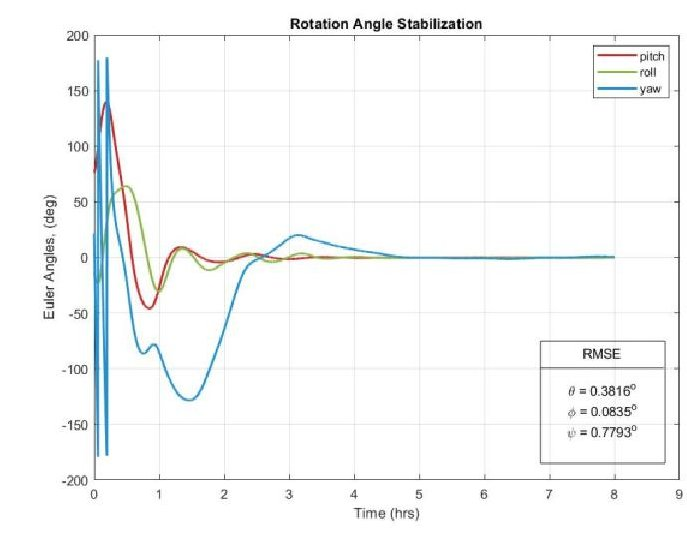

Fig. 1. ADCS Simulation - Euler Angles

Figure 1 shows the ADCS simulation with the above-mentioned parameters for a duration of almost 8 hours. In the result displayed, the quaternions are converted to Euler angles since they represent the satellite rotation more clearly as compared to the quaternions. From the results we see that the Euler angles stabilize within 5-6 hours. Since the magnetic control is used, so it is a bit slower but provides efficient control, nonetheless. The

<!-- PDF_PAGE: 9 -->

root-mean squared errors (RMSE) calculated show that the satellite is able to achieve sufficient control accuracy with rotation angles having a maximum error of $ 0. 7 7^{\circ} $ For multiple runs of the simulation, it is observed that the rotation angle accuracy remains within a minimum error of $ 0. 0 7^{\circ} $ and a maximum of $ 4^{\circ} $

In fig. 2 the angular velocity stabilization is shown, that is achieved within the first 5 hour. Here, the maximum errors do not exceed 0.06 deg/sec and for multiple simulation runs we observe the same trend with error between $ 1 0^{-4} $ - 0.06 deg/sec.

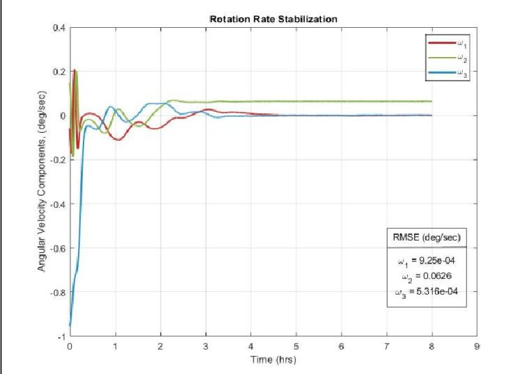

Fig. 2. ADCS Simulation - Angular Velocity

To get an idea of the filter performance, the errors between true and estimated attitude are displayed in figs. 3 & 4. Initially, the errors are quite large but within the first two hours the convergence starts, and the errors start reducing. After 1.5 hours, the errors are almost constant and are limited to less than 0.05 $ \circ $ for rotation angles and less than $ 2 \times1 0^{-4} $ deg/sec for rotation rates, along all the three axes.

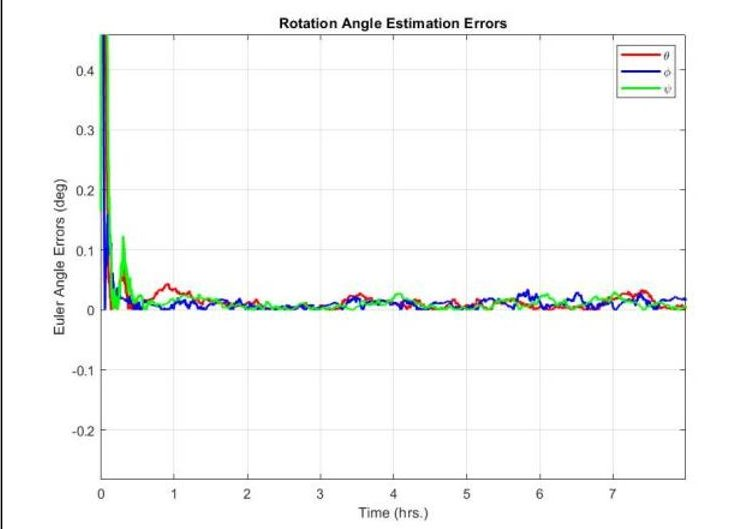

Fig. 3. Error Evolution between true and estimated rotation angles

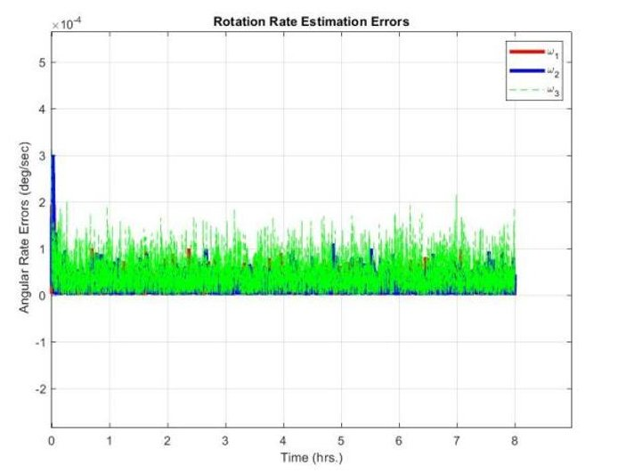

Fig. 4. Error Evolution between true and estimated rotation rates

From the results displayed above, we see that efficient estimation and control is achieved within a reasonable time. But the results are too simplified because the sensor errors are not incorporated, which will be done next.

## 4.2 ADCS Simulation with Magnetic Disturbances & sensor errors

When the residual dipole model and the sensor bias models are introduced the $ P_{o}^{+} $ is modified to incorporate these terms. The is now a 15 by 15 matrix, initialized as:

$$
P _ {o} ^ {+} = b l k d i a g \left( \begin{array}{l} I _ {3} \sigma_ {q _ {o}} ^ {2} \\ I _ {3} \sigma_ {q _ {o}} ^ {2} \\ I _ {3} \sigma_ {m _ {r e s _ {o}}} ^ {2} \\ I _ {3} \sigma_ {\beta_ {m t m _ {o}}} ^ {2} \\ I _ {3} \sigma_ {\beta_ {g y r o _ {o}}} ^ {2} \end{array} \right)
$$

Here,

<table border="1"><tr><td>$\sigma_{mres_{o}}$</td><td>$\sigma_{\beta mtm_{o}}$</td><td>$\sigma_{\beta gyro_{o}}$</td></tr><tr><td>$0.01Am^{2}$</td><td>$10^{-6}T$</td><td>$10^{-4}rad/sec$</td></tr></table>

Figure 5 displays a maximized view of the residual dipole moment estimated via the EKF. The results show the dipole estimation starts converging from the first 2 hrs, with the maximum value not more than $ 0.01 \mathrm{A m}^{2} $ which is the maximum residual dipole calculated for nanosatellite, as reported in literature [15].

<!-- PDF_PAGE: 10 -->

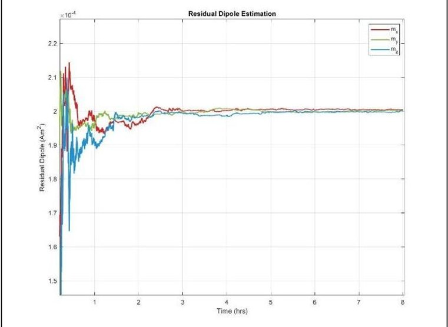

Fig. 5. Estimated Residual Dipole

## Bias Estimation

The estimated magnetometer bias, in fig. 6, shows slight random variations even after the EKF convergence. This is due to the induced bias component added to the constant one. However, the amplitude of these variations does not exceed 60 nT, keeping the overall bias well within the standard magnetic bias range.

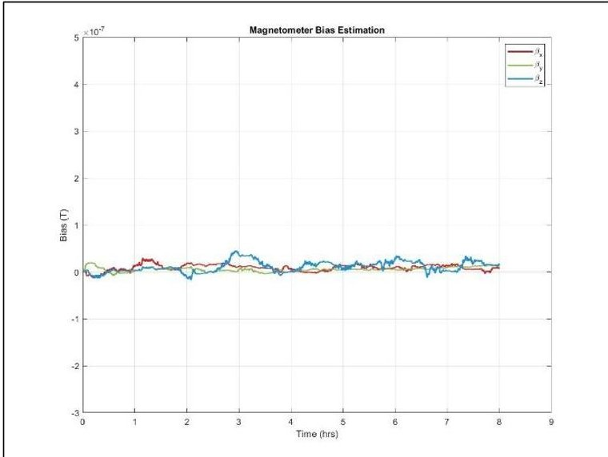

Fig. 6. Estimated Magnetometer Bias

The gyroscope bias estimation is shown in fig.7. The bias along all the three axes does not exceed 0.035 deg/sec and eventually becomes constant. Similar to the magnetometer, the gyroscope bias also shows minute random fluctuations, of order $ 1 0^{-3} $ deg/sec. This is due to the white noise bias component (eqn.40).

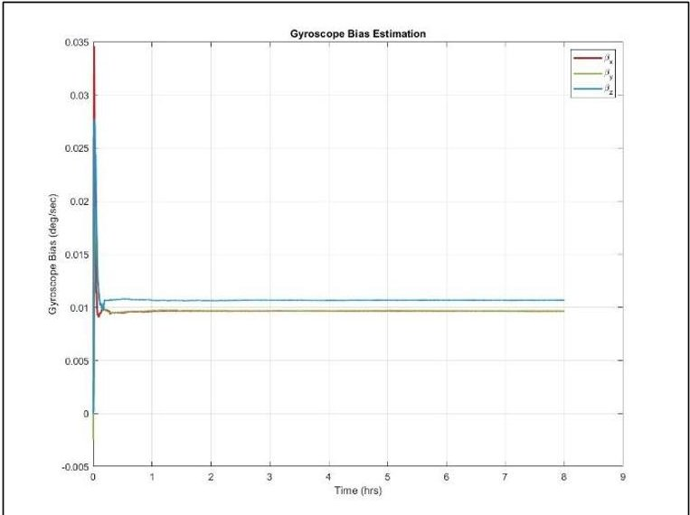

Fig. 7. Estimated Gyroscope Bias

## ADCS Simulation Results

With the incorporation of the sensor errors the estimation and control accuracy are affected but with proper tuning of the covariance matrices, in the EKF, and the disturbance rejection applied in the controller the ADCS regains its efficiency. This is evident in fig. 8 & 9 where the stabilization achieved is quite similar to that of fig. 1 & 2. Even though the errors are higher than the case without biases, but they still remain within a reasonable range with maximum error for the rotation angles being $ 0. 8^{\circ} $ and 0.06 deg/sec for rotation rates. Multiple simulation runs also show the ADCS accuracy with errors no more than $ 8^{\circ}. $

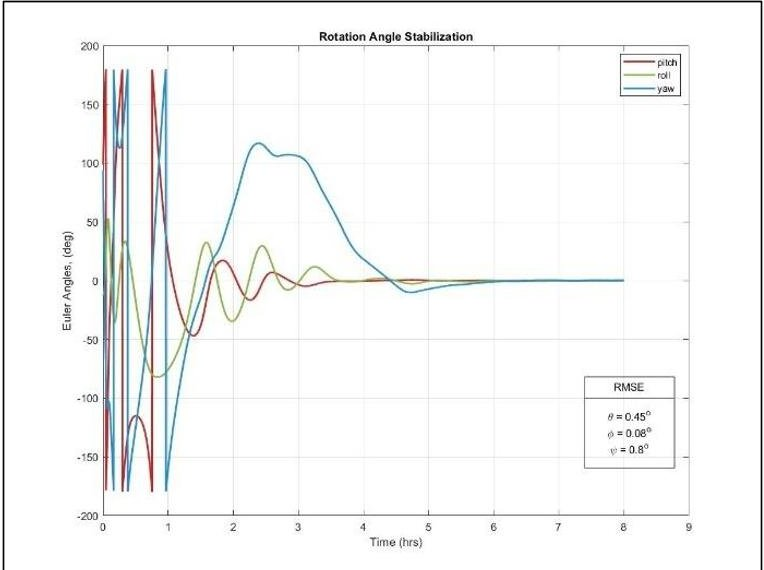

Fig. 8. ADCS Simulation with Errors - Euler Angles

<!-- PDF_PAGE: 11 -->

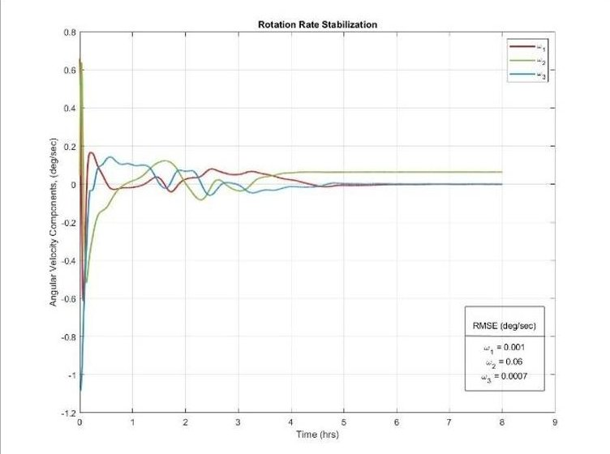

Fig. 9. ADCS Simulation with Errors - Angular Rates

For the attitude estimation in the presence of sensor bias, it is observed that the errors between the true and estimated states are higher than the case with no bias, but these results are much more realistic since the sensors operating in real environment always have bias and other error sources associated with them. The error curves follow a similar trend as seen earlier in figs. 3 & 4, with error of large magnitude in the start of the simulation, which eventually reduce and settle down once the convergence starts. The results in figs. 10 & 11 show that after convergence, the maximum error magnitude observed is about 0.25 deg. for rotation angles and 0.001 deg/sec for rotation rates.

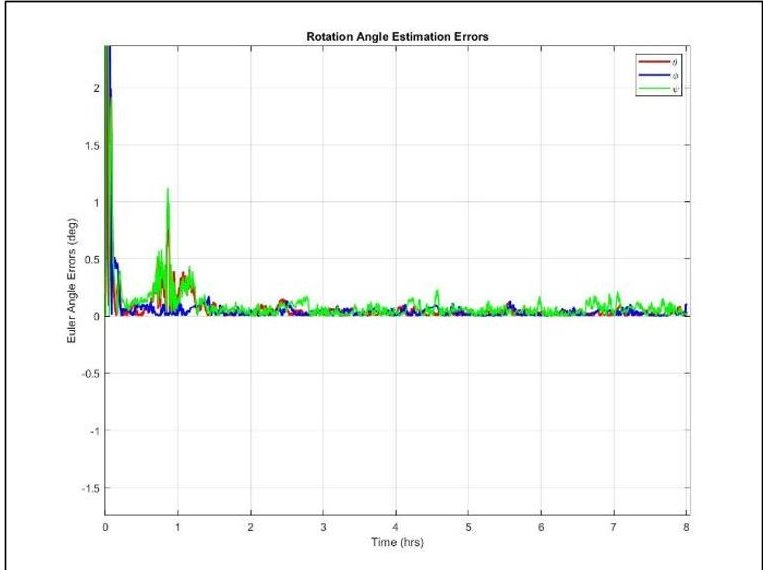

Fig. 10. Error Evolution for Rotation Angle Estimation in the presence of sensor errors

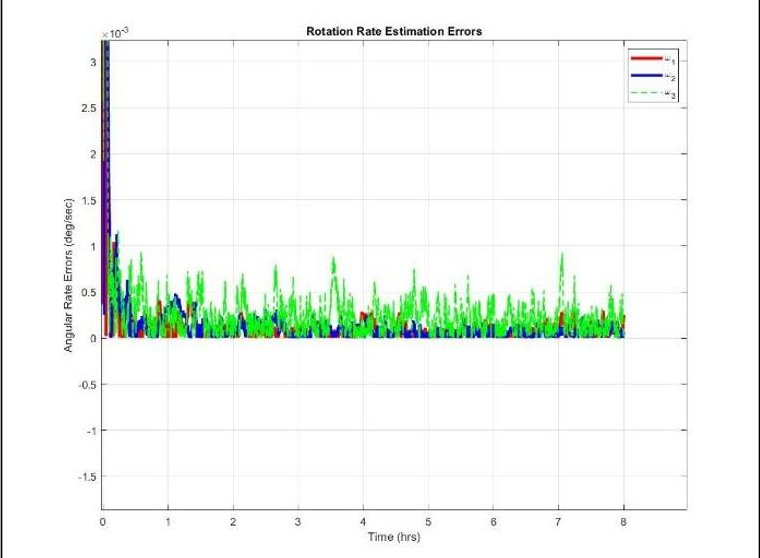

Fig. 11. Error Evolution for Rotation Rate Estimation in the presence of sensor errors

## 4.3 Requirements for Skoltech-F

Skoltech-F is a 3U CubeSat that is to be launched with the aim of testing an adapter for the launch of femto satellites directly from the CubeSat in space, fibre-optic modem testing and inter-satellite modem testing for radio link. The satellite is to be launched in a sun-synchronous orbit (SSO) at an altitude of 470 km.

In order to define the control requirements for the CubeSat-F, the residual dipole the system can handle was determined. To do this, analysis was performed on the designed ADCS by changing the residual dipole under varying conditions. As a result, the amount of maximum dipole handled by the system was determined and consequently the required ADCS control accuracy was determined. The dipole limitations set would aid the engineer to design the CubeSat such that magnetic cleanliness requirements are met, and the amount of residual dipole is restricted. The results show the maximum dipole the system can handle with proper estimation and disturbance rejection is about $ 2 \times1 0^{-4} $ Am $ ^{2} $ . This leads to control accuracy with maximum error less than $ 7^{\circ} $

For the structural requirements, the environmental disturbances were varied and the influence on the EKF and ACS were checked. The disturbance value that resulted in accuracy less than $ 7^{0} $ was considered to be the maximum the system can withstand without disrupting control. The value chosen was $ 7\times 10^{-9} $ N m. Using this torque value, the lever arm was calculated using eq. (12). The results show that for a torque of $ 7\times 10^{-9} $ Nm, the maximum lever arm should not exceed 0.32 cm.

## 5. Conclusions

The attitude determination of the in orbit Skoltech CubeSats is successfully carried out. The attitude estimation is achieved via EKF and is controlled through the magnetic PD controller. The results show that for the precise attitude estimation, the incorporation of the

<!-- PDF_PAGE: 12 -->

Copyright © IAC 2023 by Skolkovo Institute of Science & Technology. Published by the IAF, with permission and released to the IAF to publish in all forms.

sensor error sources is necessary. Estimation of the sensor bias improves the readings, since the sensor now closely resembles to what it would behave under actual environment. The estimation of the residual dipole in the system and then its incorporation in the rotational and filter dynamics depicts how the major disturbance source disrupts a satellite in LEO. The disturbance rejection applied to the controller provides a way to control attitude more accurately, despite the high magnitude magnetic disturbances. The final ADCS results, show an adequate estimation and control achieved within a reasonable time and with adequate accuracy. The results of the numerical experimentation on the designed ADCS, provide a basis for the design of the new CubeSat mission by providing requirements for various subsystems.

As a future work, the incorporation of temperature-dependent bias models and various other attitude sensors, like sun sensors or star tracks, can be done to enhance the control accuracy. To improve the EKF performance, proper methodology can be devised to tune the covariance matrices so that the singularity can be avoided.

## References

[1] H. E. Söken, "Magnetometer calibration for advanced small satellite missions," p. 1, 30th International Symposium on Space Technology and Science, (3-10 Temmuz 2015), 2015.

[2] T. Inamori, N. Sako, and S. Nakasuka, "Strategy of magnetometer calibration for nano-satellite missions and in-orbit performance," in AIAA Guidance, Navigation, and Control Conference, p. 7598, 2010.

[3] D. Ivanov, D. Roldugin, S. Tkachev, M. Ovchinnikov, R. Zharkikh, A. Kudryavtsev, and M. Bychek, "Attitude motion and sensor bias estimation onboard the SiriusSat1 nanosatellite using magnetometer only," Acta Astronautica, vol. 188, pp. 295-307, 2021.

[4] D. Ivanov, M. Ovchinnikov, N. Ivlev, and S. Karpenko, "Analytical study of microsatellite attitude determination algorithms," Acta astronautica, vol. 116, pp. 339-348, 2015.

[5] D. Ivanov, M. Y. Ovchinnikov, et al., "Advanced numerical study of the three-axis magnetic attitude

control and determination with uncertainties," Acta Astronautica, vol. 132, pp. 103-110, 2017.

[6] E. J. Lefferts, F. L. Markley, and M. D. Shuster, "Kalman filtering for spacecraft attitude estimation," Journal of Guidance, control, and Dynamics, vol. 5, no. 5, pp. 417-429, 1982.

[7] M.-Y. Hong, "In-flight magnetometer calibration with temperature compensation for phoenix cubesat," 2018.

[8] N. Abdelrahman, A. Annenkova, D. Ivanov, and D. Pritykin, "Enhancing cubesat active magnetic attitude control based on the results of the ground tests," in 2021 28th Saint Petersburg International Conference on Integrated Navigation Systems (ICINS), pp. 1-4, IEEE, 2021.

[9] C. A. Kluever, Space flight dynamics. John Wiley & Sons, 2018.

[10] F. L. Markley and J. L. Crassidis, Fundamentals of spacecraft attitude determination and control, vol. 1286. Springer, 2014.

[11] Y. Yang, Spacecraft modeling, attitude determination, and control: quaternion-based approach. CRC Press, 2019.

[12] A. Annenkova, N. Abdelrahman, et al., "Cube-Sat Magnetic Atlas and in Orbit Compensation of Residual Magnetic Dipole," Proceedings of the International Astronautical Congress, The Cyberspace Edition, vol. 2020 October 2020.

[13] M. S. Grewal and A. P. Andrews, Kalman filtering: Theory and Practice with MATLAB. John Wiley & Sons, 2014.

[14] D. J. Griffiths, Introduction to electrodynamics; 3rd ed. Upper Saddle River, NJ: Prentice-Hall, 1999.

[15] J. Springmann, J. Cutler, and H. Bahcivan, "Magnetic sensor calibration and residual dipole characterization for application to nanosatellites," in AIAA/AAS Astrodynamics Specialist Conference American Institute of Aeronautics and Astronautics 2010.