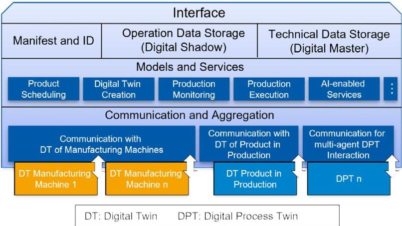
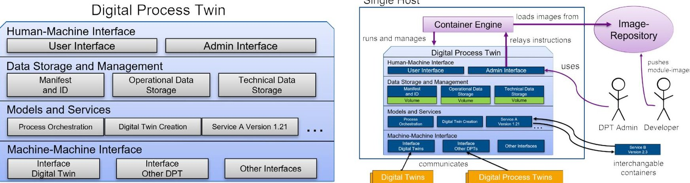
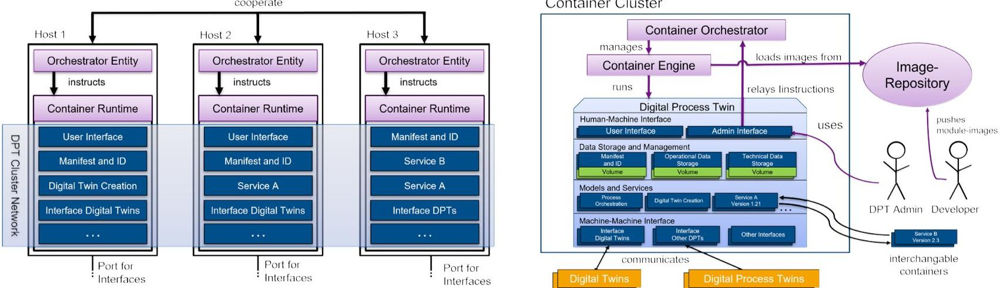
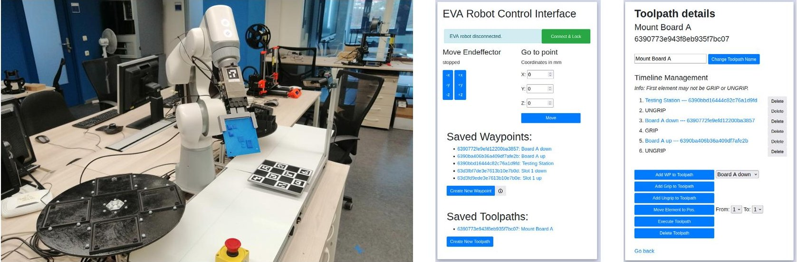

<!-- PDF_PAGE: 1 -->

# 56th CIRP Conference on Manufacturing Systems, CIRP CMS '23, South Africa Modularisation and containerisation of the Digital Process Twin

Christian Plesker $ ^{a,*} $ , Vladimir Kutscher $ ^{a} $ , Robert Knobloch $ ^{a} $ , Benjamin Schleich $ ^{a} $

$ ^{a} $ Product Life Cycle Management, Technical University of Darmstadt, Otto-Berndt-Str.2, D-64287 Darmstadt, Germany

* Corresponding author. Tel.: +49-6151-1621-797 ; fax: +49-6151-1621-793. E-mail address: plesker@plcm.tu-darmstadt.de

## Abstract

The concept of Digital Process Twins is designed to map, monitor and orchestrate entire processes. The current monolithic architecture of the Digital Process Twin does not yet meet the requirements of the industry including variable computing power, reliability and fail safety. This work addresses this research gap. It presents an architecture in which the components of the digital process twins are modularised and containerised. Operation on single host as well as distributed systems is addressed and realised in a prototypical implementation. Moreover, the overall concept is demonstrated in a case study of a cube-satellite assembly process.

$ \textcircled{c} $ 2023 The Authors. Published by Elsevier B.V.

This is an open access article under the CC BY-NC-ND license [https://creativecommons.org/licenses/by-nc-nd/4.0] Peer-review under responsibility of the scientific committee of the 56th CIRP International Conference on Manufacturing Systems 2023

Keywords: digital process twin; modularisation; containerisation; industry 4.0; digital twin;

## 1. Introduction

Digital Process Twins (DPTs) is a networked software system in the context of Industry 4.0 that digitally map, monitor and control production processes and systems and orchestrates the associated digital twins of systems and products [1]. This can increase the productivity and flexibility of value chains. However, the operation of DPTs can lead to high demands on computing resources include variable computing power, reliability and fail-safety. Monolithic DPT architectures can hardly fulfil these requirements and the maintenance is difficult because individual parts that are strongly dependent. A modular DPT architecture promises a longer service life through better maintainability and interchangeability of the components. The modules can also be separated from the computing hardware through software virtualisation using containerisation and thus flexibly moved between any hosts. This portability allows horizontal scaling, failure tolerance and outsourcing of modules to the cloud. Interchangeability and reusability of the modules as well as portability of the container technology also enable a multi-vendor ecosystem for the DPT. This paper addresses this research gap and presents the developed concept using the case study of a CubeSat satellite factory in orbit. The factory and the DPT are results of the previous project AI-In-Orbit Factory [1]. In the follow-up project AI-enabled Cyber-Physical In-Orbit Self-Recovering Factory (ACOR) the DPT is further standardised and improved.

## 2. Background and related work

In the following, the state of research on the technologies used is discussed and the research gap is described in detail.

## 2.1. Digital Process Twin (DPT)

The Digital Twin (DT) is an important technology for enhancing manufacturing systems by creating a virtual representation of the physical system and allowing for the integration of new digital technologies. This integration can lead to optimized performance of the physical twin, improved transparency in machine operations, and enable predictive maintenance, among other benefits [2]. The DPT is an adapted version of the DT, which is extended to perform tasks in the production at process level. The DPT works in conjunction with the DTs of the manufacturing system. Its definition is as follows:

"The digital process twin orchestrates the production of a product instance by allocating the relevant product components, instantiating the digital product twin as start of the physical production process and providing information to the digital twins of production machines." [1].

According to the authors, the DPT disrupts the classical automation hierarchy and allows decisions being made autonomously based on present information. An image of the architecture of the DPT can be seen in Fig. 1. The operation of DPTs can lead to high demands on computer resources, depending on the complexity and size of the process. One approach to

<!-- PDF_PAGE: 2 -->

the flexible provision of computing resources is container technology [3].

Fig. 1. DPT architecture according to [1]

## 2.2. Container technology

Container technology is a type of virtualisation technology that does not require the use of a guest operating system. Containers contain the executable code and share the host's system core. Containers can be stored as container images. A container image contains the application with its dependencies, which reduces the size of the images and the computing power needed to run the virtualised software. The number of separate applications in a container is called granularity [4]. Hung at al. developed an approach for containerisation of DT applications using Docker in a Kubernetes-cluster [5]. The authors showed, that through containerisation a larger number of different "intelligent services" and cloud services can be incorporated in a plug-and-play style [5]. Alaasam et al. used container technology to operate DTs in a Fog computing environment [6]. Their focus is on the processing of event streams in this environment. The behaviour during the migration of the DT between hosts in the Fog environment is investigated in particular. This migration is an important capability to ensure resilience. A software modularity and suitable architecture favours containerisation, since not only the entire software but also individual modules and services can be containerised. In order to use container technology effectively, the services and modules must be clearly separated from each other. This can be realised via a microservice- and service-oriented architecture (SoA).

## 2.3. SoA and Microservices

Software modularity can be made possible by SoA, which is a distinct way of making the functionalities of a program accessible. It makes it possible to modularise previously monolithic, complex software systems [7]. A service in a SoA is characterised by access to the functionalities of the service through defined interfaces, the service provider is agnostic to the identity of the service consumer and the service consumer does not know the concrete implementation of the services [8]. The term microservice denotes the building block of an architecture in which the atomic functions of an application are divided into

individual, independent and stateless services. The transformation towards a microservice architecture is mainly done with the intention of scaling the application by multiplying the instances of individual microservices. Individual functionalities can thus be scaled depending on the distribution of the load within an application. Microservice architectures consist of one application per container. [9]

## 2.4. Research gap

The current concept of the DPT has a monolithic core structure. A microservice and service-oriented architecture is thus currently not possible for the DPT. Thus, container technology cannot be applied as intended due to the structure. In this paper, the architecture is to be adapted in such a way that modularisation and containerisation of the individual sub-areas of the DPT is possible. The modularisation of the DPT creates different levels of abstraction that help all users to understand the system. By identifying and separating the individual sub-areas, a better load distribution of the modules on the individual computing resources should be ensured and better reusability and interchangeability achieved. In this way, reliability and fault tolerance can be improved so that the DPT can also be used in critical infrastructures.

## 3. Approach to modularisation and containerisation

DTs in future mature stages are complicated systems [10]. Their behaviour is predictable, but the number of components is large and their functionality is only accessible to experts [11]. In order to still be able to use the DPT in critical infrastructures with a high number of process components, the existing structure of the DPT (Fig. 1) can be modularised and containerised. This is the goal of this approach. The focus is initially on deployment on a single host system and is then extended to an architecture in cluster operation. The conceptualisation of the DPT in a cluster has a significant added value compared to that on a single host, but is associated with increased complexity and greater hardware and computing effort.

## 3.1. Modularity of the DPT

The levels of the DPT can be divided into four categories: Digital Process Twin Interface, Data, Service and Communication [1]. To achieve modularity each category has to be further subdivided into individual modules (Fig. 2 (a)). Modules are clearly separable groups of functionalities that are independent of each other. This allows each module to be developed and implemented independently. At the Interface level there are two modules for user access to the DPT. The User interface allows access to the front end of the DPT and enables technical staff to monitor and control the production process and services. The Admin interface is the access to the administration of the individual modules and later enables the administration of the containers. The Data-layer reflects the state of the DPT and is responsible for storing any data during the whole product life cycle. Manifest and ID contains a self-description of the

<!-- PDF_PAGE: 3 -->

Fig. 2. (a) Categorised and modularised DPT; (b) Single-host architecture of the DPT with containerised modules

DPT, as well as an identification and a description of the DPT-structure. The Operational Data Storage holds all data relevant at runtime of the DPT. This includes simulation data, process data and product data. Technical Data Storage includes models and documents on the production process and the modules. At the Services-level exist all services offered by the DPT that do not belong to one of the other levels. These include, for example, simulations, orchestration of the production process, creation of product DTs etc. It should be noted that the services on this level are not allowed to hold any state, but instead access the operational data storage. This is important for the later design of the architecture. The last level is the Communication, which is responsible for all external communication with other machines and DTs. This includes the DTs of the production machines, DTs of the products in production and other DPTs.

## 3.2. Single host architecture of a containerised DPT

The DPT modules must function independently of the context and be self-contained to be considered complete modules [12]. This is achieved by containerisation. One reason for virtualisation is the independence from the hardware and isolation of the software. The context relevant for the operation of a container is the container runtime and the host kernel. Since these are considered homogeneous across all hosts in this concept, a container module is context-independent, albeit in a weak formulation. There should be no dependencies that are not included in the container image. This has the advantage, that the installation of a module is simple and not linked to any framework conditions except the existence of the container runtime.

The interaction between the modules is determined by the service-oriented architecture (chapter 2.3). Each module acts as a server (service provider), a client (service consumer) or both. A server accepts requests and processes them independently of the requester. The communication functionalities are provided in a module base. Each module image builds on this module base and thus inherits its functionalities. A message oriented middleware is used in the module base, which provides most of the messaging services. However, the sender and receiver must still agree on the syntax and semantics of the messages the other module receives and sends. This is specified in a message

protocol. Since the container processes are isolated from each other, they must communicate a via network interfaces. The container engine creates and manages an DPT-internal network to which all containers of the DPT belong. Since the concept of DPT provide relatively fixed communication paths between the modules, a publisher-subscriber architecture is less suitable. Publish-subscribe is mainly designed for unidirectional communication with many consumers. Moreover, in DPTs one producer connects to rather few consumers who need different information. Instead, a point-to-point delivery system should be used. The fact that all modules of the DPT are containerised means that the modules themselves are stateless. Containers have no persistent memory.

The state of the DPT consists of the structure of the DPT which is dynamic due to modularisation, and the data stored in the volumes. Volumes should only exist in the data plane of the DPT to ensure a clear separation of data and functionality. This is important for the scalability of the DPT in the container cluster (see chapter 3.3), as a microservice architecture is favoured.

An image repository is suitable for providing the containerimages of a DPT. Using a container engine or the Admin Interface, images can be obtained from one or more of these repositories. Each module-developer can have their own repository where their software images are stored. Many non-DPTspecific modules such as Structured Query Language (SQL) databases or web servers are often already available as images on public image repositories and can be obtained directly from there. The DPT is therefore by no means limited to a single image store as the source of the images and can benefit from both local and external resources.

The standardisation of modules would be of great interest to module developers and their customers, the operators of DPTs. It would enable a whole module ecosystem. The layer system of modern container images also enables the development of module bases, i.e. base images, which could serve as a basis for standardisation in Industry 4.0.

The DPT architecture for single hosts can be seen in Fig. 2 (b). The individual modules were containerised and run by a container engine. The individual containers and associated services can be exchanged dynamically, even while the system is

<!-- PDF_PAGE: 4 -->

Fig. 3. (a) View of the hosts: The modularised, containerised digital process twin in the cluster; (b) The modularised, containerised DPT in a cluster

running. For this purpose, a DPT admin can forward instructions to the container engine via the admin interface.

The containers of the Data-layer enable persistent storage through their associated volumes. All other containers are stateless and must access this level. The container engine itself takes care of the operation and management of all containers.

## 3.3. Containerised DPT architecture for distributed systems

The modular, containerised DPT should be operable in a cluster as well. The use case for operation in a cluster becomes important when, high reliability or large and adaptive scaling of the application are required, among other things. Additionally, it can be interesting for companies with distributed computing resources. To operate in a cluster, the architecture for nondistributed systems must therefore be adapted and extended accordingly. A container cluster acts as a coherent computing unit and aggregate the computing power of the hosts. The DPT is no longer locally bound, but delocalised and decentralised in the cluster. The management of this distributed system should not take place centrally, but in consultation with all participating computing units. This avoids a single point of failure as far as possible. In the cluster, a simple container manager is no longer sufficient to manage the highly dynamic network of containers and hosts. Instead, an orchestrator is used.

The orchestrator maintains instances of itself on each host. This can be seen in Fig. 3 (a)). The figure shows a cluster of three different hosts. These are networked together and control the cluster independently. Only exemplary modules are shown. The user specifies a desired cluster state, which the orchestrator tries to achieve. The low-level container work is still done by container runtimes, which must be active on all hosts. The runtimes receive commands from the local Orchestrator instance.

The internal structure of the DPT does not change, so Fig. 3 (b) closely resembles Fig. 2 (b). The same module images as in the non-distributed concept are obtained from the image repository. DPT modules take the role of services in the cluster. The container orchestrator manages the services that communicate with each other within the cluster network. It should be noted that a service/module is to be regarded as a grouping of several

identical containers of this module on different hosts. In this way, horizontal scalability is realised. For disturbance-free behaviour during scaling, however, the modules must be designed as microservices and be stateless (see 2.3).

The principles of communication in the distributed system do not change compared to single-host communication. Since the DPT in this model is distributed on different hosts, the individual containers must communicate with each other via local networks. To do this, they exchange messages with each other asynchronously via the Transmission Control Protocol (TCP). As soon as a module is scaled in the form of several identical containers, it is not clear to which container a request addressed to the module should be routed. For this purpose, a load balancer should distribute the incoming requests evenly to the individual containers of the module. In this way, the given resources are used optimally. Answers to a request must be returned to the requesting container. For this purpose, an address is always attached to a request, which identifies the requesting container.

## 4. Prototype implementation

The concept of DPT was prototypically implemented in the context of the ACOR project, which is dedicated to research of production of small satellites (cubesats) within an in-orbit factory, see Fig. 4 (a). The considered sub-process consists of a robot arm (Automata Eva), which assembles the individual components of the cubesats. The robot is controlled via defined waypoints and the operations of the gripper. These are combined to form toolpaths that describe complex movements. The DPT has the task of controlling and monitoring the assembly process. The operations and waypoints are displayed on the user interface. The robot waypoints and toolpaths are stored in the Operational Data Storage database. For defining the means in which the database can be modified, a container implementing a SoA is used. This interface acts as an abstraction layer and an intermediary for all services to read or write to the database. Thus, the DPT consists of the following three modules. The Operational Data Storage, consisting of a MongoDB database, an interface module that modifies the database

<!-- PDF_PAGE: 5 -->

Fig. 4. (a) Prototype of the ACOR in-orbit factory; (b) User interface of the EVA Robot Control; (c) User interface of a toolpath

in response to incoming requests and a management UI for the database (mongo-express). The interface to control a EVA Automata robot arm and an UI for the process flow of the robot, consisting of a Django application that receives requests via the WSGI server Gunicorn and a NGINX web server.

As a practical example, a stored waypoint is renamed during operation of the production process. The waypoints are displayed to the user to create complex motion sequences by stringing these points together. Renaming is important to enable the user to identify the individual points. To illustrate the use case, the communication between the different containers and the interaction of the architecture is shown. For the implementation, "Docker" is chosen as the container engine. To cover both ways of managing the multi-container application, Docker-Compose is used for the non-distributed system and an administrative UI (Portainer) for the cluster. Python is used as the primary programming language.

## 4.1. Operation on a single host

All modules are based on a module base in the form of a base image (see 2.3). The module base is based on the official Python Alpine image and consists of a Python class, which any modules either instantiate as an object or from which the modules inherit as a class. In this prototype, the module base only implements the communication between the modules. For this, there is a method for registering server connections from the client side. In addition, there are separate methods for receiving and sending messages from the client and server side. Communication is implemented via "ZeroMQ". Each module receives a ROUTER socket for the general server role and a DEALER socket for each client connection. The DEALER sockets of the clients connect to the ROUTER sockets of the servers. As a result, each DEALER socket manages only one connection, but each ROUTER socket manages several connections. The incoming connections receive identities via which the socket can address the individual clients separately. The individual functionalities of the DPT build on the "BaseModule" and are implemented as microservices (see 2.3). The DPT is started in its entirety via Docker Compose, whereby the installation via the

admin interface (Portainer) is also possible. After the successful start, the Django UI is available via the IP in the browser. A user interface is shown, which displays exemplary waypoints relevant for the EVA robot during the assembly of CubeSat satellites. The waypoints are hyperlinks that lead to the detailed view of the waypoint, Fig. 4 (b) and (c).

For the use case the input is made via the user interface in a browser. The HTTP request of the browser is then processed by NGINX and forwarded to the Django app. This sends a message to the interface of the database. The request consists of the request type and the request content. The request content is the ID of the waypoint and the new name. The Operational Data Storage receives this request and processes it by making a change in the database. After the successful change the interface returns only the request type as a response. This message is received by the Django app, which incorporates the success into the HTML document that is returned to the user. In total, four containers are involved in the action: the web server, the Django app, the OP-Database interface and the MongoDB database.

## 4.2. Operation in a Cluster

The implementation is now extended to operation in a cluster. The containers are installed via the admin interface (Portainer). Docker Swarm is used as the orchestrator. For operation, three Virtual Machines (VM) are created with Oracle VM VirtualBox and connected to the same virtual network. A desktop environment is not installed, instead an Secure Shell server and Docker. Each of the three VMs runs a Docker Swarm Node in manager mode. If there are three managers and the state of one manager diverges from the rest, consensus on the correct state can still be reached [13]. The Docker engine is put into swarm mode on the first VM. After that a string is generated that is used together with the IP of the VM to join the swarm. In this implementation, the modules are installed and managed via the admin interface Portainer. The Portainer stack consists of the Portainer server and the agents, one of which runs on each manager node. Via the UI, the services can be scaled horizontally and new services or modules can be added. Before installing modules, the network with overlay driver must be cre-

<!-- PDF_PAGE: 6 -->

ated. When adding modules, they are the same modules in the same configuration as in the single-host implementation. However, the deployment in the cluster enables new configuration options, such as defining the number of container replicas or the positioning of the containers in the cluster. The individual modules are distributed to the different VMs. This creates resilience and shows the scalability of the modules. In both implementations, the Docker images can be obtained from an image repository (Docker Registry). This shows the outsourcing capability of the image repository.

## 5. Conclusion and outlook

In this work, an approach to restructure the DPT is proposed to improve reliability and fail-safety and enable highly variable computing power in operation. The existing monolithic structure is divided into independent modules and restructured. In the next step, these modules are containerised and the new DPT architecture is designed for operation on single-host and distributed systems. Restructuring into modules reduces system complexity and the loose coupling offered by the SoA enables the integration of new modules while containerisation helps the modules of the DPT to achieve better portability and scalability. Container technology also allows a fast, uncomplicated and reliable installation process for the modules and the outsourcing of parts of the DPT to the cloud [5]. The isolation from the host system and other modules means fewer compatibility problems with modules from different manufacturers. In addition, the horizontal scalability of the DPT in the cluster leads to a high failure tolerance. The segregation of functionalities promotes specialisation of manufacturers and standardisation of modules. If the possibility of storing the modules as compact images in repositories is also taken into account, this modular architecture is predestined for a DPT module ecosystem. Real-time and latency-critical applications were not yet tested. The distributed architecture of the DPT increases the latency of internal DPT communication compared to monolithic and non-containerised architectures. In the course of the follow-up project ACOR, the standardisation of DPT will be further investigated. A clear interface of the individual containerised services on the service level will be defined. In addition, the idea of a framework for providing modules and services in a digital twin app store proposed by Bulut et al. [14] is explored and attempted to be enabled using container technology.

## Acknowledgements

The results presented here were achieved within the framework of the AI-enabled Cyber-Physical In-Orbit Self-Recovering Factory project funded by the Federal Ministry for Economy Affairs and Climate Action (BMBK project number 50RP2240C) and supported by the German Space Agency at DLR.

## References

[1] F. Kempf, M. S. Mühlbauer, T. Dasbach, F. Leutert, T. Hulin, R. Radhakrishna Balachandran, M. Wende, R. Anderl, K. Schilling, A. O. Albu-Schäffer, Ai-in-orbit-factory-ai approaches for adaptive robotic in-orbit manufacturing of modular satellites, in: Proceedings of the International Astronautical Congress, IAC, IAF, 2021, p. 13.

[2] T. Y. Melesse, V. D. Pasquale, S. Riemma, Digital twin models in industrial operations: A systematic literature review, Procedia Manufacturing 42 (2020) 267-272, international Conference on Industry 4.0 and Smart Manufacturing (ISM 2019). doi:https://doi.org/10.1016/j.promfg.2020.02.084.

URL https://www.sciencedirect.com/science/article/pii/S2351978920306491

[3] V. G. da Silva, M. Kirikova, G. Alksnis, Containers for virtualization: An overview, Applied Computer Systems 23 (1) (2018) 21-27. doi:doi: 10.2478/acss-2018-0003. URL https://doi.org/10.2478/acss-2018-0003

[4] C. Pahl, Containerization and the paas cloud, IEEE Cloud Computing 2 (3) (2015) 24-31. doi:10.1109/MCC.2015.51.

[5] M.-H. Hung, Y.-C. Lin, H.-C. Hsiao, C.-C. Chen, K.-C. Lai, Y.-M. Hsieh, H. Tieng, T.-H. Tsai, H.-C. Huang, H.-C. Yang, F.-T. Cheng, A Novel Implementation Framework of Digital Twins for Intelligent Manufacturing Based on Container Technology and Cloud Manufacturing Services, IEEE Transactions on Automation Science and Engineering (2022) 1- 17doi:10.1109/TASE.2022.3143832. URL https://ieeexplore.ieee.org/document/9697094/

[6] A. B. A. Alaasam, G. Radchenko, A. Tchernykh, J. L. González Compeán, Analytic Study of Containerizing Stateful Stream Processing as Microservice to Support Digital Twins in Fog Computing, Programming and Computer Software 46 (8) (2020) 511-525. doi:10.1134/S0361768820080083. URL http://link.springer.com/10.1134/S0361768820080083

[7] C. Fang Fang, L. Chien Sing, Collaborative learning using service-oriented architecture: A framework design, Knowledge-Based Systems 22 (4) (2009) 271-274, artificial Intelligence (AI) in Blended Learning. doi:https://doi.org/10.1016/j.knosys.2009.01.003. URL https://www.sciencedirect.com/science/article/pii/S0950705109000185

[8] K. B. Laskey, K. Laskey, Service oriented architecture, Wiley Interdisciplinary Reviews: Computational Statistics 1 (1) (2009) 101-105.

[9] I. Nadareishvili, R. Mitra, M. McLarty, M. Amundsen, Microservice Architecture: Aligning Principles, Practices, and Culture, O'Reilly Media, 2016. URL https://books.google.de/books?id=gf2wDAAAQBAJ

[10] M. Grieves, J. Vickers, Digital Twin: Mitigating Unpredictable, Undesirable Emergent Behavior in Complex Systems, in: F.-J. Kahlen, S. Flumerfelt, A. Alves (Eds.), Transdisciplinary Perspectives on Complex Systems, Springer International Publishing, 2017, pp. 85-113. doi:10.1007/978-3-319-38756-7_4. URL http://link.springer.com/10.1007/978-3-319-38756-7_4

[11] G. Sarout, R. B. Mc Grath, et al., Learning to live with complexity, Harvard business review 89 (9) (2011) 68-76.

[12] H. Balzert, Lehrbuch der Softwaretechnik: Basiskonzepte und Requirements Engineering, Spektrum Akademischer Verlag, 2009. doi:10. 1007/978-3-8274-2247-7. URL http://link.springer.com/10.1007/978-3-8274-2247-7

[13] Docker, Inc., Raft consensus in swarm mode (2022). URL https://docs.docker.com/engine/swarm/raft/

[14] S. Bulut, R. Anderl, Framework approach for smart service development, Procedia CIRP 100 (2021) 864-869, 31st CIRP Design Conference 2021 (CIRP Design 2021). doi:https://doi.org/10.1016/j.procir.2021.05.030. URL https://www.sciencedirect.com/science/article/pii/S2212827121004923