<!-- PDF_PAGE: 1 -->

# On the Optimal Deployment of Virtual Network Functions in Non-Terrestrial Segments

Antonio Petrosino $ ^{ID} $ , Graduate Student Member, IEEE, Giuseppe Piro $ ^{ID} $ , Member, IEEE, Luigi Alfredo Grieco $ ^{ID} $ , Senior Member, IEEE, and Gennaro Boggia $ ^{ID} $ , Senior Member, IEEE

Abstract—In the upcoming Sixth-Generation (6G) of mobile communication systems, space network entities will cooperate with conventional terrestrial networks to provide three-dimensional wireless connectivity around the World. By considering the resulting massive amount of data to be managed into non-terrestrial segments, it will be necessary to dynamically configure functionalities across space network entities. Preliminary contributions in this context focus on quasi-static scenarios, while ignoring the challenging issues (i.e., intermittent visibility, dynamic network configuration, and communication delays) introduced by satellites' movement and communication protocols enabling the integration of terrestrial and non-terrestrial networks. To bridge this gap, this work presents a network architecture with novel orchestration capabilities of services into non-terrestrial segments. In the proposed approach, the interaction between terrestrial and non-terrestrial entities and the cloud has been detailed across service request, configuration, and provisioning phases. Then, starting from a system model describing the network configuration and the resulting deployment delays of services, an optimization problem has been formulated to dynamically allocate Virtual Network Functions (VNFs) among LEO CubeSats over a looking-ahead horizon, based on service requests, computational capabilities of the involved CubeSats, visibility matrices, and expected deployment delay bounds. Finally, the proposed optimization problem has been solved through three heuristic strategies. Computer simulations have been carried out to demonstrate the ability of the developed strategies to achieve results close to the optimal solution and to ensure better performance against a benchmark scheme.

Index Terms—6G, non-terrestrial network, virtual network functions, network optimization.

Manuscript received 22 February 2023; revised 2 May 2023; accepted 6 May 2023. Date of publication 11 May 2023; date of current version 12 December 2023. This work was partially supported by the European Union under the Italian National Recovery and Resilience Plan (NRRP) of NextGenerationEU, with particular reference to the partnership on "Telecommunications of the Future" (PE00000001 - program "RESTART", CUP: D93C22000910001) and the national center on "Sustainable Mobility" [CN00000023 - program "MOST", CUP: D93C22000410001]. It was also supported by the PRIN project no. 2017NS9FEY entitled "Realtime Control of 5G Wireless Networks: Taming the Complexity of Future Transmission and Computation Challenges" funded by the Italian MUR, by "The house of emerging technologies of Matera (CTEMT)" project funded by the Italian MIMIT, and by the PON AGREED projects (ARS01 00254) funded by the Italian MUR. The associate editor coordinating the review of this article and approving it for publication was K. Shiomoto. (Corresponding author: Antonio Petrosino.)

The authors are with the Department of Electrical and Information Engineering, Politecnico di Bari, 70126 Bari, Italy, and also with Consorzio Nazionale Interuniversitario per le Telecomunicazioni, 43124 Parma, Italy (e-mail: antonio.petrosino@poliba.it; giuseppe.piro@poliba.it; alfredo.grieco@poliba.it; gennaro.boggia@poliba.it).

Digital Object Identifier 10.1109/TNSM.2023.3275248

## I. INTRODUCTION

WHILE the Fifth-Generation (5G) of mobile communication systems are being deployed in many parts of the World, recent research interests are moving towards the Sixth-Generation (6G) of mobile networks [1]. At the time of this writing, there already exists a common consensus that 6G networks will target the very ambitious goal to realize a Ubiquitous Intelligent Mobile Society, based on scalable and effective fruition of connectivity and computing services on demand, and wherever needed [2]. To this end, Non-Terrestrial Network (NTN) entities will cooperate with conventional terrestrial networks to provide three-dimensional wireless connectivity, also covering deserts, forests, and oceans [3], [4].

The global coverage capabilities will enable a range of innovative 6G-oriented use cases and the potential for customized, on-demand services through the use of the spatial segment [5], [6], [7]. However, the on-demand deployment of customized services raises the need for the dynamic management of the NTN. Software-Defined Networking (SDN) and Network Function Virtualization (NFV) principles can be used to separate the data and control planes in NTNs and configure their functionalities according to service requests [8]. Nevertheless, the network dynamism provoked by satellites' movement invites considering the usage of effective orchestration frameworks willing to deploy specialized Virtualized Network Functions (VNFs) across satellites, on demand [9], [10]. Unfortunately, conventional strategies conceived for the VNF deployment at the edge of terrestrial networks, like [6], [7], [8], [9], [10], [11], [12], [13], [14], [15], [16], [17], [18], [19], appear inadequate for this purpose, because of the motion of satellites and the resulting intermittent visibility they grant to the terminals on the Earth's surface. Still, the contributions explicitly focusing on NTNs, such as [20], [21], [22], [23], [24], [25], [26], [27], [28], [29], [30], [31], [32], [33], [34], [35], [36], [37], just concentrate on quasi-static scenarios, thus ignoring the challenging issues (i.e., intermittent visibility and dynamic network configuration) introduced by satellites' movement and communication protocols enabling the integration of terrestrial space network elements.

Based on these premises, and starting from a very preliminary study presented by the same authors of this paper in a previous conference contribution [38], the work presented herein intends to extend the current state of the art by successfully addressing the aforementioned open research challenges and providing the following main scientific contributions:

<!-- PDF_PAGE: 2 -->

1) Definition of a novel network architecture able to collect service requests and related quality of service constraints, implement a service orchestration function, and effectively deploy the corresponding VNFs across satellites over time. The resulting approach is general and may support any kind of service. Specifically, a new communication protocol has been conceived to enable the interaction among terrestrial and space network entities (distributed among User, Edge, and Cloud layers) during three different operating phases, namely service request, configuration, and provisioning;

2) Design of a system model able to catch the network configuration (i.e., groups of terminals on the Earth's surface, satellites' constellation, orbits and consecutive visibility time windows, allocation of VNFs over time, and so on) and quantify the deployment delay experienced by the end-users;

3) Formulation of an optimization problem willing to dynamically allocate VNFs among satellites over a looking-ahead time horizon, based on service requests, computational capabilities of involved satellites, visibility matrices, and expected deployment delay bounds;

4) Development of three different strategies based on meta heuristic approaches (i.e., Tabu Search (TS) [39], Simulated Annealing (SA) [40], and Genetic Local Search (GLS) [41]), able to solve the aforementioned optimization problem.

Computer simulations have been carried out to demonstrate the effectiveness of the proposed approach, in terms of average deployment delay, resource consumption, and processing time, by varying parameter settings. The study demonstrates that the three heuristic approaches can produce outcomes that are similar to the optimal solution, as well as better performance with respect to a benchmark technique, namely Greedy Algorithm (GR) algorithm. Among the others, the SA-based strategy emerges as the best solution that can guarantee better performance in terms of service deployment delays, resource consumption, and processing time.

The remainder of the paper is organized as follows. Related works are discussed in Section II. Section III presents the proposed network and protocol architecture, the related system model, and the formulated optimization problem. The performance assessment is discussed in Section IV. Finally, conclusions are drawn in Section V.

## II. RELATED WORKS

The dynamic provisioning of VNFs at the edge of the terrestrial networks has been widely investigated in the current scientific literature. Most noteworthy contributions addressed this topic by formulating optimization problems (quite often solved through heuristic techniques), willing to reduce energy consumption [11], improve resource allocation [12], or minimize the end-to-end delay [13], [14], [15]. Other works focused attention on the real-time provisioning of services via VNFs. In this context, the proposed approaches have been conceived to lower the migration cost of the VNFs [16], [17], maximize the security level of each VNF [18], reduce

the energy consumption [19], or minimize the end-to-end delay [6].

The advent of 6G-oriented use cases brought a rapid increment of research efforts focusing on NTN [7]. Recent contributions also emphasize the use of computational resources onboard satellites for task offloading and advanced service provisioning to ground users [9]. However, the enticing solutions designed for the terrestrial network appear inadequate for the NTN infrastructure due to the motion of the satellite and the intermittent visibility offered by a satellite constellation. In this context, the contributions discussed in [20], [21], [22], [23], [25], [26] addressed the task offloading theme over the NTN segment, but without explicitly mentioning the usage of VNFs. These solutions have been conceived in order to improve the load balance in the network, by separating services into different network slices [20], manage the allocation of communication [21] or computational (i.e., processing and storage) [22] resources in order to maximize the number of accomplished requests, as well as minimize the end-to-end delay [23], [24]. Likewise, the strategy presented in [25] aims to lower energy consumption by optimizing the satellite resources according to the forecast number of ground users to be served. Furthermore, the solution proposed in [26] jointly minimizes the energy consumption and the end-to-end delay by handling the offloading and the resource allocation strategy with a game theory and Lagrange multiplier based methods.

Other contributions, such as [27], [28], [29], [30], [31], [32], [34], [35], [36] tackled such an important research topic by leveraging the virtualization and quick reconfiguration capabilities provided by the NFV and SDN paradigms, respectively. Most contributions in this context aim to maximize the number of the accomplished request in each time interval [27], [28], [29], [30], [31], [32], [33] by solving the proposed optimization problem with meta-heuristic solutions. Furthermore, other works minimize the bandwidth usage with a greedy approach solution [34], minimize the end-to-end delay [35], [36], [37], or increase the link reliability [42].

Without a doubt, the current state of the art, as summarized in Table I, provides preliminary (but very valuable) approaches to the task offloading problem in NTN. However, all of the reviewed solutions present some shortcomings that must be addressed in the ongoing research activities. To begin, they usually develop a system model by assuming a quasi-static scenario, willing to manage the task offloading process within the single upcoming time slot. Differently, the mobility of satellites belonging to a given constellation requires the definition of more complex and sophisticated schemes supporting, for example, a looking-ahead optimization. Furthermore, the communication protocol enabling the interaction and the configuration into NTN segments is quite often neglected. On the contrary, this work would extend the current state of the art by offering concrete answers to these challenging research issues.

## III. THE PROPOSED APPROACH

This Section describes the proposed network architecture and the related protocol interaction enabling the on-demand provisioning of customized services into NTN segments. Then,

<!-- PDF_PAGE: 3 -->

TABLE I REVIEW OF RELATED WORKS

<table border="1"><tr><td>References</td><td>Satellite Architecture Design</td><td>NTN Network</td><td>End-to-end Delay Optimization</td><td>Real time On-Demand VNF Deployment</td><td>Satellite visibility Constraints for LEO constellation</td><td>Looking Ahead Optimization</td><td>Protocol Stack Design</td></tr><tr><td>[11]</td><td></td><td></td><td></td><td>√</td><td></td><td></td><td></td></tr><tr><td>[12]</td><td></td><td></td><td></td><td>√</td><td></td><td></td><td></td></tr><tr><td>[13]</td><td></td><td></td><td>√</td><td>√</td><td></td><td></td><td></td></tr><tr><td>[14]</td><td></td><td></td><td>√</td><td>√</td><td></td><td></td><td></td></tr><tr><td>[15]</td><td></td><td></td><td>√</td><td>√</td><td></td><td></td><td></td></tr><tr><td>[6]</td><td></td><td></td><td>√</td><td>√</td><td></td><td></td><td></td></tr><tr><td>[18]</td><td></td><td></td><td></td><td>√</td><td></td><td></td><td></td></tr><tr><td>[17]</td><td></td><td></td><td></td><td>√</td><td></td><td></td><td></td></tr><tr><td>[19]</td><td></td><td></td><td></td><td>√</td><td></td><td></td><td></td></tr><tr><td>[16]</td><td></td><td></td><td></td><td>√</td><td></td><td></td><td></td></tr><tr><td>[20]</td><td></td><td>√</td><td></td><td></td><td>√</td><td></td><td></td></tr><tr><td>[22]</td><td>√</td><td>√</td><td></td><td></td><td></td><td></td><td></td></tr><tr><td>[21]</td><td>√</td><td>√</td><td></td><td></td><td>√</td><td></td><td></td></tr><tr><td>[25]</td><td></td><td>√</td><td></td><td></td><td>√</td><td></td><td></td></tr><tr><td>[26]</td><td></td><td>√</td><td>√</td><td></td><td></td><td></td><td></td></tr><tr><td>[23]</td><td></td><td>√</td><td>√</td><td></td><td></td><td></td><td></td></tr><tr><td>[35]</td><td>√</td><td>√</td><td>√</td><td></td><td>√</td><td></td><td></td></tr><tr><td>[24]</td><td></td><td>√</td><td>√</td><td></td><td></td><td></td><td></td></tr><tr><td>[32]</td><td>√</td><td>√</td><td></td><td>√</td><td></td><td></td><td></td></tr><tr><td>[28]</td><td></td><td>√</td><td></td><td>√</td><td></td><td></td><td></td></tr><tr><td>[34]</td><td></td><td>√</td><td></td><td>√</td><td></td><td></td><td></td></tr><tr><td>[30]</td><td></td><td>√</td><td></td><td>√</td><td>√</td><td></td><td></td></tr><tr><td>[31]</td><td>√</td><td>√</td><td></td><td>√</td><td>√</td><td></td><td></td></tr><tr><td>[36]</td><td>√</td><td>√</td><td>√</td><td>√</td><td>√</td><td></td><td></td></tr><tr><td>[37]</td><td>√</td><td>√</td><td>√</td><td>√</td><td></td><td></td><td></td></tr><tr><td>[42]</td><td>√</td><td>√</td><td></td><td>√</td><td></td><td></td><td></td></tr><tr><td>[33]</td><td></td><td>√</td><td></td><td>√</td><td></td><td></td><td></td></tr><tr><td>[29]</td><td>√</td><td>√</td><td></td><td>√</td><td>√</td><td></td><td></td></tr><tr><td>[27]</td><td>√</td><td>√</td><td></td><td>√</td><td>√</td><td></td><td></td></tr><tr><td>This work</td><td>√</td><td>√</td><td>√</td><td>√</td><td>√</td><td>√</td><td>√</td></tr></table>

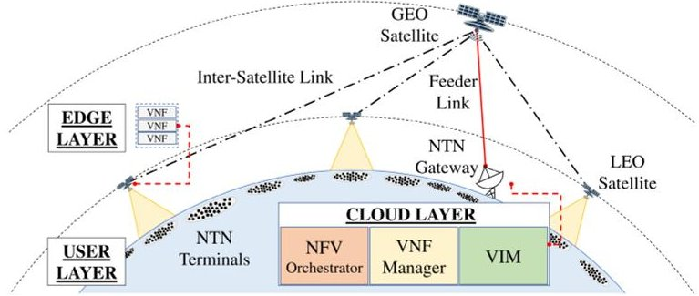

Fig. 1. The reference network architecture.

it presents a novel looking-ahead optimization problem, based on an accurate system model describing the expected delays for deploying services, according to the actual parameter settings.

## A. The Reference Network Architecture

This work focuses on a NTN-based architecture in accordance with the recommendations discussed beginning with Release 17 [43] and progressing to the Beyond-5G and 6G scenarios [44], in which satellites host specific VNFs capable of processing the huge amount of data sent by heterogeneous NTN terminals deployed on the Earth's surface [45].

The resulting network architecture is composed of User, Edge, and Cloud Layers, as depicted in Fig. 1.

At the User Layer, NTN terminals sharing the same organization and geographic region and offering and/or offering the same service are grouped into the same cluster. In each cluster, the service provider deploys and configures a dedicated entity, namely master node, which is in charge of: i) realizing the need for a given cluster of NTN terminals to deliver data and use specific VNFs deployed onboard the satellite, ii) announcing the service request to the remote NFV Orchestrator hosted by the Cloud Layer, through space network elements belonging to the Edge Layer, iii) learning the outcome of the orchestration algorithm, and iv) announcing within the cluster of NTN terminals the presence of a satellite hosting a requested service. Without loss of generality, it is possible to assume that the interaction among NTN terminals and the master node is implemented through out-of-band communication, enabled (for example) by LoRaWAN or WiFi technologies.

The Edge Layer includes a constellation of Low Earth Orbit (LEO) CubeSats, Geostationary Orbit (GEO) satellites, and NTN gateways. Today, the constellation of LEO CubeSats is considered as the widely used low-cost satellite platform because of its low overall infrastructure deployment cost. Therefore, it concretely offers a cost-effective deployment of NTN segments, thus fostering connectivity also in remote areas of the Earth [46]. In the proposed network architecture, a LEO CubeSat represents the first contact point for the master node of a cluster, issuing a service request. Such a

<!-- PDF_PAGE: 4 -->

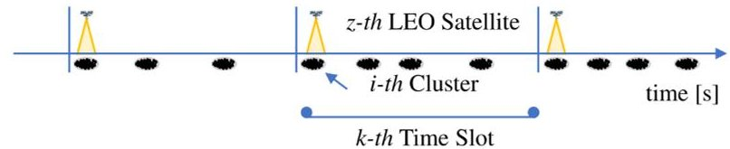

Fig. 2. Intermittent connectivity between terminals on the Earth and the LEO satellite constellation.

request must be delivered to the remote NFV Orchestrator in the Cloud Layer. Nevertheless, the constant movement of a LEO CubeSat makes intermittent the connection with the NTN terminals on the ground. Specifically, they can establish a connection with a given LEO CubeSat for a short period, namely visibility window, as depicted in Fig. 2. Furthermore, even the connection with the NTN gateways spread on the Earth is intermittent [47]. Indeed, to overcome this issue, the constellation of LEO CubeSats exploits inter-satellite links with a group of GEO satellites, granting connectivity even with the lack of a persistent feeder link with NTN gateways. As a result, the multi-hop connectivity established at the Edge Layer easily allows the LEO CubeSat to forward service requests to the Cloud Layer. Additionally, once configured (i.e., through the protocol architecture and optimization algorithm proposed in this work), LEO CubeSat can establish a connection with NTN terminals and provide them with the required services.

Finally, the Cloud Layer includes the NFV Orchestrator, the VNF Manager, and the Virtualised Infrastructure Manager (VIM). The NFV Orchestrator elaborates the VNFs deployment instruction borne by the VNF Manager. The VIM provides an interface through the SDN facilities that support the implementation of the optimization outcome by exploiting its comprehensive knowledge of the network topology. Thus, the Cloud Layer exploits these entities for the implementation of the optimization outcome by dynamically deploying VNFs onboard the LEO CubeSats [48].

## B. Protocol Interaction

The protocol interaction between Terrestrial and non-Terrestrial entities belonging to User, Edge, and Cloud Layers is detailed in what follows across three consecutive phases, namely service request, configuration, and service provisioning (see Fig. 3).

Phase 1 (Service Request): The master node realizes the need of a given cluster of NTN terminals to deliver data and use specific VNFs deployed onboard one of the available LEO CubeSat. As a consequence, the master node announces the service request to the first visible LEO CubeSat. Subsequently, the NTN gateway receives the forwarded request through the persistent feeder link ensured by the GEO satellite. Therefore, the NFV Orchestrator gathers all the received requests by the Edge Layer and collects them into a list of unaccomplished tasks.

Phase 2 (Configuration): The Cloud Layer knows the set of unaccomplished tasks and their processing requirements, the network topology, and the computational resources available in LEO CubeSats. Based on these details, it implements an optimal allocation of VNFs (as discussed below),

TABLE II

LIST OF MAIN SYMBOLS USED IN THIS PAPER

<table border="1"><tr><td>Symbol</td><td>Description</td></tr><tr><td>$\Psi$</td><td>List of clusters，L=||$\Psi$||</td></tr><tr><td>$\Sigma$</td><td>List of LEO CubeSats，S=||$\Sigma$||</td></tr><tr><td>$\Pi$</td><td>List of available services</td></tr><tr><td>$\psi_{i}$</td><td>Master node of thei-th cluster</td></tr><tr><td>$\sigma_{z}$</td><td>z-th LEO CubeSat</td></tr><tr><td>$\pi_{w}$</td><td>w-th service</td></tr><tr><td>$c(\sigma_{z})$</td><td>Processing capability of thez-th LEO CubeSat</td></tr><tr><td>$m(\sigma_{z})$</td><td>Memory capability of thez-th LEO CubeSat</td></tr><tr><td>$t(r_{k,f})$</td><td>Time slot in which the request has been generated</td></tr><tr><td>$\psi_{i}(r_{k,f})$</td><td>Master node of thei-th cluster that generated the request</td></tr><tr><td>$\pi_{w}(r_{k,f})$</td><td>Requested service</td></tr><tr><td>$\tau(r_{k,f})$</td><td>Provisioning upper bound delay</td></tr><tr><td>$\xi(r_{k,f})$</td><td>Processing load associated with request</td></tr><tr><td>$\zeta(r_{k,f})$</td><td>Memory load associated with the request</td></tr><tr><td>$\lambda_{i}$</td><td>Number of requests generated in a day for thei-th cluster</td></tr><tr><td>$\mathbf{V}(k)$</td><td>LEO CubeSat visibility matrix for thek-th time slot</td></tr><tr><td>$\mathbf{B}(k)$</td><td>Services deployment matrix for thek-th time slot</td></tr><tr><td>$\mathbf{R}(k)$</td><td>Set of pending requests at thek-th time slot</td></tr><tr><td>$T_{p}$</td><td>Time slot duration</td></tr><tr><td>$T(k)$</td><td>Time horizon at thek-th time slot</td></tr></table>

over the constellation of LEO CubeSats. Then, the NFV Orchestrator sends the optimization outcome to the VNF Manager, aiming at deploying the given VNFs in the constellation. Subsequently, the Virtualised Infrastructure Manager receives the deployment instruction forwarded by the VNF manager. Finally, the VNFs are deployed in the constellation through the feeder link ensured by the NTN gateways and the GEO satellites. The master node is finally informed about the deployment of the requested VNF onboard a specific LEO CubeSat.

Phase 3 (Service Provisioning): At the beginning of the Service Provisioning phase, the master node notifies the cluster of NTN terminals about the presence of the given LEO CubeSat configured to receive and process (via dedicated VNFs) their data. As anticipated before, the communication between the master node and NTN terminals can be enabled through out-of-band communication, such as LoRaWAN or WiFi. Finally, the NTN terminals' communication can be supported by the requested services onboard that LEO CubeSat for the whole visibility window. Obviously, the set of unaccomplished tasks is updated by removing the services that are already deployed.

## C. System Model

Since the orbits of LEO CubeSats are independent of each other, the proposed system model considers a group of LEO CubeSats belonging to the same orbit of a constellation. This choice does not limit the generality of the presented methodology [47]. The main mathematical symbols used to formulate the system model are reported in Table II.

Indeed, let $ \boldsymbol{\Sigma}=\{\sigma_{1},\dots,\sigma_{S}\} $ be the set of evenly spaced LEO CubeSats in the considered orbit and $ S=\| \boldsymbol{\Sigma}\| $ be the number of the LEO CubeSats in the considered orbit. Likewise, the processing and memory capabilities of the z-th LEO CubeSat are expressed with $ c(\sigma_{z}) $ and $ m(\sigma_{z}) $ , respectively. Similarly, let $ \boldsymbol{\Psi}=\{\psi_{1},\dots,\psi_{L}\} $ be the list of the master nodes belonging to the clusters served by the LEO

<!-- PDF_PAGE: 5 -->

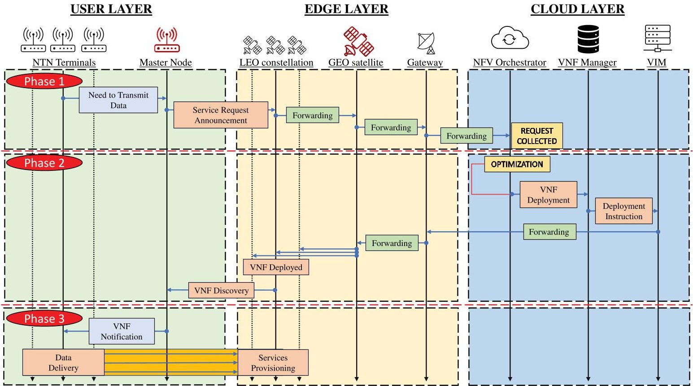

Fig. 3. Interaction among network entities.

CubeSats of the considered orbit, with $ L=\| \Psi \| $ denoting the number of clusters. Finally, let $ \Pi=\{\pi_{1},\dots,\pi_{W}\} $ be the list of the different types of services provided by the Cloud Layer.

As well known, the amount of time required by a given LEO CubeSat to complete a revolution around the Earth depends on the height of its orbit. The motion of the LEO CubeSat, as Newton's form of Kepler's third law, that is: $ T_{o}=2 \pi \sqrt{\frac{R^{3}}{G M_{e}}} $ where $ T_{o} $ represents the revolution time of the LEO CubeSat, R is the average radius of the orbit estimated as the distance from the center of the Earth, G is the gravitational constant, and $ M_{e} $ is the mass of the Earth [49]. Accordingly, a given same satellite can periodically communicate with a specific cluster of NTN terminals every $ T_{o} $ . Anyway, since the LEO CubeSats in the considered orbit are evenly spaced, the elapsed time between two consecutive visibility windows is stated as: $ T_{p}=\frac{T_{o}}{S}=\frac{2 \pi}{S} \sqrt{\frac{R^{3}}{G \cdot M_{e}}}. $

Based on these premises, the proposed system model assumes to partition time into time slots, lasting $ T_{p} $ . Therefore, the consecutive steps belonging to the procedure described in Section III-A are implemented over consecutive time slots. Specifically, requests are collected by the NFV Orchestrator during the k-th time slot. Subsequently, the looking-ahead optimization problem (formally described in Section III-D) is solved within the $ (k+1) $ -th time slot. Finally, according to the solution of the optimization problem, the VNFs will be deployed onboard satellites in the upcoming time slots, i.e., starting from the $ (k+2) $ -th time slot and within a specified deadline.

The list of pending requests at the k-th time slot is denoted with $ \mathbf{R} ( k ) $ . Each request $ r_{k,f}\in\mathbf{R} ( k ) $ , where $ F_{k}=\| \mathbf{R} ( k ) \| $ and f=1,..., $ F_{k} $ , (delivered to the NFV Orchestrator) includes the following information:

- the master node belonging to the cluster that generated the request, $ \psi_{i}(r_{k,f}) $

- the requested services, $ \pi_{w}(r_{k,f}) $

- the time slot in which the request has been generated, $ t(r_{k,f}), $

- the upper bound delay for the provisioning of the requested services, $ \tau(r_{k,f}) $

- the processing load associated with the request, $ \xi(r_{k,f}) $

- the memory load associated with the request, $ \zeta (r_{k,f}) $

Without loss of generality, it is assumed that $ \tau(r_{k,f}) $ is defined as a multiple of the time slot, that is $ \tau(r_{k,f})=nTp. $

As anticipated, a cluster can establish a communication with only one LEO CubeSat during a time slot and only for a short visibility window. Indeed, the proposed system model introduces the $ \mathbf{V} ( k ) $ matrix to represent the reciprocal visibility between LEO CubeSats and clusters on the ground during the k-th time slot. Therefore, $ v_{i,z} ( k )=1 $ , with $ v_{i,z} ( k ) \in\mathbf{V} ( k ) $ , if the z-th LEO CubeSat can communicate with the i-th cluster in the k-th time slot. Otherwise, $ v_{i,z} ( k )=0 $ . The values of the $ \mathbf{V} ( k ) $ matrix depend on the deploying position of both clusters and satellites in the network.

Furthermore, the services deployment matrix $ \mathbf{B} ( k )=(b_{w,z} ( k ))\in\{0,1\}^{L\times S\times T ( k )} $ contains boolean flags denoting if the z-th satellite hosts the w-th VNFs when $ b_{w,z} ( k )=1 $ with $ b_{w,z} ( k )\in\mathbf{B} ( k ). $ Otherwise, $ b_{w,z} ( k )=0. $ In this case, it depends on the outcome of the optimization problem, as defined in Section III-D.

## D. Optimization Problem

The goal of the optimization problem proposed in this work is to dynamically deploy VNFs onboard satellites while ensuring that:

<!-- PDF_PAGE: 6 -->

- the deployment of the service must be performed within a strict deadline,

- for all the LEO CubeSats, the sum of the processing and memory requirements pertaining to the deployed VNFs, is never greater than their capabilities,

- the sum of all the experienced service provisioning delays is minimized.

As mentioned in Section II, prior works solely consider a quasi-static scenario and neglect the movement of LEO CubeSat throughout the optimization process. Differently, this work formulates a novel optimization problem willing to dynamically deploy VNFs across LEO CubeSats, over a looking-ahead horizon.

Given the list of pending requests, that is $ \mathbf{R} ( k ) $ , and the set of the request's upper bound delay, that is $ \mathcal{T} ( k )=\left\{\tau \left(r_{k,1}\right),\dots,\tau \left(r_{k,F_{k}}\right)\right\} $ , the proposed looking-ahead optimization algorithm considers an observation time interval $ T ( k ) $ defined as:

$$
T (k) = \max \mathcal {T} (k).
$$

According to the proposed system model, $ T(k) $ is a multiple of the duration of a single time slot $ T_{p} $ . In the k-th time slot, the partial service provisioning delay already accumulated by a generic request $ r_{k,f} $ can be defined as the elapsed time between the generation and the current time slot, that is $ k-t(r_{k,f}) $ . Such a delay may increase, slot by slot, till the actual VNFs provisioning onboard a given LEO CubeSat. Indeed, given the service deployment matrix for all the time slots available till the end of the observation time interval $ T(k) $ , the delay achieved by the service $ r_{k,f} $ can be formally defined as:

$$
\delta \left(k, r _ {k, f}\right) = \sum_ {\nu = 1} ^ {T (k)} \sum_ {\sigma_ {z} \in \Sigma} \left(b _ {w, z} (\nu) \left[ k + \nu - t \left(r _ {k, f}\right) \right]\right),
$$

while considering that $ \sum_{\nu=1}^{T(k)} \sum_{\sigma_z\in\Sigma} b_{w,z}(\nu)\geq 1, \forall r_{k,f}\in $ $ \mathbf{R} ( k ). $ Such an expression implicitly assumes that the request will be accomplished at least by a single LEO CubeSat within the time horizon $ T(k). $

It is important to note that messages exchanged among the involved entities experience communication delays. However, these delays can be safely considered much lower than the duration of the time slot (as discussed in detail in Section IV-D), which is used as the minimum time interval of interest for the conceived system model, the formulated optimization problem, and the resulting service provisioning. As a consequence, by assuming to observe the overall system on a time-slot basis, the impact of both network architecture and interaction flow is intrinsically taken into account.

The objective function to be minimized can be formally defined as the sum of all the partial delays related to each pending request, as reported in what follows:

$$
\begin{array}{l} U (k) = \sum_ {r _ {k, f} \in \mathbf {R} (k)} \delta \left(k, r _ {k, f}\right) \\ = \sum_ {r _ {k, f} \in \mathbf {R} (k)} \left[ \sum_ {\nu = 1} ^ {T (k)} \sum_ {\sigma_ {z} \in \Sigma} \left(b _ {w, z} (\nu) \left[ k + \nu - t \left(r _ {k, f}\right) \right]\right) \right]. \\ \end{array}
$$

Indeed, the dynamic allocation of VNFs across CubeSats, over a looking-ahead horizon, is formulated in this work through an Integer Linear Programming (ILP) problem:

$$
\begin{array}{l} P 1: \min _ {\mathbf {R} \Sigma} \sum_ {r _ {k, f} \in \mathbf {R} (k)} \left[ \sum_ {\nu = 1} ^ {T (k)} \sum_ {\sigma_ {z} \in \Sigma} \left(b _ {w, z} (\nu) \left[ k + \nu - t \left(r _ {k, f}\right) \right]\right) \right] \\ \mathrm {s . t .} \sum_ {r _ {k, f} \in \mathbf {R} (k)} b _ {w, z} (\nu) \xi \left(r _ {k, f}\right) \leq c \left(\sigma_ {z}\right), \forall \sigma_ {z}, \nu (4a) \\ \sum_ {r _ {k, f} \in \mathbf {R} (k)} b _ {w, z} (\nu) \zeta \left(r _ {k, f}\right) \leq m \left(\sigma_ {z}\right), \forall \sigma_ {z}, \nu (4b) \\ \end{array}
$$

$$
\begin{array}{l} \sum_ {\sigma_ {z} \in \Sigma} \sum_ {\nu = t \left(r _ {k, f}\right) + 2} ^ {\tau \left(r _ {k, f}\right)} b _ {w, z} (\nu) v _ {i, z} (\nu) = 1, \forall r _ {k, f} \\ b _ {w, z} (\nu) \leq v _ {i, z} (\nu), \forall \pi_ {w}, \sigma_ {z}, \nu , \\ \end{array}
$$

where (4a) specifies that the sum of the computing requirements of the VNFs deployed on a given LEO CubeSat cannot exceed the CPU processing capabilities of the considered satellite. Furthermore, (4b) states that the total amount of memory used by the allocated VNFs on a given LEO CubeSat in any time slot must not exceed its memory capability. Moreover, (4c) ensures that a VNF requested by a pending request is deployed, by the NFV Orchestrator, no later than its deadline, beginning at least two time slots after the request is generated (allowing for collection and optimization). Finally, (4d) mandates the NFV Orchestrator to deploy the VNFs only onboard specific LEO CubeSat capable of communicating with the cluster within the deadline, specifically during its visibility window.

## IV. PERFORMANCE EVALUATION

This Section investigates the effectiveness of the proposed methodology in different scenarios and through computer simulations.

First of all, it is important to remark that the non-convex optimization problem formulated in Section III-D is NP-hard. Indeed, a brute force strategy can be hypothetically used to test all the binary combinations of the 3D matrix (i.e., $ \mathbf{B}(k)=\left(b_{w,z}(k)\right)\in\{0,1\}^{L\times S\times T(k)} $ ), every time slot and for the overall observation time interval. Such an approach, however, is feasible only for simple scenarios (e.g., with few LEO CubeSats and few clusters on the ground). More in general, instead, the optimal solution cannot be retrieved in a polynomial time.

At the same time, conventional optimization frameworks like Gurobi, CVXR, or Casadi cannot be used in this context because they work with decision variables represented by 2D matrices, whereas the proposed approach deals with decision variables in the form of a 3D matrix.

To bridge this gap and solve the formulated optimization problem three different heuristic strategies, inspired by well-known meta-heuristic approaches (such as TS [39], SA [40], and GLS [41]) have been properly developed and tested through a custom Python tool. More details about the implemented algorithms can be found in the Appendix.

The behavior of the developed strategies has been also compared with respect to a benchmark scheme, namely GR

<!-- PDF_PAGE: 7 -->

TABLE III

COMPUTATIONAL CAPABILITIES EXPOSED BY LEO CUBESATS FOR THE CONSIDERED SERVICES [56]

<table border="1"><tr><td>Symbol</td><td>Parameter</td><td>Value</td></tr><tr><td>m($\sigma_{z}$)</td><td>Memory capability</td><td>64 GB</td></tr><tr><td>c($\sigma_{z}$)</td><td>CPU processing capability</td><td>128 Gigacycles/s</td></tr><tr><td>$\beta^{c}$</td><td>Maximum aggregated throughput</td><td>92 kbps</td></tr></table>

algorithm. Specifically, it deploys the required VNFs on the first available LEO CubeSat with sufficient memory and processing power without utilizing any optimization methods.

## A. The Considered Use Case

The 3GPP, starting from Rel-15 [50], began exploring the potential of a new communication standard for NTNs, by examining various deployment scenarios and challenges. At the time of writing, Rel-17 [43], [51] is investigating key issues related to business roles, service, and network management when orchestrating services in the space segment [52]. The ease of deploying LEO CubeSats satellite constellations is driving the growth of tailored services for various companies [53], [54]. Indeed, since NTN segments are called to securely manage an ever-growing amount of data, connections, and services, it is extremely important to envisage novel methodologies for the dynamic and optimal deployment of VNFs properly devoted to security functionalities (including authentication, authorization, firewall, intrusion detection systems, intrusion prevention systems, and so on). Of course, given the limited amount of resources on the LEO CubeSats, these security services should only be activated as needed to conserve onboard resources [55]. To this aim, security VNFs are considered to demonstrate the effectiveness of the proposed approach in a realistic use case. It's worth noting that our scenario does not restrict the use of the proposed approach in other contexts.

## B. Parameter Setting

The study has been conducted by varying the number of clusters deployed on the Earth's surface, the number of LEO CubeSats in the orbit, and the average number of services issued in a day by each cluster.

The altitude of LEO CubeSats is set to 500 km. The corresponding orbit period is equal to $ T_{o}=5 6 7 6 $ s. Moreover, the number of LEO CubeSats, that is S, in the orbit, is set to 3 and 5. Indeed, based on the number of satellites per orbit, $ T_{p} $ is equal to:

$$
T _ {p} = \left\{ \begin{array}{l l} 1 8 9 2 s, & \mathrm {i f} S = 3, \\ 1 1 3 5 s, & \mathrm {i f} S = 5. \end{array} \right.
$$

Considering the time slot duration, the impact of processing and transmission time, in the order of milliseconds, can be negligible.

It is assumed that each LEO CubeSat is equipped with a PowerEdge R6515 with AMD EPYC 7702P, 2.00 GHz, 64 core, and 64 GB RAM [56], as indicated in Table III.

In the considered scenario, the clusters are uniformly distributed on the Earth's surface covered by the considered orbit.

TABLE IV

SECURITY SERVICES REQUIREMENTS FOR VNFS IMPLEMENTATION

<table border="1"><tr><td>Provider</td><td>Service</td><td>$\xi^{c}$ [cycles/bit]</td><td>$\zeta(r_{f})$ [GB]</td></tr><tr><td rowspan="3">Fortigate VM [57]</td><td>NGFW</td><td>9</td><td>4</td></tr><tr><td>IPSec VPN</td><td>14.5</td><td>2</td></tr><tr><td>Threat Prot.</td><td>11.3</td><td>4</td></tr><tr><td rowspan="2">Cisco ASAv [58]</td><td>Stateful IDS</td><td>4.2</td><td>4</td></tr><tr><td>AES VPN</td><td>6.9</td><td>2</td></tr><tr><td rowspan="3">Juniper vSRX [59]</td><td>FW</td><td>2.3</td><td>2</td></tr><tr><td>IPS</td><td>2.4</td><td>2</td></tr><tr><td>APPMonitor</td><td>1.5</td><td>2</td></tr><tr><td rowspan="2">Others</td><td>Snort IDS/IPS [60]</td><td>9.5</td><td>2</td></tr><tr><td>OpenVPN AES-NI [61]</td><td>31</td><td>4</td></tr></table>

In particular, the number of clusters L varies between 100 and 200. Let $ \lambda_{i} $ be the average number of requests generated by the i-th cluster in a day, set to 6 and 12 events per day. Accordingly, the average number of requests received by the Cloud Layer in a day is equal to $ \lambda=\lambda_{i} L $ . Data generated by terminals belonging to each cluster can be processed by means of services summarized in Table IV. The service is chosen randomly for each request. The expected computational capabilities of VNFs strictly depend on the amount of data generated by each cluster. The proposed study considers a worst-case scenario, in which each cluster exploits the overall available satellite bandwidth during the related visibility time to send data, denoted with $ \beta^{c} $ bps. Therefore, given the CPU cycles required to process one bit, that is $ \xi^{c} $ cycles/bit, the overall processing requirement of a service is equal to $ \xi(r_{f})=\xi^{c}\cdot\beta^{c} $ cycles/s [6]. The conducted study assumes that the radio access technology used in the link between LEO CubeSat and clusters is the Narrow-Band IoT (NB-IoT). In this case, $ \beta^{c}=92 $ kbps [62].

## C. KPIs

The evaluated Key Performance Indicators (KPIs) include:

- Deployment Delay of Services: it represents the amount of time (expressed as a multiple of the time slot) needed to deploy a VNF requested by a group of NTN terminals on a specific LEO CubeSat. In general, and according to the design principles at the basis of the conceived approach, it is expected the deployment delay ranges from a minimum of two time slots (one slot is required to deliver the request to the Cloud Layer during the Phase 1 and the other one is required to elaborate the deployment instructions during the Phase 2) to the expected upper bound delay,

- Percentage of Computational Resources (Including RAM and CPU) Consumed by LEO CubeSats for Hosting the Deployed VNFs: it represents the amount of RAM and the processing capabilities utilized onboard each LEO CubeSat in relation to the total amount of resources hosted in the space segment,

- Average Processing Time of Each Heuristic Algorithm in Solving the Optimization Problem: it represents the amount of time (expressed in seconds) spent by the Cloud

<!-- PDF_PAGE: 8 -->

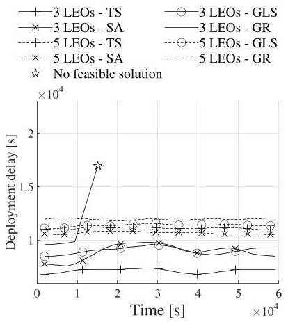

(a) $ L=100,\lambda_{i}=6 $ , and $ \tau(r_{f})=6 $ hours.

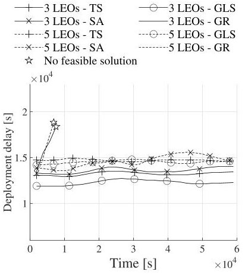

(b) $ L=200,\lambda_{i}=6 $ a $ \tau(r_{f})=6 $ hours.

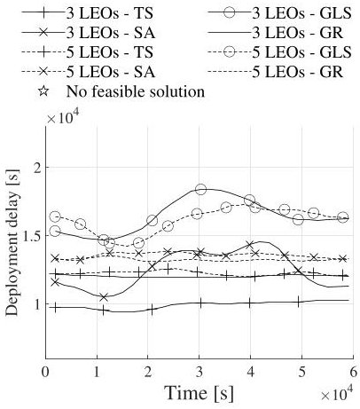

(c) $ L=1 0 0,\lambda_{i}=6 $ , and $ \tau(r_{f})=1 2 $ hours.

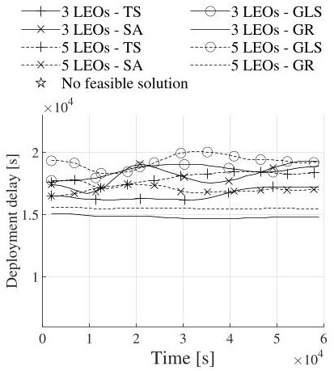

(d) $ L=200,\lambda_{i}=6 $ , and $ \tau(r_{f})=12 $ hours.

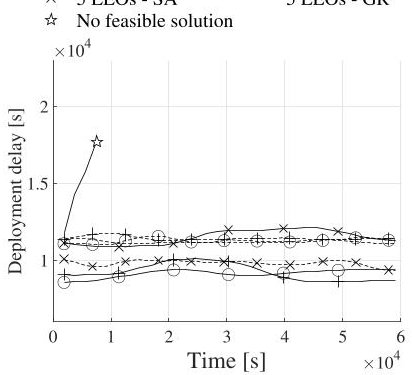

(e) $ L=1 0 0 $ $ \lambda_{i}=1 2 $ and $ \tau(r_{f})=6 $ hours.

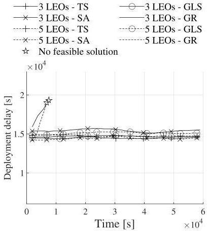

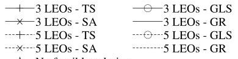

(f) $ L=200,\lambda_{i}=12 $ and $ \tau(r_{f})=6 $ hours.

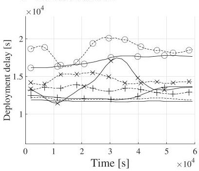

(g) $ L=100,\lambda_{i}=12 $ ,and $ \tau(r_{f})=12 $ hours.

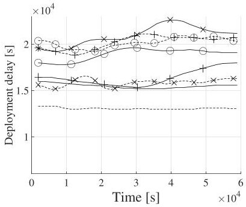

(h) $ L=200,\lambda_{i}=12 $ ,and $ \tau(r_{f})=12 $ hours.

Fig. 4. Deployment delay of security services.

Layer in evaluating the optimal deployment of VNFs requested by the pending services.

Computer simulations consider an observation period of 60000s, embracing multiple visible time intervals. Moreover, the analysis of deployment delay of requested services and the percentage of computational resources consumed onboard satellite has been organized into two parts. The former focuses the attention on a specific simulation run (e.g., network realization) and illustrates the considered KPI as a function of time. The latter, instead, reports minimum, average, and maximum values, as well as the 25th and 75th percentile of the measured KPI, obtained by considering numerous realizations.

## D. Deployment Delay of Security Services

Fig. 4 shows the deployment delay of the deployed security services, experienced for a single specific test. Moreover, reported results have been obtained by averaging the deployment delays experienced by each service request across moving windows of 5 time slots each.

Looking at the behavior of the benchmark scheme, that is the GR algorithm, it is possible to observe that it cannot provide a feasible solution in several scenarios, including the one with 3 LEO CubeSats, 100 clusters on the ground, and an upper bound delay equal to $ \tau(r_{k,f})=6 $ hours, as well as the one with the same upper bound delay, 200 clusters on the ground, and 5 LEO CubeSats. All these negative results are achieved because the GR algorithm tends to overload LEO CubeSats thus being not able to accept further requests.

On the contrary, the proposed approach always guarantees feasible solutions, independently from the heuristic algorithm adopted to find a solution for the formulated optimization problem. More specifically, obtained results show that the deployment delay increases with the number of clusters. In fact, the more clusters interact with the NTN segment, the higher the number of pending requests to be handled by the NFV Orchestrator at each optimization round. In these conditions, the NFV Orchestrator may encounter a lack of available resources across the first visible LEO CubeSats. Therefore, it is obliged to delay the deploy the VNFs by considering other future time slots (according to the conceived looking-ahead time horizon logic). Indeed, a longer deadline introduces a higher extent of the solution space, bringing an increment of deployment delays. Furthermore, regardless of the number of LEO CubeSats in the orbit, the deployment delay remains almost the same in the majority of the investigated scenarios. It relies on the exploration strategy of the optimal solution in the solution space for each heuristic approach.

To provide a further insight, additional tests have been conducted to collect performance levels by considering multiple realizations. Indeed, Fig. 5 depicts minimum, average, and maximum values of the experienced deployment delays, together with both the 25th and 75th percentile. The analysis of the GR algorithm has been omitted in this case because the previous analysis already highlighted its inability to provide feasible solutions in the most of investigated scenarios.

<!-- PDF_PAGE: 9 -->

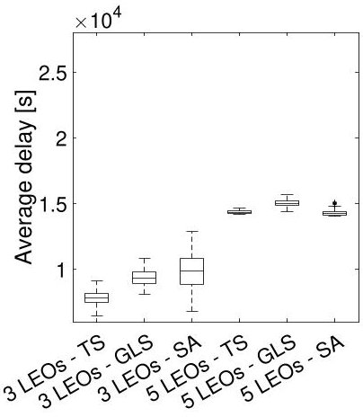

(a) $ L=100,\lambda_{i}=6 $ ,and $ \tau(r_{f})=6 $ hours.

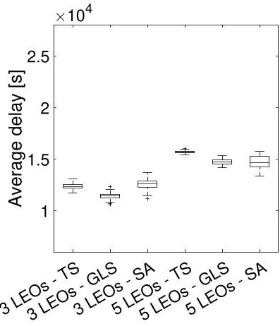

(b) $ L=200,\lambda_{i}=6 $ , and $ \tau(r_{f})=6 $ hours.

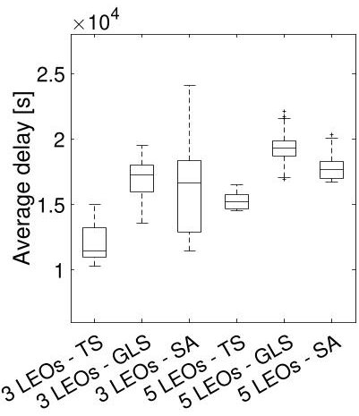

(c) $ L=100,\lambda_{i}=6 $ , and $ \tau(r_{f})=12 $ hours.

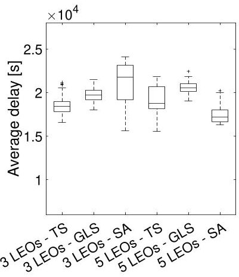

(d) $ L=200,\lambda_{i}=6 $ , and $ \tau(r_{f})=12 $ hours.

(e) $ L=100,\lambda_{i}=12 $ and $ \tau(x_{i})=6 $ hours

$ \tau(r_{f})=6 $ hours.

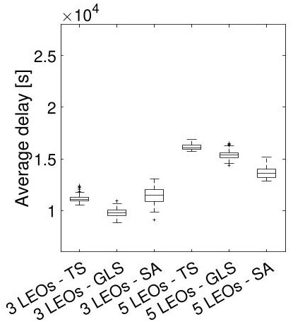

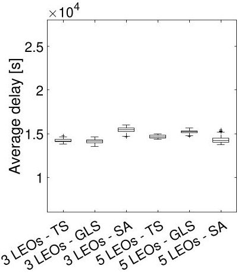

(f) $ L=200,\lambda_{i}=12 $ and $ \tau(r_{f})=6 $ hours.

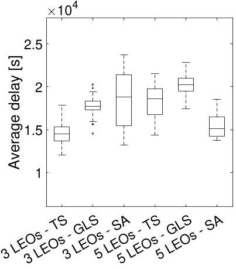

(g) $ L=100,\lambda_{i}=12 $ ,and $ \tau(r_{f})=12 $ hours.

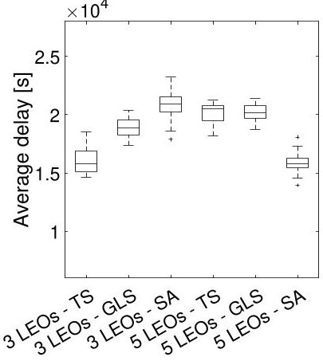

(h) $ L=200,\lambda_{i}=12 $ , and $ \tau(r_{f})=12 $ hours.

Fig. 5. Confidence interval for the deployment delay of security services.

Regarding the proposed approach, instead, all the obtained results confirm the analysis reported in Fig. 4. Moreover, it also shows that the greatest deviation from the average value (up to 30%) is registered in scenarios with 3 satellites and when the SA method is used. Conversely, with 5 satellites, the maximum deviation (up to 13%) is obtained with the TS method. In any case, obtained results always demonstrate the ability of the developed heuristic strategy to meet the expected quality of service constraint in all the considered scenarios.

To conclude, it has emerged that TS outperforms the other approaches in almost all scenarios with a low number of LEO CubeSats (i.e., 3) in the orbit, by reducing up to 25% the deployment delay of services. On the contrary, SA well suits scenarios with a higher number of LEO CubeSats (i.e., 5), for which it reduces up to 20% of the measured deployment delay.

## E. Percentage of Computational Resources Consumed by LEO CubeSats

Fig. 6 shows the percentage of RAM consumed by the deployed VNFs over time. Also in this case, reported curves have been generated by considering a single specific test and by averaging the measured KPI among all the satellites and across moving windows of 5 time slots each. It is important to remark that Fig. 6 depicts a specific realization that is a time-varying process and jointly influenced by the random

number generator adopted by the simulation tool, the statistical generation of service requests (see, for instance, the variable $ \lambda_{i} $ of the i-th cluster), and the chosen optimization strategy. Peaks in Fig. 6 are registered when the network is handling a larger number of requests.

In line with the previous comments, the GR algorithm does not present feasible solutions for all the investigated scenarios. In those (few) configurations where it provides an effective deployment of VNFs, the percentage of consumed RAM is comparable with respect to results registered by the strategies proposed in this paper.

As expected, the higher the number of served clusters, the higher the resulting memory consumption onboard the satellites. Furthermore, a wider deadline and higher number of LEO CubeSats in the considered orbit causes a higher extent of the set of feasible solutions to explore. As a result, the memory resources are allocated less efficiently by each heuristic algorithm. It is noteworthy to highlight that the SA-based strategy registers better allocation of memory resources in scenarios with a higher number of satellites.

On the other hand, Fig. 8 shows the percentage of the CPU usage. Due to the low data rate of the considered radio access technology (i.e., NB-IoT), the processing capability never represents a blocking condition for the deployment of the VNFs.

With reference to parallel tests, Fig. 7 and Fig. 9 depict minimum, average, and maximum values, as well as the 25th and

<!-- PDF_PAGE: 10 -->

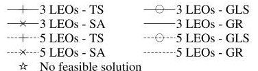

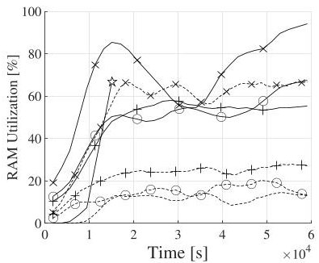

(a) $ L=100,\lambda_{i}=6 $ ,and $ \tau(r_{f})=6 $ hours.

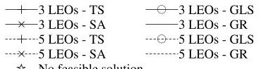

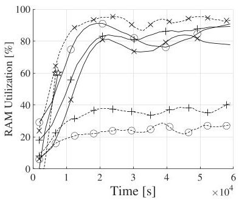

(b) $ L=200,\lambda_{i}=6 $ , and $ \tau(r_{f})=6 $ hours.

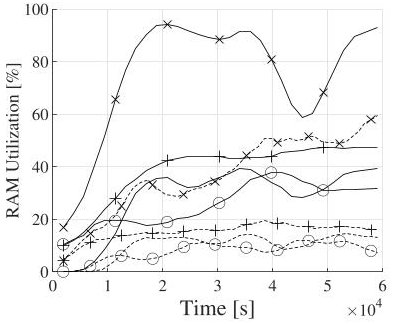

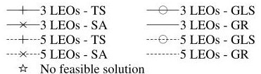

(c) $ L=1 0 0, \lambda_{i}=6 $ , and $ \tau(r_{f})=1 2 $ hours.

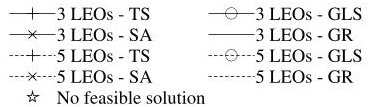

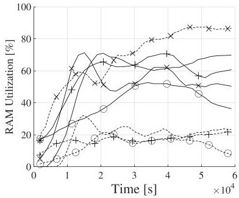

(d) $ L=200,\lambda_{i}=6 $ , and $ \tau(r_{f})=12 $ hours.

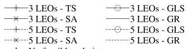

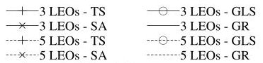

(e) $ L=100,\lambda_{i}=12 $ ,and $ \tau(r_{f})=6 $ hours.

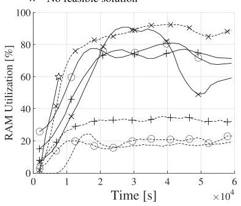

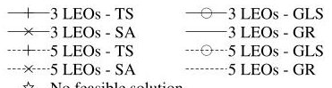

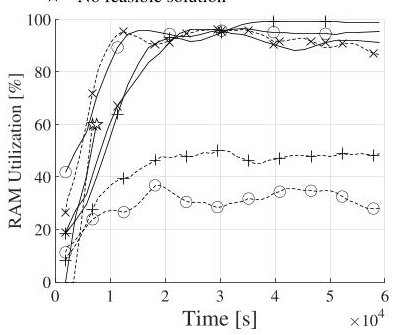

(f) $ L=200,\lambda_{i}=12 $ ,and $ \tau(r_{f})=6 $ hours.

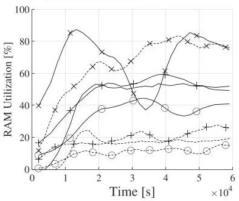

(g) $ L=100,\lambda_{i}=12 $ and $ \tau(r_{f})=12 $ hours.

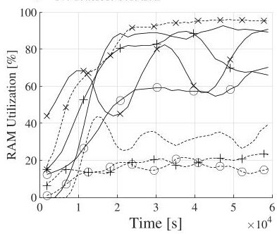

(h) $ L=200,\lambda_{i}=12 $ ,and $ \tau(r_{f})=12 $ hours.

Fig. 6. RAM utilization.

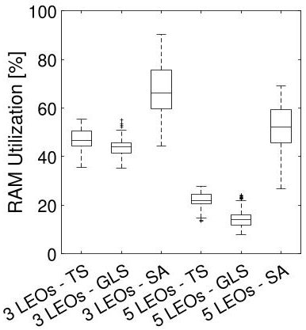

(a) $ L=100,\lambda_{i}=6 $ and $ \tau(r_{f})=6 $ hours.

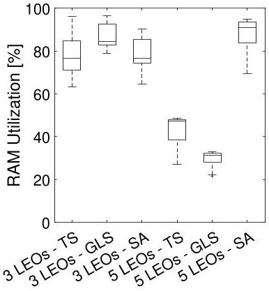

(b) $ L=200,\lambda_{i}=6 $ and $ \tau(r_{f})=6 $ hours.

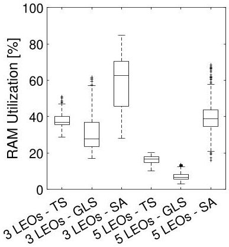

(c) $ L=100,\lambda_{i}=6 $ ,and $ \tau(r_{f})=12 $ hours.

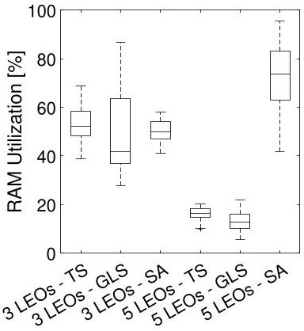

) $ L=200,\lambda_{i}=6 $ ,and $ \tau(r_{f})=12 $ hours.

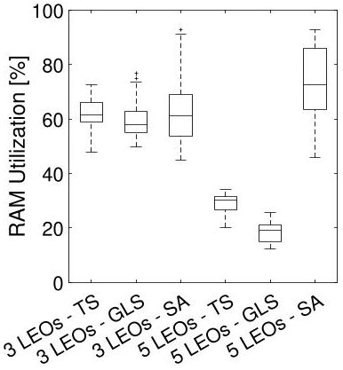

(e) $ L=100,\lambda_{i}=12 $ and $ \tau(r_{f})=6 $ hours.

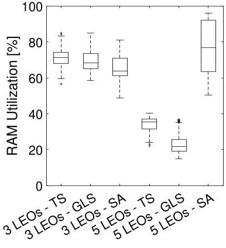

(f) $ L=200,\lambda_{i}=12 $ and $ \tau(r_{f})=6 $ hours.

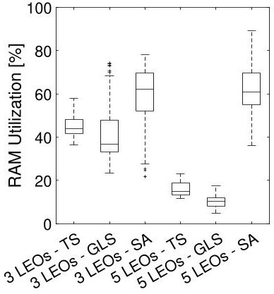

(g) $ L=100,\lambda_{i}=12 $ ,and $ \tau(r_{f})=12 $ hours.

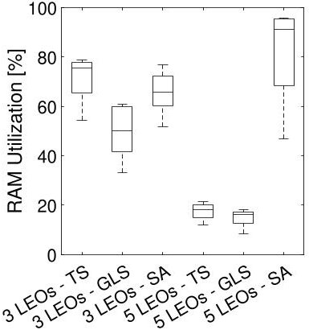

(h) $ L=200,\lambda_{i}=12 $ ,and $ \tau(r_{f})=12 $ hours.

Fig. 7. Confidence interval for the RAM utilization.

75th percentile, of both RAM and CPU usage, respectively. Here, Fig. 7 highlights that the SA-based strategy exhibits the most significant deviations from the mean value, both

for the configurations involving 3 LEO CubeSats and 5 LEO CubeSats. Notably, within the multiple realizations, the largest deviation recorded is up to 50% and 60% from the mean

<!-- PDF_PAGE: 11 -->

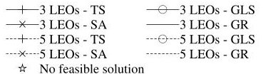

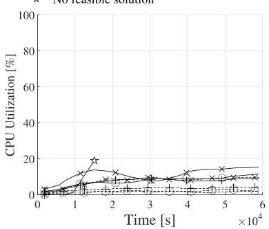

(a) $ L=100,\lambda_{i}=6 $ , and $ \tau(r_{f})=6 $ hours.

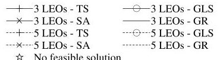

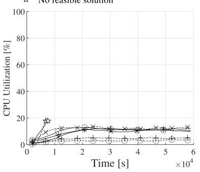

) $ L=200,\lambda_{i}=6 $ , and $ \tau(r_{f})=6 $ hours.

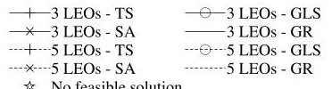

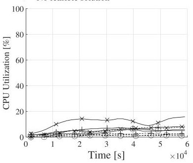

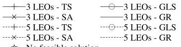

(c) $ L=1 0 0, \lambda_{i}=6 $ , and $ \tau(r_{f})=1 2 $ hours.

(d) $ L=200,\lambda_{i}=6 $ , and $ \tau(r_{f})=12 $ hours.

(e) $ L=1 0 0 $ $ \lambda_{i}=1 2 $ , and $ \tau(r_{f})=6 $ hours.

3 LEOs - GLS

3 LEOs - GR

5 LEOs - GLS

5 LEOs - GLS

(f) $ L=200,\lambda_{i}=12 $ ,and $ \tau(r_{f})=6 $ hours.

(g) $ L=100,\lambda_{i}=12 $ ,and $ \tau(r_{f})=12 $ hours.

$$
L = 2 0 0, \lambda_ {i} = 1 2, a
$$

Fig. 8. CPU utilization.

(a) $ L=100,\lambda_{i}=6 $ and $ \tau(r_{f})=6 $ hours.

(c) $ L=1 0 0, \lambda_{i}=6 $ , and $ \tau(r_{f})=1 2 $ hours.

(d) $ L=200,\lambda_{i}=6 $ and $ \tau(r_{f})=12 $ hours.

(e) $ L=1 0 0, \lambda_{i}=1 2 $ and $ \tau(r_{f})=6 $ hours.

(f) $ L=200,\lambda_{i}=12 $ and $ \tau(r_{f})=6 $ hours.

(g) $ L=100,\lambda_{i}=12 $ ,and $ \tau(r_{f})=12 $ hours.

(h) $ L=200,\lambda_{i}=12 $ ,and $ \tau(r_{f})=12 $ hours.

Fig. 9. Confidence interval for the CPU utilization.

value, respectively. Fig. 9, instead, illustrates that the CPU usage remains consistently below 20%, with a negligible deviation from the mean value. Note that, also in this case, the

analysis of the GR algorithm has been omitted because of its inability to provide feasible solutions for all the considered scenarios.

<!-- PDF_PAGE: 12 -->

(a) $ S=3 $ $ \lambda_{i}=6 $ , and $ \tau(r_{f})=6 $ hours.

(b) $ S=3,\lambda_{i}=6 $ ,and $ \tau(r_{f})=12 $ hours.

(c) $ S=3,\lambda_{i}=1 2 $ ,and $ \tau(r_{f})=6 $ hours.

(d) $ S=3,\lambda_{i}=1 2 $ ,and $ \tau(r_{f})=1 2 $ hours.

(e) $ S=5,\lambda_{i}=6 $ ,and $ \tau(r_{f})=6 $ hours.

(f) $ S=5,\lambda_{i}=6 $ ,and $ \tau(r_{f})=12 $ hours.

(g) $ S=5,\lambda_{i}=12 $ ,and $ \tau(r_{f})=6 $ hours.

(h) $ S=5,\lambda_{i}=1 2 $ ,and $ \tau(r_{f})=1 2 $ hours.

Fig. 10. Processing time.

## F. Processing Time

The processing time emphasizes the computational burden required by each heuristic algorithm to find a solution to the optimization problem. It has been evaluated with a computer Intel Xeon Bronze 3106 CPU with 16 cores at 1.70GHz and 92 GB of RAM. In this case, the number of clusters deployed on the ground is set to 100, 150, and 200. Results are shown in Fig. 10.

The evaluation of the processing time for the GR algorithm is negligible because it just defines the VNFs allocation without implementing any time-consuming task.

Particularly important is the processing time for the proposed approach. The developed heuristic strategies, in fact, are called to provide an optimal and feasible solution within a threshold represented by the time slot duration. Only in this way, they will be able to trigger the deployment of VNFs onboard LEO CubeSats in time.

From the analysis of Fig. 10, it is possible to observe that only the TS-based strategy reaches a high value of processing time, very close to the threshold (i.e., the time slot duration). Indeed, it is the heaviest heuristic approach in terms of processing load for each considered scenario as demonstrated by the results. Nevertheless, by jointly taking into account all the considered KPIs, since the SA-based strategy is able to find an optimal solution in a lower time than other approaches, it represents the best choice for both processing time and deployment delay of services, by saving up 95% in processing time than TS.

## G. Comparison With the Optimal Solution

In conclusion, to further demonstrate the effectiveness of the proposed approaches against the optimal solution, a

Fig. 11. Comparison with the optimal solution with $ L=5 $ and $ \tau(r_{f})=6 $ hours.

comparison in smaller scenarios has been conducted. In detail, the number of clusters on the ground L is set to 5, the upper bound delay $ \tau(r_{f}) $ is equal to 6 hours, $ \lambda_{i} $ is set to 1, and the number of LEO CubeSat S ranges from 2 to 5. Fig. 11 depicts how these heuristic schemes are able to produce results comparable to those expected by an optimal solution. Obtained results allow to trust the effectiveness of the heuristic strategies also in more complex scenarios.

## V. CONCLUSION

This paper proposed a novel 6G-oriented architecture with advanced orchestration capabilities of security services into the October 06,2026 at 15:05:17 UTC from IEEE Xplore. Restrictions apply.

<!-- PDF_PAGE: 13 -->

Non-Terrestrial segment. Specifically, it provides these main scientific contributions: i) a definition of network architecture and protocol stack enabling the interaction among terrestrial and space network entities, ii) a definition of a system model describing the network configuration and the delays associated with the deployment of specific security services, and iii) formulation of optimization problem willing to dynamically allocate security VNFs among satellites over a looking-ahead horizon. Three alternative heuristic methods for the aforementioned optimization problem have been investigated through computer simulation to assess the overall performance of the proposed approach. Obtained results demonstrated the ability of the conceived approach to deploying the requested services within a strict deadline. Specifically, the SA-based solution demonstrates to outperform the other approaches in terms of service deployment delays, resource consumption, and processing time. Future research activities will investigate more complex scenarios envisaging a deep integration of terrestrial and NTN, embracing other space network elements (such as drones). Moreover, they will also evaluate the effectiveness of the proposed solution through real experimental testbeds.

## APPENDIX

## HEURISTIC IMPLEMENTATION DETAILS

The design and the implementation of the three heuristics are based on the following common methods:

- As a first step, it is introduced a way to estimate the utility function starting from a feasible solution, by exploiting the 3D matrix as input.

- Then, it has been implemented a method that helps to explore the neighbourhood of a given solution (i.e., swap move) by applying a little variation from the initial one and by checking its feasibility. For example, this is done by assuming to deploy a given VNF on another LEO CubeSat of the orbit, as well as by assuming to make available that VNF in a different time slot. It is worth noting that the parameters of each heuristic approach have been determined experimentally throughout the simulations to ensure the optimal performance for each method.

- The iteration ends upon reaching a specific criterion, which varies depending on the algorithm, as detailed below.

More specifically, the technique based on the TS metaheuristic approach starts with an initial random solution and proceeds through a sequence of swap moves that lead to a new solution inside the neighbourhood of the current one, with the utility function assuming a value smaller than the selected value. To avoid the trap of local minimum, TS permits "worsening moves". However, it is possible to risk sliding back into the local minimum quickly after. To cope with this issue, it is crucial to make the last moves in the search path "forbidden", so that the algorithm cannot retrace its steps and fall back into the local minimum. Specifically, its stopping condition is verified when the same solution (i.e., $ \mathbf{B} ( k ) $ ) is elected as the best solution on two different iterations in a row since exploring the same neighbourhood more than one time is pointless.

The technique based on the SA meta-heuristic approach begins with the generation of a random solution. After that,

a new feasible one is generated by performing a swap move starting from the original. If the new solution's utility function is less than the initial one, it is accepted as the new solution. Otherwise, it can still be accepted with a decreasing likelihood as the search duration increases. If this probability is dropped too fast, the algorithm faces the risk of being stuck in a local minimum. On the other side, increasing the chance of adopting worsening solutions too slowly, lengthens the total search time. Specifically, to reach the equilibrium state in a sufficient time, the likelihood is imposed by the Metropolis Criterion, which is equal to $ \min \{1, e^{-(\frac{U_{2}-U_{1}}{T})}\} $ , where $ U_{1} $ and $ U_{2} $ express the value of the utility function of starting solution of the iteration and the newly generated one, respectively. T is the decreasing factor that drives the final equilibrium state. Finally, the maximum number of iterations is equal to 10000.

Furthermore, the technique based on the GLS meta-heuristic approach represents a search algorithm that generates solutions to problems by using strategies inspired by natural genetic populations. The basic idea is to create a population composed of random feasible solutions to a given problem. In particular, each element in the population can be utilized to generate new members of the population through crossover or mutation, specifically, by combining two alternative solutions to obtain another one. In detail, the optimal solution search starts with a population of 400 feasible solutions, which are then used to define a set of 200 parents. Finally, for each iteration, 80 new solutions are created by combining the others contained in the set of parents. The maximum number of iterations for this algorithm is set equal to 100.

## REFERENCES

[1] "System architecture for the 5G system (5GS) - 3GPP TS 23.501 version 17.4.0 release 17," 3GPP, Sophia Antipolis, France, 3GPP Rep. TR 36.331, version 17.4.0, May 2022.

[2] G. Araniti, A. Iera, S. Pizzi, and F. Rinaldi, "Toward 6G non-terrestrial networks," IEEE Netw., vol. 36, no. 1, pp. 113-120, Jan./Feb. 2022.

[3] M. Giordani and M. Zorzi, "Non-terrestrial networks in the 6G era: Challenges and opportunities," IEEE Netw., vol. 35, no. 2, pp. 244-251, Mar./Apr. 2021.

[4] E. Yaacoub and M.-S. Alouini, "A key 6G challenge and opportunity Connecting the base of the pyramid: A survey on rural connectivity," Proc. IEEE, vol. 108, no. 4, pp. 533-582, Apr. 2020.

[5] H. Cui et al., "Space-air-ground integrated network (SAGIN) for 6G: Requirements, architecture and challenges," China Commun., vol. 19, no. 2, pp. 90-108, Feb. 2022.

[6] R. Doriguzzi-Corin, S. Scott-Hayward, D. Siracusa, M. Savi, and E. Salvadori, "Dynamic and application-aware provisioning of chained virtual security network functions," IEEE Trans. Netw. Service Manag., vol. 17, no. 1, pp. 294-307, Mar. 2020.

[7] Q.-V. Pham et al., "Aerial computing: A new computing paradigm, applications, and challenges," IEEE Internet Things J., vol. 19, no. 11, pp. 8339-8363, Jun. 2022.

[8] M. Jia, L. Zhang, J. Wu, S. Meng, and Q. Guo, "Collaborative satellite-terrestrial edge computing network for everyone-centric Customized services," IEEE Netw., early access, Dec. 26, 2022, doi: 10.1109/MNET.131.2200375.

[9] S. Yuan, M. Peng, Y. Sun, and X. Liu, "Software defined intelligent satellite-terrestrial integrated networks: Insights and challenges," Digit. Commun. Netw., to be published, Jun. 2022, doi: 10.1016/j.dcan.2022.06.009.

[10] M. Pattaranantakul, R. He, Z. Zhang, A. Meddahi, and P. Wang, "Leveraging network functions Virtualization orchestrators to achieve software-defined access control in the clouds," IEEE Trans. Depend. Secure Comput., vol. 18, no. 1, pp. 372-383, Jan./Feb. 2021.

<!-- PDF_PAGE: 14 -->

[11] V. Eramo, E. Miucci, M. Ammar, and F. G. Lavacca, "An approach for service function chain routing and virtual function network instance migration in network function virtualization architectures," IEEE/ACM Trans. Netw., vol. 25, no. 4, pp. 2008-2025, Aug. 2017.

[12] S. Sahhaf et al., "Network service chaining with optimized network function embedding supporting service decompositions," Comput. Netw., vol. 93, pp. 492-505, Dec. 2015.

[13] Y. T. Woldeyohannes, A. Mohammadkhan, K. K. Ramakrishnan, and Y. Jiang, "ClusPR: Balancing multiple objectives at scale for NFV resource allocation," IEEE Trans. Netw. Service Manag., vol. 15, no. 4, pp. 1307-1321, Dec. 2018.

[14] H. Hawilo, M. Jammal, and A. Shami, "Network function virtualizationaware orchestrator for service function chaining placement in the cloud," IEEE J. Sel. Areas Commun., vol. 37, no. 3, pp. 643-655, Mar. 2019.

[15] R. Ponmagal, S. Karthick, B. Dhiyanesh, S. Balakrishnan, and K. Venkatachalam, "Optimized virtual network function provisioning technique for mobile edge cloud computing," J. Ambient Intell. Humanized Comput., vol. 12, no. 6, pp. 5807-5815, 2021.

[16] N. Moradi, A. Shameli-Sendi, and A. Khajouei, "A scalable stateful approach for virtual security functions orchestration," IEEE Trans. Parallel Distrib. Syst., vol. 32, no. 6, pp. 1383-1394, Jun. 2021.

[17] A. Shameli-Sendi, Y. Jarraya, M. Pourzandi, and M. Cheriet, "Efficient provisioning of security service function chaining using network security defense patterns," IEEE Trans. Services Comput., vol. 12, no. 4, pp. 534-549, Jul.-Aug. 2019.

[18] Y. Liu, Y. Lu, W. Qiao, and X. Chen, "A dynamic composition mechanism of security service chaining oriented to SDN/NFV-enabled networks," IEEE Access, vol. 6, pp. 53918-53929, 2018.

[20] F. Wang, D. Jiang, S. Qi, C. Qiao, and H. Song, "Fine-grained resource management for edge computing satellite networks," in Proc. IEEE Global Commun. Conf. (GLOBECOM), 2019, pp. 1-6.

[19] S. Demirci, S. Sagiroglu, and M. Demirci, "Energy-efficient virtual security function placement in NFV-enabled networks," Sustain. Comput. Informat. Syst., vol. 30, Jun. 2021, Art. no. 100494.

[21] Y. Yin et al., "Deep reinforcement learning-based joint satellite scheduling and resource allocation in satellite-terrestrial integrated networks," Wireless Commun. Mobile Comput., vol. 2022, Feb. 2022, Art. no. 1177544.

[22] C. Wang, L. Liu, C. Jiang, S. Wang, P. Zhang, and S. Shen, "Incorporating distributed DRL into storage resource optimization of space-air-ground integrated wireless communication network," IEEE J. Sel. Topics Signal Process., vol. 16, no. 3, pp. 434-446, Apr. 2022.

[23] G. Cui, X. Li, L. Xu, and W. Wang, "Latency and energy optimization for MEC enhanced SAT-IoT networks," IEEE Access, vol. 8, pp. 55915-55926, 2020.

[24] Y. Hao, Z. Song, Z. Zheng, Q. Zhang, and Z. Miao, "Joint communication, computing, and caching resource allocation in LEO satellite MEC networks," IEEE Access, vol. 11, pp. 6708-6716, 2023.

[25] S. Pan, S. Cao, L. Yan, and H. Wang, "A dynamic predictive VM resource scaling strategy in satellite-ground computing networks," in Proc. 5th Int. Conf. Comput. Sci. Application Eng., New York, NY, USA, 2021, p. 70.

[26] M. Tong, X. Wang, S. Li, and L. Peng, "Joint offloading decision and resource allocation in mobile edge computing-enabled satellite-terrestrial network," Symmetry, vol. 14, no. 3, p. 564, 2022.

[27] Z. Jia, M. Sheng, J. Li, Y. Zhu, W. Bai, and Z. Han, "Virtual network functions orchestration in software defined LEO small satellite networks," in Proc. IEEE Int. Conf. Commun. (ICC), 2020, pp. 1-6.

[28] Z. Jia et al., "Joint optimization of VNF deployment and routing in software defined satellite networks," in Proc. IEEE 88th Veh. Technol. Conf. (VTC-Fall), 2018, pp. 1-5.

[29] Z. Jia, M. Sheng, J. Li, D. Zhou, and Z. Han, "VNF-based service provision in software defined LEO satellite networks," IEEE Trans. Wireless Commun., vol. 20, no. 9, pp. 6139-6153, Sep. 2021.

[30] I. Maity, T. X. Vu, S. Chatzinotas, and M. Minardi, "D-ViNE: Dynamic virtual network embedding in non-terrestrial networks," in Proc. IEEE Wireless Commun. Netw. Conf. (WCNC), 2022, pp. 166-171.

[31] X. Gao, R. Liu, and A. Kaushik, "Virtual network function placement in satellite edge computing with a potential game approach," IEEE Trans. Netw. Service Manag., vol. 19, no. 2, pp. 1243-1259, Jun. 2022.

[32] G. Wang, S. Zhou, S. Zhang, Z. Niu, and X. Shen, "SFC-based service provisioning for reconfigurable space-air-ground integrated networks," IEEE J. Sel. Areas Commun., vol. 38, no. 7, pp. 1478-1489, Jul. 2020.

[33] H. Yang, W. Liu, X. Wang, and J. Li, "Group sparse space information network with joint virtual network function deployment and maximum flow routing strategy," IEEE Trans. Wireless Commun., early access, Jan. 9, 2023, doi: 10.1109/TWC.2022.3233067.

[34] X. Gao, R. Liu, and A. Kaushik, "Service chaining placement based on satellite mission planning in ground station networks," IEEE Trans. Netw. Service Manag., vol. 18, no. 3, pp. 3049-3063, Sep. 2021.

[35] W. Qiao, X. Ni, Y. Lu, X. Li, D. Zhao, and Y. Liu, "A service function chain deployment scheme of the software defined satellite network," Mobile Inf. Syst., vol. 2022, Mar. 2022, Art. no. 6402481.

[36] X. Gao, R. Liu, A. Kaushik, and H. Zhang, "Dynamic resource allocation for virtual network function placement in satellite edge clouds," IEEE Trans. Netw. Sci. Eng., vol. 19, no. 4, pp. 2252-2265, Jul./Aug. 2022.

[37] X. Qin, T. Ma, Z. Tang, X. Zhang, H. Zhou, and L. Zhao, "Service-aware resource orchestration in ultra-dense LEO satellite-terrestrial integrated 6G: A service function chain approach," IEEE Trans. Wireless Commun., early access, Jan. 30, 2023, doi: 10.1109/TWC.2023.3239080.

[38] A. Petrosino, G. Piro, L. A. Grieco, and G. Boggia, "An optimal allocation framework of security virtual network functions in 6G satellite deployments," in Proc. IEEE 19th Annu. Consum. Commun. Netw. Conf. (CCNC), 2022, pp. 917-920.

[39] F. Glover, "Tabu search: A tutorial," Interfaces, vol. 20, no. 4, pp. 74-94, 1990.

[40] D. Bertsimas and J. Tsitsiklis, "Simulated annealing," Statist. Sci., vol. 8, no. 1, pp. 10-15, 1993.

[41] B. Freisleben and P. Merz, "A genetic local search algorithm for solving symmetric and asymmetric traveling salesman problems," in Proc. IEEE Int. Conf. Evol. Comput., 1996, pp. 616-621.

[42] Y. Hao, L. Zhang, L. Zheng, Z. Zhao, and Z. Li, "An efficient VNF deployment scheme for reliable service chain in software defined satellite networks," in Proc. 37th Youth Acad. Annu. Conf. Chin. Assoc. Autom. (YAC), 2022, pp. 1363-1366.

[43] "Study on architecture aspects for using satellite access in 5G," 3GPP, Sophia Antipolis, France, 3GPP Rep. TR 23.737, 2019.

[44] M. M. Azari et al., "Evolution of non-terrestrial networks from 5G to 6G: A survey," IEEE Commun. Surveys Tuts., vol. 24, no. 4, pp. 2633-2672, 4th Quart., 2022.

[45] A. Guidotti et al., "The path to 5G-advanced and 6G non-terrestrial network systems," in Proc. 11th Adv. Satell. Multimedia Syst. Conf. 17th Signal Process. Space Commun. Workshop (ASMS/SPSC), 2022, pp. 1-8.

[46] T. Villela, C. A. Costa, A. M. Brandao, F. T. Bueno, and R. Leonardi, "Towards the thousandth CubeSat: A statistical overview," Int. J. Aerosp. Eng., vol. 2019, Jan. 2019, Art. no. 5063145.

[47] G. Sciddurlo et al., "Looking at NB-IoT over LEO satellite systems: Design and evaluation of a service-oriented solution," IEEE Internet Things J., vol. 9, no. 16, pp. 14952-14964, Aug. 2022.

[48] N. Hyodo, T. Sato, R. Shinkuma, and E. Oki, "Virtual network function placement for service chaining by relaxing visit order and non-loop constraints," IEEE Access, vol. 7, pp. 165399-165410, 2019.

[49] S. J. Ling, J. Sanny, and W. Moebs, University Physics, vol. 1. Houston, TX, USA: OpenStax, 2016.

[50] "Study on new radio (NR) to support non-terrestrial networks," 3GPP, Sophia Antipolis, France, 3GPP Rep. TR 38.811, 2017.

[51] "Study on narrow-band Internet of Things (NB-IoT)/enhanced machine type communication (eMTC) support for non-terrestrial networks (NTN)," 3GPP, Sophia Antipolis, France, 3GPP Rep. TR 36.763, 2021.

[52] "Study on management and orchestration aspects of integrated satellite components in a 5G network," 3GPP, Sophia Antipolis, France, 3GPP Rep. TR 28.808, 2021.

[53] X. Lin, S. Rommer, S. Euler, E. A. Yavuz, and R. S. Karlsson, "5G from space: An overview of 3GPP non-terrestrial networks," IEEE Commun. Stand. Mag., vol. 5, no. 4, pp. 147-153, Dec. 2021.

[54] Z. Lai et al., "Futuristic 6G pervasive on-demand services: Integrating space edge computing with terrestrial networks," IEEE Veh. Technol. Mag., vol. 18, no. 1, pp. 80-90, Mar. 2023.

[55] I. Ahmad, J. Suomalainen, P. Porambage, A. Gurtov, J. Huusko, and M. Höyhtyä, "Security of satellite-terrestrial communications: Challenges and potential solutions," IEEE Access, vol. 10, pp. 96038-96052, 2022.

[56] S. P. E. Corporation. "Fourth quarter." 2021. [Online]. Available: https:// www.spec.org/power_ssj2008/results/res2021q4/

[57] FortiGate. "Virtual appliances." 2021. [Online]. Available: https://www fortinet.com/content/dam/fortinet/assets/data-sheets/fortigate-vm.pdf

[58] Cisco. "Virtual appliance." 2021. [Online]. Available: https://www. cisco.com/c/en/us/products/collateral/security/adaptive-security-virtual appliance-asav/adapt-security-virtual-appliance-ds.html

[59] Juniper. "Virtual appliance." 2021. [Online]. Available: https://www. juniper.net/content/dam/www/assets/datasheets/us/en/security/vsrx virtual-firewall-datasheet.pdf

<!-- PDF_PAGE: 15 -->

[60] S. A. R. Shah and B. Issac, "Performance comparison of intrusion detection systems and application of machine learning to snort system," Future Gener. Comput. Syst., vol. 80, pp. 157-170, Mar. 2018.

[61] D. Lacković and M. Tomić, "Performance analysis of virtualized VPN endpoints," in Proc. 40th Int. Conv. Inf. Commun. Technol. Electron. Microelectron. (MIPRO), 2017, pp. 466-471.

[62] H. Malik, H. Pervaiz, M. Mahtab Alam, Y. Le Moullec, A. Kuusik, and M. Ali Imran, "Radio resource management scheme in NB-IoT systems," IEEE Access, vol. 6, pp. 15051-15064, 2018.

Luigi Alfredo Grieco (Senior Member, IEEE) is a Full Professor of Telecommunications with the Politecnico di Bari. His research interests include Internet of Things, future Internet architectures, and nano-communications. He serves as the Founder Editor-in-Chief for the Internet Technology Letters (Wiley) and an Associate Editor for the IEEE TRANSACTIONS ON VEHICULAR TECHNOLOGY (for which he has been awarded as top editor in 2012, 2017, and 2020).

Antonio Petrosino (Graduate Student Member, IEEE) received the Bachelor of Engineering degree in computer science and automation, with a focus on computer system and software engineering in 2016, and the master's degree (with Hons.) in telecommunication engineering in 2020. He is currently pursuing the Ph.D. degree with the Department of Electrical and Information Engineering, Politecnico di Bari. His research interests include satellite communication, software-defined networking, network function virtualization, and Internet of Things.

Giuseppe Piro (Member, IEEE) received the first and second level degrees (both with Hons.) in telecommunications engineering in 2006 and 2008, respectively, and the Ph.D. degree in electronic engineering from Politecnico di Bari, Italy, where he is currently an Associate Professor. His main research interests include wireless networks, network simulation tools, 5G and beyond, network security, nano-scale communications, Internet of Things, and software-defined networking. He serves as an Associate Editor for Internet Technology Letter

(Wiley), Wireless Communications and Mobile Computing (Hindawi), and Sensors (MDPI).

Gennaro Boggia (Senior Member, IEEE) received the Dr.Eng. and Ph.D. degrees (with Hons.) in electronics engineering from the Politecnico di Bari, Bari, Italy, in July 1997 and March 2001, respectively, where he is currently a Full Professor of Telecommunication. His research interests include wireless networking, cellular communication, protocol stacks for industrial applications and smart grids, Internet measurements, and network performance evaluation.