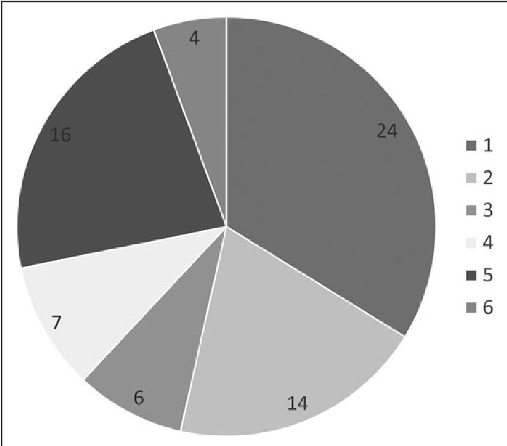
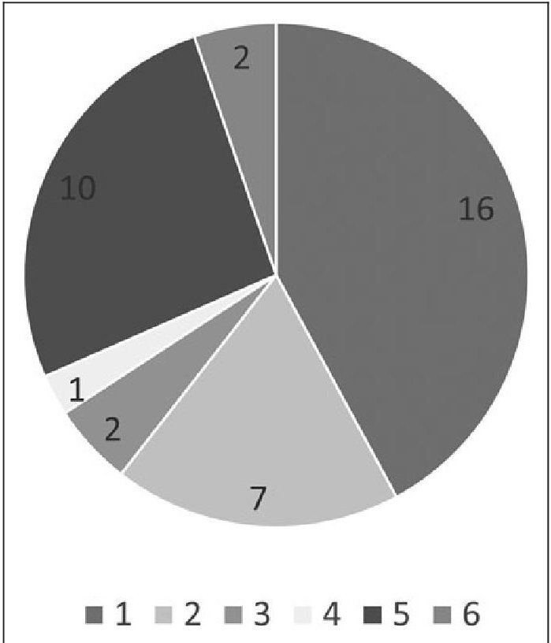
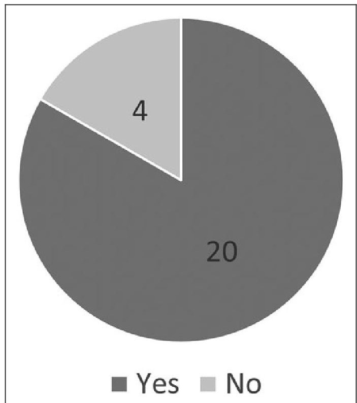
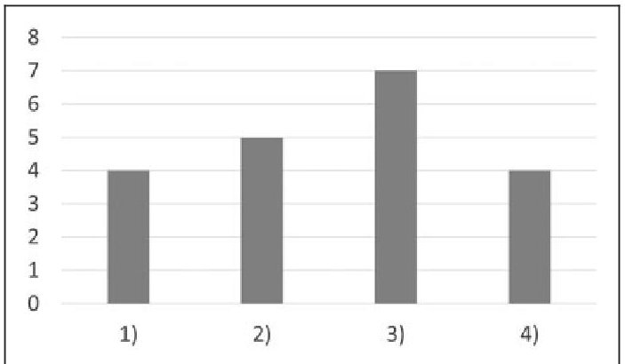
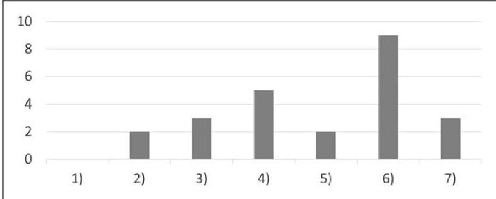
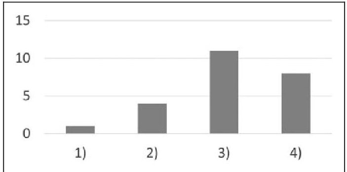
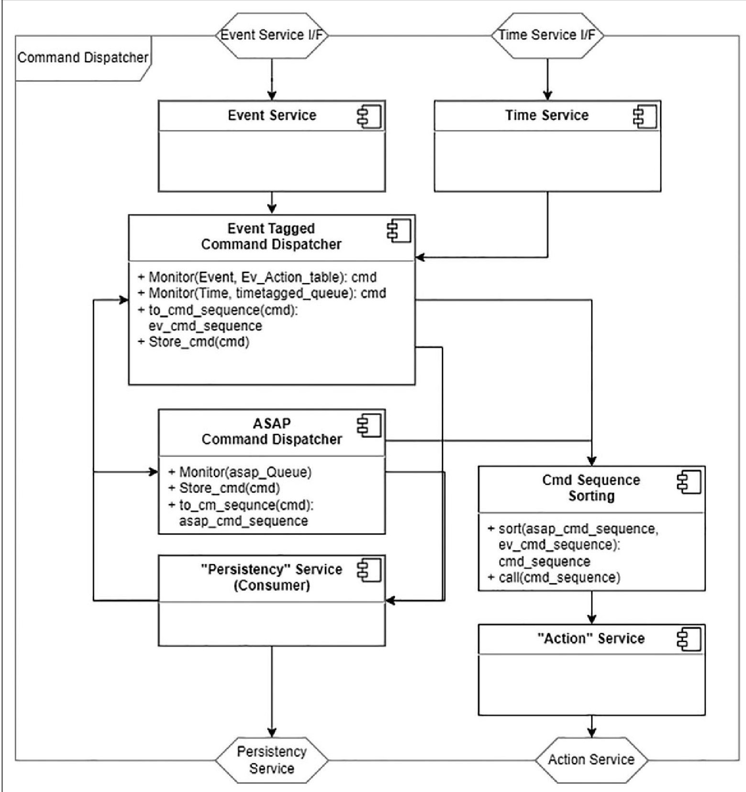
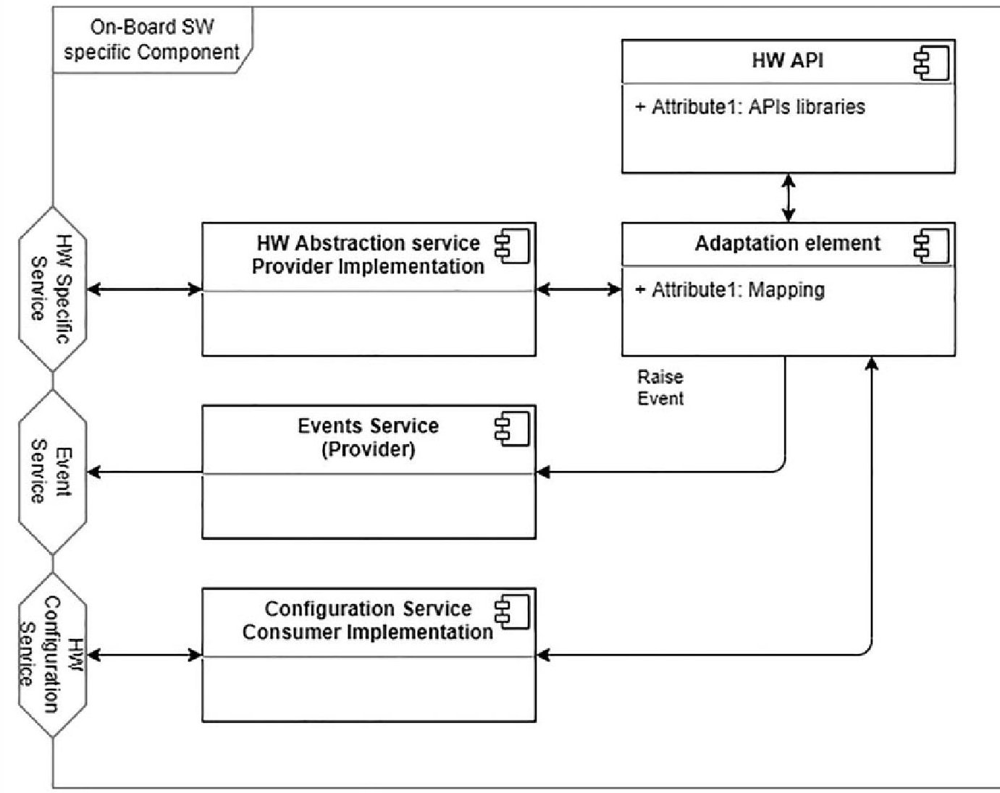
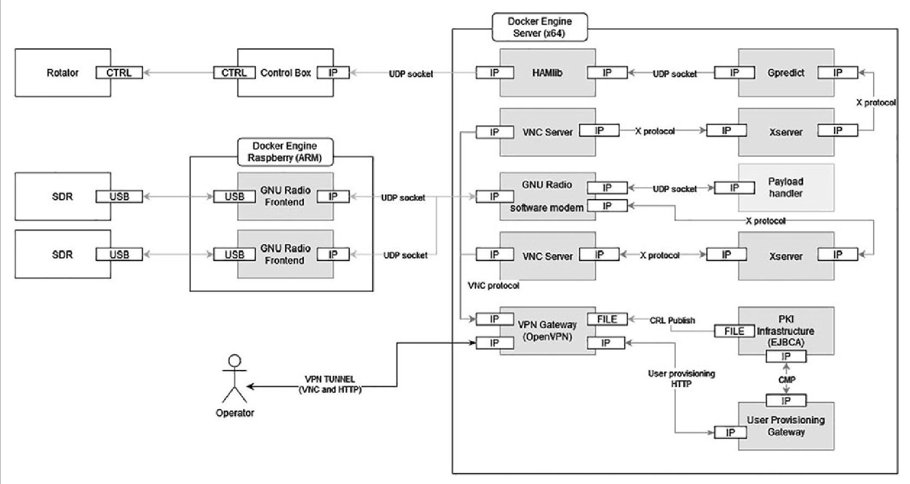
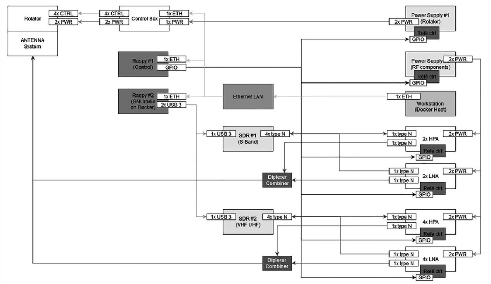

<!-- PDF_PAGE: 1 -->

# POLITECNICO DI TORINO Repository ISTITUZIONALE

## Software Reference Architecture for CubeSats - A Direct Approach

Original

Software Reference Architecture for CubeSats – A Direct Approach / Gagliardini, L.M., Corpino, S., Arcieri, A.. - In: NEW SPACE. - ISSN 2168-0256. - 11:2(2023). [10.1089/space.2021.0069]

Availability:

This version is available at: 11583/2971672 since: 2022-09-30T16:01:43Z

Publisher:

Mary Ann Liebert

Published

DOI:10.1089/space.2021.0069

Terms of use:

This article is made available under terms and conditions as specified in the corresponding bibliographic description in the repository

Publisher copyright

Mary Ann Liebert postprint/Author's Accepted Manuscript

(Article begins on next page)

<!-- PDF_PAGE: 2 -->

Open camera or QR reader and scan code to access this article and other resources online.

# Software Reference Architecture for CubeSats: A Direct Approach

AU1 Lorenzo M. Gagliardini, Sabrina Corpino, and Alessandro Arcieri

AU2 DIMEAS, Politecnico d Torino, Torino, Italy.

## AU3 ABSTRACT

Ever since the first CubeSat mission was launched, the concept and complexity of CubeSat missions has evolved at a pace that current operational system/doctrine cannot match. In an increasingly dynamic space economy, where small businesses have become the norm, innovative solutions that abstract away complexity and increase autonomy are fundamental to reduce operational costs. It is within this frame that the current study is presented. To address the need for a standardized software architecture of NewSpace companies, we first assess the European small satellite market needs through a survey with key players in the space sector. From this survey, we derive the high-level requirements, functionalities, and interfaces of a software architecture for CubeSats, the preferred platform due to its lower cost when compared with traditional platforms. Finally, we report the implementation results of a set of these components and show how they reflect design drivers.

Keywords: reference architecture, CubeSat, software

## INTRODUCTION

NewSpace ventures, ranging from private launch companies, small satellite operators, and bus manufacturers, have become the main driver of the space economy $ ^{1} $ and are reinventing the traditional space industry supply chain. Among those that were recently born, only a few have successfully established themselves in the market, relying on venture capital and proprietary software solutions. We might think of Spire $ ^{2} $ and Swarm, the latter

recently acquired by Starlink $ ^{3} $ with its huge nanosatellite constellations in low Earth orbit, as one of the most representative cases.

There are many reasons that can be attributed to the lack of market success or the delays that some companies experience getting their product to the market, but we can point out to the lack of a standardized, open-source software architectural reference for mission operations (MO) as one of the main obstacles they experience. Without access to proprietary software, these companies are forced to develop in-house knowledge and build and design their own software stacks, a lengthy and costly process. Moreover, this ad hoc development further disincentives the development of a common architecture; if a company allocates resources to gain a market edge, it is not likely that it is interested in losing it by making its software available to competitors.

Within this context, we aim at covering this gap by proposing a software architecture capable of satisfying a variety of stakeholder needs. To do so, we first characterize European small-sat operator needs through a survey involving both industry and governmental bodies, such as space agencies. Then, we address the technical challenges of defining an architecture capable of conciliating and satisfying competing operator needs. In this case, we aim not to define the specific architectural elements, but to derive the requirements that should be considered when developing such a system. Finally, we provide a proof of concept to guide designers aiming to put this concept in production.

## MARKET POLLING

We started the survey in mid-2019 by submitting a questionnaire to several private companies and public bodies in the CubeSat market ("the entities"). Of these, 24 expressed

<!-- PDF_PAGE: 3 -->

their perspective on the existing standards and best practices when applied to CubeSats. To guide our work and gauge their interest, our investigation is centered around two topics: if the European standards satisfy their needs and how proposed solutions could bridge that gap, discussing how to formalize a reference software architecture devoted exclusively to CubeSats operations. Particularly, we are concerned with how this architecture would differ from their current adopted solutions and whether they would be prone to adopt it in the future. After the response period closed, we reviewed their answers and characterized their distributions: entity size, mission needs, and unique entity characteristics.

The first questions (Figs.1 and 2) intend to point out which existing standards, references, and best practices (e.g., Consultative Committee for Space Data Systems [CCSDS], European Cooperation for Space Standardization [ECSS] standards) freely available to the European market the polled entities are familiar with, and which the respondents currently use in their CubeSat projects. We selected such list to cover the message transport issues both on-board and on-ground, the Space-to-Ground interface, and the orchestration of on-board activities, so to cover most of the macro-areas touched by the CubeSat operations. We also asked the companies to point out other references they apply in case we did not report these

Fig.1. Standards familiarity: Are you familiar with any of the following? (1) CCSDS Space Packet Protocol; (2) CCSDS Mission Operations Services; (3) CCSDS Spacecraft On-board Interface Services; (4) CCSDS Space Link Extension; (5) ECSS Packet Utilization Standard; (6) Savoir-Fair OBSW REFA. CCSDS, Consultative Committee for Space Data Systems; ECSS, European Cooperation for Space Standardization; OBSW; REFA, reference architecture.

Fig. 2. Standards usage: Have you used any of the following in your projects? (1) CCSDS Space Packet Protocol; (2) CCSDS Mission Operations Services; (3) CCSDS Spacecraft On-board Interface Services; (4) CCSDS Space Link Extension; (5) ECSS Packet Utilization Standard; (6) Savoir-Fair OBSW REFA.

in the questionnaire. The questionnaire itself takes into consideration the following standards, reported below in the graphs. $ ^{5-10} $

Beside the CCSDS and ECSS standards, the companies mentioned other references $ ^{11-13} $ they adopt in their CubeSat projects, reported in Table 1. According to our survey, 67% of the entities adopt the CCSDS Space Packet Protocol (SPP) in their CubeSat project as a solution at the network layer, showing that it has become a de facto standard, even though most of them are not developing projects in collaboration with a public space agency. This provides a common baseline mission information data exchange. At the same time, 29%

Table 1. Other Adopted Standards, References, and Best Practices

<table border="1"><tr><td>ISO Standards11</td><td>Compass Stack</td></tr><tr><td>OMG Standards12</td><td>Other ECSS Standards(tailored and non-)</td></tr><tr><td>MISRA Coding Standards</td><td>Nondisclosed in-house developed reference</td></tr><tr><td>CSP13</td><td>UNISEC Global</td></tr><tr><td colspan="2">CSP,CubeSat Space Protocol;ECSS,European Cooperation for Space Standardization;ISO;MISRA;OMG;UNISEC。</td></tr></table>

<!-- PDF_PAGE: 4 -->

Fig. 3. REFA usage distribution: Do you apply "a”/“your own” REFA in your projects?

and 42% of the entities adopt the ECSS Packet Utilization Standard (PUS) and CCSDS MO services, respectively, as these provide a reference for managing data at application (operation) level. Of these entities, 43% and 50% are contractors of the European Space Agency, which demands the use of these standards.

Nevertheless, this suggests that the CCSDS MO services are more widely spread among CubeSat missions than ECSS PUS services. Focusing on the second half of the questionnaire, we are interested in understanding how many companies are adopting "a"/"their own" reference architecture (REFA) in their project development process and to which extent. As shown in Figure 3, the majority (83%) of the polled

Fig. 4. REFA covered areas: At what level do you apply "a"/"your own" REFA? (1) At hardware interface level; (2) at software interface level; (3) at communication protocol level; (4) at operational concept level.

Fig. 5. REFA perspective distribution: Would a CubeSat REFA bring value and facilitate your business model. (1) No; (2) yes, if it is at hardware mechanical interface level; (3) yes, if it is extended at device interface level in form of APIs; (4) yes, if it is at on-board communications protocol level; (5) yes, if it is at space to ground interface level; (6) yes, if it also encompasses the composition of functional components on-board and on the ground; (7) yes, help in research or in student recruitment or in academic purposes. APIs, Application Programming Interfaces.

companies reveal that they use a REFA developed in-house or outsourced. Of those, 25% use an architecture that covers software interfaces, while 35% apply a REFA for communication protocols. Such a result aligns with Figures 1 and 2, which highlights the application-level software (i.e., MO services, PUS services) and communication protocols (i.e., SPP, CubeSat Space Protocol) as the most adopted technologies by the polled entities.

Indeed, they tend to take advantage of existing standards as a starting point for their in-house designs, notwithstanding their non-mandatory adoption (i.e., imposed by a contract). We finally asked the polled entities to deepen the software REFA topic (Figs. 5 and 6), about the possibility to adopt a common CubeSat REFA. We are interested in understanding how this choice would impact their business model, and what should the REFA encompass to bring an added value. This first question evaluates what design level the reference should

Fig. 6. How far shall a REFA go? (1) Tools for autogeneration of code; (2) high-level architectural design-paper only; (3) opensource reference implementation of the core elements of the REFA (as reference not mandatory to take); (4) Market Place with competitive vendors offering compliant and competing implementations of elements of the REFA.

<!-- PDF_PAGE: 5 -->

Fig. 7. Command dispatcher.

target (e.g., software/hardware interfaces/protocols), for tackling technology gaps. The second inquiry we make is to understand how to propose such a reference (e.g., as a paperonly design, in the form of Open-Source). What is immediately clear is that the request for an architecture covering on-board and on-ground functional components is, by far, the solution that best fits market needs.

According to the polling, 46% of the entities ask for an architecture involving the core functional components as a non-mandatory reference. This aligns with what we reported before, showing companies and public entities taking advantage of existing technologies as a starting point for their internal design process, which in most cases results into an ad hoc REFA. This further highlights the market need

<!-- PDF_PAGE: 6 -->

Fig. 8. Generic component model. HW; SW.

for a REFA and provides a line of research for a further development in our study. Moreover, from the buyer's perspective, the presence of an open-source reference implementation would mean greater competitiveness and higher quality products, with vendors offering their own design, but still compliant with the REFA differing for implementation details.

## HIGH-LEVEL REQUIREMENTS DERIVATION AND DISCUSSION

The identification of the proper level of details in the architecture definition can be considered the main driver of the design process. The aim for becoming a spread de facto standard implies the capability of reducing at most the unnecessary constraints coming from the design process while providing a solid baseline that serves as a common reference. The identification of such aspects whose definition is deemed relevant for the architecture and those who can instead be accounted for tailoring processes is of paramount importance.

The entire set on User Needs (UNs) evolves around this hinge concept, which we meet by making strategic choices in the design process, as we will sudden describe.

It is worth to bear in mind that such Needs we are proposing do not constitute by any means a technical description of the architecture, and their lack of technicality would not allow such purpose. The statements reported in Table 2 are solely intended to resume the UNs as they result from the questionnaire. The present section provides a discussion focused on the system level, to better understand the considerations, which led the requirements' derivation. An explanation of the derived requirements is provided, and a 1-to-N mapping from the UNs to the applicable set of high-level requirements, reported in Table 3, is described hereafter.

By the elicited UN-100, reported in Table 2, we do not intend to specify which of the existing standards to make use of and which to discard. Such indication serves instead for identifying the areas this architecture will span. Taking advantage of the existing standards, references, and best

<!-- PDF_PAGE: 7 -->

## GAGLIARDINI ET AL.

<table border="1"><tr><td colspan="2">Table 2. User Needs</td></tr><tr><td>UN ID</td><td>UN</td></tr><tr><td>UN-001</td><td>The architecture shall take advantage of existing standards, references, and best practices.</td></tr><tr><td>UN-002</td><td>The architecture shall allow the usage/introduction of other standards.</td></tr><tr><td>UN-003</td><td>The architecture shall offer a baseline on top of which further solutions can be developed.</td></tr><tr><td>UN-004</td><td>The architecture shall avoid unnecessary constraints.</td></tr><tr><td>UN-005</td><td>The architecture shall be easily tailorable.</td></tr><tr><td>UN-006</td><td>The architecture shall balance the proper level of details.</td></tr><tr><td>UN-007</td><td>The architecture shall allow vendors offering compliant and competing implementations of elements of the REFA.</td></tr><tr><td colspan="2">REFA, reference architecture; UN, User Needs.</td></tr></table>

practices, forces such an architecture span over the diverse functionalities of the architecture. Such architecture shall not limit the specification to the only on-board segment but shall address on-board, on-ground, and Space-to-Ground functionalities.

In System (SYS)-0100, defining an on-board and on-ground architecture results in multiple achievements, both from the UNs alignment perspective and from the analysis done on the proposed questionnaire's results. The on-board segment constitutes the focus of the present work. Nevertheless, a functional set of core on-board components cannot be considered a self-standing entity. By defining SYS-0100, we intend here to guarantee that the provision of those ground components, needed for run-time control, make the architecture an effective, functional set of tools for engineers operating the spacecraft.

UN-002 constitutes the other face of the medal for UN-001 and it was indeed important, in the interpretation of UN-001, not to impose a selection of applicable technologies/ standards. In seeking flexibility, by fixing the requirement

<table border="1"><tr><td colspan="4">Table 3. High-Level Requirements</td></tr><tr><td>Req. ID</td><td>Req. Title</td><td>High-Level Requirement Text</td><td>Reference UN ID</td></tr><tr><td>SYS-0100</td><td>System&#x27;s domain</td><td>The architecture shall define functional on-board and on-ground components.</td><td>UN-001</td></tr><tr><td>SYS-0200</td><td>Implementation</td><td>The architecture shall not tie users to a specific technology/implementation.</td><td>UN-002</td></tr><tr><td>SYS-0300</td><td>Component functionalities</td><td>The architecture shall provide a framework of core functionalities.</td><td>UN-003</td></tr><tr><td>SYS-0400</td><td>Adaptability</td><td>The architecture shall allow the user to replace the composing elements depending on the specific mission&#x27;s needs.</td><td>UN-004</td></tr><tr><td>SYS-0500</td><td>Interprocess communication</td><td>The architecture shall not define the interprocess communication technology/implementation.</td><td>UN-004</td></tr><tr><td>SYS-0600</td><td>Intercomponent communication</td><td>The functional components&#x27; interactions shall be expressed in terms of abstract interfaces.</td><td>UN-005</td></tr><tr><td>SYS-0700</td><td>System composability</td><td>The internal modification of any functional component shall be transparent to other components.</td><td>UN-005</td></tr><tr><td>SYS-0800</td><td>Architectural structure</td><td>The composition of the core functional components shall ensure the overall system&#x27;s functionality.</td><td>UN-005</td></tr><tr><td>SYS-0900</td><td>Component decomposition</td><td>Each functional component shall be internally decomposed into the different processes taking part to the activity.</td><td>UN-006</td></tr><tr><td>SYS-1000</td><td>System compositionality</td><td>Each system functionality shall be mapped to a different functional component.</td><td>UN-006</td></tr><tr><td>SYS-1100</td><td>Market model</td><td>The architecture shall not be mandatorily adopted.</td><td>UN-007</td></tr><tr><td>SYS-1200</td><td>Licensing</td><td>The architecture shall provide open-source reference implementations of the core elements of the REFA.</td><td>UN-007</td></tr><tr><td>SYS-1300</td><td>Documentation</td><td>The architecture shall be presented as a high-level descriptive standard with guidelines for its adoption and tailoring.</td><td>UN-007</td></tr></table>

<!-- PDF_PAGE: 8 -->

<table border="1"><tr><td colspan="2">Table 4. On-Board and On-Ground Functional Components</td></tr><tr><td>On-Board</td><td>On-Ground</td></tr><tr><td>On-board data handling I/O</td><td>Mission planning system</td></tr><tr><td>Command scheduler</td><td>Mission control system</td></tr><tr><td>Command dispatcher</td><td>Antenna control unit</td></tr><tr><td>Parameter monitor and report</td><td>Radio software modem</td></tr><tr><td>Parameter acquisition and pooling</td><td>Secure remote access</td></tr><tr><td>Event report and distribution</td><td></td></tr><tr><td>Time distribution</td><td></td></tr><tr><td colspan="2">I/O.</td></tr></table>

SYS-0200, we intend to avoid an architecture's specification, which refer to particular implementation choices, for example, Transport/Network protocols, Java implementation language. The interprocess communication, that is, component-to-component communication technology and implementation choices are left to the customer. Such feature plays a game-changer role in an architecture definition, which aims at spreading among the most different customers. Fixing such choices at a too early stage would instead impact into its adoptability and would mean a cutoff for potential many of the customers. SYS-0200 is a direct outcome of this consideration.

The translation from UN-003 to Requirement is straightforward. The identification and definition of a framework of core functionalities and transport components shall provide a solid baseline on top of which further solutions can be added. In SYS-0300, defining a baseline core of functionalities, that is, application-level components, needed for controlling the on-board and ground activities shall constitute a minimal, yet fully functional starting point for further tailored improvements (more granularly specified in the next requirements) and additional components. Thanks to this core set, required by SYS-0300, the customer shall avoid re-inventing the wheel spending time in designing the spacecraft bus, and rather investing in mission-specific solutions.

The UN-004 balances the detailed level of definition of the core components of the architecture coming from SYS-0300. The need for avoiding unnecessary constraints is required by two main needs. The need for the user to internally replace specific functionalities of the components, depending on the mission-specific performances required; and possibility for the implementer to impose its own transport solution when getting to the inner components functionalities. Regardless to

the component-to-component communication interfaces, the intracomponent communications shall remain transparent to the architecture definition.

This aspect is of paramount importance, and therefore, we consider that any application-level component aspect, for example, execution timing and synchronization, will be potentially compliant with mission-specific requirements. Bearing in mind such considerations, the flexibility expressed by SYS-0400 and SYS-0500 foresees the possibility for the implementer to add and customize application-level components and internal components communications.

UN-005 differs from UN-003 for the nontrivial implications. At first, tailoring the core components means that the architecture shall allow substitution of existing functional block, by maintaining the component Application Programming Interface (API). SYS-0600 intends defining a component's interface model the customers can align to, in the customization process, and focus on the translation to the mission's specific and/or customer's specific technology, which remains transparent to the architecture specification. By following SYS-0600, it is possible to derive SYS-0700, which concurs in achieving tailorability.

By maintaining the internal modification of any functional component transparent to the other components, allows concurrent developers, working on different components, to not interfere with each other as long as they comply with the component model API. SYS-0700 guarantees transparency. It is important to consider that such internal modification shall never imply the deletion, omission, of the functions on which the other core components of the architecture rely, for example, time-tagged commands parsing, which would affect the overall system's functionality. This requirement is expressed by SYS-0800, and the identification of such core elements is part of the architecture design process.

UN-006 poses a condition that cannot be directly translated into requirements, but that rather can further be evaluated by imposing specific conditions to our architecture. The proper level of granularity is reached as first by mapping any architecture macrofunctionality, for example, command ingestion, to a unique functional component. By making this segregation, it is possible to treat separately the granularity issue for every component, and varying such granularity for specific components, depending on the customer's need. For achieving internal granularity, SYS-0900 allows decomposing each application-level component into lower functional elements.

From what stated by SYS-0900, it is then possible to separate design concerns depending on their specific granularity, for each component. This will provide the means, at further

<!-- PDF_PAGE: 9 -->

development times, for identifying the proper level of definition as we dive deep into each component. It will also be possible for the customers to impose the needed granularity level for the tailored component. The same granularity is ensured by the proper separation of concerns.

As coming from the marked polling analysis, UN-007 shall be framed into a specific market model. The current work targets small companies, which can take advantage of the specification introduced by the architecture design. In such perspective, the architecture intends to be offered to the customers, that is, not imposed as a mission requirement, as stated by SYS-1100. Therefore, aim of the architecture is not to reach the rank of a standard. The market model that best aligns to such doctrine is the open-source model, which facilitates the adoption process, as remarked by SYS-1200. As a result, by fixing SYS-1300, the aim for realizing a common repository where common components can be chosen/adopted, differing for implementation details as proposed by the customers' community, allows a central entity, that is, ESA, maintaining the reference guidelines for adoption.

## DEVISED ARCHITECTURE

An example of the criteria adopted for translating requirements, reported in Table 3, into actual design choices is reported hereafter. Let us make an example by considering the user perspective:

1. The Market Polling section showed the SPP being the most spread and adopted technology at network level.

2. The UNs required to take as much advantage as possible from the existing solutions, yet adopted, so to avoid reinventing the wheel, UN-001.

Since in defining the architectural framework, we intend not to tie to a specific transport technology, as previously expressed by SYS-0200, the mediation between the application level and the transport level takes advantage of the CCSDS MO specifications. This is a valid choice both from the structural point of view and from the user point of view, that is, UN-003, since, for example, it does not force the user to any transport technology. Any MO service is defined by a set of CCSDS MO MAL $ ^{14} $ compliant objects, defined by the message structures, whose encoding choice can be left to the implementer; by a set of high-level interaction patterns through which the information travels between functional components (e.g., Publish-Subscribe); and by an abstract message header.

Those can be translated, at implementation time, into different encoding and transport technologies in conformity to

the relative CCSDS specification, including the CCSDS SPP. $ ^{14} $ These characteristics of the MO services guarantee the composability and compositionality properties required by SYS-0700 and SYS-0800. Finally, the CCSDS MO services constitute the framework on top of which the architecture's core components are deployed.

Having introduced the high-level requirements and the criteria adopted for their assumption, we present here and in the next section a set of core components and a description of their interfaces and basic functionalities. We propose three different components: an On-Board component devoted to specific on-board functionalities; a Generic Component Model (GCM) providing generic interfaces playing as a common software API for multiple on-board peripherals; and a set of functional on-ground components. The ground components will be the main subject of the Implementation section, dedicated to the implementation. We do not discuss here the completeness of the reported functionalities, as the component's functional refinement is beyond the scope of the present work. Instead, we show here the consistency of the structural characteristics of the architecture and discuss how the design choices reflect the high-level requirements. This is done by describing a selection of components and, along their description, highlighting the connection with the requirements reported in Table 3.

In our analysis, we consider the component Command Dispatcher (CD) as a core component of the architecture that is, a component on whose functionalities other components rely, as per SYS-0300, and whose inclusion into the architecture is necessary for orchestrating the system's functionalities, as per SYS-0800. Since the CD smoothly aligns with SYS-0300 and SYS-0800, it can be accounted for providing a consistent example for the current section. The CD, as suggested by the name, is responsible for the on-board sorting, addressing, and dispatching of commands originated both onboard and on-ground.

From a structural point of view, the CD interacts with the CCSDS MO framework by invoking the CCSDS MO services, whose implementation is represented in the schematic as a doubled component: the service instantiation internal to the CD, and the service interface itself as defined by the CCSDS blue books. The service instantiation makes the CD logic being transported into a MO service abstract form, thus staying compliant to SYS-0600. This consists in formatting the data both in the abstract structure in accordance with the underlying CCSDS MO service specification, and into the mission-specific encoding convention adopted by the framework itself, as required by SYS-0200. From a structural perspective, the segregation between the component-specific implementation,

<!-- PDF_PAGE: 10 -->

the common interaction layer, and third party's components introduced by the adaptation element serves the purpose of SYS-0400 and SYS-0700.

As far as the data structures are compliant to the CCSDS MO specification, the MO service endpoint of the communication channel can be invoked for the packets to be dispatched. The service interaction works both ways, being inward and outward, depending on the role the CD plays, that is, whether it is a data provider or a data consumer. For aligning the CD with SYS-0900, we provide here a first distinction between the "Event Tagged Command Dispatcher" (ET-CD) and the "ASAP Command Dispatcher" (ASAP-CD), as an example of component decomposition into internal functional blocks. From a functional point of view, the ET-CD monitors the incoming events (in this context an "event" is any happening either reported by the Event Service or by the closing of a time deadline) and checks them for on-board dispatchability before the actual dispatch.

Since the On-Board Mass Memory (OBMM) constitutes by all means a third party's component from the CD perspective, the data exchange with the OBMM occurs via a specific MO service. Nevertheless, the internal handling of data is left to the implementer, in accordance with SYS-0500. As the dispatchability is asserted, the command can be released on the bus, being either the hardware or software channel for onboard data exchange. The ET-CD is also responsible for keeping track of the managed activities, by saving an onboard command history via the Persistency Service directly to the OBMM. The parallel activity to the ET-CD is operated by the "ASAP Command Dispatcher."

The ASAP-CD monitors and dispatches the ASAP onboard que and keeps track of the managed activities, via the Persistency Service, as previously described for the ET-CD. Both the dispatched commands originated by the ET-CD and by the ASAP-CD flow in the Command Sequence Sorting, responsible for separating in time the Bus access so to avoid the time overlapping that the Mission Planning System on ground would not consider. A note shall be marked here: while showcasing the connection between the high-level requirements expressed in the previous section and the present components, it is unavoidable to provide a hypothetical logical structuring. In our case, an operation such as the internal functional decomposition of the CD is rather intended to reflect requirements, that is, SYS-0900, instead of constraining the implementer to a specific implementation.

In parallel to the architecture's functional components, a second kind of components is defined whose role is interfacing the architecture's components, defined above, with any physical on-board peripheral (aka payload). These components are named GCM and their role consists in mediating between the platform-specific API, as offered by the payload manufacturer, and the underlying CCSDS MO framework itself. The GCM plays a key role in achieving the segregation and abstraction properties expressed by SYS-0400 and SYS-0700.

The GCM can be considered a Class to instantiate as a new peripheral (at design time) is deployed on-board so to make it interacting with the other architecture's components. Therefore, we can refer to any GCM as an instantiation of the GCM class. The component itself is decomposed into simpler functionalities, covering three main roles, as per SYS-0900. The first is the interaction with the underlying MO framework, as described for the paragraph above. Key aspect to consider for the GCM is that the MO services on which it relies are selected to be generic enough for managing any on-board deployed platform.

Those are: the Hardware Configuration Service for setting the operative configurations; the Event service which is intended for raising events in case of issues or malfunctioning; and a Hardware-Specific Service in case the implementer provides a customized service implementation accordingly to CCSDS MAL specification. In the GCM, each service's implementation is composed of the service instantiation and the service interface. On the other side of the GCM, there is the platform-specific API. This is the set of commands as provided by the platform manufacturer and is usually represented as a library or set of libraries.

To mediate between the Service implementation and the Platform API, an adaptation element is needed, working as a middleware. The adaptation element is responsible for translating the platform logic into the service logic, both in terms of data and functions. By these means, it is possible to operate any on-board peripheral by MO services, thanks to the adaptation layer performing the translation between the platform agnostic MO services and the platform-specific API.

## IMPLEMENTATION

Focusing on the ground segment, we highlight that the conceptual architecture envisaged for the on-board components can be easily translated for ground components. We discuss here how to implement them so to demonstrate that the implementation criteria reflect in facts the design drivers previously discussed. Again, as described in the previous sections, the system architecture is based on the concept of multiple modules, SYS-1000, connected via well-defined loose-coupled interfaces, SYS-0600. Starting from software architecture, in computer science, we can easily find a

<!-- PDF_PAGE: 11 -->

paradigm based on the same principles: microservice architecture. It is possible to realize such kind of architecture using multiple software solutions.

One of the most famous and well-known solutions is the Docker Container Engine. Docker Container Engine (also referred to simply as "Docker") $ ^{15} $ is a Platform as a Service open-source tool designed to manage and create containers. Containers are a form of light virtualization based on namespace features provided by a Linux kernel. Each container is an isolated environment, as per SYS-1000, with its own persistence (file system) and network stack, meaning that multiple instances of the same "image" (container root file system) can run at the same time without interacting with each other, as per SYS-0700.

These features make it possible to decompose a monolithic application into multiple simple components, as per SYS- 0400, that can be packaged as containers, and then orchestrate them as atomic entities, each one with its specific multiplicity and execution environment. $ ^{1 6} $ The decomposition pattern is the base of our proposal, as any component is packaged and deployed as a container, that we connect to the others via network sockets, as displayed in Figure 9. In the current implementation, there are three principal components we provide:

1. Secure Remote Access Gateway

2. Digital Signal Process Service

3. Antenna Control Service

The first one consists of a virtual private network (VPN) access gateway with a public key infrastructure (PKI) authentication based on the OpenVPN software. This represents the main entrance point for the Ground station operators, as all communications and interactions with the station subsystems are managed in a controlled and secure way. Such ground component devoted to security is not part of the core set of components for the architecture. These are rather introduced as custom components, showcasing, as per SYS-0400, the possibility for the user to add mission-specific elements as needed. The PKI is self-hosted. Other subsystems (that will be referred to as "services" later on) are organized in "stacks," which are sets of containers connected via internal networks.

The second subsystem, the Antenna Control Service, is composed of three containers: the main one hosts an instance of GPredict, $ ^{17} $ which is responsible for propagating the satellite orbit and the relative position to the ground station at a specified time. GPredict then converts the position in azimuth and elevation parameters and sends them to a "driver" container （HAMlib $ ^{18} $ ）that translates them into real commands to

Fig. 9. Ground component software implementation. ARM; CMP; CRL; CTRL; EJBCA; GNURadio; GPredict; HAMlib; HTTP; IP; PKI, Public Key Infrastructure; SDR, Software Defined Radio; UDP; USB; VNC; VPN, Virtual Private Network.

<!-- PDF_PAGE: 12 -->

Fig. 10. Ground component hardware implementation. ETH; GPIO; HPA, High Power Amplifier; LAN; LNA, Low Noise Amplifier; PWR; UHF, Ultra High Frequency; VHF, Very High Frequency.

be sent to the antenna rotator controller: the container in this case acts as adaptation layer. The operator interacts with the system (GPredict user interface) using a VNC remote desktop session.

The third subsystem, the Digital Signal Process Service, contains three main components: the frontend, the modem, and the payload handler. The frontend module is composed of multiple instances of GNURadio responsible for controlling the Software Defined Radio (SDR) devices, making them accessible via network sockets. This adaptation layer allows to decouple the SDR from the software modem. One of the benefits of this approach is the segregation of the signal acquisition from the signal processing module, meaning that the software modem can be modeled as a functional block, abstracting it from the SDR hardware device and its handling. Another positive aspect is the fact that the software modem (which is a CPU bound workload) can be run on high-performance host that does not need to be located near the SDR or the antenna system.

The software modem component is another GNURadio instance, which implements all the signal processing logic, to act as a mid-level gateway to communicate to the satellite. At

the end of the pipeline, we can find the last component of the system, which is the payload handler block. Payload handlers block implementation will not be part of this description, as it needs to be designed specifically for the communication protocol used by the specified satellite. Anyway, our design allows us to simply change that module on the fly, just running and stopping the right container, which will be implementing the specific protocol used by the target satellite. The other modules are in fact common for all satellites and are so designed to be sufficiently generic to not represent a limit in the protocols that the GS can handle.

## CONCLUSIONS

The reported survey in the Market Polling section shows that a software REFA devoted to CubeSats can be a game changer for private and public companies in the small-sat market. Currently adopted solutions and new technologies in the CubeSat sector can be a baseline for an architecture that would be welcome by companies that are unable to implement it by themselves. Starting from this baseline, the High-Level Requirements Derivation and Discussion section proposes a design that translates market needs into a real architecture

<!-- PDF_PAGE: 13 -->

## GAGLIARDINI ET AL.

design. Flexibility is a key requirement for standardization and is thus considered in our architecture, which allows interaction with a variety of on-board peripherals without constraining implementation choices. Finally, the adoption of modular self-contained components reflects the proposed driving design principles, as shown in the Devised Architecture section for the on-ground segment.

AU17 AUTHOR DISCLOSURE STATEMENT No competing financial interests exist.

U18 FUNDING INFORMATION No funding was received for this article.

SUPPLEMENTARY MATERIAL Supplementary Data

1. OECD. Handbook on Measuring the Space Economy. Paris: OECD Publishing, 2012.

2. Masters D, Duly T, Esterhuizen S, et al. Status and accomplishments of the Spire Earth observing nanosatellite constellation. Sens Syst Next Gen Satellit XXIV. 2021;11530:115300V.

3. Crist R. Starlink explained: Everything to know about Elon Musk's Satellite Internet Venture. CNET, December 2021. https://www.cnet.com/home/internet/starlink-satellite-internet-explained

4. Farrell FJ. A Reference Architecture for CubeSat Development. Farrell F. Thesis dissertation, March 2020.

5. Space Packet Protocol, CCSDS 133.0-B-2, Blue Book. Issue 2. Washington: CCSDS Secretariat Publishing, June 2020.

6. Mission Operations Service Concept, CCSDS 520.0-G-3, Magenta Book, Issue 3. Washington: CCSDS Secretariat Publishing, December 2010.

7. Spacecraft On-Board Interface Services, CCSDS 850.0-G-2, Green Book, Issue 2. Washington: CCSDS Secretariat Publishing, December 2013.

8. Space Link Extension-Forward Space Packet Service Specification, CCSDS 911.3-B-3, Blue Book, Issue 3. Washington: CCSDS Secretariat Publishing, August 2016.

9. ESA Requirements and Standards Division, Telemetry and Telecommand Packet Utilisation—ECSS-E-ST-70-41C. ESA Publishing, April 2016.

10. Savoir-Faire working group, Savoir-Faire On-board software reference architecture—TEC-SWE/09-289/AJ. ESA Publishing, July 2018.

11. Figueiro Marques RP, Santos C, Inacio H. Organizational Auditing and Assurance in the Digital Age. Pennsylvania: Hershley Publishing, 2019.

12. Morales Trujillo ME, Oktaba H, Piattini M. The Making of an OMG Standard. Comput Stand Interf 2015;42:84-94.

13. GOMspace, CubeSat Space Protocol (CSP), Network-Layer delivery protocol for CubeSats and embedded systems. GOMSpace Publishing, June 2008.

14. Mission Operations MAL Space Packet Transport Binding and Binary Encoding, CCSDS 524.1-B-1, Blue Book. Issue 1. Washington: CCSDS Secretariat Publishing, August 2015.

15. Boettiger C. An introduction to Docker for reproducible research (Special Issue on Repeatability and Sharing of Experimental Artifacts). ACM SIGOPS Operat Syst Rev. 2015;49(1):71-79.

16. Jaramillo D, Nguyen DV, Smart R. Leveraging microservices architecture by using Docker technology. SoutheastCon 2016;2016:1-5.

17. Csete A. Gpredict. http://gpredict.oz9aec.net

18. Hamlib Maintenance and Development Team. HAMlib library. https://hamlib AU24 .github.io

Address correspondence to: AU25

Lorenzo M. Gagliardini

DIMEAS AU26

Politecnico d Torino

Corso Duca degli Abruzzi, 24

Torino 10129

Italy

E-mail: lorenzo.gagliardini@ext.esa.int, lorenzo.gagliardini@polito.it

AU0: The Publisher requests for readability that no paragraph exceeds 20 typeset lines. This paragraph contains 21 lines or more. Please divide where needed.

AU1: Please identify (highlight or circle) all authors' surnames for accurate indexing citations.

AU2: Please provide the department in authors' affiliation.

AU3: Please include IRB approval or waiver statement in the Materials and Methods section. The Clinical Trial Registration number, if applicable, should be included at the end of the abstract.

AU4: Please consider rephrasing the phrase "reported below in the graphs" with respective figure citations in the sentence "The questionnaire itself takes into consideration the following standards, reported below in the graphs."

AU5: Please expand "ESA."

AU6: Please define "MAL."

AU7: Please note that "Chapter 6" has been changed to "the Implementation section." Please check.

AU8: Please define "GPredict."

AU9: Please expand "HAMlib."

AU10: Please expand "VNC."

<!-- PDF_PAGE: 14 -->

AU11: Please define "GNURadio."

AU12: Please expand "CPU."

AU13: Please expand "GS."

AU14: Please note that "Chapter 3" has been changed to "the Market Polling section." Please check.

AU15: Please note that "Chapter 4" has been changed to "the High-Level Requirements Derivation and Discussion section." Please check.

AU16: Please note that "Chapter 5" has been changed to "the Devised Architecture section." Please check.

AU17: Disclosure statement accurate? If not, please amend as needed.

AU18: Funding Information accurate? If not, please amend as needed.

AU19: Please cite "Supplementary Data" in the text.

AU20: Please note that "Refs. 10 to 27" have been renumbered to "Refs. 1 and 18," respectively, in the reference list. Please check.

AU21: Please provide the date you last viewed the website for Ref. "3."

AU22: Please cite Ref. "4" in the text.

AU23: Please provide the date you last viewed the website for Ref. "17."

AU24: Please provide the date you last viewed the website for Ref. "18."

AU25: Please confirm the corresponding author's name and address.

AU26: Please provide the department in the corresponding author's address.

AU27: Please clarify whether "tailored and non- " can be changed to "tailored and non-tailored" in Table 1.

AU28: Please define "ISO, MISRA, OMG, and UNISEC."

AU29: Please cite Table "4" in the text.

AU30: Please define "I/O."

AU31: Please define "OBSW."

AU32: Please cite Figures "4, 7, 8, and 10" in the text.

AU33: Please define "HW and SW."

AU34: Please define "ARM, CMP, CRL, CTRL, EJBCA, GNURadio, GPredict, HAMlib, HTTP, IP, UDP, USB, and VNC."

AU35: Please define "ETH, GPIO, LAN, and PWR."