<!-- PDF_PAGE: 1 -->

IAC-23-C2.7.8

# Temperature Stabilization Device's Design and Implementation Method for Nanosatellite System

Kikuko Miyata $ ^{a *} $ , Masaki Yamagata $ ^{b} $

$ ^{a} $ Department of Vehicle and Mechanical Engineering, Meijo University, 1-501 Shiogamaguchi Tempaku-ku, Nagoya, Aichi, Japan 468-8502, kmiyata@meijo-u.ac.jp

$ ^{b} $ Department of Chemistry and Materials Engineering, Kansai University, 3-3-35 Yamate-cho, Suita-shi, Osaka, Japan 564-8680, yamagata@kansai-u.ac.jp

* Corresponding Author

## Abstract

Nanosatellites have gained attention because of their potential to widen the space utilization communities. However, their strict mass and volume limitations result in their small heat capacity, low power generation, and consumption. Nano-satellite's thermal design and operations become difficult when combined with the orbital thermal environment and these characteristics. This paper proposes a temperature stabilization device, utilizing commercial phase change materials. The proposed device mitigates temperature change by incrementing the heat capacity around the designed temperature, without utilizing power resources. The proposal consists of a selection of PCMs, a discussion of suitable implementation methods, and a discussion of a system design method for nanosatellite using PCMs. Discussions are performed by numerical and experimental studies and the results show the effectiveness of the proposed method and system.

Keywords: Phase Change Material, Nanosatellite, Thermal Design

## 1. Introduction

There are a lot of difficulties in the design of the nanosatellites' thermal design and operations, such as the periodic heating and cooling caused by orbital motion, and vacuum environment. In addition, nanosatellite has strict mass and volume limitations that cause small power generation and consumption, and small heat capacity, which cause lower temperature conditions compared with the larger spacecraft and higher temperature variations and make the thermal design difficult. Figure 1 shows an example of time series temperature variations of 1U nanosatellite structure (Temp+Z, Temp-Z) and on-board battery cell (Temp1cell, Temp3cell). [1] The temperature trends show lower than the typical spacecraft and their low power generation characteristics prevent the utilization of additional heaters for thermal management during the eclipse.

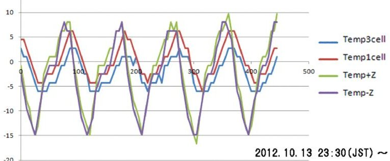

Fig. 1. Time series temperature histories (5 rev.) [1]

In addition, most electric devices tend to have temperature dependence in their performance. For

example, Fig. 2 shows the temperature dependences in the attitude gyroscope biases. [2] The verification and evaluation need certain development duration and costs. This tendency is relatively large for low-cost components comparing to the expensive ones.

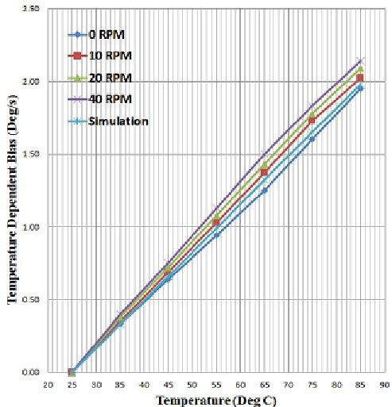

Fig.2 Simulation and experimental temperature dependent bias from 25 to $ + 8 5^{\circ} \mathrm{C}. $ [2]

These characteristics cause requirements for a temperature change mitigation system with low power consumption. Therefore, this paper proposes the utilization of commercial phase change materials (PCMs) and effective system design methods with PCMs. The system mitigates temperature change by incrementing the heat capacity around the designed temperature, which realizes power resource usage reduction for temperature mitigation.

<!-- PDF_PAGE: 2 -->

In addition, the system also might save the workload of the verification testing for constructing performance compensation modelling by utilizing compensation software techniques and suitable hardware, especially when we thinking about mass production. With sample temperature characteristic knowledge, we can sort out the requirement for an acceptable temperature range by utilizing modelling difficulties and system performance requirements. By using environmental constraints derived from the analysis and thermal design techniques, we can also design suitable hardware to achieve the temperature range requirement. This combination might realize a suitable system.

This paper focuses on the hardware design. The proposal consists of a selection of PCMs, a discussion of suitable implementation methods, and a discussion of a system design method for nanosatellite using PCMs.

## 2. Selection of PCMs

The phase change materials (PCMs) store the energy as latent heat during the material's phase transition. The phase transition can be considered conformity of the state to the other state or crystals to the other crystals, which has different energy state. PCMs can add similar tendencies to increasing the heat capacity around the required temperature by suitable material selection. Many kinds of materials show these characteristics. Here, we survey the commercial component, which enables stable performance maintenance coming from the mass production's quality control, and cost maintenance for the key technologies.

Popular PCMs are solid/liquid change materials, such as metal alloys, molten salts, salt hydrates, and organic materials, including paraffin. [3-8] There are many commercial products in this category and some of them show relatively large latent heat characteristics, such as 200 g/J. However, the volume and shape changes have occurred corresponding to the phase transition, and there are difficulties in handling them. In addition, under a vacuum environment, it is necessary to seal the PCMs to prevent outflow or vaporization. The design and fabrication of the sealed containers are difficult problems. It requires mass and volume resources and also has the possibility to become thermal resistances. Moreover, non-metal PCMs have low thermal conductivity and it prevents thermal energy transportation of the controlled target.

One of the promising methods of preventing shape change is encapsulating solid-liquid PCMs in micro-sized core-shell particles [9-13]. The encapsulating powder form enables us to utilize the solid-liquid PCM without considering a strict leak-sealed design.

However, the capsule's tolerance for vacuum has not been confirmed yet. Here, we confirm the vacuum tolerance of the capsule through the straightforward experiment as shown in Fig. 2. The experiment was

performed under $ 8. 0 \times1 0^{-2} $ Pa and lasted around 12 hours, and check the mass variations. The experimental results show there are no mass variations.

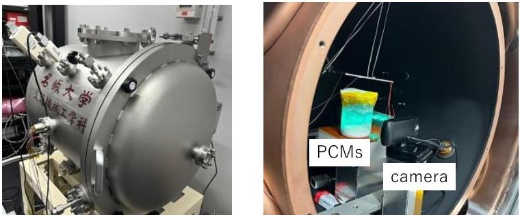

Fig. 2. Experimental setup of encapsulated solid-liquid PCMs

(Left: Test device overview, Right: Experimental setup)

Other option is solid-solid PCMs. Recently, vanadium dioxide (VO2)-based solid-solid PCMs have been developed. [14, 15] The phase transition temperature can be adjusted by substituting a part of the V in its VO2 composition with a dissimilar transition metal element. In our previous paper, we adjusted the phase transition temperature of the PCMs by doping W to VO2 and making W-doped VO2 (VWO2), and its latent heat is around 30 J/g. [16] This material is in the powder form in normal, and can be formed as plate shape by sintering.

Here, we select the powder form PCMs encapsulated solid-liquid PCMs and solid-solid material) because of their design potential.

## 3. Suitable Implementation Methods of PCMs

We decided to use powder form PCMs in the previous section. As discussed in Ref. [16], we are trying to form the powder form PCMs as the block shape by mixing with adhesive. This form has advantages in the easiness of handling and system design because it can maintain the shape without chassis or specific containers, and show the small volume variation between the phase changes.

In this paper, we propose and check the performance of the additional thermal path. The discussion is performed based on experimental studies. The experiment was performed under normal pressure, room temperature and natural convection. Because of these environmental constraints, we assume to design the battery thermal runaway prevention system. The selected PCM is PMCD-42ASPC (Mikiriken Industrial CO., LTD.) and its phase transition temperature is around 42 $ ^{\circ} \mathrm{C} $ . The adhesive and its mixing rate are decided by trial and error experiments by making sample test pieces. The adhesives are selected by using listed in the sample with space heritage. In this case, we select two potential adhesives: epoxy type (Loctite EA 9309NA AERO) and silicon type (Shinetsu KE 4908SC-T). The verification is performed with visual

<!-- PDF_PAGE: 3 -->

confirmation and simple testing. The mixing rate is decided through volume measurement and forming stability.

Figures 3 and 4 show the results with a small test piece $ ( 1 5 \times2 0 \times1 5 \mathrm{~ mm} ) $ with a heater $ ( 7 8. 4 \, \Omega) $ on one side. The heater power is about 4 W. We put T-type t hermocouple in the middle of the test piece.

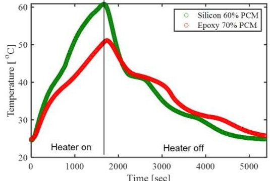

Fig. 3 Comparison of temperature mitigation performance (Silicon vs. Epoxy)

Figure 3 compares the performance of epoxy and silicon. The volume rate is decided with the visual confirmination. Epoxy result shows better performance in temperature mitigation. The recommended adhesives result in epoxy type and the adhesives-PCMs mixing rate is 3:7.

Figure 4 shows the metal parts insertion result. Based on the epoxy condition, we put a thin metal plate (about $ 1 5 \times2 0 \times0. 2 $ mm) in the center of the test piece. Here, we select two kinds of test pieces: copper and aluminum and copper plates show better performance.

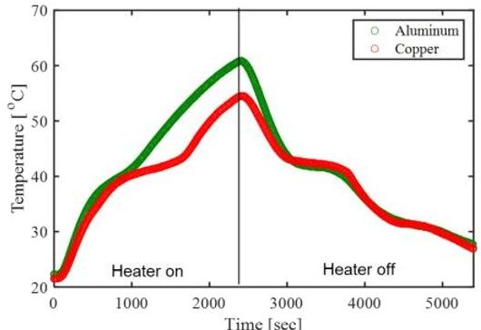

Fig. 4 Comparison of temperature mitigation performance (Copper path vs. Alminum path)

Under this condition, further discussions are performed in a much more realistic verification example: battery emulator temperature stabilization problem. The battery emulator's overview is summarized in Fig. 5. Its heat capacity is 1008 J/kg/K diameter is 18 mm and length is 65 mm. The parameters are defined by utilizing the actual 18650 battery specification. [17] The battery case dimension is defined as 75 $ \times $ 50 $ \times $ 30 mm. Here, we make three samples: 1) only with the adhesives, 2) PCM mixed adhesives (7:3), and

3) PCM mixed adhesives with copper thermal path inside of PCM block. The overview of the experimental system is summarized in Fig. 6. The Battery emulator includes a heater that emulates actual battery heat generation and is controlled by the regulated power supply. The system temperature is monitored with a T-type thermocouple and the monitor point is above the battery emulator.

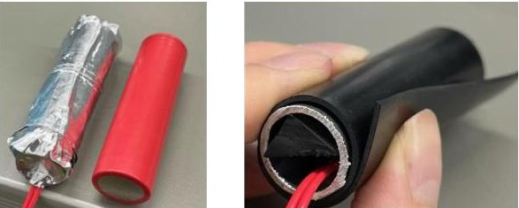

Fig. 5 Battery emulator

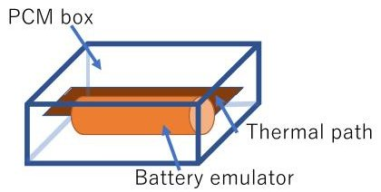

Fig. 6 Experimental system summary

Figure 7 shows the time series temperature history of the experimental system. The heaters turn on at the same time for around 0.5 hours. Then, the system is cooled by natural convection effects. The PCM effect can be seen around the phase transition temperature. The effect becomes faster and larger when the suitable thermal path works correctly. Therefore, this experiment shows the effectiveness of the supported additional thermal path. By utilizing the result of the experiment, the numerical analysis is performed to emulate the experimental results numerically and construct a numerical model for the designed system. These analysis models and determined thermal-related parameters make future design easier.

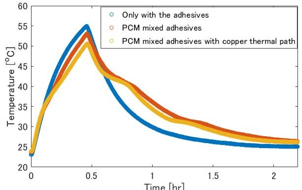

Fig.7 Experimantal result of the battery emulator temperature change mitigation system

4. System Design Method for Nanosatellite using PCMs

<!-- PDF_PAGE: 4 -->

## 4.1 System design with simplified CubeSat model

Similar to the previous section's discussion, we generate acceptable VO2 block's system model parameters using Ref. [16] experiment results. (System results and DSC(Differential Scanning Calorimetry) measurement results). Its phase change temperature is set around -10 $ ^{\circ} \mathrm{C}. $

We also generate a simple CubeSat emulation model. The analysis performed by Thermal Desktop ver. 6.1 [18] and SINDA/FLUENT. The main structure is emulated as a thin aluminum-based surface model covered with solar cells, and its dimensions are 100 $ \times100\times113 $ mm and the plate's thickness is 0.5 mm. Because the satellite is crowded, the inner components are emulated with an aluminum sphere with the same mass as the components. For simplification, the sphere generates constant heat and its value is set to 0.6 W from Ref. [19]. When considering PCM, we set a 42.6 g PCM sphere as an example, and the aluminum sphere mass is reduced with this value. For the thermal path, the PCM sphere is connected by designed thermal conductivity to the aluminum sphere. For the radiation effect, we only consider it between the satellite's surface and outer space. The surface and inner sphere are connected by a thermal conductor. The conductors are connected to all side plates, and it is assumed as the design parameters. Table 1 shows the thermal properties used in this thermal mathematical model. For optical properties of the solar cell are set to $ \alpha=0.823 $ and $ \varepsilon= $ 0.8.

The overview of the orbital and attitude motion is shown in Fig.8. The orbital condition is set to simple sun-synchronous orbit with 500 km altitude, and its beta angle is 22.5 deg. Solar flux is set to $ 1 3 5 4 \mathrm{~ W / m^{2}} $ . The Albedo parameter is 0.35 and the IR planet shine temperature is set to 250 K. Satellite attitude is set to Nadir-pointing.

Table 1 Thermal properties

<table border="1"><tr><td></td><td>Conductivity[W/m/K]</td><td>Specific heat[J/kg/K]</td><td>Density[kg/m3]</td></tr><tr><td>Aluminum</td><td>138</td><td>960</td><td>2680</td></tr><tr><td rowspan="2">PCM</td><td rowspan="2">1.24</td><td>1006(nominal.)</td><td>2613</td></tr><tr><td>24774(phase change)</td><td></td></tr></table>

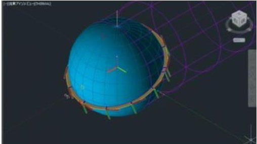

Fig.8 Overview of orbital and attitude motion setup

Figures 9-11 show the analysis results of the satellite core sphere with the satellite core part: only with the surface box and core sphere.

Figure 9 shows each surface panel's average temperature and the core sphere (component)'s temperature. Panels and the sphere are connected by 0.001 W/K/m conductivity. Each part's thermal profiles show individual tendencies corresponding to the thermal input of each component. Figure 10 shows the result with 0.1 W/K/m conductivity. All thermal profiles show dependent characteristics and the temperature is averaged in the system. Figure 11 summarizes the relationship between the core sphere temperature and thermal conductivity. The legend shows the designed thermal conductivity between the surface and the core sphere. If the core sphere's temperature is connected strongly to the satellite surface, the temperature range becomes too wide to achieve safe operations.

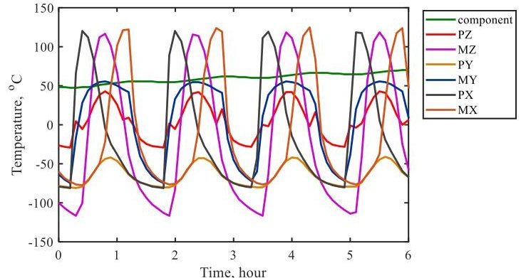

Fig.9 Sample system analysis results of each component temperature with 0.001 W/K/m thermal conductivity

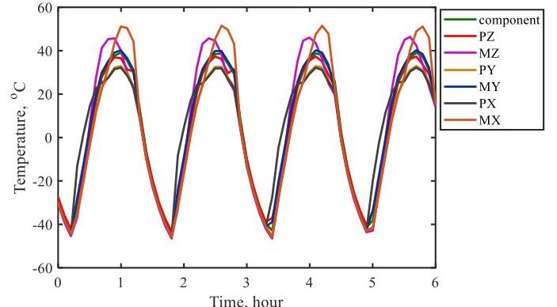

Fig.10 Sample system analysis results of each component temperature with 0.1 W/K/m thermal conductivity

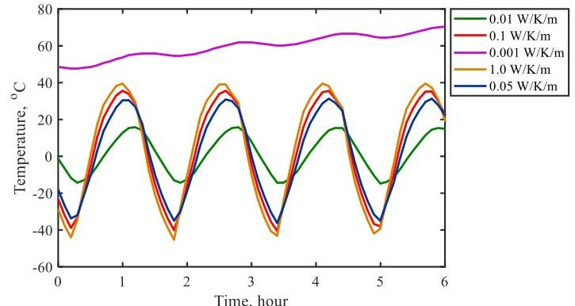

Fig.11 Summary of thermal conductivity effect (core component temperature only)

<!-- PDF_PAGE: 5 -->

Figures 12-15 show the analysis results of the satellite core sphere with PCM application. The thermal conductivity between the core sphere and surface is set to 0.01 W/m/K. Figures 12-14 only show PCM temperature and sphere temperature together with previous simulation results of sphere temperature without PCM. As shown in these figures, the PCM temperature changes related to the thermal conductivity, and the effect of PCM insertion becomes larger as the thermal conductivity is larger. The suitable connection interface parameters can be estimated by this analysis model, and we can design the system based on this guideline. In this case, the 1.0 W/m/K is a suitable value for temperature change mitigation. Figure 15 shows that the minimum temperature of the aluminum sphere rises about 3 oC, with 42.6g PCM. This mass rate is only 3.5 % of the aluminum sphere.

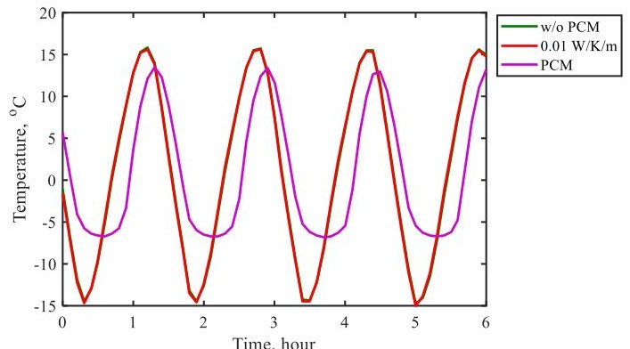

Fig.12 Sample system analysis results comparison: PCM, sphere temperature (PCM-sphere conductivity: 0.01 W/m/K) together with sphere temperature without PCM

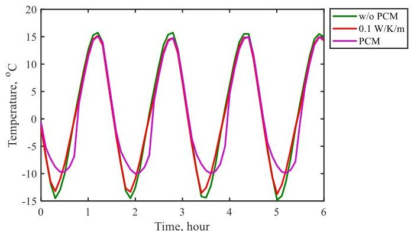

Fig.13 Sample system analysis results comparison: PCM, sphere temperature (PCM-sphere conductivity: 0.1 W/m/K) together with sphere temperature without PCM

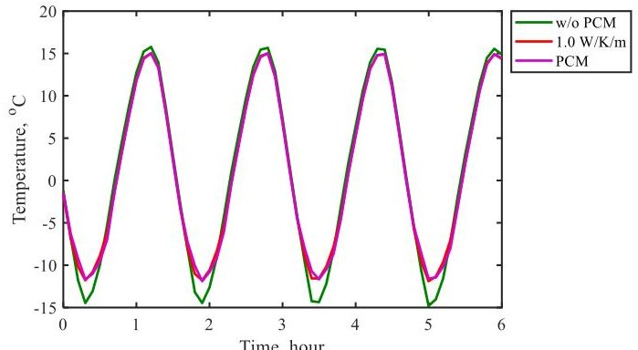

Fig.14 Sample system analysis results comparison: PCM, sphere temperature (PCM-sphere conductivity: 1.0 W/m/K) together with sphere temperature without PCM

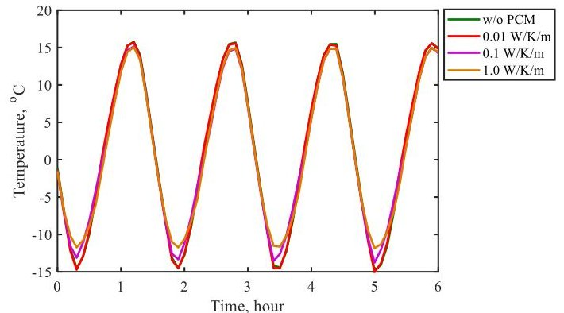

Fig.15 Summary of sample system analysis results comparison: sphere temperatures

## 4.2 1U CubeSat Project and its Thermal Vacuum Test

We are now running an actual nanosatellite project to confirm our designed VO2-based solid-solid PCM battery's temperature mitigation device. The satellite is named "DENDEN-01" (ultra-DENse power DEmoNstrator). It will be deployed from ISS in 2024. The satellite's main mission is the power component-related demonstration: novel battery testing, PCM device certification, and novel in-situ battery state estimation method verification in orbit. The PCM device verification is the dominant mission. The overview of the satellite system is summarized in Fig. 16 and details of the battery system are summarized in Fig. 17. [20] We already performed the thermal vacuum test with the engineering model as shown in Fig.18.

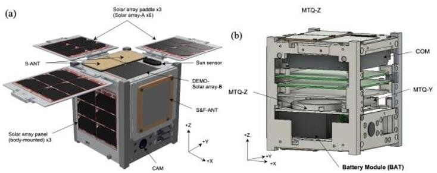

Fig.16 Overview of satellite system (Left: outside, Right: inside)

<!-- PDF_PAGE: 6 -->

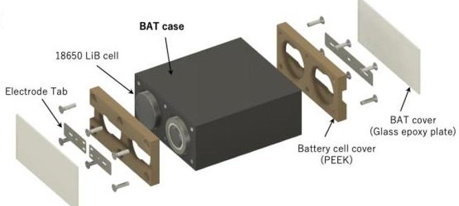

Fig. 17Details of the battery device design [18]

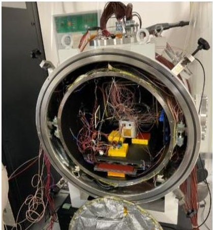

Fig. 18 Setup for thermal vacuum test

The purpose of the testing is 1) Component operations verification under the highest/lowest temperature condition and 2) Thermal equivalent testing for thermal mathematical model construction. For the former one, we changed the chamber temperature to -20 and $ 5 0 \mathrm{~ o C} $ , and checked their operations status. For the latter one, we set the chamber temperature as cool as possible and set pre-analysed satellite thermal input to realize the designed environment. The thermal input is emulated by the body mounted heater. The chamber pressure is lower than $ 1. 0 \times1 0^{-4} $ Pa. The temperature conditions are monitored by 12 satellite system thermal sensors and additional 11 thermocouples (T-type).

The purpose of the testing is 1) Component operations verification under the highest/lowest temperature condition and 2) Thermal equivalent testing for thermal mathematical model construction. For the former one, we changed the chamber temperature to -20 and $ 5 0 \mathrm{~ o C} $ , and checked their operations status. For the latter one, we set the chamber temperature as cool as possible and set pre-analysed satellite thermal input to realize the designed environment. The thermal input is emulated by the body-mounted heater. The chamber pressure is lower than $ 1. 0 \times1 0-4 $ Pa. The temperature conditions are monitored by 12 satellite system thermal sensors and the additional 11 thermocouples (T-type).

During the test sequence, we could see some profiles that show PCM effects. One of the results is shown in Fig. 19. We only chose the temperature results near the PCM. Here, we focus on showing the temperature mitigation during the on-orbit operation and the phase

change temperature is set to around 10 $ ^{\circ} \mathrm{C} $ . The x axis shows the time from the beginning of the testing. Around 34 hours from the beginning, we move on to the hot equivalent state from the cold equivalent state. Then, we move to cold state again around 45 hours from the beginning,

MX, BATon, BATside, and OBC are the satellite system temperature sensors. MX is placed in inside of the MX panel. BATon is placed on the top of the battery case. BATside is placed on the side of the battery case. OBC is placed in the OBC circuit board. BAT1, BAT2, and OBC2 are additional thermocouples. BAT1 and BAT2 are placed on the side of the battery case (different sides). OBC2 is on the circuit board.

There are environmental problems caused by the testing chamber miss operations occur during the heating up of the satellite. However, we can see some effects from PCM on battery-related temperature. The cooling phase shows a more straightforward PCM effect. We can see temperature mitigation effects around 47 hours to 50 hours from the beginning. OBC temperature decreases straightforward curve but the battery-related temperature stays around 10 $ ^{\circ} \mathrm{C} $ for a while

## 5. Summary

This paper proposes a temperature stabilization device, utilizing commercial phase change materials. The proposed device mitigates temperature change by incrementing the heat capacity around the designed temperature, without utilizing power resources. Together with the suitable compensation software, the temperature-dependent satellite performance might be improved.

For this purpose, general PCMs' characteristics are summarized and powder form PCMs are selected as the candidates for the application. A suitable implementation example is shown by the results of the trial and error experimental discussion and realistic demonstration results considering the battery temperature change mitigation system. The powder form PCM is formed by mixing with space-proven adhesive. The thermal conductivity can be improved together with the suitable thermal path, such as the insertion of the metal sheet in the PCM. The proposed idea was demonstrated experimentally under realistic conditions: battery thermal runaway prevent system emulator.

The system design example is shown with the simplified satellite system model. The results show the effectiveness of the PCM in the satellite system and show guidelines for designing the PCM system parameters.

The ongoing nanosatellite project for on-orbit demonstration was also introduced together with a quick result announcement of the thermal vacuum test.

<!-- PDF_PAGE: 7 -->

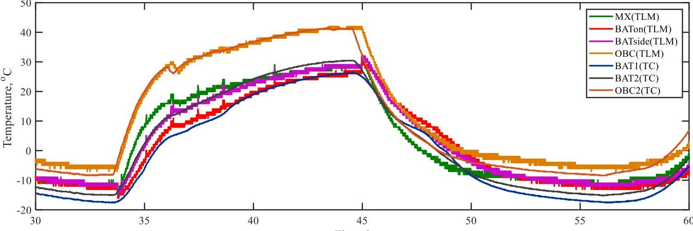

Fig. 19 Thermal vacuum test results (only PCM effect related part)

## Acknowledgment

The authors thank Mr. Yu Amano for his help in experiments, and Mikiriken Industrial CO., LTD for providing the sample. This study was partly supported by Toyota Riken Scholar program run by Toyota Physical and Chemical Research Institute, and the JSPS KAKENHI Grant Number JP20K04920.

## References

[1] T. Tanaka, Y. Kawamura, T. Tanaka, Development and Operations of CubeSat FITSAT-1 (NIWAKA), UNISEC Space Takumi J, Vol. 4, No. 1 (2013), pp. 1-25 (in Japanese)

[2] Patel, C. and McCluskey, P.: Modeling and simulation of the MEMS vibratory gyroscope, 13th InterSociety Conference on Thermal and Thermomechanical Phenomena in Electronic Systems, San Diego, CA (2012) pp. 928-933.

[3] A. Abhat, Low temperature latent heat thermal energy storage: heat storage materials, Sol. Energy. 30 (1983) pp. 313-332.

[4] K. Pielichowska, K. Pielichowski, Phase change materials for thermal energy storage, Prog. Mater. Sci. 65 (2014) pp. 67-123.

[5] H. Akeiber, P. Nejat, M.Z.A. Majid, M.A. Wahid, F. Jomehzadeh, I. Zeynali Famileh, J.K. Calautit, B.R. Hughes, S.A. Zaki, A review on phase change material (PCM) for sustainable passive cooling in building envelopes, Renew, Sustain. Energy Rev. 60 (2016) pp. 1470-1497.

[6] S. Mondal, Phase change materials for smart textiles an overview, Appl. Therm. Eng. 28 (2008) pp. 1536-1550.

[7] E. Oro, A. de Gracia, A. Castell, M.M. Farid, L.F. Cabeza, Review on phase change materials (PCMs) for cold thermal energy storage applications, Appl. Energy. 99 (2012) pp. 513-533.

[8] H. Nazir, M. Batool, F.J. Bolivar Osorio, M. Isaza-Ruiz, X. Xu, K. Vignarooban, P. Phelan, A.M.K. Inamuddin, Recent developments in phase change materials for energy storage applications: a review, Int. J. Heat Mass Transf. 129 (2019) pp. 491-523.

[9] P.B. Salunkhe, P.S. Shembekar, A review on effect of phase change material encapsulation on the thermal performance of a system, Renew. Sustain. Energy Rev. 16 (2012) pp. 5603-5616.

[10] G. Nelson, Application of microencapsulation in textiles, Int. J. Pharm. 242 (2002) pp. 55-62.

[11] A. Jamekhorshid, S.M. Sadrameli, M. Farid, A review of microencapsulation methods of phase change materials (PCMs) as a thermal energy storage (TES) medium, Renew. Sustain. Energy Rev. 31 (2014) pp. 531-542.

[12] J. Giro-Paloma, M. Martinez, L.F. Cabeza, A.I. Fernandez, Types, methods, techniques, and applications for microencapsulated phase change materials (MPCM): A review, Renew. Sustain. Energy Rev. 53 (2016) pp. 1059-1075.

[13] Y. Alva, L. Lin, G. Liu, Fang, Synthesis characterization and applications of microencapsulated phase change materials in thermal energy storage: A review, Energy Build. 144 (2017) 276-294.

[14] Y. Kinemuchi, H. Nakayama, A. Fujita, K. Ozaki, Bulk Process of Vanadium Dioxide Toward Solid-state phase change material and its application for thermal management, Ceram. Japan. (2021) pp. 779-782. (Japanese).

[15] K. Muramoto, Y. Takahashi, N. Terakado, Y. Yamazaki, S. Suzuki, T. Fujiwara, VO2-dispersed glass: A new class of phase change material, Sci. Rep. 8 (2018) pp. 1-8.

[16] M.R. Yamagata, Y. Wakita, Y. Tsuruda, K. Miyata, Feasibility study of low-temperature operable electric power supply for CubeSats using passive

<!-- PDF_PAGE: 8 -->

thermal control with VO2-based solid-solid phase change material, Therm. Sci. Eng. Prog. 37 (2023) 101601.

[17] L.H. Saw, Yonghuang Ye, A.A.O. Tay, Electrochemical-thermal analysis of 18650 Lithium Iron Phosphate cell, Energy Conversion and Management, 75 (2013), pp. 162-174.

[18] C&R technologies: Thermal Desktop user's manual CAD Based Thermal Analysis and Design Version 5.7 October 2014.

[19] Hari Ram Shrestha, Power Budget for 1U Satellite https://birds-project.com/open-source/pdf/Power Budget-Analysis-for-1U-satellit20220514.pdf

[20] Yurina Wakita, Kikuko Miyata, Yoshihiro Tsuruda, and Masaki R. Yamagata, Thermal control of electric power supply for CubeSats using a solid-solid phase change material and its installation design, Mechanical Engineering Congress (2023) S191p-08. (Japanese)