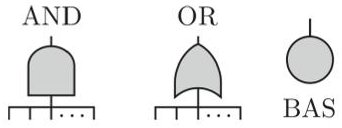
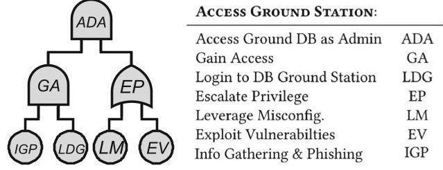
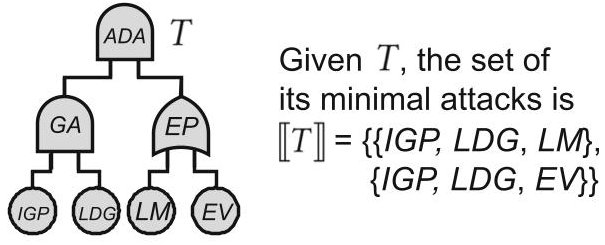
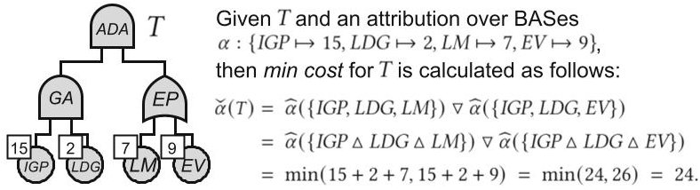
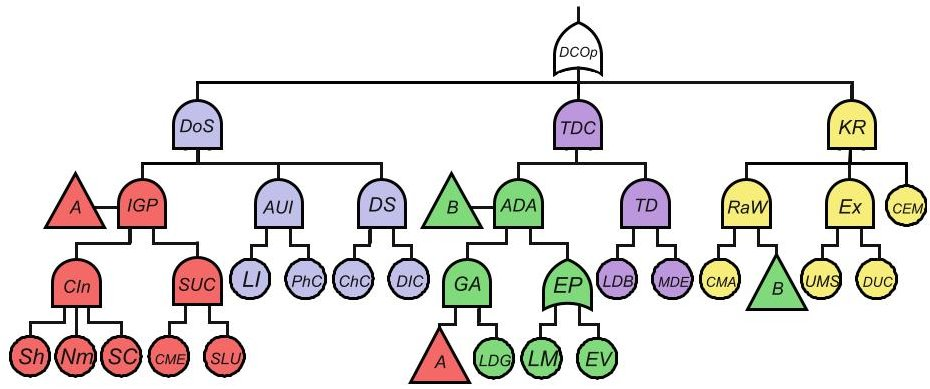

<!-- PDF_PAGE: 1 -->

# ATM: A Logic for Quantitative Security Properties on Attack Trees

Stefano M. Nicoletti $ ^{1(\boxtimes)} $ , Milan Lopuhaa-Zwakenberg $ ^{1} $ Ernst Moritz Hahn $ ^{1} $ , and Marielle Stoelinga $ ^{1,2} $

$ ^{1} $ Formal Methods and Tools, University of Twente, Enschede, the Netherlands {s.m.nicoletti,m.a.lopuhaa,e.m.hahn,m.i.a.stoelinga}@utwente.nl Department of Software Science, Radboud University, Nijmegen, The Netherlands

Abstract. Critical infrastructure systems—for which high reliability and availability are paramount—must operate securely. Attack trees (ATs) are hierarchical diagrams that offer a flexible modelling language used to assess how systems can be attacked. ATs are widely employed both in industry and academia but—in spite of their popularity—little work has been done to give practitioners instruments to formulate queries on ATs in an understandable yet powerful way. In this paper we fill this gap by presenting ATM, a logic to express quantitative security properties on ATs. ATM allows for the specification of properties involved with security metrics that include "cost", "probability" and "skill" and permits the formulation of insightful what-if scenarios. To showcase its potential, we apply ATM to the case study of a CubeSAT, presenting three different ways in which an attacker can compromise its availability. We showcase property specification on the corresponding attack tree and we present theory and algorithms—based on binary decision diagrams—to check properties and compute metrics of ATM-formulae.

## 1 Introduction

Critical infrastructure systems—for which high reliability and availability are paramount—must operate securely. Attack trees (ATs) [54] are a flexible modelling language used to assess how systems can be attacked. They operate by decomposing the attacker's goal into intermediate elements and basic attack steps that a malicious actor can take to reach said objective. ATs are widely employed both in industry and academia but—in spite of their popularity—little work has been done to give practitioners instruments to formulate queries on ATs in an understandable yet powerful way. In this paper, we fill this gap by presenting a logic to express quantitative Metrics on ATs (ATM). ATM is a powerful language able to formulate structural queries on ATs that consider quantitative security properties, or security metrics, such as "cost" of an attack, "probability" of getting attacked and "skill" of a malicious actor. The ability to formulate these queries is essential to provide

<!-- PDF_PAGE: 2 -->

practitioners with an instrument to analyse what-if scenarios and to propel a more quantitatively-informed decision making process.

Attack Trees. Attack trees (ATs) are hierarchical diagrams that represent various ways in which a system can be compromised [42,54]. Due to their popularity, ATs are referred to by many system engineering frameworks, e.g. UMLsec [35] and SysMLsec [3,53], and are supported by industrial tools such as

Fig.1. Nodes in an attack tree.

Isograph's AttackTree [31]. The root-or top level event (TLE)of an AT represents the attacker's goal, and the leaves represent basic attack steps (BASes): actions of the attacker that can no longer be refined. Intermediate nodes are labeled with gates (see Fig.1) that determine how basic actions of the attacker can propagate to reach higher-complexity elements in the attack. ATs that do not capture dynamic behaviours present only OR and AND gates—we call these static attack trees (SATs)—but many extensions exist to model more elaborate attacks. To build a solid and modular foundation for our framework, this paper focuses on SATs. It is important to note that—despite their name—ATs can be directed acyclic graphs (DAGs), i.e., graphs in which a node may have multiple parents. Them being DAGs or tree-structured has consequences on computations [42].

Example 1. Consider the AT in Fig. 2 (excerpt from Fig. 6). This AT represents different attacks to get access to the ground station database of a CubeSAT as admin. The TLE of this sub-tree is represented by the ADA AND-gate. For the attacker to reach ADA, they have to both gain access—the GA AND-gate and escalate privileges—the EP OR-gate. Each of these gates is then refined by BASes: to gain access, an attacker must perform information gathering and a successful phishing attack—the IGP BAS—and login to the ground station database using phished credentials—the LDG BAS. In addition, they have to either leverage misconfigurations—the LM BAS—or exploit vulnerabilities—the EV BAS—to escalate privileges. Note that IGP is represented here as a BAS but is further refined as an additional sub-tree in Fig. 6.

Metrics on Attack Trees. ATs are often studied via quantitative analysis, during which they are assigned a wide range of security metrics [15,42]. Such metrics are key performance indicators that formalize how well a system performs in terms of security and are essential when comparing alternatives or making trade-offs. Typical examples of such metrics are the minimal time [5,38,39,43], minimal cost [4], or maximal probability [33] of a successful attack (see Table 1 for more examples).

Fig. 2. AT modelling access to ground station DB of a CubeSAT (excerpt from Fig. 6).

<!-- PDF_PAGE: 3 -->

## 1.1 Our Approach

A Logic for Attack Trees Metrics (ATM). To perform quantitatively informed decision making w.r.t. security of systems, practitioners need the ability to analyse their models in a meaningful and thorough way. As such, they must be able to formulate meaningful queries and meaningful what-if scenarios. To cater for this need, this paper presents ATM, a logic for general Metrics on Attack Trees. ATM is a flexible language used to specify properties that take metrics such as "cost", "skill" and "probability" into account directly on ATs. ATM is structured on four layers: these allow practitioners a) to reason about successful/unsuccessful attacks; b) to check whether metrics, such as the cost, are bounded by a given value on single attacks; c) to compute metrics for a class of attacks and d) to perform quantification.

Attack Trees in Practice. To offer a concrete example, we utilise ATM to specify some properties on the AT model of a CubeSAT [32,46] from the literature [22] (see Fig. 6). This model exemplifies the effect of a security threat for the availability of a system by showcasing three ways in which a malicious actor could attack a CubeSAT: performing a denial of service attack, tampering with data on the database of the ground station or killing radio communications on the satellite. Our logic can be used to specify properties on the corresponding AT and to check whether the system under examination exhibits desired characteristics. Is it necessary to leverage misconfigurations to perform a successful attack on CubeSAT's communications? Is there an attack that ensures successful access to the ground station database while keeping the cost under a certain threshold? Is there an attack that ensures data tampering without exploiting vulnerabilities in the ground station system? These are some of the properties that one could specify and check in the framework we present.

Model Checking Algorithms. In addition, we present model checking algorithms to check properties specified with ATM and to efficiently compute metrics that appear in these properties. In particular, we provide algorithms to a) check whether an AT and an attack satisfy a formula; b) compute all attacks that satisfy an AT and a formula; c) check whether the metric of a formula is bounded by a user-specified threshold; d) compute the metric value of formulae and e) check whether a quantified ATM-formula holds true. Building on previous work in the field [15,42,47,48], all these algorithms are based on construction and manipulation of binary decision diagrams (BDDs). This translation to BDDs constitutes a formal ground to address algorithmic procedures while integrating novel work presented in this paper with previously introduced frameworks.

<!-- PDF_PAGE: 4 -->

Contributions. To summarize, in this work:

1. We develop ATM, a logic to reason about general metrics on ATs. ATM allows for the specification of metrics properties that include "cost", "proability" and "skill" and for the formulation of insightful what-if scenarios.

2. We showcase ATM by applying it to the case study of a CubeSAT and by exemplifying properties specification.

3. We propose novel algorithms based on BDDs to perform model checking and to compute metrics on properties specified using ATM.

## 1.2 Related Work

Numerous logics describe properties of state transition systems, such as labelled transition systems (LTSs) and Markov models, e.g., CTL [18], LTL [50], and their variants for Markov models, PCTL [28] and PLTL [49]. State-transition systems are usually not written by hand, but are the result of the semantics of high-level description mechanisms, such as AADL [12], the hardware description language VHDL [20] or model description languages such as JANI [14] or PRISM [41]. Consequently, these logics are not used to reason about the structure of such models (e.g. the placement of circuit elements in a VHDL model or the structure of modules in a PRISM model), but on the temporal behaviour of the underlying state-transition system. Similarly the majority of related work [9,11,55,56] on model checking on fault trees (FTs)the safety counterpart of ATs—exhibits significant differences: these works perform model checking by referring to states in the underlying stochastic models, and properties are formulated in terms of these stochastic logics, not in terms of events in the given FT. In [57], the author provides a formulation of Pandora, a logic for the qualitative analysis of temporal FTs. In [27] the authors investigate how fault tree analysis (FTA) results can be linked to software safety requirements by proposing the same system model for both. They introduce a duration calculus based on discrete time interval logic (ITL) [45] to give FTs formal semantics. In [47,48] the authors present BFLa logic on FTs that reasons about them in Boolean terms—and PFLits probabilistic counterpart. Our work is aligned in intentions to the latter two, as we develop a logic directly on ATs. However, where they reason on FTs only in Boolean or probabilistic terms, our work exhibits a broader scope by allowing for more general queries on an ample class of security metrics. Regarding AT metrics, a seminal paper by Mauw & Oosdijk [44] shows that metrics can be computed for static ATs in a bottom-up fashion. Furthermore, [16,34] are among the first to model and compute the cost and probability of attacks. In [38,39] an attack is moreover characterised by the time it takes. In the related literature, most works are on static ATs, with the relevant exception of [5,15,25,33,42] which include sequential-AND gates. However, for static ATs the algorithmic spectrum remains broader [42]. Such algorithms range from classical BDD encodings for probabilities, and extensions to multi-terminal BDDs, to logic-based semantics that exploit DPLL, including an encoding of SATs as generalised stochastic Petri nets. Prominent contributions are [10] and [37, Alg. 1]: after computing so-called

<!-- PDF_PAGE: 5 -->

optional and necessary clones, computations are exponential on the number of shared BAS (only). A thorough analysis of the literature on metrics computation for ATs can be found in [15,42]. These two contributions provide efficient and general algorithms to compute security metrics on ATs. We choose to adhere to their perspective on metrics computations as it subsumes and generalizes most of the already available literature.

Structure of the Paper. Section 2 covers background on ATs, Sect. 3 presents syntax and semantics for ATM, Sect. 4 showcases an application of ATM to a CubeSAT AT, Sect. 5 presents model checking algorithms for ATM-formulae and Sect. 6 concludes the paper and discusses future work.

## 2 Attack Trees

Definition 1. An attack tree (AT) T is a tuple (N,E,t) where (N,E) is a rooted directed acyclic graph, and t: N $ \rightarrow $ {OR, AND, BAS} is a function such that for v $ \in $ N, it holds that t(v) = BAS if and only if v is a leaf.

Moreover, ch: $ N \rightarrow \mathcal{P}(N) $ gives the set of children of a node and T has a unique root, denoted $ R_{T} $ . The subindex T is omitted if no ambiguity arises, e.g. an attack tree $ T=(N,t,ch) $ defines a set BAS $ \subseteq N $ of basic attack steps. If $ u \in ch(v) $ then u is called a child of v, and v is a parent of u. We let $ v=\mathrm{AND}(v_{1},\dots,v_{n}) $ if $ t(v)=\mathrm{AND} $ and $ ch(v)=(v_{1},\dots,v_{n}) $ , and analogously for OR, denoting $ ch(v)=\{v_{1},\dots,v_{n}\} $ . Furthermore, we denote the universe of ATs by $ \mathcal{T} $ and call $ T \in \mathcal{T} $ tree-structured if for any two nodes u and v none of their children is shared, else we say that T is DAG-structured. If only AND- and OR-gates (or their derivatives) are present we say that T is a static attack tree (SAT). In this paper we focus our attention on SATs and thus use the term ATs interchangeably to denote them. The semantics of a AT is defined by its successful attack scenarios, in turn given by its structure function. First, the notion of attack is defined:

Definition 2. An attack scenario, or shortly an attack, of a static AT T is a subset of its basic attack steps: $ A \subseteq B A S_{T} $ . We denote by $ \mathcal{A}_{T}=2^{B A S_{T}} $ the universe of attacks of T. We omit the subscript when there is no confusion.

The structure function $ f_{T}(v,A) $ indicates whether the attack $ A\in\mathcal{A} $ succeeds at node $ v\in N $ of T. For Booleans we adopt $ \mathbb{B}=\{1,0\} $

Definition 3. The structure function $ f_{T} \colon N\times \mathcal{A}\rightarrow \mathbb{B} $ of a static attack tree T is given by:

$$
f _ {T} (v, A) = \left\{ \begin{array}{l l l} 1 & \text {i f} t (v) = \mathrm {O R} & \text {a n d} \exists u \in c h (v). f _ {T} (u, A) = 1, \\ 1 & \text {i f} t (v) = \mathrm {A N D} & \text {a n d} \forall u \in c h (v). f _ {T} (u, A) = 1, \\ 1 & \text {i f} t (v) = \mathrm {B A S} & \text {a n d} v \in A, \\ 0 & \text {o t h e r w i s e}. \end{array} \right.
$$

<!-- PDF_PAGE: 6 -->

An attack A is said to reach a node v if $ f_{T}(v,A)=1 $ , i.e. it makes v succeed. If no proper subset of A reaches v, then A is a minimal attack on v. The set of minimal attacks on v is denoted $ \llbracket v \rrbracket $ . We define $ f_{T}(A)\doteq f_{T}(R_{T},A) $ , and attacks that reach $ R_{T} $ are called succesful w.r.t. T. Furthermore, the

Fig. 3. All minimal attacks for AT T modelling access to ground station DB of a CubesAT (excerpt from Fig. 6).

minimal attacks on $ R_{T} $ (i.e. the minimal successful attacks) are called minimal attacks. ATs are coherent [6], meaning that adding attack steps preserves success: if A is successful then so is $ A \cup \{a\} $ for any a $ \in $ BAS. Thus, the suite of successful attacks of an AT is characterised by its minimal attacks.

## Definition 4. The semantics of an AT T is its suite of minimal attacks $[[T]]$.

Example 2. Consider the AT in Fig. 3 representing ways to access the ground station database of a CubeSAT as admin: its suite of minimal attacks consists of { {IGP,LDG,LM}, {IGP,LDG,EV}}. That is, to mount a minimal attack a malicious actor needs to gain access performing information gathering and phishing IGP—a BAS that is further refined in Fig. 6—and by logging into the DB of the ground station; to then either leverage misconfigurations LM or exploit vulnerabilities EV in the DB software to gain admin privileges. A non-minimal attack on this AT would include both LM and EV.

## 2.1 Security Metrics for Attack Trees

Security metrics—such as the minimal time and cost among all attacks—are essential to perform quantitative analysis of systems and to support more informed decision making processes. To enable this, i.e. computing security metrics, we adopt the well-established semiring framework. Semirings have vast applicability potential [26] and have been successfully used to construct attribute domains on ATs [15,30,36,42]. In this paper, we formulate linearly ordered unital semiring attribute domains where V is the value domain, $ \triangle $ is an operator to combine values of BASes in an attack, $ \nabla $ is an operator to combine values of different attacks and $ \preceq $ is an order to compare values. These linearly ordered unital semiring attribute domains provide a convenient way to define an ample class of metrics including "min cost", "min time"—both with parallel or sequential attack steps—"min skill" and "discrete probability".

Definition 5. A linearly ordered unital semiring attribute domain (simply attribute domain or LOAD from now on) is a tuple $ L=(V,\nabla ,\triangle ,1_{\nabla},1_{\Delta},\preceq) $ where:

- V is a set;

- $ \triangle distributes over \nabla $ , i.e., $ x \triangle (y \nabla z) = (x \nabla y) \triangle (x \nabla z) $ for all x,y,z $ \in V $ ;

<!-- PDF_PAGE: 7 -->

- $ \nabla $ is absorbing w.r.t. $ \triangle $ , i.e., $ x \nabla ( x \triangle y ) = x $ for all $ x,y \in V $ ;

- $1_{\nabla}$ and $1_{\Delta}$ are unital elements, i.e., $1_{\nabla} \nabla x = 1_{\Delta} \Delta x = x$ for all $x \in V$;

- $ \preceq $ is a linear order on V.

As anticipated, many relevant metrics for security analyses on ATs can be formulated as attribute domains. Table 1 shows examples, where $ \mathbb{N}_{\infty}=\mathbb{N}\cup\{\infty\} $ includes 0 and $ \infty. $

Example 3. An example of a LOAD is $ (\mathbb{N}_{\infty},\min,+,\infty,0,\leq) $ . Indeed, min and + are commutative, associative operations on $ \mathbb{N}_{\infty} $ . The distributive property amounts to the fact that $ x+\min(y,z)=\min(x+y,x+z) $ , while the absorbing property can be stated as $ \min(x,x+y)=x $ . The units are given by $ 1_{\min}=\infty $ and $ 1_{+}=0 $ , and $ \leq $ is a linear order on $ \mathbb{N}_{\infty} $ . As we will discuss in Example 4, this LOAD corresponds to the min cost metric on ATs.

It is important to note that derived metrics such as stochastic analyses and Pareto frontiers can be represented by semirings. However, they do not fit in this framework not being LOADs [42]. Moreover, some meaningful metrics—like the cost to defend against all

Table 1. AT metrics with attribute domains.

<table border="1"><tr><td>METRIC</td><td>V</td><td>$\nabla$</td><td>$\Delta$</td><td>$1_{\nabla}$</td><td>$1_{\Delta}$</td><td>$\preceq$</td></tr><tr><td>min cost</td><td>$\mathbb{N}_{\infty}$</td><td>min</td><td>+</td><td>$\infty$</td><td>0</td><td>$\leq$</td></tr><tr><td>min time (sequential)</td><td>$\mathbb{N}_{\infty}$</td><td>min</td><td>+</td><td>$\infty$</td><td>0</td><td>$\leq$</td></tr><tr><td>min time (parallel)</td><td>$\mathbb{N}_{\infty}$</td><td>min</td><td>max</td><td>$\infty$</td><td>0</td><td>$\leq$</td></tr><tr><td>min skill</td><td>$\mathbb{N}_{\infty}$</td><td>min</td><td>max</td><td>$\infty$</td><td>0</td><td>$\leq$</td></tr><tr><td>discrete prob</td><td>[0,1]</td><td>max</td><td>·</td><td>0</td><td>1</td><td>$\leq$</td></tr></table>

attacks—do fall outside this category [42]. To render this framework functional, all BASes of ATs are enriched with attributes. More precisely, first an attribution $ \alpha $ assigns a value to each BAS; then a security metric $ \widehat{\alpha} $ assigns a value to each attack scenario; and finally the metric $ \check{\alpha} $ assigns a value to the set of minimal attacks. We then refer to LOADs to define AT metrics. Given a LOAD $ (V,\nabla ,\triangle ,1_{\nabla},1_{\Delta},\preceq) $ we assign to each BAS a an attribute value $ \alpha (a)\in V $ . The operators $ \nabla, \triangle $ are then used to define a metric value for T as follows:

Definition 6. Let T be an AT and let $ L = (V, \nabla , \triangle , 1_{\nabla}, 1_{\Delta}, \preceq) $ be a LOAD.

1. An attribution on $ T $ with values in $ L $ is a map $ \alpha \colon B A S_{T} \to V $;

2. Given such $ \alpha $ , define the metric value of an attack A by

$$
\widehat {\alpha} (A) = \bigwedge_ {a \in A} \alpha (a);
$$

3. Given such $ \alpha $ , define the metric value of T by

$$
\check {\alpha} (T) = \bigvee_ {A \in [ [ T ] ]} \widehat {\alpha} (A) = \bigvee_ {A \in [ [ T ] ]} \bigwedge_ {a \in A} \alpha (a).
$$

Example 4. Consider L from Example 3 representing the metric min cost, and let T be the AT in Fig. 4. To each BAS we attach a cost value, given by the attribution $ \alpha : \mathrm{BAS}_{T}\rightarrow V $ given by $ \{IGP\mapsto 15,LDG\mapsto 2,LM\mapsto 7,EV\mapsto 9\} $

<!-- PDF_PAGE: 8 -->

As in Example 2, T has two minimal attacks, $ A_{1}=\{IGP,LDG,LM\} $ and $ A_{2}=\{IGP,LDG,EV\} $ . Since $ \triangle=+ $ , We have $ \widehat{\alpha} (A_{1})=\alpha (IGP)+\alpha (LDG)+\alpha (LM)= 1 5+2+7=2 4 $ ; this is the cost an attacker needs to spend to perform attack $ A_{1} $ . Similarly one finds $ \widehat{\alpha} (A_{2})=1 5+2+9=2 6 $ . We then calculate $ \check{\alpha} (T)=\min (\widehat{\alpha} (A_{1}),\widehat{\alpha} (A_{2}))=2 4 $ . Indeed, the minimal cost incurred by an attacker to succesfully attack the system is by performing the cheapest minimal attack, which is $ A_{1} $ .

When computing multiple metrics on a given AT, one can resort to multiple LOADs and coherently chosen attributions over its BASes. We thus define such a tree as follows:

Fig. 4. Computing min cost for T: AT for accessing a ground station DB of a CubeSAT (excerpt from Fig. 6).

Definition 7. An attributed AT is a tuple $ \mathsf{T} = (T, \mathcal{L}, \mathfrak{a}) $ where: 1. T is an attack tree; 2. $ \mathcal{L} = \{L_{1},\dots,L_{l}\} $ is a set of LOADs; 3. $ \mathfrak{a} = \{\alpha_{i}\}_{i=1}^{l} $ is a set of attributions on T, where each $ \alpha_{i} $ takes values in $ L_{i}. $

Although in this paper we calculate metrics by considering all minimal attacks coherently with [15,42]one could also simply consider all successful attacks. For metrics obtained from LOADs this does not make a difference: for example, the successful attack with minimal cost will always be a minimal attack, since adding BASes can only increase the cost. Therefore, in the calculation of min cost we may as well take the minimum over all successful attacks, rather than just minimal attacks.

## 3 A Logic for at General Metrics

## 3.1 Syntax of ATM

Below, we present ATM, a logic for general Metrics on Attack Trees. ATM shares the objective of developing a language directly on tree-shaped models with [47, 48]. However, it extends the scope of these works to the security domain and allows for property specification that consider a large class of security metrics. The syntax of ATM is structured on four layers. The first layer, $ \phi $ , reasons about the status of elements in an AT. Atomic formulae e represent BASes and IEs in an AT and they can be combined with usual Boolean connectives. Furthermore, we can forcefully set the value of an element in a layer 1 formula to either 0 or 1 with $ \phi[e\mapsto0] $ and $ \phi[e\mapsto1] $ . With MA( $ \phi $ ) we can check whether an attack is a minimal attack, i.e., a minimal attack successful for a given $ \phi $ . Layer two and three reason about metrics. Layer 2 formulae allow the user to check whether a given metric on a $ \phi $ formula is bounded by m $ (\mathbb{M}_{k}(\phi)\preceq_{k}m) $ and to forcefully

<!-- PDF_PAGE: 9 -->

set the attribution of a given $ e\in\psi $ to an appropriate value $ \nu $ $ (\psi[e\mapsto^{k}\nu]) $ Boolean connectives are also allowed. Layer 3 formulae also allow the setting of attributions but simply return the value of a calculated metric $ (\mathbb{V}_{k}(\phi)) $ . Note that for the layer 1, layer 2 and layer 3 formulae we usually assign values with $ \mapsto $ to $ e\in\mathrm{BAS} $ . We can however assign values to IEs if 1. $ e $ is a module [21], i.e., all paths between descendants of $ e $ and the rest of the AT pass through e 2. and none of the descendants of $ e $ are present in the formula. If so, we prune that (sub-)AT and treat occurring IEs as BASes. Finally, layer 4 formulae allow us to perform quantification over layer 1 and layer 2 formulae. Given a set of LOADs $ \mathcal{L}=\{L_{1},\ldots,L_{l}\} $ with $ L_{k}\in\mathcal{L} $ and $ m\in V_{k} $ the syntax is defined as follows:

$$
\mathrm {L a y e r 1 :} \phi ::= e \mid \neg \phi \mid \phi \wedge \phi \mid \phi [ e \mapsto 0 ] \mid \phi [ e \mapsto 1 ] \mid \mathrm {M A} (\phi)
$$

$$
\text {L a y e r 2}: \psi ::= \neg \psi \mid \psi \wedge \psi \mid \mathbb {M} _ {k} (\phi) \preceq_ {k} m \mid \psi [ e \mapsto^ {k} \nu ]
$$

Layer 3: $ \xi ::= \mathbb{V}_{k}(\phi)\mid \xi[e\mapsto^{k}\nu] $

Layer 4: $ \gamma \because = \neg \gamma \mid \exists (\phi \wedge \psi) \mid \forall (\phi \wedge \psi) $

Syntactic Sugar. We define the following derived operators, where formulae $ \theta $ are either layer 1 or layer 2 formulae.

$$
\theta_ {1} \vee \theta_ {2}::= \neg (\neg \theta_ {1} \wedge \neg \theta_ {2}) \quad \theta_ {1} \nLeftrightarrow \theta_ {2}::= \neg (\theta_ {1} \Leftrightarrow \theta_ {2})
$$

$$
\theta_ {1} \Rightarrow \theta_ {2}::= \neg \left(\theta_ {1} \wedge \neg \theta_ {2}\right) \quad \mathrm {M D} (\phi)::= \mathrm {M A} (\neg \phi)
$$

$$
\theta_ {1} \Leftrightarrow \theta_ {2}::= \left(\theta_ {1} \Rightarrow \theta_ {2}\right) \wedge \left(\theta_ {2} \Rightarrow \theta_ {1}\right)
$$

where MD $ \phi $ checks whether A is a minimal defence w.r.t. $ \phi $ , i.e., a set that guarantees that $ \phi $ is not reached.

## 3.2 Semantics of ATM

The semantics for our logic reflect objects needed to evaluate the four syntactical layers. For the first layer of ATM, formulae are evaluated on an attack A and on a tree T. Atomic formulae e are satisfied by A and T if the structure function in Definition 3 returns 1 with A and e as input. Formally:

$$
A, T \models e \quad \text {i f f} f _ {T} (e, A) = 1
$$

$$
A, T \models \neg \phi \quad \text {i f f} A, T \not \models \phi
$$

$$
A, T \models \phi \wedge \phi^ {\prime} \quad \mathrm {i f f} A, T \models \phi \mathrm {a n d} A, T \models \phi^ {\prime}
$$

$ A,T\models\phi[e_{i}\mapsto 0]\mathrm{~ iff~}A^{\prime},T\models\phi\mathrm{~ with~}A^{\prime}=\{a_{1}^{\prime},\ldots,a_{n}^{\prime}\}\mathrm{~ where~} $

$$
a _ {i} ^ {\prime} = 0
$$

$$
a _ {j} ^ {\prime} = a _ {j}
$$

$ A,T\models\phi[e_{i}\mapsto 1]\mathrm{~ iff~}A^{\prime},T\models\phi\mathrm{~ with~}A^{\prime}=\{a_{1}^{\prime},\ldots,a_{n}^{\prime}\}\mathrm{~ where~} $

$$
j \neq i
$$

$$
a _ {i} ^ {\prime} = 1
$$

$$
a _ {j} ^ {\prime} = a _ {j}
$$

$$
j \neq i
$$

$$
A, T \models \mathrm {M A} (\phi) \quad \mathrm {i f f} A \in [ \llbracket \phi \rrbracket_ {T}
$$

With $ \llbracket \phi \rrbracket_{T} $ we denote the minimal satisfaction set of attacks for $ \phi $ , i.e., the set of minimal attacks that satisfy $ \phi $ given T. We define $ \llbracket \phi \rrbracket_{T} $ as follows: $ \llbracket \phi \rrbracket_{T}=\{A\mid $

<!-- PDF_PAGE: 10 -->

A, T $ \models $ $ \phi\land\neq A^{\prime}\subseteq A.A^{\prime}, $ T $ \models $ $ \phi\} $ . It is important to note that—with semantics defined as we did—we allow for fairly granular reasoning over ATs. In particular, we can evaluate whether an attack compromises a particular sub-AT without reaching the TLE. Semantics for the second and third layer require attributed trees (see Definition 7). We can then define semantics for the second layer:

$$
\begin{array}{l} A, \mathsf {T} \models \neg \psi \quad \mathrm {i f f} A, \mathsf {T} \not \models \psi \\ A, \mathsf {T} \models \psi \wedge \psi^ {\prime} \quad \mathrm {i f f} A, \mathsf {T} \models \psi \mathrm {a n d} A, \mathsf {T} \models \psi^ {\prime} \\ A, \mathsf {T} \models \mathbb {M} _ {k} (\phi) \preceq_ {k} m \quad \mathrm {i f f} A, T \models \phi \wedge \widehat {\alpha} (A) \preceq_ {k} m \\ A, \mathsf {T} \models \psi [ e _ {i} \stackrel {k} {\mapsto} \nu ] \quad \mathrm {i f f} A, \mathsf {T} \left(\mathfrak {a} \left[ \alpha_ {k} \left(a _ {i}\right) \stackrel {k} {\mapsto} \nu \right]\right) \models \psi \\ \end{array}
$$

For an attack A and an attributed tree T to satisfy $ \mathbb{M}_{k}(\phi)\preceq_{k} m $ , both the attack A and the tree T must satisfy the inner layer 1 formula and the security metric calculated on the attack must respect the given threshold. We let $ X_{1} $ be the set of layer 1 formulae and we define a $ \phi $ - security metric to attribute a value to a layer 1 formula:

Definition 8. A $ \phi $ - security metric is a function $ \check{\alpha}^{\mathsf{T}} $ : $ X_{1} \rightarrow V $ defined as follows:

$$
\check {\alpha} ^ {\mathsf {T}} (\phi) = \bigvee_ {A \in [ \llbracket \phi \rrbracket_ {T}} \bigwedge_ {a \in A} \alpha (a).
$$

Note that in Definition 8 some occurrences can lead to the application of the $ \check{\alpha} $ function to the empty set, i.e., when $ \llbracket\phi\rrbracket_{T}=\varnothing $ . To account for this, we resort to $ 1_{\nabla} $ and $ 1_{\Delta} $ for $ \nabla $ and $ \Delta $ (see Definition 5). Assuming the case in which $ \check{\alpha}^{\mathsf{T}}(\phi)\equiv\check{\alpha}(\varnothing) $ , we fix that $ \check{\alpha}^{\mathsf{T}}(\phi)=1_{\nabla} $ ; likewise for $ \widehat{\alpha} $ and $ 1_{\Delta} $ . Furthermore, with $ \check{\alpha}^{\mathsf{T}}_{k} $ : $ X_{1}\rightarrow V_{k} $ we denote a $ \phi $ - security metric whose domain and attribution are obtained appropriately from the $ k $ - est LOAD $ L_{k}\in\mathcal{L} $ . We then let $ \mathfrak{a}[\alpha_{k}(a_{i})\overset{k}{\mapsto}\nu] $ be the attribution on the element $ a_{i}\in A $ via $ \alpha_{k} $ to an arbitrary value $ \nu $ , chosen appropriately from the domain $ V_{k} $ of $ L_{k} $ . Consequently, we define semantics for the third layer. Let $ \operatorname{Val}_{\mathsf{T}} $ : $ X_{3}\rightarrow V_{k} $ define an evaluation function of layer three formulae in $ X_{3} $ :

$$
\begin{array}{l} \operatorname {V a l} _ {\mathrm {T}} \left(\mathbb {V} _ {k} (\phi)\right) = \check {\alpha} ^ {\mathrm {T} _ {k}} (\phi) \\ \operatorname {V a l} _ {\mathrm {T}} \left(\xi \left[ e _ {i} \mapsto^ {k} \nu \right]\right) = \operatorname {V a l} _ {\mathrm {T} \left(\mathfrak {a} \left[ \alpha_ {k} \left(a _ {i}\right) \mapsto^ {k} \nu \right]\right)} (\xi) \\ \end{array}
$$

Finally, we can define semantics for the fourth layer containing quantifiers:

$$
\begin{array}{l} \mathrm {T} \models \neg \gamma \quad \mathrm {i f f} \mathrm {T} \not \models \gamma \\ \mathrm {T} \models \exists (\phi \wedge \psi) \mathrm {i f f} \exists A. A, T \models \phi \mathrm {a n d} A, \mathrm {T} \models \psi \\ \mathrm {T} \models \forall (\phi \wedge \psi) \mathrm {i f f} \forall A. A, T \models \phi \mathrm {a n d} A, \mathrm {T} \models \psi \\ \end{array}
$$

<!-- PDF_PAGE: 11 -->

## 4 Case Study: Attacking a CubeSAT

Fig. 5. Representation of orbiting CubeSATs.

CubeSATs are a type of nanosatellite typically used for academic and educational purposes [46]：they are usually built in units (or "U") of 10cm x 10cm x 10cm and can be combined to form larger satellites. They are relatively inexpensive to design, build, and launch compared to traditional, larger satellites and they are a popular choice among students, universities, technology pioneers, and crowd sourced initiatives [32]. To give a sense of the importance of CubeSATs in our orbital ecosystem, we provide a representation of orbiting CubeSATs as of March 2023 in Fig. 5 and an animation in [23]. A total of 153 elements are plotted on the Earth, following data provided by the online database Celestrack [17]. The size of each sphere is exaggerated for visual purposes—a diameter of 500km for each element—and satellites are propagated using the Simplified General Perturbations 4 (SGP4) orbit propagator [29]. As CubeSATs are one of the platforms achieving more consensus in the context of the "New Space" [19,32], it is fundamental that security risks on these systems are not overlooked. To cater for this need, we showcase how ATM can be applied to specify useful properties on CubeSATs.

<!-- PDF_PAGE: 12 -->

Fig. 6. An AT representing ways to attack a CubeSAT.

Table 2. Abbreviations for the AT in Fig. 6.

<table border="1"><tr><td>CUBESAT TLE:</td><td></td><td colspan="2">INFO GATHERING + PHISH:</td><td colspan="2">DATA TAMPERING:</td></tr><tr><td>Disrupt CubeSAT Operations</td><td>DCOp</td><td>Info Gathering &amp; Phishing</td><td>IGP</td><td>Tamper Data from CubeSAT</td><td>TDC</td></tr><tr><td>DOS ATTACK:</td><td></td><td>Collect Information</td><td>CIn</td><td>Tamper with Data</td><td>TD</td></tr><tr><td>Denial of Service</td><td>DoS</td><td>Shodan</td><td>Sh</td><td>Login to DB as Admin</td><td>LDB</td></tr><tr><td>Access CubeSAT UI</td><td>AUI</td><td>NMAP</td><td>Nm</td><td>Modify Database Entries</td><td>MDE</td></tr><tr><td>Locate Interfaces</td><td>LI</td><td>Scrape Credentials</td><td>SC</td><td>KILL COMMS ON CUBESAT:</td><td></td></tr><tr><td>Login with Phished Creds</td><td>PhC</td><td>ACCESS GROUND STATION:</td><td></td><td>Kill Radio on CubeSAT</td><td>KR</td></tr><tr><td>Disrupt Service</td><td>DS</td><td>Access Ground DB as Admin</td><td>ADA</td><td>Recon. and Weaponization</td><td>RaW</td></tr><tr><td>Change Config. Settings</td><td>ChC</td><td>Gain Access</td><td>GA</td><td>Create Malicious App</td><td>CMA</td></tr><tr><td>Delete Items on CubeSAT</td><td>DIC</td><td>Login to DB Ground Station</td><td>LDG</td><td>Exploit</td><td>Ex</td></tr><tr><td>Steal User Credentials</td><td>SUC</td><td>Escalate Privilege</td><td>EP</td><td>Upload Malware to Server</td><td>UMS</td></tr><tr><td>Craft Malicious Email</td><td>CME</td><td>Leverage Misconfig.</td><td>LM</td><td>Command for Upload</td><td>EV</td></tr><tr><td>Send as Legit User</td><td>SLU</td><td>Exploit Vulnerabilities</td><td>EV</td><td>SAT Gets &amp; Exec. Malware</td><td>CEM</td></tr></table>

In Fig. 6, an AT represents three possible ways in which an attacker could compromise the availability of a CubeSAT. The scenario and the original ATs are taken from [22] and then slightly adapted to model a unique cohesive AT. The TLE in Fig. 6 represents the disruption of CubeSAT's operations—the DCOp OR-gate. This gate is detailed by three children: DoS—the indigo TLE of a sub-tree on the left presenting a denial of service attack—TDC—the violet TLE of the central sub-tree detailing a data tampering attack—and KR—the yellow TLE of the sub-tree on the right that presents an attack killing communications on the CubeSAT. For a denial of service to happen, the attacker must perform information gathering and a successful phishing attack—detailed by the red IGP AND-gate—and use gathered intel to access the CubeSAT UI and disrupt the service. On the other hand, to perform a data tampering attack, one must access the ground control database as admin—detailed by the green ADA AND-gate—then modify database entries and tamper with data. Finally, to kill communications on the CubeSAT an attacker must perform reconnaissance and weaponization, crafting a malicious app, and also conduct the exploit uploading the malware on the CubeSAT via the ground station: executing this code on the satellite would cause communications to go offline. Due to the increasing

<!-- PDF_PAGE: 13 -->

complexity of these three different attacks, the AT in Fig. 6 presents several subtrees that are shared. The red sub-tree for information gathering and phishing is shared by the denial of service attack and by the sub-tree that models getting access to the database on the ground station. Furthermore, this green subtree is itself shared between the tampering data attack and the more complex malware-based communication killing attack.

Properties. ATM allows us to specify some properties on the AT in Fig. 6. As per semantics, properties 2 and 3 are evaluated w.r.t. a given attack. 1) What are all minimal attacks to achieve denial of service? $ \llbracket DoS \rrbracket_{T} $; 2) Are the cost of data-tampering and info gathering and phishing respectively lower than 20 and at most 5? Cost(TDC) $ < 20 \land \mathrm{Cost}(IGP) \leq 5 $; 3) Are the probability of successfully attacking the TLE and the parallel time of attack lower than 0.05 and 45 respectively? Prob(DCOp) $ < 0.05 \land \mathrm{ParTime}(DCOp) < 45 $; 4) What is the min skill an attacker has to have to kill communications on the CubeSAT, assuming that one needs skill of 20 to perform info gathering and phishing? Skill(KR)[IGP $ \mapsto 20 $]; 5) Is there an attack that ensures data tampering without exploiting vulnerabilities in the ground station system? $ \exists(TDC[EV \mapsto 0]) $; 6) Is it necessary to leverage misconfigurations to perform a successful attack on CubeSAT's communications? $ \forall(KR \Rightarrow LM) $; 7) Is there an attack that ensures successful access to the ground station DB while keeping the cost under 20? $ \exists(\mathrm{Cost}(ADA) < 20) $; 8) Do accessing the CubeSAT UI and disrupting service always imply that successful attacks to the TLE are strictly cheaper than 35 and strictly faster than 60 (when parallelized)? $ \forall((AUI \land DS) \Rightarrow (\mathrm{Cost}(DCOp) < 35 \land \mathrm{ParTime}(DCOp) < 60)) $ (Table 2).

## 5 Model Checking Algoritms

In this section we present model checking algorithms for ATM. As noted in [47, 48], some scenarios, especially in the Boolean domain, are trivial: e.g., checking if A, $ T\models\phi $ holds is trivial if $ \phi $ is a formula that does not contain a MA or MD operator. In that case, we can simply substitute the values of A in the atoms of $ \phi $ and see if the Boolean expression evaluates to true. Non trivial scenarios arise if $ \phi $ contains a MA or MD operator or if ATs are not tree-shaped. These require computations based on BDDs, introduced in Sect. 5.1: a coherent choice with the landscape of algorithms for FT logics [47,48] and AT computation [15,42]. In this section we build upon these results and present algorithms to: 1) Obtain BDDs from layer 1 formulae taking the structure of a given tree T into account (Sect. 5.2); 2) a) Check whether an attack A and a tree T satisfy a layer 1 formula and b) compute all the satisfying attacks A for a given tree T and layer 1 formula (Sect. 5.3); 3) Check whether an attack A and an attributed tree T satisfy a layer 2 formula (Sect. 5.4); 4) Compute the metric value of a given layer 3 formula (Sect. 5.5); 5) Check whether an attributed tree T satisfies a layer 4 formula (Sect. 5.6).

<!-- PDF_PAGE: 14 -->

## 5.1 Binary Decision Diagrams (BDDs)

BDDs are directed acyclic graphs (DAGs) that compactly represent Boolean functions [2] by reducing redundancy. Depending on variable's ordering, BDD's size can grow linearly in the number of variables and at worst exponentially. In practice, BDDs are heavily used, including in AT analysis [15,42] and in their safety counterpart, FTs [7,47,48,52]. Formally, a BDD is a rooted DAG $ B_{f} $ that represents a Boolean function $ f\colon \mathbb{B}^{n}\rightarrow \mathbb{B} $ over variables $ Vars=\{x_{i}\}_{i=1}^{n}. $ Each nonleaf w has two outgoing arrows, labeled 0 and 1, and a label $ Lab(w)\in Vars; $ furthermore, each leaf has a label 0 or 1. Given a b in $ \mathbb{B}^{n} $ , the BDD is used to compute $ f(b) $ as follows: starting from the top, upon arriving at a node w with $ Lab(w)=x_{i}, $ one takes the 0-edge if $ b_{i}=0 $ and the 1-edge if $ b_{i}=1. $ The label of the leaf one ends up in, is then equal to $ f(b). $ A function f can be represented by multiple BDDs, but has a unique reduced ordered representative, or ROBDD [8,13], where the $ x_{i} $ occur in ascending order, and the BDD is reduced as much as possible by removing irrelevant nodes and merging duplicates. This is formally defined below; we let $ Low(w) $ (resp. $ High(w)) $ be the endpoint of w's 0-edge (resp. 1-edge) and let $ R_{B} $ be the BDD root.

Definition 9. Let Vars be a set. A (RO)BDD over Vars is a tuple $ B=(W,H, $ Lab,u) where (W,H) is a rooted directed acyclic graph, and Lab: $ W \rightarrow Vars \sqcup \{0,1\}, $ u: $ H \rightarrow \{0,1\} $ are maps such that: 1. Every nonleaf w has exactly two outgoing edges h, $ h^{\prime} $ with $ u(h)\neq u(h^{\prime}) $ , and $ Lab(w)\in Vars $ ; 2. Every leaf w has $ Lab(w)\in\{0,1\} $ . 3. Vars are equipped with a total order, $ B_{f} $ is thus defined over a pair $ \langle Vars,<\rangle $ ; 4. the variable of a node is of lower order than its children, that is: $ \forall w\in W_{n}. Lab(w)<Lab(Low(w)), Lab(High(w)) $ ; 5. the children of nonleaf nodes are distinct nodes; 6. nodes are uniquely determined by their label, low child and high child.

## 5.2 BDDs from ATs and Layer 1 Formulae

The first step to enable further computations is to obtain BDDs from layer 1 formulae taking the structure of a given tree T into account (for related procedures on FT logics see [47,48]). Following, operations between BDDs are represented by bold operands e.g., $ \land $ $ \lor $ Where convenient notationally, we write $ B_{T}^{\phi} $ for $ B_{T}(\phi) $ , i.e., the BDD B of $ \phi $ , given T. Given a set of variables $ Vars=\{x_{i}\}_{i=1}^{n} $ existential quantification can be defined as follows: $ \exists x. B=\operatorname* {R E S T R I C T}(B,x,0)\vee\operatorname* {R E S T R I C T}(B,x,1) $ and $ \exists Vars. B=\exists x_{1}.\exists x_{2}.\dots $ $ \exists x_{n}.B. $ Furthermore, we define a set of primed variables $ Vars^{\prime}=\{x_{i}^{\prime}\}_{i=1}^{n} $ and let $ B_{T}^{\phi}[Vars\curvearrowright Vars^{\prime}] $ be the BDD $ B_{T}^{\phi} $ in which every variable $ x_{i}\in Vars $ is renamed to its primed $ x_{i}^{\prime}\in Vars^{\prime} $ . Finally we let $ Vars^{\prime}\subset Vars\equiv(\bigwedge_{i}x_{i}^{\prime}\Rightarrow x_{i})\land(\bigvee_{i}x_{i}^{\prime}\neq x_{i}) $ . Algorithms to conduct typical BDD operations—such as RESTRICT—can be found in [2,8].

<!-- PDF_PAGE: 15 -->

Definition 10. The translation function of an AT T is a function $ \mathfrak{f}_{T}:\mathrm{E}\rightarrow\mathrm{BDD} $ that takes as input an element $ e\in\mathrm{E}. $

that takes as input an element $e \in \mathbf{E}$.

$$\mathfrak{f}_T(e) = \left\{ \begin{array}{ll} B(e) & \text{if } e \in \mathbf{BAS} \\ \bigvee_{e' \in ch(e)} \mathfrak{f}_T(e') & \text{if } e \in \mathbf{IE} \text{ and } t(e) = \mathbf{OR} \\ \bigwedge_{e' \in ch(e)} \mathfrak{f}_T(e') & \text{if } e \in \mathbf{IE} \text{ and } t(e) = \mathbf{AND} \end{array} \right.$$

where $B(e)$ is a BDD with a single node $w$ with $Low(w) = 0$ and $High(w) = 1$.

Algorithm 1 computes $B_T^{\phi}$ following semantics for layer 1 formulae:

Algorithm 1 computes $ B_{T}^{\phi} $ following semantics for layer 1 formulae:

Algorithm 1. Compute $ B_{T}^{\phi} $ from $ T $ and $ \phi $

1: Input: AT $ T $ , formula $ \phi $

2: Output: BDD $ B_{T}^{\phi} $

3: Method:

4: if $ \phi = e $ then return $ \mathfrak{f}_{T}(e) $

5: else if $ \phi = \neg\phi^{\prime} $ then return $ \neg(Algorithm1(T,\phi^{\prime})) $

6: else if $ \phi = \phi^{\prime}\wedge\phi^{\prime\prime} $ then return $ Algorithm1(T,\phi^{\prime})\wedge Algorithm1(T,\phi^{\prime\prime}) $

7: else if $ \phi = \phi^{\prime}[e_{i}\mapsto0] $ then return RESTRICT(Algorithm1(T,$ \phi^{\prime} $), $ x_{i},0 $)

8: else if $ \phi = \phi^{\prime}[e_{i}\mapsto1] $ then return RESTRICT(Algorithm1(T,$ \phi^{\prime} $), $ x_{i},1 $)

9: else // $ \phi = MA(\phi^{\prime}) $

10: return $ Algorithm1(T,\phi^{\prime})\wedge(\neg\exists Vars^{\prime}.(Vars^{\prime}\subset Vars)) $

11: $ Algorithm1(T,\phi^{\prime})[Vars\curvearrowright Vars^{\prime}]) $

12: end if

## 5.3 Model Checking Layer 1 Formulae

Is an Attack Successful w.r.t. $ \phi $ ? Algorithm 2 checks whether A, T $ \models\phi $ given an attack A and a tree T. First, the BDD $ B_{T}^{\phi} $ for $ \phi $ given T is constructed via Algorithm 1. Then, the algorithm walks the BDD path representing values of BASes in A. If it ends up in the terminal 0, then A, $ T\models\phi $ , otherwise—if the terminal node is 1—A, $ T\models\phi $ .

Algorithm 2. Check if A, T $ \models\phi $

1: Input: attack A, attack tree T, formula $ \phi $

2: Output: true iff A, T $ \models\phi $ ; false otherwise.

3: Method:

4: $ B_{T}^{\phi}\leftarrow Algorithm1(T,\phi); w_{i}=R_{B_{T}^{\phi}} $

5: while $ w_{i}\notin W_{t} $ do:

6: if $ a_{i}\in A=0 $ then $ w_{i}=Low(w_{i}) $

7: else if $ a_{i}\in A=1 $ then $ w_{i}=High(w_{i}) $

8: end if

9: end while

<!-- PDF_PAGE: 16 -->

10: **if** $Lab(w_{i})=0$ **then return** $false$

11: **else** // $Lab(w_{i})=1$

12: **return** $true$

13: **end if**

All Successful Attacks w.r.t. $ \phi $ . Our ability to construct a BDD $ B_{T}^{\phi} $ for layer 1 formulae granted by Algorithm 1 allows us to compute all attacks A such that $ A,T\models\phi $ . Algorithm 3 performs this computation by applying the AllSat [2] algorithm to $ B_{T}^{\phi} $ : AllSat walks down the BDD and stores the paths that lead to the terminal node 1. These paths then represent satisfying attacks for $ \phi $ given T. Note that Algorithm 3 can be used to compute all the minimal attacks of a given $ \phi $ by simply calling it on MA( $ \phi $ ).

## 5.4 Model Checking Layer 2 Formulae

Algorithm 3. Compute all A s.t. A, T $ \models\phi $

1: Input: AT T, formula $ \phi $

2: Output: $ \{A \mid A, T \models\phi\} $

3: Method:

4: $ B_{T}^{\phi}\leftarrow Algorithm1(T,\phi); w_{i}=R_{B_{T}^{\phi}} $

5: $ \{A \mid A, T \models\phi\}\leftarrow \mathrm{ALLSAT}(w_{i}) $

6: return $ \{A \mid A, T \models\phi\} $

formula is constructed and Algorithm 2 is emplyed to assess whether A, T $ \models\phi $ If that is not the case, we return false. Otherwise, we compute the metric value for the given attack following the interpretation of $ \triangle $ taken from the k-est LOSG $ L_{k} $ of our attributed tree T. We store this value in metr_val, and we return the result of the comparison with $ \preceq_{k} m $ . To handle the case in which we set evidence for a specific atom $ e_{i} $ in a layer 2 formula, we simply call the algorithm again and we make sure that the attribution $ \alpha_{k} $ of the corresponding $ a_{i} $ is mapped to the chosen value $ \nu $

Algorithm 4. Check if $ A,T\models\psi $

1: Input: attack $ A $ , attributed AT $ T $ , formula $ \psi $

2: Output: true iff $ A,T\models\psi $ ; false otherwise.

3: Method:

4: if $ \psi=\neg\psi^{\prime} $ then return not Algorithm 4($ A,T,\psi^{\prime} $)

5: else if $ \psi=\psi^{\prime}\wedge\psi^{\prime\prime} $ then return Algorithm 4($ A,T,\psi^{\prime\prime} $)

6: else if $ \psi=\mathbb{M}_{k}(\phi)\preceq_{k}m $ then

7: if Algorithm 2($ A,T,\phi $) returns true then // $ A,T\models\phi $

8: $ \mathrm{metr\_val}=\sum_{a\in A}\alpha_{k}(a) $

9: return $ \mathrm{metr\_val}\preceq_{k}m $

<!-- PDF_PAGE: 17 -->

10: **else** // $A,T \models \phi$

11: **return** false

12: **end if**

13: **else** // $\psi = \psi'[e_i \mapsto^k \nu]$

14: **return** Algorithm 4(A, $T(\mathfrak{a}[\alpha_k(a_i) \mapsto^k \nu]),\psi')$

15: **end if**

## 5.5 Compute Metrics for Layer 3 Formulae

This subsection showcases an algorithm to compute a metric value for a specified $ \xi $ -formula. If $ \xi $ equals $ \mathbb{V}_{k}(\phi) $ , one approach would be to directly use the formula of Definition 8. However, directly finding all minimal attacks on $ \phi $ is computationally expensive [42]. Instead, we calculate metrics by applying the BDDbased method from [42]. This method exploits the fact that paths from the root

Algorithm 5. Compute metric for $ \xi $ -formula

1: **Input:** attributed AT $ \mathsf{T} $ , formula $ \xi $

2: **Output:** metric value for $ \xi $

3: **Method:**

4: **if** $ \xi=\mathbb{V}_{k}(\phi) $ **then**

5: $ (W,H,Lab,u)\leftarrow Algorithm1(T,\phi) $

6: $ W_{\mathrm{todo}}\leftarrow W $

7: **while** $ W_{\mathrm{todo}}\neq\varnothing $ **do**

8: Take $ w\in W_{\mathrm{todo}} $ without children in $ W_{\mathrm{todo}} $

9: **if** $ Lab(w)=0 $ **then** $ v(w)\leftarrow 1_{\nabla} $

10: **else if** $ Lab(w)=1 $ **then** $ v(w)\leftarrow 1_{\Delta} $

11: **else**

12: $ v(w)\leftarrow v(Low(w))\nabla(v(High(w))\Delta\alpha(Lab(w))) $

13: **end if**

14: $ W_{\mathrm{todo}}\leftarrow W_{\mathrm{todo}}\setminus\{w\} $

15: **end while return** $ v(\mathrm{R}_{W,H,Lab,u}) $

16: **else** $ //\xi=\xi^{\prime}[e_{i}\overset{k}{\mapsto}\nu] $

17: **return** $ Algorithm5(\mathsf{T}(\mathfrak{a}[\alpha_{k}(a_{i})\overset{k}{\mapsto}\nu]),\xi^{\prime}) $

18: **end if**

to 1 in a BDD encode succesful attacks, and 1-labeled edges on such a path represent the BAS of these attacks. Assigning weight $ \alpha (Lab(w)) $ to an edge $ (w, High(w)) $ , the metric value can then be computed by a variant of the shortest path algorithm for DAGs. Note that the method in [42] is defined only for $ \phi=e $ , but the result readily generalizes. If $ \xi=\xi^{\prime}[e_{i}\overset{k}{\mapsto}\nu] $ , the algorithm is called again on $ \xi^{\prime} $ and the attribution $ \alpha_{k} $ on the corresponding $ a_{i} $ is set to $ \nu. $

## 5.6 Model Checking Layer 4 Formulae

We present an algorithm to check whether an attributed tree T satisfies a layer 4 formula. The non-trivial cases of Algorithm 6 check whether $ \mathsf{T}\models\exists(\phi\wedge\psi) $ and $ \mathsf{T}\models\forall(\phi\wedge\psi). $ In the former case, for each attack $ A_{i} $ in the set of satisfying attacks for $ \phi\longrightarrow\{A\mid A,T\models\phi\} \leftarrow Algorithm 3(T,\phi) $ we check whether $ A_{i},\mathsf{T}\models\psi. $ If we find a fitting $ A_{i} $ , we return it alongside true. Otherwise, we return false. In the latter case, for each $ A_{i} $ in the set of all attacks for $ T\mathcal{A}_{T} $ we check whether either $ A_{i},T\not\models\phi $ or $ A_{i},\mathsf{T}\not\models\psi. $ If we find a counterexample $ A_{i}, $ we return it alongside false. Otherwise, we return true.

<!-- PDF_PAGE: 18 -->

Algorithm 6. Check if $ \mathsf{T} \models\gamma $

1: Input: set of all attacks $ \mathcal{A}_{T} $ , attributed AT $ \mathsf{T} $ , formula $ \gamma $

2: Output: true iff $ \mathsf{T} \models\gamma $ ; false otherwise; (counter)example $ A_{i} $

3: Method:

4: if $ \gamma=\neg\gamma^{\prime} $ then return not Algorithm 6(A, $ \mathsf{T} $ , $ \gamma^{\prime} $ )

5: else if $ \gamma=\exists(\phi\wedge\psi) $ then

6: for $ A_{i}\in\{A\mid A,T\models\phi\} \leftarrow Algorithm 3(T,\phi) $ do

7: if Algorithm 4(A $ _{i} $ , $ \mathsf{T} $ , $ \psi $ ) returns true then return true, $ A_{i} $

8: end if

9: end for

10: return false

11: else if $ \gamma=\forall(\phi\wedge\psi) $ then

12: for $ A_{i}\in\mathcal{A}_{T} $ do

13: if Algorithm 2(A $ _{i} $ , $ \mathsf{T} $ , $ \phi $ ) returns false $ \vee $ Algorithm 4(A $ _{i} $ , $ \mathsf{T} $ , $ \psi $ ) returns false then

14: return false, $ A_{i} $

15: end if

16: end for

17: return true

18: end if

## 6 Conclusions

We presented ATM, a logic for general metrics on ATs that enables the construction of complex queries and insightful what-if scenarios. We showcased its usefulness with an application of ATM to the case study of a CubeSAT. Specified properties can then be checked and metrics computed via model checking algorithms that we presented. Our work opens several relevant perspectives for future research. First, it would be interesting to extend ATM to consider timed behaviours: this would allow to further extend quantitative analysis capabilities. This step could be achieved by extending ATM to dynamic ATs that consider the sequential nature of attack steps. To handle dynamic gates in dynamic ATs it would be very natural to have a logic that can express temporal properties, moving more in the direction of LTL [50] or CTL [18] or their timed variants TLTL [51] and TCTL [1]. Another notable extension of ATM could express and calculate Pareto fronts between metrics [42]. Moreover, it is foreseeable to extend the proposed framework to safety-security variants of ATs and FTs, e.g., to attack-fault trees (AFTs) [40], and to graphs that consider more general safety-security risks, in the sense of probability $ \times $ impact [24]. Lastly, implementing this logic could further propel usability of ATM by providing hands-on feedback from domain experts acquainted with threat modelling and vulnerability analysis.

Acknowledgements. The authors would like to thank Dr. Juan A. Fraire(0000-0001 9816-6989) (Inria, CONICET and Saarland University) for the insightful discussions about routing in space and for propagating and visualizing orbiting CubeSATs, resulting in Fig. 5 and in the animation in [23].

<!-- PDF_PAGE: 19 -->

## References

1. Alur, R., Courcoubetis, C., Dill, D.: Model-checking in dense real-time. Inf. Comput. 104(1), 2-34 (1993)

2. Andersen, H.R.: An intro. to binary decision diagrams. Lecture notes, available online, IT University of Copenhagen, p. 5 (1997)

3. Apvrille, L., Roudier, Y.: SysML-sec: a sysML environment for the design and development of secure embedded systems. In: APCOSEC (2013)

4. Arnold, F., Guck, D., Kumar, R., Stoelinga, M.: Sequential and parallel attack tree modelling. In: Koornneef, F., van Gulijk, C. (eds.) SAFECOMP 2015. LNCS, vol. 9338, pp. 291-299. Springer, Cham (2015). https://doi.org/10.1007/978-3-319-24249-1 25

5. Arnold, F., Hermanns, H., Pulungan, R., Stoelinga, M.: Time-dependent analysis of attacks. In: Abadi, M., Kremer, S. (eds.) POST 2014. LNCS, vol. 8414, pp. 285-305. Springer, Heidelberg (2014). https://doi.org/10.1007/978-3-642-54792-8 16

6. Barlow, R.E., Proschan, F.: Statistical theory of reliability and life testing: probability models. In: International Series in Decision Processes, Holt, Rinehart and Winston (1975)

7. Basgöze, D., Volk, M., Katoen, J., Khan, S., Stoelinga, M.: BDDs strike back efficient analysis of static and dynamic fault trees. In: NFM, vol. 13260, pp. 713732 (2022)

8. Ben-Ari, M.: Mathematical Logic for Computer Science. Springer, Heidelberg (2012). https://doi.org/10.1007/978-1-4471-4129-7

9. Bieber, P., Castel, C., Seguin, C.: Combination of fault tree analysis and model checking for safety assessment of complex system. In: EDCC, vol. 2485, pp. 19-31 (2002)

10. Bossuat, A., Kordy, B.: Evil twins: handling repetitions in attack-defense trees. In: Liu, P., Mauw, S., Stølen, K. (eds.) GraMSec 2017. LNCS, vol. 10744, pp. 17-37. Springer, Cham (2018). https://doi.org/10.1007/978-3-319-74860-3_2

11. Boudali, H., Crouzen, P., Stoelinga, M.: Dynamic fault tree analysis using input/output interactive markov chains. In: DSN, pp. 708-717 (2007)

12. Bozzano, M., Cimatti, A., Katoen, J., Nguyen, V.Y., Noll, T., Roveri, M.: Safety, dependability and performance analysis of extended AADL models. Comput. J. 54(5), 754-775 (2011)

13. Brace, K.S., Rudell, R.L., Bryant, R.E.: Efficient implementation of a BDD package. In: 27th ACM/IEEE Design Automation Conference, pp. 40-45 (1990)

14. Budde, C.E., Dehnert, C., Hahn, E.M., Hartmanns, A., Junges, S., Turrini, A.: JANI: quantitative model and tool interaction. In: Legay, A., Margaria, T. (eds.) TACAS 2017. LNCS, vol. 10206, pp. 151-168. Springer, Heidelberg (2017). https:// doi.org/10.1007/978-3-662-54580-5 9

15. Budde, C.E., Stoelinga, M.: Efficient algorithms for quantitative attack tree analysis. In: CSF, pp. 1-15 (2021)

16. Buldas, A., Laud, P., Priisalu, J., Saarepera, M., Willemson, J.: Rational choice of security measures via multi-parameter attack trees. In: Lopez, J. (ed.) CRITIS 2006. LNCS, vol. 4347, pp. 235-248. Springer, Heidelberg (2006). https://doi.org/ 10.1007/11962977 19

17. Celestrack: Orbiting CubeSATs (2023). https://celestrak.org/NORAD/elements/gp.php?GROUP=cubesat&FORMAT=tle. Accessed Mar 2023

<!-- PDF_PAGE: 20 -->

18. Clarke, E.M., Emerson, E.: Design and synthesis of synchronisation skeletons using branching time temporal logic. In: Logic of Programs, Proceedings of Workshop, LNCS, vol. 31, pp. 52-71 (1981). Springer, Heidelberg. https://doi.org/10.1007/bfb0025774

19. CORDIS, European Commission: MISSION (2023). https://cordis.europa.eu/ project/id/101008233

20. Déharbe, D., Shankar, S., Clarke, E.M.: Model checking VHDL with CV. In: Gopalakrishnan, G., Windley, P. (eds.) FMCAD 1998. LNCS, vol. 1522, pp. 508- 514. Springer, Heidelberg (1998). https://doi.org/10.1007/3-540-49519-3_33

21. Dutuit, Y., Rauzy, A.: A linear-time algorithm to find modules of fault trees. IEEE Trans. Reliab. 45(3), 422-425 (1996)

22. Falco, G., Viswanathan, A., Santangelo, A.: Cubesat security attack tree analysis. In: SMC-IT, pp. 68-76 (2021)

23. Fraire, J.: All active CubeSATs as of 2023 (according to Celestrak). https://www. youtube.com/watch?v=PIkwxOvPLTw. Accessed Aug 2023

24. Fumagalli, M., et al.: On the semantics of risk propagation. In: International Conference on Research Challenges in Information Science, pp. 69-86. Springer, Heidelberg (2023). https://doi.org/10.1007/978-3-031-33080-3_5

25. Gadyatskaya, O., Jhawar, R., Kordy, P., Lounis, K., Mauw, S., Trujillo-Rasua, R.: Attack trees for practical security assessment: ranking of attack scenarios with ADTool 2.0. In: Agha, G., Van Houdt, B. (eds.) QEST 2016. LNCS, vol. 9826, pp. 159-162. Springer, Cham (2016). https://doi.org/10.1007/978-3-319-43425-4_10

26. Golan, J.S.: Semirings and their Applications. Springer, Heidelberg (2013). https:// doi.org/10.1007/978-94-015-9333-5

27. Hansen, K.M., Ravn, A.P., Stavridou, V.: From safety analysis to software requirements. IEEE Trans. Softw. Eng. 24(7), 573-584 (1998)

28. Hansson, H., Jonsson, B.: A logic for reasoning about time and reliability. Formal Aspects Comput. 6(5), 512-535 (1994)

29. Hejduk, M.D., Casali, S.J., Cappellucci, D.A., Ericson, N.L., Snow, D.: A catalogue-wide implementation of general perturbations orbit determination extrapolated from higher order orbital theory solutions. In: Proceedings of the 23rd AAS/AIAA Space Flight Mechanics Meeting, pp. 619-632 (2013)

30. Horne, R., Mauw, S., Tiu, A.: Semantics for specialising attack trees based on linear logic. Fund. Inf. 153(1-2), 57-86 (2017)

31. Isograph: AttackTree. https://www.isograph.com/software/attacktree/. Accessed Mar 2023

32. Jet Propulsion Laboratory NASA: CubeSATs and SmallSATs. https://www.jpl. nasa.gov/topics/cubesats. Accessed Mar 2023

33. Jhawar, R., Kordy, B., Mauw, S., Radomirović, S., Trujillo-Rasua, R.: Attack trees with sequential conjunction. In: Federrath, H., Gollmann, D. (eds.) SEC 2015. IAICT, vol. 455, pp. 339-353. Springer, Cham (2015). https://doi.org/10.1007/978-3-319-18467-8 23

34. Jürgenson, A., Willemson, J.: Computing exact outcomes of multi-parameter attack trees. In: Meersman, R., Tari, Z. (eds.) OTM 2008. LNCS, vol. 5332, pp. 1036-1051. Springer, Heidelberg (2008). https://doi.org/10.1007/978-3-540-88873-4 8

35. Jürjens, J.: UMLsec: extending UML for secure systems development. In: UML 2002 - The Unified Modeling Language, vol. 2460, pp. 412-425 (2002)

36. Kordy, B., Pouly, M., Schweitzer, P.: Probabilistic reasoning with graphical security models. Inf. Sci. 342, 111-131 (2016)

<!-- PDF_PAGE: 21 -->

37. Kordy, B., Widel, W.: On quantitative analysis of attack-defense trees with repeated labels. In: Bauer, L., Küsters, R. (eds.) POST 2018. LNCS, vol. 10804, pp. 325-346. Springer, Cham (2018). https://doi.org/10.1007/978-3-319-89722-6_14

38. Kumar, R., Ruijters, E., Stoelinga, M.: Quantitative attack tree analysis via priced timed automata. In: Sankaranarayanan, S., Vicario, E. (eds.) FORMATS 2015. LNCS, vol. 9268, pp. 156-171. Springer, Cham (2015). https://doi.org/10.1007/978-3-319-22975-1 11

39. Kumar, R., et al.: Effective analysis of attack trees: a model-driven approach. In: Russo, A., Schurr, A. (eds.) FASE 2018. LNCS, vol. 10802, pp. 56-73. Springer, Cham (2018). https://doi.org/10.1007/978-3-319-89363-1_4

40. Kumar, R., Stoelinga, M.: Quantitative security and safety analysis with attackfault trees. In: HASE, pp. 25-32 (2017)

41. Kwiatkowska, M., Norman, G., Parker, D.: PRISM 4.0: verification of probabilistic real-time systems. In: Gopalakrishnan, G., Qadeer, S. (eds.) CAV 2011. LNCS, vol. 6806, pp. 585-591. Springer, Heidelberg (2011). https://doi.org/10.1007/978-3-642-22110-1 47

42. Lopuhaä-Zwakenberg, M., Budde, C.E., Stoelinga, M.: Efficient and generic algorithms for quantitative attack tree analysis. IEEE TDSC 20, 4169-4187 (2022)

43. Lopuhaä-Zwakenberg, M., Stoelinga, M.: Attack time analysis in dynamic attack trees via integer linear programming. arXiv e-prints arXiv:2111.05114 (2021)

44. Mauw, S., Oostdijk, M.: Foundations of attack trees. In: Won, D.H., Kim, S. (eds.) ICISC 2005. LNCS, vol. 3935, pp. 186-198. Springer, Heidelberg (2006). https:// doi.org/10.1007/11734727 17

45. Moszkowski, B.: A temporal logic for multi-level reasoning about hardware. STANFORD UNIV CA, Technical report (1982)

46. NASA: CubeSATs Overview. https://www.nasa.gov/mission_pages/cubesats/ overview. Accessed Mar 2023

47. Nicoletti, S., Hahn, E., Stoelinga, M.: BFL: a logic to reason about fault trees. In: DSN, pp. 441-452 (2022)

48. Nicoletti, S.M., Lopuhaä-Zwakenberg, M., Hahn, E.M., Stoelinga, M.: Pfl: a probabilistic logic for fault trees. In: FM 2023, pp. 199-221 (2023)

49. Ognjanovic, Z.: Discrete linear-time probabilistic logics: completeness, decidability and complexity. J. Log. Comput. 16(2), 257-285 (2006)

50. Pnueli, A.: The temporal logic of programs. In: FOCS, pp. 46-57 (1977)

51. Raskin, J.F.: Logics, automata and classical theories for deciding real time. Ph.D. thesis (1999)

52. Rauzy, A.: New algorithms for fault trees analysis. RESS 40(3), 203-211 (1993)

53. Roudier, Y., Apvrille, L.: SysML-Sec: a model driven approach for designing safe and secure systems. In: MODELSWARD, pp. 655-664. IEEE (2015)

54. Schneier, B.: Attack trees. Dr. Dobb's J. 24(12), 21-29 (1999)

55. Thums, A., Schellhorn, G.: Model checking FTA. In: FME, vol. 2805, pp. 739-757 (2003)

56. Volk, M., Junges, S., Katoen, J.: Fast dynamic fault tree analysis by model checking techniques. Trans. Ind. Inf. 14(1), 370-379 (2018)

57. Walker, M.D.: Pandora: a logic for the qualitative analysis of temporal fault trees. Ph.D. thesis, The University of Hull (2009)