<!-- PDF_PAGE: 1 -->

ORIGINAL PAPER

# The path towards increasing RAMS for novel complex missions based on CubeSat technology

A. Cervone $ ^{1} $ ID $ \cdot $ F. Topputo $ ^{2} $ $ \cdot $ V. Franzese $ ^{2} $ $ \cdot $ A. Rodríguez Pérez-Silva $ ^{3} $ $ \cdot $ B. Benavent Leon $ ^{3} $ $ \cdot $ B. Delmas Garcia $ ^{3} $ $ \cdot $ P. Minacapilli $ ^{3} $ $ \cdot $ P. Rosa $ ^{4} $ $ \cdot $ G. Bay $ ^{5} $ $ \cdot $ S. Radu $ ^{6} $

Received: 6 March 2023 / Revised: 23 June 2023 / Accepted: 5 July 2023 The Author(s) 2023

## Abstract

The paper presents the initial outcomes of a project, currently ongoing under the supervision of the European Space Agency, having the main objective to specify and design a Fault Detection Isolation and Recovery (FDIR) system by making use of relevant RAMS (Reliability, Availability, Maintainability, Safety) analyses for missions in non-deterministic environment with limited resources. The initial project tasks have been to select a study case represented by a CubeSat complex mission, analyse in detail both its mission and system requirements and, based on them, define a set of relevant RAMS analyses to be carried out in the second phase of the project, as inputs for the development of a FDIR concept aimed at a careful balance of the limited spacecraft resources in case of critical failures. Two possible study cases have been identified: LUMIO, a 12U CubeSat mission for the observation of micro-meteoroid impacts on the Lunar farside, and M-ARGO, a 12U deep-space CubeSat which will rendezvous with a near-Earth asteroid and characterize its physical properties for the presence of in-situ resources. Although both missions are characterized by a high level of autonomy and complexity in a harsh environment, LUMIO has been eventually selected as study case for the project. In the paper, the challenges and features of this mission are shortly presented. The specificities of the RAMS analysis and FDIR concept for this specific class of small satellite missions (including the selected study case) are highlighted in the paper, looking in particular at aspects such as the improvement of reliability while maintaining the CubeSat philosophy, the tuning of mission and system requirements in view of facilitating the design and implementation of the FDIR concept, and the current gaps within the RAMS/FDIR body of knowledge. The conclusions drawn during this first project phase provide a real view of how systems engineering must work in tandem with RAMS analyses and FDIR to achieve a more robust and functional mission architecture, thus improving the mission reliability.

Keywords FDIR · RAMS · LUMIO · CubeSats · Reliability

## Abbreviations

ADCS Attitude determination and control system

AOCS Attitude and orbital control system

ARR Analytical redundancy relations

ASI Italian Space Agency

CCD Charge-coupled device

CDF Concurrent design facility

COTS Commercial-off-the-shelf

DoA Dead-on-arrival

<!-- PDF_PAGE: 2 -->

ECSS European Cooperation for Space Standardization

EEE Electrical, electronic and electro-mechanical

ESA European Space Agency

FDIR Fault detection isolation and recovery

FMECA Failure modes, effects and criticality analysis

GAFE Generic AOCS/GNC techniques & design framework for FDIR

GNC Guidance, navigation and control

GSTP General support technology programme

HIM Halo injection maneuver

IOD In-orbit demonstration

JAXA Japan Aerospace eXploration Agency

LEO Low earth orbit

LUCE LUnar CubeSats for exploration

LUMIO LUnar meteoroid impacts observer

M-ARGO Miniaturised asteroid remote geophysical observer

MBSE Model based systems engineering

NASA National Aeronautics and Space Administration

NOSA NOrwegian Space Agency

OBC On-board computer

OBPDP On-board payload data processing

RAMS Reliability, availability, maintainability, safety

RCS Reaction control system

RHA Radiation hardness assurance

SMIM Stable manifold injection maneuver

TCM Trajectory corrections maneuver

## 1 Introduction

Quality assurance is a fundamental aspect in the design, development and testing of space systems, especially when considering that their maintenance is particularly difficult, and sometimes impossible, to be performed while operational. In space engineering, it is therefore crucial to perform a sufficient and sufficiently wide variety of quality assurance activities, including appropriate use of Reliability, Availability, Maintainability and Safety (RAMS) tools and methodologies. RAMS analyses are used during the entire engineering process, continuously supporting the definition of engineering budgets, cost estimates, safety and survivability considerations, in an iterative cycle starting at the very beginning of the mission development and continuing through all mission phases until end of life. As such, RAMS is intrinsically interweaved with Systems Engineering and can potentially take high advantage from the use of afferent methodologies such as MBSE (Model Based Systems Engineering).

Small satellite missions, in particular those based on the CubeSat standard platform, were initially intended primarily

for education or demonstration purposes, with design and requirements mainly driven by cost reduction and lead time. Commercial-Off-The-Shelf (COTS) assemblies and components represent the baseline for this class of satellites, coupled with a shortening of the design, analysis, and testing phases. As a consequence, CubeSats have historically experienced significantly higher failure rates compared to conventional satellites, implying reduced reliability and lifetime. This trend has continued up to the current date and has even become more evident in CubeSats used for complex beyond-LEO or deep-space missions, as shown by the high amount of failures experienced by the CubeSats launched with the recent Artemis I mission [1]. Especially for this class of extremely demanding missions in harsh environment, involving highly complex spacecraft and mission architectures, it is therefore critical to focus on reducing the failure rate, in particular in the early stages of the mission.

To achieve high reliability levels while still maintaining the CubeSat philosophy (low-cost, off-the-self components, modularity), a balance must be found between development time, cost and reliability. The solution cannot focus on the methods traditionally used in larger spacecraft, such as space-grade components, conservative designs, or implementation of physical redundancies. Alternative actions to improve reliability, based on a more extensive use of the outputs of RAMS analysis, shall be evaluated to avoid modifications affecting the stringent mass, volume and power budgets imposed by the small satellite philosophy. Aspects which can potentially jeopardize the mission, such as the lack of reliability data on COTS components, shall be taken in due account. By implementing a reliability engineering approach based on RAMS analyses, it would be possible to allow for earlier identification of risks in the design phase, finding their root causes and hence developing adequate mitigation strategies at low or no cost.

For this class of complex CubeSat missions the contact frequency with ground is low and hence ground operations shall be reduced, thus requiring a high level of autonomy and availability for the spacecraft. The solution can be represented by implementing an active fault-tolerant control system based on a FDIR architecture, able to provide the necessary inputs to ensure functional redundancy and proper failure detection and recovery. When properly connected with an adequate set of RAMS analyses, this FDIR architecture can start being developed in the early stages of the mission, identifying the most critical design aspects to be addressed and thus understanding where functional redundancy can be exploited.

The above needs are well understood by the European Space Agency and represented the driver for the definition of the currently ongoing project "Increasing RAMS for Small Satellites". Main objective of this project is to specify and design a FDIR system by making use of relevant RAMS

<!-- PDF_PAGE: 3 -->

analyses, for missions in non-deterministic environment with limited resources [2].

This paper presents the activities carried out in the first part of the project, specifically: (1) a critical investigation of the existing CubeSat failure databases; (2) the identification of possible improvement areas in the existing RAMS tools and design practices, in particular when applied to COTS components; and (3) the selection and description of a study case, represented by a CubeSat complex mission on which the tools developed by the project will specifically focus.

The second part of the project will be dedicated to the generation of several RAMS analyses for the selected study case, the conclusions of which will allow the definition of a FDIR concept. Furthermore, the results of these, together with the outcomes presented in this paper, will then be used to suggest possible updates to the existing FDIR standards and to provide recommendations on how FDIR can be modelled as the bridge between RAMS and systems engineering.

## 2 State of the art: existing literature on CubeSat failures

By looking at the available open literature on CubeSat failures, it is possible to shed light on their trend and the way how it changed through the years.

Swartwout [3] provided a statistical analysis on the first 100 CubeSats, thus until approximately 2012, showing that more than 40% of them (mostly those from university projects) did not meet their mission objectives, with however, a positive trend observed in the success rate from 2010 onwards. In this research, since it was not always possible to find information on the operational status of each mission, it was assumed that missions operational for less than 60 days were to be considered as failed. A big percentage of mission failures were caused by the electrical power, communications and mechanical sub-systems, although almost half of the failed missions were never contacted after launch, thus making impossible to actual retrieve the cause of their failure. As a matter of fact, one of the main current disadvantages in the development of CubeSats is the lack of on board implemented telemetry, which would be very useful to provide return of experience and overall log of failures/errors.

This statistical analysis was extended by Langer and Bouwmeester [4], considering a total of 178 individual satellites launched up to June 2014. They reported and analyzed 70 failures, not including those directly caused by the launcher. Dead-on-Arrival cases, i.e., those that were never contacted after release, counted for approximately 20% of the total amount of failures; while a large part of all other failures was attributed to the electrical power, on-board computer, and communications sub-systems. A similar outcome was reported by Swartwout [5], who was the first to include

CubeSats in his analysis as a separate category of small satellites.

A study conducted by Jacklin at the NASA Ames Research Center [6] analyzed small satellites (including CubeSats) launched from 2000 to 2016, concluding that 41.3% of them experienced failure, of which 6.1% were launch failures, 11% were partial mission failures and 24.2% were total mission failures. A percentage increment of total mission failures compared to partial mission failures was detected, which was attributed to the more and more challenging objectives of small satellite missions, requiring in turn more complex satellite software, with typically not enough time given to validation and verification activities.

The sharp increase observed in CubeSat launches in the last few years requires, however, more in-depth statistical analyses, such as those presented by Villela et al. [7] and Swartwout [8]. As of 2021, more than 1600 CubeSats are reported to have been launched, with a large majority of them being 3U, differently to the very initial times of CubeSats until 2012, when according to [3] the majority of them were 1U. A positive trend can be observed in the total success rate of CubeSat missions, in parallel to a negative trend in terms of infant mortality, thus showing an improved reliability in more recently developed CubeSats.

## 2.1 Statistical study of the available failures databases

As a reference for this study, the Nanosatellites and CubeSat database [9] has been used. As of June 2022, a total of 3409 nanosatellites were included in this database, which considers CubeSats but also Picosatellites, PocketQubes and other less popular formats. As a starting point, the database has been filtered to consider only CubeSats, and only actually launched spacecraft (thus, neither cancelled missions nor spacecraft that were still carried by other motherships at the date). This allows to reduce the total number of database items to 1652, thus in good agreement to the most recent statistical studies cited in the previous section.

Some general classifications of these CubeSats launched up to the current date are shown in Fig.1. More than half of them have been developed by companies, with around one out of 4 having been developed by universities. The 3U is by far the most popular format, with Earth observation being the main type of mission. The trend in the number of launches per year is shown in Fig.2.

To specifically analyze failures with a good level of confidence, some additional filters were applied to the 1652 items considered in Figs. 1 and 2. First, military CubeSats were discarded, due to the significant lack of data on the design and outcomes of this type of missions. Then, missions which experienced launch or deployment failures were discarded, since in this case the failure cannot be

<!-- PDF_PAGE: 4 -->

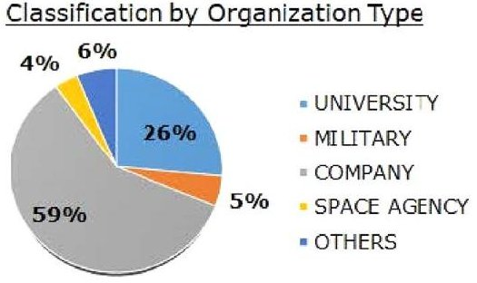

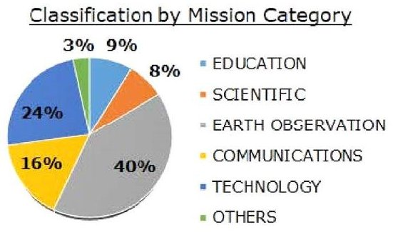

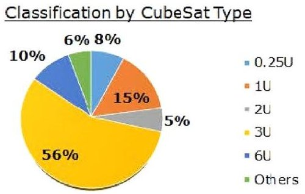

Fig.1 CubeSats classification by Organization Type (left), Mission Category (center) and format/type (right). Total number of considered spacecraft=1652. From [9]

Fig.2 CubeSats launches per year (2003-2021), from [9]

CubeSats Launches per Year

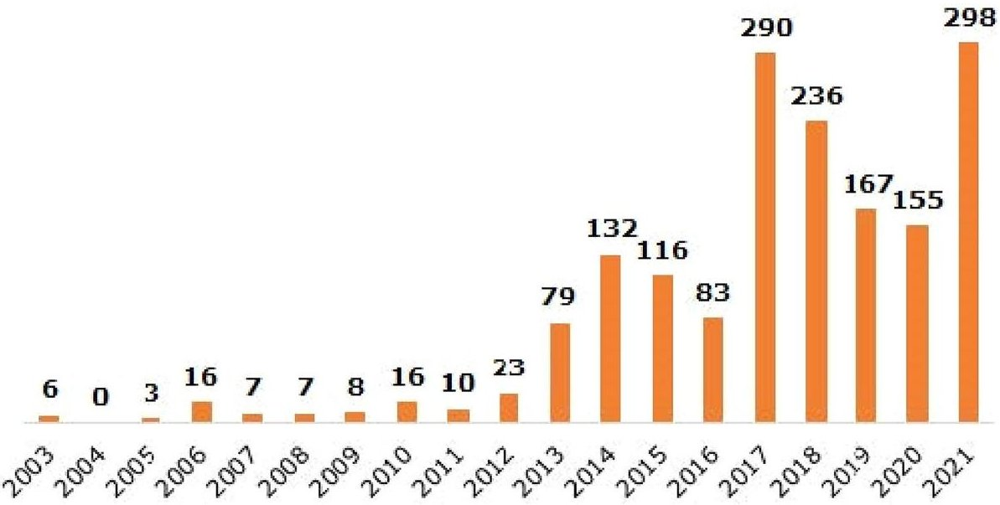

attributed to the CubeSat itself, but to external causes. Furthermore, satellites being part of constellations were excluded, since in this case the failure of a single satellite does not typically lead to a mission failure and, therefore, the statistical analysis might be jeopardized by their inclusion. Finally, passive non-functional satellites were excluded too, since they are just inert masses launched in orbit and cannot therefore fail by definition. As a consequence of this additional set of filters, the total number of CubeSats to be considered for the statistical analysis of failures was reduced to 672 items. These CubeSats have been then categorized in terms of: (1) launch date; (2) mission category; (3) type/format; (4) success/failure; (5) lifetime at which the failure occurred; (6) reason of the failure and sub-system in which the failure has occurred, if known. For the scope of this analysis, a "success" has been defined as a CubeSat which survived its early operational phase (deployment and commissioning) and kept functioning without major criticalities, independently on whether all mission objectives were actually met; "partial failure" has been defined as a case where the spacecraft was operational for some time, until some critical event resulted in

the spacecraft being brought to a semi-operational status or in a complete interruption of the mission. The definition adopted for spacecraft "failure" includes all other cases, mainly referable to Dead-on-Arrival or spacecraft with which a contact was never established. A schematic overview of the complete filtering and categorization procedure adopted in the analysis is shown in Fig. 3.

An overview of the percentage of successes, failures or partial failures, according to the above definitions, is reported in Fig. 4 (left). The other two diagrams in the figure, for which both partial and total failures have been considered, show how these failures can be classified in terms of their reason and the lifetime point when they occurred. More than 1/3 of all failures are reported to have actually been Dead-on-Arrival, with an ample majority of all failures having happened in the early stages of the mission, at a lifetime of less than 3 months. This is well in line with the classic bathtub rate curve reported by other researchers (such as Bouwmeester et al. [10]), which is justified by the large infant mortality of this class of spacecraft caused by poor design, production errors, limited testing and/or wrong analysis of the operational environment.

<!-- PDF_PAGE: 5 -->

The reason for a large part of the reported failures is "No Signal" (directly related to the Dead-on-Arrival cases), followed by the communications and electric power subsystems, well in line with what has been shown by previous statistical analyses. The portion of unknowns in this diagram may be (and will most probably be, in the next future) improved with the introduction of more effective strategies for on-board detection of errors and failures.

Figure 5 shows the cumulative rate of CubeSat successes and failures up to a given year: in other terms, the "success rate" and "failure rate" shown in the diagram, for a certain year, are the total success and failure rates of all CubeSats

considered by this analysis and launched from 2003 up to that year.

The trend from 2013 onwards is particularly good, with an increasing percentage of successes and a decreasing percentage of failures. This can be associated to the growing commercial interest of CubeSats, with more and more companies playing key roles in their development and exploitation. Before 2013, as shown by Fig. 2, just a few CubeSats were launched each year, therefore not providing enough data to conduct a significant statistical analysis.

A more detailed analysis of all CubeSat failures per mission category and per type/format is presented in Figs. 6 and

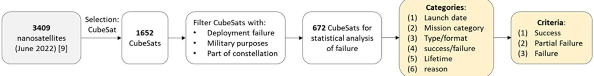

Fig.3 Schematic summary of the filtering procedure, categorization, and criteria adopted for the statistical analysis of CubeSat failures

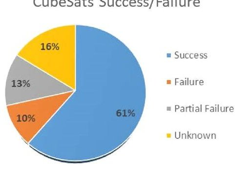

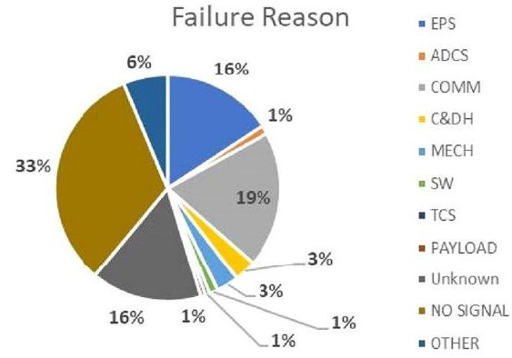

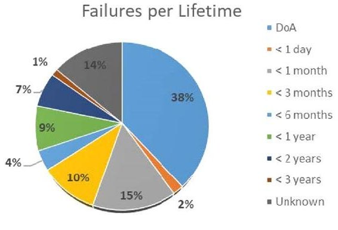

Fig.4 Rate of success/failure among the 672 analyzed CubeSats (left); classification of the failures per reason (center) and per lifetime (right)

Fig.5 Variation over time of the CubeSat cumulative success and failure rates

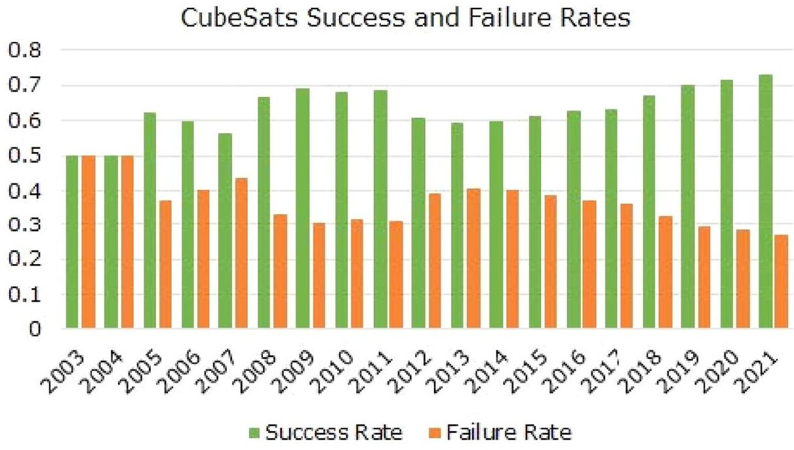

<!-- PDF_PAGE: 6 -->

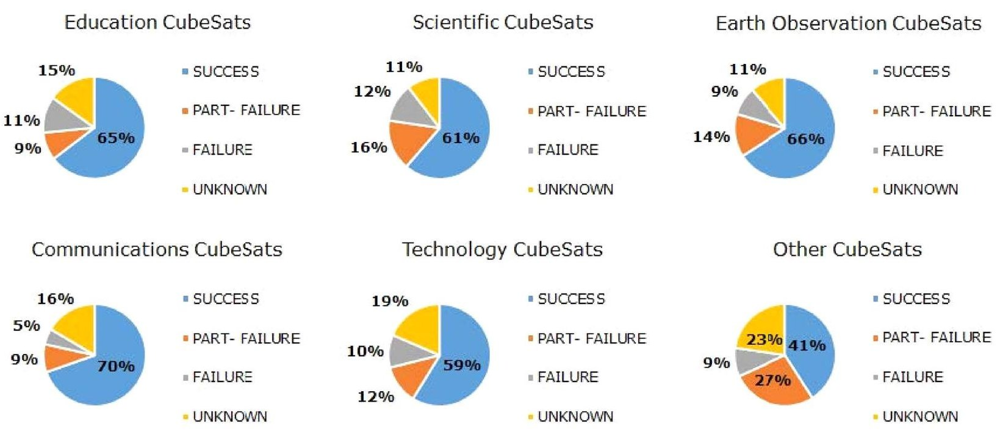

Fig.6 Success and failure rates for different CubeSat mission categories (total number of CubeSats per category:113 Education,106 Scientific, 44 Earth Observation,79 Communications,308 Technology,22 Other)

7. Particularly noticeable is the 65% success rate of educational CubeSats, which may appear a counter-intuitive result when considering the reduced financial and technical resources available for these missions, but is actually justified by their typical simplicity and lower-level objectives, when compared for instance to scientific CubeSats.

It is also interesting to note that 6U CubeSats present a slightly lower percentage of failures when compared to 3U or 2U, which might be justified by the fact that this format is typically used for more ambitious/demanding missions, with consequent higher budget and lower risk tolerance, often

leading to more redundancy and a more careful testing and qualification of the spacecraft.

Finally, Fig. 8 shows the correlation between the failure cause and the lifetime point when the failure happened, giving the possibility to draw some interesting conclusions.

Most Dead-on-Arrival (DoA) are obviously just falling under the "No Signal" category, since no contact has ever been established with these spacecraft. Failures happening within a lifetime of less than 1 month are still dominated by unknown reasons, while the reason for the failure becomes much more clear and identifiable for failures happening later

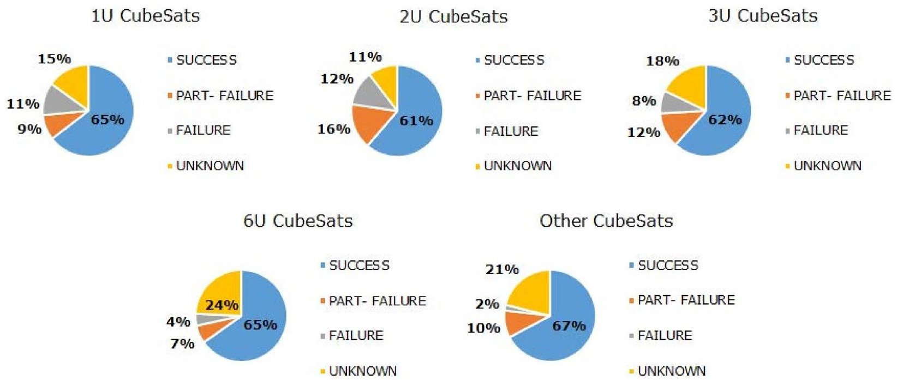

Fig.7 Success and failure rates for different CubeSat type/format (total number of CubeSats per type: 208 (1U), 82 (2U), 235 (3U), 95 (6U), 52 Other)

<!-- PDF_PAGE: 7 -->

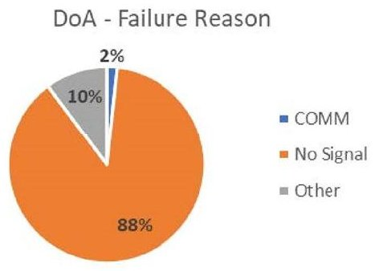

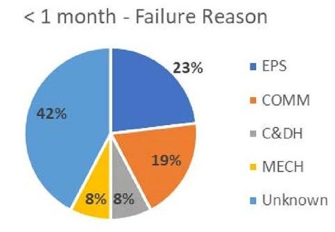

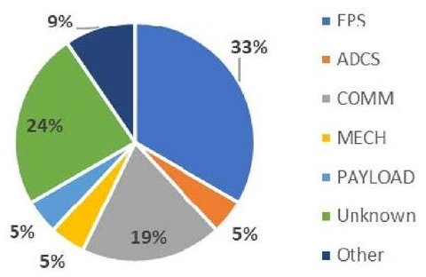

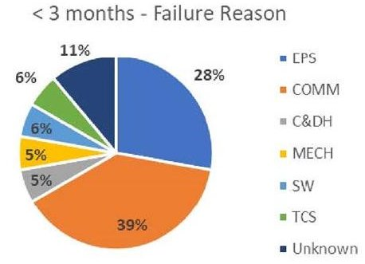

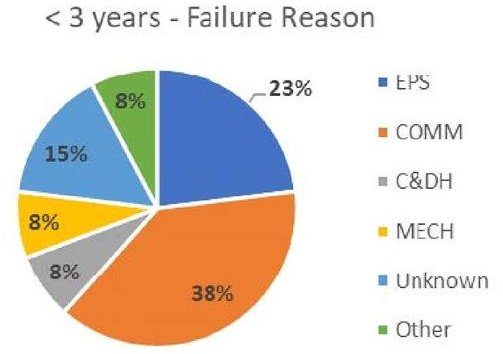

Fig. 8 Failure cause distribution per lifetime at which the failure occurred

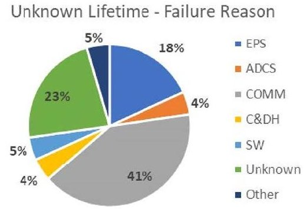

in the lifetime of the spacecraft. Similarly to what has been reported by other researchers, the electrical power and communications sub-systems are the dominant failure causes. It is, however, interesting to note that the command and data handling sub-system is gradually becoming a less significant failure cause when compared to the early age of CubeSats (see for instance the data presented in [3]), currently being approximately at the same level of the mechanical sub-systems in terms of number of caused failures.

Concluding, the most important outcomes of this statistical study are the large number of Dead-on-Arrival cases among all CubeSats launched from 2003 up to the present date, representing around 40% of all failure cases and thus confirming the still very high infant mortality for this class of satellites. In contrast, the promising trend observed from 2013 should be highlighted, with a constantly increasing success rate (exceeding 70% by 2021) and a constantly decreasing failure rate. The communications and electrical power sub-systems remain, at the current date, the two most significant failure causes for this class of small satellites.

## 3 Enhancement of reliability for complex CubeSat missions

As highlighted in the previous Section, the use of CubeSats in space missions has sharply increased in recent years and it is expected to stay at a high level also in the close future, possibly covering more and more ambitious missions and goals. However, the data presented in the previous Section show that, as of today, the failure rate of CubeSats is still

high when compared to conventionally sized spacecraft (for which a failure rate in the order of 5-10% can be roughly estimated), leading to reduced reliability and lifetime for this class of small satellites.

In this Section, starting from existing standards and literature, some design approaches are recommended at component, subsystem, spacecraft and mission level, to be followed in order to improve the reliability of complex CubeSat missions operating in non-deterministic environment with limited resources.

## 3.1 Project level

Already in the early project stages, it is crucial to clearly define the purpose, success criteria and expectations of the mission, as well as an appropriate de-scoping plan should circumstances require it. Particularly important is also to not be too optimistic in the estimation of the total mission cost or in the definition of the project scope, making sure that all expectations stay in line with the budget and schedule. Since the highest level of pressure is typically experienced during the latter half of the schedule, especially in the assembly and testing phase, it is critical to foresee sufficient duration for this phase.

For the project reviews, the most effective approach is to still follow a tailored industry review. Although major review milestones take resources away from engineering, they help identify gaps or missed options. For CubeSat missions, to save time and budget, reviews can however be less formal, and focus just on the major risk factors.

<!-- PDF_PAGE: 8 -->

In order to increase reliability at both COTS and platform level, it is also important to follow procedures and standards during all project phases, from design to assembly and testing, and beyond.

The CubeSat Design Specification, first published in 1999 and updated several times until the present date, is the main standard used by the developers of these types of satellites. It is a relatively basic standard that regulates aspects such as the dimensions or the assembly procedures, to facilitate the integration and the interface with the launcher. However, this standard does not cover aspects related to the system design or testing.

Although the fulfilment of the complete ECSS standards is explicitly deemed out of scope for traditional CubeSat missions, to not hinder their low-cost philosophy, it is still recommended to follow a tailored version of these standards. To this extent, ESA has published a document which specifies the level of applicability of ECSS standards to InOrbit Demonstration (IOD) CubeSat missions [11]. RAMS aspects for this type of missions are covered by another ESA document more focused on product and quality assurance requirements [12], which includes guidelines on the selection of COTS components to ensure sufficient reliability. A limitation of these tailoring documents, published in 2016, is however that they are explicitly intended for IOD missions, and are therefore not fully adapted to the ambitions and needs of more complex CubeSat missions, e.g. interplanetary or deep-space ones. The proposed tailoring is well in line with the original low-cost CubeSat philosophy, but their applicability to more complex missions should be carefully checked on a case-by-case basis.

## 3.2 Design phase

Even more than in other space missions, for CubeSats it is of high importance to design for simplicity and robustness, especially in the mechanical, thermal, and electrical areas, for which a robust design can at least partially compensate for the shortcomings of using commercial EEE (Electrical, Electronic and Electro-mechanical) parts. More details at component and sub-system level are provided in the following.

## 3.2.1 COTS selection

The selection of COTS components should always be well integrated in the design phase. In particular, the following criteria should be taken into account in the trade-off of these components:

- Data available from the manufacturer on product traceability, quality assurance, etc.;

- Available qualification level;

- Level of complexity;

- Performance vs. cost;

- Environmental suitability, including radiation tolerance.

- In case the trade-off leads to selecting a COTS component not explicitly intended for space applications, the following guidelines should be considered:

- Since product traceability is typically not ensured within different lots of COTS components, margins need to be applied to account for variability in part responses.

- Requirements and expectations should be detailed in all procurement documents (Purchase Order, Technical Specification, etc.), and should always include quality assurance requirements (required tin-lead, not pure tin, solder, etc.)

- Whenever possible, the component should have an established heritage, for example through demonstration in IOD missions.

- The component should follow the de-rating rules formulated for space components, as provided by the ECSS standards [13].

- Furthermore, once a COTS component is selected, a review of its qualification status should be performed to identify if it covers the environmental conditions relevant to the mission. To this extent, categories A-D indicated by the ECSS standards [14] can be used, defined in the following way:

- Category A is a component used without modifications, already subjected to a qualification program compliant to the project specifications (including those on environment), and produced by the same manufacturer or supplier using the same tools and manufacturing processes. In this case, no delta qualification is needed.

- Category B is a component used without modifications, which has not been subjected yet to a sufficient qualification program according to the project specifications. In this case, a delta qualification program is required, to be defined on a case-by-case basis.

- Category C is a component which would require modifications, such as a change in design, parts, materials, tools, processes, supplier or manufacturer. In this case, a delta qualification program is required, to be defined on a case-by-case basis, and this qualification shall include testing.

- Category D is a newly designed or developed component, for which a full qualification program is required.

<!-- PDF_PAGE: 9 -->

## 3.2.2 Electrical power sub-system

As shown in the state-of-art of CubeSat failures presented in the previous Section, a significant part of these failures have historically been related to the electrical power sub-system, typically leading to a negative power budget. To mitigate this risk, the following aspects should be carefully considered during the design phase:

- Never overestimate the solar cell efficiency, especially as a function of lifetime. If insufficient data are provided by the supplier, a worst-case estimate should be done on the basis of typical/statistical values.

- Minimize the depth-of-discharge of batteries, even to extreme low levels such as 10-20% if possible, in order to maximize their lifetime.

- Perform a sufficiently accurate thermal analysis of the spacecraft already at the early design stage, especially with reference to the batteries given the extreme sensitivity of their efficiency to temperature. Whenever possible, include in the design dedicated heaters for the batteries.

- Design the solar arrays in such a way that during the initial tumbling phase before commissioning, the satellite still has enough power to perform at least a minimum level of operations, and in particular to allow for sufficient charging of the batteries.

## 3.2.3 Communications sub-system

Historically, the communications sub-system is the other big contributor to CubeSat failures. This is typically due to underestimated losses in the link budget during the design phase, which result in poor sizing of both the on board equipment and the ground station. Therefore, whereas possible, solid margins should be included in the link budget, for example by increasing the transmission power or considering transmission at a higher frequency. If this is not possible with the available resources, advanced operations concepts should be included in the design of both the space and ground segment, for example by implementing FDIR concepts that allow for enhanced on-board autonomy.

In addition, the communications sub-system is often responsible for navigation functions, for example through ranging. To this respect, particular attention should be given during the design phase to the antenna pointing angle and to the measured Doppler shift on the ranging link.

## 3.2.4 Flight software

The flight software is often a significant driver of system cost and complexity. To optimize its development, systems engineering practices should be implemented since the early stages of the software design process. The design should be

baselined on including robust safe modes and offer the ability to patch or reprogram the software in orbit. Such update process should be carefully verified during the software testing phase.

For CubeSats operating in non-deterministic environment with limited resources and limited ground contact, it is crucial for the spacecraft to be capable of autonomously solving software issues while in space, through robust fault tolerance FDIR methods. A valuable approach to this respect is to achieve a good level of functional redundancy through FDIR, in order to avoid as much physical redundancy as possible. As a minimum, the FDIR system should be capable of identifying simple fault monitors such as low battery voltage, incorrect elements in the field of view of attitude sensors, commanding loss, sequence failures, consequently taking actions either at sub-system/component level or at spacecraft level (e.g., reset power-cycling of all subsystems). On-ground functional testing of the system under non-nominal scenarios, as those indicated for example by the RAMS analyses, is also crucial to improve the learning curve of the autonomous fault handling system.

## 3.2.5 Radiation effects

In traditional space missions, components are carefully designed or selected to provide ad-hoc radiation performance, specifically defined for each mission. However, this leads to complex quality control procedures, which are generally too expensive for the budget of a typical CubeSat mission. For these missions, a so-called "careful COTS" approach, as defined for example by Sinclair & Dyer [15], is a better compromise. Such an approach would be based on two main guidelines: (1) key components shall be screened and tested; and (2) the spacecraft (not just each COTS component separately) shall be designed to minimize the impact of radiation-induced effects.

Other authors, such as Campola [16] introduce the concept of best practices focused on Radiation Hardness Assurance (RHA), to improve the success rate of CubeSat missions while adapting to their limitations. Radiation requirements need to be tailored according to the mission, with environment and mission requirements determining the actual RHA needs of the system and, consequently, the mitigation approaches to be followed. In particular, the following practices should be used at system design level to reduce the impact of possible radiation effects:

- Whenever possible and in the limits allowed by the budgets, add shielding around sensitive or critical electronics during the structural design.

- If shielding is not deemed sufficient, surround critical electronics using other sub-systems and components, such as the propellant tanks.

<!-- PDF_PAGE: 10 -->

- Power buses shall always be protected against catastrophic Single Event Latchup, for example through fastacting current and thermal limiting.

- Volatile memory and registers on computers shall be protected against Single Event Upsets, for example by using Triple Modular Redundancy.

- Other mitigations could be implemented at software level, such as Error Detection/Correction Codes, watchdog timers, memory scrubbing.

- Make use as much as possible of idle states, by not providing power to electronic components that are not needed in a specific phase of the mission.

Solar flare events are another, unfortunately unpredictable, event often leading to critical CubeSat failures. To mitigate this risk, it can be useful to design spacecraft operations in such a way that the system enters a dormant mode (unpowered state) during solar flare events. The mode state and duration should be triggered, in this case, by a ground command.

More generally speaking, especially in COTS components, manufacturing process and materials can significantly change from one lot to another. Therefore, radiation tolerance can significantly change from one component to another one. Lot control and screening is important to mitigate this risk.

## 3.3 Assembly, integration and testing

For CubeSat missions, the Engineering Model of the spacecraft is typically in the so-called "FlatSat" format: a model including all spacecraft components and sub-systems except the structural ones, used to test the system before its actual integration, eventually offering the possibility of additional software development in parallel to the testing.

Qualification activities are then completed following one of the next approaches: Engineering Qualification Model, prior to accepting the actual Flight Model; or only a Protoflight Model. These models and their qualification activities are typically defined for CubeSats in the same way as traditional missions employing larger spacecraft. Note that, if the different equipment on board the platform is suitable for the mission in terms of qualification status, it is preferred to implement a Protoflight Model philosophy at system level, based on a single model subject to Protoflight qualification test campaign, offering advantages in terms of cost and schedule, without impact on the technical risk assumed.

As already mentioned, no test standards specifically intended for CubeSats are currently available. The latest version of the CubeSat Design Specification [17] states that all testing levels and requirements are mission specific and are subject to vary, in order to meet the Launch Provider requirements. Therefore, no details are provided in terms

of test requirements, methods, or qualification levels, for which the existing test standards for conventional satellites (e.g., [18]) apply, usually tailored on a case-by-case basis depending on the specific mission.

For the first step of the Functional Testing phase, typically performed on a FlatSat model, Donner & Smith [19] stress the importance of having proper documentation on COTS and, specifically, of keeping a critical attitude on what can be found in their datasheets. This is the testing phase during which any discrepancy, incorrect or incomplete information from the data sheets should be identified and corrected. Two examples of the issues that can be caused by overlooking this aspect, taken from the lessons learned from the Asteria mission, are given in the paper: the identification of an "auto mode" of the COTS radio (speak only when spoken to), which prohibited a beacon mode and was not declared in the documentation; and the identification of an unexpected behaviour of the electrical power system timers governing the power sequencing, not declared in the documentation too.

After separate validation of the hardware at an individual level on the FlatSat model, the following Functional Testing steps are performed at system level. Related to this testing phase, Doyle et al. [20] present the highlights and benefits of the so-called Mission Testing, where in-flight operations are evaluated in a mission representative manner, including nominal and non-nominal scenarios with contingency or mitigation procedures. The authors claim that extensive Mission Testing prior to launch is an important step towards improving the reliability and performance of a CubeSat mission. This type of tests, also known as "Test as you fly" or "Day in the Life" testing, validate the full spacecraft system (hardware and software) in relation to the actual scenarios of the mission it has to perform. As such, they allow to address possible failures happening during the early operational phase of the spacecraft, thus contributing to a reduction of the infant mortality rate. As an example, for the electrical power sub-system, this type of test should be conducted in a realistic mission scenario, including the simulation of expected on-orbit charging/discharging cycles, verifying that the amount of generated power is adequate according to the budget, and that this is correctly reflected by the spacecraft telemetry parameters.

For Mission Testing, the ECSS standards [18] indicate that, during the test, the space segment element shall be kept continuously on, according to the agreed test profile (modes, modes transition and modes duration), in order to reduce the risk of error accumulation. In practice, due to the lack of specific standards and requirements on it, the total duration of the Mission Testing phase can range from a few hours to several weeks, depending on the team who performs it.

Another crucial test at system level is the End-to-End communications, which is performed to validate the closure

<!-- PDF_PAGE: 11 -->

of the link budget under all mission modes and phases. This test should be done using a ground station as identical as possible to the one that will be used for the actual mission, and simulating the losses experienced in actual flight conditions by means of attenuators.

Other crucial steps of the system testing phase are the Environmental Testing (mechanical and thermal), and the Electromagnetic Compatibility Testing. For CubeSats, the Environmental Testing typically includes vibration tests (modal survey and random vibrations) and a thermal vacuum test during which all functionalities of the spacecraft are checked. To verify that these test activities have not affected the performance and functionality of the system, a high-level functional test is performed after the mechanical tests. The electromagnetic compatibility tests, finally, cover aspects such as the conducted emissions, conducted susceptibility, radiated emissions and radiated susceptibility, and are typically conducted on CubeSats according to standards, but tailored on a case-by-case basis to reduce the testing costs.

Other tests, which are instead typically not conducted or overlooked in CubeSat missions, need to be evaluated on a case-by-case basis, depending on the mission. For example, those related to the physical properties of the spacecraft (center of mass, moments of inertia, etc.), to the deployment mechanism, or to the burn-in testing of the integrated assembly. In fact, a critical aspect related to the high rate of failures in CubeSats is the deployment mechanism. Testing of these aspects can be challenging, difficult and time consuming; furthermore, the mechanism cannot be usually reset, or can only be used a limited number of times. If these devices are not tested in a representative environment, at least the possible risks and consequences must be taken into account.

## 3.4 Risk-based mission assurance

Apart the engineering practices described in the previous sub-Sections, which when implemented could significantly affect the total mission budget, an alternative way to increase the reliability of complex CubeSat missions is represented by a smart use of RAMS analyses and practices, for example by following an approach based on risk assessment and failure resilience: in case of sub-system failures or anomalies, the system is designed in such a way to still be capable of achieving as many key mission objectives as possible, even with degraded performance.

The implementation of a reliability engineering approach based on RAMS analyses (such as the FMECA, Failure Modes, Effects and Criticality Analysis) also allows to identify the most critical risks early in the design phase, finding their root causes and developing strategies to correct or mitigate them at little or no cost, such as: modify or integrate the requirements, modify the design, redefine or better shape the

procedures to be followed during assembly, integration and testing, and similar.

A standard classification of the risk and confidence levels for CubeSat missions has been proposed for example by Fuhrman et al. [21, 22]. According to this classification, for deep space/complex missions, a high confidence level would be required when 5-10 years of operations are expected, while a moderate confidence level is acceptable for 1-3 years of operations, and a low confidence level is acceptable when just a few months of operations are foreseen.

In any case, independently on the type of classification adopted, different types of mitigation techniques can be adopted based on the risk and its root cause: avoid the risk by eliminating the root cause and/or consequence; control the cause or consequence; transfer the risk to a different party or project; accept the risk and continue the mission development. The choice of a mitigation technique is highly dependent on the available budget and the nature of the project itself (university, industry, agency, military).

## 3.5 Conclusion

In Table 1, a summary of the most important guidelines and recommendations proposed in this Section is provided. For different items, different recommendations are proposed depending on whether high or low confidence level is needed.

It can be easily noted that some of these guidelines and recommendations can be achieved with basic approaches and a relatively small impact on mission costs: a combination of robust design and testing can lead to high levels of reliability without necessarily compromising on the CubeSat philosophy. For other recommendations, having more impact on the budget and/or schedule, a trade-off between their impact and the consequent improvement in the probability of success of the mission would be required.

## 4 Study case selection and description

The recommendations gathered and shortly summarized in the previous Section will be applied, in the next phase of the ESA project to which this paper refers, to the design of a FDIR system for a study-case mission. Two potential study cases with the required characteristics (small spacecraft in non-deterministic environment with limited resources) have been identified: LUMIO and M-ARGO. Both are interplanetary CubeSat missions, previously studied by the CDF (Concurrent Design Facility) of ESA, involving complex spacecraft and mission architectures.

LUMIO (LUnar Meteoroid Impacts Observer) is a 12U CubeSat mission to a halo orbit at Earth-Moon L2 that will observe, quantify, and characterize meteoroid impacts on

<!-- PDF_PAGE: 12 -->

Table 1 Guidelines for complex CubeSat missions, per required confidence level

<table border="1"><tr><td>Item</td><td>When high confidence is required</td><td>When low confidence is required</td></tr><tr><td>Reviews</td><td>Formal reviews for the critical areas, with external review board</td><td>Internal/Informal reviews, with key stakeholders</td></tr><tr><td>Standards/procedures</td><td>Use of (complete) ECSS standards, eventually tailored</td><td>Limited or no use of (tailored) standards</td></tr><tr><td>EEE components</td><td>Space-graded components</td><td>COTS components</td></tr><tr><td>COTS documentation</td><td>Part traceability, trusted practices (design, manufacturing, processes)</td><td>No documentation needed, risks are mitigated through design (fail-safe devices, de-rating rules, etc.)</td></tr><tr><td>Design tasks</td><td>Detailed and comprehensive analyses</td><td>Reduced-order analyses, risks are mitigated through margins and use of pessimistic assumptions</td></tr><tr><td>Radiation tolerance</td><td>Rad-hard or rad-tolerant parts; detailed radiation analysis at system level; testing data for all components</td><td>Minimal or no knowledge (general evaluation of the radiation environment, reduced test campaign)</td></tr><tr><td>Flight spare components</td><td>Spares of critical items at component level</td><td>None or limited (parts from Engineering Models can be used as flight spare elements)</td></tr><tr><td>Qualification Model</td><td>Recommended</td><td>Not included</td></tr><tr><td>Engineering Model</td><td>Recommended</td><td>FlatSat approach only</td></tr><tr><td>Testing</td><td>Full qualification campaign for design validation, acceptance campaign for workmanship validation; functional testing required</td><td>Minimum acceptable test campaign as per launch service provider requirements</td></tr></table>

the Lunar farside by detecting their flashes, complementing Earth-based observations on the Lunar nearside, to provide global information on the Lunar Meteoroid Environment and contribute to Lunar Situational Awareness [21, 22]-23). M-ARGO is a 12U deep-space CubeSat which will rendezvous with a near-Earth asteroid and characterize its physical properties for the presence of in situ resources, demonstrating for the first time the capability of CubeSat systems to independently explore deep space [24].

Both missions are currently at the same stage, having successfully completed their Phase A. Although the general mission complexity of M-ARGO is slightly higher (given the extreme deep-space environment and the longer transfer time to the final target), LUMIO was eventually selected as study case given the key role played by Politecnico di Milano (coordinator) and TU Delft in the mission.

To the best of the authors knowledge, no FDIR or RAMS studies are currently available for M-ARGO, while a preliminary but quite detailed study on LUMIO has been previously performed by TU Delft. This study, performed as a student project, was however based on the Phase 0 configuration of the spacecraft and mission, and therefore needs to be significantly updated based on the configuration changes proposed during the following phases.

More details and highlights on the LUMIO mission are given in the next sub-Section.

## 4.1 The LUMIO mission

The idea for the LUMIO mission originated from one of the proposals submitted to the SysNova LUCE (LUnar CubeSats for Exploration) call by the European Space Agency, a

challenge intended to generate new and innovative concepts and to quickly verify their usefulness and feasibility via short concurrent studies. After the first phase of the challenge (open call for ideas), LUMIO was one of the four proposals selected for performing a pre-Phase 0 analysis, funded by ESA. During the final review and evaluation from ESA, the mission was then awarded as one of the two ex-aequo winners of the challenge. As prize for the winners, ESA offered the opportunity to perform an independent study in its CDF, to further assess the objectives, design, and feasibility of the mission. The CDF study confirmed the feasibility and the scientific value of the mission, proposing a number of design iterations that, together with the initial design proposed by the LUMIO team in response to the SysNova challenge, contributed to form the Phase 0 study of the mission.

The LUMIO Phase A study, funded by ESA under the GSTP Programme, was kicked off in March 2020 and completed in March 2021.

The science question that LUMIO intends to answer is: what are the spatial and temporal characteristics of meteoroids impacting the Lunar surface? The corresponding science goal will be to advance the understanding of how meteoroids evolve in the cislunar space by observing the flashes produced by their impacts with the Lunar surface.

When a meteoroid impacts the Lunar surface, its kinetic energy is partitioned into: the generation of a seismic wave; the excavation of a crater; the ejection of particles; the emission of radiation through flashes. In principle, any of these phenomena can be observed to detect Lunar meteoroid impacts; among them, detecting impact flashes has been selected as the most advantageous method for LUMIO, for various reasons: it yields an independent detection of

<!-- PDF_PAGE: 13 -->

meteoroid impacts, provides the most complete information about the impactor, and allows for the monitoring of a large Moon surface area.

Observation of light flashes on the Moon is typically performed by looking at local spikes of the luminous energy in the visible spectrum. When done by an Earth-based telescope, however, this observation is affected by background noise caused by the Earthshine (Earth reflected light on the Moon surface) and by thermal emissions of the Moon surface in the infrared spectrum. Better quality observations can be obtained by looking at the Lunar night side. Furthermore, the well-known fact that an observer on Earth always sees the same portion of the Moon (the Lunar nearside) poses an additional constraint to the observations taken from the Earth, which are intrinsically limited to just half of the Lunar surface. Meteoroid impact flashes can only be observed from ground on the Lunar nightside, when the nearside is less than 50% illuminated, and during the Earth night. A similar situation applies to observations of the Lunar farside, which however, can be performed at time periods complementary to those when Lunar nearside observations can be taken. This can be clearly seen in Fig. 9 (right): the dashed green line shows when and where Earth-based observations are possible, while the solid blue line shows where and when space-based observations of the farside are possible. It is therefore clear that the two types of observations are fully complementary, in both space and time.

LUMIO will make use of a 12U CubeSat equipped with the LUMIO-Cam, an optical instrument capable of detecting light flashes in the visible spectrum to continuously monitor and process the data. The mission implements a novel orbit design and COTS CubeSat technologies, to serve as a pioneer in demonstrating how CubeSats can become a viable

tool for interplanetary science and exploration. The selected LUMIO operative orbit is a quasi-periodic halo orbit around Earth-Moon L2. The ranges to the Moon along the operative orbit span between 35,000 and 85,000 km, where the Lunar farside is always contained in the LUMIO optical payload field-of-view and the Earth is always in sight.

Figure 9 (left) shows a simplified representation of the mission profile and phases, according to the outcomes of Phase A. LUMIO is divided in 5 phases: (0) the Earth-Moon transfer phase, (1) the Parking Orbit phase, (2) the Transfer phase, (3) the Operative phase, and (4) the End-of-Life phase. In the Earth-Moon transfer phase (0), LUMIO is carried by the deployer in a mothership, until it is released into a selenocentric parking orbit (1). In this phase, commissioning and health check are performed, before preparing for the stable manifold injection maneuver (SMIM). This maneuver marks the beginning of the transfer phase (2), where two trajectory corrections maneuvers (TCM) and a final halo injection maneuver (HIM) are planned. Then, the mission enters in the operative phase (3), where the operative halo orbit is divided in two cycles: the scientific cycle for continuous processing of images and the engineering cycle for station keeping and platform life checks and corrections. Eventually, after 1 year of operations, the mission enters in the End-of-Life phase (4) with a disposal maneuver in a heliocentric orbit.

A rendering of the Phase A configuration of the LUMIO spacecraft is shown in Fig. 10 (left), while Fig. 10 (right) shows an internal view of the spacecraft. The spacecraft mass in this Phase A configuration is currently estimated at approximately 28.7 kg (including margins as per ESA standards). More details on the sub-systems of this spacecraft configuration are given in the following.

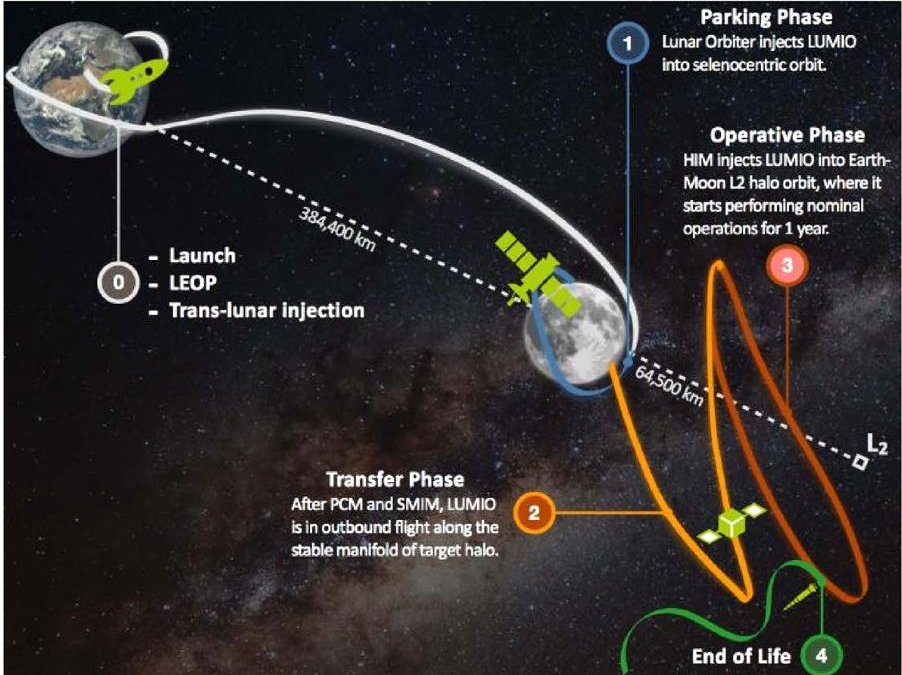

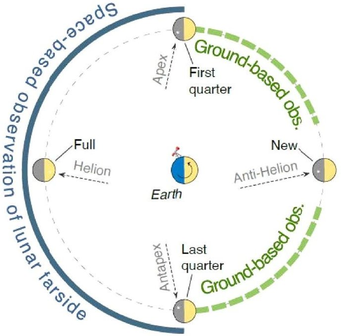

Fig.9 LUMIO mission concept (left); Moon phases and main direction of incoming meteoroids in the Earth-Moon system (right) [21]

<!-- PDF_PAGE: 14 -->

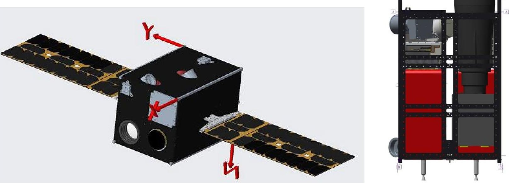

Fig.10 Rendering (left) and internal view (right) of the LUMIO spacecraft (Phase A configuration) [21]

The payload is the LUMIO-Cam, custom developed by one of the key partners of the LUMIO team, Leonardo. The camera is designed to operate in a bandwidth between 450 and 950 nm, implementing a double Focal Plane Assembly configuration. The optical head includes an optical barrel and a baffle. The optical barrel is a dioptric objective composed of 5 lenses, with focal length of 127 mm and field of view of 6 deg. In front of the optical barrel, a baffle with an overall length of 150 mm is positioned, in order to minimize any straylight signal which would eventually come from the Sun. The camera design is completed by a Focal Plane Assembly including two identical $ 1 0 2 4 \times1 0 2 4 $ CCD detectors, one for the visible channel and one for the infrared, and their respective thermo-electric coolers. Finally, the Proximity Electronic embedded in the camera design manages all electrical interfaces between the payload and the spacecraft, generates the scanning and acquisition digital signals from the two detectors and manages the acquisition of the housekeeping data.

The ADCS sub-system is of crucial importance for the success of the mission, given the constraints generated by the combined need for accurately pointing the LUMIO-Cam towards the Moon (for good-quality science product), the antennas towards the Earth (for communications and radiometric navigation) and the solar panels towards the Sun (for maximizing power generation). Especially the last constraint is particularly challenging for LUMIO, since in the operative orbit the Sun continuously moves with respect to the bodyfixed reference frame of the spacecraft. This requires simultaneous pointing of the LUMIO-Cam towards the Moon and rotation of the solar arrays in the body-fixed frame by means of a dedicated drive mechanism. In terms of sensors, the Phase A design includes 6 fine Sun sensors, 2 star trackers and one Inertial Measurement Unit. The actuators are 4

reaction wheels, which are desaturated by a dedicated RCS propulsion system.

The propulsion sub-system includes two separate systems, one for main propulsion (orbital maneuvers) and one for RCS propulsion (spacecraft de-tumbling and wheel desaturation). The main propulsion system is a mono-propellant system intended to provide a total thrust in the range from 100 mN (minimum allowed) to 1 N (maximum allowed), either with a single thruster or with multiple nozzles, to facilitate compensation of any undesired torques (such as those caused by misalignment effects). On the other hand, each thruster of the RCS propulsion system (either coldgas or micro-resistojet) is required to deliver a thrust in the range 1-10 mN, with a minimum of 4 thrusters allowed in the system.

The Telecommunications system is based on a combination of Inter-Satellite and Direct-to-Earth link. The Inter-Satellite link is based on a S-band radio and a patch antenna, allowing for an estimated data rate in the order of 0.5-2 kbs at a power of 9 dBW (depending on the relative distance between LUMIO and the mothership spacecraft in Lunar orbit), therefore insufficient to transmit the payload data, which will instead be transmitted through the Direct-to-Earth link. For the Direct-to-Earth link, a maximum communication window of 14.75 days has been estimated over each Lunar month which, considering the telemetry, payload data generation and post-processing requirements of the spacecraft, leads to an estimated total data throughput of 2.91 Mbytes per day. A X-band radio and two patch antennas have been selected for this link. Radiometric ranging and tracking have been considered as the baseline navigation method, giving priority to the use of the Direct-to-Earth link over the Inter-Satellite ranging option.

<!-- PDF_PAGE: 15 -->

One of the main features of the LUMIO design is the use of a dedicated On-Board Payload Data Processing unit (OBPDP), that allows to significantly reduce the amount of data to be sent to ground by limiting them to the scientifically significant data only. In order to do this, the OBPDP is designed in such a way to: (1) detect and keep only the camera images in which impact flashes are present; (2) cut from the whole image a smaller "tile", including the flash area and the information on where this area is located on the Lunar farside surface as seen by the spacecraft. This data processing strategy allows for a reduction by a factor in the order of $ 1 0^{6} $ on the amount of data to be stored and sent to ground. The Phase A spacecraft design is based on three separate On-Board computer units: one for the ADCS sub-system, one for the main OBC, and one for the OBPDP.

The Electric Power System is based on a power demand reaching a maximum of 56 W during the transfer phase, 54 W during the science cycle, and up to 69 W when propulsion system heating is performed. It includes 4 battery packs for a total capacity of 180 Wh and two deployable solar arrays made of 24 cells, for a total solar array area of $ 0.144 \mathrm{~m}^{2} $ or $ 1.5 \times 6 \mathrm{U}. $

Finally, the spacecraft structure is based on the 12U CubeSat structure (with the option of using the 12U XL structure, to tackle possible volume challenges caused by the LUMIO-Cam baffle length) and aluminum cover panels with thickness of 1.5 mm, estimated to provide sufficient radiation hardening for the whole mission duration.

## 5 Available toolsets and possible improvements

## 5.1 FDIR for the AOCS and GNC sub-systems: GAFE methodology and tools

In order to ensure the safety and dependability of a spacecraft and its mission, a coherent and well-defined FDIR engineering process, as part of the overall product assurance and risk management process, needs to be adopted at all stages of the design, in parallel with the classical system engineering activities. The objective is to ensure that all risks and hazards connected with any unintended behaviour of the system are identified, quantified, and addressed in relation with the mission needs and objectives through the definition of mitigation means allocated to the different elements and levels of the system. Within this engineering process, a layered FDIR strategy can be effectively put in place based on passive or active recovery actions implemented at different system levels, together with the associated identification actions, to mitigate the risks arising from identified system failures. The strategy is based on the classical failure-effect

level approach, in which the effect of the failure on the faulty element or subsystem/system is attended as close as possible to the source of the fault, in an incremental manner to minimize the propagation of undetected failures. The following levels are typically defined:

- L0-Recovery (unit level): for units/equipment capable of autonomous failure detection and recovery. At this level, the failure is detected and isolated by the unit, and the recovery action is taken by its own FDIR (internal to the unit).

- L1-Recovery (local reconfiguration level): the function failure is detected and isolated during data acquisition, and the recovery action (reset or re-initialization) is taken by the sub-system FDIR.

- L2-Recovery (sub-system level): the recovery action is based on unit(s) reconfiguration and/or changes in the sub-system functional chain.

- L3-Recovery (sub-system management level): the recovery action is based on a change in the sub-system operational mode.

- L4-Recovery (system management level): the recovery action is based on a change in the system operational mode.

In this context, the FDIR for the AOCS and GNC subsystems typically plays a critical role, spanning between layers L0 and L3. One of the most known methodologies applied to this FDIR is GAFE, an abbreviation that stands for "Generic AOCS/GNC Techniques & Design Framework for FDIR" [25], developed and implemented in the frame of an ESA GSTP study.

During the ESA activity from which the present paper has originated, application of the GAFE methodology to complex CubeSat missions has been evaluated, with a specific example explicitly tailored to the characteristics of the LUMIO mission.

The GAFE methodology follows a linear process which designs the FDIR system through several steps: (1) Requirement analysis; (2) Extension of the equipment set; (3) FDIR definition and development; (4) Simulator Configuration; (5) Definition and execution of test cases, and associated metrics; (6) Assessment of FDIR performance; (7) Generation of FDIR documentation. Inputs to the process are the FDIR requirements and the nominal AOCS/GNC design, which includes all the elements to meet the functional and performance requirements in absence of faults and is assumed to be robust against parametric uncertainties, expected environmental conditions and expected sensors outages. Particularly important to this respect is the definition of the AOCS modes and sub-modes, the most important of which is the safe mode.

<!-- PDF_PAGE: 16 -->

Two particularly important tools available in GAFE are the Structural Analysis tool (used for steps 2 and 3 in the above list) and the Simulator (used for steps 4 and 5).

The Structural Analysis tool starts from the spacecraft configuration, to identify any existing redundancies and their connection with the modelled faults. A structural model is defined, where the relationship between known states (e.g., the measured attitude), unknown states (e.g., the true attitude) and faults (e.g., an attitude measurement fault) is expressed in terms of structural constraints describing dependency links between two states, while disregarding the specific formula of the constraint itself. In this way the structure of the system can be represented by a bi-partite graph, where an edge connects a state and a constraint. The Structural Analysis tool allows, among other things, to:

- Identify cost-optimal extensions of the nominal equipment set, while meeting FDIR requirements;

- Exploit systematic ARR (Analytical Redundancy Relations) to achieve model-based redundancy without including any additional hardware redundancy;

- Identify fault signatures and generation of residuals;

- Identify required on-board models.

Especially for CubeSat missions, the Structural Analysis tool can be very useful to systematically explore redundancy configurations (possibly in terms of functional redundancies) in combination with the available ARR, to optimize the number of components and reduce the impact on system budgets of meeting the FDIR requirements.

On the other hand, the GAFE Simulator provides a generic simulation framework for testing the AOCS FDIR design. It includes the following features:

- Hierarchical definition of test cases based on parameter inheritance;

- Automatic generation of the AOCS algorithms, obtained scheduling predefined components selected in the configuration files;

- Complete architecture of parametric simulation modules (e.g. environment, equipment, AOCS algorithms, telecommand, fault injection);

- A wide range of simulation models and AOCS functions implemented.

The capabilities of the GAFE Structural Analysis tool have been explored in a sample scenario using the AOCS components of the LUMIO spacecraft in its Phase A configuration, as described in the previous Section. Specifically, a nominal AOCS equipment set has been considered, consisting of elements with the characteristics indicated in Table 2, which can be assumed as sufficiently representative of the LUMIO spacecraft case.

Table 2 Characteristics of the equipment set considered for the LUMIO sample case

<table border="1"><tr><td>Unit</td><td>Mass[kg]</td><td>Power[W]</td><td>Cost(k€)</td></tr><tr><td>Sun sensor</td><td>0.05</td><td>0.1</td><td>10</td></tr><tr><td>Inertial Measurement Unit</td><td>0.06</td><td>1.5</td><td>10</td></tr><tr><td>Star tracker</td><td>0.5</td><td>1</td><td>80</td></tr><tr><td>RCS thrusters</td><td>0.5</td><td>1</td><td>40</td></tr><tr><td>Reaction wheels</td><td>1.5</td><td>1</td><td>40</td></tr><tr><td>Solar array drive mechanism</td><td>1</td><td>2</td><td>20</td></tr></table>

The overall solution cost has been optimized using a normalization factor with which 1 kg of mass, 1 W of power consumption and 50 k€ are normalized to unity, and weighting factors equal to 0.4 for mass, 0.2 for power and 0.15 for cost. The Structural Analysis tool has then been run to identify the best equipment selection which would enable FDIR in the case of 1-fault tolerance. Although the weighting factors for mass, power and cost have been chosen in an arbitrary way for the specific example presented here, they resemble well the typical scenario encountered during the development of a CubeSat mission, where mass (and volume) constraints are normally more demanding, and therefore given more importance, with respect to power generation and monetary aspects. The situation might be different for specific types of missions, for which different weighting factors might need to be used. For example, in the case of amateur CubeSats with extremely limited money budget, the weighting factor for the "cost" aspect would become predominant compared to the other two.

According to the solution provided by the tool, the best equipment set in terms of fault tolerance consists of two units for each of the elements listed in Table 2, thus ensuring one redundant unit for each nominal element. On the other hand, the best identified active set for fault detection consists of one unit per element (nominal equipment set), therefore no additional unit is required to ensure fault detection.

Figure 11 shows an overview of the total budget costs evaluated by the tool for all the equipment sets considered, with the number of units of each element for each equipment set shown in the bottom-right plot. Note that CPU costs and Power costs have been included in the figure for completeness, even if they are not changing in a significant way for the considered equipment sets. In summary, this simple but instructive example based on the LUMIO AOCS architecture shows that the GAFE Structural Analysis tool is capable of providing, for each AOCS mode, a deep understanding of the main drivers of the FDIR design starting from the given requirements, allowing to identify optimal design solutions from the FDIR perspective. It is thus especially useful in

<!-- PDF_PAGE: 17 -->

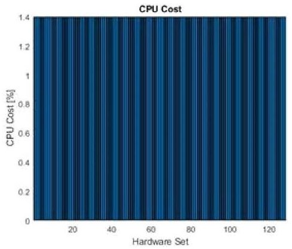

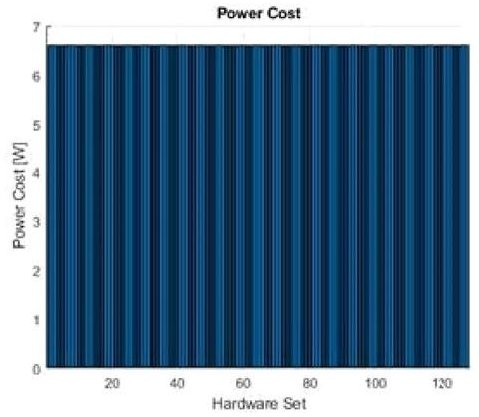

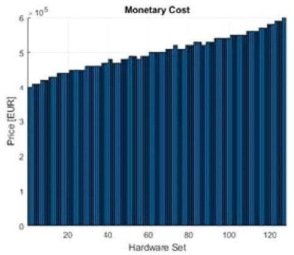

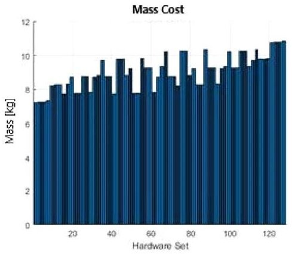

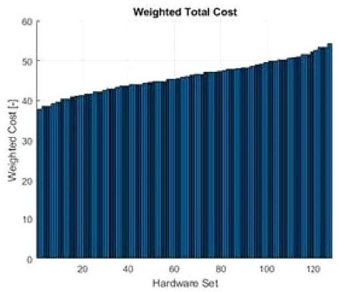

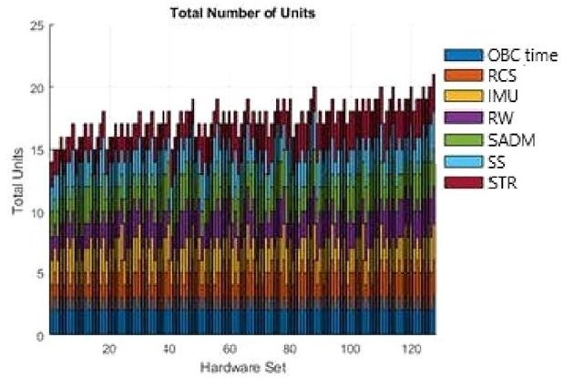

Fig.11 Overview of the total budget costs evaluated for all possible equipment sets by the GAFE Structural Analysis tool (sample case based on the LUMIO AOCS architecture, legend: RCS=RCS

thrusters; IMU=Inertial Measurement Unit; RW=Reaction Wheel; SADM=Solar Array Drive Mechanism; SS=Sun Sensor; STR=Star Tracker)

the context of complex CubeSat missions affected by tight constraints, for which it would be too expensive to apply standard approaches.

## 5.2 Relationship between FDIR, RAMS and MBSE

The Model Based Systems Engineering (MBSE) approach allows to condensate mission and system design into a single working environment, where the whole lifecycle of the product is modelled. For small satellites and especially CubeSats, which are inherently complex due to their multidisciplinary nature, MBSE allows to catch their functionalities, physical components, interfaces, modes and operations within a single body of knowledge. Multiple commercial MBSE tools are currently available for use, many of which have also been evaluated or implemented in ESA projects (see Whitehouse et al. [26]). However, these tools mainly focus on pure systems engineering activities, with almost no connection with RAMS.

Other MBSE tools specifically dedicated to RAMS activities are COMPASS [27], used for FMECA and RAMS analyses, and the already mentioned GAFE [25], more focused on the AOCS and GNC sub-systems. They are however not fully optimized for the specificities and needs of the first phases of a mission. Currently under-development tools more tailored to this aspect are, for example, RAMBO (from the company GMV, for availability management), MADe

(from PHMTechnology, intended to identify, analyse and mitigate technical engineering risks in a system during its design and operation), CAMEO (a plug-in developed in collaboration by NASA, ESA and JAXA, to support the automatic generation of FMECA and Fault Tree Analyses under a given mission assurance methodology).

It is undoubtable that the system engineering process related to the FDIR design requires a continuous iteration between different disciplines, mainly systems engineering, RAMS, software, and operations. Therefore, several currently ongoing and past activities have tried to implement a common model-based toolset which allows to develop concurrently (and over the same model) systems engineering, RAMS and FDIR activities. Thales Alenia Space has been one of the main contributors to these activities, see for example Attanasio et al. [28], Bitetti et al. [29], Alana et al. [30]. Some of the main outcomes of these activities have been:

- COMPASTA, an integration of COMPASS and TASTE toolsets to cover system development, early verification and validation, safety assessment and FDIR deployment [31].

- COMET, a newly developed ESA tool serving as a common database for the different disciplines, with dedicated interfaces for multiple domain tools and languages [32].

<!-- PDF_PAGE: 18 -->

Even if further investigation and development is still necessary to create a model-based toolset environment which can provide the required features for the proper development of different activities including RAMS, the above efforts represent a good starting point towards this direction. However, the associated license costs and the required learning curve might not always meet the budget requirements of a typical CubeSat mission.

## 5.3 Gaps within the FDIR body of knowledge for complex CubeSat missions

Apart the difficulties in implementing MBSE approaches discussed in the previous sub-Section, there are still some evident gaps within the body of knowledge for the design and implementation of the FDIR system of CubeSat missions Especially the newly emerging trend of using CubeSats for complex missions, such as close proximity operations or deep space exploration [32, 33]), poses new challenges for the definition and implementation of on-board autonomy.

Historically, CubeSat developers have focused on reduced autonomy, with real-time control from ground and pre-planned schedules for nominal operations, sometimes including event-based autonomy (fault protection). However, in the new trend towards more complex missions, this approach is not possible anymore, and the objective is to reach an autonomy level that allows for goal-oriented onboard operations, so that the mission can be successfully executed and completed with low ground contact intervention or availability.

Table 3 shows an extensive list of past or proposed CubeSat missions focused on deep space or close proximity operations, indicating for each of them what is the available information on autonomy and FDIR implementation. It can be observed that most of the missions listed in the table focus on the development of autonomous systems for mission operations and navigation, as demonstration of CubeSats capabilities mainly linked to the AOCS sub-system. To the contrary, just a few missions report the use and implementation of FDIR techniques which, also in this case, are mostly related to the GNC or AOCS sub-systems only and not to the complete system, as it would be required to enhance the full mission and system reliability. Furthermore, in most of the missions for which FDIR implementation is mentioned, the FDIR design is very basic, relying just on the monitoring of a few high-level parameters and on recovery actions at system level (mode transition) or sub-system level (reconfiguration).

The need for a new strategy taking into account the relevant role of the FDIR design in addressing the new and emerging mission challenges is well identified in literature ([35, 36]). It is widely agreed that the goal will be to design a combined centralized and distributed FDIR system, having a single location gathering the whole satellite status but keeping local FDIR functions at unit level.

Generally speaking, the FDIR system development is closely linked to the architecture and characteristics of each particular mission, due to the lack of sufficient standardization for the FDIR body of knowledge in relation to CubeSats.

The SAVOIR FDIR handbook by ESA (see next sub-Section) proposes a roadmap for the definition, design, implementation and validation of the FDIR strategy, indicating recommended steps per project development phase and including the identification of required inputs and expected outputs, as well as related guidelines and lessons learned. However, a tailoring of this handbook to the specific case of CubeSats is needed, considering the specificities of this class of spacecraft. Special attention should be paid, in particular, when applying the outcomes from RAMS analyses in terms of redundancy and on-board accommodation, as well as the use of typically less reliable COTS elements. To deal with these restrictions at hardware level, the FDIR strategy shall focus on functional redundancy, without forgetting the available elements (sensors and parameters) for the selection of detection, isolation and recovery methods.

## 5.4 ESA SAVOIR FDIR handbook update

The SAVOIR FDIR handbook by ESA is an initiative aimed at establishing a common view on how to realize system health management (or fault management), with a focus on active mitigation. This handbook was the main outcome produced by the SAVOIR FDIR working group, formally established in 2017. This multi-disciplinary working group was initiated and led by ESA, with significant involvement from the European industry and other national agencies.

In 2021, the SAVOIR Advisory Group decided to continue with the FDIR working group and perform an update to the existing handbook, with the following tasks:

- Identify missions or technologies for which common FDIR design and processes recommended in the first issue of the handbook are not applicable;

- Identify minor aspects within the handbook that need update, in order to be aligned with other existing handbooks or technical notes;

- Revise the overall handbook alignment with the ECSS standards;

- Gather lessons learned from satellite manufacturers and mission operators on FDIR, and integrate them in the handbook.

Especially in relation to the first one among the above tasks, CubeSats (especially those performing complex missions) were identified to be one of the types of missions/

<!-- PDF_PAGE: 19 -->

Table 3 List of past/proposed complex CubeSat missions, highlighting their level of autonomy and FDIR implementation

<table border="1"><tr><td>Mission</td><td>Size</td><td>Destination</td><td>Status</td><td>Autonomy&amp;FDIR</td><td>Ref</td></tr><tr><td>Aeolus</td><td>24U</td><td>Mars</td><td>Unknown</td><td>No related info found</td><td>-</td></tr><tr><td>AGEX</td><td>3U</td><td>Small Bodies</td><td>Cancelled</td><td>No related info found</td><td>-</td></tr><tr><td>ArgoMoon</td><td>6U</td><td>Cislunar</td><td>Launched 2022</td><td>Artificial intelligence-based algorithm for autonomous FDIR</td><td>[38]</td></tr><tr><td>ASPECT</td><td>3U</td><td>Small Bodies</td><td>Cancelled</td><td>Autonomous navigation, operation and orbit correction</td><td>[39]</td></tr><tr><td>BioSentinel</td><td>6U</td><td>Lunar Flyby</td><td>Launched 2022</td><td>Autonomous, fault protection system and ADCS not subject to single-point failure</td><td>[40]</td></tr><tr><td>BOLAS</td><td>12U</td><td>Cislunar</td><td>Unknown</td><td>Autonomous navigation</td><td>[41]</td></tr><tr><td>CAPSTONE</td><td>12U</td><td>Cislunar</td><td>Launched 2022</td><td>Autonomous navigation and operations and fault protection</td><td>[42]</td></tr><tr><td>Cislunar Explorers</td><td>6U</td><td>Cislunar</td><td>Expected launch 2023</td><td>Autonomous navigation and mission operation (no FDIR info found)</td><td>[43]</td></tr><tr><td>CPOD</td><td>3U</td><td>Proximity Operations</td><td>Launched 2022</td><td>Autonomous operations (no FDIR info found)</td><td>[44]</td></tr><tr><td>CUBATA</td><td>3U</td><td>Small Bodies</td><td>Cancelled</td><td>No related info found</td><td>-</td></tr><tr><td>CubeX</td><td>36U</td><td>Cislunar</td><td>Unknown</td><td>Semi-autonomous deep space navigation (no FDIR info found)</td><td>[45]</td></tr><tr><td>CuSP</td><td>6U</td><td>Lunar Flyby</td><td>Launched 2022</td><td>No related info found</td><td>-</td></tr><tr><td>CUVE</td><td>6U</td><td>Venus</td><td>Unknown</td><td>No related info found</td><td>-</td></tr><tr><td>DAVID</td><td>6U</td><td>Small Bodies</td><td>Unknown</td><td>Zero-fault tolerant requirement, but nothing related to design and implementation</td><td>[46]</td></tr><tr><td>DustCube</td><td>3U</td><td>Small Bodies</td><td>Cancelled</td><td>Autonomous navigation and detailed FDIR implementation</td><td>[47]</td></tr><tr><td>EQUULEUS</td><td>6U</td><td>Cislunar</td><td>Launched 2022</td><td>Simple FDIR strategy implemented</td><td>[48]</td></tr><tr><td>GOMX-5</td><td>12U</td><td>LEO Constellation</td><td>Expected launch 2023</td><td>Autonomous navigation and goal-driven FDIR at constellation system level</td><td>[33]</td></tr><tr><td>HALO</td><td>6U</td><td>Cislunar</td><td>Unknown</td><td>No related info found</td><td>-</td></tr><tr><td>Juventas</td><td>6U</td><td>Small Bodies</td><td>Expected launch 2024</td><td>Autonomous operations with fault protection (FDIR design)</td><td>[49]</td></tr><tr><td>LICIACube</td><td>6U</td><td>Small Bodies</td><td>Launched 2021, Deployed 2022</td><td>Autonomous navigation and single fault tolerant for redundant components</td><td>[50]</td></tr><tr><td>LUMIO</td><td>12U</td><td>Cislunar</td><td>Expected launch 2024</td><td>Autonomous operations and navigation, and FDIR definition</td><td>[21,22]</td></tr><tr><td>LunaH-Map</td><td>6U</td><td>Cislunar</td><td>Launched 2022</td><td>Autonomous performance (fault recovery, scheduled propulsive manoeuvres, fine pointing)</td><td>[51]</td></tr><tr><td>Lunar Flashlight</td><td>6U</td><td>Cislunar</td><td>Launched 2022</td><td>Autonomous navigation and fault protection implemented</td><td>[52]</td></tr><tr><td>Lunar IceCube</td><td>6U</td><td>Cislunar</td><td>Launched 2022</td><td>Autonomous navigation (no FDIR info found)</td><td>[53]</td></tr><tr><td>LunIR</td><td>6U</td><td>Cislunar</td><td>Launched 2022</td><td>No related info found</td><td>-</td></tr><tr><td>MarCO</td><td>6U</td><td>Mars</td><td>Operational until end 2018</td><td>Autonomous operation and navigation and fault protection system</td><td>[54]</td></tr><tr><td>M-ARGO</td><td>12U</td><td>Small Bodies</td><td>Expected launch 2024</td><td>Autonomous navigation and operation, and advanced GNC/FDIR techniques</td><td>[33]</td></tr><tr><td>MARIO</td><td>16U</td><td>Mars</td><td>Unknown</td><td>Autonomous deep space navigation</td><td>[55]</td></tr><tr><td>MIIAR</td><td>6U</td><td>Mars</td><td>Unknown</td><td>FDIR implementation</td><td>[56]</td></tr><tr><td>MILANI</td><td>6U</td><td>Small Bodies</td><td>Expected launch 2024</td><td>Autonomous navigation (no FDIR info found)</td><td>[57]</td></tr><tr><td>MoonCare</td><td>12U</td><td>Cislunar</td><td>Cancelled</td><td>No related info found</td><td>-</td></tr><tr><td>NEA Scout</td><td>6U</td><td>Small Bodies</td><td>Launched 2022</td><td>Autonomous navigation (no FDIR info found)</td><td>[58]</td></tr><tr><td>OMOTENASHI</td><td>6U</td><td>Cislunar</td><td>Launched 2022</td><td>No related info found</td><td>-</td></tr></table>

<!-- PDF_PAGE: 20 -->

Table 3 (continued)

<table border="1"><tr><td>Mission</td><td>Size</td><td>Destination</td><td>Status</td><td>Autonomy&amp;FDIR</td><td>Ref</td></tr><tr><td>PALS</td><td>3U</td><td>Small Bodies</td><td>Cancelled</td><td>No related info found</td><td>-</td></tr><tr><td>RACE</td><td>6U</td><td>Close Proximity Operations</td><td>Expected launch 2024</td><td>Robust accurate GNC/FDIR for mission operations</td><td>[33]</td></tr><tr><td>Ross</td><td>12U</td><td>Small Bodies</td><td>Unknown</td><td>No related info found</td><td>-</td></tr><tr><td>Team Miles</td><td>6U</td><td>Lunar Flyby</td><td>Launched 2022</td><td>Autonomous navigation(no FDIR info found)</td><td>[59]</td></tr><tr><td>VMMO</td><td>12U</td><td>Cislunar</td><td>Expected launch 2024</td><td>Semi-autonomous operations,fault monitoring and mitigation(FDIR implementation)</td><td>[60]</td></tr></table>

technologies deserving specific attention. Given the shorter development times and budgets of these missions, it was recommended to include in the handbook guidelines on how to tailor the FDIR process steps for such cases. This can enable a faster and streamlined FDIR design, implementation, and verification & validation, compatible with the constraints of these missions.

The other important challenge when designing the FDIR system of a complex CubeSat mission is in achieving the right balance between two conflicting goals: mission cost minimization and mission success maximization. To this respect, information such as the most common failures in CubeSats, their associated impact, and potential recovery actions, similar to those preliminarily presented by this paper, need to be collected and analyzed. The description of the main outcomes of this analysis can support the design of future FDIR systems, which can focus on the most relevant failures and thus further streamline the FDIR design process.

## 6 Conclusions

This paper represents the first step towards the identification of a credible roadmap to increase RAMS for novel complex missions based on CubeSats, characterized by low contact frequency with the ground station and high autonomy and availability of the spacecraft. For this class of mission, it is crucial to implement active FDIR architectures, connected with an adequate set of RAMS analyses, possibly starting this development already in the early mission design stages.

To this respect, the first outcomes of the project "Increasing RAMS for Small Satellites", funded by the European Space Agency, have been presented. A preliminary investigation of the existing CubeSat failure databases has shown the high incidence of Dead-on-Arrival cases and infant mortality for this class of satellites, with the Communications and Electrical Power sub-systems being the two most common sources of failures. Several possible improvement areas in the existing RAMS tools and design practices have been presented, in particular with respect to COTS components. A first simplified analysis has been presented on a selected

study-case, the LUMIO mission, showing the capabilities of the GAFE methodology to provide a deep understanding of the main drivers of the FDIR design and to identify optimal design solutions from the FDIR perspective. Finally, the current gaps in the available body of knowledge on CubeSat FDIR practices have been discussed, with particular reference to the needed updates and tailoring of the SAVOIR FDIR handbook by ESA.

The main conclusion that can be drawn from what has been presented in the paper is that, for CubeSats and other small satellite missions, combining robust design and testing is the most viable way to achieve high levels of reliability without necessarily compromising on their low-cost philosophy. There is a significant difference, to this respect, between simpler missions (such as educational or demonstration ones) and more complex missions, like interplanetary or deep space ones, for which a higher probability of success is typically required. Some activities that are typically just minimally taken into account or not performed at all in simpler missions, such as systematic use of standards and procedures, traceability of COTS suppliers, design for radiation tolerance, use of Engineering and Qualification Models, or availability of flight qualified components, become instead crucial in more complex missions, for increasing their reliability and probability of success.

Acknowledgements The work presented in this paper is funded by the European Space Agency under the activity "Increasing RAMS for Small Satellites". The authors would like to acknowledge the contributions of all colleagues and students at TU Delft, Politecnico di Milano, Deimos and the European Space Agency, who are collaborating to the project. The Phase B of the LUMIO mission is funded by the European Space Agency under the General Support Technology Programme (GSTP) and has received support from the national delegations of Italy (ASI) and Norway (NOSA).

## Declarations

Conflict of interest The authors declare that they have no conflict of interest.

Open Access This article is licensed under a Creative Commons Attribution 4.0 International License, which permits use, sharing, adaptation, distribution and reproduction in any medium or format, as long

<!-- PDF_PAGE: 21 -->

as you give appropriate credit to the original author(s) and the source, provide a link to the Creative Commons licence, and indicate if changes were made. The images or other third party material in this article are included in the article's Creative Commons licence, unless indicated otherwise in a credit line to the material. If material is not included in the article's Creative Commons licence and your intended use is not permitted by statutory regulation or exceeds the permitted use, you will need to obtain permission directly from the copyright holder. To view a copy of this licence, visit http://creativecommons.org/licenses/by/4.0/.

## References

1. Agius M "Lost in space? The Artemis CubeSats that have thrived or died", The Cosmos Magazine, December 2022. https://cosmosmagazine.com/space/artemis-cubesats-thrived-or-died/

2. European Space Agency, 2021, Statement of Work: Increasing RAMS for Small Satellites, doc. ref. ESA-TRP-TEC-SOW-022145

3. Swartwout, M.: The first one hundred CubeSats: a statistical look. J. Small Satellites 2(2), 213-233 (2013)

4. M. Langer, J. Bouwmeester, Reliability of CubeSats—Statistical Data, Developers' Beliefs and the Way Forward. In 30th Annual AIAA/USU Conference on Small Satellites, Paper SSC16-X-2

5. M. Swartwout, Secondary spacecraft in 2016: why some succeed (and too many do not), 2016 IEEE Aerospace Conference, 05-12 March 2016

6. S. A. Jacklin, Small-Satellite Mission Failure Rates, NASA/ TM—2018-220034, 2019

7. T. Villela, C.A. Costa, A.M. Brandao, F.T. Bueno, R. Leonardi, Towards the thousandth CubeSat: a statistical overview, Int. J. Aerospace Eng. Volume 2019, Article ID 5063145

8. T. Swartwout online CubeSat database, https://sites.google.com/a/slu.edu/swartwout/cubesat-database/census?authuser=0, last accessed: June 2022

9. Nanosatellites & CubeSat database, https://www.nanosats.eu/ database, last accessed: June 2022

10. Bouwmeester, J., Menicucci, A., Gill, E.K.A.: Improving CubeSat reliability: subsystem redundancy or improved testing? Reliab. Eng. Syst. Saf. 220, 108288 (2022)

11. European Space Agency, TEC-SY/128/2013/SPD/RW, Tailored ECSS Engineering Standards for In-Orbit Demonstration CubeSat Projects, issue 1.3

12. European Space Agency, TEC-SY/129/2013/SPD/RW, Product and quality assurance requirements for in-orbit demonstration CubeSat projects, issue 1.2

13. European Space Agency, ECSS-Q-ST-30-11C, Space Product Assurance—Derating—EEE components, issue 23/6/2021

14. European Space Agency, ECSS-E-ST-10-02C, Space Engineering—Verification Standards, issue 6/3/2009

15. D. Sinclair, J. Dyer, Radiation Effects and COTS Parts in SmallSats, Vols. SSC13-IV-3, Logan, UT: 27th Annual AIAA/USU Conference on Small Satellites, 2013

16. J.M. Campola, Taking Smallsats to the Next Level-Sensible Radiation Requirements and Qualification That Won't Break the Bank, 32nd Annual AIAA/USU Conference on Small Satellites, 2018

17. CubeSat Design Specification (CDS), Rev. 14.1

18. European Space Agency, ECSS-E-ST-10-03C, Space Engineering—Testing, issue 31/5/2022

19. A. Donner, M.W. Smith, ASTERIA Lessons Learned: small satellite reliability initiative (SSRI), Technical Interchange Meeting-4 (TIM-4) Jet Propulsion Laboratory, California Institute of Technology

20. M., Doyle, R., Dunwoody, G., Finneran, D., Murphy, J., Reilly, et al., Mission Testing for Improved Reliability of CubeSats, International Conference on Space Optics — ICSO 2021

21. L. Fuhrman, et al.; Government SmallSat Reliability Group. Reliability Subcommittee. Mission / System Classification Guidelines; March 2017

22. Cervone, A., et al.: LUMIO: a CubeSat for observing and characterizing micro-meteoroid impacts on the lunar far side. Acta Astronaut. 195, 309-317 (2022)

23. F. Topputo, et al., "Meteoroids Detection with the LUMIO Lunar CubeSat", Icarus, September 2022

24. Walker, R., et al.: Deep-space CubeSats: thinking inside the box. Astron. Geophys. 59(5), 5-24 (2018)

25. Generic AOCS/GNC Techniques & Design Framework for FDIR (GAFE), available online at http://gafe.estec.esa.int/, last accessed: June 2022

26. J. Whitehouse, et al., MBSE at ESA—State of MBSE in ESA Missions and Activities, MBSE2021 Conference, 2021

27. COMPASS (Correctness, Modeling and Performance of Aerospace Systems), available online at https://www.compass-toolset.org/, last accessed: June 2022

28. B. Attanasio, D. Cellarier, R. Ferluc, Model-Based System Engineering for Avionics Processes, MBSE2021, 2021

29. L. Bitetti, et al., Model Based approach for RAMS analyses in the Space domain with Capella open-source tool, Int. Symp. Model-Based Saf. Assessment, 2019

30. E. Alana, et al., Automated generation of FDIR for the compass integrated toolset (AUTOGEF), DASIA 2012-DAta Systems In Aerospace 701 (2012): 27

31. M. Bozzano, et al. COMPASTA: Integration of the COMPASS and TASTE toolsets, MBSE2021, 2021

32. COMET upgrade for ESA's mission design centre, available online at https://www.esa.int/Enabling_Support/Space_Engineering_Technology/COMET_upgrade_for_ESA_s_mission design_centre, last accessed: June 2022

33. R. Walker, ESA Technology CubeSats: Pushing the Mission Autonomy Envelope, 2021

34. A. Zucherman, et al., Interplanetary CubeSats: Summary of the Current Thinking, Approaches and Lessons Learned White Paper, Proceedings of the ASU Deep Space Summit, 2022

35. Olive, X.: FDI (R) for satellites: How to deal with high availability and robustness in the space domain? Int. J. Appl. Math. Comput. Sci. 22(1), 99-107 (2012)

36. Tipaldi, M., et al.: Survey on fault detection, isolation, and recovery strategies in the space domain. J. Aerospace Inform. Syst. 12(2), 235-256 (2015)

37. A. Wander, F. Roger, Innovative fault detection, isolation and recovery strategies on-board spacecraft: state of the art and research challenges, Deutsche Gesellschaft für Luft-und Raumfahrt-Lilienthal-Oberth eV, 2013

38. S. Simonetti, et al., 2020, ArgoMoon: Italian CubeSat Technology to Record the Maiden Flight of SLS Towards the Moon

39. Kohout, T., et al.: Feasibility of asteroid exploration using CubeSats—ASPECT case study. Adv. Space Res. 62(8), 2239-2244 (2018)

40. M. Nehrenz, M. Sorgenfrei, On the development of spacecraft operating modes for a deep space cubeSat, AIAA SPACE 2015 Conference and Exposition, 2015, p. 4647

41. NASA Studies Tethered CubeSat Mission to Study Lunar Swirls, available online at https://www.nasa.gov/feature/goddard/2017/ nasa-studies-tethered-cubesat-mission-to-study-lunar-swirls, last accessed: June 2022

42. NASA CAPSTONE Uses Gravity on Unusual, Efficient Route to the Moon, available online at https://www.nasa.gov/feature/ames/

<!-- PDF_PAGE: 22 -->

capstone-uses-gravity-on-unusual-efficient-route-to-the-moon last accessed: June 2022

43. A. Zucherman, et al., Cislunar Explorers: Lessons Learned from the Development of an Interplanetary CubeSat, 34th AIAA/USU Conference on Small Satellites, 2020

44. NASA CubeSat Proximity Operations Demonstration (CPOD), available online at https://www.nasa.gov/directorates/spacetech/ small_spacecraft/cpod_project.html, last accessed: June 2022

45. J. Hong, et al., CubeSat X-ray Telescope for Lunar Elemental Abundance Mapping & Millisecond X-ray Pulsar Navigation, 2018

46. M.V.S. Chandrashekhar, Diminutive Asteroid Visitor using Ion Drive (DAVID): A 6U-CubeSat Mission Analysis of a Near Earth Asteroid Visit

47. Perez, F., et al.: DustCube, a nanosatellite mission to binary asteroid 65803 Didymos as part of the ESA AIM mission. Adv. Space Res. 62(12), 3335-3356 (2018)

48. Funase, R., et al.: Mission to Earth-Moon Lagrange point by a 6U CubeSat: Equuleus. IEEE Aerosp. Electron. Syst. Mag. 35(3), 30-44 (2020)

49. O. Karatekin, H. Goldberg, Juventas Cubesat, HERA Workshop, 2018

50. P. Tortora, V. Di Tana, LICIACube, the Italian witness of DART impact on Didymos, 2019 IEEE 5th International Workshop on Metrology for AeroSpace (MetroAeroSpace), IEEE, 2019

51. C. Hardgrove, C., The lunar polar hydrogen mapper (lunah-map) mission, 2019

52. Sternberg, D.C., et al.: Pre-launch testing of the lunar flashlight (LF) CubeSat GNC system. J Small Satellites 10(1), 959-981 (2021)

53. Malphrus, B.K., et al.: The lunar IceCube EM-1 mission: prospecting the Moon for water ice. IEEE Aerosp. Electron. Syst. Mag. 34(4), 6-14 (2019)

54. D. Sternberg, et al., Attitude control system for the Mars Cube One spacecraft, 2019 IEEE Aerospace Conf IEEE, 2019

55. K.V. Mani, et al., Systems Design of MARIO: Stand-alone 16U CubeSat from Earth to Mars. 70th International Astronautical Congress, Washington DC, 2019

56. R. Huq, et al., System design concept of Mars Intelligent Imaging & Atmospheric Research CubeSat Constellation using Distributed Deep Learning (MIIAR), 2019

57. Ferrari, F., et al.: Preliminary mission profile of Hera's Milani CubeSat. Adv. Space Res. 67(6), 2010-2029 (2021)

58. Lockett, T.R., et al.: Near-earth asteroid scout flight mission. IEEE Aerosp. Electron. Syst. Mag. 35(3), 20-29 (2020)

59. NASA Cube Quest Challenge Spotlight: Team Miles, available online at https://www.nasa.gov/directorates/spacetech/centennial challenges/cubequest/team_miles, last accessed: June 2022

60. S. Rowe, et al., Lunar Volatile and Mineralogy Mapping Orbiter (VMMO): Viable Science from Lunar CubeSats, 2021

Publisher's Note Springer Nature remains neutral with regard to jurisdictional claims in published maps and institutional affiliations.

